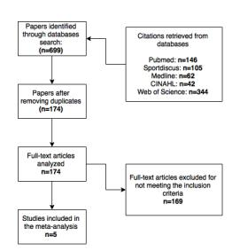

#### **TITLE**: THE EFFECTS OF STRENGTH TRAINING ON RUNNING ECONOMY IN HIGHLY TRAINED RUNNERS: A SYSTEMATIC REVIEW WITH META-ANALYSIS OF CONTROLLED TRIALS

#### **BRIEF RUNNING HEAD**: META-ANALYSIS: STRENGTH TRAINING&RUNNING ECONOMY

### **Carlos Balsalobre-Fernández**

Department of Physical Education, Sport and Human Movement, Autonomous

University of Madrid, Spain

E-mail: carlos.balsalobre@icloud.com

#### **Jordan Santos-Concejero**

Department of Physical Education and Sport, University of the Basque Country UPV/EHU, Vitoria- Gasteiz, Spain

E-mail: jordan.santos@ehu.eus

### **Gerasimos V. Grivas**

Department of Physical Education and Sport Science, University of Thessaly, Trikala, Greece

E-mail: grivasger@hotmail.com

## **Corresponding author: Carlos Balsalobre-Fernández**

Department of Physical Education, Sport and Human Movement, Autonomous University of Madrid, Spain. Street: Fco. Tomás y Valiente, 3. Campus Cantoblanco, 28049 Madrid (Spain). **ACCEPTED**

Tel. Nº: +34 606798498

E-mail: carlos.balsalobre@icloud.com

#### **ABSTRACT**

The purpose of this study was to perform a systematic review and meta-analysis of controlled trials to determine the effect of strength-training programs on the running economy (RE) of high-level middle- and long-distance runners. Four electronic databases were searched in September 2015 (Pubmed, SPORTDiscus, MEDLINE and CINAHL) for original research articles. After analyzing 699 resultant original articles, studies were included if the following criteria were met: (a) participants were competitive middle- and/or long-distance runners; (b) participants had a *V*O2max > 60mL·kg-1-·min-1; (c) studies were controlled trials published in peer-reviewed journals; (d) studies analyzed the effects of strength-training programs with a duration greater than 4 weeks; (e) RE was measured before and after the strength-training intervention. Five studies met the inclusion criteria, resulting in a total sample size of 93 competitive, high-level middle- and long-distance runners. Four out of five of the included studies used low to moderate training intensities (40-70% one-repetition maximum), and all of them used low to moderate training volume (2-4 resistance lower-body exercises plus up to 200 jumps and 5-10 short sprints) 2-3 per week for 8-12 weeks. The metaanalyzed effect of strength training programs on RE in high-level middle- and longdistance runners showed a large, beneficial effect (standardized mean difference [95%Confidence Interval] = -1.42 [-2.23, -0.60]). In conclusion, a strength-training program including low to high intensity resistance exercises and plyometric exercises performed 2-3 times per week for 8-12 weeks is an appropriate strategy to improve RE in highly training middle- and long-distance runners. **ACCEPTED** **KEYWORDS:** elite athletes; distance running; performance; resistance training; plyometrics

## **INTRODUCTION**

Sustained running performance is reliant on a complex interaction of factors that lead to efficient muscular work and should result in fast and effective running gait (25). Among the factors that may predict middle- and long-distance running performance, running economy (RE), commonly defined as the steady-state *V*O2 required at a given submaximal speed, has garnered the most attention over the last decade, although it is often still referred to as "*being relatively ignored in the scientific literature*" (12).

Traditionally, biomechanical factors (30,50), muscle fiber distribution (7,38), age (28), sex (8) and anthropometric factors (32), have been found to account for inter-individual variability in RE. However, RE is also largely influenced by training strategies, including a wide range of forms of strength training such as low-resistance training, high-resistance training, explosive training and plyometric training(3). These different strength-training modalities have been reported to improve RE not only in recreational, but also in moderately trained and highly trained runners (3,4,58). **ACCEPTED**

RE improvements consequence of strength-training interventions have been attributed to improved lower limb coordination and muscle co-activation, which would ultimately increase muscle stiffness and decrease ground contact times (37). Similarly, strengthtraining interventions have been suggested to increase type I and type II fibers' strength (53), resulting in less motor unit activation to produce a given force (3). This increase in strength may also improve biomechanical efficiency and muscle recruitment patterns (43), thus allowing a runner to run more efficiently at a given running speed.

However, despite the body of evidence supporting the use of strength training to improve RE, it has been traditionally overlooked by long-distance runners and their coaches to the extent that runners competing in the 2008 US Olympic Marathon trials "*included little strength training in their training programmes… and nearly half the runners did no strength training at all*" (26). This may be a consequence of longdistance runners and their coaches being unaware of the potential benefits of strength training to improve RE and thus, performance.

Previous review articles on the effects of strength-training programs on RE did not perform a meta-analysis as they only summarised the available data (3,4,58). Thus, the aim of this study was to systematically review the body of scientific literature for original research and perform a meta-analysis addressing the effects of strength training on RE in highly-trained runners. **ACCEPTED**

# **METHODS**

# **Experimental approach to the problem**

A literature search was conducted on 25 September 2015. The following databases were searched: Pubmed, SPORTDiscus, Medline and CINAHL (Cumulative Index to Nursing and Allied Health Literature). Databases were searched from inception up to September 2015, with no language limitation. Abstracts and citations from scientific conferences were excluded.

## **Literature search**

In each database the title, abstract and keywords search fields were searched. The following keywords, combined with Boolean operators (AND, OR), were used: "running economy", "cost of running", "strength training", "resistance training", "weight training", "weight lifting", "plyometric", "sled training", "resisted sprints" and "jump". No additional filters or search limitations were used.

## **Inclusion criteria**

Studies were eligible for further analysis if the following inclusion criteria were met: (a) participants were middle- and/or long- distance runners (studies with triathletes or any other kind of athletes were excluded); (b) participants had a *V*O2max value > 60mL·kg-1- ·min-1; (c) studies were controlled trials published in peer-reviewed journals; (d) studies analyzed strength-training programs with a duration greater than 4 weeks; (e) RE was measured before and after the strength-training intervention. **ACCEPTED**

Two independent observers reviewed the studies and then individually decided whether inclusion was appropriate. In the event of a disagreement, a third observer was consulted to determine the inclusion of the study. A flow chart of the search strategy and study selection is shown in Figure 1.

\*\*\*\*FIGURE 1 ABOUT HERE\*\*\*\*

## **Quality assessment**

The Physiotherapy Evidence Database (PEDro) scale (34) and Oxford's levels of evidence (36) were used by two independent observers in order to assess the methodological quality of the articles included in the meta-analysis. Oxford's level of evidence ranges from 1a to 5, with 1a being systematic reviews of high-quality randomized controlled trials and 5 being expert opinions. The PEDro scale consists of 11 different items related to scientific rigor. Items 2-11 can be rated with 0 or 1, so the highest rate in the PEDro scale is 10, and the lowest, 0.

## **Statistical analyses**

Standardized mean difference (SMD) with 95% Confidence Intervals (CI) between strength training and control conditions were calculated with RevMan 5.3.5 for Mac using a random effects model. Mean and standard deviations for the outcome measures were present in each original article and it was not necessary to contact the authors for further data. Significance for an overall effect was set at p<0.05. Heterogeneity of the analyzed studies was assessed using an I-squared test, setting the significance level at p<0.01. If heterogeneity was significant, further analysis (removing studies to detect the potential source of heterogeneity) was performed. Also, the contribution (%) of each study to the overall combined effect of the intervention was computed as an inverse proportion of the within-study variance (20). Finally, effects of the interventions (strength-training programs) were qualitatively assessed using the following threshold for the standardized mean difference, which was specifically designed for high-level athletes (40): <0.25, trivial; 0.25-0.50, small; 0.50-1.0, moderate; >1.0, large. **ACCEPTED**

### **RESULTS**

# **Studies selected**

Search strategy yielded 699 total citations as presented in Figure 1. After removing duplicates and reviewing the resultant 174 full-text articles, 5 studies met the inclusion criteria (33,37,51,52,54). Excluded studies had at least one of the following characteristics: (a) participants had *V*O2max values < 60 ml·kg-1·min-1; (b) participants

were not middle and/or long distance runners; (c) lack of a control group; (d) strengthtraining interventions lasted less than 4 weeks; (e) RE was not measured. Thus, the overall sample for the present meta-analysis resulted in 93 high-level middle- and longdistance runners with *V*O2max > 60 ml·kg-1·min-1 .

## **Level of evidence and quality of the studies**

Three of the 5 included studies had a level of evidence 1b (high quality randomized controlled trials). The two remaining studies had a level of evidence 2b as participants were not randomly allocated into the intervention or control groups. Also, mean score in the PEDro scale was 5.4, with values ranging from 5 to 6 (Table 1).

## **Characteristics of the participants**

A summary of participants' characteristics is presented in Table 2. The total number of participants was 93 (78 males and 15 females) with an age ranging from 17.3 to 29.8 years. Participants' *V*O2max ranged between 61.2-71.1 ml·kg-1·min-1. All participants competed in middle- and long-distance running events at national and/or international level. **ACCEPTED**

## **Characteristics of the training programs**

The characteristics of the training programs of each study are depicted in Table 3. Three studies (51,52,54) randomly allocated the participants into the intervention or control groups, while the other two (33,37) matched the groups for age and training level in a non-randomized way. Training interventions ranged from 8 to 12 weeks: 2 studies used 8-week programs (33,54), 2 studies used 9-week programs (37,51) and 1 study used a 12-week program (52). Participants trained 3 times per week in 4 studies (33,37,51,54), and 2 times per week in the other study (52). Training duration ranged from 15 to 90 minutes, with 4 of the 5 studies having sessions longer than 30 minutes (33,37,51,52). One study (54) used high loads (85% of one-repetition maximum, 1-RM) and just the half squat exercise for the intervention group. In contrast, four studies (33,37,51,52) used 4 resistance-exercises with 1-3 sets of 4-10 repetitions at low and moderate intensities (40-70% 1RM) in combination with 2-6 unloaded plyometric exercises for a total of 30-200 jumps and/or 5-10 repetitions of 20-150 m sprints.

## **Effects of strength training on running economy**

The average RE change was -2.32 ± 2.07 and 0.57 ± 2.48 ml·kg-1·min-1 for the intervention and control group, respectively. The meta-analysis demonstrated an overall, significant, large beneficial effect of the strength-training interventions on RE when compared to the control group (SMD [95%CI] = -1.43 [-2.23, -0.64], Z = 3.53, p<0.001). Four studies showed a large effect of the intervention (SMD >1.0) and another one showed a moderate effect. See Figure 2. **ACCEPTED**

# \*\*\*\*FIGURE 2 ABOUT HERE\*\*\*\*

The I-squared test showed a significant heterogeneity among the included studies (*I* 2 =61%, p=0.03). However, further analysis showed that the removal of the study by Paavolainen et al. (37) reduced the heterogeneity to 0 (*I* 2 = 0%, p=0.77), indicating that this study was the source of heterogeneity. In addition, the contribution of this particular study was the lowest of the 5 studies (13.5% *vs*. 20.3-24.1%). When removing the aforementioned study, the re-calculated average RE change was -1.88 ± 2.31 and 0.51 ± 2.76 ml·kg-1·min-1 for the intervention and control group, respectively. This resulted in

an overall large, beneficial and significant effect of the strength-training interventions (SMD [95%CI] = -1.06 [-1.56, -0.56], Z = 4.16, p<0.001).

## **DISCUSSION**

The present meta-analysis shows an overall large beneficial effect of the strength training interventions on RE in highly trained middle- and long-distance runners when compared to the control group. Four of the 5 included studies presented an absolute SMD greater than 1, which is considered a large effect when studying high-level athletes (40), and the fifth study showed a moderate to high effect. Moreover, the overall 95% CI ranged from -2.23 to -0.64 SMD, that is, it did not cross 0 or positive values, which would have meant trivial or negative effects of the intervention. Thus, 100% of the studies showed a significant and meaningful beneficial effect of strengthtraining interventions on RE in highly trained middle- and long-distance runners. Interestingly, one particular study (37) showed a very large SMD, which was greater than those observed in the other studies (i.e., -3.78 *vs.* -1.43 for the overall effect). However, we could not find any particular explanation for the superior benefits of the intervention used in Paavolainen et al. (37) as the number of strength-training sessions conducted (3 sessions), its contents (resistance, plyometrics and sprint exercises), the range of loads used (0-40% 1-RM) and the duration of the intervention (9 weeks) were very similar to those in the other studies. **ACCEPTED**

One of the main concerns when training strength and endurance concurrently is the well-known interference phenomenon, by which the development of one of these capacities is impaired by training the other (15). Thus, finding the right balance between strength- and endurance-training sessions appears to be crucial (1,13,16). It has been previously reported that just one resistance training session per week is not enough to increase muscle strength or power in elite middle- and long-distance runners probably because of the high endurance:strength training ratio (2). In this regard, although every study in this meta-analysis used a different configuration of exercises and training intensities, all included at least 2 strength-training sessions per week during the intervention, with most studies (4/5) having 3 sessions per week (Table 3). Taking into account that runners conducted also 6-9 endurance-training sessions per week, it results in a 6:2-9:3 ratio between weekly endurance:training sessions. All analyzed studies found significant improvements in muscle strength, power output, jump height and RE (33,37,51,52,54); therefore, strength-training sessions being ~30% of the total training sessions might be an valid strategy to improve RE and muscle strength concurrently in highly trained runners according to our analysis.

The most common strength-training programs in the analyzed studies consisted of lower-body resistance exercises such as back squats or leg extensions combined with plyometrics (33,37,51,52,54). Both types of strength-training modalities have been probed, in both an isolated or combined way (11,41,55) to improve several variables related to neuromuscular performance such as maximal strength muscle power output, tendon stiffness and rate of force development (9,11,17,29,42). While these factors have been specially studied in strength or explosive athletes such as weightlifters, rugby players or sprinters (5,18,44), there is a growing body of research that highlights the importance of neuromuscular performance in middle- and long-distance runners (4,10,38,39). For example, a significant correlation has been observed between jumping ability and the time to cover 800, 3000 and 5000 m in highly trained runners (21). Similarly, recent studies describing the muscle-tendon properties of world-class Kenyan runners found that these athletes have higher jumping ability, muscle power and smaller **ACCEPTED** stretch-shortening amplitudes and contact times that national level Japanese athletes (47,48), variables likely related to their more efficient RE (31,35,42).

It has to be noted that most strength-training programs (4 out of 5 of the included studies in the present meta-analysis) used low to moderate training intensities for the resistance exercises (40-70% 1-RM), and all of them used low to moderate training volumes (2-4 resistance lower-body exercises plus up to 200 jumps and 5-10 short sprints, for a total session duration of 30-60 min). Just one study used heavy loads (85% 1-RM), but each strength-training session consisted of just 4 sets of 4 repetitions of back squat for about 15 min. Furthermore, none of the studies used repetitions to failure, a common practice in bodybuilding that seems to maximize muscle hypertrophy (11,45), but that may impair muscular performance and produce an excessive degree of fatigue (19,23,24,57). **ACCEPTED**

Training to failure (reaching the maximal number of repetitions that could be done within a set for a determined load) produces an enormous metabolic and neuromuscular fatigue (19,46) that could lead to a transition to slow-twitch fiber type (14) and reduce the muscle power output (19,23). Therefore, since variables related to muscle power are crucial for distance running performance, a non-to-failure approach aiming the improvement of the neuromuscular performance might be more appropriate for highlytrained middle- and long-distance runners.

The main limitation of the present meta-analysis is the small number of included studies. Although the role of strength training in the improvement of running performance has received a lot of attention during the last decade (4,42,58), the vast majority of the studies recruited amateur-recreational runners instead of highly trained athletes (27,35,38). Considering that highly trained runners have different biomechanical and physiological profiles than non-elite athletes (6,48,49,56), future research analysing elite runners is thus warranted. This may provide valuable information for coaches and applied scientists for the ongoing management of elite running training programmes and may be especially relevant in the context of a multifactorial approach to reach historic milestones such as the sub-2h marathon (22).

## **PRACTICAL APPLICATIONS**

The present meta-analysis shows an overall unanimous, large, beneficial effect of the strength training in the RE of highly trained middle- and long-distance runners when compared to the control group. It appears that a strength-training program consisting of 2-4 resistance exercises at 40-70% 1-RM without reaching failure, plus plyometric exercises performed 2-3 times per week for an overall 3:1 endurance:strength training ratio and lasting 8-12-week is a safe strategy to improve RE. This may help highly trained middle- and long-distance runners to achieve an optimum performance. **ACCEPTED**

## **REFERENCES**

- 1. Baar, K. Using molecular biology to maximize concurrent training. *Sports Med* 44 Suppl 2: 117–125, 2014.
- 2. Balsalobre-Fernández, C, Tejero-González, CM, and del Campo-Vecino, J. Seasonal strength performance and its relationship with training load on elite runners. *J Sports Sci Med* 14: 9–15, 2015.
- 3. Barnes, KR and Kilding, AE. Running economy: measurement, norms, and determining factors. *Sport Med - Open* 1, 2015.

- 4. Beattie, K, Kenny, IC, Lyons, M, and Carson, BP. The effect of strength training on performance in endurance athletes. *Sport Med* 44: 845–865, 2014.
- 5. Bevan, HR, Bunce, PJ, Owen, NJ, Bennett, MA, Cook, CJ, Cunningham, DJ, et al. Optimal loading for the development of peak power output in professional rugby players. *J Strength Cond Res* 24: 43–47, 2010.
- 6. Billat, V, Lepretre, PM, Heugas, AM, Laurence, MH, Salim, D, and Koralsztein, JP. Training and bioenergetic characteristics in elite male and female Kenyan runners. *Med Sci Sport Exerc* 35: 297–304, 2003.
- 7. Bosco, C, Montanari, G, Ribacchi, R, Giovenali, P, Latteri, F, Iachelli, G, et al. Relationship between the efficiency of muscular work during jumping and the energetics of running. *Eur J Appl Physiol Occup Physiol* 56: 138–43, 1987.
- 8. Bransford, DR and Howley, ET. Oxygen cost of running in trained and untrained men and women. *Med Sci Sports* 9: 41–4, 1977.
- 9. Cormie, P, McGuigan, MR, and Newton, RU. Adaptations in athletic performance after ballistic power versus strength training. *Med Sci Sport Exerc* 42: 1582–1598, 2010.
- 10. Damasceno, M V, Lima‑Silva, AE, Pasqua, LA, Tricoli, V, Duarte, M, Bishop, DJ, et al. Effects of resistance training on neuromuscular characteristics and pacing during 10‑km running time trial. *Eur J Appl Physiol* , 2015.
- 11. Folland, JP and Williams, AG. The adaptations to strength training. *Sport Med* 37: 145–168, 2007.
- 12. Foster, C and Lucia, A. Running economy : the forgotten factor in elite performance. *Sports Med* 37: 316–9, 2007.
- 13. Francesca-Piacentini, M, De Ioannon, G, Comotto, S, Spedicato, A, Vernillo, G, and La Torre, A. Concurrent strength and endurance training effects on running economy in master endurance runners. *J Strength Cond Res* 27: 2295–2303, 2013.
- 14. Fry, AC. The role of resistance exercise intensity on muscle fibre adaptations. *Sport Med* 34: 663–679, 2004.
- 15. Fyfe, JJ, Bishop, DJ, and Stepto, NK. Interference between concurrent resistance and endurance exercise: molecular bases and the role of individual training **ACCEPTED**

- 16. García-Pallarés, J and Izquierdo, M. Strategies to optimize concurrent training of strength and aerobic fitness for rowing and canoeing. *Sport Med* 41: 329–343, 2011.
- 17. González-Badillo, JJ, Gorostiaga, EM, Arellano, R, and Izquierdo, M. Moderate resistance training volume produces more favorable strength gains than high or low volumes during a short-term training cycle. *J Strength Cond Res* 19: 689– 697, 2005.
- 18. González-Badillo, JJ, Izquierdo, M, and Gorostiaga, E. Moderate volume of high relative training intensity produces greater strength gains compared with low and high volumes in competitive weightlifters. *J Strength Cond Res* 20: 73–81, 2006.
- 19. Gorostiaga, EM, Navarro-Amézqueta, I, Calbet, JAL, Hellsten, Y, Cusso, R, Guerrero, M, et al. Energy metabolism during repeated sets of leg press exercise leading to failure or not. *PLoS One* 7: e40621, 2012.
- 20. HajGhanbari, B, Yamabayashi, C, Buna, TR, Coelho, JD, Freedman, KD, Morton, TA, et al. Effects of respiratory muscle training on performance in athletes: a systematic review with meta-analyses. *J Strength Cond Res* 27: 1643– 63, 2013.
- 21. Hudgins, B, Scharfenberg, J, Triplett, NT, and McBride, JM. Relationship between jumping ability and running performance in events of varying distance. *J Strength Cond Res* 27: 563–567, 2013.
- 22. Hunter, SK, Joyner, MJ, and Jones, AM. The two-hour marathon: what's the equivalent for women? *J Appl Physiol* , 2014.
- 23. Izquierdo, M, Ibañez, J, González-Badillo, JJ, Häkkinen, K, Ratamess, NA, Kraemer, WJ, et al. Differential effects of strength training leading to failure versus not to failure on hormonal responses, strength, and muscle power gains. *J Appl Physiol* 100: 1647–1656, 2006.
- 24. Izquierdo-Gabarren, M, De Txabarri Expósito, RG, García-Pallarés, J, Sánchez-Medina, L, De Villarreal, ESS, and Izquierdo, M. Concurrent endurance and strength training not to failure optimizes performance gains. *Med Sci Sport Exerc* 42: 1191–1199, 2010.
- 25. Joyner, MJ. Modeling: optimal marathon performance on the basis of physiological factors. *J Appl Physiol* 70: 683–7, 1991. **ACCEPTED**

- 26. Karp, JR. Training characteristics of qualifiers for the U.S. Olympic Marathon Trials. *Int J Sports Physiol Perform* 2: 72–92, 2007.
- 27. Kelly, CM, Burnett, AF, and Newton, MJ. The effect of strength training on three-kilometer performance in recreational women endurance runners. *J Strength Cond Res* 22: 396–403, 2008.
- 28. Krahenbuhl, GS and Pangrazi, RP. Characteristics associated with running performance in young boys. *Med Sci Sports Exerc* 15: 486–90, 1983.
- 29. Kyrolainen, H, Avela, J, McBride, JM, Koskinen, S, Andersen, JL, Sipila, S, et al. Effects of power training on muscle structure and neuromuscular performance. *Scand J Med Sci Sports* 15: 58–64, 2005.
- 30. Kyröläinen, H, Belli, A, and Komi, P V. Biomechanical factors affecting running economy. *Med Sci Sports Exerc* 33: 1330–7, 2001.
- 31. Lacour, JR and Bourdin, M. Factors affecting the energy cost of level running at submaximal speed. *Eur J Appl Physiol* , 2015.
- 32. Lucia, A, Esteve-Lanao, J, Oliván, J, Gómez-Gallego, F, San Juan, AF, Santiago, C, et al. Physiological characteristics of the best Eritrean runners—exceptional running economy. *Appl Physiol Nutr Metab* 31: 530–540, 2006.
- 33. Mikkola, J, Rusko, H, Nummela, A, Pollari, T, and Hakkinen, K. Concurrent endurance and explosive type strength training improves neuromuscular and anaerobic characteristics in young distance runners. *Int J Sports Med* 28: 602– 611, 2007.
- 34. de Morton, NA. The PEDro scale is a valid measure of the methodological quality of clinical trials: a demographic study. *Aust J Physiother* 55: 129–33, 2009.
- 35. Nummela, AT, Paavolainen, LM, Sharwood, KA, Lambert, MI, Noakes, TD, and Rusko, HK. Neuromuscular factors determining 5 km running performance and running economy in well-trained athletes. *Eur J Appl Physiol* 97: 1–8, 2006.
- 36. Oxford Centre for Evidence-based Medicine. Levels of evidence. Univ Oxford. 4–5, 2009.
- 37. Paavolainen, L, Häkkinen, K, Hämäläinen, I, Nummela, A, and Rusko, H. **ACCEPTED**

Explosive-strength training improves 5-km running time by improving running economy and muscle power. *J Appl Physiol* 86: 1527–1533, 1999.

- 38. Pellegrino, J, Ruby, BC, and Dumke, CL. Effect of plyometrics on the energy cost of running and mhc and titin isoforms. *Med Sci Sports Exerc* , 2015.
- 39. Ramirez-Campillo, R, Alvarez, C, Henriquez-Olguin, C, Baez, EB, Martinez, C, Andrade, DC, et al. Effects of plyometric training on endurance and explosive strength performance in competitive middle- and long-distance runners. *J Strength Cond Res* 28: 97–104, 2014.
- 40. Rhea, MR. Determining the magnitude of treatment effects in strength training research through the use of the effect size. *J Strength Cond Res* 18: 918–920, 2004.
- 41. Rønnestad, B, Kojedal, Ø, Losnegard, T, Kvamme, B, Raastad, T, Ronnestad, BR, et al. Effect of heavy strength training on muscle thickness, strength, jump performance, and endurance performance in well-trained Nordic Combined athletes. *Eur J Appl Physiol* 112: 2341–2352, 2012.
- 42. Ronnestad, BR and Mujika, I. Optimizing strength training for running and cycling endurance performance: A review. *Scand J Med Sci Sports* in press, 2013.
- 43. Sale, DG. Neural adaptation to resistance training. *Med Sci Sports Exerc* 20: S135–45, 1988.
- 44. Samozino, P, Rabita, G, Dorel, S, Slawinski, J, Peyrot, N, Saez de Villarreal, E, et al. A simple method for measuring power, force, velocity properties, and mechanical effectiveness in sprint running. *Scand J Med Sci Sports* , 2015.
- 45. Sampson, JA and Groeller, H. Is repetition failure critical for the development of muscle hypertrophy and strength? *Scand J Med Sci Sports* , 2015.
- 46. Sanchez-Medina, L and González-Badillo, JJ. Velocity loss as an indicator of neuromuscular fatigue during resistance training. *Med Sci Sport Exerc* 43: 1725– 1734, 2011.
- 47. Sano, K, Ishikawa, M, Nobue, A, Danno, Y, Akiyama, M, Oda, T, et al. Muscletendon interaction and EMG profiles of world class endurance runners during hopping. *Eur J Appl Physiol* 113: 1395–1403, 2013. **ACCEPTED**

- 48. Sano, K, Nicol, C, Akiyama, M, Kunimasa, Y, Oda, T, Ito, A, et al. Can measures of muscle-tendon interaction improve our understanding of the superiority of Kenyan endurance runners? *Eur J Appl Physiol* , 2014.
- 49. Santos-Concejero, J, Billaut, F, Grobler, L, Olivan, J, Noakes, TD, and Tucker,
  - R. Maintained cerebral oxygenation during maximal self-paced exercise in elite Kenyan runners. *J Appl Physiol* jap.00909.2014, 2014.
- 50. Santos-Concejero, J, Tam, N, Granados, C, Irazusta, J, Bidaurrazaga-Letona, I, Zabala-Lili, J, et al. Interaction effects of stride angle and strike pattern on running economy. *Int J Sport Med* 35: 1118–1123, 2014.
- 51. Saunders, PU, Telford, RD, Pyne, DB, Peltola, EM, Cunningham, RB, Gore, CJ, et al. Short-term plyometric training improves running economy in highly trained middle and long distance runners. *J Strength Cond Res* 20: 947–54, 2006.
- 52. Sedano, S, Marín, PJ, Cuadrado, G, and Redondo, JC. Concurrent training in elite male runners: the influence of strength versus muscular endurance training on performance outcomes. *J Strength Cond Res* 27: 2433–43, 2013.
- 53. Staron, RS, Karapondo, DL, Kraemer, WJ, Fry, AC, Gordon, SE, Falkel, JE, et al. Skeletal muscle adaptations during early phase of heavy-resistance training in men and women. *J Appl Physiol* 76: 1247–55, 1994.
- 54. Støren, Ø, Helgerud, J, Støa, EM, and Hoff, J. Maximal strength training improves running economy in distance runners. *Med Sci Sport Exerc* 40: 1087– 1092, 2008.
- 55. de Villarreal, ESS, Izquierdo, M, and Gonzalez-Badillo, JJ. Enhancing jump performance after combined vs. maximal power, heavy-resistance, and plyometric training alone. *J Strength Cond Res* 25: 3274–3281, 2011.
- 56. Wilber, RL and Pitsiladis, YP. Kenyan and Ethiopian distance runners: what makes them so good? *Int J Sport Physiol Perform* 7: 92–102, 2012.
- 57. Willardson, JM, Emmett, J, Oliver, JA, and Bressel, E. Effect of short-term failure versus nonfailure training on lower body muscular endurance. *Int J Sport Physiol Perform* 3: 279–293, 2008.
- 58. Yamamoto, LM, Lopez, RM, Klau, JF, Casa, DJ, Kraemer, WJ, and Maresh, CM. The effects of resistance training on endurance distance running performance among highly trained runners: a systematic review. *J Strength Cond Res* 22: 2036–2044, 2008. **ACCEPTED**

## **FIGURES LEGENDS**

## Figure 1. Flow chart of search strategy and selection of articles

Figure 2. Forest plot showing the individual and combined effects of the intervention on running economy (RE). Black square with horizontal lines indicates the standardized mean difference (SMD), with 95% Confidence Interval (CI) between the intervention (experimental) and control groups for each study, while the black diamond represents the overall SMD and CI for all studies in the meta-analysis. Mean and SD represent absolute measures of RE in ml·kg-1·min-1 . **ACCEPTED**

**Table 1. PEDro ratings and evidence levels of the included studies** 

| Study                      |       | PEDro ratings* |   |    |    |       | Evidence levels |
|----------------------------|-------|----------------|---|----|----|-------|-----------------|
| 1 2                        | 3 4 5 | 6 7 8          | 9 | 10 | 11 | Total |                 |
| No Paavolainen et al. 1999 | 1     | 1              | 1 | 1  | 1  | 5     | 2b              |
| Yes 1 Saunders et al. 2006 | 1     | 1              | 1 | 1  | 1  | 6     | 1b              |
| Yes Mikkola et al. 2007    | 1     | 1              | 1 | 1  | 1  | 5     | 2b              |
| Yes 1 Støren et al.        |       | 1              | 1 | 1  | 1  | 5     | 1b              |
| Yes 1 Sedano et al.        | 1     | 1              | 1 | 1  | 1  | 6     | 1b              |

\*Items in the PEDro scale: 1 = eligibility criteria were specified; 2 = subjects were randomly allocated to groups; 3 = allocation was concealed; 4 = the groups were similar at baseline regarding the most important prognostic indicators; 5 = blinding of all subjects; 6 = blinding of all therapists who administered the therapy; 7 = blinding of all assessors who measured at least 1 key outcome; 8 = measures of 1 key outcome were obtained from .85% of subjects initially allocated to groups; 9 = all subjects for whom outcome measures were available received the treatment or control condition as allocated or, where this was not the case, data for at least 1 key outcome was analysed by "intention to treat"; 10 = the results of between-group statistical comparisons are reported for at least 1 key outcome; 11 = the study provides both point measures and

measures of variability for at least 1 key outcome.

**ACCEPTED**

**Table 2. Characteristics of the studies and the participants** 

**Participants Study design** 

**First author,** 

**year** 

Number

(M/F)

Age (yrs.)

VO2Max

(mL\*kg-

1 \*min-1) Randomized:

YES/NO

Main outcome\*

Paavolainen et al.

1999

18

(18/0)

23.3 ± 3 63.3 ± 2.1 NO

RE at 15km/h;

VO2Max

Saunders et al.

2006

15

(15/0)

24.2 ±2.3 71.1 ± 6.0 YES

RE at 18km/h,

VO2Max

Mikkola et al.

2007

25

(18/7)

17.3 ± 0.5 62.6 ± 3.9 NO

RE at 14km/h,

VO2Max

Støren et al. 2008 17 (9/8) 29.1 ± 6.1 61.2 ± 3.9 YES

RE at

70%VO2Max,

VO2Max

Sedano et al.

2013

18

(18/0)

23.8 ± 1.2 69.6 ± 2.0 YES

RE at 12km/h,

VO2Max

RE = running economy; M/F = male/female; VO2Max = maximal oxygen consumption. \*RE and VO2Max values were measured in mL\*kg-1\*min-1, except in Støren et al (CITA), in which RE was measured in mL\*kg-0.75\*min-1, and in Sauders et al. (CITA), in which RE was measured in L\*min-1 **ACCEPTED** .

**Table 3. Characteristics of the training programs** 

| Program First author, type year Paavolainen et ST/PLY/ ST: (5 al 1999 20 RT CMJ, | 15 -90 -3 .78 [ -5 .45, -2 .1] Range of #weeks of Program exercises loads Sessions/week Duration (min) SMD [95%CI] intervention (%BW/RM)* -10reps of ST/PLY: 0; 9 Not reported; 2 .7h -100m); PLY: per wee k, RT: 40 (alternative jumps, according to jump squats, session duration |
|----------------------------------------------------------------------------------|-------------------------------------------------------------------------------------------------------------------------------------------------------------------------------------------------------------------------------------------------------------------------------------|
| drop jumps,                                                                      | 30 -200 most likely 3                                                                                                                                                                                                                                                               |
| total jumps);                                                                    | RT:                                                                                                                                                                                                                                                                                 |
| (leg extension,                                                                  | leg                                                                                                                                                                                                                                                                                 |
| curl, leg                                                                        | -press,                                                                                                                                                                                                                                                                             |
| 1set/5 -10 rep)                                                                  |                                                                                                                                                                                                                                                                                     |

| Saunders et al PLY/RT PLY:   | (alternate leg                                                |
|------------------------------|----------------------------------------------------------------|
| bounds,                      | skip for                                                       |
| height,                      | single -leg                                                    |
| ankle jumps,                 | CMJ,                                                           |
| scissors jumps,              | 1                                                              |
| 2sets/6                      | -15reps; 36                                                    |
|                              | hamstring curls, 1                                             |
| 2sets/6                      | -10reps)                                                       |
|                              | PLY: 0; RT:                                                    |
| hurdle jumps, RT (leg press, | 9 3 30 -0 .54 [ -1 .58, 0 .49] 180 total jumps);               |
| ST: (5                       | -10reps of                                                     |
| 30 -150m);                   | PLY:                                                           |
| calf jumps,                  | squat                                                          |
| Mikkola et al ST/PLY/        | ST/PLY: 0;                                                     |
|                              | RT: Low                                                        |
|                              | repe titions                                                   |
| RT                           | 8 3 30 -60 -1 .03 [ -1 .87, -0 .18] (alternative jumps, loads, |

jumps, hurdle jumps, reps/sets not reported); RT (halfsquats, knee extensions, calf raises, abdominal crunches, back extensions, 2-3sets/6-10reps) NOT until failure, %RM not reported Støren et al. 2008 RT RT: (half squats, 4sets/4reps) 85 8 3 Not reported. Considering number of exercises, sets and reps, about 15min **-1.45 [-2.56, -0.35]ACCEPTED**

| RT/PLY RT: (back squat,                                                                                        |                                                                |
|----------------------------------------------------------------------------------------------------------------|----------------------------------------------------------------|
| 3sets/7reps); PLY:                                                                                             |                                                                |
| 6sets/10reps; 120                                                                                              |                                                                |
| RT: 40                                                                                                         | -70;                                                           |
| PLY: 0                                                                                                         |                                                                |
| Sedano et al                                                                                                   | 12 2 Not reported                                              |
|                                                                                                                | exercises, sets                                                |
|                                                                                                                | and reps, about                                                |
|                                                                                                                | 45 -60min                                                      |
| lying leg curl, seated calf raises, leg extension, (hurdle jumps, horizontal jumps, total jumps)               | -1 .17 [ -2 .24, -0 .10] Considering number of                 |
| ST = sprint training Short sprints performed at maximal intended velocity;                                     | PLY = plyometric training; RT = resistance training; BW = body |
| weight; RM =1 -repetition maximum; SMD = standardized mean difference between experimental and control groups, | bias corrected (Hedge’s g)                                     |
| as repor ted by RevMan 5 .3; CI = confidence intervals                                                         |                                                                |
| or ST and PLY,                                                                                                 | and as a percentage of RM for RT                               |

**ACCEPTED**

| Study on Subgroup                                                                                                                  | Reinforcement |      |            |      |            | Std Difference (MD) |                             |      | Covariate              | Std Difference (MD) |      |
|------------------------------------------------------------------------------------------------------------------------------------|---------------|------|------------|------|------------|---------------------|-----------------------------|------|------------------------|---------------------|------|
|                                                                                                                                    | Mean          | SD   | Mean       | SD   | Mean       | SD                  | Mean                        | SD   |                        | F                   | Mean |
| Study on Subgroup                                                                                                                  | -4.71         | 1.13 | 0.0        | 0.18 | <b>3.4</b> | 13.5                | -3.78 [-5.45, -2.0]         | 1999 | -                      | -                   | -    |
| Sauvage et al.                                                                                                                     | -3.06         | 1.09 | 0.0        | 0.06 | -2.05      | 8.1                 | 21.6 [-7.45, -1.70, 0.00]   | 2006 | -                      | -                   | -    |
| Mickley et al.                                                                                                                     | -1.5          | 2.38 | 1.3        | 2.9  | 12         | 24.3%               | -1.17 [-1.87, -0.18]        | 2007 | -                      | -                   | -    |
| Armstrong et al.                                                                                                                   | -1.22         | 0.48 | 0.4        | 0.15 | 9          | 20.3%               | -1.45 [-2.56, -0.56]        | 2007 | -                      | -                   | -    |
| Sedano et al.                                                                                                                      | -2.9          | 0.99 | -0.1       | 1.8  | 6          | 20.8%               | -1.17 [-2.25, -0.10]        | 2013 | -                      | -                   | -    |
|                                                                                                                                    | -             | -    | -          | -    | -          | -                   | -                           | -    | -                      | -                   | -    |
| <b>Test study (CI)</b>                                                                                                             | <b>5.0</b>    |      | <b>5.0</b> |      | <b>5.0</b> |                     | <b>-1.43 [-2.23, -0.64]</b> |      | -                      | -                   | -    |
| Heteroscedasty $T_{study}^2 = 0.49^*$ ( $\text{CI} = 0.13, 9 \text{ df} = 4 \text{ (} p = 0.03^* \text{)}$ ); $r_{study}^2 = 0.16$ |               |      |            |      |            |                     |                             |      | -                      | -                   | -    |
| Test for overall field $T = 3.5 \pm 3$ (P = 0.004)                                                                                 |               |      |            |      |            |                     |                             |      | Favours (experimental) | Favours (control)   |      |

**ACCEPTED**