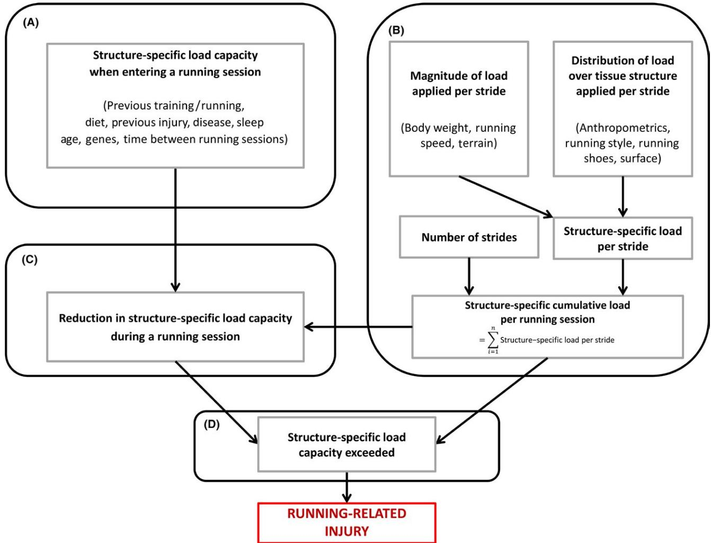
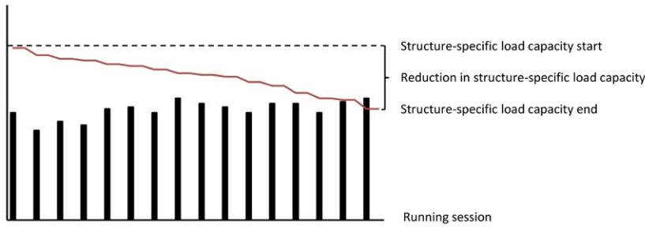
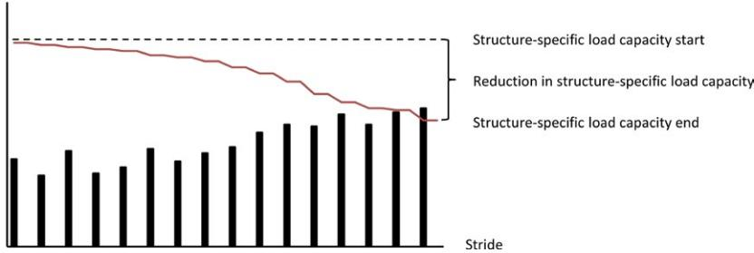

REVIEW ARTICLEWILEY

# A framework for the etiology of running-related injuries

M. L. Bertelsen1 ✉ A. Hulme2 | J. Petersen1 | R. K. Brund3 ✉ |

H. Sørensen1 | C. F. Finch2 | E. T. Parner4 | R. O. Nielsen1 ✉

1Section for Sports Science, Department of Public Health, Aarhus University, Aarhus C, Denmark

2Australian Collaboration for Research into Injury in Sport and its Prevention, Federation University Australia, Ballarat, Vic., Australia

3Department of Health Science and Technology, Aalborg University, SMI®, Aalborg, Denmark

4Section of Biostatistics, Department of Public Health, Aarhus University, Aarhus C, Denmark

## Correspondence

Michael Lejbach Bertelsen, Department of Public Health, Aarhus University, Aarhus C, Denmark.  
Email: michael.bertelsen@ph.au.dk

## Funding information

Michael Bertelsen is funded by Aarhus University, the Graduate School of Health. Rasmus Nielsen is funded by Aarhus University Research Fund. Adam Hulme is funded via the Australian Research Training Scheme RTS program at Federation University Australia. Caroline Finch is funded by a National Health and Medical Research Council (NHMRC) Principal Research Fellowship (ID1058737). ACRISP is one of the International Research Centres for the Prevention of Injury and Protection of Athlete Health supported by the International Olympic Committee (IOC).

The etiology of running-related injury is important to consider as the effectiveness of a given running-related injury prevention intervention is dependent on whether etiologic factors are readily modifiable and consistent with a biologically plausible causal mechanism. Therefore, the purpose of the present article was to present an evidence-informed conceptual framework outlining the multifactorial nature of running-related injury etiology. In the framework, four mutually exclusive parts are presented: (a) Structure-specific capacity when entering a running session; (b) structure-specific cumulative load per running session; (c) reduction in the structure-specific capacity during a running session; and (d) exceeding the structure-specific capacity. The framework can then be used to inform the design of future running-related injury prevention studies, including the formation of research questions and hypotheses, as well as the monitoring of participation-related and non-participation-related exposures. In addition, future research applications should focus on addressing how changes in one or more exposures influence the risk of running-related injury. This necessitates the investigation of how different factors affect the structure-specific load and/or the load capacity, and the dose-response relationship between running participation and injury risk. Ultimately, this direction allows researchers to move beyond traditional risk factor identification to produce research findings that are not only reliably reported in terms of the observed cause-effect association, but also translatable in practice.

## KEY WORDS

biomechanics, injury prevention, sports injury

## 1 | INTRODUCTION

Running is performed by many able-bodied individuals worldwide and is highly effective at promoting a range of health-related benefits.1 Notwithstanding the plethora of health-related benefits that distance running offers to its adherents, musculoskeletal injury is a major barrier to continued participation.2-4

A recent meta-analysis has highlighted that, depending on the type of runner, injury definition, and length of follow-up, the reported running-related injury incidence rate ranges from 2.5 to 33.0 injuries per 1000 hours of running.4 Owing to the potentially high risk of sustaining injury and its consequences on time-to-recovery and socioeconomic costs,1,3-6 running-related injury arguably characterizes an important public health issue. For this reason, injury prevention research

approaches and strategies should be prioritized. However, in order to directly reduce the risk of injury at the population level, it is important to firstly gain understanding about causal factors and mechanisms of its etiology.7

The nature of running-related injury is known to have a complex multifactorial origin.8,9 Considerable research efforts have been made on behalf of the sports medicine research community to shed light on its etiology. According to a recent systematic review, in excess of 70 studies have examined non-biomechanical, modifiable and non-modifiable, middle- and long-distance running-related injury risk and protective factors.10 Across these studies, risk factors for running-related injury have represented a range of exposures, from footwear properties, training-related parameters, anthropometric characteristics, and demographic indications.10 The identification of risk factors for injury can help to detect certain runners who might be at an increased or decreased risk of developing injury.11 Irrespective of statistical significance, however, not every exposure will be causally related to running-related injury.12 In other words, potentially effective injury prevention intervention strategies will have a better chance of working if the identified etiologic factors are readily modifiable and consistent with a biologically plausible mechanism.7 In a recent consensus-based statement on training load in sport,13 the important role of training errors in relation to injury development was promoted, as all sports-related injuries occur as a direct result of participating in a given training regimen. As with other sports,14 training errors have also been acknowledged as a major contributor to overuse injury in distance runners.9,15

Even though the evidence about risk factors as generated via traditional epidemiological inquiry is useful, knowledge about how to reduce running-related injury risk has to be used in a practical way by runners and/or their immediate supporting staff (eg, coaches and healthcare professionals). Accordingly, the design and analyses associated with a given running-related injury study has to produce research findings that are not only reliably reported in terms of the observed cause-effect association, but also translatable under a real-world scenario. For instance, a study found that runners with a body mass index (BMI) of  $\geq 26$  kg/m2 had a reduced risk of sustaining a running-related injury when compared to runners with a lower BMI.16 In the absence of a training load exposure in the analyses, it would be misleading to interpret this finding as “runners with a BMI  $\geq 26$  kg/m2 can participate in running to a greater extent than their peers who have a lower BMI.” Contrastingly, in a study by Nielsen et al.,17 stratified analyses were used to investigate if runners with a higher BMI were able to tolerate less running than those with a lower BMI. The results from that study revealed BMI to modify the association between running distance and injury in the sense that those with a higher BMI were more

susceptible to injury than those with a lower BMI if they ran a similar distance.17

Unfortunately, only very few studies in the past 40 years have examined the role of effect-measure modification on injury risk as it relates to the association between a participation-related exposure and running-related injury.10 This problem was recently addressed in the International Olympic Committee (IOC) consensus statements on load in sports and risk of injury.13 The IOC statement recommended that, where feasible, future research should investigate the dose-response relationship between a participation-related variable and injury risk through large-scale prospective cohort study designs. In addition, particular focus should be directed toward the potential interactions with, and relative contributions from, other risk factors.13 Therefore, in the distance running-related injury prevention research context, researchers should consider how much running is “too much,” as well as how factors such as BMI, footwear, sex, and surface and terrain, influence the dose-response relationship between running participation and injury risk.

To facilitate this research direction, a framework for the complex, multifactorial etiology of running injuries will assist in the future hypothesis making and study design. Such a framework can then be used to facilitate data analyses through better understanding the role of confounders, mediators, and/or effect-measure modifiers.12,18,19 From there, the proposed framework can assist with the identification of whether a given exposure of interest is time-fixed or time-dependent (ie, changes status over time), and if it is modifiable.20 Therefore, the purpose of the present article was to present an evidence-informed conceptual framework outlining the multifactorial nature of running-related injury etiology.

## 2 | A FRAMEWORK FOR THE ETIOLOGY OF RUNNING INJURIES

In the sports science context, several authors have emphasized the importance of looking beyond the immediate set of risk factors and deeper into the complex nature of causation.12,21-23 While visualizing causal frameworks has been used in a number of studies on sports injury in general,23-25 sports-specific frameworks are now needed. In the running-related injury thematic, a simple model has been presented.9 Accordingly, more work is needed to modify and further develop this model. In Figure 1, a conceptual framework of running-related injury development is presented with the use of four parts: (Part A) Structure-specific capacity when entering a running session; (Part B) structure-specific cumulative load per running session; (Part C) reduction in the structure-specific capacity during a running session; and (Part D) exceeding the structure-specific capacity.

**FIGURE 1** A conceptual framework for the causal mechanism underpinning running-related injury within one single running session. Box A represents the structure-specific capacity just before the first stride of a running session. The equation presented in box B, to calculate structure specific cumulative load per session, is adapted of Petersen et al.67 using the more generic “load” instead of the biomechanically more specific “stress” (force/area) originally used. Box C represents the reduction in structure-specific capacity caused by the structure-specific cumulative load in box A. Some examples of possible influencing factors are provided within the parentheses

**2.1 | Part A: Structure-specific load capacity when entering a running session**

The structure-specific load capacity can be defined as the musculoskeletal system’s ability to withstand load without sustaining injury.8 As all musculoskeletal structures in the human body adapt positively or negatively to applied load over time,26,27 each runner will commence a given running session with a unique load capacity for each bodily structure.28 This adaptation can be influenced by factors such as time between sessions or competition,13,29 running experience, previous injury, history of menstrual patterns, diet, sleep,30 use of oral contraceptives, participation in other sporting activities, sex,31 and age.32 These factors comprise only a limited number of known risk factors that might affect the structure-specific load capacity.

**2.2 | Part B: Structure-specific cumulative load per running session**

Seminal work which conceptualized the cyclical nature of risk and causation in the sports injury context reported, “exposure is a combination of both possessing a risk factor and then participating (to a greater or lesser degree) with the risk factor”.23 Based on this, it can be contended that injury development in runners requires understanding of how the risk of injury changes depending on the dose of running participation. Therefore, the quantification of running participation is needed to move from risk factor identification alone toward a better understanding of the nature of running-related injury development. However, methodological and practical considerations on what precisely constitutes “running participation,” and how it differs from structure-specific load, is

currently required to move beyond the traditional approach of simply identifying statistically significant risk factors.10

Repetition count has recently been promoted as important when monitoring sports participation in relation to injury risk.13 In a running context, repetition count is best expressed as the number of gait cycles (strides).33 The stride begins when one foot contacts the ground and ends when that same foot contacts the ground again.33 In the present study, running participation is defined as the number of strides taken during a running session. As will soon be discussed, the number of strides per running session is theoretically superior as an alternative to running distance and time-spent running. Similarly, it is equally important to distinguish running participation (ie, number of strides) from the load applied to the specific musculoskeletal structures in the body. To predict the latter, quantification of stride-wise load magnitude and load distribution is needed.34-38

In a distance running context, structure-specific cumulative load can be viewed as the sum of stride-specific loads that a certain musculoskeletal structure is exposed to during a single running session.39 Estimation of the structure-specific cumulative load per running session involves stride-wise quantification of: (a) the load distribution per stride; and (b) the load magnitude per stride.

### 2.2.1 | Load distribution per stride

The term “load distribution” refers to how the load per stride is distributed across individual anatomical structures (eg, joint surfaces, muscles, and ligaments). Using a few examples, load distribution is affected by (a) Changing running shoes, as the load may be distributed differently across lower extremities,36,37,40-48 (b) applying a different running technique, as differences in kinematic and kinetic characteristics between foot-strike patterns were found during running.49 Other technique modifications influencing running kinematics and/or kinetics involve trunk posture,50 step rate,39,51,52 the pose-method and chi-running,53-55 and step length56; (c) change in terrain, as uphill and downhill running will change certain kinematics and hence load distribution depending on the nature of the terrain57; (d) changing between overground and treadmill, as loads are distributed differently in the two settings,38 (e) changing surface, as surface hardness may influence the interplay of load distribution to the lower extremity by changing the lower leg kinematics and kinetics during running58-61; and (f) bone morphology and physiology, as the form and structure and special structural features of the leg impacts how the load is distributed.62-65

### 2.2.2 | Load magnitude per stride

The term “load magnitude” refers to the size of the load per stride applied to the body while engaged in running. During

stance phase, the load magnitude will predominantly be determined by the ground reaction force and muscle forces contributing to joint compression forces and strain on tendons and muscles.33 Alternatively, during swing phase, the load magnitude will predominantly be determined by kinematic properties such as hip flexor range of motion.33 Thus, the magnitude of the stride-specific load during stance and swing phase is influenced by factors, including but not limited to, body weight and terrain, running speed,35,66-68 and vertical oscillation.69-71

### 2.3 | Part C: Reduction in the structure-specific load capacity during a running session

The proposed framework indicates that the structure-specific load capacity gradually decreases in response to repetitive loading associated with multiple strides and no restitution period (Figure 2A).8,13,29 The extent to which this capacity decreases after each stride is dependent on the magnitude of the load applied in each stride, and the structures sensitivity to that load.26,35 Therefore, if the structure-specific cumulative load of a running session can be successfully estimated, the next task is to relate it to the reduction in the structure-specific load capacity in different runners cumulating the load in various ways (eg, few strides with high load vs many strides with low load).26,69,72 The reduction in load capacity, particularly in combination with psychological non-sport stressors and inter- and intra-individual variation, will determine whether maladaptation is triggered at a given time frame for recovery.13

### 2.4 | Part D: Exceeding the structure-specific load capacity

The relationship between load and load capacity has been suggested to play an important role in injury development,8,13,73 and the inciting event for running-related injury occurs when the structure-specific cumulative load exceeds the capacity of that structure.8 Injury may occur within one session, or over multiple running sessions given insufficient recovery between running sessions. This will contribute to the gradual reduction in the load capacity of certain structures (Figure 2A).29,74 However, in the specific injurious running session, injury is the result of multiple load repetitions (strides) that have gradually decreased the structure-specific load capacity to a level where eventually, it has been surpassed (Figure 2B). The severity of a given injury depends on the degree to which the structure-specific load capacity has been exceeded. Soligard et al.13 described the relationship between load and health as a well-being continuum progressing from homeostasis, acute fatigue, functional and non-functional over-reaching, overtraining syndrome, subclinical tissue damage, clinical symptoms, time-loss injury or illness, and ultimately death.

**(A)** Structure-specific cumulative load per running session

**(B)** Structure-specific load per stride

**FIGURE 2** Running-related injury development over multiple or during a single running session. In graph A, an example is provided where a runner participates in multiple more or less similar running sessions with almost constant cumulative load but insufficient recovery between sessions; RRI occurs mainly as a result of the structures capacity being gradually reduced over time. In graph B, an example is provided where the structures capacity, following multiple strides during a running session, is reduced to a level where it is exceeded by a load application. This causes the runner to sustain a running injury during that specific running session

In summary, the number of strides a runner is able to complete without exceeding the load capacity of a specific structure in a running session is dependent on the following: (a) the structure-specific load capacity when entering the running session; (b) the amount of load applied to the structure in each stride (magnitude and distribution); and (c) the structure's sensitivity to that load (reduction in load capacity).

### 3 | IMPLICATIONS OF THE FRAMEWORK

The concepts of combining participation-related and non-participation-related risk factors for running-related injury development have been addressed by Malisoux et al.9 However, the distinction between participation and cumulative structure-specific load, as described in the present framework, has received little attention in the context of running. This distinction has important considerations for hypothesis-making, data analysis, and data collection procedures.

#### 3.1 | Implications for hypothesis-making and research question

The proposed framework illustrates that if participation in running is omitted from an analyses, subgroups of runners at a decreased or increased risk of injury can be identified, whereas researchers' ability to investigate the etiology behind injury occurrence is restricted. Rather than identifying discrete individual-level risk factors in isolation, it is important to consider how participation-related and

non-participation-related variables interact in a dynamic and recursive manner.11,21 For example, a research hypothesis such as "runners sustain a running-related injury because they had a certain characteristic" requires appropriate reformulation because the effect of a given variable; whether it is affecting the load per stride or the load capacity also depends on the level of participation. For instance, a running-related injury is not sustained because of footwear type, a high or low BMI, or poor running technique.9 Rather, running injuries are sustained when runners increase their participation to the point where an interaction with an existing risk factor becomes significant enough to cause injury. Causal relationships are thus better examined by including the level of participation as the exposure to injury. A more appropriate hypothesis is "We hypothesise the injury occurred as a result of the runner possessing multiple risk factors and then participating in running under certain circumstances to a degree where the structure's load capacity was exceeded." If the combined nature of the exposure and other factors is to be examined, then researchers must rephrase their research question. The common risk factor approach "Are runners with a specific variable at an increased risk of running-related injury?" is not appropriate if we seek to move beyond prediction and toward causation and intervention. A more appropriate research question would be "How much running participation can runners with a specific variable tolerate, compared to runners not having that variable?"

Reformulating traditional hypotheses to instead account for alternative participatory exposures will have implications for methodologies and analyses. Runners might be allocated to different conditions based on participatory criteria, and

further stratified according to training-related experience or other variables under investigation.17 As such, analyses require insight into the differences between confounders, effect-measure modifiers, and mediating variables.12,18

### 3.2 | Implications for data analysis

If overuse running-related injuries occur as a consequence of “running too much, too soon” as suggested by others,15,75-79 the role of exposures and their changes in status over time requires further attention from running injury researchers.20 Much attention in the broader field of sports science has, as of late, also shifted in this same direction.13 According to the framework presented in this article, we recommend researchers, and healthcare professionals to consider whether change prior to running-related injury development has occurred within one or more of the following four categories: (a) change in the amount of participation (ie, running more than usual) and/or (b) change in the load distribution; (c) change in the magnitude of the load; and (d) change in the load capacity (ie, participating the same but with circumstances that changed).

#### 3.2.1 | Change in the amount of running participation

Researchers conducting large-scale epidemiological studies have the opportunity to quantify changes in running participation. Recently, emphasis has shifted toward calculating sudden changes via the acute:chronic workload ratio.25,80-82

Importantly, such workload ratio does not, although terminologically related, respond to changes in the cumulative structure-specific load as described in the present framework. Instead, the workload ratio corresponds to changes in running participation. Although new research endeavors may include sudden changes in running participation, the definition of “sudden change” requires clarification and further discussion. Definition of sudden changes in participation has included differences between a 4-week-based acute:chronic workload ratio, which is commonly used in other sports than running,81-84 and the week-to-week change which has been applied to running-related injury data.85-87 The question remains whether data on sports participation and sudden changes should be viewed as rolling averages or as non-linear relationships.88-90

#### 3.2.2 | Change in the load distribution

Running too much following a change in distribution of load across individual anatomical structures, for example, joint surfaces, muscles and ligaments, may, as visualized by the model, increases injury risk because the structure-specific cumulative load of a running session is dependent on the

load distribution. For instance, running too much in a new shoe,42,44,91,92 or transitioning to a new running technique, may increase the cumulative load in a specific structure to a level which does not allow for adaptive tissue repair between running sessions, thus increasing the risk of injury.54 Importantly, the increase in risk following change in distribution could be neglected if the amount of running participation is reduced accordingly until the tissue is accustomed to the new load. In the case of a researcher wanting to examine whether a change in load distribution increases the risk of running-related injury, quantification of running participation and variables like changes in running style, running shoes, and surface, is necessary.

#### 3.2.3 | Change in the magnitude of load per stride

Injury may occur if the magnitude of the load per stride is suddenly increased to a level where the structure-specific cumulative load of a running session overwhelms the ability for adaptive tissue repair. For instance, increasing running speed will increase the magnitude of the load per stride, and if the increase in speed is excessive and unfamiliar to the runner, an injury might occur.93 The same line of reasoning can be applied to a gradual change in body weight or a sudden change in running surfaces and terrain.94 Examination of the role of a sudden change in the magnitude of load on running-related injury development requires, for instance, the quantification of running participation and changes in body weight, running speed, and terrain.

#### 3.2.4 | Change in load capacity

Naturally, other sports activities and activities of daily living change the structures capabilities to withstand load during running, for better or worse, over time. Running-related injury may, therefore, occur if runners run too much with a reduced load capacity following other types of activities.69,71 Unfortunately, at the present time, load capacity is nearly impossible to quantify. Indirect markers of overtraining, such as elevated heart rate at rest or live blood analysis (eg, hormone analysis or biochemical analysis), might be quantifiable.95-97 However, no current methods directly address tissue-specific load capacity. In large-scale epidemiological studies, quantification of between-session changes in activity level, sleep, diet, and illness is necessary to identify the influence of changes in load capacity on the association between running participation and injury risk.

#### 3.2.5 | Applying statistics to analyze changes

To examine the role of change (in one or more of the four levels above) on running-related injury development, researchers should be encouraged to understand advanced statistical

models, such as those based on time-to-event, as inclusion of variables that change status over time is a necessary step in the analytical approach.20,98,99 Unfortunately, studies investigating the association between time-varying exposures and outcomes are rare in sport-injury research.20,24,87 Lack of interdisciplinary collaborations between researchers with different competencies may be the reason for the limited number of studies dealing with changes. This calls for a stronger collaboration between researchers with, for example, epidemiological, statistical, or biomechanical backgrounds.

### 3.3 | Implications for data collection procedures

The framework enables researchers within the running injury thematic to carefully consider when and why to collect continuous data on exposures related to running-related injury. Here, quantification of running participation is of particular importance.

#### 3.3.1 | Quantifying running participation in epidemiological studies

To outline the mechanisms leading to injury, number of strides was used as a measure of running participation. Measurement of strides in epidemiological studies examining the etiology behind running-related injuries should be considered for the following reasons: (a) It takes into account repetition count13,33; and (b) each stride defines the load and load distribution and the vast majority of the load is distributed during stance.100 Based on this, we recommend future data collections within the running-related injury thematic to include quantification of strides. However, researchers conducting epidemiological studies have the opportunity to, at least, measure three types of participation-related variables: (a) time exposed to running, (b) running distance (eg, kilometers run per session or week), and/or (c) number of strides. If it is not possible to quantify number of strides in prospective studies on runners, then running distance and/or time exposed to running are still feasible alternatives and should be used.9

In situations where traditional participation-related variables have to be used, researchers should strive to collect objective data, particularly when it has been shown runners are unable to validly self-report running distance.101 For decades, wearable technologies such as sports watches and fitness trackers have allowed runners to quantify time exposed to running. The recent development of these commercially available devices,102,103 including insoles,104 pedometers105 and accelerometers,106,107 as well as electronic health platforms,108 now afford research teams the possibility of using new ways to collect data. This potentially opens up a new era of data collection and data analyses possibilities, especially given that no large-scale field-based epidemiological studies

have yet examined the association between number of strides during running, as a measure of running participation, and the risk of developing running-related injury.

#### 3.3.2 | Future data collection challenges

Quantification of sudden changes in structure-specific cumulative load is appealing but presents a number of challenges from a biomechanical perspective. Firstly, quantifying structure-specific load per stride is complex, but can be achieved with contemporary laboratory-based methods and computer modeling.34,66 Such approaches allow for approximation of forces applied to individual anatomical structures. However, the calculation of stress (ie, force/area, which is the load-variable most closely related to tissue damage) per stride, also requires knowledge of the areas over which the forces are applied (eg, contact areas between joint surfaces subjected to compression “bone-on-bone” forces or cross sectional areas of muscles, tendons and ligaments subjected to traction forces). Valid biomechanical measures of these areas are hard to obtain, not least because they vary considerably during the step cycle. Moreover, methods for estimating forces applied to individual structures all involve some form of mathematical optimization, which requires fairly speculative assumptions about how the central nervous system coordinates activation of individual muscles.100,109,110

Despite these limitations, the model proposed in the present article is appealing given that it provides a conceptual framework that, if used in practice, would lead to more accurate quantification of running exposure compared with traditional measures. This makes sudden changes in cumulative structure-specific load an interesting area of study because it permits an in-depth examination of the association between changes in training-related variables (eg, pace, distance, surface, and technique) and runner characteristics (eg, equipment usage, weight) in relation to injury development in specific structures. Stride-specific loads vary from stride to stride. Therefore, information on a stride-wise level must be added to calculate an estimate of the structure-specific cumulative load per running session. Such data may be gathered in biomechanical laboratories. Still, the future challenge is to be able to calculate approximate values of these structure-specific loads from field-based data.

## 4 | PERSPECTIVES

Running-related injury occurs from a combination of the runner possessing multiple risk factors and then participating in running under certain circumstances to a degree where the structure’s load capacity is exceeded. The number of strides, magnitude of load, distribution of load, and load capacity are all necessary ingredients for understanding the cause of

running-related injury. Based on the proposed framework, we recommend future running-related injury research to carefully consider its research question, hypotheses, and the adopted statistical approach, to ensure that advances can be made in understanding how and why running-related injury occurs. Knowledge on how factors influence the dose-response relationship between running participation and injury will bring significant advances toward understanding the etiology of running-related injury.

## ACKNOWLEDGEMENTS

Ellen Aagaard Nøhr, University of Southern Denmark, for providing valuable comments in the initial part of the development of the framework.

## REFERENCES

1. 1. Hespanhol Junior LC, Pillay JD, van Mechelen W, Verhagen E. Meta-analyses of the effects of habitual running on indices of health in physically inactive adults. *Sports Med.* 2015a;45:1455-1468.
2. 2. Koplan JP, Rothenberg RB, Jones EL. The natural history of exercise: a 10-yr follow-up of a cohort of runners. *Med Sci Sports Exerc.* 1995;27:1180-1184.
3. 3. Nielsen RO, Ronnow L, Rasmussen S, Lind M. A prospective study on time to recovery in 254 injured novice runners. *PLoS One.* 2014c;9:e99877.
4. 4. Videbaek S, Bueno AM, Nielsen RO, Rasmussen S. Incidence of running-related injuries per 1000 h of running in different types of runners: a systematic review and meta-analysis. *Sports Med.* 2015;45:1017-1026.
5. 5. Hespanhol Junior LC, van Mechelen W, Postuma E, Verhagen E. Health and economic burden of running-related injuries in runners training for an event: a prospective cohort study. *Scand J Med Sci Sports.* 2016;26:1091-1099.
6. 6. Smits DW, Huisstede B, Verhagen E, et al. Short-term absenteeism and health care utilization due to lower extremity injuries among novice runners: a prospective cohort study. *Clin J Sport Med.* 2016;26:502-509.
7. 7. Finch C. A new framework for research leading to sports injury prevention. *J Sci Med Sport.* 2006;9:3-9.
8. 8. Hreljac A. Etiology, prevention, and early intervention of overuse injuries in runners: a biomechanical perspective. *Phys Med Rehabil Clin N Am.* 2005;16:651-667, vi.
9. 9. Malisoux L, Nielsen RO, Urhausen A, Theisen D. A step towards understanding the mechanisms of running-related injuries. *J Sci Med Sport.* 2015a;18:523-528.
10. 10. Hulme A, Nielsen RO, Timpka T, Verhagen E, Finch C. Risk and protective factors for middle- and long-distance running-related injury: a systematic review. *Sports Med.* 2016; doi:10.1007/s40279-016-0636-4.
11. 11. Bittencourt NF, Meeuwisse WH, Mendonca LD, Nettel-Aguirre A, Ocarino JM, Fonseca ST. Complex systems approach for sports injuries: moving from risk factor identification to injury pattern recognition-narrative review and new concept. *Br J Sports Med.* 2016; doi:10.1136/bjsports-2015-095850.
12. 12. Shrier I, Platt RW. Reducing bias through directed acyclic graphs. *BMC Med Res Methodol.* 2008;8:70.
13. 13. Soligard T, Schwellnus M, Alonso JM, et al. How much is too much? (Part 1) International Olympic Committee consensus statement on load in sport and risk of injury. *Br J Sports Med.* 2016;50:1030-1041.
14. 14. Drew MK, Finch CF. The relationship between training load and injury, illness and soreness: a systematic and literature review. *Sports Med.* 2016;8:861-883.
15. 15. Nielsen RO, Buist I, Sorensen H, Lind M, Rasmussen S. Training errors and running related injuries: a systematic review. *Int J Sports Phys Ther.* 2012;7:58-75.
16. 16. Taunton JE, Ryan MB, Clement DB, McKenzie DC, Lloyd-Smith DR, Zumbo BD. A prospective study of running injuries: the Vancouver Sun Run "In Training" clinics. *Br J Sports Med.* 2003;37:239-244.
17. 17. Nielsen RO, Bertelsen ML, Parner ET, Sorensen H, Lind M, Rasmussen S. Running more than three kilometers during the first week of a running regimen may be associated with increased risk of injury in obese novice runners. *Int J Sports Phys Ther.* 2014a;9:338-345.
18. 18. Meeuwisse WH. Athletic injury etiology: distinguishing between interaction and confounding. *Clin J Sport Med.* 1994;4:171-175.
19. 19. VanderWeele TJ, Vansteelandt S. Conceptual issues concerning mediation, interventions and composition. *Stat Inference.* 2009;2:457-468.
20. 20. Nielsen RO, Malisoux L, Møller M, Theisen D, Parner ET. Shedding light on the etiology of sports injuries: a look behind the scenes of time-to-event analyses. *J Orthop Sports Phys Ther.* 2016;46:300-311.
21. 21. Bekker S, Clark AM. Bringing complexity to sports injury prevention research: from simplification to explanation. *Br J Sports Med.* 2016;50:1489-1490.
22. 22. Hulme A, Finch C. The epistemic basis of distance running injury research: a historical perspective. *J Sport Health Sci.* 2016;5:172-175.
23. 23. Meeuwisse WH, Tyreman H, Hagel B, Emery C. A dynamic model of etiology in sport injury: the recursive nature of risk and causation. *Clin J Sport Med.* 2007;17:215-219.
24. 24. Shrier I, Steele RJ, Zhao M, et al. A multistate framework for the analysis of subsequent injury in sport (M-FASIS). *Scand J Med Sci Sports.* 2016;26:128-139.
25. 25. Windt J, Gabbett TJ. How do training and competition workloads relate to injury? The workload-injury aetiology model. *Br J Sports Med.* 2017;51:428-435.
26. 26. Ni GX, Liu SY, Lei L, Li Z, Zhou YZ, Zhan LQ. Intensity-dependent effect of treadmill running on knee articular cartilage in a rat model. *Biomed Res Int.* 2013;2013:172392.
27. 27. Xu SY, Li SF, Ni GX. Strenuous treadmill running induces a chondrocyte phenotype in rat Achilles tendons. *Med Sci Monit.* 2016;22:3705-3712.
28. 28. Bohm S, Mersmann F, Arampatzis A. Human tendon adaptation in response to mechanical loading: a systematic review and meta-analysis of exercise intervention studies on healthy adults. *Sports Med Open.* 2015;1:7.
29. 29. Magnusson SP, Langberg H, Kjaer M. The pathogenesis of tendinopathy: balancing the response to loading. *Nat Rev Rheumatol.* 2010;6:262-268.
30. 30. von Rosen P, Frohm A, Kottorp A, Friden C, Heijne A. Too little sleep and an unhealthy diet could increase the risk of

sustaining a new injury in adolescent elite athletes. *Scand J Med Sci Sports*. 2016; doi: 10.1111/sms.12735.

1. 31. van der Worp MP, ten Haaf DS, van Cingel R, de Wijer A, Nijhuis-van der Sanden MW, Staal JB. Injuries in runners; a systematic review on risk factors and sex differences. *PLoS One*. 2015;10:e0114937.
2. 32. Kline PW, Williams DS 3rd. Effects of normal aging on lower extremity loading and coordination during running in males and females. *Int J Sports Phys Ther*. 2015;10:901-909.
3. 33. Novacheck TF. The biomechanics of running. *Gait Posture*. 1998;7:77-95.
4. 34. Edwards WB, Gillette JC, Thomas JM, Derrick TR. Internal femoral forces and moments during running: implications for stress fracture development. *Clin Biomech (Bristol, Avon)*. 2008;23:1269-1278.
5. 35. Edwards WB, Taylor D, Rudolphi TJ, Gillette JC, Derrick TR. Effects of running speed on a probabilistic stress fracture model. *Clin Biomech (Bristol, Avon)*. 2010;25:372-377.
6. 36. Firminger CR, Edwards WB. The influence of minimalist footwear and stride length reduction on lower-extremity running mechanics and cumulative loading. *J Sci Med Sport*. 2016;19:975-979.
7. 37. Sobhani S, van den Heuvel ER, Dekker R, et al. Biomechanics of running with rocker shoes. *J Sci Med Sport*. 2017;20:38-44.
8. 38. Willy RW, Halsey L, Hayek A, Johnson H, Willson JD. Patellofemoral joint and achilles tendon loads during overground and treadmill running. *J Orthop Sports Phys Ther*. 2016;46:664-672.
9. 39. Lenhart RL, Thelen DG, Wille CM, Chumanov ES, Heiderscheit BC. Increasing running step rate reduces patellofemoral joint forces. *Med Sci Sports Exerc*. 2014b;46:557-564.
10. 40. Bergstra SA, Kluitenberg B, Dekker R, et al. Running with a minimalist shoe increases plantar pressure in the forefoot region of healthy female runners. *J Sci Med Sport*. 2015;18:463-468.
11. 41. Chambon N, Sevrez V, Ly QH, Gueguen N, Berton E, Rao G. Aging of running shoes and its effect on mechanical and biomechanical variables: implications for runners. *J Sports Sci*. 2014;32:1013-1022.
12. 42. Fuller JT, Buckley JD, Tsiros MD, Brown NA, Thewlis D. Redistribution of mechanical work at the knee and ankle joints during fast running in minimalist shoes. *J Athl Train*. 2016;10:806-812.
13. 43. Kong PW, Candelaria NG, Smith DR. Running in new and worn shoes: a comparison of three types of cushioning footwear. *Br J Sports Med*. 2009;43:745-749.
14. 44. Ryan M, Elashi M, Newsham-West R, Taunton J. Examining injury risk and pain perception in runners using minimalist footwear. *Br J Sports Med*. 2014;48:1257-1262.
15. 45. Sobhani S, van den Heuvel E, Bredeweg S, et al. Effect of rocker shoes on plantar pressure pattern in healthy female runners. *Gait Posture*. 2014;39:920-925.
16. 46. Sobhani S, Zwerver J, van den Heuvel E, Postema K, Dekker R, Hijmans JM. Rocker shoes reduce Achilles tendon load in running and walking in patients with chronic Achilles tendinopathy. *J Sci Med Sport*. 2015;18:133-138.
17. 47. Warne JP, Kilduff SM, Gregan BC, Nevill AM, Moran KA, Warrington GD. A 4-week instructed minimalist running transition and gait-retraining changes plantar pressure and force. *Scand J Med Sci Sports*. 2014;24:964-973.
18. 48. Warne JP, Smyth BP, Fagan JO, et al. Kinetic changes during a six-week minimal footwear and gait-retraining intervention in runners. *J Sports Sci*. 2016;1-9.
19. 49. Almeida MO, Davis IS, Lopes AD. Biomechanical differences of foot-strike patterns during running: a systematic review with meta-analysis. *J Orthop Sports Phys Ther*. 2015;45:738-755.
20. 50. Teng HL, Powers CM. Influence of trunk posture on lower extremity energetics during running. *Med Sci Sports Exerc*. 2015;47:625-630.
21. 51. Heiderscheit BC, Chumanov ES, Michalski MP, Wille CM, Ryan MB. Effects of step rate manipulation on joint mechanics during running. *Med Sci Sports Exerc*. 2011;43:296-302.
22. 52. Lenhart R, Thelen D, Heiderscheit B. Hip muscle loads during running at various step rates. *J Orthop Sports Phys Ther*. 2014;44:766-774. A1-A4.
23. 53. Arendse RE, Noakes TD, Azevedo LB, Romanov N, Schwellnus MP, Fletcher G. Reduced eccentric loading of the knee with the pose running method. *Med Sci Sports Exerc*. 2004; 36:272-277.
24. 54. Goss DL, Gross MT. A review of mechanics and injury trends among various running styles. *US Army Med Dep J*. 2012; 62-71.
25. 55. Goss DL, Gross MT. A comparison of negative joint work and vertical ground reaction force loading rates in Chi runners and rearfoot-striking runners. *J Orthop Sports Phys Ther*. 2013;43:685-692.
26. 56. Willson JD, Sharpee R, Meardon SA, Kernozek TW. Effects of step length on patellofemoral joint stress in female runners with and without patellofemoral pain. *Clin Biomech (Bristol, Avon)*. 2014;29:243-247.
27. 57. Vernillo G, Giandolini M, Edwards WB, et al. Biomechanics and physiology of uphill and downhill running. *Sports Med*. 2017;4:615-629.
28. 58. Dixon SJ, Collop AC, Batt ME. Surface effects on ground reaction forces and lower extremity kinematics in running. *Med Sci Sports Exerc*. 2000;32:1919-1926.
29. 59. Ferris DP, Liang K, Farley CT. Runners adjust leg stiffness for their first step on a new running surface. *J Biomech*. 1999;32:787-794.
30. 60. Hardin EC, van den Bogert AJ, Hamill J. Kinematic adaptations during running: effects of footwear, surface, and duration. *Med Sci Sports Exerc*. 2004;36:838-844.
31. 61. Stergiou N, Bates BT, James SL. Asynchrony between subtalar and knee joint function during running. *Med Sci Sports Exerc*. 1999;31:1645-1655.
32. 62. Popp KL, McDermott W, Hughes JM, Baxter SA, Stovitz SD, Petit MA. Bone strength estimates relative to vertical ground reaction force discriminates women runners with stress fracture history. *Bone*. 2017;94:22-28.
33. 63. Powell DW, Andrews S, Stickley C, Williams DS. High- compared to low-arched athletes exhibit smaller knee abduction moments in walking and running. *Hum Mov Sci*. 2016;50:47-53.
34. 64. Powell DW, Williams DS 3rd, Windsor B, Butler RJ, Zhang S. Ankle work and dynamic joint stiffness in high- compared to low-arched athletes during a barefoot running task. *Hum Mov Sci*. 2014;34:147-156.
35. 65. Williams DS III, Davis IM, Scholz JP, Hamill J, Buchanan TS. High-arched runners exhibit increased leg stiffness compared to low-arched runners. *Gait Posture*. 2004;19:263-269.

1. 66. Dorn TW, Schache AG, Pandy MG. Muscular strategy shift in human running: dependence of running speed on hip and ankle muscle performance. *J Exp Biol*. 2012;215:1944-1956.
2. 67. Petersen J, Nielsen RO, Rasmussen S, Sorensen H. Comparisons of increases in knee and ankle joint moments following an increase in running speed from 8 to 12 to 16km. *Clin Biomech (Bristol, Avon)*. 2014;29:959-964.
3. 68. Schache AG, Blanch PD, Dorn TW, Brown NA, Rosemond D, Pandy MG. Effect of running speed on lower limb joint kinetics. *Med Sci Sports Exerc*. 2011;43:1260-1271.
4. 69. Kaplan JT, Neu CP, Drissi H, Emery NC, Pierce DM. Cyclic loading of human articular cartilage: the transition from compaction to fatigue. *J Mech Behav Biomed Mater*. 2016;65:734-742.
5. 70. Wille CM, Lenhart RL, Wang S, Thelen DG, Heiderscheit BC. Ability of sagittal kinematic variables to estimate ground reaction forces and joint kinetics in running. *J Orthop Sports Phys Ther*. 2014;44:825-830.
6. 71. Wren TA, Yerby SA, Beaupre GS, Carter DR. Mechanical properties of the human Achilles tendon. *Clin Biomech (Bristol, Avon)*. 2001;16:245-251.
7. 72. Dye SF. The pathophysiology of patellofemoral pain: a tissue homeostasis perspective. *Clin Orthop Relat Res*. 2005;436:100-110.
8. 73. Dye SF. The knee as a biologic transmission with an envelope of function: a theory. *Clin Orthop Relat Res*. 1996;325:10-18.
9. 74. Meeusen R, Duclos M, Foster C, et al. European College of Sport Science, American College of Sports Medicine. Prevention, diagnosis, and treatment of the overtraining syndrome: joint consensus statement of the European College of Sport Science and the American College of Sports Medicine. *Med Sci Sports Exerc*. 2013;45:186-205.
10. 75. Fredericson M. Common injuries in runners. Diagnosis, rehabilitation and prevention. *Sports Med*. 1996;21:49-72.
11. 76. Galloway MT, Jokl P, Dayton OW. Achilles tendon overuse injuries. *Clin Sports Med*. 1992;11:771-782.
12. 77. Renstrom AF. Mechanism, diagnosis, and treatment of running injuries. *Instr Course Lect*. 1993;42:225-234.
13. 78. Rzonca EC, Baylis WJ. Common sports injuries to the foot and leg. *Clin Podiatr Med Surg*. 1988;5:591-612.
14. 79. Wen DY. Risk factors for overuse injuries in runners. *Curr Sports Med Rep*. 2007;6:307-313.
15. 80. Gabbett TJ, Ullah S, Finch CF. Identifying risk factors for contact injury in professional rugby league players—application of a frailty model for recurrent injury. *J Sci Med Sport*. 2012;15:496-504.
16. 81. Hulin BT, Gabbett TJ, Blanch P, Chapman P, Bailey D, Orchard JW. Spikes in acute workload are associated with increased injury risk in elite cricket fast bowlers. *Br J Sports Med*. 2014;48:708-712.
17. 82. Hulin BT, Gabbett TJ, Lawson DW, Caputi P, Sampson JA. The acute: chronic workload ratio predicts injury: high chronic workload may decrease injury risk in elite rugby league players. *Br J Sports Med*. 2016;50:231-236.
18. 83. Gabbett TJ. The training-injury prevention paradox: should athletes be training smarter and harder? *Br J Sports Med*. 2016;50:273-280.
19. 84. Gabbett TJ, Hulin BT, Blanch P, Whiteley R. High training workloads alone do not cause sports injuries: how you get there is the real issue. *Br J Sports Med*. 2016;50:444-445.
20. 85. Buist I, Bredeweg SW, van Mechelen W, Lemmink KA, Pepping GJ, Diercks RL. No effect of a graded training program on the number of running-related injuries in novice runners: a randomized controlled trial. *Am J Sports Med*. 2008;36:33-39.
21. 86. Kluitenberg B, van der Worp H, Huisstede BM, et al. The NLstart2run study: training-related factors associated with running-related injuries in novice runners. *J Sci Med Sport*. 2016;19:642-646.
22. 87. Nielsen RO, Parner ET, Nohr EA, SOrensen H, Lind M, Rasmussen S. Excessive progression in weekly running distance and risk of running-related injuries: an association which varies according to type of injury. *J Orthop Sports Phys Ther*. 2014b;44:739-747.
23. 88. Drew MK, Blanch P, Purdam C, Gabbett TJ. Yes, rolling averages are a good way to assess training load for injury prevention. Is there a better way? Probably, but we have not seen the evidence. *Br J Sports Med*. 2017;7:618-619.
24. 89. Menaspa P. Are rolling averages a good way to assess training load for injury prevention? *Br J Sports Med*. 2017;7:618-619.
25. 90. Murray NB, Gabbett TJ, Townshend AD, Blanch P. Calculating acute: chronic workload ratios using exponentially weighted moving averages provides a more sensitive indicator of injury likelihood than rolling averages. *Br J Sports Med*. 2016; doi: 10.1136/bjsports-2016-097152.
26. 91. Histen K, Arntsen J, L'Hereux L, et al. Achilles tendon properties in minimalist and traditionally shod runners. *J Sport Rehabil*. 2016;1-16.
27. 92. Malisoux L, Ramesh J, Mann R, Seil R, Urhausen A, Theisen D. Can parallel use of different running shoes decrease running-related injury risk? *Scand J Med Sci Sports*. 2015b;25:110-115.
28. 93. Nielsen RO, Nohr EA, Rasmussen S, Sorensen H. Classifying running-related injuries based upon etiology, with emphasis on volume and pace. *Int J Sports Phys Ther*. 2013b;8:172-179.
29. 94. Tessutti V, Ribeiro AP, Trombini-Souza F, Sacco IC. Attenuation of foot pressure during running on four different surfaces: asphalt, concrete, rubber, and natural grass. *J Sports Sci*. 2012;30:1545-1550.
30. 95. Halson SL. Monitoring training load to understand fatigue in athletes. *Sports Med*. 2014;44(Suppl 2):S139-S147.
31. 96. Urhausen A, Gabriel H, Kindermann W. Blood hormones as markers of training stress and overtraining. *Sports Med*. 1995;20:251-276.
32. 97. Urhausen A, Kindermann W. Diagnosis of overtraining: what tools do we have? *Sports Med*. 2002;32:95-102.
33. 98. Mahmood A, Ullah S, Finch CF. Application of survival models in sports injury prevention research: a systematic review. *Br J Sports Med*. 2014;48:630.
34. 99. Ullah S, Gabbett TJ, Finch CF. Statistical modelling for recurrent events: an application to sports injuries. *Br J Sports Med*. 2014;48:1287-1293.
35. 100. Kernozek T, Gheidi N, Ragan R. Comparison of estimates of achilles tendon loading from inverse dynamics and inverse dynamics-based static optimisation during running. *J Sports Sci*. 2016;1-7.
36. 101. Dideriksen M, Soegaard C, Nielsen RO. Validity of self-reported running distance. *J Strength Cond Res*. 2016;30:1592-1596.
37. 102. Adams D, Pozzi F, Carroll A, Rombach A, Zeni J Jr. Validity and reliability of a commercial fitness watch for measuring running dynamics. *J Orthop Sports Phys Ther*. 2016;46:471-476.

- 103. Nielsen RO, Cederholm P, Buist I, Sorensen H, Lind M, Rasmussen S. Can GPS be used to detect deleterious progression in training volume among runners? *J Strength Cond Res*. 2013a;27:1471-1478.
- 104. Mann R, Malisoux L, Brunner R, et al. Reliability and validity of pressure and temporal parameters recorded using a pressure-sensitive insole during running. *Gait Posture*. 2014;39:455-459.
- 105. Moran DS, Evans R, Arbel Y, et al. Physical and psychological stressors linked with stress fractures in recruit training. *Scand J Med Sci Sports*. 2013;23:443-450.
- 106. Tudor-Locke C, Barreira TV, Schuna JM Jr. Comparison of step outputs for waist and wrist accelerometer attachment sites. *Med Sci Sports Exerc*. 2015;47:839-842.
- 107. Watari R, Hettinga B, Osis S, Ferber R. Validation of a torso-mounted accelerometer for measures of vertical oscillation and ground contact time during treadmill running. *J Appl Biomech*. 2016;32:306-310.
- 108. Malisoux L, Frisch A, Urhausen A, Seil R, Theisen D. Monitoring of sport participation and injury risk in young athletes. *J Sci Med Sport*. 2013;16:504-508.
- 109. Al-Munajjed AA, Bischoff JE, Dharia MA, Telfer S, Woodburn J, Carbes S. Metatarsal loading during gait-a musculoskeletal analysis. *J Biomech Eng*. 2016;138:4032413.
- 110. Miller RH, Hamill J. Computer simulation of the effects of shoe cushioning on internal and external loading during running impacts. *Comput Methods Biomech Biomed Engin*. 2009;12:481-490.

**How to cite this article:** Bertelsen ML, Hulme A, Petersen J, et al. A framework for the etiology of running-related injuries. *Scand J Med Sci Sports*. 2017;27:1170–1180. <https://doi.org/10.1111/sms.12883>