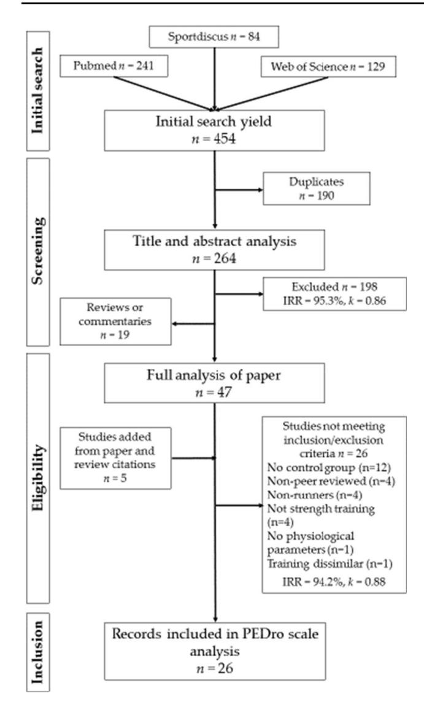

### Effects of Strength Training on the Physiological Determinants of Middle- and Long-Distance Running Performance: A Systematic Review

Richard C. Blagrove1,2 • Glyn Howatson2,3 • Philip R. Hayes2

-The Author(s) 2017. This article is an open access publication

#### Abstract

Background Middle- and long-distance running performance is constrained by several important aerobic and anaerobic parameters. The efficacy of strength training (ST) for distance runners has received considerable attention in the literature. However, to date, the results of these studies have not been fully synthesized in a review on the topic.

Objectives This systematic review aimed to provide a comprehensive critical commentary on the current literature that has examined the effects of ST modalities on the physiological determinants and performance of middleand long-distance runners, and offer recommendations for best practice.

Methods Electronic databases were searched using a variety of key words relating to ST exercise and distance running. This search was supplemented with citation tracking. To be eligible for inclusion, a study was required to meet the following criteria: participants were middle- or long-distance runners with C 6 months experience, a ST intervention (heavy resistance training, explosive resistance training, or plyometric training) lasting C 4 weeks was applied, a running only control group was used, data on one or more physiological variables was reported. Two independent assessors deemed that 24 studies fully met the criteria for inclusion. Methodological rigor was assessed for each study using the PEDro scale.

Results PEDro scores revealed internal validity of 4, 5, or 6 for the studies reviewed. Running economy (RE) was measured in 20 of the studies and generally showed improvements (2–8%) compared to a control group, although this was not always the case. Time trial (TT) performance (1.5–10 km) and anaerobic speed qualities also tended to improve following ST. Other parameters [maximal oxygen uptake (V\_O2max), velocity at V\_O2max, blood lactate, body composition] were typically unaffected by ST.

Conclusion Whilst there was good evidence that ST improves RE, TT, and sprint performance, this was not a consistent finding across all works that were reviewed. Several important methodological differences and limitations are highlighted, which may explain the discrepancies in findings and should be considered in future investigations in this area. Importantly for the distance runner, measures relating to body composition are not negatively

&amp; Richard C. Blagrove richard.blagrove@bcu.ac.uk

Glyn Howatson

glyn.howatson@nothumbria.ac.uk Philip R. Hayes phil.hayes@northumbria.ac.uk

1 Faculty of Health, Education and Life Sciences, School of Health Sciences, Birmingham City University, City South Campus, Westbourne Road, Edgbaston, Birmingham B15 3TN, UK

2 Division of Sport, Exercise and Rehabilitation, Faculty of Health and Life Sciences, Northumbria University, Northumberland Building, Newcastle-upon-Tyne NE1 8ST, UK

3 Water Research Group, Northwest University, Potchefstroom, South Africa

impacted by a ST intervention. The addition of two to three ST sessions per week, which include a variety of ST modalities are likely to provide benefits to the performance of middle- and long-distance runners.

#### Key Points

Strength training (ST) appears to provide benefits to running economy, time trial performance and maximal sprint speed in middle- and long-distance runners of all abilities

Maximal oxygen uptake, blood lactate parameters, and body composition appear to be unaffected by the addition of ST to a distance runner's program

Adding ST, in the form of heavy resistance training, explosive resistance training, and plyometric training performed, on 2–3 occasions per week is likely to positively affect performance.

#### 1 Introduction

Distance running performance is the consequence of a complex interaction of physiological, biomechanical, psychological, environmental, and tactical factors. From a physiological perspective, the classic model [[1,](#page-27-0) [2\]](#page-27-0) identifies three main parameters that largely influence performance: maximal oxygen uptake (V\_O2max), running economy (RE), and fractional utilization (sustainable percentage of V\_O2max). Collectively, these determinants are capable of predicting 16 km performance with more than 95% accuracy in well-trained runners [\[3](#page-27-0)]. The velocity associated with V\_O2max (vV\_O2max) also provides a composite measure of V\_O2max and RE, and has been used to explain differences in performance amongst trained distance runners [\[3](#page-27-0), [4](#page-27-0)]. Whilst V\_O2max values differ little in homogenous groups of distance runners, RE displays a high degree of interindividual variability [\[5](#page-27-0), [6\]](#page-27-0). Defined as the oxygen or energy cost of sustaining a given sub-maximal running velocity, RE is underpinned by a variety of anthropometric, physiological, biomechanical, and neuromuscular factors [[7\]](#page-27-0). Traditionally, chronic periods of running training have been used to enhance RE [[8,](#page-27-0) [9](#page-27-0)]; however, novel approaches such as strength training (ST) modalities have also been shown to elicit improvements [\[10](#page-27-0)].

For middle-distance (800–3000 m) runners, cardiovascular-related parameters associated with aerobic energy production can explain a large proportion of the variance in performance [\[11–17](#page-27-0)]. However a large contribution is also derived from anaerobic sources of energy [\[14](#page-27-0), [18](#page-27-0)]. Anaerobic capabilities can explain differences in physiological profiles between middle- and longer-distance runners [\[14](#page-27-0)] and are more sensitive to discriminating performance in groups of elite middle-distance runners than traditional aerobic parameters [[19\]](#page-27-0). Anaerobic capacity and event-specific muscular power factors, such as vV\_O2max and the velocity achieved during a maximal anaerobic running test (vMART) have also been proposed as limiting factors for distance runners [[12,](#page-27-0) [20,](#page-27-0) [21](#page-27-0)]. For an 800-m runner in particular, near-maximal velocities of running are reached during the first 200 m of the race [\[22](#page-27-0)], which necessitate a high capacity of the neuromuscular and anaerobic system.

Both RE and anaerobic factors, (i.e., speed, anaerobic capacity and vMART) rely on the generation of rapid force during ground contact when running [\[23](#page-27-0), [24\]](#page-27-0). Programs of ST provide an overload to the neuromuscular system, which improves motor unit recruitment, firing frequency, musculotendinous stiffness, and intramuscular co-ordination, and therefore potentially provides distance runners with a strategy to enhance their RE and event-specific muscular power factors [\[19](#page-27-0)]. In addition, an improvement in force-generating capacity would theoretically allow athletes to sustain a lower percentage of maximal strength, thereby reducing anaerobic energy contribution [\[25](#page-27-0)]. This reduction in relative effort may therefore reduce RE and blood lactate (BL) concentration. As vV\_O2maxis a function of RE, V\_O2max and anaerobic power factors, it would also be expected to show improvements following an ST intervention. Several recent reviews in this area have provided compelling evidence that a short-term ST intervention is likely to enhance RE [[10,](#page-27-0) [26\]](#page-27-0), in the order of \* 4% [\[10](#page-27-0)]. Whilst these reviews have provided valuable insight into how ST specifically impacts RE, studies also typically measure other important aerobic and anaerobic determinants of distance running performance, which have not previously been fully synthesized in a review. Body composition also appears to be an important determinant of distance running performance, with low body mass conferring an advantage [[27,](#page-27-0) [28\]](#page-27-0). Resistance training (RT) is generally associated with a hypertrophic response [\[29](#page-27-0)]; however, this is known to be attenuated when RT and endurance training are performed concurrently within the same program [[30\]](#page-27-0). Changes in body composition as a consequence of ST in distance runners have yet to be fully addressed in reviews on this topic.

There are also a number of recent publications [[31–38\]](#page-27-0) that have not been captured in previous reviews [\[10](#page-27-0), [26](#page-27-0)] on this topic, which potentially provide valuable additional insight into the area. Previous papers that have reviewed the impact of ST modalities on distance running performance have done so alongside other endurance sports [\[23](#page-27-0), [39\]](#page-27-0) or are somewhat outdated [\[40–42\]](#page-28-0). Furthermore, although improvements in RE would likely confer a benefit to distance running performance, the outcomes from studies that have used time trials have not been comprehensively reviewed. Performance-related outcome measures provide high levels of external validity compared to physiological parameters, therefore it is likely that a collective summary of results would be of considerable interest to coaches and athletes.

Consequently the aim of this review was to systematically analyze the evidence surrounding the use of ST on distance running parameters that includes both aerobic and anaerobic qualities, in addition to body composition and performance-related outcomes. This work also provides a forensic, critical evaluation that, unlike previous work, highlights areas that future investigations should address to improve methodological rigor, such as ensuring valid measurement of physiological parameters and maximizing control over potential confounding factors.

#### 2 Methods

#### 2.1 Literature Search Strategy

The PRISMA statement [\[43](#page-28-0)] was used as a basis for the procedures described herein. Electronic database searches were carried out in Pubmed, SPORTDiscus, and Web of Science using the following search terms and Boolean operators: (''strength training'' OR ''resistance training'' OR ''weight training'' OR ''weight lifting'' OR ''plyometric training'' OR ''concurrent training'') AND (''distance running'' OR ''endurance running'' OR ''distance runners'' OR ''endurance runners'' OR ''middle distance runners'') AND (''anaerobic'' OR ''sprint'' OR ''speed'' OR ''performance'' OR ''time'' OR ''economy'' OR ''energy cost'' OR ''lactate'' OR ''maximal oxygen uptake'' OR ''V\_O2max'' OR ''aerobic'' OR ''time trial''). Searches were limited to papers published in English and from 1 January 1980 to 6 October 2017.

#### 2.2 Inclusion and Exclusion Criteria

For a study to be eligible, each of the following inclusion criteria were met:

- Participants were middle- (800–3000 m) or long-distance runners (5000 m–ultra-distance). Studies using triathletes and duathletes were also included because often these participants possess similar physiology to distance runners and complete similar volumes of running training.
- A ST intervention was applied. This was defined as heavy (less than 9 repetition maximum (RM) loads and/ or 80% of 1RM) or isometric resistance training (HRT), moderate load (9–15 RM and/or 60–80% 1RM) RT, explosive resistance training (ERT), reactive ST or plyometric training (PT). Sprint training (SpT) could be used in conjunction with one or more of the above ST methods, but not exclusively as the only intervention activity.
- The intervention period lasted 4 weeks or longer. This criteria was employed as neuromuscular adaptations have been observed in as little as 4 weeks in nonstrength trained individuals [[44,](#page-28-0) [45](#page-28-0)].
- A running only control group was used that adopted similar running training to the intervention group(s).
- Data on one or more of the following physiological parameters was reported: V\_O2max, RE, velocity associated with vV\_O2max, time trial (TT) performance, time to exhaustion (TTE), BL response, anaerobic capacity, maximal speed, measures of body composition.
- Published in full in a peer-reviewed journal.

Studies were excluded if any of the following criteria applied:

- Participants were non-runners (e.g., students, untrained/less than 6 months running experience). Further restrictions were not placed upon experience/training status.
- The running training and/or ST intervention was poorly controlled and/or reported.
- The intervention involved only SpT or was embedded as part of running training sessions.
- Participants were reported to be in poor health or symptomatic.
- Ergogenic aids were used as part of the intervention.

Using the mean V\_O2max values provided within each study, participants training status was considered as moderately-trained (male V\_O2max B 55 ml kg-1 min-1 ), welltrained (male V\_O2max 55–65 ml kg-1 min-1 ), or highlytrained (male V\_O2max C 65 ml kg-1 min-1 )[\[10](#page-27-0), [46](#page-28-0)]. For female participants, the V\_O2max thresholds were set 10 ml kg-1 min-1 lower [\[46](#page-28-0)]). In the absence of V\_O2max values, training status was based upon the training or competitive level of the participants: moderatelytrained = recreational or local club, well-

trained = Collegiate or provincial, highly-trained = national or international.

#### 2.3 Study Selection

Figure 1 provides a visual overview of the study selection process. Search results were imported into a published software for systematic reviews [\[47\]](#page-28-0), which allowed a blind screening process to be performed by two independent reviewers (RB and PH). Any disagreements were resolved by consensus. The initial search yielded 454 publications. Following the removal of duplicates (n = 190), publications were filtered by reading the title and abstract [inter-rater reliability (IRR): 95.3%, Cohens k = 0.86] leaving 19 review articles or commentaries, and 47 potentially relevant papers, which were given full consideration. Five additional records were identified as being potentially relevant via manual searches of previously published reviews on this topic and the individual study citations. These 52 studies were considered in detail for appropriateness, resulting in a further 26 papers [[34](#page-27-0), [37,](#page-27-0) [48–71\]](#page-28-0) being excluded (IRR: 94.2%, Cohens k = 0.88) for the following reasons: not published in full in a peer-reviewed journal [\[50,](#page-28-0) [52](#page-28-0), [60,](#page-28-0) [61](#page-28-0)], absence of a running only control group [\[48,](#page-28-0) [49,](#page-28-0) [54](#page-28-0), [57,](#page-28-0) [59,](#page-28-0) [62–67,](#page-28-0) [69](#page-28-0)], participants were non-runners [\[51,](#page-28-0) [53,](#page-28-0) [56](#page-28-0), [68](#page-28-0)], no physiological parameters were measured [\[55\]](#page-28-0), dissimilar running training was applied between groups [\[71\]](#page-28-0), the ST intervention was poorly controlled [[54](#page-28-0)], and ST did not involve one of the aforementioned types [\[34,](#page-27-0) [37](#page-27-0), [58,](#page-28-0) [70\]](#page-28-0).

#### 2.4 Analysis of Results

The Physiotherapy Evidence Database (PEDro) scale was subsequently used to assess the quality of the remaining 26 records [[31–33,](#page-27-0) [36,](#page-27-0) [38](#page-27-0), [72](#page-28-0)[–92\]](#page-29-0) by the two independent reviewers. Two studies reported their results across two papers [[32,](#page-27-0) [38](#page-27-0), [90](#page-29-0), [92\]](#page-29-0), therefore both are considered as single studies hereafter, thus a total of 24 studies were analyzed. The PEDro scale is a tool recommended for assessing the quality of evidence when systematically reviewing randomized-controlled trials [\[93](#page-29-0)]. Each paper is scrutinized against 11 items relating to the scientific rigor of the methodology, with items 2–11 being scored 0 or 1. Papers are therefore awarded a rating from 0 to 10 depending upon the number of items which the study methodology satisfies (10 = study possesses excellent internal validity, 0 = study has poor internal validity). No studies were not excluded based upon their PEDro scale score and IRR was excellent (93.2%, Cohens k = 0.86).

Results are summarized as a percentage change and the p value for variables relating to: strength outcomes, RE, V\_O2max,vV\_O2max, BL response, time trial, anaerobic performance, and body composition. Due to the heterogeneity of outcome measures in the included studies and the limitations associated with conditional probability, where possible, an effect size (ES) statistic (Cohens d) is also provided. Effect size values are based upon those reported in the studies or were calculated using the ratio between the change score (post-intervention value minus pre-intervention value) and a pooled standard deviation at baseline for intervention and control groups. Values are interpreted as trivial\0.2; small 0.2–0.6; moderate 0.6–1.2; and large[1.2.

### 3 Results

#### 3.1 Participant Characteristics

A summary of the participant characteristics for the 24 studies which met the criteria for inclusion in this review is presented in Table [1.](#page-4-0) A total of 469 participants (male

Fig. 1 Search, screening and selection process for suitable studies

TableParticipantcharacteristicsanddesignofeachstudy

| Study                      | Participant characteristics                                                   |                                        |                                                      | Study design                                                     |                                                                                |                  |             |                     |                              |             |
|----------------------------|-------------------------------------------------------------------------------|----------------------------------------|------------------------------------------------------|------------------------------------------------------------------|--------------------------------------------------------------------------------|------------------|-------------|---------------------|------------------------------|-------------|
|                            | <i>n</i> (I/C)                                                                | Sex                                    | Age (years)                                          | $\dot{V}O_{\text{max}}$ (mL kg -1 min -1 ) | Training background (event specialism)                                         | Duration (weeks) | Randomized? | Running controlled? | ST added or replace running? | PEDro score |
| Albracht & Arampatzis [84] | 26 (13/13)                                                                    | <i>M</i>                               | <i>I</i> = 27, <i>C</i> = 25                      | –                                                                | Recreational (≥ 3 runs wk -1 , 30–120 km wk -1 )         | 14               | No          | No                  | Added                        | 5           |
| Beattie et al. [33]        | 20 (11/9)                                                                     | <i>M</i> = 19 <i>F</i> = 1          | <i>I</i> = 29.5, <i>C</i> = 27.4                  | <i>I</i> = 59.6, <i>C</i> = 63.2                              | Collegiate and national level (1500 m–10 km)                                   | 40               | No          | No                  | Added                        | 4           |
| Berryman et al. [80]       | 28 (HRT <i>n</i> = 12, PT <i>n</i> = 11, C <i>n</i> = 5)             | <i>M</i>                               | HRT = 31, PT = 29, <i>C</i> = 29               | HRT = 57.5, PT = 57.5, <i>C</i> = 55.7                     | 3–7 runs wk -1 , Provincial level (5 km–marathon)                   | 8                | Yes         | Yes                 | Added                        | 5           |
| Bertuzzi et al. [85]       | 22 (RT WBV <i>n</i> = 8, RT <i>n</i> = 8, C <i>n</i> = 6) | <i>M</i>                               | RT WBV = 34, RT = 31, <i>C</i> = 33 | RT WBV = 56.3, RT = 57.4, <i>C</i> = 56.1       | Local 10 km (35–45 min) race competitors                                       | 6                | Yes         | No (monitored)      | Added                        | 6           |
| Bonacci et al. [83]        | 8 (3/5)                                                                       | <i>M</i> = 5 <i>F</i> = 3           | 21.6                                                 | –                                                                | Moderately-trained triathletes (34.8 km wk -1 )                     | 8                | Yes         | No (monitored)      | Added                        | 5           |
| Damasceno et al. [89]      | 18 (9/9)                                                                      | <i>M</i>                               | <i>I</i> = 34.1, <i>C</i> = 32.9                  | <i>I</i> = 54.3, <i>C</i> = 55.8                              | Local 10 km (35–45 min) race competitors                                       | 8                | Yes         | No (monitored)      | Added                        | 6           |
| Ferrauti et al. [81]       | 20 (11/9)                                                                     | <i>M</i> = 14 <i>F</i> = 6          | 40.0                                                 | <i>I</i> = 52.0, <i>C</i> = 51.1                              | Experienced (8.7 years) recreational (4.6 h wk -1 )                 | 8                | Yes         | No (monitored)      | Added                        | 6           |
| Fletcher et al. [82]       | 12 (6/6)                                                                      | <i>M</i>                               | <i>I</i> = 22.2, <i>C</i> = 26.3                  | <i>I</i> = 67.3, <i>C</i> = 67.6                              | Regional/national/international level (1500 m–marathon)                        | 8                | Yes         | No                  | Added                        | 6           |
| Giovanelli et al. [36]     | 25 (13/12)                                                                    | <i>M</i>                               | <i>I</i> = 36.3, <i>C</i> = 40.3                  | <i>I</i> = 55.2, <i>C</i> = 55.6                              | Experienced (11.7 years, > 60 km wk -1 ) ultra-distance competitors | 12               | Yes         | No (monitored)      | Added                        | 6           |
| Johnston et al. [72]       | 12 (6/6)                                                                      | <i>F</i>                               | 30.3                                                 | <i>I</i> = 50.5, <i>C</i> = 51.5                              | > 1 year experience, 20–30 miles wk -1 , 4–5 days wk -1  | 10               | Yes         | No (monitored)      | Added                        | 6           |
| Karsten et al. [31]        | 16 (8/8)                                                                      | <i>M</i> = 11 <i>F</i> = 5 <i>C</i> |                                                      |                                                                  |                                                                                |                  |             |                     |                              |             |

# Tablecontinued

| Study                        | Participant characteristics                                     |                               |                                            |                                                             | Study design                                                                                 |                  |                                                  |                     |                                          |             |
|------------------------------|-----------------------------------------------------------------|-------------------------------|--------------------------------------------|-------------------------------------------------------------|----------------------------------------------------------------------------------------------|------------------|--------------------------------------------------|---------------------|------------------------------------------|-------------|
|                              | <i>n</i> (I/C)                                                  | Sex                           | Age (years)                                | $\dot{V}O_{2\max}$ (mL kg -1 min -1 ) | Training background (event specialism)                                                       | Duration (weeks) | Randomized?                                      | Running controlled? | ST added or replace running?             | PEDro score |
| Paavolainen et al. [73]      | 18 (10/8)                                                       | <i>M</i>                      | <i>I</i> = 23, <i>C</i> = 24            | <i>I</i> = 63.7, <i>C</i> = 65.1                         | Experienced (8 years) cross-country runners (545 h year -1 )                      | 9                | Unclear (matched on $\dot{V}O_{2\max}$ and 5 km) | Yes                 | Replace (I: 32%, C: 3%)                  | 4           |
| Pellegrino et al. [91]       | 22 (11/11)                                                      | <i>M</i> = 14 <i>F</i> = 8 | <i>I</i> = 34.2, <i>C</i> = 32.5        | <i>I</i> = 48.0, <i>C</i> = 47.7                         | Experienced recreational (local clubs and races)                                             | 6                | Yes                                              | No                  | Added                                    | 6           |
| Piacentini et al. [86]       | 16 (HRT <i>n</i> = 6, RT <i>n</i> = 5, C <i>n</i> = 5) | <i>M</i> = 6 <i>F</i> = 4  | HRT = 44.2 RT = 44.8 <i>C</i> = 43.2 | –                                                           | Local (> 5 years, 4–5 days wk -1 ) masters runners (10 km – marathon)             | 6                | Yes                                              | No                  | Added                                    | 4           |
| Ramírez-Campillo et al. [87] | 32 (17/15)                                                      | <i>M</i> = 9 <i>F</i> = 13 | 22.1                                       | –                                                           | National/international competitive level (1500 m – marathon)                                 | 6                | Yes                                              | No                  | Added                                    | 6           |
| Saunders et al. [77]         | 15 (7/8)                                                        | <i>M</i>                      | <i>I</i> = 23.4, <i>C</i> = 24.9        | <i>I</i> = 67.7, <i>C</i> = 70.4                         | National/international competitive level (3 km)                                              | 9                | Yes                                              | No                  | Added (but C matched with stretching/CS) | 6           |
| Schumann et al. [90, 92]     | 27 (13/14)                                                      | <i>M</i>                      | 33                                         | –                                                           | Recreational (> 12 months; ≥ 2 runs wk -1 )                                       | 24               | Unclear (matched by performance)                 | Yes                 | Added                                    | 5           |
| Skovgaard et al. [88]        | 21 (12/9)                                                       | <i>M</i>                      | 31.1                                       | 59.4                                                        | Experienced (7.5 years) recreational (29.7 km wk -1 , 3.3 runs wk -1 ) | 8                | Yes                                              | Yes (I only)        | Replace (I: 42%)                         | 6           |
| Spurrs et al. [75]           | 17 (8/9)                                                        | <i>M</i>                      | 25                                         | <i>I</i> = 57.6, <i>C</i> = 57.8                         | Experienced (10 years): 60–80 km wk -1                                            | 6                | Yes                                              | No                  | Added                                    | 6           |
| Søren et al. [79]            | 17 (8/9)                                                        | <i>M</i> = 9 <i>F</i> = 8  | <i>I</i> = 28.6, <i>C</i> = 29.7        | <i>I</i> = 61.4, <i>C</i> = 56.5                         | Well-trained (5 km: <i>M</i> = 18.42, <i>F</i> = 19.23)                                      | 8                | Yes                                              | No                  | Added                                    | 6           |
| Turner et al. [76]           | 18 (10/8)                                                       | <i>M</i> = 8 <i>F</i> = 10 | <i>I</i> = 31, <i>C</i> = 27            | <i>I</i> = 50.4, <i>C</i> = 54.0                         | Basic training (> 6 months; ≥ 3 runs wk -1 )                                      | 6                | Yes                                              | No                  | Added                                    | 6           |
| Vikmoen et al. [19]          | 19 (11/8)                                                       | <i>F</i>                      | <i>I</i> = 31                              |                                                             |                                                                                              |                  |                                                  |                     |                                          |             |

[[32](#page-27-0),[38\]](#page-27-0) Ccontrolgroup,CScorestability,Ffemale,hhours,HRTheavyresistancetraining,Iinterventiongroup,Mmale,PTplyometrictraining,RTresistancetraining,RTWBVresistancetrainingwithwholebodyvibration,VO2maxmaximaloxygenuptake,wkweek

n = 352, female n = 96) are included, aged between 17.3 and 44.8 years. Maximal oxygen uptake data was reported for all but five studies [\[83](#page-29-0), [84](#page-29-0), [86,](#page-29-0) [87,](#page-29-0) [90,](#page-29-0) [92](#page-29-0)] and ranged from 47.0 to 70.4 mL kg-1 min-1 . Based upon weighted mean values in the studies that reported participant characteristics for each group, age (30.2 vs. 29.0 years), body mass (68.1 vs. 70.0 kg), height (1.74 vs. 1.74 m), and V\_O2max (57.3 vs. 57.7 mL kg-1 min-1 ) appeared to differ little at baseline for ST groups and control groups respectively. Moderately trained or recreational level runners were used in nine studies [[31,](#page-27-0) [72](#page-28-0), [76](#page-28-0), [81,](#page-29-0) [83](#page-29-0), [84](#page-29-0), [86,](#page-29-0) [90–92\]](#page-29-0), well-trained participants in ten studies [[32](#page-27-0), [33,](#page-27-0) [36,](#page-27-0) [38](#page-27-0), [73,](#page-28-0) [75](#page-28-0), [79,](#page-29-0) [80,](#page-29-0) [85](#page-29-0), [88,](#page-29-0) [89](#page-29-0)], and highly-trained or national/international runners were used in four studies [\[74](#page-28-0), [77](#page-28-0), [82](#page-29-0), [87\]](#page-29-0). National caliber junior runners were also used in one investigation [\[78](#page-28-0)]. Participants took part or competed in events ranging from the middle-distances to ultra-marathons, and several studies used triathletes [\[31](#page-27-0), [74](#page-28-0), [83\]](#page-29-0) or duathletes [[32](#page-27-0), [38](#page-27-0)].

#### 3.2 Study Design and PEDro Scores

Table [1](#page-4-0) also provides an overview of several important features of study design, including PEDro scale scores. Studies lasted 6–14 weeks with the exception of two investigations, which lasted 24 [[90,](#page-29-0) [92](#page-29-0)] and 40 weeks [\[33](#page-27-0)]. Fourteen studies provided detailed accounts of the running training undertaken by the participants. However, these were usually reported from monitoring records, thus only three studies were deemed to have appropriately controlled for the volume and intensity of running in both groups [\[32](#page-27-0), [38,](#page-27-0) [73](#page-28-0), [80,](#page-29-0) [90,](#page-29-0) [92](#page-29-0)]. Six studies provided little or no detail on the running training that participants performed [\[31](#page-27-0), [33,](#page-27-0) [82,](#page-29-0) [84,](#page-29-0) [86](#page-29-0), [91](#page-29-0)]. Strength training in all but three investigations [[73,](#page-28-0) [78](#page-28-0), [88\]](#page-29-0) was supplementary to running training, and one paper provided the control group with alternative activities (stretching and core stability) matched for training time [\[77](#page-28-0)].

Studies were all scored a 4, 5, or 6 on the PEDro scale. All investigations had points deducted for items relating to blinding of participants, therapists, and assessors. Differences in the scores awarded were mainly the result of studies not randomly allocating participants to groups and failing to obtain data for more than 85% of participants initially allocated to groups; or this information not being explicitly stated.

#### 3.3 Training Programs

Table [2](#page-7-0) provides a summary of the training characteristics associated with the ST intervention and running training used concurrently as part of the study period. The ST activities used were RT or HRT [\[31](#page-27-0), [32](#page-27-0), [38,](#page-27-0) [72,](#page-28-0) [78](#page-28-0), [79](#page-29-0), [81,](#page-29-0) [82,](#page-29-0) [84–86](#page-29-0), [89](#page-29-0)], PT [[75,](#page-28-0) [76,](#page-28-0) [80](#page-29-0), [87](#page-29-0), [91\]](#page-29-0), ERT [\[80](#page-29-0)], or a combination of these methods [\[33](#page-27-0), [36](#page-27-0), [77,](#page-28-0) [83](#page-29-0), [90,](#page-29-0) [92](#page-29-0)], which in some cases also included SpT [\[73](#page-28-0), [74](#page-28-0), [88](#page-29-0)].

All studies utilized at least one multi-joint, closed kinetic chain exercise with the exception of two studies that used isometric contractions on the ankle plantarflexors [\[82](#page-29-0), [84](#page-29-0)]. One study employed only resistance machine exercises for lower limb HRT [[81\]](#page-29-0), whereas all other studies used free weights, bodyweight resistance or a combination of machines and free weights. Strength training (using lower limb musculature) was scheduled once [[33,](#page-27-0) [80,](#page-29-0) [81\]](#page-29-0), twice [\[31–33](#page-27-0), [38](#page-27-0), [75,](#page-28-0) [78,](#page-28-0) [85–87,](#page-29-0) [89](#page-29-0), [90,](#page-29-0) [92](#page-29-0)], three times [[36,](#page-27-0) [72,](#page-28-0) [74–77](#page-28-0), [79,](#page-29-0) [82,](#page-29-0) [83](#page-29-0), [88\]](#page-29-0), or four times [[84\]](#page-29-0) per week. One study used 15 sessions over a 6-week period [\[91](#page-29-0)] and one study reported 2.7 h of ST activity per week [\[73](#page-28-0)].

Heavy RT was typically prescribed in 2–6 sets of 3–10 repetitions per exercise at relatively heavy loads (higher than 70% 1RM or to repetition failure). Plyometric training prescription consisted of 1–6 exercises performed over 1–6 sets of 4–10 repetitions, totaling 30–228 foot contacts per session. Most studies applied the principle of progressive overload and some authors reported periodized models for the intervention period [\[32](#page-27-0), [33,](#page-27-0) [36,](#page-27-0) [38](#page-27-0), [77,](#page-28-0) [88,](#page-29-0) [89](#page-29-0)]. Studies which included SpT tended to utilize short distances (20–150 m), over 4–12 sets at maximal intensity [\[73](#page-28-0), [74,](#page-28-0) [88](#page-29-0)]. Strength training was supervised or part-supervised across all studies with the exception of three, one that was unsupervised [[76\]](#page-28-0) and two where it was unclear from the report [\[73](#page-28-0), [74\]](#page-28-0).

Running training varied considerably (16–170 km week-1 , 3–9 sessions week-1 ) across the studies, with various levels of detail provided regarding weekly volume and intensity. Importantly, all studies that added ST reported that running training did not differ between groups.

#### 3.4 Strength Outcomes

All but two studies [\[31](#page-27-0), [83\]](#page-29-0) measured at least one strengthrelated parameter (Table [3](#page-11-0)). Across all studies that used 1RM testing [[33,](#page-27-0) [72](#page-28-0), [74,](#page-28-0) [78](#page-28-0), [79,](#page-29-0) [85,](#page-29-0) [86](#page-29-0), [88–90,](#page-29-0) [92](#page-29-0)], the intervention produced a statistically significant improvement (4–33%, ES: 0.7–2.4). Maximal voluntary contraction (MVC) was also used to assess strength capacity in seven papers, with the majority reporting improved (7–34%, ES: 0.38–1.65) scores following ST [[73,](#page-28-0) [75,](#page-28-0) [78,](#page-28-0) [81,](#page-29-0) [84\]](#page-29-0) but others reporting no difference compared to a control group [\[81](#page-29-0), [82,](#page-29-0) [90](#page-29-0), [92\]](#page-29-0). Performance on a jump test was shown to improve (3–9%, ES: 0.25–0.65) in some studies [\[32](#page-27-0), [73,](#page-28-0) [74,](#page-28-0) [80](#page-29-0), [87\]](#page-29-0); however, other studies showed no

Table2Interventionandrunningtrainingvariables

| Study                      | Intervention type        | Main exercises                                                                                                | Frequency                                | Volume per session                                                          | Intensity                                           | ST supervised? | Recovery between sessions                                     | Running training                                                                                                                   |
|----------------------------|--------------------------|---------------------------------------------------------------------------------------------------------------|------------------------------------------|-----------------------------------------------------------------------------|-----------------------------------------------------|----------------|---------------------------------------------------------------|------------------------------------------------------------------------------------------------------------------------------------|
| Albracht & Arampatzis [84] | HRT (isometric)          | Ankle plantarflexion (5° dorsiflexion, knee extended, 40° hip flexion)                                        | 4 per week                               | 4 sets × 4 reps (3 s loading, 3 s relaxation)                               | 90% MVC (adjusted weekly)                           | Yes            | –                                                             | I: 66 km wk -1 C: 62 km wk -1                                                                             |
| Beattie et al. [33]        | HRT/ERT/PT               | PT: pogo jumps, depth jumps, CMJ HRT: back squat, RDL, lunge ERT: jump squats                           | Wk 1–20: 2 per week; Wk 2–40: 1 per week | 9–12 sets (2–3 sets per exercise); PT: 4–5 reps, HRT: 3–8 reps, ERT: 3 reps | Load progressed when competent                      | Yes            | ≥48 h between sessions (wk 1–20). Separate session to running | Not reported (usual running training)                                                                                              |
| Berryman et al. [80]       | ERT and PT               | ERT: concentric squats PT: DJ                                                                              | 1 per week                               | ERT and PT: 3–6 sets × 8 reps                                               | ERT: > 95% PPO PT: 20–60 cm so rebound > 95% CMJ | Yes            | –                                                             | 2 × AIT (1 × peak speed, 1 × 80% peak speed) 1 × LSD (30–60 min)                                                                |
| Bertuzzi et al. [85]       | RT and RT WBV | Half-squats                                                                                                   | 2 per week                               | 3–6 sets × 4–10 reps periodized                                             | 70–100% IRM over 12 wk                              | Yes            | Different days to runs                                        | –                                                                                                                                  |
| Bonacci et al. [83]        | PT/ERT                   | PT: CMJ, knee lifts, ankle jumps, bounds, skips, hurdle jumps ERT: Squat jumps, back ext., hamstring curls | 3 per week                               | PT: 1–5 sets × 5–10 reps or 20–30 m RT: 2–5 sets × 8–15 reps             | Max height/fast velocity                            | Yes            | –                                                             | Same as previous 3 months. I: swim (7.3 km), cycle (137.6 km), run (34.8 km) C: swim (10.1 km), cycle (147.5 km), run (29.0 km) |
| Damasceno et al. [89]      | HRT                      | Half-squat, leg press, calf raise, knee ext                                                                   | 2 per week                               | 2–3 sets × 3–10 reps                                                        | 10RM periodized to 3RM                              | Yes            | 72 h between HRT sessions. Different days to runs             | 36–41 km wk -1 @ 50–70% V O2max Different days to runs                                                    |
| Ferrauti et al. [81]       | HRT                      | Machines: leg press, knee ext., knee flexion, hip ext., ankle ext.; UB exercises                              | 1 per week LB: 1 per week UB          | LB: 4 sets × 3–5 reps                                                       | 3–5 RM                                              | Yes            | –                                                             | I: 240 min wk -1 , C: 276 min wk -1                                                                          |
| Fletcher et al. [82]       | HRT (isometric)          | Plantarflexions                                                                                               | 3 per week                               | 4 sets × 20 s                                                               |                                                     |                |                                                               |                                                                                                                                    |

## Table2continued

|                                                                                                                                                                                                                                                                                                                                                                                                                                                                                                                                                                                                                                                                                                                                                                                                                                                                                                                                                                                                                                                                                                                                                                                                 | (8                                                                                                                                                                                                                                                                                                                                                                                                                                                                                                                                                                                                                                                                                                                                                                                                                                                                                                                |
|-------------------------------------------------------------------------------------------------------------------------------------------------------------------------------------------------------------------------------------------------------------------------------------------------------------------------------------------------------------------------------------------------------------------------------------------------------------------------------------------------------------------------------------------------------------------------------------------------------------------------------------------------------------------------------------------------------------------------------------------------------------------------------------------------------------------------------------------------------------------------------------------------------------------------------------------------------------------------------------------------------------------------------------------------------------------------------------------------------------------------------------------------------------------------------------------------|-------------------------------------------------------------------------------------------------------------------------------------------------------------------------------------------------------------------------------------------------------------------------------------------------------------------------------------------------------------------------------------------------------------------------------------------------------------------------------------------------------------------------------------------------------------------------------------------------------------------------------------------------------------------------------------------------------------------------------------------------------------------------------------------------------------------------------------------------------------------------------------------------------------------|
| [ 36 ]                                                                                                                                                                                                                                                                                                                                                                                                                                                                                                                                                                                                                                                                                                                                                                                                                                                                                                                                                                                                                                                                                                                                                                                          |                                                                                                                                                                                                                                                                                                                                                                                                                                                                                                                                                                                                                                                                                                                                                                                                                                                                                                                   |
| C 48                                                                                                                                                                                                                                                                                                                                                                                                                                                                                                                                                                                                                                                                                                                                                                                                                                                                                                                                                                                                                                                                                                                                                                                            |                                                                                                                                                                                                                                                                                                                                                                                                                                                                                                                                                                                                                                                                                                                                                                                                                                                                                                                   |
| wk 1 ,                                                                                                                                                                                                                                                                                                                                                                                                                                                                                                                                                                                                                                                                                                                                                                                                                                                                                                                                                                                                                                                                                                                                                                                          |                                                                                                                                                                                                                                                                                                                                                                                                                                                                                                                                                                                                                                                                                                                                                                                                                                                                                                                   |
| wk 1                                                                                                                                                                                                                                                                                                                                                                                                                                                                                                                                                                                                                                                                                                                                                                                                                                                                                                                                                                                                                                                                                                                                                                                            |                                                                                                                                                                                                                                                                                                                                                                                                                                                                                                                                                                                                                                                                                                                                                                                                                                                                                                                   |
| [ 72 ]                                                                                                                                                                                                                                                                                                                                                                                                                                                                                                                                                                                                                                                                                                                                                                                                                                                                                                                                                                                                                                                                                                                                                                                          |                                                                                                                                                                                                                                                                                                                                                                                                                                                                                                                                                                                                                                                                                                                                                                                                                                                                                                                   |
| C 48                                                                                                                                                                                                                                                                                                                                                                                                                                                                                                                                                                                                                                                                                                                                                                                                                                                                                                                                                                                                                                                                                                                                                                                            |                                                                                                                                                                                                                                                                                                                                                                                                                                                                                                                                                                                                                                                                                                                                                                                                                                                                                                                   |
| wk 1                                                                                                                                                                                                                                                                                                                                                                                                                                                                                                                                                                                                                                                                                                                                                                                                                                                                                                                                                                                                                                                                                                                                                                                            |                                                                                                                                                                                                                                                                                                                                                                                                                                                                                                                                                                                                                                                                                                                                                                                                                                                                                                                   |
| wk 1                                                                                                                                                                                                                                                                                                                                                                                                                                                                                                                                                                                                                                                                                                                                                                                                                                                                                                                                                                                                                                                                                                                                                                                            |                                                                                                                                                                                                                                                                                                                                                                                                                                                                                                                                                                                                                                                                                                                                                                                                                                                                                                                   |
| [ 31 ]                                                                                                                                                                                                                                                                                                                                                                                                                                                                                                                                                                                                                                                                                                                                                                                                                                                                                                                                                                                                                                                                                                                                                                                          |                                                                                                                                                                                                                                                                                                                                                                                                                                                                                                                                                                                                                                                                                                                                                                                                                                                                                                                   |
| C 48                                                                                                                                                                                                                                                                                                                                                                                                                                                                                                                                                                                                                                                                                                                                                                                                                                                                                                                                                                                                                                                                                                                                                                                            |                                                                                                                                                                                                                                                                                                                                                                                                                                                                                                                                                                                                                                                                                                                                                                                                                                                                                                                   |
| wk 1                                                                                                                                                                                                                                                                                                                                                                                                                                                                                                                                                                                                                                                                                                                                                                                                                                                                                                                                                                                                                                                                                                                                                                                            |                                                                                                                                                                                                                                                                                                                                                                                                                                                                                                                                                                                                                                                                                                                                                                                                                                                                                                                   |
| [ 78 ]                                                                                                                                                                                                                                                                                                                                                                                                                                                                                                                                                                                                                                                                                                                                                                                                                                                                                                                                                                                                                                                                                                                                                                                          |                                                                                                                                                                                                                                                                                                                                                                                                                                                                                                                                                                                                                                                                                                                                                                                                                                                                                                                   |
| [ 90%                                                                                                                                                                                                                                                                                                                                                                                                                                                                                                                                                                                                                                                                                                                                                                                                                                                                                                                                                                                                                                                                                                                                                                                           |                                                                                                                                                                                                                                                                                                                                                                                                                                                                                                                                                                                                                                                                                                                                                                                                                                                                                                                   |
| wk 1                                                                                                                                                                                                                                                                                                                                                                                                                                                                                                                                                                                                                                                                                                                                                                                                                                                                                                                                                                                                                                                                                                                                                                                            |                                                                                                                                                                                                                                                                                                                                                                                                                                                                                                                                                                                                                                                                                                                                                                                                                                                                                                                   |
| wk 1                                                                                                                                                                                                                                                                                                                                                                                                                                                                                                                                                                                                                                                                                                                                                                                                                                                                                                                                                                                                                                                                                                                                                                                            |                                                                                                                                                                                                                                                                                                                                                                                                                                                                                                                                                                                                                                                                                                                                                                                                                                                                                                                   |
| wk 1                                                                                                                                                                                                                                                                                                                                                                                                                                                                                                                                                                                                                                                                                                                                                                                                                                                                                                                                                                                                                                                                                                                                                                                            |                                                                                                                                                                                                                                                                                                                                                                                                                                                                                                                                                                                                                                                                                                                                                                                                                                                                                                                   |
| wk 1                                                                                                                                                                                                                                                                                                                                                                                                                                                                                                                                                                                                                                                                                                                                                                                                                                                                                                                                                                                                                                                                                                                                                                                            |                                                                                                                                                                                                                                                                                                                                                                                                                                                                                                                                                                                                                                                                                                                                                                                                                                                                                                                   |
|                                                                                                                                                                                                                                                                                                                                                                                                                                                                                                                                                                                                                                                                                                                                                                                                                                                                                                                                                                                                                                                                                                                                                                                                 | [ 74 ]                                                                                                                                                                                                                                                                                                                                                                                                                                                                                                                                                                                                                                                                                                                                                                                                                                                                                                            |
|                                                                                                                                                                                                                                                                                                                                                                                                                                                                                                                                                                                                                                                                                                                                                                                                                                                                                                                                                                                                                                                                                                                                                                                                 | I :                                                                                                                                                                                                                                                                                                                                                                                                                                                                                                                                                                                                                                                                                                                                                                                                                                                                                                               |
| 1                                                                                                                                                                                                                                                                                                                                                                                                                                                                                                                                                                                                                                                                                                                                                                                                                                                                                                                                                                                                                                                                                                                                                                                               | wk                                                                                                                                                                                                                                                                                                                                                                                                                                                                                                                                                                                                                                                                                                                                                                                                                                                                                                                |
|                                                                                                                                                                                                                                                                                                                                                                                                                                                                                                                                                                                                                                                                                                                                                                                                                                                                                                                                                                                                                                                                                                                                                                                                 | C :                                                                                                                                                                                                                                                                                                                                                                                                                                                                                                                                                                                                                                                                                                                                                                                                                                                                                                               |
|                                                                                                                                                                                                                                                                                                                                                                                                                                                                                                                                                                                                                                                                                                                                                                                                                                                                                                                                                                                                                                                                                                                                                                                                 | wk 1                                                                                                                                                                                                                                                                                                                                                                                                                                                                                                                                                                                                                                                                                                                                                                                                                                                                                                              |
|                                                                                                                                                                                                                                                                                                                                                                                                                                                                                                                                                                                                                                                                                                                                                                                                                                                                                                                                                                                                                                                                                                                                                                                                 | [ 73 ]                                                                                                                                                                                                                                                                                                                                                                                                                                                                                                                                                                                                                                                                                                                                                                                                                                                                                                            |
|                                                                                                                                                                                                                                                                                                                                                                                                                                                                                                                                                                                                                                                                                                                                                                                                                                                                                                                                                                                                                                                                                                                                                                                                 | reps.set 1                                                                                                                                                                                                                                                                                                                                                                                                                                                                                                                                                                                                                                                                                                                                                                                                                                                                                                        |
|                                                                                                                                                                                                                                                                                                                                                                                                                                                                                                                                                                                                                                                                                                                                                                                                                                                                                                                                                                                                                                                                                                                                                                                                 | reps.session 1                                                                                                                                                                                                                                                                                                                                                                                                                                                                                                                                                                                                                                                                                                                                                                                                                                                                                                    |
|                                                                                                                                                                                                                                                                                                                                                                                                                                                                                                                                                                                                                                                                                                                                                                                                                                                                                                                                                                                                                                                                                                                                                                                                 | I :                                                                                                                                                                                                                                                                                                                                                                                                                                                                                                                                                                                                                                                                                                                                                                                                                                                                                                               |
|                                                                                                                                                                                                                                                                                                                                                                                                                                                                                                                                                                                                                                                                                                                                                                                                                                                                                                                                                                                                                                                                                                                                                                                                 | wk 1                                                                                                                                                                                                                                                                                                                                                                                                                                                                                                                                                                                                                                                                                                                                                                                                                                                                                                              |
|                                                                                                                                                                                                                                                                                                                                                                                                                                                                                                                                                                                                                                                                                                                                                                                                                                                                                                                                                                                                                                                                                                                                                                                                 | C :                                                                                                                                                                                                                                                                                                                                                                                                                                                                                                                                                                                                                                                                                                                                                                                                                                                                                                               |
|                                                                                                                                                                                                                                                                                                                                                                                                                                                                                                                                                                                                                                                                                                                                                                                                                                                                                                                                                                                                                                                                                                                                                                                                 | wk 1                                                                                                                                                                                                                                                                                                                                                                                                                                                                                                                                                                                                                                                                                                                                                                                                                                                                                                              |
|                                                                                                                                                                                                                                                                                                                                                                                                                                                                                                                                                                                                                                                                                                                                                                                                                                                                                                                                                                                                                                                                                                                                                                                                 | [ 91 ]                                                                                                                                                                                                                                                                                                                                                                                                                                                                                                                                                                                                                                                                                                                                                                                                                                                                                                            |
|                                                                                                                                                                                                                                                                                                                                                                                                                                                                                                                                                                                                                                                                                                                                                                                                                                                                                                                                                                                                                                                                                                                                                                                                 | wk 1                                                                                                                                                                                                                                                                                                                                                                                                                                                                                                                                                                                                                                                                                                                                                                                                                                                                                                              |
|                                                                                                                                                                                                                                                                                                                                                                                                                                                                                                                                                                                                                                                                                                                                                                                                                                                                                                                                                                                                                                                                                                                                                                                                 | wk 1                                                                                                                                                                                                                                                                                                                                                                                                                                                                                                                                                                                                                                                                                                                                                                                                                                                                                                              |
|                                                                                                                                                                                                                                                                                                                                                                                                                                                                                                                                                                                                                                                                                                                                                                                                                                                                                                                                                                                                                                                                                                                                                                                                 | [ 86 ]                                                                                                                                                                                                                                                                                                                                                                                                                                                                                                                                                                                                                                                                                                                                                                                                                                                                                                            |
|                                                                                                                                                                                                                                                                                                                                                                                                                                                                                                                                                                                                                                                                                                                                                                                                                                                                                                                                                                                                                                                                                                                                                                                                 | wk 1 ,                                                                                                                                                                                                                                                                                                                                                                                                                                                                                                                                                                                                                                                                                                                                                                                                                                                                                                            |
| , training 5–7 , km ; running training , min km h = km sessions/ h km I 70–140 180–300 = sessions normal Running: days Running 32–48 I = = Total: 4–5 3–5 C C C: I: between races/ 5h session sessions. HRT between between between Not running C running after sessions. sessions. sessions. between Recovery Separate sessions HRT HRT h h h AIT and day to (only supervised? and Partly wk Yes Yes Yes 2) ST wk) (reassessed set 1RM 1RM each Intensity every RM – rest) knee reps and heel s 20/12 reps (30 squat reps session bent–/straight–leg 1–3 reps reps reps 3–5 sets exercises, 6–15 sets ext./flexion per sets Volume lunge; raise; sets sets sets 5–8 3–5 week week week week Frequency per per per per and heel (e.g., step-up, press, high 8xUB leg leg heel (straight- calf knee split ext., single curl, exercises rope, lunges exercises seated lunge, ext./flexion, half-squat, squat, CMJ, leg bent-leg), exercises Hamstring jump RT/HRT: planks) lunges raises, squat, press, knees raises Squats, squat raise RDL, Main ERT: CS: PT: Intervention (8wk) HRT/ERT/ (4wk) CS/RT HRT HRT HRT PT type al. al. et Giovanelli et Johnston Mikkola Karsten al. al. Study et et | wk 1 km h km km , 29.5–31.3 34.4–36.2 sessions) sessions) days h h h 4–5 C: (9 I: – – – – Unclear Unclear Yes Yes load, 1RM velocity Progressively or increased low barbell BW BW 1RM 1RM high HRT: ERT: ERT: RT: PT: PT: m m 6–10 / 30–150 20–100 reps reps contacts 3–4 sets sets sets 5–20 2–3 foot sets 5–10 5–10 sets 30–200 PT/ERT: PT/ERT: 60–228 reps HRT: SpT: SpT: RT: intervention reported; once) week sessions week per (each week h total type per per Not knee leg jumps drop jump, calf, of jumps, eccentric bounds, flexion raise, press, calf version press, alternative, alternative, hurdle hurdle al. ext./curl UB hops hurdle Squat, calf calf et exercises and leg (jumps, ? Modified lunges, Spurrs squat, hops) quad, CMJ, raise, press Squat, and ext. ERT: ERT: leg PT: PT: RT and SpT/PT/ SpT/PT/ ERT ERT HRT PT Paavolainen al. Pellegrino Piacentini et al. al. al. Millet et et et |

## Table2continued

|                                                                                                                                                                                                        |                                                                                    |                                                                                               | min)                                                                                                                                                                          | min/ LSD min/                                                                                                                                                                                                                                                                        | @85% @75–85% AIT)                                                                                                                                                                                                                                                                                                          |                                                                                                                                                                            | min                                                                                     | min           | running                                                                                                                                                                                                                                                    |
|--------------------------------------------------------------------------------------------------------------------------------------------------------------------------------------------------------|------------------------------------------------------------------------------------|-----------------------------------------------------------------------------------------------|-------------------------------------------------------------------------------------------------------------------------------------------------------------------------------|--------------------------------------------------------------------------------------------------------------------------------------------------------------------------------------------------------------------------------------------------------------------------------------|----------------------------------------------------------------------------------------------------------------------------------------------------------------------------------------------------------------------------------------------------------------------------------------------------------------------------|----------------------------------------------------------------------------------------------------------------------------------------------------------------------------|-----------------------------------------------------------------------------------------|---------------|------------------------------------------------------------------------------------------------------------------------------------------------------------------------------------------------------------------------------------------------------------|
|                                                                                                                                                                                                        | [ 87 ]                                                                             |                                                                                               |                                                                                                                                                                               |                                                                                                                                                                                                                                                                                      |                                                                                                                                                                                                                                                                                                                            |                                                                                                                                                                            |                                                                                         |               |                                                                                                                                                                                                                                                            |
| C 48                                                                                                                                                                                                   |                                                                                    |                                                                                               |                                                                                                                                                                               |                                                                                                                                                                                                                                                                                      |                                                                                                                                                                                                                                                                                                                            |                                                                                                                                                                            |                                                                                         |               |                                                                                                                                                                                                                                                            |
| km.wk 1                                                                                                                                                                                                |                                                                                    |                                                                                               |                                                                                                                                                                               |                                                                                                                                                                                                                                                                                      |                                                                                                                                                                                                                                                                                                                            |                                                                                                                                                                            |                                                                                         |               |                                                                                                                                                                                                                                                            |
|                                                                                                                                                                                                        | km.wk 1                                                                            |                                                                                               |                                                                                                                                                                               |                                                                                                                                                                                                                                                                                      |                                                                                                                                                                                                                                                                                                                            |                                                                                                                                                                            |                                                                                         |               |                                                                                                                                                                                                                                                            |
|                                                                                                                                                                                                        |                                                                                    |                                                                                               | [ 77 ]                                                                                                                                                                        |                                                                                                                                                                                                                                                                                      |                                                                                                                                                                                                                                                                                                                            |                                                                                                                                                                            |                                                                                         |               |                                                                                                                                                                                                                                                            |
|                                                                                                                                                                                                        |                                                                                    | km.wk 1                                                                                       |                                                                                                                                                                               |                                                                                                                                                                                                                                                                                      |                                                                                                                                                                                                                                                                                                                            |                                                                                                                                                                            |                                                                                         |               |                                                                                                                                                                                                                                                            |
|                                                                                                                                                                                                        |                                                                                    |                                                                                               |                                                                                                                                                                               | [ 90 ,                                                                                                                                                                                                                                                                               |                                                                                                                                                                                                                                                                                                                            |                                                                                                                                                                            |                                                                                         |               |                                                                                                                                                                                                                                                            |
|                                                                                                                                                                                                        |                                                                                    |                                                                                               |                                                                                                                                                                               | ? UB/core                                                                                                                                                                                                                                                                            |                                                                                                                                                                                                                                                                                                                            |                                                                                                                                                                            |                                                                                         |               |                                                                                                                                                                                                                                                            |
|                                                                                                                                                                                                        |                                                                                    |                                                                                               |                                                                                                                                                                               | [ 48                                                                                                                                                                                                                                                                                 |                                                                                                                                                                                                                                                                                                                            |                                                                                                                                                                            |                                                                                         |               |                                                                                                                                                                                                                                                            |
|                                                                                                                                                                                                        |                                                                                    |                                                                                               |                                                                                                                                                                               |                                                                                                                                                                                                                                                                                      | [ 88 ]                                                                                                                                                                                                                                                                                                                     |                                                                                                                                                                            |                                                                                         |               |                                                                                                                                                                                                                                                            |
|                                                                                                                                                                                                        |                                                                                    |                                                                                               |                                                                                                                                                                               |                                                                                                                                                                                                                                                                                      |                                                                                                                                                                                                                                                                                                                            | [ 75 ]                                                                                                                                                                     |                                                                                         |               |                                                                                                                                                                                                                                                            |
|                                                                                                                                                                                                        |                                                                                    |                                                                                               |                                                                                                                                                                               |                                                                                                                                                                                                                                                                                      |                                                                                                                                                                                                                                                                                                                            |                                                                                                                                                                            | [ 79 ]                                                                                  |               |                                                                                                                                                                                                                                                            |
|                                                                                                                                                                                                        |                                                                                    |                                                                                               |                                                                                                                                                                               |                                                                                                                                                                                                                                                                                      |                                                                                                                                                                                                                                                                                                                            |                                                                                                                                                                            | I :                                                                                     |               |                                                                                                                                                                                                                                                            |
|                                                                                                                                                                                                        |                                                                                    |                                                                                               |                                                                                                                                                                               |                                                                                                                                                                                                                                                                                      |                                                                                                                                                                                                                                                                                                                            |                                                                                                                                                                            | wk 1                                                                                    |               |                                                                                                                                                                                                                                                            |
|                                                                                                                                                                                                        |                                                                                    |                                                                                               |                                                                                                                                                                               |                                                                                                                                                                                                                                                                                      |                                                                                                                                                                                                                                                                                                                            |                                                                                                                                                                            | ( ?                                                                                     |               |                                                                                                                                                                                                                                                            |
|                                                                                                                                                                                                        |                                                                                    |                                                                                               |                                                                                                                                                                               |                                                                                                                                                                                                                                                                                      |                                                                                                                                                                                                                                                                                                                            |                                                                                                                                                                            |                                                                                         | C :           |                                                                                                                                                                                                                                                            |
|                                                                                                                                                                                                        |                                                                                    |                                                                                               |                                                                                                                                                                               |                                                                                                                                                                                                                                                                                      |                                                                                                                                                                                                                                                                                                                            |                                                                                                                                                                            |                                                                                         | wk 1          |                                                                                                                                                                                                                                                            |
|                                                                                                                                                                                                        | (AIT                                                                               | AIT, (3x                                                                                      | min, min, 20–40 60–150 30–60                                                                                                                                                  | 70–125 (35–45 HIIT HRmax), HRmax), and                                                                                                                                                                                                                                               | min km min (4                                                                                                                                                                                                                                                                                                              | week                                                                                                                                                                       |                                                                                         | ( ? 120       | C regular ,                                                                                                                                                                                                                                                |
|                                                                                                                                                                                                        |                                                                                    |                                                                                               |                                                                                                                                                                               |                                                                                                                                                                                                                                                                                      |                                                                                                                                                                                                                                                                                                                            |                                                                                                                                                                            |                                                                                         |               | [ 76 ]                                                                                                                                                                                                                                                     |
|                                                                                                                                                                                                        |                                                                                    |                                                                                               |                                                                                                                                                                               |                                                                                                                                                                                                                                                                                      |                                                                                                                                                                                                                                                                                                                            |                                                                                                                                                                            |                                                                                         |               | ( C                                                                                                                                                                                                                                                        |
| training                                                                                                                                                                                               |                                                                                    |                                                                                               | LSD                                                                                                                                                                           | & run min                                                                                                                                                                                                                                                                            | ? total                                                                                                                                                                                                                                                                                                                    | per                                                                                                                                                                        |                                                                                         |               | wk 1 )                                                                                                                                                                                                                                                     |
| Running I: between between Recovery sessions h supervised? Yes ST cm, @20 Intensity reps session sets (6 per contacts Volume week Frequency per exercises Main DJ Intervention type PT Ramı´rez Study | preferred) C: sessions. Performed before PT @60 cm, reps @40 reps) Campillo al. et | runs. – Yes cm GCT fast reps PT: to from Progress PT: week per ankle CMJ, PT: PT/HRT Saunders | LSD LSD 3–6 press 1RM Leg HRT: m reps reps/10–30 6–10 ext.) sets back 6–10 1–5 (except HRT: sets leg bounds, ext., scissor hurdle back jumps, jumps, jumps skips, HRT: al. et | AIT 2x (35–40 Weekly: 1–2 as between session running. sessions h Same Yes 5–24): 1RM (wk 1RM ERT: HRT reps 5–12 5–24): (wk set per HRT week per knee raise jumps, hamstring press, calf Squat exercises step-ups leg flexion, press, curls HRT: ERT: HRT/ERT/ PT Schumann 92] al. et | HRmax); km (4 HRmax AIT C: I: to days between SpT/HRT Different sessions. d 3–4 Yes 1–4; to maximal 15RM wk effort 8RM HRT: SpT: wk reps reps s 6–8 sets sets sets rest) 4–12 3–4 1–4; min HRT: wk SpT: (3 per per week week HRT SpT deadlift, jumps, jumps squat, press Drop hurdle HRT: leg PT: SpT/HRT Skovgaard al. et | km 60–80 session running Separate runs to Yes and to 5–8 progressed unilateral wk Bilateral 4RM contacts foot 60–180 5–8 week per 2–3 hops bounds, Jumps, PT al. et Spurrs | ET) min other – Yes height greater 4RM reps sets week per Half-squats HRT al. et Støren | min ET) other | wk 1 runs Continued miles sessions in Performed running (logbooks) No contact Bodyweight, short time s (5–30 contacts exercise) foot 40–110 per week per uphill and intermittent), (continuous jumps jumps, Vertical jumps hops split and PT al. et Turner |

change compared to a control group [\[33](#page-27-0), [76–78](#page-28-0), [90–92\]](#page-29-0) and in one study the control group improved to a greater extent than the intervention group [\[86](#page-29-0)]. Changes in an ability to produce force rapidly also showed mixed results, with some studies showing improvements in peak power output [[80\]](#page-29-0) and rate of force development [[78,](#page-28-0) [79\]](#page-29-0) and others showing no change in these parameters [[36,](#page-27-0) [75](#page-28-0), [77](#page-28-0)]. Similarly, stiffness, when measured directly or indirectly (using reactive strength index) during non-running tasks, has been shown to improve (ES: 0.43–0.90) [\[75](#page-28-0), [84](#page-29-0), [86](#page-29-0), [87\]](#page-29-0) and remain unchanged [[33,](#page-27-0) [74](#page-28-0), [89\]](#page-29-0) following ST. Vertical or leg stiffness during running showed improvements (10%, ES: 0.33) at relatively slow speeds [[36\]](#page-27-0) and also at 3 km race pace (ES: 1.2) following ST [\[74](#page-28-0)].

#### 3.5 Running Economy

An assessment of RE was included in all but four [\[31](#page-27-0), [85,](#page-29-0) [87](#page-29-0), [90,](#page-29-0) [92](#page-29-0)] of the studies in this review (Table [3](#page-11-0)). Running economy was quantified as the oxygen cost of running at a given speed in every case, except in three studies where a calculation of energy cost was used [\[82](#page-29-0), [84,](#page-29-0) [91\]](#page-29-0). Statistically significant improvements (2–8%, ES: 0.14–3.22) in RE were observed for at least one speed in 14 papers. A single measure of RE was reported in four of these papers [\[31](#page-27-0), [79](#page-29-0), [80,](#page-29-0) [88](#page-29-0)], and a further four studies assessed RE across multiple different speeds and found improvements across all measures taken [[72,](#page-28-0) [74,](#page-28-0) [75](#page-28-0), [84](#page-29-0)]. Six papers reported a mixture of significant and non-significant results from the intensities they used to evaluate RE [[36,](#page-27-0) [73](#page-28-0), [76–78](#page-28-0), [86](#page-29-0)]. Six studies failed to show any significant improvements in RE compared to a control group [\[32](#page-27-0), [81–83,](#page-29-0) [89,](#page-29-0) [91](#page-29-0)].

#### 3.6 Maximal Oxygen Uptake

No statistically significant changes were reported in V\_O2max or V\_O2peak for any group in the majority of studies that assessed this parameter [[31,](#page-27-0) [32,](#page-27-0) [36,](#page-27-0) [72](#page-28-0), [74,](#page-28-0) [75,](#page-28-0) [77](#page-28-0)[–80](#page-29-0), [85](#page-29-0), [88,](#page-29-0) [89](#page-29-0)]. Three papers observed improvements for V\_O2max in the intervention group, but the change in score did not differ significantly from that of the control group [\[33](#page-27-0), [81](#page-29-0), [91](#page-29-0)]. One study detected a significant improvement (4.9%) in V\_O2max for the control group compared to the intervention group [\[73](#page-28-0)].

#### 3.7 Velocity Associated with V\_O2max

Nine studies provided data on vV\_O2max or a similar metric [\[31–33](#page-27-0), [36,](#page-27-0) [74](#page-28-0), [78,](#page-28-0) [80](#page-29-0), [85,](#page-29-0) [89](#page-29-0)]. Just two of these papers reported statistically significant improvements (3–4%, ES: 0.42–0.49) in the ST group compared to the control group

Table2continued

Study

Interventiontype

Main

exercises

Frequency

Volume

per

session

Intensity

STsupervised?

Recovery

between

sessions

Running

training

Vikmoenetal.[[32](#page-27-0),[38\]](#page-27-0)

HRT

Machines:

Half-

squats,

unilateral

legpress,

cablehip

flexion,

calfraises

2perweek

3sets94–10reps

(periodized

3wk

cycles)

Sets

performed

to

RM

failure

Partly(1sessionperwk3–11)

HRTfirst

sessionperformeddifferent

days

4.3

sessions

wk-1;3.7h

@60–82%

HRmax,

1.1h

@83–87%

HRmax,

0.8h

> @[87%

HRmax

AITaerobicintervaltraining,BWbodyweight,CMJcounter-movementjump,Ccontrolgroup,CScorestability,DJdropjump,ERTexplosiveresistancetraining,ETendurancetraining(e.g.,cycling,swimming,rollerskiing),GCTgroundcontacttime,hhours,HIIThigh-intensityintervaltraining,HRmaxmaximumheartrate(predictedfrom220-age),HRTheavyresistancetraining,Iinterventiongroup,LBlowerbody,LSDlongslowdistancerun,MVCmaximumvoluntarycontraction,PPOpeakpoweroutput,PTplyometrictraining,RDLRomaniandeadlift,RMrepetitionmaximum,RTresistancetraining,SpTsprinttraining,STstrengthtraining,UBupperbody,RTWBVresistancetrainingwithwholebodyvibration

Table3Outcomesofthestudies.Percentagechanges,effectsize(ES)andpvalueonlyreportedforstatisticallysignificantgroupresultsorES[0.2.Allresultspresentedarefortheintervention(I)groupunlessstated(e.g.,Ccontrol).Variablesmeasuredwhereno-significance(NS)differencefortime(prevs.post-score)andnogroup9time(G9T)interactionwasdetected,alsolisted

| Study                        | Main strength outcomes                                                                                                                                          | Economy                                                                                                                                                               | $\dot{V}O_{2max}/\dot{V}O_{2peak}$     | $\dot{V}O_{2peak}$                                                    | Blood lactate                                          | Time trial                                                                                      | Anaerobic measures | Body composition                               |                                                |
|------------------------------|-----------------------------------------------------------------------------------------------------------------------------------------------------------------|-----------------------------------------------------------------------------------------------------------------------------------------------------------------------|----------------------------------------|-----------------------------------------------------------------------|--------------------------------------------------------|-------------------------------------------------------------------------------------------------|--------------------|------------------------------------------------|------------------------------------------------|
| Albracht and Arampatzis [84] | Plantarflexion MVC (6.7%, ES = 0.56, $p = 0.004$ ), max Achilles tendon force (7.0%, ES = 0.55, $p < 0.01$ ), Tendon stiffness (15.8%, ES = 0.90, $p < 0.001$ ) | ES = 0.79 @12.6 km h -1 (3.4%, ES = 0.51) EC@10.8 km h -1 (4.6%, ES = 0.61) @12.6 km h -1 (3.5%, ES = 0.50), all $p < 0.05$ | -                                      | -                                                                     | BL@10.8 and 12.6 km h -1 , NS               | -                                                                                               | -                  | Body mass, NS                                  |                                                |
| Beattie et al. [33]          | IRM back squat (wk 0-20: 19.3%, ES = 1.2, $p = 0.001$ )                                                                                                         | Ave. of 5 speeds Wk 0-20: 5.0%, ES = 1.0, $p = 0.01$ .                                                                                                             | Wk 0-20: 0.1%, ES = 0.1, $p = 0.013$ . | Wk 0-20: 3.5%, ES = 0.7, NS. Wk 0-40: 3.5%, ES = 0.6, NS.          | v2 mmol L -1 , v4 mmol L -1 , NS | -                                                                                               | -                  | Body mass, fat and lean muscle, NS             |                                                |
| Berryman et al. [80]         | PPO (ERT: 15.4%, ES = 0.98, $p < 0.01$ ; PT: 3.4%, ES = 0.24, $p < 0.01$ ), CMJ (ERT: 4.5%, ES = 0.25, $p < 0.01$ ; PT: 6.0%, ES = 0.52, $p < 0.01$ )           | @12 km h -1 ERT: 4%, ES = 0.62, $p < 0.01$ . PT: 7%, ES = 1.01, $p < 0.01$                                                                           | NS                                     | ERT: 4.2%, ES = 0.43, $p < 0.01$ . PT: 4.2%, ES = 0.49, $p < 0.01$ | -                                                      | 3 km TT                                                                                         | -                  | Body mass, NS                                  |                                                |
| Bertuzzi et al. [85]         | IRM half squat (RT: 17%, $p \leq 0.05$ ; RT wbv : 18%, $p \leq 0.05$ )                                                                               | -                                                                                                                                                                     | NS                                     | NS                                                                    | -                                                      | ERT: 4.1%, ES = 0.37, PT: 4.8%, ES = 0.46, C: 3.0%, ES = 0.20; all $p < 0.05$ , G $\times$ T NS | -                  | -                                              | Body mass, skinfolds, thigh and calf girth, NS |
| Bonacci et al. [83]          | -                                                                                                                                                               | @12 km h -1 (after 45 min AIT cycle) NS                                                                                                                    | -                                      | -                                                                     | -                                                      | -                                                                                               | -                  | Body mass, skinfolds, thigh and calf girth, NS |                                                |

## Table3continued

| Study                  | Main strength outcomes                                                                                                                                                                               | Economy                                                                                                                                                                                                                                                        | $\dot{V}O_{\max}/\dot{V}O_{peak}$   | $\dot{v}\dot{V}O_{max}$                                   | Blood lactate                                                                                                                       | Time trial                                                                    | Anaerobic measures    | Body composition                         |
|------------------------|------------------------------------------------------------------------------------------------------------------------------------------------------------------------------------------------------|----------------------------------------------------------------------------------------------------------------------------------------------------------------------------------------------------------------------------------------------------------------|-------------------------------------|-----------------------------------------------------------|-------------------------------------------------------------------------------------------------------------------------------------|-------------------------------------------------------------------------------|-----------------------|------------------------------------------|
| Damasceno et al. [89]  | IRM half-squat (23%, $ES = 1.41$ , $p < 0.05$ ), DJ RS , wingate test NS                                                                                                                  | @12 km h -1 NS                                                                                                                                                                                                                                      | NS                                  | $\dot{v}\dot{V}O_{max}$ (2.9%, $ES = 0.42$ , $p < 0.05$ ) | -                                                                                                                                   | 10 km TT (2.5%, $p = 0.039$ ), increased speed in final 7 laps ( $p < 0.05$ ) | 30 s Wingate test, NS | Body mass and skinfold, NS               |
| Ferrauti et al. [81]   | Leg extension MVC (33.9%, $ES = 1.65$ , $p < 0.001$ ); leg flexion MVC (9.4%, $ES = 0.38$ , NS)                                                                                                      | @LT ( $ES = 0.40$ , $p < 0.05$ , NS $G \times T$ ) @8.6 and 10.1 km h -1 , NS FU@10.1 km h -1 ( $ES = 0.61$ , $p = 0.05$ G $\times T$ )                                                                                         | 5.6%, $ES = 0.40$ , NS $G \times T$ | -                                                         | BL@10.1 km h -1 (I: 13.1%, C: 12.1%, NS $G \times T$ ), v4 mmol L -1 (I: 4.2%, C: 2.6%, NS $G \times T$ ). | -                                                                             | -                     | Body mass, NS                            |
| Fletcher et al. [82]   | Isometric MVC (I: 21.6%, C: 13.4%), NS $G \times T$                                                                                                                                                  | EC@75,85,95% sLT, NS                                                                                                                                                                                                                                           | -                                   | -                                                         | BL@ 75,85,95% sLT, NS.                                                                                                              | -                                                                             | -                     | -                                        |
| Giovanelli et al. [36] | SJ PPO, NS $k_{leg}$ @10 km h -1 , (9.5%, $ES = 0.33$ , $p = 0.034$ ), @12 km h -1 (10.1%, $ES = 0.33$ , $p = 0.038$ ), $k_{ert}$ @8,10,12,14 km h -1 , NS | @8 km h -1 (6.5%, $ES = 0.43$ , $p = 0.005$ ), @10 km h -1 (3.5%, $ES = 0.48$ , $p = 0.032$ ), @12 km h -1 (4.0%, $ES = 0.34$ , $p = 0.020$ ), @14 km h -1 (3.2%, $ES = 0.35$ , $p = 0.022$ ), @RCP NS | NS                                  | NS                                                        | -                                                                                                                                   | -                                                                             | -                     | Body mass, FFM, fat mass, NS             |
| Johnston et al. [72]   | IRM squat (40%, $p < 0.05$ ), knee flexion (27%, $p < 0.05$ )                                                                                                                                        | @12.8 km h -1 (4.1%, $ES = 1.76$ , $p < 0.05$ ), @13.8 km h -1 (3.8%, $ES = 1.61$ , $p < 0.05$ )                                                                                                                                      | NS                                  | -                                                         | -                                                                                                                                   | -                                                                             | -                     | Body mass, fat mass, FFM, limb girth, NS |
| Karsten et al. [31]    | -                                                                                                                                                                                                    | -                                                                                                                                                                                                                                                              | NS                                  | NS                                                        | -                                                                                                                                   | 5 km TT (3.5%, $ES = 1.06$ , $p = 0.002$ )                                    | -                     | -                                        |

## Table3continued

| Study                   | Main strength outcomes                                                                                                                                                  | Economy                                                                                                                                                                                                       | $\dot{V}O_{2\max}/\dot{V}O_{2peak}$                                                     | $\dot{V}\dot{O}_{2max}$                       | Blood lactate                                                            | Time trial                             | Anaerobic measures                                                      | Body composition                                                                                                                                 |
|-------------------------|-------------------------------------------------------------------------------------------------------------------------------------------------------------------------|---------------------------------------------------------------------------------------------------------------------------------------------------------------------------------------------------------------|-----------------------------------------------------------------------------------------|-----------------------------------------------|--------------------------------------------------------------------------|----------------------------------------|-------------------------------------------------------------------------|--------------------------------------------------------------------------------------------------------------------------------------------------|
| Mikkola et al. [78]     | MVC (8%), IRM (4%), RFD (31%) on leg press; all $p < 0.05$ , CMJ and 5-bounds, NS                                                                                       | @14 km $h^{-1}$ (2.7%, ES = 0.32, $p < 0.05$ ), @10,12,13 km $h^{-1}$ , NS                                                                                                                                    | NS                                                                                      | NS                                            | BL@12 km $h^{-1}$ (12%, $p < 0.05$ ), @14 km $h^{-1}$ (11%, $p < 0.05$ ) | -                                      | vMART (3.0%, $p < 0.01$ ), v30 m sprint (1.1%, $p < 0.01$ )             | Body mass (2%, ES = 0.32, $p < 0.01$ ). Thickness of QF (I: 3.9%, ES = 0.35, $p < 0.01$ ; C: 1.9%, ES = 0.10, $p < 0.05$ ); fat %, lean mass, NS |
| Millet et al. [74]      | IRM half-squat (25%, $p < 0.01$ ), IRM heel raise (17%, $p < 0.01$ ), hop height (3.3%, $p < 0.05$ )                                                                    | @75% $\dot{V}O_{2max}$ (7.4%, ES = 1.14, $p < 0.05$ ) @ 92% $\dot{V}O_{2max}$ (5.9%, ES = 1.15, $p < 0.05$ )                                                                                               | NS                                                                                      | 2.6%, ES = 0.57, $p < 0.01$ , NS G $\times$ T | -                                                                        | -                                      | -                                                                       | Body mass, NS                                                                                                                                    |
| Paavalainen et al. [73] | MVC knee extension (7.1%, $p < 0.01$ ), 5BJ (4.6%, $p < 0.01$ )                                                                                                         | @15 km $h^{-1}$ (8.1%, ES = 3.22, $p < 0.001$ ) @13.2 km $h^{-1}$ , NS $\dot{V}O_2 @ LT$ , NS                                                                                                           | C: (4.9%, $p < 0.05$ ) $\dot{V}O_{2max}$ demand (3.7%, $p < 0.05$ , NS G $\times$ T) | -                                             | -                                                                        | 5 km TT (3.1%, $p < 0.05$ )            | v20 m (3.4%, ES = 0.77, $p < 0.01$ ) vMART (ES = 1.98, $p < 0.001$ ) | Body mass, fat %, calf and thigh girth, NS                                                                                                       |
| Pellegrino et al. [91]  | CMJ (5.2%, $p = 0.045$ , NS G $\times$ T)                                                                                                                               | @10.6 km $h^{-1}$ (1.3%, $p < 0.05$ group) NS G $\times$ T @7.7, 9.2, 12.1, 13.5, 15.0, 16.4 km $h^{-1}$ , NS. @10.75 km $h^{-1}$ /marathon pace (HRT: 6.2%, $p < 0.05$ ). @9.75,11.75 km $h^{-1}$ , NS | 5.2%, ES = 0.49, $p = 0.03$ , NS G $\times$ T                                           | -                                             | sLT, NS                                                                  | 3 km TT (2.6%, ES = 0.20, $p = 0.04$ ) | -                                                                       | Body mass, fat mass, FEM, RMR, NS                                                                                                                |
| Piacentini et al. [86]  | IRM leg press (HRT: 17%, ES = 0.69, $p < 0.05$ ), CMJ (C: 7%, ES = 0.63, $p < 0.05$ ), SJ (C: 13%, ES = 0.83, $p < 0.01$ ), Stiffness (RT: 13%, ES = 0.64, $p < 0.05$ ) | IRM leg press (HRT: 17%, ES = 0.69, $p < 0.05$ ), CMJ (C: 7%, ES = 0.63, $p < 0.05$ ), SJ (C: 13%, ES = 0.83, $p < 0.01$ ), Stiffness (RT: 13%, ES = 0.64, $p l$                                              |                                                                                         |                                               |                                                                          |                                        |                                                                         |                                                                                                                                                  |

## Table3continued

| Study                    | Main strength outcomes                                                                                                                                            | Economy                                                                                                                                    | $\dot{V}O_{2\max}/\dot{V}O_{2peak}$ | $\dot{V}\dot{V}O_{2max}$ | Blood lactate                                | Time trial                                                 | Anaerobic measures | Body composition                                                                                                     |
|--------------------------|-------------------------------------------------------------------------------------------------------------------------------------------------------------------|--------------------------------------------------------------------------------------------------------------------------------------------|-------------------------------------|--------------------------|----------------------------------------------|------------------------------------------------------------|--------------------|----------------------------------------------------------------------------------------------------------------------|
| Saunders et al. [77]     | SJ RFD and peak force, NS.                                                                                                                                        | @18 km h -1 (4.1%, ES = 0.35, $p < 0.05$ )                                                                                      | NS                                  | -                        | BL @14,16,18 km h -1 , NS         | -                                                          | -                  | Body mass, NS                                                                                                        |
| Schumaan et al. [90, 92] | 5CMJ, NS                                                                                                                                                          | @14,16 km h -1 , NS                                                                                                             | -                                   | -                        | BL during 6 × 1 km (I: NS, C: 21%, NS G × T) | 1 km TT after 5x 1 km, 60 s rec. (I: 9%, C: 13%, NS G × T) | -                  | Body mass, NS; CSA vastus lateralis (group diff. I: 7%, C: -6%, NS G × T); Total and leg lean mass (I: 2%, NS G × T) |
| Skovgaard et al. [88]    | IRM squat (wk 4: 3.8%, wk 8: 12%, $p < 0.001$ ); IRM leg press (wk 4: 8%, $p < 0.05$ ; wk 8: 18%, $p < 0.001$ ), 5RM deadlift (wk 4: 14%, wk8: 22%, $p < 0.001$ ) | @12 km h -1 (wk 8: 3.1%, ES = 1.53, $p < 0.01$ )                                                                                | NS                                  | -                        | -                                            | 10 km TT (wk 4: 3.8%, ES = 1.50, $p < 0.05$ )              | -                  | Body mass, NS                                                                                                        |
| Spurrs et al. [75]       | MTS @75% MVC (left: 14.9%, right: 10.9%, $p < 0.05$ ), Calf MVC (left: 11.4%, right: 13.6%, $p < 0.05$ ).                                                         | @12 km h -1 (6.7%, ES = 0.45), 14 km h -1 (6.4%, ES = 0.45), 16 km h -1 (4.1%, ES = 0.30), all $p < 0.01$ | NS                                  | -                        | -                                            | 3 km TT (2.7%, ES = 0.13, $p < 0.05$ , NS G × T)           | -                  | Body mass, NS                                                                                                        |
| Søren et al. [79]        | IRM (33.2%, $p < 0.01$ ) and RFD (26%, $p < 0.01$ ) half-squat                                                                                                    | @70% $\dot{V}O_{2max}$ (5%, ES = 1.03, $p < 0.01$ )                                                                                        | NS                                  | -                        | sLT, LT % $\dot{V}O_{2max}$ , NS             | -                                                          | -                  | Body mass, NS                                                                                                        |
| Turner et al. [76]       | CMJ and SJ, NS                                                                                                                                                    | Ave. of 3 speeds: $M = 9.6$ , 11.3, 12.9, $F = 8.0$ , 9.6, 11.3 km h -1 (2-3%, $p \leq 0.05$ )                                  | -                                   | -                        | -                                            | -                                                          | -                  | -                                                                                                                    |
|                          |                                                                                                                                                                   | @96 km h -1 , NS                                                                                                                |                                     |                          |                                              |                                                            |                    |                                                                                                                      |

[\[80](#page-29-0) , [89](#page-29-0)]. One study [[74](#page-28-0)] reported a 2.6% improvement (ES: 0.57) and another [\[33](#page-27-0)] a 4.0% increase (ES: 0.9) after a 40-week intervention; however, these changes were not significantly different to the control group.

#### 3.8 Blood Lactate Parameters

Blood lactate value was measured at fixed velocities in six studies [\[77](#page-28-0) , [78](#page-28-0) , [81](#page-29-0) , [82](#page-29-0) , [84](#page-29-0) , [92](#page-29-0)] and velocity assessed for fixed concentrations of BL (2–4 mmol L - 1 ) or lactate threshold (LT) in six studies [\[32](#page-27-0) , [33](#page-27-0) , [79](#page-29-0) , [81](#page-29-0) , [90](#page-29-0) , [91](#page-29-0)]. One study using young participants observed significantly greater improvements (11–12%) at two speeds compared to the control group [\[78](#page-28-0)]. Other studies found no significant changes following the intervention [[32](#page-27-0) , [33](#page-27-0) , [77](#page-28-0) , [79](#page-29-0) , [82](#page-29-0) , [84](#page-29-0) , [91\]](#page-29-0) or a change which was not superior to the control group [[81](#page-29-0) , [90](#page-29-0) , [92](#page-29-0)].

#### 3.9 Time-Trial Performance

To assess the impact of ST directly upon distance running performance, studies utilized time trials over 1000 m (preceded by 5 9 1 km) [\[90](#page-29-0) , [92\]](#page-29-0), 1500 m [[88\]](#page-29-0), 2.4 km [\[87](#page-29-0)], 3 km [\[75](#page-28-0) , [80](#page-29-0) , [91\]](#page-29-0), 5 km [[31](#page-27-0) , [73\]](#page-28-0), 10 km [[88](#page-29-0) , [89](#page-29-0)], 5 min [\[32\]](#page-27-0), and 40 min [\[38](#page-27-0)]. There were similarities to competitive scenarios in most studies, including performances taking place under race conditions [[31,](#page-27-0) [75,](#page-28-0) [87](#page-29-0) , [90](#page-29-0) [–92](#page-29-0)], on an outdoor athletics track [\[31](#page-27-0) , [87](#page-29-0) –[89\]](#page-29-0), on an indoor athletics track [\[73](#page-28-0) , [75](#page-28-0) , [80](#page-29-0) , [90](#page-29-0) –[92\]](#page-29-0), and following a prolonged (90-min) submaximal run [\[38](#page-27-0)]. Performance improvements were statistically significant compared to a control group for eight of the 12 trials. The exceptions were a 40-min time trial [\[38](#page-27-0)], a 1000-m repetition [[90,](#page-29-0) [92](#page-29-0)], and two studies that used a 3 km time trial [\[75](#page-28-0), [80](#page-29-0)]. Statistically significant 3 km improvements were observed for all groups in one case [\[80](#page-29-0)]; however, the ES was larger for the two intervention groups (0.37 and 0.46) compared to the control group (0.20). Improvements over middle-distances (1500–3000 m) were generally moderate (3–5%, ES: 0.4–1.0). Moderate to large effects (ES: [1.0) were observed for two studies [[31](#page-27-0) , [88\]](#page-29-0) that evaluated performance over longer distances (5–10 km); however, the relative improvements were quite similar (2–4%) over long distances compared to shorter distances [\[31](#page-27-0), [73,](#page-28-0) [88,](#page-29-0) [89](#page-29-0)].

#### 3.10 Anaerobic Outcomes

Tests relating to anaerobic determinants of distance running performance were used in five investigations. Sprint speed over 20 m [[73](#page-28-0) , [87\]](#page-29-0) and 30 m [\[78](#page-28-0)] showed statistically significant improvements following ST (1.1–3.4%). Two studies provided evidence for enhancement of

Table3continued

| V O2max =                                                                                                                                         |        |                                                       |
|---------------------------------------------------------------------------------------------------------------------------------------------------|--------|-------------------------------------------------------|
| V O2peak                                                                                                                                          |        |                                                       |
| V O2max                                                                                                                                           |        |                                                       |
| 32                                                                                                                                                | [      | ,                                                     |
| p \ 0.01),                                                                                                                                        |        |                                                       |
|                                                                                                                                                   |        | p \ 0.05),                                            |
|                                                                                                                                                   |        | p \ 0.05)                                             |
| h 1 ,                                                                                                                                             |        |                                                       |
| L 1 ,                                                                                                                                             |        |                                                       |
|                                                                                                                                                   |        | p \ 0.05).                                            |
| 0.05),                                                                                                                                            | p= p \ |                                                       |
| composition mass = ES I: Anaerobic measures trial TT min Time NS mmol Blood v3.5 NS v NS NS km @10 outcomes strength = Main 1RM ES Vikmoen al. et |        | p \ 0.05) mass mass NS mass, C: = min NS ES = ES = ES |

ARDanaerobicrunningdistance,BJbroadjump,BLbloodlactate,CMJcounter-movementjump,Ccontrolgroup,DJdropjump,DJRSIdropjumpreactivestrengthindex,ECenergycost,EMGelectromyography,ERTexplosiveresistancetraining,FFMfat-freemass,FUfractionalutilization,GCTgroundcontacttime,GRFgroundreactionforce,HRheartrate,HRTheavyresistancetraining,Iinterventiongroup,kleglegstiffness,kvertverticalstiffness,(s)LT(speedat)lactatethreshold,MASmaximalaerobicspeed,MTSmusculotendinousstiffness,MVCmaximumvoluntarycontraction,PPOpeakpoweroutput,PTplyometrictraining,QFquadricepsfemoris,RCPrespiratorycompensationpoint(VE/VCO2),RFDrateofforcedevelopment,RMrepetitionmaximum,RMRrestingmetabolicrate,RTresistancetraining,RTWBVresistancetrainingwithwholebodyvibration,SJsquatjump,TTtimetrial,TTEtimetoexhaustion,vvelocity,vMARTvelocityduringmaximalanaerobicrunningtest,VO2oxygenuptake,VO2max=VO2peakhighestoxygenuptakeassociatedwithmaximalaerobicexercisetest,VO2maxvelocityassociatedwithVO2max,wkweek

vMART [[73,](#page-28-0) [78](#page-28-0)], and one further study showed no change in anaerobic running distance after 6 weeks of HRT [[31\]](#page-27-0). A 30-s Wingate test was also used in one paper; however, no differences in performance were noted [\[89](#page-29-0)].

#### 3.11 Body Composition

Body mass did not change from baseline in 18 of the studies [\[32](#page-27-0), [33](#page-27-0), [36](#page-27-0), [38,](#page-27-0) [72–75,](#page-28-0) [77,](#page-28-0) [79–81](#page-29-0), [83](#page-29-0), [84](#page-29-0), [86–89](#page-29-0)]; however, one investigation reported a significant increase (2%, ES: 0.32) following ST [\[78](#page-28-0)]. This study also documented changes in the thickness of quadriceps femoris muscle in both the intervention (3.9%, ES: 0.35) and control group (1.9%, ES: 0.10) [\[78](#page-28-0)]. Similarly, an increase in total lean mass (3%) and leg lean mass (3%) was found following 12 weeks of ST despite little alteration in crosssectional area of the vastus lateralis and body mass being noted [\[90](#page-29-0), [92\]](#page-29-0). Another study observed a significant decrease (- 1.2%) in body mass in the control group, with no change in the intervention group [\[32](#page-27-0)]. A significant increase in leg mass (3.1%, ES: 1.69) was also noted in this study [\[32](#page-27-0), [38\]](#page-27-0). Other indices of body composition that exhibited no significant changes were: fat mass [\[33](#page-27-0), [36](#page-27-0), [72,](#page-28-0) [73](#page-28-0), [78](#page-28-0), [86\]](#page-29-0), fat-free mass [[36,](#page-27-0) [72,](#page-28-0) [86](#page-29-0)], lean muscle mass [\[33](#page-27-0), [78\]](#page-28-0), skinfolds [\[83](#page-29-0), [89\]](#page-29-0), and limb girth measurements [[72,](#page-28-0) [73,](#page-28-0) [83\]](#page-29-0).

#### 4 Discussion

The aim of this systematic review was to identify and evaluate current literature which investigated the effects of ST exercise on the physiological determinants of middleand long-distance running performance. The addition of new research published in this area, and the application of more liberal criteria provided results for 50% more participants (n = 469) compared to a recent review on RE [\[10](#page-27-0)]. Based upon the data presented herein, it appears that ST activities can positively affect performance directly and provide benefits to several physiological parameters that are important for distance running. However, inconsistencies exist within the literature, that can be attributed to differences in methodologies and characteristics of study participants, thus practitioners should be cautious when applying generalized recommendations to their athletes. Despite the moderate PEDro scores (4, 5, or 6), the quality of the works reviewed in this paper are generally considered acceptable when the unavoidable constraints imposed by a training intervention study (related to blinding) are taken into account.

#### 4.1 Running Economy

Running economy, defined as the oxygen or energy cost to run at a given sub-maximal velocity, is influenced by a variety of factors, including force-related and stretch– shortening cycle qualities, which can be improved with ST activities. In general, an ST intervention, lasting 6–20 weeks, added to the training program of a distance runner appears to enhance RE by 2–8%. This finding is in agreement with previous meta-analytical reviews in this area that show concurrent training has a beneficial effect (\* 4%) on RE [[10,](#page-27-0) [26\]](#page-27-0). In real terms, an improvement in RE of this magnitude should theoretically allow a runner to operate at a lower relative intensity and thus improve training and/or race performance. No studies attempted to demonstrate this link directly, although inferences were made in studies, which noted improvements in RE and performance separately [[73,](#page-28-0) [80,](#page-29-0) [88](#page-29-0)]. Other works provide evidence that small alterations in RE (\* 1.1%) directly translate to changes (\* 0.8%) in sub-maximal [[94\]](#page-29-0) and maximal running performance [[95\]](#page-29-0). The typical error of measurement of RE has been reported to be 1–2% [[96–99\]](#page-29-0) and the smallest worthwhile change \* 2% [\[94](#page-29-0), [98](#page-29-0), [100](#page-29-0)], which is thought to represent a ''real'' improvement and not simply a change due to variability of the measure. Taken together, it is therefore likely that the improvements seen in RE following a period of concurrent training would represent a meaningful change in performance.

Improvements were observed in moderately-trained [\[72](#page-28-0), [76,](#page-28-0) [84,](#page-29-0) [86](#page-29-0)], well-trained [\[33](#page-27-0), [36,](#page-27-0) [73,](#page-28-0) [75](#page-28-0), [79](#page-29-0), [80,](#page-29-0) [88\]](#page-29-0) and highly-trained participants [\[74](#page-28-0), [77](#page-28-0)], suggesting runners of any training status can benefit from ST. Different modes of ST were utilized in the studies, with RT or HRT [\[72](#page-28-0), [78,](#page-28-0) [79,](#page-29-0) [84,](#page-29-0) [86](#page-29-0)], ERT [[80\]](#page-29-0), PT [[75,](#page-28-0) [76,](#page-28-0) [80](#page-29-0)], and a combination of these activities [\[33](#page-27-0), [36,](#page-27-0) [77\]](#page-28-0), all augmenting RE to a similar extent. Single-joint isometric RT may also provide a benefit if performed at a high frequency (4 day week-1 )[\[84](#page-29-0)]. Several studies adopted a periodized approach to the types of ST prioritized during each 3- to 6-week cycle [[33,](#page-27-0) [36,](#page-27-0) [77,](#page-28-0) [88](#page-29-0)], which is likely to provide the best strategy to optimize gains long-term [[101\]](#page-29-0).

Six studies [\[32](#page-27-0), [81–83](#page-29-0), [89](#page-29-0), [91](#page-29-0)] failed to show any improvement in RE and a further six [\[36](#page-27-0), [73,](#page-28-0) [76–78,](#page-28-0) [86\]](#page-29-0) observed both improvements and an absence of change at various velocities. This implies benefits are more likely to occur under specific conditions relating to the choice of exercises, participant characteristics, and velocity used to measure RE. In most studies that observed a benefit, exercises with free weights were utilized [\[33](#page-27-0), [36](#page-27-0), [72](#page-28-0), [74,](#page-28-0) [86,](#page-29-0) [88](#page-29-0)]. Multi-joint exercises using free weights are likely to provide a superior neuromuscular stimulus compared to machine-based or single-joint exercises as they demand greater levels of co-ordination, multiplanar control, activation of synergistic muscle groups [\[102](#page-29-0), [103](#page-29-0)] and usually require force to be produced from closed-kinetic chain positions. These types of exercise also have a greater biomechanical similarity to the running action so are therefore likely to provide a greater level of specificity and hence transfer of training effect [\[104](#page-29-0)]. An insufficient overload or a lack of movement pattern specificity may therefore be the reason for the absence of an effect in studies that used only resistance machines [\[32](#page-27-0), [81\]](#page-29-0) or a single-joint exercise [\[82](#page-29-0)]. These studies were also characterized by a lower frequency of sessions compared to studies that used similar RT exercises but did observe an improvement in RE [[78,](#page-28-0) [84](#page-29-0)].

Moderately-trained runners were used in three of the six studies showing an absence of effect [\[81](#page-29-0), [83](#page-29-0), [91](#page-29-0)] and one used triathletes who performed a relatively low volume of running (34.8 km week-1 ) as part of their training [\[83](#page-29-0)]. However, a similar number of studies who used recreational athletes did show a positive effect [[72,](#page-28-0) [76](#page-28-0), [84,](#page-29-0) [86](#page-29-0)], suggesting that training level is unlikely to be the reason for the lack of response in these studies. This is also confirmed by recent observations that showed improvement in RE following a period of concurrent training was similar across individuals irrespective of training status and the number of sessions per week ST was performed [\[10](#page-27-0)].

The velocity used to assess RE may also explain the discrepancies in results across studies. It has been suggested that runners are most economical at the speeds they practice at most [\[98](#page-29-0)], and for investigations that utilized PT, stretch–shortening cycle improvements are likely to manifest at high running speeds where elastic mechanisms have greatest contribution [\[83](#page-29-0), [105\]](#page-29-0). Therefore a velocityspecific measurement of RE may be the most valid strategy to establish whether an improvement has occurred. For example, Saunders and associates [\[77](#page-28-0)] observed an improvement (p = 0.02, ES: 0.35) at 18 km h-1 in elite runners, but an absence of change at slower speeds. Similarly, Millet and colleagues [[74\]](#page-28-0) noted large (ES:[1.1) improvements at speeds faster than 75% vV\_O2max (\* 15 km h-1 ) in highly-trained triathletes, and Paavolainen et al. [\[73](#page-28-0)] detected changes at 15 km h-1 but not slower speeds in well-trained runners. Furthermore, Piacentini and co-workers [\[86](#page-29-0)] found improvement at racepace in recreational marathon runners but not at a slower and a faster velocity. Improvements observed at faster compared to slower speeds may also reflect improvements in motor unit recruitment as a consequence of ST. As running speed increases there is a requirement for greater peak vertical forces due to shorter ground contact times, which elevates metabolic cost [\[25](#page-27-0)]. To produce higher forces, yet overcome a reduction in force per motor unit as a consequence of a faster shortening velocity, more motor unit recruitment is required [\[106](#page-29-0)]. Thus, an increase in absolute motor unit recruitment following a period of ST would result in a lower relative intensity reducing the necessity to recruit higher threshold motor units during running [[25\]](#page-27-0). Several studies that failed to show any response used a single velocity to assess RE [\[32](#page-27-0), [83](#page-29-0), [89](#page-29-0)], perhaps indicating that the velocity selected was unsuitable to capture an improvement. Furthermore, only a small number of studies used relative speeds [[33,](#page-27-0) [74,](#page-28-0) [79](#page-29-0), [81](#page-29-0), [82](#page-29-0)], with most choosing to assess participants at the same absolute intensity. A given speed for one runner may represent a high relative intensity, whereas for another runner it may be a relatively low intensity. Therefore selecting the same absolute speed in a group heterogeneous with respect to V\_O2max, may not provide a true reflection of any changes which take place following an intervention. Moreover, this may also confound any potential improvements observed in fractional utilization of V\_O2max.

Several common procedural issues exist in the studies reviewed, which may influence the interpretation of results and therefore conclusions drawn. The majority of studies quantified RE and V\_O2max as a ratio to body mass; however, oxygen uptake does not show a linear relationship with increasing body size [\[107](#page-29-0)]. It is also known that the relationship between body size and metabolic response varies across intensities, with a trend for an increasing size exponent as individuals move from low-intensity towards maximal exercise [\[108](#page-29-0), [109\]](#page-29-0). Moreover, allometric scaling is likely to decrease interindividual variability [\[110](#page-29-0)], potentially improving the reliability of observations [\[99](#page-29-0)]. Ratio-scaling RE for all velocities to body mass is therefore theoretically and statistically inappropriate [\[111](#page-29-0)]. Just two studies [[79,](#page-29-0) [80\]](#page-29-0) used an appropriate allometric scaling exponent (0.75) to account for the non-linearity associated with oxygen uptake response to differences in body mass, both establishing a large ES in their results. The unsuitability of ratio-scaling as a normalization technique when processing physiological data is likely to have influenced the statistical outcomes of some studies and thus inaccurate conclusions may have been generated.

Running economy was expressed as oxygen cost in all but three studies [[82,](#page-29-0) [84,](#page-29-0) [91](#page-29-0)], which quantified RE using the energy cost method. As the energy yield from the oxidation of carbohydrates and lipids differs, subtle alterations in substrate utilization during exercise can confound measurement of RE when expressed simply as an oxygen uptake value. Energy cost is therefore the more valid [\[112](#page-29-0), [113](#page-29-0)] and reliable [[99\]](#page-29-0) metric for expressing economy, compared to traditional oxygen cost, as metabolic energy expenditure can be calculated using the respiratory exchange ratio, thus accounting for differences in substrate utilization. Despite attempts to control for confounding variables such as diet and lifestyle in most studies, equivalence in inter-trial substrate utilization cannot be guaranteed, which may have impacted upon the measurement of RE.

#### 4.2 Maximal Oxygen Uptake

Maximal oxygen uptake is widely regarded as one of the most important factors in distance running success [\[114](#page-29-0)], therefore the objective for any distance runner is to maximize their aerobic power [\[9](#page-27-0)]. An individual's V\_O2max is limited by their ability to uptake, transport and utilize oxygen in the mitochondria of working muscles. Endurance training involving prolonged continuous bouts of exercise or high intensity interval training induces adaptations primarily within the cardiovascular and metabolic systems that results in improvements in V\_O2max [\[9](#page-27-0), [115](#page-29-0)]. Conversely, ST is associated with a hypertrophy response that increases body mass and has been reported to decrease capillary density, oxidative enzymes and mitochondrial density [[116–](#page-29-0)[118\]](#page-30-0), which would adversely impact aerobic performance. Theoretically there is therefore little basis for ST as a strategy to enhance aerobic power. However it is important to address whether in fact V\_O2max is negatively affected when distance running is performed concurrently with ST.

Thirteen works in this review found no change in V\_O2max following the intervention period, demonstrating that although ST does not appear to positively influence V\_O2max, it also does not hinder aerobic power. Although ST in most studies was supplementary to running training, it appears that the additional physiological stimulus provided by ST was insufficient to elicit changes in cardiovascular-related parameters [\[119](#page-30-0)]. Three studies did observe significant increases in aerobic power that did not differ to the change observed in the control group [\[33](#page-27-0), [81,](#page-29-0) [91](#page-29-0)], and one further study found an improvement in V\_O2max in the control group only [[78](#page-28-0)]. It is perhaps surprising that more studies did not find an increase in V\_O2max (in any group) given that participants continued their normal running training through the study period. Improvements in V\_O2max of 5–10% have been shown following relatively short periods (\6 weeks) of endurance training [\[9](#page-27-0)]; however, the magnitude of changes is dependent upon a variety of factors including the initial fitness level of individuals and the duration and nature of the training programoo [\[120](#page-30-0)]. Maximal oxygen uptake is known to have an innate upper limit for each individual, therefore in highly-trained and elite runners, long-term performance improvement is likely to result from enhancement of other physiological determinants, such as RE, fractional utilization and vV\_O2max [\[4](#page-27-0), [121](#page-30-0), [122\]](#page-30-0). A number of studies used moderately-trained participants [[23,](#page-27-0) [72](#page-28-0), [76,](#page-28-0) [81](#page-29-0), [91](#page-29-0)], who would be the most likely to show an improvement in V\_O2max following a 6- to 14-week period of running, with two investigations demonstrating improvements for both groups [[81,](#page-29-0) [91](#page-29-0)]. The absence of V\_O2max improvement in other papers suggests that the duration of the study and/or the training stimulus, was insufficient to generate an improvement [\[120](#page-30-0)]. Indeed, one study of 40 weeks' duration in Collegiate level runners observed similar improvements (ES: 0.5–0.6) in V\_O2max in both groups [\[33](#page-27-0)], suggesting a longer time period may be required to detect changes in runners with a higher training status. High-intensity aerobic training ([80% V\_O2max) is a potent stimulus for driving changes in V\_O2max[\[123](#page-30-0)]; however, some studies reported runners predominantly utilized low-intensity (\70% V\_O2max) continuous running [[74,](#page-28-0) [78](#page-28-0), [89](#page-29-0)], which may also explain the lack of changes observed.

#### 4.3 Velocity Associated with V\_O2max

An individual's vV\_O2max is influenced by their V\_O2max, RE and anaerobic factors including neuromuscular capacity [[4,](#page-27-0) [124](#page-30-0)]. The amalgamation of several physiological qualities into this single determinant appears to more accurately differentiate performance, particularly in well-trained runners [[3,](#page-27-0) [98](#page-29-0), [125](#page-30-0), [126](#page-30-0)], therefore vV\_O2max has been labelled as an important endurance-specific measure of muscular power [[127\]](#page-30-0).

Improvements for vV\_O2max (3–4%, ES: 0.42–0.49) were found in two investigations [\[80](#page-29-0), [89](#page-29-0)], with a further two studies observing improvements (2.6–4.0%, ES: 0.57–0.9) that could not be ascribed to the training differences between the groups [[33,](#page-27-0) [74](#page-28-0)]. A number of studies also found little change in vV\_O2max following an intervention [\[31](#page-27-0), [32,](#page-27-0) [36,](#page-27-0) [78](#page-28-0), [85\]](#page-29-0). As vV\_O2max is the product of the interaction between aerobic and anaerobic variables, a small improvement in one area of physiology may not necessarily result in an increase in vV\_O2max. Damasceno et al. [[89\]](#page-29-0) found an improvement in vV\_O2max (2.9%, p\0.05, ES: 0.42) despite detecting no change in V\_O2max, RE or Wingate performance, therefore attributed the change to the large improvements (23%, ES: 1.41) in the force-producing ability they observed in participants. Conversely, Berryman and associates [[80\]](#page-29-0) found changes in vV\_O2max (4.2%, ES: 0.43–0.49) alongside improvements in RE (4–7%, ES: 1.01), moderate increases in power output, and no change in V\_O2max scores. Beattie and coworkers [\[33](#page-27-0)] credited the change in vV\_O2max they observed (20-weeks: 3.5%, ES: 0.7) to the accumulation of improvements in RE, V\_O2max and anaerobic factors; however, these were not sufficiently large enough to provide a significant group 9 time interaction. Millet and colleagues [\[74](#page-28-0)] found notable improvements in RE (7.4%, ES: 1.14); however, changes in RE could not explain the changes observed in vV\_O2max (r =- 0.46, p = 0.09). It may also be the case that longer periods of ST are required before an improvement in vV\_O2max is detected, as studies showing an improvement (2.6–4.0%, ES: 0.57–0.9) from baseline lasted 14 weeks or more [\[33](#page-27-0), [74](#page-28-0)], and studies showing little change tended to be 6–8 weeks in duration [\[31](#page-27-0), [78](#page-28-0), [85\]](#page-29-0).

The conflicting results could also be explained by the inconsistency in methods used to define vV\_O2max.A number of different protocols and predictive methods have been suggested to assess vV\_O2max [[4\]](#page-27-0), including determination from the V\_O2-velocity relationship [[128\]](#page-30-0) and the peak running speed attained during a maximal test using speed increments to achieve exhaustion [[21,](#page-27-0) [127\]](#page-30-0). All studies that measured vV\_O2max in this review did so via an incremental run to exhaustion progressed using velocity. Velocity at V\_O2max was taken as the highest speed that could be maintained for a full 60-s stage [[78,](#page-28-0) [80](#page-29-0), [85](#page-29-0)], an average of the final 30-s [\[31](#page-27-0), [36\]](#page-27-0), the mean velocity in the final 120-s [[32\]](#page-27-0), or the minimum velocity that elicited V\_O2max [\[33](#page-27-0), [74\]](#page-28-0). Although a direct approach to the measurement of vV\_O2max has been recommended [[4\]](#page-27-0), due to the velocity increments (0.5–1.0 km h-1 ) used in these investigations, this may not provide sufficient sensitivity to detect a change following a short- to medium-term intervention. Damasceno and associates [[89\]](#page-29-0) calculated vV\_O2max using a more precise method based upon the fractional time participants reached through the final stage of the test multiplied by the increment rate. This perhaps provided a greater level of accuracy which allowed the authors to identify the differences in changes which existed between the groups. Taken together, there is weak evidence that vV\_O2max can be improved following an ST intervention, despite constituent physiological qualities often exhibiting change. Differences in the protocols used to determine vV\_O2max makes comparison problematic; however, a more precise measurement of vV\_O2max that accounts for partial completion of a final stage is likely to provide the sensitivity to identify subtle changes that may occur.

The critical velocity model, which represents exercise tolerance in the severe intensity domain, potentially offers an alternative to measurement of vV\_O2max that is currently uninvestigated in runners [\[35](#page-27-0), [129](#page-30-0)]. Two main parameters can be assessed using the critical velocity model; critical velocity itself, which is defined as the lower boundary of the severe intensity domain which when maintained to exhaustion leads to attainment of V\_O2max, and the curvature constant of the velocity–time hyperbola above critical velocity, which is represented by the total distance that can be covered prior to exhaustion at a constant velocity [\[130](#page-30-0)]. Middle-distance running performance (800 m) is strongly related to critical velocity models (r = 0.83–0.94) in trained runners [[131\]](#page-30-0), and may be more important than RE in well-trained runners [\[35](#page-27-0)]. Evidence from studies using untrained participants has demonstrated that the total amount of work that can be performed above critical power during high-intensity cycling exercise is improved (35–60%) following 6–8 weeks of RT [\[132](#page-30-0), [133](#page-30-0)]. Future investigations should therefore address the dearth in literature around how ST might positively influence parameters related to the critical velocity model [\[35](#page-27-0)].

#### 4.4 Blood Lactate Markers

A runner's velocity at a reference point on the lactatevelocity curve (e.g., LT) or BL for a given running speed are important predictors of distance running performance [\[134–136](#page-30-0)]. A runners LT also corresponds to the fractional utilization of V\_O2max that can be sustained for a given distance [\[114](#page-29-0)], therefore an increase in LT also allows a greater proportion of aerobic capacity to be accessed.

In contrast to RE, ST appears to have little impact upon BL markers. This is quite surprising as an improvement in RE should theoretically result in an enhancement in speed for a fixed BL concentration. This suggests that adaptations to RE can occur independently to changes in metabolic markers of performance. An absence of change in BL also implies that ST does not alter anaerobic energy contribution during running, thus assuming aerobic energy cost of running is reduced following ST, it can be inferred that total energy cost (aerobic plus anaerobic energy) is also likely to be reduced. Previous studies have shown as little as 6 weeks of endurance training can improve BL levels or the velocity corresponding to an arbitrary BL value in runners [\[137–139\]](#page-30-0). The intensity of training is important to elicit improvement in BL parameters [[140\]](#page-30-0), therefore it appears that the running training prescription may have been insufficient to stimulate improvements, or the training status of participants meant a longer period was required to realize a meaningful change. In addition, the inter-session reliability of BL measurement between 2–4 mmol L-1 is \* 0.2 mmol L-1 [[99\]](#page-29-0), therefore over a short study duration this metric may not provide sufficient sensitivity to detect change.

Training at an intensity above the LT is likely to result in a reduction in the rate of BL production (and therefore accumulation), or an improved lactate clearance ability from the blood [[9\]](#page-27-0). Short duration high-intensity bouts of activity generate high levels of BL so drive metabolic adaptations which can result in an improvement in performance [[141–143\]](#page-30-0). Studies that have utilized high-repetition, low-load RT in endurance athletes therefore have the potential to produce high BL concentrations so may provide an additional stimulus to improve performance via BL parameters. This theory is supported by works that have demonstrated improvements in BL-related variables in endurance athletes following an intervention that uses a strength-endurance style of conditioning with limited rest between sets [[54,](#page-28-0) [62](#page-28-0), [144\]](#page-30-0). The ST prescription in the studies reviewed was predominantly low-repetition, highintensity RT or PT, which is unlikely to have provided a metabolic environment sufficient to directly enhance adaptations related to BL markers.

#### 4.5 Time-Trial Performance

Physiological parameters such as V\_O2max,vV\_O2max, RE and LT are clearly important determinants that can be quantified in a laboratory; however, for a runner, TT performance possesses a far higher degree of external validity. Similar improvements in TT performance were observed for middle-distance events (3–5%, ES: 0.4–1.0) and longdistance events up to 10 km (2–4%, ES: 1.06–1.5). In the majority of these studies, time trials took place in a similar environment and under comparable conditions to a race, therefore these findings have genuine applicability to ''reallife'' scenarios. These improvements are likely to be a consequence of significant enhancements in one or more determinants of performance. Interestingly, Damasceno and co-authors [[89\]](#page-29-0) found an improvement in 10 km TT performance due to the attainment of higher speeds in the final 3 km, despite observing no change in RE during a separate assessment. This suggests that greater levels of muscular strength may result in lower levels of relative force production per stride, thereby delaying recruitment of higher threshold muscle fibers and thus providing a fatigue resistant effect [\[145](#page-30-0)]. This subsequently manifests in a superior performance during the latter stages of long-distance events [[89\]](#page-29-0).

Four studies observed no difference in performance change compared to a control group [[38](#page-27-0), [75,](#page-28-0) [80,](#page-29-0) [90](#page-29-0), [92](#page-29-0)]. Vikmoen and colleagues [[38\]](#page-27-0) attributed a lack of effect in their 40 min TT to the slow running velocity caused by the 5.3% treadmill inclination used in the test. This was also the only study to use a treadmill set to a pre-determined velocity which participants could control once the test had commenced. The absence of natural self-pacing may therefore have prevented participants achieving their true potential on the test. Spurrs et al. [\[75](#page-28-0)] and Berryman et al. [\[80](#page-29-0)] both found improvements in 3 km performance compared to a pre-training measure of a comparable magnitude to other studies (2.7–4.8%, ES: 0.13–0.46); however, changes were not significantly different to a control group, suggesting ST provided no additional benefit or there was a practice effect associated with the test.

It could be possible that enhancement of physiological qualities in some studies could be attributed to RT being positioned immediately after low-intensity, non-depleting running sessions [[146\]](#page-30-0). This arrangement of activities in concurrent training programs has been shown to provide a superior stimulus for endurance adaptation compared to performing separate sessions, and without compromising the signaling response regulating strength gains [\[147](#page-30-0), [148](#page-30-0)]. This, however, appears not to be the case, as most studies reported ST activities took place on different days to running sessions [\[85](#page-29-0), [88](#page-29-0), [89\]](#page-29-0) or were at least performed as separate sessions within the same day [\[33](#page-27-0), [36](#page-27-0), [38](#page-27-0), [72,](#page-28-0) [75,](#page-28-0) [78](#page-28-0)]. Only three studies performed ST and running immediately after one another, with one positioning PT before running [[87\]](#page-29-0) and one lacking clarity on sequencing [\[76](#page-28-0)]. Schumann and colleagues [[90,](#page-29-0) [92\]](#page-29-0) observed no additional benefit to both strength and endurance outcomes compared to a running only group, when ST was performed immediately following an incremental running session (65–85% maximal heart rate), citing residual fatigue which compromised quality of ST sessions as the reason.

#### 4.6 Anaerobic Running Performance

The contribution of anaerobic factors to distance running performance is well established [[127,](#page-30-0) [149](#page-30-0)]. In particular, anaerobic capacity and neuromuscular capabilities are thought to play a large role in discriminating performance in runners who are closely matched from an aerobic perspective [[124,](#page-30-0) [150](#page-30-0)]. An individual's vV\_O2max perhaps provides the most functional representation of neuromuscular power in distance runners; however, measures of maximal running velocity and anaerobic capacity are also potentially important [\[127](#page-30-0)].

Tests for pure maximal sprinting velocity (20–30 m) were used in three studies [\[73](#page-28-0), [78](#page-28-0), [87](#page-29-0)] and showed improvements (1.1–3.4%) following ST in every case. This confirms results from previous studies that have shown sprinting performance can be positively affected by an ST intervention in shorter-distance specialists [[151–153\]](#page-30-0). This finding has important implications for distance runners, as competitive events often involve mid-race surges and outcomes are frequently determined in sprint-finishes, particularly at an elite level [[154–157\]](#page-30-0). Middle-distance runners also benefit from an ability to produce fast running speeds at the start of races [[158\]](#page-31-0), therefore improving maximum speed allows for a greater ''anaerobic speed reserve'' [[159\]](#page-31-0), resulting in a lower relative work-rate, and thus decreasing anaerobic energy contribution [\[41](#page-28-0)]. Interestingly, endurance training in cyclists has been shown to improve critical power [\[160](#page-31-0)] but reduce work capacity for short duration exercise [\[161](#page-31-0), [162](#page-31-0)]. It is unknown whether long-term aerobic training has a similar effect on anaerobic running qualities; however, ST offers a strategy to avoid this potential negative consequence.

The velocity attained during a maximal anaerobic running test provides an indirect measure of anaerobic and neuromuscular performance, and has a strong relationship (r = 0.85) to vV\_O2max [\[19](#page-27-0)]. The vMART is particularly relevant to middle-distance runners because it requires athletes to produce fast running speeds under high-levels of fatigue caused by the acidosis and metabolites derived from glycolysis [[163\]](#page-31-0). Both studies that included this test observed significant improvements in vMART (1.1–3.4%), which can be attributed to changes observed in neuromuscular power as a result of the ST intervention [[73,](#page-28-0) [78](#page-28-0)]. One study showed no alteration in the predicted distance achieved on an anaerobic running test following 6 weeks of HRT; however, the validity and reliability of the test was questioned by the authors [[31\]](#page-27-0). Performance on a 30 s Wingate test was also unchanged following 8 weeks of running training combined with HRT in recreational participants [\[89](#page-29-0)]. This finding perhaps underlines the importance of selecting tests which are specific to the training which has been performed in the investigation.

#### 4.7 Strength Outcomes

Changes in strength outcomes were evident in most studies despite all but one [\[78](#page-28-0)] observing no change in body mass. Since strength changes can be ascribed to both neurological and morphological adaptations [\[164](#page-31-0)], it is therefore likely that improvements are primarily underpinned by alterations in intra- and inter-muscular co-ordination. It is also known that initial gains in strength in non-strength trained individuals are the consequence of neural adaptations rather than structural changes [[118\]](#page-30-0). An improvement in force producing capability is perhaps expected in individuals who have little or no strength-training experience [\[165](#page-31-0)]; however, concurrent regimens of training have consistently been shown to attenuate strength-related adaptation [[30\]](#page-27-0).

The seminal paper published by Hickson et al. [\[48](#page-28-0)] was the first to identify the potential for endurance exercise to mitigate strength gains, when both training modalities were performed concurrently within the same program. Followup investigations have since shown mixed results [\[166–171](#page-31-0)], but evidence from this review clearly demonstrates that, for the distance runner at least, strength-related improvements are certainly possible following a concurrent period of training. Nevertheless, the study designs adopted by the works under review did not include a strength-only training group, thus it is not possible to determine whether strength adaptation was in fact negated under a concurrent regimen. One study using well-trained endurance cyclists with no ST experience, observed a blunted strength response in a group who added ST to their endurance training compared to a group who only performed ST [\[170](#page-31-0)]. Based upon this finding and other similar observations [[167,](#page-31-0) [172](#page-31-0), [173\]](#page-31-0) it seems likely that although distance runners can significantly improve their strength using a concurrent approach to training, strength outcomes are unlikely to be maximized. Moreover, the degree of interference with strength-adaptation also appears to be exacerbated when volumes of endurance training are increased and the duration of concurrent training programs is longer [\[30](#page-27-0), [146](#page-30-0)].

#### 4.8 Body Composition

Resistance training performed 2–3 times per week is associated with increases in muscle cross-sectional area as a principal adaptation [[174\]](#page-31-0). Although gains in gross body mass may appear to be an unfavorable outcome for distance runners, the addition of muscle mass to proximal regions of the lower limb (i.e., gluteal muscles) should theoretically provide an advantage, via increases in hip extension forces, minimizing moment of inertia of the swinging limb, and reducing absolute energy usage [[25\]](#page-27-0). It is somewhat surprising that virtually all studies demonstrated an absence of change in body mass, fat-free mass, lean muscle mass, and limb girths. Other than one investigation [[33\]](#page-27-0), the duration of the studies that observed no effect on measures of body composition was\14 weeks, suggesting this may not have been sufficiently long to demonstrate a clear hypertrophic response. There is also a possibility that small increases in muscle mass within specific muscle groups (e.g., gluteals) were present, and contributed to the improvements observed in RE, but these may not have been detectable using a gross measure of mass. Evidence for this may have occurred in the Schumann et al. study [\[90](#page-29-0), [92\]](#page-29-0), who observed increases in total lean mass (3%) despite noting no significant change in body mass or cross-sectional area of the vastus lateralis compared to baseline measures.

The interference effect observed during concomitant integration of endurance and ST as part of the same program may also provide an explanation for the lack of change in measures of mass. Following a bout of exercise, a number of primary and secondary signaling messengers are up regulated for 3–12 h [\[175](#page-31-0)], which initiate a series of molecular events that serve to activate or suppress specific genes. The signaling messengers which are activated, relate to the specific stress which is imposed on the physiological systems involved in an exercise bout. Strength training causes mechanical perturbation to the muscle cell, which elicits a multitude of signaling pathways that lead to a hypertrophic response [[176\]](#page-31-0). In particular, the secretion of insulin-like growth factor-1 as a result of intense muscular contraction is likely to cause a cascade of signaling events which increase activity of phosphoinositide-3-dependent kinase (Pl-3 k) and the mammalian target of Rapamycin (mTOR) [\[177–179](#page-31-0)]. There is strong evidence that mTOR is responsible for mediating skeletal muscle hypertrophy via activation of ribosome proteins which up regulate protein synthesis [\[180](#page-31-0)]. Prolonged exercise bouts, such as those associated with endurance training, activate metabolic signals related to energy depletion, uptake and release of calcium ions from the sarcoplasmic reticulum and oxidative stress in cells [[181\]](#page-31-0). Adenosine monophosphate activated kinase (AMPK) is a potent secondary messenger which functions to monitor energy homeostasis [[182\]](#page-31-0) and when activated, modulates the release of peroxisome proliferator co-activator-1a, which along with calciumcalmodulin-dependent kinases increase mitochondrial function to enhance aerobic function [\[181](#page-31-0), [183,](#page-31-0) [184](#page-31-0)]. Crucially though, AMPK also acts to inhibit the Pl-3 k/ mTOR stage of the pathway via activation of the tuberous sclerosis complex thereby suppressing the ST induced up regulation of protein synthesis [\[185](#page-31-0), [186\]](#page-31-0). This conflict arising at a molecular signaling level therefore appears to impair the muscle fiber hypertrophy response to ST and attenuate increases in body mass [[186\]](#page-31-0).

#### 4.9 Muscle–Tendon Interaction Mechanisms

The potential mechanisms for the positive changes observed in physiological parameters underpinning running performance were directly investigated in three studies [[82,](#page-29-0) [84](#page-29-0), [91\]](#page-29-0), and were inferred from gait measures [[36,](#page-27-0) [73–75,](#page-28-0) [77\]](#page-28-0) and strength outcomes in others. It is well documented that muscle–tendon unit stiffness correlates well with RE [\[187–189](#page-31-0)]. Tendons are also highly adaptable to mechanical loading and have been shown to increase in stiffness in response to HRT and PT [\[84](#page-29-0), [190](#page-31-0), [191\]](#page-31-0). Despite observing no statistical effect for HRT on RE, Fletcher and colleagues [[82\]](#page-29-0) also found a relationship between the change in RE and the changes observed in Achilles tendon stiffness. Despite these associations, it is likely that improvements in RE are a consequence of the interaction between adaptations to tendon properties and improvements in motor unit activation which influence behavior of force– length-velocity properties of muscles [\[25](#page-27-0)]. It tends to be assumed that improved tendon stiffness allows the body to store and return elastic energy more effectively, which results in a reduction in muscle energy cost due to a greater contribution from the elastic recoil properties of tendons [\[192](#page-31-0)]. Indeed, authors of studies in the present review have argued that the improvements observed in RE following a period of ST are due to an enhanced utilization of elastic energy during running [\[36](#page-27-0), [73–75\]](#page-28-0). An alternative proposal, based upon more recent evidence, suggests the Achilles tendon provides a very small contribution to the total energy cost of running therefore improvements in stiffness provide a negligible reduction in energy cost [[193,](#page-31-0) [194](#page-31-0)]. Instead, a tendon with an optimal stiffness contributes to reducing RE by minimizing the magnitude and velocity of muscle shortening, thus allowing muscle fascicles to optimize their length and remain closer to an isometric state [[25\]](#page-27-0). A reduction in the amount and velocity of fiber shortening therefore reduces the level of muscle activation required and hence the energy cost of running [\[193](#page-31-0)].

The improvements observed in maximal and explosive strength, which can be attributed to increases in motor unit recruitment and firing frequency, enable the lower limb to resist eccentric forces during the early part of ground contact [[165\]](#page-31-0) and thus contribute to the attainment of a near isometric state during stance. As the force required to sustain speed during distance running performance is submaximal, the level of motor unit activation needed can be minimized when fascicles contract isometrically [\[25](#page-27-0)]. This enables the Achilles tendon in particular to accommodate a greater proportion of the muscle–tendon unit length change during running thereby reducing metabolic cost [\[194](#page-31-0)]. Variables which provide an indirect measure of the neuromuscular systems ability to produce force rapidly and utilize tendon stiffness were found to improve in other studies that showed improvements in running performance and/or key determinants [[73,](#page-28-0) [74](#page-28-0), [78–](#page-28-0)[80,](#page-29-0) [87](#page-29-0)]. However, some studies found improvements in running-related parameters despite observing no alterations in jump performance [\[33](#page-27-0), [76–78](#page-28-0), [91](#page-29-0)], rate of force development [[36,](#page-27-0) [75](#page-28-0), [77](#page-28-0)], or stiffness [\[33](#page-27-0), [74,](#page-28-0) [89\]](#page-29-0) illustrating that measures were insufficiently sensitive to detect change, or a combination of mechanisms is likely to be contributing towards the enhancements observed.

Heavy RT causes a shift in muscle fiber phenotype, from the less efficient myosin heavy chain (MHC) IIx to more oxidative MHC IIa, [[195,](#page-31-0) [196](#page-31-0)]. A higher proportion of MHC IIa has been shown to relate to better running economy [[91,](#page-29-0) [197](#page-31-0), [198](#page-31-0)]; however, whether changes to MHC properties as a result of ST contribute to an improvement in RE and performance remains to be determined. One previous study provided evidence that 4 weeks of sprint running (30-s bouts) improve RE and also the percentage of MHC IIx [[199\]](#page-31-0); however, the absence of endurance training may partly explain the shift in phenotype. Over a longer period (6 weeks), Pellegrino and co-workers [\[91](#page-29-0)] found no measurable changes in MHC isoforms following a PT intervention despite a significant improvement in 3 km TT performance, suggesting that a contribution from this mechanism is unlikely for distance running.

It could also be speculated that improvements in RE due to improved strength might have resulted in subtle changes to running kinematics, thus enabling participants to perform less work for a given submaximal speed [[72](#page-28-0)]. There is currently little direct support for this conjecture; however, previous work has shown that running technique is an important component of RE [\[200](#page-32-0), [201\]](#page-32-0), and improving hip strength can reduce undesirable frontal and transverse plane motion in the lower limb during running [\[202](#page-32-0)]. One study in this review did observe a reduction in EMG amplitude in the superficial musculature of the lower limb following ST; however, this wasn't accompanied by an improvement in RE [[83\]](#page-29-0). This suggests that favorable adaptations in neuromuscular control do not necessarily translate to reducing the metabolic cost of running. Additionally, two studies showed significant increases (3.0–4.4%) in ground contact time during submaximal running after an ST intervention [[36,](#page-27-0) [81](#page-29-0)]; however, only Giovanelli and colleagues [\[36](#page-27-0)] found a corresponding improvement in RE. Several papers have demonstrated an inverse relationship between RE and ground contact times [\[201](#page-32-0), [203,](#page-32-0) [204](#page-32-0)], since a lower peak vertical force is required to generate the same amount of impulse during longer compared to short ground contacts [[25\]](#page-27-0). Although there is currently minimal evidence to suggest an ST intervention increases ground contact time during submaximal running, this mechanism may in part explain the improvements in RE.

#### 4.10 Strength-Training Prescription

#### 4.10.1 Modality and Exercise Selection

The works included in this review used a variety of ST modalities; however, the most effective type of training is currently difficult to discern. Adaptations are specific to the demands placed upon the body, therefore it would be expected that HRT, ERT and PT produce somewhat different outcomes [[205\]](#page-32-0). This can be observed in the study by Berryman and co-workers [\[80](#page-29-0)], who observed larger improvements in explosive concentric power in a group following an ERT program compared to a group who used PT. The opposite result occurred for the counter-movement jump, which places a greater reliance on a plyometric action; the PT group displayed greater improvements than the ERT group [\[80](#page-29-0)]. Heavy RT, which is characterized by slow velocities of movement, is likely to improve agonist muscle activation via enhanced recruitment of the motor neuron pool, whereas ERT, which involves lighter loads being moved rapidly, tends to enhance firing frequency and hence improve rate of force development [[164](#page-31-0), [165](#page-31-0)]. Plyometric training develops properties related to the stretch– shortening cycle function [\[206](#page-32-0)], and uses movements patterns which closely mimic the running action (e.g., hopping and skipping). It is therefore likely that although a variety of ST methods are capable of improving physiological parameters relating to distance running performance, the mechanisms underpinning the response may differ.

In less strength-trained individuals, such as those used in the studies reviewed, any novel ST stimulus is likely to provide a sufficient overload to the neuromuscular system to induce an adaptation in the short term [[207\]](#page-32-0). This is perhaps why ST is effective even in highly-trained distance runners [\[74](#page-28-0), [77](#page-28-0), [87](#page-29-0)]. Studies that have attempted to compare ST techniques in distance runners have generally shown HRT to be superior to ERT or a mixed methods approach at improving aerobic parameters [[57,](#page-28-0) [63](#page-28-0)] and maximal anaerobic running speed [\[62\]](#page-28-0). Plyometric training has also shown superiority to ERT for improvement of RE in moderately trained runners [\[80](#page-29-0)]. Other investigations have found no differences in the physiological changes between groups using HRT, ERT or a mixture of modalities [\[62](#page-28-0), [65](#page-28-0)]. A number of studies have also shown HRT and/or ERT to be more beneficial to a muscular endurance style of ST [[59,](#page-28-0) [64](#page-28-0), [65](#page-28-0), [67](#page-28-0), [86](#page-29-0)]. The addition of whole body vibration to RT also provides no extra benefit [\[85](#page-29-0)]. Although ERT and PT may have more appeal compared to HRT due to their higher-level of biomechanical similarity to running, an initial period of HRT is likely to provide an advantage long-term in terms of reducing injury risk [[208\]](#page-32-0) and eliciting a more pronounced training effect [\[209](#page-32-0)]. Taken together, it seems that long-term, a mixed modality approach to ST is most effective, as this provides the variety and continual overload required to ensure the neuromuscular system is constantly challenged. One study that used a longer intervention period lends support to this notion, as significant improvements were observed in strength and physiological measures after 20 and 40 weeks with a periodized methodology that used several types of ST [\[33](#page-27-0)]. Further research is required to ascertain the longterm benefits of various ST modalities and the relative merits of different approaches to sequencing and progressing these modalities.

As discussed in Sect. [4.1](#page-16-0), the exercises selected in an ST program can potentially influence the magnitude of neuromuscular adaptation and thus the impact on physiological determinants of performance. Exercises using free weights, which require force to be generated from the leg extensor muscles in a close-kinetic chain position, are the most likely to positively transfer to running performance [\[210](#page-32-0)].

Examples of RT exercises commonly used include: barbell squat, deadlifts, step-ups and lunging movement patterns [\[31](#page-27-0), [33,](#page-27-0) [36](#page-27-0), [72](#page-28-0), [79,](#page-29-0) [85](#page-29-0), [88\]](#page-29-0). Isometric HRT may also have value for the plantarflexors [\[84](#page-29-0)]. Explosive RT, by its very nature, should avoid a deceleration phase, therefore exercises such as squat jumps and Olympic weightlifting derivatives should be utilized [[33,](#page-27-0) [80\]](#page-29-0). To maximize transfer to distance running performance, particularly at faster speeds, PT exercises should exhibit short ground contact times (\0.2 s) [[36,](#page-27-0) [72\]](#page-28-0), which approximates the contact times observed in competitive middle- [\[211](#page-32-0)] and long-distance running [\[212](#page-32-0)], and encourages a rapid excitation–contraction coupling sequence and improved musculotendinous stiffness [\[36](#page-27-0), [73–75\]](#page-28-0). Exercises which possess a low to moderate eccentric demand such as depth jumps (from a 20–30 cm box), skipping, hopping, speed bounding appear most suitable [[33,](#page-27-0) [73,](#page-28-0) [75](#page-28-0), [77](#page-28-0), [80,](#page-29-0) [83\]](#page-29-0).

#### 4.10.2 Intra-Session Variables

For non-strength trained individuals, exercise prescription and gradual progression is important to avoid injury and overtraining [\[213](#page-32-0)]. Most studies initially used 1–2 sets and progressed to 3–6 sets over the course of the intervention period for HRT, ERT and PT, which appears appropriate to circumvent these risks. Several studies utilized a low (3–5) repetition range in every HRT session [\[31](#page-27-0), [79](#page-29-0), [81,](#page-29-0) [86\]](#page-29-0) at loads which approached maximum (C 80% 1RM or repetition failure), but did not observe superior benefits compared to investigations that prescribed RT at moderate loads (60–80% 1RM) and higher repetition ranges (5–15 repetitions). Sets were performed to RM in a number of studies [\[32](#page-27-0), [38](#page-27-0), [72](#page-28-0), [79,](#page-29-0) [81,](#page-29-0) [88,](#page-29-0) [89](#page-29-0)], which was likely employed as a means of standardizing the intensity of each set in the absence of 1RM data for participants. Performing sets which leads to repetition failure induces a high level of metabolic and neuromuscular fatigue, which may delay recovery [\[214](#page-32-0)]. Although training to repetition failure may be more important than the load lifted for inducing a hypertrophy response [\[215](#page-32-0)], this is both unfavorable and unnecessary to optimize gains in strength compared to a non-repetition failure strategy [[216\]](#page-32-0). Not working to repetition failure also appears to become a more important feature of RT as ST status increases [\[216](#page-32-0)]. Participants were often instructed to move the weights as rapidly as possible when performing the concentric phase of RT exercises, which increases the likelihood of maximizing neuromuscular adaptations [\[217](#page-32-0)]. Plyometric training is characterized by high eccentric forces compared to running and RT, therefore repetitions per set were typically low (4–10 repetitions). Total foot contacts progressed from 30 to 60 repetitions in the first week of an intervention up to 110–228 repetitions after 6–9 weeks [[73,](#page-28-0) [75](#page-28-0), [76,](#page-28-0) [91](#page-29-0)]. Plyometric exercises were all performed without additional external resistance in all but one study [[73\]](#page-28-0) and in many cases a short ground contact time [[76,](#page-28-0) [77](#page-28-0), [83](#page-29-0)] and maximal height [[80,](#page-29-0) [83\]](#page-29-0) were cued to amplify the intensity. An interset recovery period of 2–3 min was typical for HRT, ERT and PT, which is in line with recommendations for these training techniques [[213\]](#page-32-0). Where SpT was incorporated into ST programs, repetition distances were short (20–150 m) and performed at or close to maximal running speed [[73,](#page-28-0) [74](#page-28-0), [88](#page-29-0)].

#### 4.10.3 Inter-Session Variables

The majority of studies that demonstrated improvements in running physiology scheduled ST 2–3 times per week, which is in line with the guidelines for non-strength trained individuals [\[213](#page-32-0)]. One study used just one session per week (ERT or PT) and achieved moderate improvements in strength outcomes and RE after 8 weeks of training [\[80](#page-29-0)]. Beattie and associates [\[33](#page-27-0)] observed small improvements (ES: 0.3) in RE using a single ST session (mixed activities) each week for 20 weeks; however, the participants had already experienced moderate improvement (ES: 1.0) in this parameter using a twice weekly program in the 20 weeks prior. For well-trained runners who complete 8–13 running sessions per week [\[73](#page-28-0), [77](#page-28-0)], it would be useful to establish the minimal ST dosage required to elicit a beneficial effect to reduce the risk of overtraining. Equally, for the recreational runner, ST may take up valuable leisure time that could be spent running, therefore identifying the optimal volume and frequency of ST to achieve an improvement in performance would be desirable. A previous meta-analysis indicated that two or three sessions per week provides a large effect on strength, but for the nonstrength trained individual, three sessions is superior to two sessions per week [[218\]](#page-32-0). More recently, a weak relationship was established between improvement in RE and weekly frequency of ST sessions in 311 endurance runners [\[10](#page-27-0)]. This suggests that higher weekly volumes of ST would not necessarily provide greater RE improvements, therefore two sessions per week is likely to be sufficient [\[10](#page-27-0)].

Given the volume of endurance training participants were exposed to and the duration of each study, it seems likely that an attenuation of strength-related adaptation would have occurred. To minimize this interference phenomenon, it is therefore recommended that a recovery period of[3 h is provided following high-intensity running training before ST takes place [[146\]](#page-30-0). In many studies running training and ST took place on different days [[33,](#page-27-0) [36](#page-27-0), [85,](#page-29-0) [88,](#page-29-0) [89\]](#page-29-0), and several papers noted a gap of[3h between running and ST on the same day [\[32](#page-27-0), [38](#page-27-0), [72,](#page-28-0) [78,](#page-28-0) [79](#page-29-0)]. This feature of concurrent training prescription therefore appears important in ensuring sufficient strengthadaptations are realized but without compromising running training. Although there is very little evidence that the dosage of ST prescribed impaired any endurance-related adaptations, recent work has highlighted that acute bouts of RT may cause fatigue sufficient to impair subsequent running performance, which long term may result in suboptimal adaptation [[219\]](#page-32-0). It is therefore recommended that this potential fatigue is accounted for by allowing at least 24 h recovery between an ST session and an intensive running session [[33,](#page-27-0) [85,](#page-29-0) [88](#page-29-0), [89](#page-29-0)].

The results provide compelling evidence that a relatively short period (6 weeks) of ST can enhance physiological qualities related to distance running performance. Improvements in RE [\[57](#page-28-0)] and 10 km TT performance [[88\]](#page-29-0) have also been shown in as little as 4 weeks. A relationship between intervention duration and improvement in RE has previously been reported [\[10](#page-27-0)], suggesting that longer periods of ST provide a larger benefit. The same may be true for vV\_O2max; however, more research using longer periods of ST is required to establish if this is indeed the case. The benefits to performance also seem to be dependent on study duration as most short interventions (6 weeks) tended to produce small TT improvements (2.4–2.7%, ES: 0.13–0.4) [[75,](#page-28-0) [87,](#page-29-0) [91\]](#page-29-0), whereas longer programs (8–11 weeks) resulted in moderate or large performance effects (3.1–5.5%, ES: 0.67–1.50) [\[32](#page-27-0), [73](#page-28-0), [88\]](#page-29-0). It would seem reasonable to assume that highly-trained distance runners would require a higher volume of ST to achieve the same benefit as less experienced runners; however, this does not appear to be the case. Relatively short (6–9 weeks) periods of ST improved RE and TT performance to a similar extent in highly-trained individuals [[77,](#page-28-0) [87\]](#page-29-0) and recreational runners [[76,](#page-28-0) [86,](#page-29-0) [91\]](#page-29-0). It is therefore recommended that future investigations use periods of 10 weeks or longer to provide further insight into how ST modalities may impact physiological parameters long-term in different types of distance runner.

The time of year or phase of training when the research was conducted was not reported in the majority of studies. Several papers indicated that the intervention formed part of an off-season preparation period [[73,](#page-28-0) [74,](#page-28-0) [78,](#page-28-0) [82,](#page-29-0) [86\]](#page-29-0), but others scheduled the intervention within the competition period [\[32](#page-27-0), [38](#page-27-0), [87](#page-29-0)]. Based upon the literature reviewed, it is currently not possible to provide specific recommendations for ST in different phases of a runners training macrocycle, as most studies found at least some physiological or performance benefits to concurrent training. Importantly though, evidence suggests that choosing to exclude ST following a successful intervention period results in a detraining effect which causes improvements to return to baseline levels within 6 weeks [\[31](#page-27-0)]. The 40-week intervention conducted by Beattie and colleagues [[33\]](#page-27-0) provides evidence that reducing ST volume from two sessions per week (both with a lower limb HRT emphasis) during the preparatory phase to one weekly session (ERT and PT emphasis) during the in-season racing period is sufficient to at least maintain previous strength and physiological gains. This finding corroborates with a maintenance effect observed in cyclists [[220,](#page-32-0) [221](#page-32-0)] and soccer players [[222\]](#page-32-0) showing one ST session per week is sufficient to preserve the strength qualities developed during a preceding phase of training. Therefore, runners can decrease ST volume from 2–3 sessions per week (each with a lower limb focus) in preparatory phases of training to a single session each week during the competitive season without fearing a loss of adaptation as a consequence of the reduction in training density.

It is currently uncertain what volume and intensity of running and ST are most likely to avoid the interference effect associated with concurrent training practices. One option to minimize attenuation of strength development is to organize activities into periods that concentrate on developing either strength or endurance adaptation [\[223](#page-32-0)]. This polarized approach to planning seems unnecessary and counterintuitive for distance runners who generally possess little ST experience, therefore require a minimal stimulus to create an adaptation. Indeed, studies that replaced running training with ST [\[73](#page-28-0), [78,](#page-28-0) [88](#page-29-0)] found no greater benefit than those which included ST in a supplementary manner.

#### 4.10.4 Training Supervision

In most studies, the ST routine was supervised and tightly monitored; however, similar controls were often absent for the running training participants performed. It seems reasonable to assume that any errors in participants training logbooks would be similar across intervention and control groups; however, validity of findings would be improved if the running component of training had been more tightly defined. Where supervision of the ST exercises was not included [[76\]](#page-28-0) or only included for the first 2 weeks [\[36](#page-27-0)], strength measures did not improve following the intervention period. This indicates that a suitably qualified coach is an important feature of an ST programme for a distance runner who lacks ST experience.

#### 4.11 Limitations

In addition to the limitations already highlighted in this review, there are other weaknesses that should be acknowledged. For many of the studies reviewed, calculation of an ES was possible for the variables measured, which provides insight into the meaningfulness and substantiveness of results. However, despite the qualitative nature of this review, interpretation of findings was predominantly based upon reported probability values, which can be misleading due to low sample sizes and the heterogeneity in the pool of participants studied. A relatively large number of studies have been included in this review; however, several parameters (e.g., vV\_O2max and BL) were measured in only a small number of studies, which increases the possibility that false conclusions may be drawn.

There was also a lack of detail concerning several important confounding variables in studies, such as the nature of running training prescription and participant's previous experience in ST. All but seven studies [\[31](#page-27-0), [73,](#page-28-0) [74](#page-28-0), [76](#page-28-0), [84](#page-29-0), [86](#page-29-0), [90](#page-29-0), [92](#page-29-0)] identified that participants had not been engaged in a program of ST for at least 3 months prior to the study commencing. Although it is perhaps unlikely that participants in these seven studies were strengthtrained, this cannot be discounted and may therefore have influenced findings in these investigations.

#### 5 Conclusion and Future Research

This review is the most comprehensive to date surrounding the potential impact of ST on the physiological determinants of distance running. The research reviewed suggests that supplementing the training of a distance runner with ST is likely to provide improvements to RE, TT performance and anaerobic parameters such as maximal sprint speed. Improvements in RE in the absence of changes in V\_O2max, BL and body composition parameters suggests that the underlying mechanisms predominantly relate to alterations in intra-muscular co-ordination and increases in tendon stiffness which contribute to optimizing force– length-velocity properties of muscle. Nevertheless, it is clear that the inclusion of ST does not adversely affect V\_O2max or BL markers. The addition of two to three supervised ST sessions per week is likely to provide a sufficient stimulus to augment parameters within a 6- to 14-week period, and benefits are likely to be larger for interventions of a longer duration. A variety of ST modalities can be used to achieve similar outcomes assuming runners are of a non-strength trained status; however, to maximize long-term adaptations, it is suggested that a periodized approach is adopted with HRT prioritized initially. Although changes in fat-free mass were not observed in the majority of studies, a targeted RT program, which aims to increase muscle mass specifically around the proximal region of the lower limb may enhance biomechanical and physiological factors which positively influence RE.

A number of methodological issues are likely to have contributed towards the discrepancies in results and should be acknowledged in future research conducted in this area. In particular, the measurement of RE should be quantified as energy cost (rather than oxygen cost) and a variety of speeds assessed which are relative to the maximum steady state of each participant. Furthermore, when quantifying RE and V\_O2max, differences in body size should be accounted for by using scaling exponents which are appropriate for the cohort under investigation. Although a direct measure of vV\_O2max has obvious validity, the discrete increments utilized during a maximal test may not provide the sensitivity required to detect changes which exist in this parameter following a relatively short intervention. Alternative strategies to quantifying vV\_O2max may provide a solution. It is therefore recommended that future studies focus their time and efforts on investigating the effects of ST on physiological variables other than V\_O2max and BL responses, such as RE, vV\_O2max and parameters associated with the critical power model. The nature of the running training undertaken by participants and strength training history potentially confounds the outcomes of studies in this area, therefore attempts should also be made to control these variables as much as possible.

Although the interference phenomenon is likely to have blunted the strength adaptations observed, the extent to which this occurs is currently uncertain due to the absence of a strength-only training group in the studies reviewed. For longer term interventions, where improvements inevitably plateau, minimizing attenuation to strength outcomes (and equally augmenting aerobic adaptation) potentially becomes more important. Therefore the organization of ST around running training provides a further avenue for investigation. Similarly, it would be useful for practitioners to understand the optimal sequencing of ST modalities within a long-term program in order to optimize training outcomes and facilitate a peaking response. Finally, very few investigations have examined the effect of ST on specific populations of runners such as young [\[78](#page-28-0)], female [\[32](#page-27-0), [38,](#page-27-0) [72\]](#page-28-0), and masters' age [[86\]](#page-29-0) competitors, therefore future research should attempt to address this dearth in literature.

#### Compliance with ethical standards

Conflict of interest Richard Blagrove, Glyn Howatson and Philip Hayes declare that they have no conflict of interest. No funding was provided to support the preparation of this manuscript.

Open Access This article is distributed under the terms of the Creative Commons Attribution 4.0 International License ([http://](http://creativecommons.org/licenses/by/4.0/) [creativecommons.org/licenses/by/4.0/](http://creativecommons.org/licenses/by/4.0/)), which permits unrestricted use, distribution, and reproduction in any medium, provided you give appropriate credit to the original author(s) and the source, provide a

- link to the Creative Commons license, and indicate if changes were made. References
  - 1. di Prampero PE, Atchou G, Bruckner JC, Moia C. The energetics of endurance running. Euro J Appl Physiol Occ Physiol. 1986;55(3):259–66.
  - 2. Joyner MJ. Modeling: optimal marathon performance on the basis of physiological factors. J Appl Physiol. 1991;70(2):683–7.
  - 3. McLaughlin JE, Howley ET, Bassett DR Jr, et al. Test of the classic model for predicting endurance running performance. Med Sci Sports Exerc. 2010;42(5):991–7.
  - 4. Billat LV, Koralsztein JP. Significance of the velocity at V\_O2max and time to exhaustion at this velocity. Sports Med. 1996;22(2):90–108.
  - 5. Conley DL, Krahenbuhl GS. Running economy and distance running performance of highly trained athletes. Med Sci Sports Exerc. 1980;12(5):357–60.
  - 6. Morgan DW, Craib M. Physiological aspects of running economy. Med Sci Sports Exerc. 1992;24(4):456–61.
  - 7. Saunders PU, Pyne DB, Telford RD, Hawley JA. Factors affecting running economy in trained distance runners. Sports Med. 2004;34(7):465–85.
  - 8. Svedenhag J, Sjodin B. Physiological characteristics of elite male runners in and off-season. Can J Appl Sport Sci. 1985;10(3):127–33.
  - 9. Jones AM, Carter H. The effect of endurance training on parameters of aerobic fitness. Sports Med. 2000;29(6):373–86.
- 10. Denadai BS, de Aguiar RA, de Lima LC, et al. Explosive training and heavy weight training are effective for improving running economy in endurance athletes: a systematic review and meta-analysis. Sports Med. 2017;47(3):545–54.
- 11. Lacour JR, Padilla-Magunacelaya S, Barthelemy JC, Dormois
  - D. The energetics of middle-distance running. Euro J App Physiol Occ Physiol. 1990;60(1):38–43.
- 12. Brandon LJ, Boileau RA. Influence of metabolic, mechanical and physique variables on middle distance running. J Sports Med Phys Fit. 1992;32(1):1–9.
- 13. Padilla S, Bourdin M, Barthelemy JC, Lacour JR. Physiological correlates of middle-distance running performance. A comparative study between men and women. Euro J App Physiol Occ Physiol. 1992;65(6):561–6.
- 14. Brandon LJ. Physiological factors associated with middle distance running performance. Sports Med. 1995;19(4):268–77.
- 15. Abe D, Yanagawa K, Yamanobe K, Tamura K. Assessment of middle-distance running performance in sub-elite young runners using energy cost of running. Euro J App Physiol Occ Physiol. 1998;77(4):320–5.
- 16. Ingham SA, Whyte GP, Pedlar C, et al. Determinants of 800-m and 1500-m running performance using allometric models. Med Sci Sports Exerc. 2008;40(2):345–50.
- 17. Rabada´n M, Dı´az V, Caldero´n FJ, et al. Physiological determinants of speciality of elite middle- and long-distance runners. J Sports Sci. 2011;29(9):975–82.
- 18. Busso T, Chatagnon M. Modelling of aerobic and anaerobic energy production in middle-distance running. Eur J App Physiol. 2006;97(6):745–54.
- 19. Paavolainen L, Nummela A, Rusko H. Muscle power factors V\_O2maxand as determinants of horizontal and uphill running performance. Scand J Med Sci Sports. 2000;10(5):286–91.
- 20. Houmard JA, Costill DL, Mitchell JB, et al. The role of anaerobic ability in middle distance running performance. Euro J App Physiol Occ Physiol. 1991;62(1):40–3.
- 21. Billat V, Renoux JC, Pinoteau J, et al. Reproducibility of running time to exhaustion at V\_O2max in subelite runners. Med Sci Sports Exerc. 1994;26(2):254–7.
- 22. Reardon J. Optimal pacing for running 400-and 800-m track races. Am J Phys. 2013;81(6):428–35.
- 23. Beattie K, Kenny IC, Lyons M, Carson BP. The effect of strength training on performance in endurance athletes. Sports Med. 2014;44(6):845–65.
- 24. Moore IS. Is there an economical running technique? A review of modifiable biomechanical factors affecting running economy. Sports Med. 2016;46(6):793–807.
- 25. Fletcher JR, MacIntosh BR. Running economy from a muscle energetics perspective. Front Physiol. 2017;8:433.
- 26. Balsalobre-Fernandez C, Santos-Concejero J, Grivas GV. Effects of strength training on running economy in highly trained runners: a systematic review with meta-analysis of controlled trials. J Strength Cond Res. 2016;30(8):2361–8.
- 27. Cavanagh PR, Pollock ML, Landa J. A biomechanical comparison of elite and good distance runners. Ann NY Acad Sci. 1977;301:328–45.
- 28. Coetzer P, Noakes TD, Sanders B, et al. Superior fatigue resistance of elite black South African distance runners. J Appl Physiol. 1993;75(4):1822–7.
- 29. Schoenfeld BJ, Ogborn D, Krieger JW. Effects of resistance training frequency on measures of muscle hypertrophy: a systematic review and meta-analysis. Sports Med. 2016;46(11):1689–97.
- 30. Wilson JM, Marin PJ, Rhea MR, et al. Concurrent training: a meta-analysis examining interference of aerobic and resistance exercises. J Strength Cond Res. 2012;26(8):2293–307.
- 31. Karsten B, Stevens L, Colpus M, et al. The effects of sportspecific maximal strength and conditioning training on critical velocity, anaerobic running distance, and 5-km race performance. Int J Sports Physiol Perf. 2016;11(1):80–5.
- 32. Vikmoen O, Raastad T, Seynnes O, et al. Effects of heavy strength training on running performance and determinants of running performance in female endurance athletes. PLoS One. 2016;11(3):e0150799.
- 33. Beattie K, Carson BP, Lyons M, et al. The effect of strength training on performance indicators in distance runners. J Strength Cond Res. 2017;31(1):9–23.
- 34. Clark AW, Goedeke MK, Cunningham SR, et al. Effects of pelvic and core strength training on high school cross-country race times. J Strength Cond Res. 2017;31(8):2289–95.
- 35. Denadai BS, Greco CC. Resistance training and exercise tolerance during high-intensity exercise: moving beyond just running economy and muscle strength. J Appl Physiol. 2017. [https://doi.](http://dx.doi.org/10.1152/japplphysiol.00800.2017) [org/10.1152/japplphysiol.00800.2017](http://dx.doi.org/10.1152/japplphysiol.00800.2017) (jap 00800 2017).
- 36. Giovanelli N, Taboga P, Rejc E, Lazzer S. Effects of strength, explosive and plyometric training on energy cost of running in ultra-endurance athletes. Eur J Sport Sci. 2017;17(7):805–13.
- 37. Stohanzl M, Balas J, Draper N. Effects of minimal dose of strength training on running performance in female recreational runners. J Sports Med Phys Fit. 2017. [https://doi.org/10.23736/](http://dx.doi.org/10.23736/s0022-4707.17.07124-9) [s0022-4707.17.07124-9](http://dx.doi.org/10.23736/s0022-4707.17.07124-9).
- 38. Vikmoen O, Ronnestad BR, Ellefsen S, Raastad T. Heavy strength training improves running and cycling performance following prolonged submaximal work in well-trained female athletes. Physiol Rep. 2017; 5(5). [https://doi.org/10.14814/phy2.](http://dx.doi.org/10.14814/phy2.13149) [13149.](http://dx.doi.org/10.14814/phy2.13149)
- 39. Berryman N, Mujika I, Arvisais D, et al. Strength training for middle- and long-distance performance: a meta-analysis. Int J

- Sports Physiol Perf. 2017; pp 1–27. [https://doi.org/10.1123/](http://dx.doi.org/10.1123/ijspp.2017-0032) [ijspp.2017-0032](http://dx.doi.org/10.1123/ijspp.2017-0032)
- 40. Tanaka H, Swensen T. Impact of resistance training on endurance performance. A new form of cross-training? Sports Med. 1998;25(3):191–200.
- 41. Jung AP. The impact of resistance training on distance running performance. Sports Med. 2003;33(7):539–52.
- 42. Yamamoto LM, Lopez RM, Klau JF, et al. The effects of resistance training on endurance distance running performance among highly trained runners: a systematic review. J Strength Cond Res. 2008;22(6):2036–44.
- 43. Moher D, Liberati A, Tetzlaff J, et al. Preferred reporting items for systematic reviews and meta-analyses: the PRISMA statement. Bri Med J. 2009;339:b2535. [https://doi.org/10.1136/bmj.](http://dx.doi.org/10.1136/bmj.b2535) [b2535.](http://dx.doi.org/10.1136/bmj.b2535)
- 44. Mayhew TP, Rothstein JM, Finucane SD, Lamb RL. Muscular adaptation to concentric and eccentric exercise at equal power levels. Med Sci Sports Exerc. 1995;27(6):868–73.
- 45. Baroni BM, Rodrigues R, Franke RA, et al. Time course of neuromuscular adaptations to knee extensor eccentric training. Int J Sports Med. 2013;34(10):904–11.
- 46. Jones AM. Middle- and long-distance running. In: Winter EM, Jones AM, Davidson RC, et al., editors. Sport and exercise physiology testing guidelines: volume i–sport testing: The British Association of Sport and Exercise Sciences Guide. London, UK: Routledge; 2006. p. 152.
- 47. Ouzzani M, Hammady H, Fedorowicz Z, Elmagarmid A. Rayyan-a web and mobile app for systematic reviews. Syst Rev. 2016;5(1):210.
- 48. Hickson RC. Interference of strength development by simultaneously training for strength and endurance. Euro J Appl Physiol Occ Physiol. 1980;45(2–3):255–63.
- 49. Hickson RC, Dvorak BA, Gorostiaga EM, et al. Potential for strength and endurance training to amplify endurance performance. J Appl Physiol. 1988;65(5):2285–90.
- 50. Spurrs R, Murphy A, Watsford M. Plyometric training improves distance running performance: a case study. J Sci Med Sport. 2002;5(4):41.
- 51. Glowacki SP, Martin SE, Maurer A, et al. Effects of resistance, endurance, and concurrent exercise on training outcomes in men. Med Sci Sports Exerc. 2004;36(12):2119–27.
- 52. Saunders PU, Pyne DB, Telford RD, et al. Nine weeks of plyometric training improves running economy in highly trained distance runners. Med Sci Sports Exerc. 2004;36(5):S254.
- 53. Chtara M, Chamari K, Chaouachi M, et al. Effects of intrasession concurrent endurance and strength training sequence on aerobic performance and capacity. Brit J Sports Med. 2005;39(8):555–60.
- 54. Hamilton RJ, Paton CD, Hopkins WG. Effect of high-intensity resistance training on performance of competitive distance runners. Int J Sports Physiol Perf. 2006;1(1):40–9.
- 55. Esteve-Lanao J, Rhea MR, Fleck SJ, Lucia A. Running-specific, periodized strength training attenuates loss of stride length during intense endurance running. J Strength Cond Res. 2008;22(4):1176–83.
- 56. Kelly CM, Burnett AF, Newton MJ. The effect of strength training on three-kilometer performance in recreational women endurance runners. J Strength Cond Res. 2008;22(2):396–403.
- 57. Guglielmo LG, Greco CC, Denadai BS. Effects of strength training on running economy. Int J Sports Med. 2009;30(1):27–32.
- 58. Sato K, Mokha M. Does core strength training influence running kinetics, lower-extremity stability, and 5000-m performance in runners? J Strength Cond Res. 2009;23(1):133–40.
- 59. Taipale RS, Mikkola J, Nummela A, et al. Strength training in endurance runners. Int J Sports Med. 2010;31(7):468–76.
- 60. Childs D, Ryan M, Reneau P. The effects of core strength training on maximal running performance in middle distance running. Med Sci Sports Exerc. 2011;43(5):775.
- 61. Hasegawa H, Yamauchi T, Kawasaki T, et al. Effects of plyometric training using a portable self-coaching system on running performance and biomechanical variables in jump exercises. J Strength Cond Res. 2011;25:S110–1.
- 62. Mikkola J, Vesterinen V, Taipale R, et al. Effect of resistance training regimens on treadmill running and neuromuscular performance in recreational endurance runners. J Sports Sci. 2011;29(13):1359–71.
- 63. Barnes KR, Hopkins WG, McGuigan MR, et al. Effects of resistance training on running economy and cross-country performance. Med Sci Sports Exerc. 2013;45(12):2322–31.
- 64. Sedano S, Marin PJ, Cuadrado G, Redondo JC. Concurrent training in elite male runners: the influence of strength versus muscular endurance training on performance outcomes. J Strength Cond Res. 2013;27(9):2433–43.
- 65. Taipale RS, Mikkola J, Vesterinen V, et al. Neuromuscular adaptations during combined strength and endurance training in endurance runners: maximal versus explosive strength training or a mix of both. Euro J Appl Physiol. 2013;113(2):325–35.
- 66. Mac´kała K, Stodo´łka J. Effects of explosive type strength training on selected physical and technical performance characteristics in middle distance running-a case report. Pol J Sport Tourism. 2014;21(4):228–33.
- 67. Taipale RS, Mikkola J, Salo T, et al. Mixed maximal and explosive strength training in recreational endurance runners. J Strength Cond Res. 2014;28(3):689–99.
- 68. Bluett KA, De Ste Croix MB, Lloyd RS. A preliminary investigation into concurrent aerobic and resistance training in youth runners. Isokinet Exerc Sci. 2015;23(2):77–85.
- 69. Roschel H, Barroso R, Tricoli V, et al. Effects of strength training associated with whole-body vibration training on running economy and vertical stiffness. J Strength Cond Res. 2015;29(8):2215–20.
- 70. Tong TK, McConnell AK, Lin H, et al. Functional inspiratory and core muscle training enhances running performance and economy. J Strength Cond Res. 2016;30(10):2942–51.
- 71. Vorup J, Tybirk J, Gunnarsson TP, et al. Effect of speed endurance and strength training on performance, running economy and muscular adaptations in endurance-trained runners. Euro J Appl Physiol. 2016;116(7):1331–41.
- 72. Johnston RE, Quinn TJ, Kertzer R, Vroman NB. Strength training in female distance runners: impact on running economy. J Strength Cond Res. 1997;11(4):224–9.
- 73. Paavolainen L, Ha¨kkinen K, Ha¨ma¨la¨inen I, et al. Explosivestrength training improves 5-km running time by improving running economy and muscle power. J Appl Phys. 1999;86(5):1527–33.
- 74. Millet GP, Jaouen B, Borrani F, Candau R. Effects of concurrent endurance and strength training on running economy and VO(2) kinetics. Med Sci Sports Exerc. 2002;34(8):1351–9.
- 75. Spurrs RW, Murphy AJ, Watsford ML. The effect of plyometric training on distance running performance. Euro J Appl Physiol. 2003;89(1):1–7.
- 76. Turner AM, Owings M, Schwane JA. Improvement in running economy after 6 weeks of plyometric training. J Strength Cond Res. 2003;17(1):60–7.
- 77. Saunders PU, Telford RD, Pyne DB, et al. Short-term plyometric training improves running economy in highly trained middle and long distance runners. J Strength Cond Res. 2006;20(4):947–54.
- 78. Mikkola J, Rusko H, Nummela A, et al. Concurrent endurance and explosive type strength training improves neuromuscular

- and anaerobic characteristics in young distance runners. Int J Sports Med. 2007;28(7):602–11.
- 79. Storen O, Helgerud J, Stoa EM, Hoff J. Maximal strength training improves running economy in distance runners. Med Sci Sports Exerc. 2008;40(6):1087–92.
- 80. Berryman N, Maurel DB, Bosquet L. Effect of plyometric vs. dynamic weight training on the energy cost of running. J Strength Cond Res. 2010;24(7):1818–25.
- 81. Ferrauti A, Bergermann M, Fernandez-Fernandez J. Effects of a concurrent strength and endurance training on running performance and running economy in recreational marathon runners. J Strength Cond Res. 2010;24(10):2770–8.
- 82. Fletcher JR, Esau SP, MacIntosh BR. Changes in tendon stiffness and running economy in highly trained distance runners. Euro J Appl Physiol. 2010;110(5):1037–46.
- 83. Bonacci J, Green D, Saunders PU, et al. Plyometric training as an intervention to correct altered neuromotor control during running after cycling in triathletes: a preliminary randomised controlled trial. Phys Ther Sport. 2011;12(1):15–21.
- 84. Albracht K, Arampatzis A. Exercise-induced changes in triceps surae tendon stiffness and muscle strength affect running economy in humans. Euro J Appl Physiol. 2013;113(6):1605–15.
- 85. Bertuzzi R, Pasqua LA, Bueno S, et al. Strength-training with whole-body vibration in long-distance runners: a randomized trial. Int J Sports Med. 2013;34(10):917–23.
- 86. Piacentini MF, De Ioannon G, Comotto S, et al. Concurrent strength and endurance training effects on running economy in master endurance runners. J Strength Cond Res. 2013;27(8):2295–303.
- 87. Ramirez-Campillo R, Alvarez C, Henriquez-Olguin C, et al. Effects of plyometric training on endurance and explosive strength performance in competitive middle- and long-distance runners. J Strength Cond Res. 2014;28(1):97–104.
- 88. Skovgaard C, Christensen PM, Larsen S, et al. Concurrent speed endurance and resistance training improves performance, running economy, and muscle NHE1 in moderately trained runners. J Appl Physiol. 2014;117(10):1097–109.
- 89. Damasceno MV, Lima-Silva AE, Pasqua LA, et al. Effects of resistance training on neuromuscular characteristics and pacing during 10-km running time trial. Euro J Appl Physiol. 2015;115(7):1513–22.
- 90. Schumann M, Mykkanen OP, Doma K, et al. Effects of endurance training only versus same-session combined endurance and strength training on physical performance and serum hormone concentrations in recreational endurance runners. Appl Physiol Nutr Metab. 2015;40(1):28–36.
- 91. Pellegrino J, Ruby BC, Dumke CL. Effect of plyometrics on the energy cost of running and MHC and titin isoforms. Med Sci Sports Exerc. 2016;48(1):49–56.
- 92. Schumann M, Pelttari P, Doma K, et al. Neuromuscular adaptations to same-session combined endurance and strength training in recreational endurance runners. Int J Sports Med. 2016;37(14):1136–43.
- 93. Maher CG, Sherrington C, Herbert RD, et al. Reliability of the PEDro scale for rating quality of randomized controlled trials. Phys Ther. 2003;83(8):713–21.
- 94. Hoogkamer W, Kipp S, Spiering BA, Kram R. Altered running economy directly translates to altered distance-running performance. Med Sci Sports Exerc. 2016;48(11):2175–80.
- 95. Frederick EC, Daniels JT, Hayes JW. The effect of shoe weight on the aerobic demands of running. In: Bachl N, Prokop L, Suckert R, editors. Curr top sports med. Vienna: Urban & Schwarzenberg; 1984. p. 616–25.
- 96. Morgan DW, Martin PE, Krahenbuhl GS, Baldini FD. Variability in running economy and mechanics among trained male runners. Med Sci Sports Exerc. 1991;23(3):378–83.
- 97. Pereira MA, Freedson PS. Intraindividual variation of running economy in highly trained and moderately trained males. Int J Sports Med. 1997;18(2):118–24.
- 98. Saunders PU, Pyne DB, Telford RD, Hawley JA. Reliability and variability of running economy in elite distance runners. Med Sci Sports Exerc. 2004;36(11):1972–6.
- 99. Blagrove RC, Howatson G, Hayes PR. Test-retest reliability of physiological parameters in elite junior distance runners following allometric scaling. Eur J Sport Sci. 2017; pp 1–10. [https://doi.org/10.1080/17461391.2017.1364301](http://dx.doi.org/10.1080/17461391.2017.1364301).
- 100. Shaw AJ, Ingham SA, Fudge BW, Folland JP. The reliability of running economy expressed as oxygen cost and energy cost in trained distance runners. Appl Physiol Nutr Metab. 2013;38(12):1268–72.
- 101. Rhea MR, Alderman BL. A meta-analysis of periodized versus nonperiodized strength and power training programs. Res Q Exerc Sport. 2004;75(4):413–22.
- 102. McCaw ST, Friday JJ. A comparison of muscle activity between a free weight and a machine bench press. J Strength Cond Res. 1994;8:259–64.
- 103. Schwanbeck S, Chilibeck PD, Binsted G. A comparison of free weight squat to Smith machine squat using electromyography. J Strength Cond Res. 2009;23(9):2588–91.
- 104. Young WB. Transfer of strength and power training to sports performance. Int J Sports Physiol Perf. 2006;1(2):74–83.
- 105. Cavagna GA, Kaneko M. Mechanical work and efficiency in level walking and running. J Physiol. 1977;268(2):467–81.
- 106. Barnes KR, Kilding AE. Running economy: measurement, norms, and determining factors. Sports Med Open. 2015;1(1):8–15.
- 107. Bergh U, Sjodin B, Forsberg A, Svedenhag J. The relationship between body mass and oxygen uptake during running in humans. Med Sci Sports Exerc. 1991;23(2):205–11.
- 108. Batterham AM, Jackson AS. Validity of the allometric cascade model at submaximal and maximal metabolic rates in exercising men. Respir Physiol Neurobiol. 2003;135(1):103–6.
- 109. Markovic G, Vucetic V, Nevill AM. Scaling behaviour of V\_O2max in athletes and untrained individuals. Ann Hum Biol. 2007;34(3):315–28.
- 110. Helgerud J. Maximal oxygen uptake, anaerobic threshold and running economy in women and men with similar performances level in marathons. Eur J Appl Physiol Occ Physiol. 1994;68(2):155–61.
- 111. Curran-Everett D. Explorations in statistics: the analysis of ratios and normalized data. Adv Physiol Educ. 2013;37(3):213–9.
- 112. Fletcher JR, Esau SP, Macintosh BR. Economy of running: beyond the measurement of oxygen uptake. J Appl Physiol. 2009;107(6):1918–22.
- 113. Shaw AJ, Ingham SA, Folland JP. The valid measurement of running economy in runners. Med Sci Sports Exerc. 2014;46(10):1968–73.
- 114. Bassett DR, Howley ET. Limiting factors for maximum oxygen uptake and determinants of endurance performance. Med Sci Sports Exerc. 2000;32(1):70–84.
- 115. Pate RR, Branch JD. Training for endurance sport. Med Sci Sports Exerc. 1992;24(9 Suppl):S340–3.
- 116. Tesch PA, Komi PV, Hakkinen K. Enzymatic adaptations consequent to long-term strength training. Int J Sports Med. 1987;8(1 Suppl):66–9.
- 117. Dudley GA. Metabolic consequences of resistive-type exercise. Med Sci Sports Exerc. 1988;20(5 Suppl):S158–61.

- 118. Kraemer WJ, Fleck SJ, Evans WJ. Strength and power training: physiological mechanisms of adaptation. Exerc Sport Sci Rev. 1996;24:363–97.
- 119. Hurley BF, Seals DR, Ehsani AA, et al. Effects of high-intensity strength training on cardiovascular function. Med Sci Sports Exerc. 1984;16(5):483–8.
- 120. Wenger HA, Bell GJ. The interactions of intensity, frequency and duration of exercise training in altering cardiorespiratory fitness. Sports Med. 1986;3(5):346–56.
- 121. Martin DE, Vroon DH, May DF, Pilbeam SP. Physiological changes in elite male distance runners training for Olympic competition. Phys Sportsmed. 1986;14(1):152–206.
- 122. Morgan DW, Baldini FD, Martin PE, Kohrt WM. Ten kilometer performance and predicted velocity V\_O2max at among welltrained male runners. Med Sci Sports Exerc. 1989;21(1):78–83.
- 123. Midgley AW, McNaughton LR, Wilkinson M. Is there an optimal training intensity for enhancing the maximal oxygen uptake of distance runners?: empirical research findings, current opinions, physiological rationale and practical recommendations. Sports Med. 2006;36(2):117–32.
- 124. Paavolainen LM, Nummela AT, Rusko HK. Neuromuscular characteristics and muscle power as determinants of 5-km running performance. Med Sci Sports Exerc. 1999;31(1):124–30.
- 125. Noakes TD, Myburgh KH, Schall R. Peak treadmill running velocity during the V\_O2max test predicts running performance. J Sports Sci. 1990;8(1):35–45.
- 126. Stratton E, O'Brien BJ, Harvey J, et al. Treadmill velocity best predicts 5000-m run performance. Int J Sports Med. 2009;30(1):40–5.
- 127. Noakes TD. Implications of exercise testing for prediction of athletic performance: a contemporary perspective. Med Sci Sports Exerc. 1988;20(4):319–30.
- 128. Daniels JT, Scardina N, Hayes J, et al. Elite and subelite female middle-and long-distance runners. In: Landers DM, editor. Sport and elite performers. Champaign: Human Kinetics; 1984. p. 57–72.
- 129. Denadai BS, Greco CC. Can the critical power model explain the increased peak velocity/power during incremental test after concurrent strength and endurance training? J Strength Cond Res. 2017;31(8):2319–23.
- 130. Jones AM, Vanhatalo A, Burnley M, et al. Critical power: implications for determination of and exercise tolerance. Med Sci Sports Exerc. 2010;42(10):1876–90.
- 131. Bosquet L, Duchene A, Lecot F, et al. Vmax estimate from three-parameter critical velocity models: validity and impact on 800 m running performance prediction. Euro J Appl Physiol. 2006;97(1):34–42.
- 132. Bishop D, Jenkins DG. The influence of resistance training on the critical power function and time to fatigue at critical power. Aust J Sci Med Sport. 1996;28(4):101–5.
- 133. Sawyer BJ, Stokes DG, Womack CJ, et al. Strength training increases endurance time to exhaustion during high-intensity exercise despite no change in critical power. J Strength Cond Res. 2014;28(3):601–9.
- 134. Farrell PA, Wilmore JH, Coyle EF, et al. Plasma lactate accumulation and distance running performance. Med Sci Sports. 1979;11(4):338–44.
- 135. Fay L, Londeree BR, LaFontaine TP, Volek MR. Physiological parameters related to distance running performance in female athletes. Med Sci Sports Exerc. 1989;21(3):319–24.
- 136. Yoshida T, Udo M, Iwai K, Yamaguchi T. Physiological characteristics related to endurance running performance in female distance runners. J Sports Sci. 1993;11(1):57–62.
- 137. Tanaka K, Matsuura Y, Matsuzaka A, et al. A longitudinal assessment of anaerobic threshold and distance-running performance. Med Sci Sports Exerc. 1984;16(3):278–82.
- 138. Carter H, Jones AM, Doust JH. Effect of 6 weeks of endurance training on the lactate minimum speed. J Sports Sci. 1999;17(12):957–67.
- 139. Billat V, Sirvent P, Lepretre PM, Koralsztein JP. Training effect on performance, substrate balance and blood lactate concentration at maximal lactate steady state in master endurance-runners. Pflugers Arch. 2004;447(6):875–83.
- 140. Londeree BR. Effect of training on lactate/ventilatory thresholds: a meta-analysis. Med Sci Sports Exerc. 1997;29(6):837–43.
- 141. Jacobs I, Esbjornsson M, Sylven C, et al. Sprint training effects on muscle myoglobin, enzymes, fiber types, and blood lactate. Med Sci Sports Exerc. 1987;19(4):368–74.
- 142. Harmer AR, McKenna MJ, Sutton JR, et al. Skeletal muscle metabolic and ionic adaptations during intense exercise following sprint training in humans. J Appl Physiol. 2000;89(5):1793–803.
- 143. Burgomaster KA, Heigenhauser GJ, Gibala MJ. Effect of shortterm sprint interval training on human skeletal muscle carbohydrate metabolism during exercise and time-trial performance. J Appl Physiol. 2006;100(6):2041–7.
- 144. Marcinik EJ, Potts J, Schlabach G, et al. Effects of strength training on lactate threshold and endurance performance. Med Sci Sports Exerc. 1991;23(6):739–43.
- 145. Hayes PR, Bowen SJ, Davies EJ. The relationships between local muscular endurance and kinematic changes during a run to exhaustion at v V\_O2max. J Strength Cond Res. 2004;18(4):898–903.
- 146. Baar K. Using molecular biology to maximize concurrent training. Sports Med. 2014;44(Suppl 2):S117–25.
- 147. Coffey VG, Pilegaard H, Garnham AP, et al. Consecutive bouts of diverse contractile activity alter acute responses in human skeletal muscle. J Appl Physiol. 2009;106(4):1187–97.
- 148. Wang L, Mascher H, Psilander N, et al. Resistance exercise enhances the molecular signaling of mitochondrial biogenesis induced by endurance exercise in human skeletal muscle. J Appl Physiol. 2011;111(5):1335–44.
- 149. Green HJ, Patla AE. Maximal aerobic power: neuromuscular and metabolic considerations. Med Sci Sports Exerc. 1992;24(1):38–46.
- 150. Bulbulian R, Wilcox AR, Darabos BL. Anaerobic contribution to distance running performance of trained cross-country athletes. Med Sci Sports Exerc. 1986;18(1):107–13.
- 151. Blazevich AJ, Jenkins DG. Effect of the movement speed of resistance training exercises on sprint and strength performance in concurrently training elite junior sprinters. J Sports Sci. 2002;20(12):981–90.
- 152. Satkunskiene D, Rauktys D. Stanislovaitis A The effect of power training on sprint running kinematics. Educ Physical Train Sport. 2009;72:116–22.
- 153. Kamandulis S, Skurvydas A, Brazaitis M, et al. Effect of a periodized power training program on the functional performances and contractile properties of the quadriceps in sprinters. Res Q Exerc Sport. 2012;83(4):540–5.
- 154. Tucker R, Lambert MI, Noakes TD. An analysis of pacing strategies during men's world-record performances in track athletics. Int J Sports Physiol Perf. 2006;1(3):233–45.
- 155. Hanley B. Senior men's pacing profiles at the IAAF World Cross Country Championships. J Sports Sci. 2014;32(11):1060–5.
- 156. Hanley B. Pacing profiles and pack running at the IAAF World Half Marathon Championships. J Sports Sci. 2015;33(11):1189–95.
- 157. Sandford GN, Pearson S, Allen SV, et al. Tactical behaviours in men's 800 m Olympic and World Championship medallists: a

- changing of the guard. Int J Sports Physiol Perform. 2017; pp 1–13. [https://doi.org/10.1123/ijspp.2016-0780.](http://dx.doi.org/10.1123/ijspp.2016-0780)
- 158. Turnes T, Salvador AF, Lisboa FD, et al. A fast-start pacing strategy speeds pulmonary oxygen uptake kinetics and improves supramaximal running performance. PLoS One. 2014;9(10):e111621.
- 159. Bundle MW, Hoyt RW, Weyand PG. High-speed running performance: a new approach to assessment and prediction. J Appl Physiol. 2003;95(5):1955–62.
- 160. Vanhatalo A, Jones AM, Burnley M. Application of critical power in sport. Int J Sports Physiol Perform. 2011;6(1):128–36.
- 161. Jenkins DG, Quigley BM. Endurance training enhances critical power. Med Sci Sports Exerc. 1992;24(11):1283–9.
- 162. Vanhatalo A, Doust JH, Burnley M. A 3-min all-out cycling test is sensitive to a change in critical power. Med Sci Sports Exerc. 2008;40(9):1693–9.
- 163. Rusko HK. Measurement of maximal and submaximal anaerobic power: an introduction. Int J Sports Med. 1996;17(Suppl 2):S89–90.
- 164. Folland JP, Williams AG. The adaptations to strength training: morphological and neurological contributions to increased strength. Sports Med. 2007;37(2):145–68.
- 165. Sale DG. Neural adaptation to resistance training. Med Sci Sports Exerc. 1988;20(5 Suppl):S135–45.
- 166. Sale D, MacDougall J, Jacobs I, Garner S. Interaction between concurrent strength and endurance training. J App Physiol. 1990;68(1):260–70.
- 167. Kraemer WJ, Patton JF, Gordon SE, et al. Compatibility of highintensity strength and endurance training on hormonal and skeletal muscle adaptations. J Appl Physiol. 1995;78(3):976–89.
- 168. McCarthy JP, Agre JC, Graf BK, et al. Compatibility of adaptive responses with combining strength and endurance training. Med Sci Sports Exerc. 1995;27(3):429–36.
- 169. McCarthy JP, Pozniak MA, Agre JC. Neuromuscular adaptations to concurrent strength and endurance training. Med Sci Sports Exerc. 2002;34(3):511–9.
- 170. Rønnestad BR, Hansen EA, Raastad T. High volume of endurance training impairs adaptations to 12 weeks of strength training in well-trained endurance athletes. Eur J Appl Physiol. 2012;112(4):1457–66.
- 171. Lundberg TR, Fernandez-Gonzalo R, Gustafsson T, Tesch PA. Aerobic exercise does not compromise muscle hypertrophy response to short-term resistance training. J Appl Physiol. 2013;114(1):81–9.
- 172. Hennessy LC, Watson AW. The interference effects of training for strength and endurance simultaneously. J Strength Cond Res. 1994;8(1):12–9.
- 173. Chtara M, Chaouachi A, Levin GT, et al. Effect of concurrent endurance and circuit resistance training sequence on muscular strength and power development. J Strength Cond Res. 2008;22(4):1037–45.
- 174. Hakkinen K. Neuromuscular and hormonal adaptations during strength and power training. A review. J Sports Med Phys Fit. 1989;29(1):9–26.
- 175. Yang Y, Creer A, Jemiolo B, Trappe S. Time course of myogenic and metabolic gene expression in response to acute exercise in human skeletal muscle. J Appl Physiol. 2005;98(5):1745–52.
- 176. Spiering BA, Kraemer WJ, Anderson JM, et al. Resistance exercise biology: manipulation of resistance exercise programme variables determines the responses of cellular and molecular signalling pathways. Sports Med. 2008;38(7):527–40.
- 177. Glass DJ. Skeletal muscle hypertrophy and atrophy signaling pathways. Int J Biochem Cell Biol. 2005;37(10):1974–84.
- 178. Song Y-H, Godard M, Li Y, et al. Insulin-like growth factor I-mediated skeletal muscle hypertrophy is characterized by increased mTOR-p70S6 K signaling without increased Akt phosphorylation. J Investig Med. 2005;53(3):135–42.
  - 179. Vary TC. IGF-I stimulates protein synthesis in skeletal muscle through multiple signaling pathways during sepsis. Am J Physiol Regul Integr Comp Physiol. 2006;290(2):R313–21.
  - 180. Bodine SC. mTOR signaling and the molecular adaptation to resistance exercise. Med Sci Sports Exerc. 2006;38(11):1950–7.
  - 181. Irrcher I, Adhihetty PJ, Joseph AM, et al. Regulation of mitochondrial biogenesis in muscle by endurance exercise. Sports Med. 2003;33(11):783–93.
  - 182. Hardie DG, Sakamoto K. AMPK: a key sensor of fuel and energy status in skeletal muscle. Physiol. 2006;21:48–60.
  - 183. Horman S, Browne G, Krause U, et al. Activation of AMPactivated protein kinase leads to the phosphorylation of elongation factor 2 and an inhibition of protein synthesis. Curr Biol. 2002;12(16):1419–23.
  - 184. Rose AJ, Hargreaves M. Exercise increases Ca2 ? -calmodulindependent protein kinase II activity in human skeletal muscle. J Physiol. 2003;553(Pt 1):303–9.
  - 185. Baar K. Training for endurance and strength: lessons from cell signaling. Med Sci Sports Exerc. 2006;38(11):1939–44.
  - 186. Nader GA. Concurrent strength and endurance training: from molecules to man. Med Sci Sports Exerc. 2006;38(11):1965–70.
  - 187. Dalleau G, Belli A, Bourdin M, Lacour JR. The spring-mass model and the energy cost of treadmill running. Eur J Appl Physiol Occup Physiol. 1998;77(3):257–63.
  - 188. Arampatzis A, De Monte G, Karamanidis K, et al. Influence of the muscle-tendon unit's mechanical and morphological properties on running economy. J Exp Biol. 2006;209(Pt 17):3345–57.
  - 189. Dumke CL, Pfaffenroth CM, McBride JM, McCauley GO. Relationship between muscle strength, power and stiffness and running economy in trained male runners. Int J Sports Physiol Perform. 2010;5(2):249–61.
  - 190. Kubo K, Kanehisa H, Fukunaga T. Effects of resistance and stretching training programmes on the viscoelastic properties of human tendon structures in vivo. J Physiol. 2002;538(Pt 1):219–26.
  - 191. Foure A, Nordez A, Cornu C. Plyometric training effects on Achilles tendon stiffness and dissipative properties. J Appl Physiol. 2010;109(3):849–54.
  - 192. Kyrolainen H, Belli A, Komi PV. Biomechanical factors affecting running economy. Med Sci Sports Exerc. 2001;33(8):1330–7.
  - 193. Fletcher JR, Groves EM, Pfister TR, Macintosh BR. Can muscle shortening alone, explain the energy cost of muscle contraction in vivo? Eur J Appl Physiol. 2013;113(9):2313–22.
  - 194. Fletcher JR, MacIntosh BR. Achilles tendon strain energy in distance running: consider the muscle energy cost. J Appl Physiol. 2015;118(2):193–9.
  - 195. Staron RS, Malicky ES, Leonardi MJ, et al. Muscle hypertrophy and fast fiber type conversions in heavy resistance-trained women. Eur J Appl Physiol Occup Physiol. 1990;60(1):71–9.
  - 196. Staron RS, Karapondo DL, Kraemer WJ, et al. Skeletal muscle adaptations during early phase of heavy-resistance training in men and women. J Appl Physiol. 1994;76(3):1247–55.
  - 197. Kyrolainen H, Kivela R, Koskinen S, et al. Interrelationships between muscle structure, muscle strength, and running economy. Med Sci Sports Exerc. 2003;35(1):45–9.
  - 198. Hunter GR, McCarthy JP, Carter SJ, et al. Muscle fiber type, Achilles tendon length, potentiation, and running economy. J Strength Cond Res. 2015;29(5):1302–9.
  - 199. Iaia FM, Hellsten Y, Nielsen JJ, et al. Four weeks of speed endurance training reduces energy expenditure during exercise and maintains muscle oxidative capacity despite a reduction in training volume. J Appl Physiol. 2009;106(1):73–80.

- 200. Williams KR, Cavanagh PR. Relationship between distance running mechanics, running economy, and performance. J Appl Physiol. 1987;63(3):1236–45.
- 201. Folland JP, Allen SJ, Black MI, et al. Running technique is an important component of running economy and performance. Med Sci Sports Exerc. 2017;49(7):1412–23.
- 202. Snyder KR, Earl JE, O'Connor KM, Ebersole KT. Resistance training is accompanied by increases in hip strength and changes in lower extremity biomechanics during running. Clin Biomech. 2009;24(1):26–34.
- 203. Chapman RF, Laymon AS, Wilhite DP, et al. Ground contact time as an indicator of metabolic cost in elite distance runners. Med Sci Sports Exerc. 2012;44(5):917–25.
- 204. Di Michele R, Merni F. The concurrent effects of strike pattern and ground-contact time on running economy. J Sci Med Sport. 2014;17(4):414–8.
- 205. Crewther B, Cronin J, Keogh J. Possible stimuli for strength and power adaptation: acute mechanical responses. Sports Med. 2005;35(11):967–89.
- 206. Markovic G, Mikulic P. Neuro-musculoskeletal and performance adaptations to lower-extremity plyometric training. Sports Med. 2010;40(10):859–95.
- 207. Cormie P, McGuigan MR, Newton RU. Adaptations in athletic performance after ballistic power versus strength training. Med Sci Sports Exerc. 2010;42(8):1582–98.
- 208. Lauersen JB, Bertelsen DM, Andersen LB. The effectiveness of exercise interventions to prevent sports injuries: a systematic review and meta-analysis of randomised controlled trials. Br J Sports Med. 2014;48(11):871–7.
- 209. Cormie P, McGuigan MR, Newton RU. Influence of strength on magnitude and mechanisms of adaptation to power training. Med Sci Sports Exerc. 2010;42(8):1566–81.
- 210. Gamble P. Implications and applications of training specificity for coaches and athletes. Strength Cond J. 2006;28(3):54.
- 211. Hayes P, Caplan N. Foot strike patterns and ground contact times during high-calibre middle-distance races. J Sports Sci. 2012;30(12):1275–83.
- 212. Hasegawa H, Yamauchi T, Kraemer WJ. Foot strike patterns of runners at the 15-km point during an elite-level half marathon. J Strength Cond Res. 2007;21(3):888.
- 213. Kraemer WJ, Ratamess NA. Fundamentals of resistance training: progression and exercise prescription. Med Sci Sports Exerc. 2004;36(4):674–88.
- 214. Izquierdo M, Ibanez J, Gonzalez-Badillo JJ, et al. Differential effects of strength training leading to failure versus not to failure on hormonal responses, strength, and muscle power gains. J Appl Physiol. 2006;100(5):1647–56.
- 215. Morton RW, Oikawa SY, Wavell CG, et al. Neither load nor systemic hormones determine resistance training-mediated hypertrophy or strength gains in resistance-trained young men. J Appl Physiol. 2016;121(1):129–38.
- 216. Davies T, Orr R, Halaki M, Hackett D. Effect of training leading to repetition failure on muscular strength: a systematic review and meta-analysis. Sports Med. 2016;46(4):487–502.
- 217. Pareja-Blanco F, Rodriguez-Rosell D, Sanchez-Medina L, et al. Effect of movement velocity during resistance training on neuromuscular performance. Int J Sports Med. 2014;35(11):916–24.
- 218. Rhea MR, Alvar BA, Burkett LN, Ball SD. A meta-analysis to determine the dose response for strength development. Med Sci Sports Exerc. 2003;35(3):456–64.
- 219. Doma K, Deakin GB, Bentley DJ. Implications of impaired endurance performance following single bouts of resistance training: an alternate concurrent training perspective. Sports Med. 2017. [https://doi.org/10.1007/s40279-017-0758-3.](http://dx.doi.org/10.1007/s40279-017-0758-3)
- 220. Rønnestad BR, Hansen EA, Raastad T. In-season strength maintenance training increases well-trained cyclists' performance. Eur J Appl Physiol. 2010;110(6):1269–82.
- 221. Rønnestad BR, Hansen J, Hollan I, Ellefsen S. Strength training improves performance and pedaling characteristics in elite cyclists. Scand J Med Sci Sports. 2015;25(1):e89–98.
- 222. Rønnestad BR, Nymark BS, Raastad T. Effects of in-season strength maintenance training frequency in professional soccer players. J Strength Cond Res. 2011;25(10):2653–60.
- 223. Garcia-Pallares J, Izquierdo M. Strategies to optimize concurrent training of strength and aerobic fitness for rowing and canoeing. Sports Med. 2011;41(4):329–43.