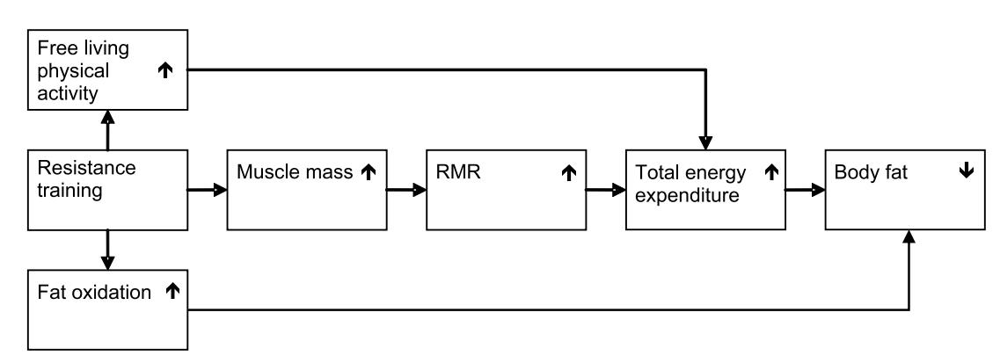

# Appropriate Physical Activity Intervention Strategies for Weight Loss and Prevention of Weight Regain for Adults

POSITION STAND

#### ABSTRACT

Overweight and obesity affects more than 66% of the adult population and is associated with a variety of chronic diseases. Weight reduction reduces health risks associated with chronic diseases and is therefore encouraged by major health agencies. Guidelines of the National Heart, Lung, and Blood Institute (NHLBI) encourage a 10% reduction in weight, although considerable literature indicates reduction in health risk with 3% to 5% reduction in weight. Physical activity (PA) is recommended as a component of weight management for prevention of weight gain, for weight loss, and for prevention of weight regain after weight loss. In 2001, the American College of Sports Medicine (ACSM) published a Position Stand that recommended a minimum of 150 minIwkj1 of moderateintensity PA for overweight and obese adults to improve health; however, 200–300 minIwkj1 was recommended for long-term weight loss. More recent evidence has supported this recommendation and has indicated more PA may be necessary to prevent weight regain after weight loss. To this end, we have reexamined the evidence from 1999 to determine whether there is a level at which PA is effective for prevention of weight gain, for weight loss, and prevention of weight regain. Evidence supports moderateintensity PA between 150 and 250 minIwkj1 to be effective to prevent weight gain. Moderate-intensity PA between 150 and 250 minIwkj1 will provide only modest weight loss. Greater amounts of PA (9250 minIwkj1 ) have been associated with clinically significant weight loss. Moderateintensity PA between 150 and 250 minIwkj1 will improve weight loss in studies that use moderate diet restriction but not severe diet restriction. Cross-sectional and prospective studies indicate that after weight loss, weight maintenance is improved with PA 9250 minIwkj1 . However, no evidence from well-designed randomized controlled trials exists to judge the effectiveness of PA for prevention of weight regain after weight loss. Resistance training does not enhance weight loss but may increase fat-free mass and increase loss of fat mass and is associated with reductions in health risk. Existing evidence indicates that endurance PA or resistance training without weight loss improves health risk. There is inadequate evidence to determine whether PA prevents or attenuates detrimental changes in chronic disease risk during weight gain.

This document is an update of the 2001 American College of Sports Medicine (ACSM) Position Stand titled ''Appropriate Intervention Strategies for Weight Loss and Prevention of Weight Regain for Adults'' (68). This Position Stand provided a variety of recommendations such as the identification of adults for whom weight loss is recommended, the magnitude of weight loss recommended, dietary recommendations, the use of resistance exercise, the use of pharmacological agents, behavioral strategies, and other topics. The purpose of the current update was to focus on new information that has been published after 1999, which may indicate that increased levels of physical activity (PA) may be necessary for prevention of weight gain, for weight loss, and prevention of weight regain compared to those recommended in the 2001 Position Stand. In particular, this update is in response to published information regarding the amount of PA needed for weight management found in the National Weight Control Registry (155) and by the Institute of Medicine (67).

This update was undertaken for persons older than 18 yr who were enrolled in PA trials designed for prevention of weight gain (i.e., weight stability), for weight loss, or prevention of weight regain. Investigations that include older adults (i.e., older than 65 yr) are not abundant. Some concerns exist for the need for weight loss in older adults and for loss of fat-free mass and potential bone loss. This review considers the existing literature as it applies to the general population. However, it is likely that individuals vary in their response to PA for prevention of weight gain, for weight loss, and for weight maintenance. Successful results will also depend on energy intakes [Weight management. J Am Diet Assoc. 2009;109(2):330–46]. Trials with individuals with comorbid conditions that acutely affect weight and trials using pharmacotherapy were not included (i.e., acquired immunodeficiency syndrome, type 1 diabetes). Trials using

#### 0195-9131/09/4102-0459/0

MEDICINE & SCIENCE IN SPORTS & EXERCISE Copyright - 2009 by the American College of Sports Medicine DOI: 10.1249/MSS.0b013e3181949333

This pronouncement was written for the American College of Sports Medicine by Joseph E. Donnelly, Ed.D. (Chair); Steven N. Blair, PED; John M. Jakicic, Ph.D.; Melinda M. Manore, Ph.D., R.D.; Janet W. Rankin, Ph.D.; and Bryan K. Smith, Ph.D.

individuals with medication and comorbid diseases, such as hypertension, cardiovascular disease (CVD), and type 2 diabetes, were included because these individuals are very prevalent in the United States (US) and individuals with these conditions are frequently in need of weight loss. Throughout this paper light-intensity activity is defined as 1.1 to 2.9 METS, moderate-intensity activity is 3.0 to 5.9 METS, and vigorous activity is Q 6 METS (U.S. Department of Health and Human Services Website [Internet]. Washington, DC: 2008 Physical Activity Guidelines for Americans; [cited 2008 Nov 17]. Available from http:// www.health.gov/PAGuidelines.) The Evidence Categories of the National Heart, Lung, and Blood Institute (NHLBI) were used to evaluate the strength of the literature and to support recommendations (Table 1).

# RATIONALE FOR WEIGHT MANAGEMENT

Overweight and obesity are defined by a body mass index (BMI) of 25 to 29.9 kgImj2 and 30 kgImj2 or greater, respectively. Together, overweight and obesity are exhibited by approximately 66.3% of adults in the US (107). Both overweight and obesity are characterized by the accumulation of excessive levels of body fat and contribute to heart disease, hypertension, diabetes, and some cancers as well as psychosocial and economic difficulties (55,97,99,147). The cost of treatment of weight reduction is now estimated to exceed \$117 billion annually (135). Reduction in the prevalence of obesity was among the major aims of Healthy People 2000 (147), although it is now apparent that this goal was not achieved (148). Reduction in obesity remains a major aim of Healthy People 2010 (146) and of other major health campaigns (i.e., Steps to a HealthierUS Initiative, http://www.healthierus.gov/steps/; Make Your Calories Count, http://www.cfsan.fda.gov/~dms/hwm-qa.html; We Can! http://www.nhlbi.nih.gov/health/public/heart/obesity/ wecan/). Management of overweight and obesity is considered an important public health initiative because numerous studies have shown the beneficial effects of diminished weight and body fat in overweight and obese individuals. These beneficial effects include an improvement in CVD risk factors such as decreased blood pressure (85,102,137), decreased LDL-C (24,85,151), increased HDL-C (24,151), decreased triglycerides (TG) (24,43,151), and improved glucose tolerance (30,45). Weight loss has also been associated with a decrease in inflammatory markers, such as Creactive protein (60,81,139), which have also been associated with the development of CVD (118,119). The NHLBI Guidelines (101) recommend a minimum weight loss of 10%. However, there are also numerous studies that show beneficial improvements in CVD risk factors when weight loss is less than 10% (16,38,56,80,114,150). In fact, beneficial improvements in chronic disease risk factors have been reported with as little as 2–3% of weight loss (30,45,85,141).

### POTENTIAL NEED FOR GREATER AMOUNTS OF PA

PA is recommended as an important part of weight management by virtually all public health agencies and scientific organizations including NHLBI (41), Centers for Disease Control (CDC) (57), ACSM (57), and various medical societies (American Heart Association, American Medical Association, American Academy of Family Physicians) (92). Although there are existing recommendations for the amount of PA useful for weight management, recent studies have suggested greater amounts may be needed for most individuals. For example, individuals in the National Weight Control Registry who have maintained weight loss have shown levels of energy expenditure equivalent to walking È28 milesIwkj1 (78). Schoeller et al. (126) used doubly labeled water to study women who recently lost 23 T 9 kg weight to estimate the energy expenditure needed to prevent weight regain. Retrospective analyses of the data were performed to determine the level of PA that provided maximum differentiation between gainers and maintainers. On the basis of these analyses, it was determined that sedentary individuals would need to perform È80 minIdj1 of moderate-intensity PA or 35 minIdj1 of vigorous PA to prevent weight regain. These studies contributed to the 2001 recommendation by ACSM of 200–300 minIwkj1 of moderate-intensity PA for long-term weight loss, and other published recommendations (i.e., Institute of Medicine [67]) suggest that greater amounts of PA may be necessary for

TABLE 1. Level of evidence for evidence statements.

|                                                                                                                                                                           | Evidence |
|---------------------------------------------------------------------------------------------------------------------------------------------------------------------------|----------|
| Evidence Statement                                                                                                                                                        | Category |
| PA to prevent weight gain. PA of 150 to 250 min I wk j 1 with an energy equivalent of 1200 to 2000 kcal I wk j 1 will prevent weight gain greater than 3% in most adults. | A        |
| PA for weight loss. PA G 150 min I wk j 1 promotes minimal weight loss, PA 9 150 min I wk j 1 results in modest weight loss of È 2–3 kg, PA 9 225–420 min I wk j 1        | B        |
| results in 5- to 7.5-kg weight loss, and a dose–response exists.                                                                                                          |          |
| PA for weight maintenance after weight loss. Some studies support the value of È 200- to 300-min I wk j 1 PA during weight maintenance to reduce weight regain after      | B        |
| weight loss, and it seems that ‘‘more is better.’’ However, there are no correctly designed, adequately powered, energy balance studies to provide evidence for the       |          |
| amount of PA to prevent weight regain after weight loss.                                                                                                                  |          |
| Lifestyle PA is an ambiguous term and must be carefully defined to evaluate the literature. Given this limitation, it seems lifestyle PA may be useful to counter the     | B        |
| small energy imbalance responsible for obesity in most adults.                                                                                                            |          |
| PA and diet restriction. PA will increase weight loss if diet restriction is modest but not if diet restriction is severe (i,e., G kcal I wk j 1 needed to meet RMR).     | A        |
| Resistance training (RT) for weight loss. Research evidence does not support RT as effective for weight loss with or without diet restriction. There is limited evidence  | B        |
| that RT promotes gain or maintenance of lean mass and loss of body fat during energy restriction and there is some evidence RT improves chronic disease risk              |          |
| factors (i.e., HDL-C, LDL-C, insulin, blood pressure).                                                                                                                    |          |

prevention of weight regain after weight loss. In response, we have examined the literature from 1999 to present to determine whether there is sufficient evidence to recommend increased levels of PA for prevention of weight gain, weight loss, and prevention of weight regain.

### WEIGHT MAINTENANCE AND CLINICALLY SIGNIFICANT WEIGHT LOSS

The clinical significance of weight maintenance and weight loss is often questioned in studies that provide marginal results. To provide context to a discussion of PA for weight maintenance, weight loss, or prevention of weight regain after weight loss, St Jeor et al. (133) and Sherwood et al. (129) both operationally defined weight maintenance as a change of e5 lb (2.3 kg). Stevens et al. (136) recently recommended a definition of weight maintenance as G3% change in body weight with 95% change in body weight considered as clinically significant.

There are also problems with setting operating definitions. Benefits associated with weight maintenance or weight changes likely exist on a continuum and do not operate under a threshold. The definitions above are the product of observational studies and review of the literature. Randomized controlled trials that were designed to provide evidence to answer the question of clinical significance have not been conducted. Indeed, such trials may be unrealistic and may not yield a clear definition. Thus, judgment of clinical significance remains a topic for continued research and under the interpretation of the reader.

Evidence Statement: PA Will Prevent Weight Gain. Evidence Category A. Primary prevention of obesity starts with maintenance of current weight, not weight reduction. The risk for weight gain may vary across time, and the need for PA to prevent weight gain, therefore, may also vary. However, studies that test this promise are lacking. A considerable amount of cross-sectional evidence indicates an inverse relationship between body weight or BMI and PA (5,94). In addition, a small dose–response relationship is shown for the decrease in body weight or BMI as PA levels increase. For example, Kavouras et al. (76) reported a significantly lower BMI (25.9 kgImj2 ) for individuals participating in PA equivalent to at least 30 minIdj1 for 5 dIwkj1 when compared to less active individuals (26.7 kgImj2 ). However, Berk et al. (7) found that individuals who initially reported G60 minIwkj1 of PA and increased to 134 minIwkj1 of PA had a change in BMI of 0.4 kgImj2 across a 16-yr follow-up period, but this was not significantly different from the 0.9 kgImj2 increase observed for individuals who remained sedentary at both assessment periods (G60 minIwkj1 ). These data suggest that G150 minIwkj1 of PA will result in a nonsignificant change of weight gain compared to individuals who remain sedentary. However, individuals who were classified as active at both assessment periods and were participating in 261 minIwkj1 of PA resulted in a significantly lower change in

BMI compared to individuals who were initially active (960 minIwkj1 ) at baseline but became less active at follow-up (G60 minIwkj1 ). These two studies support the need to maintain a physically activity lifestyle and the need for 9150 minIwkj1 of PA to manage body weight in the long term.

Additional evidence for the effectiveness of greater amounts of PA is provided by McTiernan et al. (95). In their study, prevention of weight gain was investigated in a 12 month randomized, controlled trial that targeted 300 min of moderately vigorous PA per wk. Women lost 1.4 T 1.8 kg compared to an increase of 0.7 T 0.9 kg in controls and men lost 1.8 T 1.9 kg compared to an increase of 0.1 T 0.1 kg in controls. A nonsignificant dose effect was shown for minutes of PA for women with 9250 minIwkj1 associated with greater weight loss compared to G250 minIwkj1 . For men, a significant dose effect was found for those who reported 9250 minIwkj1 compared to those who reported G250 minIwkj1 . Thus, greater amounts of PA resulted in greater amounts of weight loss. Taken together, the above studies suggest that there is sufficient evidence that moderately vigorous PA of 150 to 250 minIwkj1 with an energy equivalent of È1200 to 2000 kcalIwkj1 (È12 to 20 milesIwkj1 ) is sufficient to prevent a weight gain greater than 3% in most adults.

Evidence Statement: PA Will Promote Clinically Significant Weight Loss. Evidence Category B. A negative energy balance generated by PA will result in weight loss, and the larger the negative energy balance, the greater the weight loss. Extreme amounts of PA found with military training (104) or mountain climbing (116) may result in substantial weight loss; however, it is difficult for most individuals to achieve and sustain these high levels of PA. Few studies with sedentary overweight or obese individuals using PA as the only intervention result in Q3% decreases of baseline weight. Therefore, most individuals who require substantial weight loss may need additional interventions (i.e., energy restriction) to meet their weight loss needs.

Several studies that targeted G150 minIwkj1 of PA resulted in no significant change in body weight (10,14, 27,98). Donnelly et al. (33), targeted 90 min of continuous moderate-intensity PA (30 min, 3 dIwkj1 ) compared to 150 min of moderate-intensity intermittent PA (30 min, 5dIwkj1 ) in women for 18 months. The continuous group lost significantly greater weight than the intermittent group (1.7 vs 0.8 kg), yet neither group lost Q3% of baseline weight.

Garrow et al. (53) and Wing (154) have reviewed the literature for the effects of PA for weight loss and concluded that weight loss is typically 2 to 3 kg; however, the level of PA was not well described. Interestingly, wellcontrolled laboratory studies generally find greater levels of weight loss in response to PA. This may reflect a greater amount of PA that is targeted in laboratory studies compared to outpatient studies and verification that participants achieved the targeted amount. For example, Ross et al. (121)

showed that men and women who experienced a 500- to 700-kcalIdj1 deficit for 12 wk had weight loss of 7.5 kg (8%) and 5.9 kg (6.5%), respectively. Donnelly et al. (32), used a randomized, controlled trial of 16 months duration that provided 225 min of moderate-intensity PA with a targeted energy equivalent of È400 kcalIdj1 ,5dIwkj1 , and verified all sessions of PA in a laboratory. The difference in weight between experimental and controls at 16 months was j4.8 kg for men and j5.2 kg for women. However, these differences were achieved differently. Men who received PA lost weight compared to controls who maintained weight. Women who received PA maintained weight compared to controls who gained weight. These findings may suggest a potential gender difference in response to PA. However, other investigations (134) have not found differences, and further investigation for gender differences seems warranted.

It is likely that any increase in PA has the potential for weight loss; however, it seems that PA G150 minIwkj1 results in minimal weight loss compared to controls, PA 9 150 minIwkj1 results in modest weight loss of È2–3 kg, and PA between 225 and 420 minIwkj1 results in 5- to 7.5-kg weight loss. Thus, a dose effect is apparent for PA and weight loss, and higher doses are capable of providing 3% or greater weight loss from initial weight.

Evidence Statement: PA Will Prevent Weight Regain after Weight Loss. Evidence Category B. It is generally accepted that most individuals can lose weight but cannot maintain weight loss. PA is universally promoted as a necessity for weight maintenance (67,68, 101). Indeed, PA is often cited as the best predictor of weight maintenance after weight loss (78,138). A systematic review of PA to prevent weight regain after weight loss was completed by Fogelholm and Kukkonen-Harjula (47). The majority of studies were observational studies and studies of individuals who were randomized at baseline to exercise or no exercise, or to different levels of PA. Followup varied from several months to several years and the results indicated that individuals who engaged in exercise experienced less regain than those individuals who did not, and those individuals who engaged in greater amounts of PA experienced less regain than those with more moderate levels of PA. Only three studies used a design in which individuals were randomized to PA after weight loss (48,87,112), and the results showed that PA had an indifferent, negative, or positive effect on prevention of weight regain. Failure to randomize to PA levels after weight loss is a serious design flaw and diminishes the evidence available for evaluation.

Despite the accepted concept that PA is necessary for successful weight maintenance after weight loss, the amount that is needed remains uncertain and may vary among individuals (70). The CDC/ACSM recommendations for PA specified the accumulation of 30 min of moderate-intensity PA for most days of the week (111). These guidelines were provided for health promotion and disease prevention; however, they were widely interpreted

to be useful for weight management. Minimum levels of 150 minIwkj1 (30 minIdj1 ,5dIwkj1 ) of moderateintensity PA were also recommended by the ACSM Position Stand in ''Appropriate Intervention Strategies for Weight Loss and Prevention of Weight Regain for Adults'' for health benefits; however, 200–300 minIwkj1 was recommended for long-term weight loss (68). Jakicic et al. (69,71) and Andersen et al. (2) provide data from randomized trials that indicate individuals who perform greater amounts of PA maintain greater amounts of weight loss at follow-up of 18, 12, and 12 months, respectively. In particular, Jakicic et al. (69,71) show very little weight regain in individuals who performed 9200 minIwkj1 of moderate-intensity PA. Recently, Jakicic et al. (70) have reported that individuals who achieved a weight loss of 910% of initial body weight at 24 months were participating in 275 minIwkj1 (approximately 1500 kcalIwkj1 ) of PA activity above baseline levels. Likewise, Ewbank et al. (40) found similar results 2 yr after weight loss by a very low energy diet. Retrospectively grouping participants by levels of self-reported PA, individuals who reported greater levels of PA (walking È16 milesIwkj1 ) had significantly less weight regain than individuals reporting less PA per week (4.8–9.1 milesIwkj1 ). However, it is important to note that individuals in all three studies mentioned were grouped into PA categories retrospectively and were not randomly assigned to these PA groups after weight loss. Thus, the amount of PA was self-selected and therefore does not provide clear evidence for the amount of PA needed to prevent weight regain.

To explore the effects of levels of PA greater than those normally recommended in weight management programs, Jeffery et al. (74) targeted 1000 and 2500 kcalIwkj1 for 18 months in two groups of participants, and these levels of PA were randomly assigned at baseline. The actual reported energy expenditure for kilocalories per week at 18 months was 1629 T 1483 and 2317 T 1854 for the 1000- and 2500-kcalIwkj1 groups, respectively. There were no differences for weight loss between groups at 6 months (weight loss), but there were significant differences at 12 and 18 months (weight maintenance) of follow-up with the 2500-kcalIwkj1 group showing significantly greater weight losses (6.7 T 8.1 vs 4.1 T 7.3 kg). This study indicates that greater levels of PA provided significantly lower levels of weight regain. However, the results must be interpreted with caution because there was great variation in the percentage of individuals meeting the targeted energy expenditure, and the behavioral interventions were not equal.

In summary, most of the available literature indicates that ''more is better'' regarding the amount of PA needed to prevent weight regain after weight loss. However, as indicated above, there are some major flaws in the literature relative to the appropriate research design needed to directly address this question. Specifically, there are no adequately powered studies of sufficient duration with randomization to different levels of PA after weight loss. In addition, the literature is absent of randomized, controlled studies that used state-ofthe-art energy balance techniques. Given these limitations, weight maintenance (weight fluctuation G3%) is likely to be associated with È60 min walking per day (È4 milesIdj1 ) at a moderate intensity (40,71,126,138).

## OVERVIEW OF LIFESTYLE PA

Interventions for weight loss frequently implement behavioral programs that include strategies to integrate PA into the individuals' lifestyle. Examples include supervised exercise, nonsupervised exercise, occupational activity, work around the home, personal care, commuting, and leisure time activities. It is critically important to understand the difference between lifestyle intervention approaches to increasing PA and lifestyle forms of PA. The lack of clear differences between the two has lead to confusion regarding what the term ''lifestyle PA'' really means.

Part of the confusion comes from the lack of differentiation between a behavioral approach to modifying PA and specific forms of PA classified as lifestyle in nature. The following segments are offered to provide clarity for the purpose of this review.

Lifestyle Approaches to increasing PA. Lifestyle approaches to increasing PA refers to interventions that incorporate behavioral theories and constructs to assist and facilitate increasing PA within one's lifestyle. Examples may include, but are not limited to, inclusion of problem solving, goal-setting, self-monitoring, and relapse prevention strategies based on theories, such as Social Cognitive Theory, Transtheoretical Model, Theory of Planned Behavior, and Health Belief Model. This intervention approach can be used to improve participation in all forms of PA that include structured exercise, leisure time PA, occupational PA, household PA, and PA used for commuting.

Lifestyle forms of PA. Clearly defining lifestyle forms of PA is somewhat more challenging. For the purpose of this review, we define lifestyle PA as any nonstructured form of PA performed that is not intended to constitute a structured period of exercise. For example, walking done for commuting would be considered lifestyle PA. Walking in a structured period of exercise would not be considered lifestyle PA.

Nonexercise activity thermogenesis. Levine et al. (89,90) have developed the concept of nonexercise activity thermogenesis (NEAT), which they define as all energy expenditure that is not from sleeping, eating, or planned exercise programs. This definition does not use the term ''lifestyle'' and may therefore diminish the confusion between a lifestyle PA approach and forms of lifestyle PA. Regardless of definition, it is apparent that separating PA integrated into the lifestyle in behavioral programs from PA not associated with planned PA is currently confusing and problematic in terms of definition and measurement.

Measurement of lifestyle PA. Lifestyle PA energy expenditure (PAEE) has been measured in observational studies and randomized trials by various methods. Many studies have used self-report PA questionnaires to estimate total PA, and more recently, an objective measurement of PA has been achieved by use of pedometers, accelerometers, inclinometers, or doubly labeled water assessments (6,89,90,93). Although self-report of purposeful PA or exercise is sometimes crude and imprecise, it is even more difficult for individuals to provide an accurate self-report of lifestyle PA. Most adults can remember if they went for a run or to aerobics class and can also accurately report some types of lifestyle activity such as walking to the bus stop or to work. However, it is difficult to accurately quantify overall lifestyle activity because it constitutes hours per day and much of it is not memorable. An example of this was reported by Manini et al. (93) in a study of PAEE and mortality in a group of older adults (93). They assessed PAEE by doubly labeled water and also administered several PA questionnaires. They developed 21 separate estimates of time spent in PA or energy expended in PA from the questionnaire data. Only 8 of the 21 measures were significantly different across thirds of PAEE (low, G521 kcalIdj1 ; middle, 521–770 kcalIdj1 ; high, 9779 kcalIdj1 ), which indicate the difficulty of measuring lifestyle PA by self-report.

Evidence statement: lifestyle PA is useful for weight management. Evidence category B. In modern society, most adults spend most of their time sitting, whether at work, at home, or during leisure time. This leads to low levels of energy expenditure and is likely to be an important cause of the obesity epidemic (61,89,90,149). Estimates of the size of the positive energy balance leading to the obesity epidemic range from 10 (149) to 100 kcalIdj1 (61). There are numerous observational studies supporting the hypothesis that higher levels of lifestyle PA prevent initial weight gain (6,22,25,35,37,46,49,51,124,144). Many of the recent studies include objective measurement of PA by a variety of methods (6,22,25,37,144), but most of these studies had a cross-sectional design. Chan et al. (17) provided data from 106 sedentary workers who participated in a 12-wk intervention promoting walking. Steps per day were determined by pedometers, and participants had an average increase of 3451 steps per day during the course of the study. There was a greater decrease in waist circumference in those who had a greater increase in steps per day, but there was no association between BMI and increases in steps. There are several large longitudinal studies that used self-report of PA at baseline as a predictor of weight gain over time (28,35,49,113,124). These studies each include more than 1000 participants, and several years of follow-up. One study from Denmark followed up 21,685 men for 11 yr (35). There is consistency across the studies showing that more active individuals gained less weight or were less likely to become obese. However, another cohort of 3653 women and 2626 men in Denmark followed up for 5 yr did not show that inactivity led to obesity but did suggest that those who became obese also became more inactive (113). Several experimental trials have included a lifestyle

approach to PA within the intervention (1,2,19–21, 36,49,52,71,132,152,153). In general, the interventions were successful in increasing PA, and this tended to have a beneficial effect on body weight. Many of these trials were relatively short term; but some lasted 1 yr or more (2,20,36,71,152), with a notable study by Simkin-Silverman et al. (132) that was carried out for 54 months in 535 premenopausal women. A recent systematic review of studies using pedometers to increase PA provides information on how lifestyle PA may affect body weight (12). The investigators reviewed 26 studies on PA programs, 8 of them randomized trials, in which pedometers were used to assess changes in PA. Participants increased their steps per day by more than 2100 in both the randomized trials and the observational studies. Across all studies, participants decreased BMI by 0.38 units (95% confidence interval, 0.05– 0.72; P = 0.03). Although weight loss seems modest, the review does suggest that it is possible to increase lifestyle PA and that this may result in lower weight.

The studies reviewed here include a wide variety of assessments of PA, diverse populations, and long followup. These characteristics of current research provide strong evidence for beneficial effects of lifestyle PA in overall weight management. However, there are inherent difficulties in making specific recommendations about lifestyle PA. First is the lack of a consistent definition on what should be included as lifestyle PA. In addition, there are many different measurement approaches that have been used in the various studies, which make it difficult to provide precise information on specific amounts of PA that should be recommended. Nonetheless, when we consider the emerging evidence on NEAT and inactivity physiology and the relatively small positive energy balance that has produced the obesity epidemic, it is reasonable to conclude that increasing lifestyle PA should be a strategy included in weight management efforts.

Evidence statement: PA combined with energy restriction will increase weight loss. Evidence category A. Examination of the weight loss literature shows that a reduction in energy intake plays a significant role in reducing body weight and this topic has been extensively reviewed (11,50). However, most recommendations for weight loss include both energy restriction and PA. Weight loss programs can vary dramatically in the amount of PA used and the level of energy restriction imposed, with a greater energy deficit producing a greater weight loss. Most weight loss programs either limit energy intake to a specific amount (e.g., 500–1500 kcalIdj1 ) regardless of the size or gender of the individuals participating in the program (4,8,9) or select a specific energy deficit through diet (e.g., energy restriction of j300 kcalIdj1 ) and/ or exercise (e.g., j300 kcalIdj1 ) to bring about a total energy reduction (e.g., j600 kcalIdj1 ) (18,39,59,72,96).

Virtually all recommendations from public health groups and governmental agencies include the use of PA in conjunction with diet to promote weight loss (57,101,111, 122,145–147). When the energy deficit imposed by diet-only and diet plus PA interventions are similar, weight loss and/or percent change in body weight are similar (4,8,18,39, 58,59,72,82,103,120,140). When energy intake is reduced severely, diet and diet and PA groups tend to have similar results (34). For example, several investigations have used 600–1000 kcalIdj1 deficits for 12–16 wk, and the group assigned to PA participated in three to five sessions per week of 30–60 min in duration. Weight loss ranged from È4 to 11 kg (e.g., È1–1.5 lbIwkj1 ), regardless of group assignment (i.e., diet-only or diet plus exercise) (39,72,140). Thus, the addition of PA to severe diet restriction may result in metabolic adaptations that diminish any additive effect of the energy expenditure from PA on weight loss.

In studies where energy restriction is not severe (i.e., 500–700 kcal), there is evidence that diet combined with PA is associated with significantly greater weight loss compared to diet alone. For example, a recent meta-analysis (128) found a small but significant increase in weight loss in diet plus PA programs of 1.1 kg compared to diet-only programs. Curioni and Lourenco (23) compared six randomized clinical trials ranging from 10 to 52 wk that also followed up subjects (n = 265) for 1 yr after the weight loss intervention. They found a 20% greater weight loss in diet plus exercise programs (j13 kg) compared to diet-only programs (j9.9 kg) and a 20% greater sustained weight loss after 1 yr (23). In summary, PA and diet restriction provide comparable weight loss if they provide similar levels of negative energy balance. It seems PA will increase weight loss in combination with diet restriction if the diet restriction is moderate but not if it is severe.

A thorough review of the diet literature and recommendations for effective diet counseling are available through the American Dietetic Association position paper on weight management [J Am Diet Assoc. 2009;109(2):330–46]. Exercise professionals should be cautioned regarding the provision of dietary advice to overweight and obese adults. In particular, caution is advised when chronic disease risk factors or known chronic disease are present. Providing specific diet recommendations may be outside the scope of practice for the exercise professional, and the appropriate course of action may require referral to a registered dietitian.

Evidence statement: Resistance training will not promote clinically significant weight loss. Evidence category A. The ACSM Position Stand ''Appropriate Intervention Strategies for Weight Loss and Prevention of Weight Regain for Adults'' (68) emphasized diet restriction and endurance exercise. Resistance training was not assigned a major role by the authors because it was believed that evidence for the efficacy of weight training for weight loss and maintenance was insufficient. Although the energy expenditure associated with resistance training is not large, resistance training may increase muscle mass which may in turn increase 24-h energy expenditure. Figure 1 represents a model that may reflect a role for resistance training in weight management.

Less research has been conducted using resistance training as part of an exercise intervention compared to aerobic exercise. This may be caused by the diminished energy and fat use compared to aerobic exercise during a typical session of the same duration. However, differences in hormonal response to resistance exercise (potential for acute stimulation of metabolic rate and fat oxidation after the activity) and enhancement of muscle protein balance (potential to chronically increase total energy expenditure) provide some justification for the examination of benefits on body weight and composition. Studies evaluating the effect of resistance training on body weight and composition are summarized below. There is less evidence for the effect of resistance exercise on body composition than body weight because some studies did not assess body composition.

Neither randomized controlled (42,108,123,125) nor intervention studies without a sedentary comparison group (63,66,79,88,115) provide evidence for a reduction in body weight when resistance training is performed without any modification of diet. However, the studies since 1999 are equally split concerning whether resistance training will cause a loss of body fat. Some studies report a modest reduction in body fat (63,66,88,125) when resistance training was continued for 16–26 wk, whereas others reported no effect on body fat for interventions of 12– 52 wk in duration (44,88,108,115). It is noteworthy that one study (88) reported a differential response on body fat depending on age and gender; reduction in body fat was observed only for older men with no effect for young men or young or old women. Slightly more studies reported an increase in lean mass after resistance training without modification of diet (63,64,108,125) than those reporting no effect (44,115,123). Some of the differences among studies could be secondary to differences in body composition technique used, duration of intervention, or specific exercise prescription. Combining resistance training with aerobic training has been shown to be superior for body weight and fat loss (3,110) and to result in greater lean body mass (110) when compared to aerobic exercise alone in several randomized controlled trials but not others (26).

When resistance training is added to a reduced energy intake intervention, the energy restriction seems to overshadow the resistance training. None of the recently performed randomized controlled trials (73,75,82,117) observed a greater body weight loss for interventions lasting from 4 to 16 wk. Most studies did not detect greater body fat loss with resistance training over energy restriction alone (75,82,117), although one study (73) examined body fat at various sites using magnetic resonance imaging and reported a superior loss of subcutaneous body fat with the combination of resistance training with diet compared to diet modification alone. On the other hand, most studies combining resistance training with energy restriction report improved lean body mass compared to dieting alone (73,75,82,117).

Only two recent randomized controlled studies have examined the effect of resistance exercise on prevention of weight gain or regain after weight loss (84,123). One study demonstrated no difference in weight regain during a 6 month period after a very low energy diet for 90 subjects assigned to walking, resistance training, or no exercise (84). A larger group of subjects (n = 164) was recruited for evaluation of regular resistance training to prevent gain in fat mass for 2 yr (123). No differences were noted in body weight change during this period; however, total body fat decreased more and intra-abdominal fat increased less for the treatment group compared to the control.

There is a potentially interesting interaction between resistance training and dietary protein in interventions with overweight individuals. Two randomized controlled trials compared the effects of resistance training when combined with diets that varied in protein content (31,86). The higher protein intervention was superior for either body weight and total fat lost (86) or prevention of lean tissue loss (31). In one study, this was accomplished through a doubling of the overall protein content of the diet to 1.6 gIkgj1 (86), whereas the other (31) used a high-protein supplement (10 g protein) immediately after each resistance workout.

There is little literature and no clear pattern for outcomes of weight and body composition when the dose for

FIGURE 1—Conceptual model of resistance training and the potential effect on energy expenditure. A conceptual model that includes both the energy expenditure from increased muscle mass and the potential energy expenditure from increased activities of daily living. RMR, resting metabolic rate.

resistance training has varied. Only two recent randomized controlled studies compared different resistance protocols within one study (15,26). Campbell et al. (15) compared obese subjects who performed whole-body resistance exercise for 11 wk to those who did only lower-body resistance exercises. There was no difference in the effect of the two exercise plans on body composition. Similarly, no difference in body weight or composition change was noted by Delecluse et al. (26) when comparing moderate- (two sets of 20 repetition maximum (RM) increasing to 8 RM over time) to a low- (two sets of 30 RM) intensity resistance protocol for 20 wk.

Although the effects of resistance training on body weight and composition may be modest, resistance training has been associated with improvements in CVD risk factors in the absence of significant weight loss. Resistance training has been shown to increase HDL-C (65), decrease LDL-C (54,65), and decrease TG (54). Improvements in insulin sensitivity (29,66) and reductions in glucose-stimulated plasma insulin concentrations (65) have been reported after resistance training. Reductions in both systolic and diastolic blood pressure have also been reported after resistance training (77,106).

In summary, resistance training does not seem to be effective for weight reduction in the order of 3% of initial weight and does not add to weight loss when combined with diet restriction. Resistance training increases fat-free mass when used alone or in combination with weight loss from diet restriction. Resistance training may increase loss of fat mass when combined with aerobic exercise compared to resistance training alone. No evidence currently exists for prevention of weight regain after weight loss or for a dose effect for resistance training and weight loss.

PA, weight, and chronic disease risk factors. This position paper is primarily focused on PA and weight; however, it should be acknowledged that there are benefits shown for PA whether weight is lost and perhaps even if weight is gained. For example, data from longitudinal studies such as The Coronary Artery Risk Development in Young Adults Study (CARDIA) (91,105), the Atherosclerosis Risk in Communities Cohort (141–143), and the FELS Longitudinal Study (127,130,131) provide evidence that the prevention of weight gain may be the easiest way to prevent the development of undesirable changes in CVD risk factors (i.e., increased LDL-C, total cholesterol, TG, fasting glucose, and decreased HDL-C). Long-term data (15 yr) from the CARDIA study (91) indicate that regardless of BMI, individuals that maintain a stable BMI minimized the undesirable changes in CVD risk factors that may be associated with aging.

Benefits of PA for the reduction of chronic health risks are seen with minimal weight loss of less than 3%. For example, Donnelly et al. (33) randomized sedentary, moderately obese females to 18 months of either continuous or intermittent exercise. After 18 months of exercise, weight loss was È2% in the continuous group and È1% in the intermittent group. Despite the minimal weight loss, both groups had significant improvements in HDL-C and reduced insulin area under the curve after an oral glucose tolerance test. Kraus et al. (83) randomized sedentary, overweight men and women to either a control group, a high-amount, high-intensity group, a low-amount, highintensity group, or a low-amount, moderate-intensity group. Intensities ranged from 40% to 55% V˙ O2max in the moderate-intensity group and from 65% to 80% V˙ O2max in the high-intensity groups. Despite minimal weight (G2%) loss in all groups, there were significant beneficial decreases in TG and increases in HDL-C.

Considering that most of the adult population gains weight across time, it is important to determine whether PA attenuates undesirable changes in chronic disease risk factors across time. Data from longitudinal observational studies indicate an association between PA and an attenuation of risk across time. In the Healthy Women Study (109), women who increased PA by Q300 kcalIwkj1 had basically no change HDL-C during a 3-yr period compared to women who decreased PA by Q300 kcalIwkj1 had a 1.9-mgIdLj1 decrease in HDL-C. Data from Nurse's Health Study (62) examined the association of sedentary behavior and television watching to the risk of obesity and type 2 diabetes during a 6-yr period. Minimal activity (walking around the house 2 hIdj1 ) was associated with 9% reduction in obesity and a 12% reduction in type 2 diabetes and walking 1 hIdj1 was associated with a 24% reduction in obesity and a 34% reduction in type 2 diabetes. A limitation of these studies is that they are observational in nature and the PA is self-reported.

Few randomized controlled trials have examined the relationship between PA and weight gain. Of the few available that measure CVD risk factors, they examine this relationship in individuals that are at risk for weight gain and utilize interventions that are a combination of PA and nutrition (13,100). Thus, there is not enough literature to determine whether PA prevents or attenuates detrimental changes in chronic disease risk factors during weight gain and such studies are needed. In summary, it seems that minimal amounts of PA improve many chronic disease risk factors. However, there are few published literature on the time course of these improvements; the permanence of these improvements over time, if there are diminishing returns for the amount of weight lost, and the ability of the PA to improve or attenuate increases in chronic risk factors during weight gain are poorly understood and merit investigation.

### CONCLUSIONS

Moderate-intensity PA of 150 to 250 minIwkj1 with an energy equivalent of È1200 to 2000 kcalIwkj1 seems sufficient to prevent weight gain greater than 3% in most adults and may result in modest weight loss. PA without diet restriction generally provides modest weight loss; however, laboratory studies that provide supervision and greater doses of PA compared to outpatient studies tend to show weight loss at or above 3% of initial weight. PA combined with diet restriction provides a modest addition of weight loss compared to diet alone, and this additive effect is diminished as the level of diet restriction increases. There are cross-sectional and prospective data that PA is associated with prevention of weight regain after weight loss; however, there are no appropriately designed, randomized controlled trials to indicate whether PA is effective for the prevention of weight regain and no information regarding the existence of a potential dose effect. Lifestyle approaches for increasing PA and planned PA are consistently associated with less weight gain compared to inactivity. The effects of lifestyle PA for prevention of weight regain after weight loss are unknown owing to lack of available literature. The effects of resistance training for prevention of weight gain are largely unknown owing to lack of available literature. Resistance training does not seem to be an effective means for weight loss but is associated with numerous other health benefits including decreases in many chronic disease risk factors and increases in fat-free mass and decreases in fat mass. Weight maintenance compared to weight gain seems to protect against an increase in chronic disease risk factors, and in many studies, weight loss as little as 3% has been associated with favorable changes in chronic disease risk factors.

On the basis of the available scientific literature, the ACSM recommends that adults participate in at least 150 minIwkj1 of moderate-intensity PA to prevent significant weight gain and reduce associated chronic disease risk factors. It is recommended that overweight and obese individuals participate in this level of PA to elicit modest reductions in body weight. However, there is likely a dose effect of PA, with greater weight loss and enhanced prevention of weight regained with doses of PA that approximate 250 to 300 minIwkj1 (approximately 2000 kcalIwkj1 ) of moderateintensity PA.

This Position Stand is endorsed by the American Dietetic Association.

These recommendations are consistent with the recent publication of the US Department of Health and Human Services Physical Activity Guidelines for Americans and the accompanying Advisory Committee Report (http://www.health.gov/PAGuidelines/Report/ Default.aspx).

This pronouncement was reviewed for the American College of Sports Medicine by the ACSM Pronouncements Committee and by Ross E. Andersen, Ph.D., James D. Dziura, Ph.D., James O. Hill, Ph.D., Laura J. Kurskall, Ph.D., FACSM, and Robert Ross, Ph.D.

This Position Stand replaces the 2001 Position Stand, ''Appropriate Intervention Strategies for Weight Loss and Prevention of Weight Regain for Adults'' [Med Sci Sports Exerc. 2001;33(12): 2145–56].

### REFERENCES

- 1. Aldana SG, Greenlaw RL, Diehl HA, et al. Effects of an intensive diet and physical activity modification program on the health risks of adults. J Am Diet Assoc. 2005;105:371–81.
- 2. Andersen RE, Wadden TA, Barlett SJ, Zemel B, Verde TJ, Franckowiak SC. Effects of lifestyle activity vs structured aerobic exercise in obese women. JAMA. 1999;281:335–40.
- 3. Arciero PJ, Gentile CL, Martin-Pressman R, et al. Increased dietary protein and combined high intensity aerobic and resistance exercise improves body fat distribution and cardiovascular risk factors. Int J Sport Nutr Exerc Metab. 2006;16: 373–92.
- 4. Balkestein EJ, Van Aggel-Leijssen DP, van Baak MA, Struijker-Boudier HA, Van Bortel LM. The effect of weight loss with or without exercise training on large artery compliance in healthy obese men. J Hypertens. 1999;17:1831–5.
- 5. Ball K, Owen N, Salmon J, Bauman A, Gore CJ. Associations of physical activity with body weight and fat in men and women. Int J Obes Relat Metab Disord. 2001;25:914–9.
- 6. Bassett DR, Schneider PL, Huntington GE. Physical activity in an Old Order Amish community. Med Sci Sports Exerc. 2004; 36(1):79–85.
- 7. Berk DR, Hubert HB, Fries JF. Associations of changes in exercise level with subsequent disability among seniors: a 16-year longitudinal study. J Gerontol A Biol Sci Med Sci. 2006; 61:97–102.
- 8. Bond Brill J, Perry AC, Parker L, Robinson A, Burnett K. Dose– response effect of walking exercise on weight loss. How much is enough? Int J Obes Relat Metab Disord. 2002;26:1484–93.
- 9. Borg P, Kukkonen-Harjula K, Fogelholm M, Pasanen M. Effects of walking or resistance training on weight loss maintenance in obese, middle-aged men: a randomized trial. Int J Obes Relat Metab Disord. 2002;26:676–83.
- 10. Boudou P, Sobngwi E, Mauvais-Jarvis F, Vexiau P, Gautier JF. Absence of exercise-induced variations in adiponectin levels despite decreased abdominal adiposity and improved insulin sensitivity in type 2 diabetic men. Eur J Endocrinol. 2003; 149:421–4.
- 11. Bravata DM, Sanders L, Huang J, Krumholz HM, Olkin I, Gardner DM. Efficacy and safety of low-carbohydrate diets—a systematic review. JAMA. 2003;289:1837–50.
- 12. Bravata DM, Smith-Spangler C, Sundaram V, et al. Using pedometers to increase physical activity and improve health: a systematic review. JAMA. 2007;298:2296–304.
- 13. Burke V, Giangiulio N, Gillam HF, Beilin LJ, Houghton S. Physical activity and nutrition programs for couples: a randomized controlled trial. J Clin Epidemiol. 2003;56:421–32.
- 14. Campbell KL, Westerlind KC, Harber VJ, Bell GJ, Mackey JR, Courneya KS. Effects of aerobic exercise training on estrogen metabolism in premenopausal women: a randomized controlled trial. Cancer Epidemiol Biomarkers Prev. 2007;16:731–9.
- 15. Campbell WW, Kruskall LJ, Evans WJ. Lower body versus whole body resistive exercise training and energy requirements of older men and women. Metabolism. 2002;51(8): 989–97.
- 16. Carels RA, Darby LA, Cacciapaglia HM, Douglass OM. Reducing cardiovascular risk factors in postmenopausal women through a lifestyle change intervention. J Womens Health. 2004;13:412–26.
- 17. Chan CB, Ryan DA, Tudor-Locke C. Health benefits of a pedometer-based physical activity intervention in sedentary workers. Prev Med. 2004;39:1215–22.
- 18. Christ M, Iannello C, Iannello PG, Grimm W. Effects of a weight reduction program with and without aerobic exercise in the metabolic syndrome. Int J Cardiol. 2004;97:115–22.

- 19. Christiansen T, Bruun JM, Madsen EL, Richelsen B. Weight loss maintenance in severely obese adults after an intensive lifestyle intervention: 2- to 4-year follow-up. Obesity. 2007;15: 413–20.
- 20. Clark M, Hampson SE, Avery L, Simpson R. Effects of a tailored lifestyle self-management intervention in patients with type 2 diabetes. Br J Health Psychol. 2004;9:365–79.
- 21. Coleman KJ, Raynor HR, Mueller DM, Cerny FJ, Dorn JM, Epstein LH. Providing sedentary adults with choices for meeting their walking goals. Prev Med. 1999;28:510–9.
- 22. Cooper AR, Page A, Fox KR, Misson J. Physical activity patterns in normal, overweight and obese individuals using minute-by-minute accelerometry. Eur J Clin Nutr. 2000;54: 887–94.
- 23. Curioni CC, Lourenco PM. Long-term weight loss after diet and exercise: a systematic review. Int J Obes. 2005;29:1168–74.
- 24. Dattilo AM, Kris-Etherton PM. Effects of weight reduction on blood lipids and lipoproteins: a meta-analysis. Am J Clin Nutr. 1992;56:320–8.
- 25. Davis JN, Hodges VA, Gillham MB. Physical activity compliance: differences between overweight/obese and normal-weight adults. Obesity. 2006;14:2259–65.
- 26. Delecluse C, Colman V, Roelants M, et al. Exercise programs for older men: mode and intensity to induce the highest possible health-related benefits. Prev Med. 2004;39:823–33.
- 27. Dengel DR, Galecki AT, Hagberg JM, Pratley RE. The independent and combined effects of weight loss and aerobic exercise on blood pressure and oral glucose tolerance in older men. Am J Hypertens. 1998;11:1405–12.
- 28. Di Pietro L, Dziura J, Blair SN. Estimated change in physical activity level (PAL) and prediction of 5-year weight change in men: the Aerobics Center Longitudinal Study. Int J Obes Relat Metab Disord. 2004;28:1541–7.
- 29. Di Pietro L, Dziura J, Yeckel CW, Neufer PD. Exercise and improved insulin sensitivity in older women: evidence of the enduring benefits of higher intensity training. J Appl Physiol. 2006;100:142–9.
- 30. Ditschuneit HH, Flechtner-Mors M, Johnson TD, Adler
  - G. Metabolic and weight-loss effects of a long-term dietary intervention in obese patients. Am J Clin Nutr. 1999;69: 198–204.
- 31. Doi T, Matsuo T, Sugawara M, et al. New approach for weight reduction by a combination of diet, light resistance exercise and the timing of ingesting a protein supplement. Asia Pac J Clin Nutr. 2001;10:226–32.
- 32. Donnelly JE, Hill JO, Jacobsen DJ, et al. Effects of a 16-month randomized controlled exercise trial on body weight and composition in young, overweight men and women: the midwest exercise trial (MET). Arch Intern Med. 2003;163:1343–50.
- 33. Donnelly JE, Jacobsen DJ, Snyder Heelan KA, Seip R, Smith S. The effects of 18 months of intermittent vs continuous exercise on aerobic capacity, body weight and composition, and metabolic fitness in previously sedentary, moderately obese females. Int J Obes Relat Metab Disord. 2000;24:566–72.
- 34. Donnelly JE, Pronk NP, Jacobsen DJ, Pronk SJ, Jakicic JM. Effects of a very-low-calorie diet and physical-training regimens on body composition and resting metabolic rate in obese females. Am J Clin Nutr. 1991;54:56–61.
- 35. Droyvold WB, Holmen J, Midthjell K, Lydersen S. BMI change and leisure time physical activity (LTPA): an 11-y follow-up study in apparently healthy men aged 20–69 y with normal weight at baseline. Int J Obes Relat Metab Disord. 2004;28:410–7.
- 36. Dunn AL, Marcus BH, Kampert JB, Garcia ME, Kohl HW, Brasel JA. Comparison of lifestyle and structured interventions to increase physical activity and cardirespiratory fitness. JAMA. 1999;281:327–34.
- 37. Esparza J, Fox C, Harper IT, et al. Daily energy expenditure in Mexican and USA Pima Indians: low physical activity as a possible cause of obesity. Int J Obes Relat Metab Disord. 2000;24:55–9.
  - 38. Esposito K, Pontillo A, Di Palo C, et al. Effect of weight loss and lifestyle changes on vascular inflammatory markers in obese women—a randomized trial. JAMA. 2003;289:1799–804.
  - 39. Evans EM, Saunders MJ, Spano MA, Arngrimsson A, Lewis RD, Cureton KJ. Effects of diet and exercise on the density and composition of the fat-free mass in obese women. Med Sci Sports Exerc. 1999;31(12):1778–87.
  - 40. Ewbank PP, Darga LL, Lucas CP. Physical activity as a predictor of weight maintenance in previously obese subjects. Obes Res. 1995;3(3):257–63.
  - 41. Expert Panel on the Identification, Evaluation, and Treatment of Overweight in Adults. Clinical guidelines on the identification, evaluation, and treatment of overweight and obesity in adults: executive summary (1–3). Am J Clin Nutr. 1998;68:899–917.
  - 42. Fenkci S, Sarsan A, Rota S, Ardic F. Effects of resistance or aerobic exercises on metabolic parameters in obese women who are not on a diet. Adv Ther. 2006;23:404–13.
  - 43. Fernandez ML, Metghalchi S, Vega-Lopez S, Conde-Knape K, Lohman TG, Cordero-Macintyre ZR. Beneficial effects of weight loss on plasma apolipoproteins in postmenopausal women. J Nutr Biochem. 2004;15:717–21.
  - 44. Ferrara CM, Goldberg AP, Ortmeyer HK, Ryan AS. Effects of aerobic and resistive exercise training on glucose disposal and skeletal muscle metabolism in older men. J Gerontol A Biol Sci Med Sci. 2006;61:480–7.
  - 45. Flechtner-Mors M, Ditschuneit HH, Johnson TD, Suchard MA, Adler G. Metabolic and weight loss effects of long-term dietary intervention in obese patients: four-year results. Obes Res. 2000; 8:399–402.
  - 46. Fogelholm M, Kujala U, Kaprio J, Sarna S. Predictors of weight change in middle-aged and old men. Obes Res. 2000;8:367–73.
  - 47. Fogelholm M, Kukkonen-Harjula K. Does physical activity prevent weight gain-a systematic review. Obes Rev. 2000;1:95–111.
  - 48. Fogelholm M, Kukkonen-Harjula K, Nenonen A, Pasanen M. Effects of walking training on weight maintenance after a verylow-energy diet in premenopausal obese women: a randomized controlled trial. Arch Intern Med. 2000;160:2177–84.
  - 49. Fogelholm M, Kukkonen-Harjula K, Oja P. Eating control and physical activity as determinants of short-term weight maintenance after a very-low-calorie diet among obese women. Int J Obes Relat Metab Disord. 1999;23:203–10.
  - 50. Freedman MR, King J, Kennedy E. Popular diets: a scientific review. Obes Res. 2001;9(suppl 1):S1–S40.
  - 51. French SA, Harnack LJ, Toomey TL, Hannan PJ. Association between body weight, physical activity and food choices among metropolitan transit workers. Int J Behav Nutr Phys Act. 2007; 4:52.
  - 52. Frost G, Lyons F, Bovill-Taylor C, Carter L, Stuttard J, Dornhorst A. Intensive lifestyle intervention combined with the choice of pharmacotherapy improves weight loss and cardiac risk factors in the obese. J Hum Nutr Diet. 2002;15:287–95; quiz 297–289.
  - 53. Garrow JS, Summerbell CD. Meta-analysis: effect of exercise, with or without dieting, on the body composition of overweight subjects. Eur J Clin Nutr. 1995;49:1–10.
  - 54. Goldberg L, Elliot DL, Schutz RW, Kloster FE. Changes in lipid and lipoprotein levels after weight training. JAMA. 1984;252: 504–6.
  - 55. Gortmaker SL, Must A, Perrin JM, Sobol AM, Dietz WH. Social an economic consequences of overweight in adolescence and young adulthood. N Engl J Med. 1993;329(14):1008–12.
  - 56. Haffner S, Temprosa M, Crandall J, et al. Intensive lifestyle intervention or metformin on inflammation and coagulation in

- participants with impaired glucose tolerance. Diabetes. 2005; 54:1566–72.
- 57. Haskell WL, Lee IM, Pate RR, et al. Physical activity and public health: updated recommendation for adults from the American College of Sports Medicine and the American Heart Association. Med Sci Sports Exerc. 2007;39(8):1423–34.
- 58. Hays NP, Starling RD, Liu X, et al. Effects of an ad libitum lowfat, high-carbohydrate diet on body weight, body composition, and fat distribution in older men and women: a randomized controlled trial. Arch Intern Med. 2004;164:210–7.
- 59. Heilbronn LK, de Jonge L, Frisard MI, et al. Effect of 6-month calorie restriction on biomarkers of longevity, metabolic adaptation, and oxidative stress in overweight individuals: a randomized controlled trial. JAMA. 2006;295:1539–48.
- 60. Heilbronn LK, Noakes M, Clifton PM. Energy restriction and weight loss on very-low-fat diets reduce C-reactive protein concentrations in obese, healthy women. Arterioscler Thromb Vasc Biol. 2001;21:968–70.
- 61. Hill JO, Wyatt HR, Reed GW, Peters JC. Obesity and the environment: where do we go from here? Science. 2003;299: 853–5.
- 62. Hu FB, Li TY, Colditz GA, Willett WC, Manson JE. Television watching and other sedentary behaviors in relation to risk of obesity and type 2 diabetes mellitus in women. JAMA. 2003;289:1785–91.
- 63. Hunter GR, Bryan DR, Wetzstein CJ, Zuckerman PA, Bamman MM. Resistance training and intra-abdominal adipose tissue in older men and women. Med Sci Sports Exerc. 2002;34(6): 1023–8.
- 64. Hunter GR, Wetzstein CJ, Fields DA, Brown A, Bamman MM. Resistance training increases total energy expenditure and freeliving physical activity in older adults. J Appl Physiol. 2000; 89:977–84.
- 65. Hurley BF, Hagberg JM, Goldberg AP, et al. Resistive training can reduce coronary risk factors without altering V˙ O2max or percent body fat. Med Sci Sports Exerc. 1988;20(2):150–4.
- 66. Ibanez J, Izquierdo M, Arguelles I, et al. Twice-weekly progressive resistance training decreases abdominal fat and improves insulin sensitivity in older men with type 2 diabetes. Diabetes Care. 2005;28:662–7.
- 67. Institute of Medicine. Dietary Reference Intake for Energy, Carbohydrate, Fiber, Fat, Fatty Acids, Cholesterol, Protein and Amino Acids. Washington (DC): Washington National Academic Press; 2002.
- 68. Jakicic JM, Clark K, Coleman E, et al. Appropriate intervention strategies for weight loss and prevention of weight regain for adults. Med Sci Sports Exerc. 2001;33(12):2145–56.
- 69. Jakicic JM, Marcus BH, Gallagher KL, Napolitano M, Lang W. Effect of exercise duration and intensity on weight loss in overweight, sedentary women. JAMA. 2003;290:1323.
- 70. Jakicic JM, Marcus BH, Lang W, Janney C. Effect of exercise on 24-month weight loss maintenance in overweight women. Arch Intern Med. 2008;168:1550–9; discussion 1559–1560.
- 71. Jakicic JM, Winters C, Lang W, Wing RR. Effects of intermittent exercise and use of home exercise equipment on adherence, weight loss, and fitness in overweight women. JAMA. 1999;282(16):1554–60.
- 72. Janssen I, Fortier A, Hudson R, Ross R. Effects of an energyrestrictive diet with or without exercise on abdominal fat, intermuscular fat, and metabolic risk factors in obese women. Diabetes Care. 2002;25:431–8.
- 73. Janssen I, Ross R. Effects of sex on the change in visceral, subcutaneous adipose tissue and skeletal muscle in response to weight loss. Int J Obes Relat Metab Disord. 1999;23:1035–46.
- 74. Jeffery RW, Wing RR, Sherwood NE, Tate DF. Physical activity and weight loss: does prescribing higher physical activity goals improve outcome? Am J Clin Nutr. 2003;78:684–9.
- 75. Joseph LJO, Trappe TA, Farrell PA, et al. Short-term moderate weight loss and resistance training do not affect insulinstimulated glucose disposal in postmenopausal women. Diabetes Care. 2001;24:1863–9.
- 76. Kavouras SA, Panagiotakos DB, Pitsavos C, et al. Physical activity, obesity status, and glycemic control: the ATTICA study. Med Sci Sports Exerc. 2007;39(4):606–11.
- 77. Kelley G. Dynamic resistance exercise and resting blood pressure inadults:ameta-analysis. J Appl Physiol. 1997;82(5):1559–65.
- 78. Klem ML, Wing RR, McGuire MT, Seagle HM, Hill JO. A descriptive study of individuals successful at long-term maintenance of substantial weight loss. Am J Clin Nutr. 1997;66:239–46.
- 79. Klimcakova E, Polak J, Moro C, et al. Dynamic strength training improves insulin sensitivity without altering plasma levels and gene expression of adipokines in subcutaneous adipose tissue in obese men. J Clin Endocrinol Metab. 2006;91:5107–12.
- 80. Knowler WC, Barrett-Connor E, Fowler SE, et al. Reduction in the incidence of type 2 diabetes with lifestyle intervention or metformin. N Engl J Med. 2002;346:393–403.
- 81. Kopp HP, Kopp CW, Festa A, et al. Impact of weight loss on inflammatory proteins and their association with the insulin resistance syndrome in morbidly obese patients. Arterioscler Thromb Vasc Biol. 2003;23:1042–7.
- 82. Kraemer WJ, Volek JS, Clark KL, et al. Influence of exercise training on physiological and performance changes with weight loss in men. Med Sci Sports Exerc. 1999;31(9):1320–9.
- 83. Kraus WE, Houmard JA, Duscha BD, et al. Effects of the amount and intensity of exercise on plasma lipoproteins. N Engl J Med. 2002;347:1483–92.
- 84. Kukkonen-Harjula KT, Borg PT, Nenonen AM, Fogelholm MG. Effects of a weight maintenance program with or without exercise on the metabolic syndrome: a randomized trial in obese men. Prev Med. 2005;41:784–90.
- 85. Lalonde L, Gray-Donald K, Lowensteyn I, et al. Comparing the benefits of diet and exercise in the treatment of dyslipidemia. Prev Med. 2002;35:16–24.
- 86. Layman DK, Evans E, Baum JI, Seyler J, Erickson DJ, Boileau RA. Dietary protein and exercise have additive effects on body composition during weight loss in adult women. J Nutr. 2005; 135:1903–10.
- 87. Leermakers EA, Perri MG, Shigaki CL, Fuller PR. Effects of exercise-focused versus weight-focused maintenance programs on the management of obesity. Addict Behav. 1999;24:219–27.
- 88. Lemmer JT, Ivey FM, Ryan AS, et al. Effect of strength training on resting metabolic rate and physical activity: age and gender comparisons. Med Sci Sports Exerc. 2001;33(4):532–41.
- 89. Levine JA, Miller JM. The energy expenditure of using a ''walkand-work'' desk for office workers with obesity. Br J Sports Med. 2007;41:558–61.
- 90. Levine JA, Vander Weg MW, Hill JO, Klesges RC. Nonexercise activity thermogenesis: the crouching tiger hidden dragon of societal weight gain. Arterioscler Thromb Vasc Biol. 2006;26:729–36.
- 91. Lloyd-Jones DM, Liu K, Colangelo LA, et al. Consistently stable or decreased body mass index in young adulthood and longitudinal changes in metabolic syndrome components: the Coronary Artery Risk Development in Young Adults Study. Circulation. 2007;115:1004–11.
- 92. Lyznicki JM, Young DC, Riggs JA, Davis RM. Obesity: assessment and management in primary care. Am Fam Physician. 2001;63:2185–96.
- 93. Manini TM, Everhart JE, Patel KV, et al. Daily activity energy expenditure and mortality among older adults. JAMA. 2006; 296:171–9.
- 94. Martinez JA, Kearney JM, Kafatos A, Paquet S, Martinez-Gonzalez MA. Variables independently associated with selfreported obesity in the European Union. Public Health Nutr. 1999;2:125–33.

- 95. McTiernan A, Sorensen B, Irwin ML, et al. Exercise effect on weight and body fat in men and women. Obesity. 2007; 15:1496–512.
- 96. Melanson KJ, Dell'Olio J, Carpenter MR, Angelopoulos TJ. Changes in multiple health outcomes at 12 and 24 weeks resulting from 12 weeks of exercise counseling with or without dietary counseling in obese adults. Nutrition. 2004;20:849–56.
- 97. Mokdad AH, Ford ES, Bowman BA, et al. Prevalence of obesity, diabetes, and obesity-related health risk factors, 2001. JAMA. 2003;289:76–9.
- 98. Murphy M, Nevill A, Biddle S, Neville C, Hardman A. Accumulation brisk walking for fitness, cardiovascular risk, and psychological health. Med Sci Sports Exerc. 2002;34(9): 1468–74.
- 99. Must A, Spadano J, Coakley EH, Field AE, Colditz G, Dietz WH. The disease burden associated with overweight and obesity. JAMA. 1999;282:1523–9.
- 100. Muto T, Yamauchi K. Evaluation of a multicomponent workplace health promotion program conducted in Japan for improving employees' cardiovascular disease risk factors. Prev Med. 2001;33:571–7.
- 101. National Heart, Lung, and Blood Institute. Clinical Guidelines on the Identification, Evaluation, and Treatment of Overweight and Obesity in Adults; The Evidence Report. Bethesda (MD): National Institutes of Health; 1998.
- 102. Neter JE, Stam BE, Kok FJ, Grobbee DE, Geleijnse JM. Influence of weight reduction on blood pressure: a meta-analysis of randomized controlled trials. Hypertension. 2003;42:878–84.
- 103. Nicklas BJ, Ambrosius W, Messier SP, et al. Diet-induced weight loss, exercise, and chronic inflammation in older, obese adults: a randomized controlled clinical trial. Am J Clin Nutr. 2004;79:544–51.
- 104. Nindl BC, Barnes BR, Alemany JA, Frykman PN, Shippee RL, Friedl KE. Physiological consequences of U.S. Army Ranger training. Med Sci Sports Exerc. 2007;39(8):1380–7.
- 105. Norman JE, Bild D, Liu K, West SD. The impact of weight change on cardiovascular disease risk factors in young black and white adults: the CARDIA study. Int J Obes. 2003;27:369–76.
- 106. Norris R, Carroll D, Cochrane R. The effect of aerobic and anaerobic training on fitness, blood pressure, and psychological stress and well-being. J Psychosom Res. 1990;34:367–75.
- 107. Ogden CL, Carroll MD, Curtin LR, McDowell MA, Tabak CJ, Flegal KM. Prevalence of overweight and obesity in the United States, 1999–2004. JAMA. 2006;295:1549–55.
- 108. Olson TP, Dengel DR, Leon AS, Schmitz KH. Changes in inflammatory biomarkers following one-year of moderate resistance training in overweight women. Int J Obes. 2007; 31:996–1003.
- 109. Owens JF, Matthews KA, Wing RR, Kuller LH. Can physical activity mitigate the effects of aging in middle-aged women? Circulation. 1992;85:1265–70.
- 110. Park SK, Park JH, Kwon YC, Kim HS, Yoon MS, Park HT. The effect of combined aerobic and resistance exercise training on abdominal fat in obese middle-aged women. J Physiol Anthropol Appl Human Sci. 2003;22:129–35.
- 111. Pate RR, Pratt M, Blair SN, et al. Physical activity and public health: a recommendation from the Centers for Disease Control and Prevention and the American College of Sports Medicine. JAMA. 1995;273(5):402–7.
- 112. Perri MG, McAllister DA, Gange JJ, Jordan RC, McAdoo G, Nezu AM. Effects of four maintenance programs on the longterm management of obesity. J Consult Clin Psychol. 1988;56: 529–34.
- 113. Petersen L, Schnohr P, Sorensen TI. Longitudinal study of the long-term relation between physical activity and obesity in adults. Int J Obes Relat Metab Disord. 2004;28:105–12.
- 114. Pi-Sunyer X, Blackburn G, Brancati FL, et al. Reduction in weight and cardiovascular disease risk factors in individuals with type 2 diabetes: one-year results of the look AHEAD trial. Diabetes Care. 2007;30:1374–83.
  - 115. Polak J, Moro C, Klimcakova E, et al. Dynamic strength training improves insulin sensitivity and functional balance between adrenergic alpha 2A and beta pathways in subcutaneous adipose tissue of obese subjects. Diabetologia. 2005;48:2631–40.
  - 116. Pulfrey SM, Jones PJ. Energy expenditure and requirement while climbing above 6,000 m. J Appl Physiol. 1996; 81:1306–11.
  - 117. Rice B, Janssen I, Hudson R, Ross R. Effects of aerobic or resistance exercise and/or diet on glucose tolerance and plasma insulin levels in obese men. Diabetes Care. 1999;22:684–91.
  - 118. Ridker PM, Cushman M, Stampfer MJ, Tracy RP, Hennekens CH. Inflammation, aspirin, and the risk of cardiovascular disease in apparently healthy men. N Engl J Med. 1997;336: 973–9.
  - 119. Ridker PM, Hennekens CH, Buring JE, Rifai N. C-reactive protein and other markers of inflammation in the prediction of cardiovascular disease in women. N Engl J Med. 2000; 342:836–43.
  - 120. Ross R, Dagnone D, Jones PJ, et al. Reduction in obesity and related comorbid conditions after diet-induced weight loss or exercise-induced weight loss in men. A randomized, controlled trial. Ann Intern Med. 2000;133:92–103.
  - 121. Ross R, Pedwell H, Rissanen J. Effects of energy restriction and exercise on skeletal muscle and adipose tissue in women as measured by magnetic resonance imaging. Am J Clin Nutr. 1995;61:1179–85.
  - 122. Saris WH, Blair SN, van Baak MA, et al. How much physical activity is enough to prevent unhealthy weight gain? Outcome of the IASO 1st Stock Conference and consensus statement. Obes Rev. 2003;4:101–14.
  - 123. Schmitz KH, Hannan PJ, Stovitz SD, Bryan CJ, Warren M, Jensen MD. Strength training and adiposity in premenopausal women: strong, healthy, and empowered study. Am J Clin Nutr. 2007;86:566–72.
  - 124. Schmitz KH, Jacobs DR, Jr, Leon AS, Schreiner PJ, Sternfeld B. Physical activity and body weight: associations over ten years in the CARDIA study. Int J Obes Relat Metab Disord. 2000; 24(11):1475–87.
  - 125. Schmitz KH, Jensen MD, Kugler KC, Jeffery RW, Leon AS. Strength training for obesity prevention in midlife women. Int J Obes Relat Metab Disord. 2003;27:326–33.
  - 126. Schoeller DA, Shay K, Kushner RF. How much physical activity is needed to minimize weight gain in previously obese women? Am J Clin Nutr. 1997;66:551–6.
  - 127. Schubert CM, Rogers NL, Remsberg KE, et al. Lipids, lipoproteins, lifestyle, adiposity and fat-free mass during middle age: the FELS Longitudinal Study. Int J Obes. 2006;30:251–60.
  - 128. Shaw K, Gennat H, O'Rourke P, Del Mar C. Exercise for overweight or obesity. Cochrane Database Syst Rev. 2006; CD003817.
  - 129. Sherwood NE, Jeffery RW, French SA, Hannan PJ, Murray DM. Predictors of weight gain in the Pound of Prevention study. Int J Obes Relat Metab Disord. 2000;24:395–403.
  - 130. Siervogel RM, Wisemandle W, Maynard LM, Guo SS, Chumlea WC, Towne B. Lifetime overweight status in relation to serial changes in body composition and risk factors for cardiovascular disease: the FELS Longitudinal Study. Obes Res. 2000;8: 422–30.
  - 131. Siervogel RM, Wisemandle W, Maynard LM, et al. Serial changes in body composition throughout adulthood and their relationships to changes in lipid and lipoprotein levels. The FELS Longitudinal Study. Arterioscler Thromb Vasc Biol. 1998; 18:1759–64.
  - 132. Simkin-Silverman LR, Wing RR, Boraz MA, Kuller LH.

- Lifestyle intervention can prevent weight gain during menopause: results from a 5-year randomized clinical trial. Ann Behav Med. 2003;26:212–20.
- 133. St Jeor ST, Brunner RL, Harrington ME, et al. A classification system to evaluate weight maintainers, gainers, and losers. J Am Diet Assoc. 1997;97:481–8.
- 134. Stefanick ML, Mackey S, Sheehan M, Ellsworth N, Haskell WL, Wood PD. Effects of diet and exercise in men and postmenopausal women with low levels of HDL cholesterol and high levels of LDL cholesterol. N Engl J Med. 1998;339:12–20.
- 135. Stein CJ, Colditz GA. The epidemic of obesity. J Clin Endocrinol Metab. 2004;89:2522–5.
- 136. Stevens J, Truesdale KP, McClain JE, Cai J. The definition of weight maintenance. Int J Obes. 2006;30:391–9.
- 137. Stevens VJ, Obarzanek E, Cook NR, et al. Long-term weight loss and changes in blood pressure: results of the Trials of Hypertension Prevention, phase II. Ann Intern Med. 2001;134:1–11.
- 138. Tate DF, Jeffery RW, Sherwood NE, Wing RR. Long-term weight losses associated with prescription of higher physical activity goals. Are higher levels of physical activity protective against weight regain? Am J Clin Nutr. 2007;85:954–9.
- 139. Tchernof A, Nolan A, Sites CK, Ades PA, Poehlman ET. Weight loss reduces C-reactive protein levels in obese postmenopausal women. Circulation. 2002;105:564–9.
- 140. Tonacio AC, Trombetta IC, Rondon MU, et al. Effects of diet and exercise training on neurovascular control during mental stress in obese women. Braz J Med Biol Res. 2006;39:53–62.
- 141. Truesdale KP, Stevens J, Cai J. The effect of weight history on glucose and lipids: the Atherosclerosis Risk in Communities Study. Am J Epidemiol. 2005;161:1133–43.
- 142. Truesdale KP, Stevens J, Cai J. Nine-year changes in cardiovascular disease risk factors with weight maintenance in the Atherosclerosis Risk in Communities Cohort. Am J Epidemiol. 2007;165:890–900.
- 143. Truesdale KP, Stevens J, Lewis CE, Schreiner PJ, Loria CM, Cai
  - J. Changes in risk factors for cardiovascular disease by baseline weight status in young adults who maintain or gain weight over 15 years: the CARDIA study. Int J Obes. 2006;30:1397–407.
- 144. Tudor-Locke C, Ainsworth BE, Whitt MC, Thompson RW, Addy CL, Jones DA. The relationship between pedometerdetermined ambulatory activity and body composition variables. Int J Obes Relat Metab Disord. 2001;25:1571–8.
  - 145. U.S. Department of Health and Human Services and U.S. Department of Agriculture. Dietary Guidelines for Americans, 2005. 6th ed. Washington (DC): U.S. Government Printing Office; January 2005.
  - 146. U.S. Department of Health and Human Services. Healthy People 2010. 2nd ed. With understanding and Improving Health and Objectives for Improving Health. 2 vols. Washington, DC; U.S. Government Printing Office, November 2000.
  - 147. U.S. Department of Health and Human Services. Healthy People 2000: National Health Promotion and Disease Prevention Objectives. DHHS Publication No. (PHS) 91-50212. Washington (DC): U.S. Government Printing Office, Public Health Service; 1990.
  - 148. U.S. Department of Health and Human Services. Physical Activity and Fitness, Progress Review, Healthy People 2000. Washington (DC): U.S. Government Printing Office, Public Health Service; December 1998.
  - 149. Veerman JL, Barendregt JJ, van Beeck EF, Seidell JC, Mackenbach JP. Stemming the obesity epidemic: a tantalizing prospect. Obesity. 2007;15:2365–70.
  - 150. Villareal DT, Miller BV 3rd, Banks M, Fontana L, Sinacore DR, Klein S. Effect of lifestyle intervention on metabolic coronary heart disease risk factors in obese older adults. Am J Clin Nutr. 2006;84:1317–23.
  - 151. Wadden TA, Anderson DA, Foster GD. Two-year changes in lipids and lipoproteins associated with the maintenance of 5% to 10% reduction in initial weight: some findings and some questions. Obes Res. 1999;7:170–8.
  - 152. Wadden TA, Berkowitz RI, Womble LG, et al. Randomized trial of lifestyle modification and pharmacotherapy for obesity. N Engl J Med. 2005;353:2111–20.
  - 153. Wadden TA, Butryn ML, Wilson C. Lifestyle modification for the management of obesity. Gastroenterology. 2007;132: 2226–38.
  - 154. Wing R. Physical activity in the treatment of the adulthood overweight and obesity: current evidence and research issues. Med Sci Sports Exerc. 1999;31:S547–52.
  - 155. Wing RR, Phelan S. Long-term weight loss maintenance. Am J Clin Nutr. 2005;82:222S–25S.