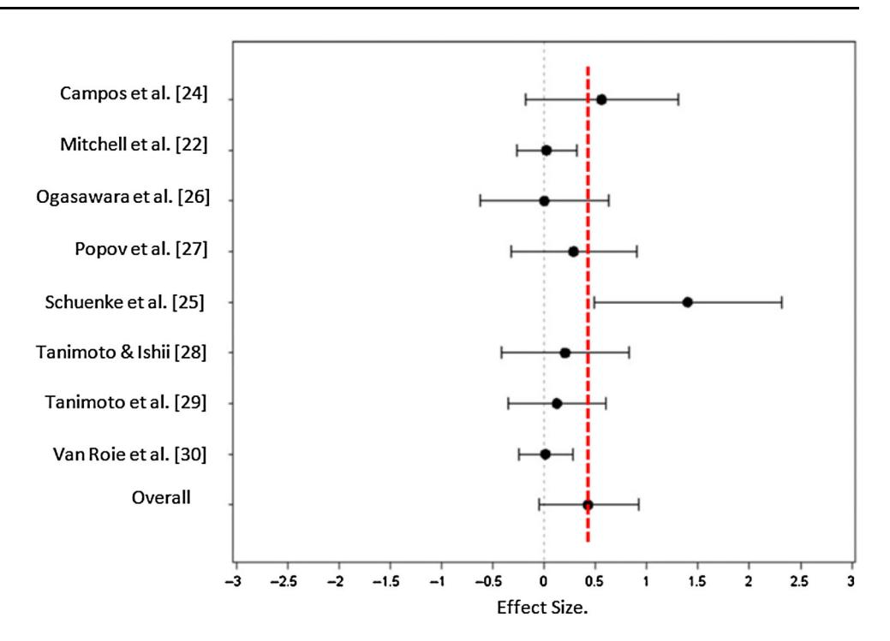

# High- and Low-Load Resistance Training: Interpretation and Practical Application of Current Research Findings

James Fisher1 • James Steele1 • Dave Smith2

-Springer International Publishing Switzerland 2016

Abstract Our current state of knowledge regarding the load (lighter or heavier) lifted in resistance training programmes that will result in 'optimal' strength and hypertrophic adaptations is unclear. Despite this, position stands and recommendations are made based on, we propose, limited evidence to lift heavier weights. Here we discuss the state of evidence on the impact of load and how it, as a single variable, stimulates adaptations to take place and whether evidence for recommending heavier loads is available, well-defined, currently correctly interpreted or has been overlooked. Areas of discussion include electromyography amplitude, in vivo and in vitro methods of measuring hypertrophy, and motor schema and skill acquisition. The present piece clarifies to trainers and trainees the impact of these variables by discussing interpretation of synchronous and sequential motor unit recruitment and revisiting the size principle, poor agreement between whole-muscle cross-sectional area (CSA) and biopsy-determined changes in myofibril CSA, and neural adaptations around task specificity. Our opinion is that the practical implications of being able to self-select external load include reducing the need for specific facility memberships, motivating older persons or those who might be less confident using heavy loads, and allowing people to

undertake home- or field-based resistance training intervention strategies that might ultimately improve exercise adherence.

#### Key Points

Current research is equivocal regarding the use of heavy or light loads for optimal strength and hypertrophic adaptations.

Misinterpretation of electromyography amplitude, differing hypertrophic assessment methods (e.g. in vivo and in vitro) and unconsidered motor schema research might present reasons behind the differing adaptations reported.

# 1 Introduction

The role of load within resistance training is presently a hotly discussed topic in exercise science. Recent reviews have examined existing studies comparing the effects of different loads on muscle function (e.g. strength and endurance) and hypertrophy. In these reviews, some authors have suggested that essentially the same adaptations are possible with both heavy loads (HLs) or light loads (LLs) when resistance training is continued to momentary failure [\[1](#page-5-0), [2](#page-5-0)]. In contrast, others suggest that inclusion of specifically LLs or HLs may be necessary for optimising certain adaptations [\[3–6](#page-5-0)]. We propose that 'heavy' and 'light' loading systems exist on a spectrum and are individual based on subjectivity; however, for clarity, HL and LL have been operationally defined as [65 %

&amp; James Fisher James.Fisher@solent.ac.uk

James Steele James.steele@solent.ac.uk

Dave Smith D.D.Smith@mmu.ac.uk

1 Southampton Solent University, East Park Terrace, Southampton SO14 0YN, UK

2 Manchester Metropolitan University, Crewe, UK

1 repetition maximum (RM) and \60 % 1 RM, respectively [[6\]](#page-5-0). A number of recent studies have been published, with some examining acute mechanistic differences resulting from difference in load and others comparing chronic changes in muscle function and hypertrophy. Unfortunately, we believe that some researchers may have inappropriately interpreted the data produced in these studies, with much of this attributable to incorrect inferences regarding motor unit (MU) recruitment in acute studies of electromyography (EMG) as well as different methods of measuring both muscle function and hypertrophy. With this in mind, in the present piece we aim to discuss why different exercise scientists might have given contrasting recommendations by discussing the factors that should be considered in interpretation of research in this area.

#### 2 Acute Electromyography Amplitude and the Size Principle

It is commonly accepted in the resistance training literature that recruitment of a MU is necessary in order for subsequent adaptation to occur [\[7](#page-5-0)]. Since discussions around optimal load for muscular adaptations are predicated on the belief that complete recruitment of MUs and thus muscle fibres is required for optimal adaptations, it is essential to consider acute EMG research within this area as well as briefly reconsider the size principle of MU recruitment. Recent studies have reported higher peak EMG amplitude for HLs than for LLs [[7](#page-5-0), [8](#page-6-0)], with one recent study showing increasing EMG amplitudes from 50 to 70 % and to 90 % 1RM [\[9](#page-6-0)]. From this, the authors of these studies have inferred that LLs do not maximally recruit all MU and as such HLs are favourable for development of strength and hypertrophy. However, such recommendations may be founded on an incorrect use and interpretation of EMG data relating to MU recruitment as well as a misapplication of the size principle.

For clarity, the size principle states that ''when the central nervous system recruits motor units for a specific activity it begins with the smallest, more easily excited, least powerful motor units and progresses to the larger, more difficult to excite, most powerful motor units to maintain or increase force'' [[10,](#page-6-0) [11\]](#page-6-0). However, as noted recently by Enoka and Duchateau [\[12](#page-6-0)], whilst EMG amplitude is influenced by MU recruitment strategies, many continue to mistakenly infer MU recruitment from amplitude data. For example, during a maximal voluntary contraction, more MUs, including both those of a low or high threshold, will be activated and at increased frequencies in order to produce maximal force. As such, the high MU recruitment would result in a higher EMG amplitude. In comparison, a sustained submaximal contraction would only recruit sufficient MUs to produce the necessary force; however, as those MUs fatigue, other MUs would be recruited to replace them in sustaining the desired force. Indeed, during fatiguing contractions the threshold for recruitment of higher-threshold MU is reduced, permitting their subsequent recruitment [[13\]](#page-6-0), and MUs may 'cycle' (momentary de-recruitment and recruitment of different MUs) during submaximal fatiguing contractions to reduce fatigue and maintain force [\[14](#page-6-0)]. Furthermore, the 'muscle wisdom hypothesis' suggests that during sustained contractions the MU discharge rate might decrease due to optimising the force output of MUs and protecting against peripheral conduction failure [\[15](#page-6-0), [16](#page-6-0)]. Should this decrease in discharge rate occur, there would be a resultant decrease in signal amplitude [\[17](#page-6-0)]. As such, whilst HLs would require more synchronous MU recruitment at greater frequencies (resulting in higher EMG amplitudes), sustained contractions to muscular failure with LLs might ultimately recruit all Mus, albeit sequentially (resulting in lower EMG amplitudes) rather than synchronously.

It should be noted that whether MU recruitment is ultimately similar between HLs and LLs remains a hypothesis that needs to be tested empirically. Examination of this would require more advanced handling of EMG data such as spike-triggered averaging [\[18](#page-6-0)] or initial wavelet analysis followed by principal component classification of major frequency properties and optimisation to tune wavelets to these frequencies [[19\]](#page-6-0). Though acute mechanistic data cannot be used to infer chronic adaptations, studies such as these recent EMG amplitude comparisons of HLs and LLs are useful for generating hypotheses for examination in chronic training interventions. However, the hypotheses presented by the authors of these recent studies suggesting that HLs may produce greater adaptations appear to stem from inappropriate interpretation of EMG amplitudes and consideration of the size principle.

### 3 Hypertrophic Adaptations

Common methods of measuring hypertrophy are in vivo (e.g. computed tomography [CT], magnetic resonance imaging [MRI] and ultrasound) and in vitro (e.g. muscle biopsy). Recent reviews have differed in their inclusion of studies using these methods with some opting to examine only in vivo measures of whole-muscle hypertrophy [[1\]](#page-5-0) and others considering both in vivo and in vitro measures [\[5](#page-5-0), [6\]](#page-5-0). In fact, methods used to measure hypertrophy, the information they can provide, and the strengths and weaknesses of both have been discussed in light of these publications [\[20](#page-6-0), [21](#page-6-0)]. We acknowledge that whilst both in vivo and in vitro methods present useful information, both offer very different information and the two should be interpreted individually and carefully.

In both a recent review [\[5](#page-5-0)] and meta-analysis [[6\]](#page-5-0) of hypertrophy in response to HLs and LLs, resistance training studies utilising both muscle biopsy and in vivo methods were considered, and in the meta-analysis were combined for analysis. However, the combination of in vivo and in vitro measures in this meta-analysis might have confounded the overall conclusions drawn in relation to other publications [\[1](#page-5-0)]. In support of this concern, a study by Mitchell et al. [\[22](#page-6-0)] that was included in the metaanalysis conducted both MRI and biopsy measures of hypertrophy in response to different resistance training loads and reported that relative increases appear to be greater for biopsy measures (mean = \*17–30 % type I and \*16–18 % type II; favouring LL and HL conditions, respectively, in terms of effect size [ES]) than for MRI (\*7 %; favouring the HL condition in terms of ES). McCall et al. [[23\]](#page-6-0) have also reported differences between muscle biopsy and MRI methods in magnitude of mean cross-sectional area (CSA) increase (biopsy = 10 % type I fibre and 17.1 % type II fibre vs. 12.6 % from MRI). It is not clear from the meta-analysis method section how the authors dealt with the inclusion of the different outcome measures for hypertrophy used by Mitchell et al. [[22\]](#page-6-0), i.e. whether they were dealt with separately or combined. Indeed, it has been noted [[20\]](#page-6-0) that in the earlier review [[5\]](#page-5-0) those studies using in vivo measures of whole-muscle hypertrophy consistently showed no difference between HLs and LLs, whereas the two in vitro studies using biopsies did show significantly greater gains for HLs. Whilst ultimately still not statistically significant (p = 0.076), the degree to which the combination of methods influenced the results of this meta-analysis in favour of greater ESs for HLs compared with LLs it is unclear (mean ± standard deviation [SD] LL = 0.39 ± 0.17; HL = 0.82 ± 0.17). In the aforementioned meta-analysis by Schoenfeld et al. [\[6](#page-5-0)], a forest plot of the ESs showed the impact of load on hypertrophy; this has been adapted and included as Fig. 1. When compared with the overall ES for all studies evaluated, it is noteworthy that studies with a higher ES than the overall value (e.g. right of the broken line in Fig. 1; Campos et al. [[24\]](#page-6-0) and Schuenke et al. [\[25](#page-6-0)]) used in vitro methods of measuring hypertrophy, whereas studies with a lower ES than the overall value (e.g. left of the broken line in Fig. 1; Mitchell et al. [\[22](#page-6-0)], Ogasawara et al. [[26\]](#page-6-0), Popov et al. [\[27](#page-6-0)], Tanimoto and Ishii [[28\]](#page-6-0), Tanimoto et al. [[29\]](#page-6-0), Van Roie et al. [\[30](#page-6-0)]) used in vivo methods of measuring hypertrophy. This suggests that combining these methods of measurement might have contaminated the analyses and overall outcome.

The use of in vitro measures such as muscle biopsy permits the examination of many important aspects of muscular adaptation, including individual fibre typing, individual fibre area, mitochondrial content, enzyme expression and capillarisation. Indeed, it has been suggested that fibre-type specific adaptations may occur in response to HL or LL training [\[31](#page-6-0)] and, though evidence is

Fig. 1 Forest plot showing the impact of load on hypertrophy by study. The broken red line represents the overall effect size. Studies to the right of the broken red line used in vitro methods to measure hypertrophy, whereas studies to the left of this line used in vivo methods. Plotted values represent mean muscle hypertrophy effect size difference between high- and low-load groups ± confidence interval Adapted from Schoenfeld et al. [[6](#page-5-0)], with permission

mixed at present as to whether this indeed occurs [\[22](#page-6-0), [32](#page-6-0), [33](#page-6-0)], biopsy would be necessary to test this hypothesis further. Pertinent to hypertrophy as an outcome, it has been argued that a case could be made for biopsy providing the most relevant information. This is because individual fibre area can be determined, thus allowing differentiation between contractile and non-contractile components [\[5](#page-5-0)]. However, it should be noted that evidence is equivocal regarding the agreement between wholemuscle CSA changes and biopsy-determined changes in myofibril CSA, with some studies suggesting a similar magnitude of relative change [[34,](#page-6-0) [35](#page-6-0)] whereas others do not [[36,](#page-6-0) [37\]](#page-6-0). In fact, authors have actually agreed that ''it might be true…that single fiber CSA data over-estimate whole muscle CSA'' [[38,](#page-6-0) [39](#page-6-0)]. Methods exist to ensure that sufficient tissue samples are obtained for analysis using biopsy, yet only a limited number of cells are assessed irrespective of method. In this sense, variation in fibre characteristics and non-uniform growth along the length of a muscle [[40\]](#page-6-0) provide notable limitations in attempting to extrapolate biopsy results to consider whole-muscle change [\[41](#page-6-0)]. However, measuring muscular adaptation using in vivo methods is not without issues: different methods (MRI, CT, ultrasound) can offer different information for both individual and whole muscle groups, including CSA, muscle thickness, muscle density, architectural changes such as pennation angle and changes in non-contractile components such as intra-muscular adipose tissue. Again pertinent to the outcome of hypertrophy, even consideration of whole-muscle changes in CSA or muscle thickness may not be fully reflective of morphological adaptation. CSA may also include non-contractile components and so increases may not entirely reflect muscular adaptations. Further, and conversely, prior studies have reported a lack of change in CSA yet significant increases in muscular density [[42\]](#page-6-0) in addition to disproportionate strength and CSA gains possibly being influenced by changes in muscle density [[43\]](#page-6-0).

In our opinion, the confounding factors discussed limit the integrity of any outcome data where analyses have combined these methods of measurement of hypertrophy. Furthermore, from a practical perspective, different outcomes may hold different value for persons with different goals. For example, those with aesthetic goals may have greater interest in wholemuscle changes irrespective of whether changes occur as a result of contractile or non-contractile components increasing, whereas those with more performance-specific goals may have greater interest in fibre-specific adaptations or changes in muscle density. As such, we believe that the different outcome methods, though both providing important information, ultimately provide different information and should be considered as such in interpretation.

### 4 Muscle Function Adaptations

Muscle function is often measured as either strength, relative endurance (repetitions performed at a submaximal percentage 1RM load) or absolute endurance (repetitions performed with an absolute submaximal load). The nature of testing mode for these can vary considerably, including free weights, resistance machines, and isokinetic or isometric dynamometers. Publications from the American College of Sports Medicine (ACSM) have suggested that HLs promote greater strength adaptations, whereas LLs may promote greater endurance adaptations (though it is not specified whether they refer to relative or absolute endurance) [[3,](#page-5-0) [4\]](#page-5-0). However, these claims have received criticism [[44,](#page-6-0) [45\]](#page-6-0) and authors of more recent reviews have reported similar increases in strength and absolute endurance adaptation irrespective of training load [[2,](#page-5-0) [10,](#page-6-0) [46](#page-6-0)]. The similar changes in strength and absolute endurance have been suggested as possibly due to the inherent relationship between the two outcomes [\[47,](#page-7-0) [48](#page-7-0)]. With this in mind, it is important to consider the nature of the measures of muscular function employed in studies considering HL and LL training.

The recent meta-analysis by Schoenfeld et al. [[6\]](#page-5-0) referred to in Sect. [3](#page-1-0) also examined a muscle function outcome (strength), again reporting no significant difference between HLs and LLs but a greater ES in the HL condition (mean ± SD LL = 1.23 ± 0.43; HL = 2.30 ± 0.43). However, again some studies have utilised differing methods of measuring muscle function within their designs. For example, Mitchell et al. [\[22](#page-6-0)] reported a number of different muscle function-related outcomes, including strength (1RM and isometric maximal voluntary contractions) and relative endurance (repetitions to failure with both 30 and 80 % 1RM loads in addition to total work). These varied with regards to whether changes significantly favoured the HL group (1RM and total work with 80 % 1RM) or the LL group (number of repetitions with 30 % 1RM). The authors of a more recent publication reported significantly greater strength adaptations for the back squat but not bench press: 1RM when using 70–80 % 1RM compared with 30–50 % 1RM (although larger ESs for bench press were noted for the HL group) [[49\]](#page-7-0). Further, changes in relative endurance (repetitions to failure using 50 % 1RM) were significantly greater for the LL group. Interestingly, there were no significant between-group (HL vs. LL) differences for hypertrophy of the elbow flexors, extensors and quadriceps muscles. In contrast, the same group of authors reported significantly greater increases in 1RM for bench press, but not back squat, when training with 3RM compared with 10RM [\[50](#page-7-0)]. Another paper included in the meta-analysis by Ogasawara et al. [[26\]](#page-6-0) found no difference in elbow extension isokinetic strength between HL and LL groups but did find a difference for bench press 1RM. As with studies included in the hypertrophy component of this meta-analysis, it is not clear how different outcomes were handled for these studies [\[22](#page-6-0), [26\]](#page-6-0) and, for reasons described below, this may have similarly impacted the ESs in favour of HL conditions.

It is interesting to consider the reasons for the divergent results within these studies and to consider the testing modes employed. We propose that one reason as to why there might be differing strength and hypertrophic adaptations might be that of skill specificity in motor recruitment [[51\]](#page-7-0). Motor control research suggests that a motor schema is highly specific to the task being practised [\[52](#page-7-0), [53](#page-7-0)], and though it could be argued that the higher number of repetitions associated with LL training could suggest a greater volume of practice favouring those conditions, motor schemata have also been reported to be load-/force-specific [\[54](#page-7-0)]. With this in mind, lifting a heavier load in a particular movement might serve to practise and refine that schema as a skill, which would include the maximal synchronous recruitment of MUs and muscle fibres. This is a key reason why most maximal testing protocols include some sort of familiarisation or practice component within exercise science research [\[55](#page-7-0)]. Indeed the results of Mitchell et al. [\[22](#page-6-0)] support this contention: though the HL group had a greater increase in 1RM, possibly due to the motor schema refinement that likely occurred from training closer to their maximal load, there were no differences between the HL and LL groups for peak isometric maximal voluntary contraction, maximal power output or rate of force development. The tendency for greater strength gains in the HL groups in the studies by Schoenfeld et al. [[49](#page-7-0), [50](#page-7-0)] may also be due to this specificity of motor schema refinement. Further, the 1RM tasks measured were compound free-weight movements (squat and bench press) which have been shown to require multiple (\*3 to 5) familiarisation sessions even in moderately trained persons due to continued increases in 1RM [\[56](#page-7-0)], and improvements during these tasks are likely attributable to neural and learning effects [\[57](#page-7-0)]. In support of this are the results from Ogasawara et al. [[26\]](#page-6-0) who reported significantly greater gains in bench press 1RM for the HL group but found no differences between groups for elbow extension strength. Thus, in the studies mentioned the apparent superiority of HLs in enhancing strength may simply reflect better learning of the specific skills involved in the testing. In contrast, more simple strength tasks such as dynamometry of isolated joint movements require less refinement of motor schemata evidenced by the requirement for only a single familiarisation session to achieve reliable results [[58,](#page-7-0) [59](#page-7-0)]. However, that single familiarisation session is still essential to achieve valid results, and therefore even with such simple tasks there is clearly a skill learning element to testing results. In our opinion, researchers should therefore bear the specificity principle in mind when comparing the results of different training protocols, as the similarity of training and testing protocols is likely a key factor.

#### 5 Exertion and Discomfort

We also speculate that a secondary reason for the differing results in these studies [[22,](#page-6-0) [49](#page-7-0), [50](#page-7-0)], particularly with respect to the changes in relative endurance, may relate to exertion and associated discomfort. The differentiation between perceptions of effort and discomfort have been highlighted recently as important [\[60](#page-7-0)], particularly within resistance training [[61\]](#page-7-0), for good reason.

Shimano et al. [\[62](#page-7-0)] considered rating of perceived exertion (RPE) values in trained and untrained persons performing a single set to momentary failure at 60, 80 and 90 % 1RM for back squat, bench press and arm curl. The authors reported no significant differences in RPE between load and exercise performed, with the exception of a significantly higher exertion for the back squat at 60 % 1RM in trained persons (mean ± SD 8.8 ± 0.7 vs. 6.9 ± 1.9). This might suggest that the volume of repetitions preceding momentary failure may have produced a greater degree of discomfort resulting in a higher RPE value. Indeed, further research has shown that when performing multiple sets to momentary failure, mean (±SD) RPE increases significantly from set one (50 % 1RM = 7.40 ± 1.96 vs. 70 % 1RM = 7.73 ± 1.44) to set two (50 % 1RM = 8.60 ± 0.99 vs. 70 % 1RM = 8.73 ± 0.80) to set three (50 % 1RM = 9.33 ± 0.82 vs. 70 % 1RM = 9.47 ± 0.74) with no difference between different loads [\[63](#page-7-0)]. We have quite specifically termed this discomfort rather than exertion for the following reason. The authors of these studies reported that participants exercised to momentary failure with verbal encouragement to ensure adequate motivation and effort, and RPE was measured using a Borg CR10 scale [\[64](#page-7-0)], where a value of 10 indicates maximal effort. In this case, each trial, irrespective of exercise, load or training status should have resulted in a maximal value for effort since participants were exercising to momentary failure. However, as participants did not report maximal values we can only assume that the participants were unclear how to report their perception of effort and, as such, potentially expressed their feelings of discomfort. Again, despite also using the Borg CR10 RPE scale and having participants train to momentary failure, Pritchett et al. [\[65](#page-7-0)] also reported RPE values of less than 10 for both acute and session RPE. However, RPE was significantly higher for the 60 % 1RM condition compared with 90 % 1RM, suggesting the LL with a higher number of repetitions incurred higher discomfort than training at a HL. Based on this, we hypothesise that people might find it more difficult to reach momentary failure with a LL because of higher discomfort. As such, studies comparing HL and LL training where participants are said to have trained to momentary failure might be limited by high discomfort in the LL group, preventing participants from reaching true momentary failure. We propose that in comparisons of HL and LL groups the conduct of reaching momentary failure becomes all the more important in a LL group to maximally, sequentially recruit all possible MUs. However, we should acknowledge that at present there are insufficient studies comparing LL training to momentary failure and not to momentary failure to determine how much of a meaningful difference a final repetition (e.g. reaching 'true' momentary failure) might make towards chronic adaptations.

## 6 Conclusion

When considering the findings of studies comparing the effects of HLs and LLs, there are a number of important factors to consider. These include the different outcomes related to morphological changes providing differing information, skill associated with the testing mode chosen (both load and task), and other psychosocial factors such as discomfort. We contend that different testing modes evidently reflect different outcomes and, indeed, they may hold different values for persons with different goals. Again, it is possible that HLs or LLs may favour certain outcomes and not impact on others. For example, if solely wishing to improve maximal strength of a specific task (such as a powerlifter wishing to improve back squat, deadlift or bench press) a recommendation might be to perform these specific exercises using HLs to attempt to catalyse both morphological and neural adaptations [[50\]](#page-7-0). In contrast, those more interested in improving muscular force production for health parameters or in a way that might be widely transferable may be able to utilise a variety of loading schemes [[22\]](#page-6-0).

We hope that the present piece has catalysed a more open mindset toward some of the factors that must be considered with regards to interpretation of studies examining HLs and LLs in resistance training. The discussion of resistance training load is pertinent since most strength coaches first consider maximal strength testing in order to then make training recommendations based on percentage 1RM. The purpose of this piece is not necessarily to challenge others' recommendations regarding this topic; rather, we hope to provide practitioners with the necessary understanding to interpret presently existing research on the topic and recommendations surrounding it that may on the surface seem to be contradictory. The impact of load in resistance training may produce differential adaptations in different aspects of morphology or function. Thus, persons should first consider their desired training goals and then decide whether evidence would appear to suggest that the manipulation of load might impact those goals differentially. If the effect of load is presently equivocal for a particular outcome, there are potentially numerous practical implications of being able to self-select an external load. These include reducing the need for specific facility memberships (e.g. where specifically HLs are available), motivating older persons or those who might be less confident using HLs, and allowing people to undertake homeor field-based resistance training intervention strategies. Ultimately these might serve to improve exercise adherence. As a final caveat to the content discussed, we recognise that there is very likely a threshold load (below which continued recruitment would not be produced because of the recovery capacity of utilised MUs and muscle fibres, and thus preventing true momentary failure from ever being reached) that, if not exceeded, might produce suboptimal adaptations. However, this has not been identified empirically in any literature and is likely very individual, and possibly based on individual mechanics and muscle fibre type.

#### Compliance with Ethical Standards

Funding No sources of funding were used to assist in the preparation of this article.

Conflict of interest James Fisher, James Steele and Dave Smith declare that they have no conflicts of interest relevant to the content of this article.

# References

- 1. Fisher J, Steele J, Smith D. Evidence-based resistance training recommendations for muscular hypertrophy. Med Sport. 2013;17(4):217–35.
- 2. Fisher J, Steele J, Bruce-Low S, et al. Evidence-based resistance training recommendations. Med Sport. 2011;15(3):147–62.
- 3. Kraemer WJ, Adams K, Cafarelli E, et al. Progression models in resistance training for healthy adults. Med Sci Sports Exerc. 2002;34:364–80.
- 4. Ratamess NA, Alvar BA, Evetoch TK, et al. Progression models in resistance training for healthy adults. Med Sci Sports Exerc. 2009;41(3):687–708.
- 5. Schoenfeld B. Is there a minimum intensity threshold for resistance training-induced hypertrophic adaptations? Sports Med. 2013;43(12):1279–88.
- 6. Schoenfeld BJ, Wilson JM, Lowery RP, et al. Muscular adaptations in low-versus high-load resistance training: a meta-analysis. Eur J Sport Sci. 2016;16(1):1–10.
- 7. Schoenfeld BJ, Contreras B, Willardson JM, et al. Muscle activation during low- versus high-load resistance training in welltrained men. Eur J Appl Physiol. 2014;114(12):2491–7.

- 8. Jenkins ND, Housh TJ, Bergstrom HC, et al. Muscle activation during three sets to failure at 80 vs. 30 % 1RM resistance exercise. Eur J Appl Physiol. 2015;115(11):2335–47.
- 9. Looney DP, Kraemer WJ, Joseph MF, et al. Electromyographical and perceptual responses to different resistance intensities in a squat protocol: does performing sets to failure with light loads produce the same activity? J Strength Cond Res. 2016;30(3):729–99.
- 10. Denny-Brown D, Pennybacker JB. Fibrillation and fasciculation in voluntary muscle. Brain. 1938;61(3):311–2.
- 11. Carpinelli R. The size principle and a critical analysis of the unsubstantiated heavier-is-better recommendation for resistance training. J Exerc Sci Fit. 2008;6:67–86.
- 12. Enoka RM, Duchateau J. Inappropriate interpretation of surface EMG signals and muscle fiber characteristics impedes progress on understanding the control of neuromuscular function. J Appl Physiol. 2015;119(12):1516–8.
- 13. Adam A, De Luca CJ. Recruitment order of motor units in human vastus lateralis muscle is maintained during fatiguing contractions. J Neurophysiol. 2003;90:2919–27.
- 14. Westad C, Westgaard RH, De Luca CJ. Motor unit recruitment and derecruitment induced by brief increase in contraction amplitude of the human trapezius muscle. J Physiol. 2003;552:645–56.
- 15. Petrofsky JS, Phillips CA. Discharge characteristics of motor units and the surface EMG during fatiguing isometric contractions at submaximal tensions. Aviat Space Environ Med. 1985;56:581–6.
- 16. Behm DG. Force maintenance with submaximal fatiguing contractions. Can J Appl Physiol. 2004;29(3):274–90.
- 17. Garland SJ, Gossen R. The muscular wisdom hypothesis in human muscle fatigue. Exerc Sport Sci Rev. 2002;30(1):45–9.
- 18. Boe SG, Stashuk DW, Doherty TJ. Motor unit number estimation by decomposition-enhanced spike-triggered averaging: control data, test-retest reliability, and contractile level effects. Muscle Nerve. 2004;29:693–9.
- 19. Hodson-Tole EF, Wakeling JM. Variations in motor unit recruitment patterns occur within and between muscles in the running rat (Rattus norvegicus). J Exp Biol. 2007;210:2333–45.
- 20. Steele J, Fisher J. Scientific rigour: a heavy or light load to carry? [letter]. Sports Med. 2014;44(1):141–2.
- 21. Schoenfeld B. Author's reply to Steele and Fisher: ''Scientific rigour: a heavy or light load to carry?'': the importance of maintaining objectivity in drawing evidence-based conclusions [letter]. Sports Med. 2014;44:143–5.
- 22. Mitchell CJ, Churchward-Venne TA, West DW, et al. Resistance exercise load does not determine training-mediated hypertrophic gains in young men. J Appl Physiol. 2012;113(1):71–7.
- 23. McCall GE, Byrnes WC, Dickinson A, et al. Muscle fiber hypertrophy, hyperplasia, and capillary density in college men after resistance training. J Appl Physiol. 1996;81(5):2004–12.
- 24. Campos GER, Luecke TJ, Wendeln HK, et al. Muscular adaptations in response to three different resistance training regimens: specificity of repetition maximum training zones. Eur J Appl Physiol. 2002;88(1–2):50–60.
- 25. Schuenke MD, Herman JR, Gliders RM, et al. Early phase muscular adaptations in response to slow-speed versus traditional resistance-training regimens. Eur J Appl Physiol. 2012;2012(112):3585–95.
- 26. Ogasawara R, Loenneke JP, Thiebaud RS, Abe T. Low-load bench press training to fatigue results in muscle hypertrophy similar to high-load bench press training. Int J Clin Med. 2013;4:114–21.
- 27. Popov DV, Tsvirkun DV, Netreba AI, et al. Hormonal adaptation determines the increase in muscle mass and strength during lowintensity strength training without relaxation. Human Physiol. 2006;32(5):609–14.
  - 28. Tanimoto M, Ishii N. Effects of low-intensity resistance exercise with slow movement and tonic force generation on muscular function in young men. J Appl Physiol. 2006;100:1150–7.
  - 29. Tanimoto M, Sanada K, Yamamoto K, et al. Effects of wholebody low-intensity resistance training with slow movement and tonic force generation on muscular size and strength in young men. J Strength Cond Res. 2008;22:1926–38.
  - 30. Van Roie E, Delecluse C, Coudyzer W, et al. Strength training at high versus low external resistance in older adults: effects on muscle volume, muscle strength, and force-velocity characteristics. Exp Geront. 2013;48:1351–61.
  - 31. Ogborn D, Schoenfeld BJ. The role of fiber types in muscle hypertrophy: implications for loading strategies. Strength Cond J. 2014;36(2):20–5.
  - 32. Vinogradova OL, Popov DV, Netreba AI, et al. Optimization of training: new developments in safe strength training. Hum Physiol. 2013;39(5):511–23.
  - 33. Netreba A, Popov D, Yam Bravyy, et al. Responses of knee extensor muscles to leg press training of various types in human. Russian J Physiol. 2013;99(3):406–16.
  - 34. Hather BM, Adams GR, Tesch PE, et al. Skeletal muscle responses to lower limb suspension in humans. J Appl Physiol. 1992;72(4):1493–8.
  - 35. Oates BR, Glover EI, West DW, et al. Low-volume resistance exercise attenuates the decline in strength and muscle mass associated with immobilization. Muscle Nerve. 2010;42(4):539–46.
  - 36. Adams GR, Bamman MM. Characterization and regulation of mechanical loading-induced compensatory muscle hypertrophy. Compr Physiol. 2012;2(4):2829–71.
  - 37. Verdijk LB, Gleeson BG, Jonkers RAM, et al. Skeletal muscle hypertrophy following resistance training is accompanied by a fiber-type specific increase in satellite cell content in elderly men. J Gerontol. 2009;64A(3):332–9.
  - 38. Burd NA, Moore DR, Mitchell CJ, et al. Big claims for big weights but with little evidence. Eur J Appl Physiol. 2013;113(1):267–8.
  - 39. Schuenke MD, Herman J, Staron RS. Preponderance of evidence proves ''big'' weights optimize hypertrophic and strength adaptations. Eur J Appl Physiol. 2013;113(1):269–71.
  - 40. Wakahara T, Fukutani A, Kawakami Y, et al. Nonuniform muscle hypertrophy: its relation to muscle activation in training session. Med Sci Sports Exerc. 2013;45(11):2158–65.
  - 41. Lexell J, Taylor CC. A morphometrical comparison of right and left whole human vastus lateralis muscle: how to reduce sampling errors in biopsy techniques. Clin Physiol. 1991;11(3):271–6.
  - 42. Lemon PWR, Tarnopolsky MA, MacDougall JD, et al. Protein requirements and muscle mass/strength changes during intensive training in novice bodybuilders. J Appl Physiol. 1992;73(2):767–75.
  - 43. Jones DA, Rutherford OM. Human muscle strength training: the effects of three different regimes and the nature of resultant changes. J Physiol. 1987;391:1–11.
  - 44. Carpinelli R, Otto RM, Winett RA. A critical analysis of the ACSM position stand on resistance training: insufficient evidence to support recommended training protocols. J Exerc Physiol. 2004;7:1–60.
  - 45. Carpinelli R. Challenging the American College of Sports Medicine 2009 position stand on resistance training. Med Sport. 2009;13:131–7.
  - 46. Jungblut S. The correct interpretation of the size principle and its practical application to resistance training. Med Sport. 2009;13(4):203–9.

- 47. Hickson RC, Hidaka K, Foster C. Skeletal muscle fibre-type, resistance training, and strength-related performance. Med Sci Sports Exerc. 1994;26:593–8.
- 48. Mazzetti SA, Kraemer WJ, Volek JS, et al. The influence of direct supervision of resistance training on strength performance. Med Sci Sports Exerc. 2000;32(6):1175–84.
- 49. Schoenfeld BJ, Peterson MD, Ogborn D, et al. Effects of lowversus high-load resistance training on muscle strength and hypertrophy in well-trained men. J Strength Cond Res. 2015;29(10):2954–63.
- 50. Schoenfeld BJ, Ratamess NA, Peterson MD, et al. Effects of different volume-equated resistance training loading strategies on muscular adaptations in well-trained men. J Strength Cond Res. 2014;28(10):2909–18.
- 51. Behm DG, Sale DG. Velocity specificity of resistance training. Sports Med. 1993;15(6):347–88.
- 52. Drowatzky JN, Zuccato FC. Interrelationships between selected measures of static and dynamic balance. Res Q. 1967;38:509–10.
- 53. Mount J. Effect of practice of a throwing skill in one body position on performance of the skill in an alternate position. Percept Mot Skills. 1996;83:723–32.
- 54. Schmidt RA. Motor schema theory after 27 years: reflections and implications for a new theory. Res Q Exerc Sport. 2003;74(4):366–75.
- 55. Brown LE, Weir JP. ASEP procedures recommendation I: accurate assessment of muscular strength and power. J Exerc Physiol. 2001;4(3):1–21.
- 56. Soares-Caldeira LF, Ritt-Dias RM, Okuno NM, et al. Familiarization indexes in sessions of 1-RM tests in adult women. J Strength Cond Res. 2009;23(7):2039–45.
- 57. Cronin JB, Henderson ME. Maximal strength and power assessment in novice weight trainers. J Strength Cond Res. 2007;18(1):48–52.
- 58. Graves JE, Pollock ML, Carpenter DM, et al. Quantitative assessment of full range-of-motion isometric lumbar extension strength. Spine. 1990;15(4):289–94.
- 59. Welsch MA, Williams PA, Pollock ML, et al. Quantification of full-range-of-motion unilateral and bilateral knee flexion and extension torque ratios. Arch Phys Med Rehabil. 1998;79(8):971–8.
- 60. Marcora S. Perception of effort during exercise is independent of afferent feedback from the skeletal muscles, heart, and lungs. J Appl Physiol. 2009;106:2060–2.
- 61. Steele J. Intensity; in-ten-si-ty; noun. 1. Often used ambiguously within resistance training. 2. Is it time to drop the term altogether? Br J Sports Med. 2014;48(22):1586–8.
- 62. Shimano T, Kraemer WJ, Spiering BA, et al. Relationship between the number of repetitions and selected percentages of one repetition maximum in free weight exercises in trained and untrained men. J Strength Cond Res. 2006;20:819–23.
- 63. Silva VL, Azevedo AP, Cordeiro JP, et al. Effects of exercise intensity on perceived exertion during multiple sets of bench press to volitional failure. J Trainol. 2014;3:41–6.
- 64. Borg GA. Psychophysical bases of perceived exertion. Med Sci Sports Exerc. 1982;14:377–81.
- 65. Pritchett RC, Green JM, Wickwire PJ, et al. Acute and session RPE responses during resistance training: bouts to failure at 60% and 90% of 1RM. S Afr J Sports Med. 2009;21(1):23–6.