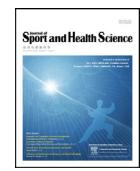
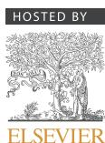
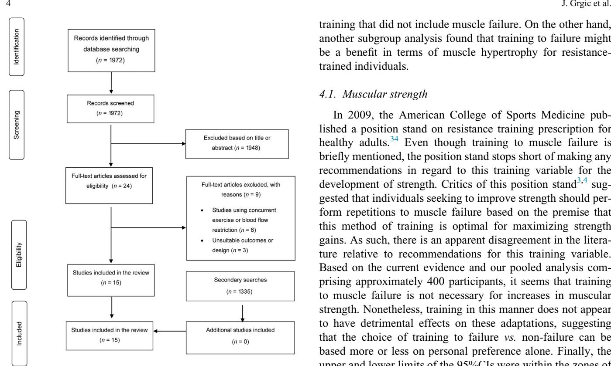
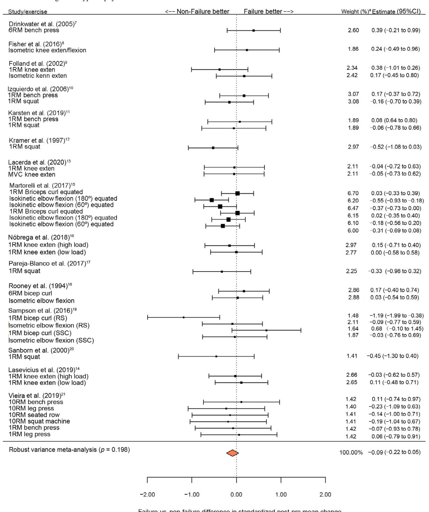
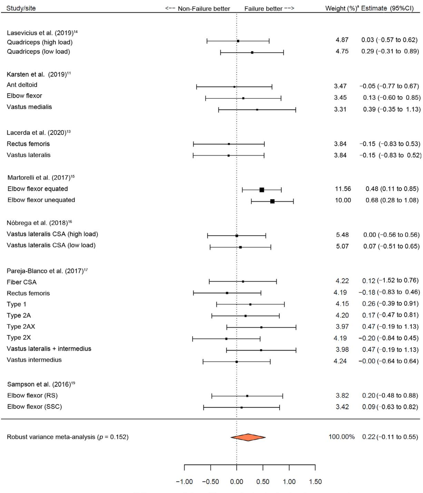

# Review

# Effects of resistance training performed to repetition failure or non-failure on muscular strength and hypertrophy: A systematic review and meta-analysis

Jozo Grgic [a](#page-0-0) , Brad J. Schoenfeld [b](#page-0-1), [\\*](#page-0-2), John Orazem [c](#page-0-3) , Filip Sabol [d](#page-0-4),[e](#page-0-5)

a Institute for Health and Sport (IHES), Victoria University, Melbourne 3011, Australia

b Department of Health Sciences, Lehman College, Bronx, NY 10468, USA

c School of Health Sciences, Human Services and Nursing, Lehman College, Bronx, NY 10468, USA

d Fitness Academy, Zagreb 10000, Croatia

e Faculty of Kinesiology, University of Zagreb, Zagreb 10000, Croatia

Received 25 July 2020; revised 20 September 2020; accepted 6 November 2020

2095-2546/ 2021 Published by Elsevier B.V. on behalf of Shanghai University of Sport. This is an open access article under the CC BY-NC-ND license [\(http://creativecommons.org/licenses/by-nc-nd/4.0/\)](http://creativecommons.org/licenses/by-nc-nd/4.0/)

#### Abstract

Purpose: We aimed to perform a systematic review and meta-analysis of the effects of training to muscle failure or non-failure on muscular strength and hypertrophy.

Methods: Meta-analyses of effect sizes (ESs) explored the effects of training to failure vs. non-failure on strength and hypertrophy. Subgroup meta-analyses explored potential moderating effects of variables such as training status (trained vs. untrained), training volume (volume equated vs. volume non-equated), body region (upper vs. lower), exercise selection (multi- vs. single-joint exercises (only for strength)), and study design (independent vs. dependent groups).

Results: Fifteen studies were included in the review. All studies included young adults as participants. Meta-analysis indicated no significant difference between the training conditions for muscular strength (ES = 0.09; 95% confidence interval (95%CI): 0.22 to 0.05) and for hypertrophy (ES = 0.22; 95%CI: 0.11 to 0.55). Subgroup analyses that stratified the studies according to body region, exercise selection, or study design showed no significant differences between training conditions. In studies that did not equate training volume between the groups, the analysis showed significant favoring of non-failure training on strength gains (ES = 0.32; 95%CI: 0.57 to 0.07). In the subgroup analysis for resistance-trained individuals, the analysis showed a significant effect of training to failure for muscle hypertrophy (ES = 0.15; 95%CI:

0.030.26). Conclusion: Training to muscle failure does not seem to be required for gains in strength and muscle size. However, training in this manner does not seem to have detrimental effects on these adaptations, either. More studies should be conducted among older adults and highly trained individuals to improve the generalizability of these findings.

Keywords: 1RM; Cross-sectional area; Data synthesis; Muscle size

#### 1. Introduction

According to Henneman's size principle, motor units are recruited in an orderly fashion.[1](#page-9-0) This principle dictates that as force production requirements increase, motor units are recruited according to the magnitude of their force output, with small motor units being recruited first.[2](#page-9-1) Theoretically, in a resistance exercise set using moderate loads, lower threshold

motor units associated with Type I muscle fibers are initially recruited to lift the load.[2](#page-9-1)[4](#page-9-1) As the lower threshold motor units become fatigued, increased recruitment occurs of the higher threshold motor units associated with Type II muscle fibers in order to maintain force production.[2](#page-9-1)[4](#page-9-1) Therefore, performing resistance exercise sets to momentary muscular failure (i.e., the maximum number of possible repetitions in a given set) is thought to be necessary to recruit all possible motor units.[3](#page-9-2)[,4](#page-9-3) Accordingly, some suggest this manner of training is optimal for achieving resistance training-induced increases in muscular strength and muscle size.[3,](#page-9-2)[4](#page-9-3) Peer review under responsibility of Shanghai University of Sport.

[Journal of Sport and Health Science 00 \(2021\) 1](https://doi.org/)[10](https://doi.org/)

\* Corresponding author.

E-mail address: [bradschoenfeldphd@gmail.com](mailto:bradschoenfeldphd@gmail.com) (B.J. Schoenfeld).

Given the hypothesis that training to muscle failure is important for catalyzing resistance training-induced adaptations, several studies examined the effects that this type of training has on muscular strength and hypertrophy, as compared to the effects of training that does not include reaching muscle failure.[5](#page-9-4)[21](#page-9-4) However, detailed scrutiny of these studies highlights inconsistent findings. For example, some report that training to muscle failure results in greater increases in muscular strength and/or hypertrophy.[5](#page-9-4)[,18](#page-9-5) However, others suggest that both training options (i.e., training either to or not to muscle failure) can produce similar improvements with respect to these outcomes.[9](#page-9-6)[,16](#page-9-7) Some studies even indicate that training to failure has a detrimental effect.[5,](#page-9-4)[6](#page-9-8) The inconsistent evidence on this topic currently hinders the ability to draw practical recommendations for training program design.

In an attempt to provide greater clarity on the equivocal evidence on this topic, Davies and colleagues[22](#page-9-9)[,23](#page-9-10) performed a meta-analysis in which they pooled studies comparing the effects of training to muscle failure vs. non-failure on muscular strength gains. The analysis included 8 studies and indicated no significant difference between training to or not to muscle failure in terms of increases in muscular strength. Of the 8 studies included in this review, four equated training volume between the groups and four did not equate training volume. Since publication of the meta-analysis by Davies et al.,[22,](#page-9-9)[23](#page-9-10) 8 additional studies have been published that examine the topic.[8,](#page-9-11)[11,](#page-9-12)[13](#page-9-13)[17,](#page-9-13)[21](#page-9-14) Thus, an updated meta-analysis would theoretically have approximately a 2-fold increase in the number of included studies. Furthermore, while the effects of training to or not to muscle failure on muscular strength have been explored via meta-analysis, the same is not true for hypertrophy. Therefore, in this review, we performed an updated metaanalysis exploring the effects of training to failure on muscular strength as well as conducted the first meta-analysis exploring the effects of training to muscle failure on hypertrophy outcomes.

### 2. Methods

#### 2.1. Search strategy

We performed the systematic review following the Preferred Reporting Items for Systematic Reviews and Meta-Analyses (PRISMA) guidelines.[24](#page-9-15) Electronic searches of PubMed/MEDLINE, Scopus, and SPORTDiscus databases were conducted using the following search syntax: ("resistance training" OR "resistance exercise" OR "strength training" OR "strength exercise" OR "weight training" OR "weight exercise") AND ("repetition failure" OR "failure training" OR "non-failure training" OR "non failure training" OR "muscular failure" OR "muscle failure" OR "to failure" OR "not to failure" OR "without resting" OR "volitional interruption" OR "high fatigue" OR "low fatigue") AND ("1 repetition maximum" OR "1 RM" OR "1RM" OR "one repetition maximum" OR "MVC" OR "maximal voluntary contraction" OR "muscle strength" OR "muscular strength" OR "muscle hypertrophy" OR "muscular hypertrophy" OR "muscle fibre" OR "muscle fiber" OR "muscle thickness" OR "CSA" OR

"cross-sectional area" OR "muscle size"). In addition to the primary search, we performed secondary searches by examining the reference lists of the included studies and by conducting forward citation tracking (i.e., examining studies that have cited the included studies) in the Scopus database. Two authors of the review (JG and BJS) conducted these searches independently. Following the initial searches, the lists of included and excluded studies were compared between the authors. Any discrepancies between them were resolved through discussion and agreement. The search was finalized on January 2, 2020.

#### 2.2. Inclusion criteria

Based on the following criteria, we included studies that: (a) randomized participants (of any age) to the experimental groups; (b) compared the effects of resistance training to versus not to muscle failure; (c) assessed changes in muscular strength and/or hypertrophy; (d) had a training protocol lasting for a minimum of 6 weeks; and (e) involved apparently healthy participants. For muscular strength outcomes, we considered studies that used either isometric or dynamic tests, or both. For muscular hypertrophy, we considered studies that assessed changes at the muscle fibre and/or whole muscle level. We considered studies with independent sample groups as well as those with dependent sample groups. We did not include studies that used blood flow restriction resistance training or concurrent training interventions (e.g., combined resistance and aerobic training).

#### 2.3. Data extraction

From each included study, we extracted the following data: (a) lead author name and year of publication; (b) sample size and participant characteristics, including age and resistance training experience; (c) details of the resistance training programs; (d) muscular strength test(s) used and/or the site and tool used for the muscular hypertrophy assessment; and (e) pre- and post-intervention mean § SD of the strength and/or hypertrophy outcomes. Data extraction was performed independently by 2 authors (JG and BJS). Any discrepancies in the extracted data were resolved through discussion and consensus.

#### 2.4. Methodological quality

We assessed the methodological quality of the included studies using the 27-item Downs and Black checklist.[25](#page-9-16) This checklist addresses different aspects of the study design, including: reporting (Items 110), external validity (Items 1113), internal validity (Items 1426), and statistical power (Item 27). Given the specificity of the included studies (i.e., exercise intervention), we modified the checklist by adding 2 items, one pertaining to the training programs (Item 28) and one to training supervision (Item 29)[.22,](#page-9-9)[26](#page-9-17)[28](#page-9-17) On this checklist, each item is scored with "1" if the criterion is satisfied and with "0" if the criterion is not satisfied. Based on the summary score, studies were classified as being of: "good quality" (2129 points), "moderate quality" (1120 points), or "poor quality" (less than 11 points).[22](#page-9-9)[,26,](#page-9-17)[27](#page-9-18) Studies were independently rated by 2 reviewers (JG and FS) who settled any observed differences with discussion and agreement.

# 2.5. Statistical analyses

For each hypertrophy or strength outcome, the contrast between the training to failure vs. non-failure groups was calculated as the difference in effect sizes (ESs), where the ES was determined as the posttest-pretest mean change in each group, divided by the pooled pretest standard deviation, and multiplied by an adjustment for small sample bias[.29](#page-9-19) ESs were interpreted as: "small" (-0.20), "moderate" (0.210.50), "large" (0.510.80), and "very large" (>0.80).[30](#page-9-20) ESs are presented with their respective 95% confidence interval (95% CI). The variance of the difference in ESs depends on the withinsubject posttest-pretest correlation, which was not available from the published data for many of the studies. Among studies for which this correlation could be estimated (back-solving from paired t test p values or SD of posttestpretest change scores, when presented), the median value was 0.86; the moderately conservative value of 0.75 was used to calculate the variance for all studies. Sensitivity analyses (not presented) were performed using correlations ranging from 0.25 to 0.85; results were consistent with those using 0.75. Typically, when studies report multiple ESs, one approach is to use study average ES, but this may result in a loss of information[.31](#page-9-21) Therefore, we used a robust variance meta-analysis model, with adjustments for small samples, to account for correlated ESs within studies.[32](#page-9-22) This meta-analysis model is specifically designed to be used when dealing with dependent ESs (e.g., multiple strength tests in a single study).31 Meta-analysis was conducted separately for the hypertrophy outcomes and strength outcomes. In addition, subgroup analyses were performed to explore the effects of training status (trained vs. untrained), training volume (volume equated vs. volume not equated), body region (upper vs. lower), exercise selection (multi vs. single-joint exercises (only for strength)), and study design (independent vs. dependent groups). For hypertrophy outcomes, a sensitivity analysis was performed in which the muscle fibre data was excluded from the analysis. Publication bias was checked by examining funnel plot asymmetry and calculating trim-and-fill estimates. The trim-and-fill estimates (not presented) were similar to the main results. Calculations were performed using the robumeta package within R (Version 3.6.1; the R Foundation for Statistical Computing, Vienna, Austria).[33](#page-9-23) All meta-analyses were performed using the robust variance random effects model. Effects were considered statistically significant at a p value of <0.05.

## 3. Results

# 3.1. Search results

The primary search resulted in 1972 potentially relevant references. Of these results, 15 studies[7](#page-9-24)[21](#page-9-24) were identified that satisfied the inclusion criteria. A screening of the reference lists of the included studies and an examination of newer studies that cite them resulted in an additional 591 and 744 results, respectively. However, we did not find any additional relevant studies in the secondary searches. Therefore, the final number of included studies was 15, as presented in [Fig. 1](#page-3-0). [7](#page-9-24)[21](#page-9-24)

#### 3.2. Study characteristics

Fifteen studies explored muscular strength outcomes [\(Table 1](#page-4-0)). The pooled number of participants in the studies was 394 (265 males and 129 females). All participants in the studies were young adults. The sample sizes in the individual studies ranged from 9 to 89 participants, with a median of 25. Six studies included resistance-trained participants, while the others were conducted on untrained individuals [\(Table 1\)](#page-4-0). The duration of the training programs ranged from 6 to 14 weeks, with a median of 8. Training frequency ranged from 2 to 3 days per week. Muscular strength was most commonly assessed using the 1-repetition maximum (1RM) test. Other strength tests included the 6RM and 10RM, as well as different isometric or isokinetic strength (e.g., knee extension, elbow flexion).

Seven studie[s11,](#page-9-12)[13](#page-9-13)[17](#page-9-13)[,19](#page-9-25) explored hypertrophy outcomes [\(Table 1](#page-4-0)). The pooled number of participants across studies was 219 (130 males and 89 females). All participants in the studies were young adults. In the individual studies, sample sizes ranged from 10 to 89 participants, with a median of 25. Two studies[11,](#page-9-12)[17](#page-9-26) involved resistance-trained participants, while the others employed untrained individuals as study participants [\(Table 1\)](#page-4-0). Resistance training programs in the studies lasted between 6 and 14 weeks (10 on average) with a training frequency of 23 days per week. Hypertrophy was most commonly assessed by the changes in muscle cross-sectional area or thickness of the quadriceps muscle. Some studies assessed alternative sites for muscle thickness, such as the elbow flexor and anterior deltoid. One study also assessed cross-sectional area changes in Type I and Type II muscle fibers.

# 3.3. Methodological quality

The median score on the modified Downs and Black checklist was 21 (range: 1924 points). Five studies[7](#page-9-24)[,14](#page-9-27)[,18](#page-9-5)[20](#page-9-5) were classified as being of moderate methodological quality, whereas all other studies were considered to be of good methodological quality ([Table 2\)](#page-5-0). None of the studies were classified as being of low quality.

# 3.4. Meta-analysis results

When considering all available studies, the meta-analysis for muscular strength gains indicated no significant difference between the training conditions (p = 0.198; ES = 0.09; 95%CI: 0.22 to 0.05; [Fig. 2\)](#page-6-0). Subgroup analysis for studies that did not equate training volume showed a moderate significant effect favoring non-failure training on strength gains (p = 0.025; ES = 0.32; 95%CI: 0.57 to 0.07). In the subgroup analyses for studies that did equate training volume, however, there was no significant difference between training

conditions with respect to strength gains (p = 0.860; ES = 0.01; 95%CI: 0.12 to 0.15). Subgroup analyses that stratified the studies according to training status, body region, exercise selection, or study design showed no significant differences between training conditions ([Table 3](#page-7-0)).

When considering all available studies, the meta-analysis for hypertrophy indicated no significant difference between the training conditions (p = 0.152; ES = 0.22; 95%CI: 0.11 to 0.55; [Fig. 3](#page-8-0)). The sensitivity analysis did not have a meaningful impact on the results. Notably, in the subgroup analysis for resistance-trained individuals, the analysis showed that training to failure had a significant effect on muscle hypertrophy (p = 0.039; ES = 0.15; 95%CI: 0.030.26). Subgroup analyses that stratified the studies according to training volume, body region, or study design, however, did not demonstrate significant differences between training conditions ([Table 3](#page-7-0)).

#### 4. Discussion

The results of this systematic review and meta-analysis suggest that training to muscle failure may produce similar increases in muscular strength and muscle size as non-failure training. This finding remained consistent among subgroup analyses, which suggests that the impact of training to failure is not likely to be moderated by variables such as body region, exercise selection, or study design. The subgroup analysis of studies that did not equate training volume between the groups stood out because it found that muscular strength gains favored

training that did not include muscle failure. On the other hand, another subgroup analysis found that training to failure might be a benefit in terms of muscle hypertrophy for resistancetrained individuals.

#### 4.1. Muscular strength

In 2009, the American College of Sports Medicine published a position stand on resistance training prescription for healthy adults.[34](#page-9-28) Even though training to muscle failure is briefly mentioned, the position stand stops short of making any recommendations in regard to this training variable for the development of strength. Critics of this position stand[3](#page-9-2)[,4](#page-9-3) suggested that individuals seeking to improve strength should perform repetitions to muscle failure based on the premise that this method of training is optimal for maximizing strength gains. As such, there is an apparent disagreement in the literature relative to recommendations for this training variable. Based on the current evidence and our pooled analysis comprising approximately 400 participants, it seems that training to muscle failure is not necessary for increases in muscular strength. Nonetheless, training in this manner does not appear to have detrimental effects on these adaptations, suggesting that the choice of training to failure vs. non-failure can be based more or less on personal preference alone. Finally, the upper and lower limits of the 95%CIs were within the zones of small to moderate ES suggesting that even if there were a benefit to either of these methods of training, the benefit is likely to be negligible for most individuals.

As previously noted, the subgroup analysis for training volume showed significant favoring for the effects of non-failure training on muscular strength gains. However, in the majority of studies that did not equate training volume between the groups, participants that did not train to muscle failure performed more sets (i.e., more volume) than did the individuals training to muscle failure.[12](#page-9-29),[17](#page-9-26)[,19,](#page-9-25)[20](#page-9-30) For example, in a study done by Kramer et al.,[12](#page-9-29) the group that trained to muscle failure performed a single set per exercise for 812 repetitions, whereas the group that did not train to muscle failure performed three sets of 10 repetitions (while not reaching muscle failure). This is relevant to emphasize because it has been previously shown that training volume increases strength in a linear doseresponse manner.[35](#page-9-31) Therefore, the significant effect of training that does not include muscle failure seems to be primarily related to the differences in training volume between the groups. Indeed, when considering only studies that equated for training volume between the groups, the pooled ES amounted to 0.01 nested within a 95%CI of 0.12 to 0.15, suggesting highly similar increases in strength regardless of whether an individual does or does not reach failure during training.

# 4.2. Muscle hypertrophy

The meta-analysis for hypertrophy outcomes suggests that similar increases in muscle size can be attained regardless of whether or not training is carried out to muscle failure. This

Fig. 1. Flow diagram of the search process.

TableSummaryofstudiesincludedinthereview.

| Study                                 | Participants                                                                           | Training load                                                        | Set and repetition scheme                                                                                                                          | Volume equated | Training duration and weekly frequency | Assessed outcomes                                                                           |
|---------------------------------------|----------------------------------------------------------------------------------------|----------------------------------------------------------------------|----------------------------------------------------------------------------------------------------------------------------------------------------|----------------|----------------------------------------|---------------------------------------------------------------------------------------------|
| Drinkwater et al. (2005) 7 | 26 elite junior male team game players with previous experience in resistance training | Failure: 80%–105% 6RM Non-failure: 80%–105% 6RM                   | Failure: 4 sets $\times$ 6 repetitions Non-failure: 8 sets $\times$ 3 repetitions                                                               | Yes            | 6 weeks, 3 days per week               | 6RM bench press                                                                             |
| Fisher et al. (2016) 8     | 9 young untrained men                                                                  | Failure: 80% of maximal torque Non-failure: 80% of maximal torque | Failure: 25 repetitions in as few sets as possible Non-failure: 5 sets $\times$ 5 repetitions                                                   | Yes            | 6 weeks, 2 days per week               | Isometric knee extension and flexion                                                        |
| Folland et al. (2002) 9    | 23 young untrained men and women                                                       | Failure: 75% 1RM Non-failure: 75% 1RM                             | Failure: 4 sets $\times$ 10 repetitions Non-failure: 40 repetitions with 30 of rest between each repetition                                     | Yes            | 9 weeks, 3 days per week               | 1RM and isometric knee extension                                                            |
| Izquierdo et al. (2006) 10 | 29 young male Basque ball players with previous experience in resistance training      | Failure: 6–10RM, or 80% 6–10RM Non-failure: 6–10RM, or 80% 6–10RM | Failure: 3 sets $\times$ 6–10 repetitions Non-failure: 6 sets $\times$ 3–5 repetitions                                                          | Yes            | 11 weeks, 2 days per week              | 1RM bench press and squat                                                                   |
| Karsten et al. (2019) 11   | 18 young resistance-trained men                                                        | Failure: 75% 1RM Non-failure: 75% 1RM                             | Failure: 4 sets $\times$ 10 repetitions Non-failure: 8 sets $\times$ 5 repetitions                                                              | Yes            | 6 weeks, 2 days per week               | 1RM bench press and squat, vastus medialis, elbow flexor, anterior deltoid muscle thickness |
| Kramer et al. (1997) 12    | 30 young resistance-trained men                                                        | Failure: 8–12RM Non-failure: 90%–100 % 10RM                       | Failure: 1 set $\times$ 8–12 repetitions Non-failure: 3 sets $\times$ 10 repetitions                                                            | No             | 14 weeks, 3 days per week              | 1RM squat                                                                                   |
| Lacerda et al. (2020) 13   | 10 young untrained men                                                                 | Failure: 50%–60% 1RM Non-failure: 50%–60% 1RM                     | Failure: 3–4 sets performed to failure Non-failure: total number of repetitions in the group training to failure was divided into multiple sets | Yes            | 14 weeks, 2–3 days per week            | 1RM and isometric knee exten                                                                |

means that, based on the current body of literature, training to momentary muscle failure does not seem to be required for increases in muscle size. However, we should again highlight that training to muscle failure does not appear to produce any detrimental effects on muscle hypertrophy. Still, it should be considered that the upper limit of the 95%CI in this analysis was 0.55, which is in the range of a large effect. Therefore, while we did not show significant differences between training to failure vs. non-failure, the wide 95%CI also underlines the need for future research on the topic.

The subgroup analysis performed for resistance-trained participants indicated that, for them, training to failure had a significant effect on muscle hypertrophy. Indeed, it is conceivable that, as an individual approaches his or her genetic ceiling for muscular adaptations, a greater intensity of effort may be required to elicit further gains. However, this analysis was limited by the small number of included studies. Specifically, only 2 studies[11](#page-9-12),[17](#page-9-26) were included: one that equated training volume between the groups, and one that did not. While the results presented in our review offer preliminary support for training to failure in resistance-trained participants, future studies are needed to provide greater clarity on the influence of training status when exercise variables are strictly controlled, particularly in highly trained individuals.

The finding observed in the main meta-analysis for hypertrophy could be explained by the loads used in the majority of included studies. In general, studies used moderate to high loads (e.g., 60%90% 1RM) in their resistance training programs [\(Table 1\)](#page-4-0). This aspect is relevant because the upper limit of motor unit recruitment is thought to be around 60%85% of maximum force (depending on the muscle group)[.36](#page-9-47)[38](#page-9-47) In other words, when exercising with such training loads, high-threshold motor units tend to be recruited from the onset of the exercise, and the additional increase in force beyond the upper limit of motor unit recruitment is accomplished by rate coding.[36](#page-9-47)[38](#page-9-47) Therefore, training to muscle failure may not be needed for motor unit recruitment when using moderate or high loads. However, it should be noted that simply because a fiber has been recruited does not mean that it has been sufficiently stimulated to hypertrophy. Thus, while the level of recruitment may provide a partial mechanistic explanation of these findings, it would appear that other factors are involved as well.[39](#page-9-48)

Recently, it has been hypothesized that training to muscle failure becomes increasingly more important when exercising with lower loads (e.g., 30% of maximum force), due to the delayed recruitment of larger motor units[.40](#page-9-49) In support of this idea, Lasevicius et al.[14](#page-9-27) compared training to muscle failure vs. non-failure with loads of 30% and 80% 1RM. The study used a within-subject unilateral design whereby one limb trained to failure at the given load and the other did not. Results indicated that training to failure promoted greater increases in muscle size in groups training with low loads. Alternatively, in the groups performing high-load training, similar increases in muscle size were noted with and without training to muscle failure. Nobrega et al.[16](#page-9-7) performed a similar

Table2ResultsofthemethodologicalqualityassessmentusingthemodifiedDownsandBlackchecklist.

| Study                                     | Reporting (Items 1–10) |   |   |   |   |   |   |   |   |                |                |                |                | External validity (Items 11–13) |    |    |                |                |                | Internal validity (Items 14–26) |                |    |                |    |                 | Power, compliance, supervision (Items 27–29) |    |    |    |    |  | Total score |
|-------------------------------------------|------------------------|---|---|---|---|---|---|---|---|----------------|----------------|----------------|----------------|---------------------------------|----|----|----------------|----------------|----------------|---------------------------------|----------------|----|----------------|----|-----------------|----------------------------------------------|----|----|----|----|--|-------------|
|                                           | 1                      | 2 | 3 | 4 | 5 | 6 | 7 | 8 | 9 | 10             | 11             | 12             | 13             | 14                              | 15 | 16 | 17             | 18             | 19             | 20                              | 21             | 22 | 23             | 24 | 25              | 26                                           | 27 | 28 | 29 |    |  |             |
| Drinkwater et al. (2005) 7     | 1                      | 1 | 1 | 1 | 1 | 1 | 0 | 1 | 0 | 1              | 0 a | 1              | 0 a | 0 a                  | 1  | 1  | 1              | 0 a | 1              | 1                               | 0 a | 1  | 1              | 0  | 1               | 1                                            | 0  | 1  | 1  | 20 |  |             |
| Fisher et al. (2016) 8         | 1                      | 1 | 1 | 1 | 1 | 1 | 0 | 1 | 1 | 0 a | 1              | 0 a | 0 a | 1                               | 1  | 1  | 0 a | 1              | 1              | 0 a                  | 1              | 1  | 0              | 1  | 1               | 0                                            | 1  | 1  | 21 |    |  |             |
| Folland et al. (2002) 9        | 1                      | 1 | 1 | 1 | 1 | 1 | 0 | 0 | 1 | 0 a | 1              | 0 a | 0 a | 1                               | 1  | 1  | 1              | 1              | 1              | 0 a                  | 1              | 1  | 0 a | 1  | 1               | 1                                            | 21 |    |    |    |  |             |
| Izquierdo et al. (2006) 10     | 1                      | 1 | 1 | 1 | 1 | 1 | 0 | 0 | 1 | 0 a | 1              | 0 a | 0 a | 1                               | 1  | 1  | 1              | 1              | 1              | 1                               | 0 a | 1  | 1              | 0  | 1               | 1                                            | 23 |    |    |    |  |             |
| Karsten et al. (2019) 11       | 1                      | 1 | 1 | 1 | 1 | 1 | 0 | 1 | 1 | 0 a | 1              | 0 a | 0 a | 1                               | 1  | 1  | 1              | 1              | 1              | 0 a                  | 1              | 1  | 0              | 1  | 1               | 23                                           |    |    |    |    |  |             |
| Kramer et al. (1997) 12        | 1                      | 1 | 1 | 1 | 0 | 1 | 1 | 1 | 0 | 0 a | 1              | 0 a | 0 a | 1                               | 1  | 1  | 1              | 1              | 0 a | 1                               | 0 a | 0  | 1              | 1  | 21              |                                              |    |    |    |    |  |             |
| Lacerda et al. (2020) 13       | 1                      | 1 | 1 | 1 | 1 | 1 | 1 | 1 | 1 | 0 a | 1              | 0 a | 0 a | 1                               | 1  | 1  | 1              | 1              | 0 a | 1                               | 0 a | 0  | 1              | 1  | 24              |                                              |    |    |    |    |  |             |
| Lasevicius et al. (2019) 14    | 1                      | 1 | 1 | 1 | 1 | 1 | 0 | 1 | 0 | 0 a | 1              | 0 a | 0 a | 1                               | 1  | 1  | 0 a | 1              | 1              | 0 a                  | 1              | 1  | 0              | 1  | 1               | 19                                           |    |    |    |    |  |             |
| Martorelli et al. (2017) 5     | 1                      | 1 | 1 | 1 | 1 | 1 | 1 | 0 | 1 | 0 a | 1              | 0 a | 0 a | 1                               | 1  | 1  | 1              | 1              | 0 a | 1                               | 1              | 1  | 1              | 1  | 1               | 22                                           |    |    |    |    |  |             |
| Nóbrega et al. (2018) 16       | 1                      | 1 | 1 | 1 | 1 | 1 | 1 | 1 | 1 | 0 a | 1              | 0 a | 0 a | 1                               | 1  | 1  | 1              | 1              | 0 a | 1                               | 0 a | 1  | 1              | 1  | 24              |                                              |    |    |    |    |  |             |
| Pareja-Blanco et al. (2017) 17 | 1                      | 1 | 1 | 1 | 0 | 1 | 1 | 1 | 1 | 0 a | 1              | 0 a | 0 a | 1                               | 1  | 1  | 1              | 1              | 0 a | 1                               | 0 a | 0  | 1              | 1  | 23              |                                              |    |    |    |    |  |             |
| Rooney et al. (1994) 18        | 1                      | 1 | 1 | 1 | 1 | 1 | 0 | 0 | 1 | 0 a | 1              | 0 a | 0 a | 1                               | 1  | 1  | 0 a | 1              | 1              | 0 a                  | 1              | 1  | 0              | 1  | 1               | 20                                           |    |    |    |    |  |             |
| Sampson et al. (2016) 19       | 1                      | 1 | 1 | 1 | 0 | 1 | 1 | 0 | 1 | 0 a | 1              | 0 a | 0 a | 1                               | 1  | 1  | 1              | 1              | 0 a | 1                               | 0 a | 0  | 1              | 1  | 20 a |                                              |    |    |    |    |  |             |
| Sanborn et al. (2000) 20       | 1                      | 1 | 1 | 1 | 0 | 1 | 1 | 1 | 1 | 0 a | 1              | 0 a | 0 a | 1                               | 1  | 1  | 1              | 1              | 0 a | 1                               | 0 a | 0  | 1              | 1  | 20              |                                              |    |    |    |    |  |             |
| Vieira et al. (2019) 21        | 1                      | 1 | 1 | 1 | 1 | 1 | 1 | 1 | 1 | 0 a | 1              | 0 a | 0 a | 1                               | 1  | 1  | 1              | 1              | 0 a | 1                               | 0 a | 0  | 1              | 1  | 23              |                                              |    |    |    |    |  |             |

Itemwasunabletobedetermined,scored0.Criteriamet;criterianotmet.

experiment and reported comparable hypertrophy effects in both high and low-load training groups, regardless of whether or not they trained to failure. However, in this study, the groups not training to failure performed only 12 repetitions less per set than the group training to failure. In the Lasevicius et al.[14](#page-9-27) study, the limb that did not exercise to failure, trained with 60% of the total repetitions (per set) performed by the limb that trained to failure; additional sets were added to match the total number of repetitions between the conditions. These methodological differences are likely to account for the conflicting evidence. As such, this is an area requiring further scientific attention.

Fig. 2. The forest plot from the meta-analysis of the effects of training to failure vs. non-failure on muscular strength. The x-axis denotes Cohen's d (ES) while the whiskers denote the 95%CI. a The sum of the percentages is not 100% due to the rounding. 95%CI = 95% confidence interval; MVC = maximal voluntary contraction; RS = rapid speed; SSC = stretch-shortening cycle .

# 4.3. Generalizability of the results

While this meta-analysis showed no significant differences between the effects of training to muscle failure or non-failure on muscle strength and hypertrophy, these results are specific to the population analyzed in all included studies—young adults. Therefore, future work is needed to explore the effects of training to failure vs. non-failure among middle-aged and older adults. Additionally, our results are specific to studies that used isolated traditional resistance training programs. There is evidence that avoiding muscle failure may be important when using blood flow restriction training and in concurrent exercise programs.[5](#page-9-4),[6,](#page-9-8)[41](#page-9-52) For example, in a study by Carroll et al.,[5](#page-9-4) the participants coupled resistance training with a low-volume sprint interval training. While this study did not satisfy our inclusion criteria due to its utilization of concurrent exercise programs, its results did indicate that failure training had a detrimental effect on muscle hypertrophy in resistancetrained men. Therefore, the findings presented herein cannot necessarily be generalized to adaptations that occur with concurrent training.

#### 4.4. Areas for future research

Although our findings provide evidence that consistently training to failure is not obligatory for enhancing muscular strength and hypertrophy, the current literature is not sufficient to determine the level of effort necessary to maximize these adaptations. It is currently unclear whether the same effects would be achieved if an individual stops the set, for example, 5 repetitions before failure vs. 2 repetitions before failure. Future research should seek to quantify the lower threshold as to how many repetitions short of failure would be sufficient to elicit an optimal adaptive response. This should be quantified across various repetition ranges, as the relative magnitude of load will necessarily influence results.

#### 4.5. Methodological quality and limitations

All included studies were classified as being of moderate or good methodological quality. Therefore, the results presented in this review are not confounded by the inclusion of studies that were of low methodological quality. However, there is one significant limitation noted in some of the included studies. Specifically, 5 studies did not report participants' adherence to the training programs ([Table 2](#page-5-0)). In the studies that did report adherence to the training interventions, it was very similar between the groups ([Table 1](#page-4-0)). Thus, while there is no reason to believe that adherence was not similar between the groups in papers that did not report these data, future studies should ensure that this information is clearly presented.

An important methodological consideration of this review is that we included studies with independent groups as well as those with dependent groups. In a design with dependent groups, limbs are assigned to perform one of 2 training routines (e.g., either training to or not to failure). This design has certain advantages, such as minimizing the variability in responses between individuals. Still, this model's limitation is the possible cross-education effect, which dictates that training one limb increases strength in both limbs.[42](#page-9-53) However, we also conducted subgroup analyses where the studies were stratified according to their study design. There was no significant difference between training to failure vs. non-failure in subgroup analyses for studies with independent vs. dependent groups, therefore reinforcing the primary analysis results. As mentioned previously, training to muscle failure may be more important with lower as opposed to higher loads. In the present review, we included studies that utilized both high and low loads in their respective training routines, which might be a limitation of the review, even though it should be considered that only 2 studies used very low loads (i.e., 30% 1RM).[14,](#page-9-27)[16](#page-9-7)

#### 5. Conclusion

The findings of this review suggest that training to or not to muscle failure may produce similar increases in muscular strength and muscle size. This finding generally remained consistent in subgroup analyses that stratified the studies according to body region, exercise selection, or study design. Still, when volume was not controlled for, there was favoring of non-failure training on strength gains, as well as favoring of training to failure for hypertrophy in resistance-trained individuals. More studies should be conducted among older adults and highly trained individuals in order to improve the generalizability of these findings.

Table 3 Results of the subgroup meta-analyses.

| Subgroup analysis Classification |         | ES (95%CI) |       |        |          |         | p     |
|----------------------------------|---------|------------|-------|--------|----------|---------|-------|
| Outcome: muscular strength       |         |            |       |        |          |         |       |
| Training status Trained          |         |  0.09     | (     |  0.48 | to       | 0.29)   | 0.554 |
| Untrained                        |         |  0.08     | (     |  0.22 | to       | 0.06)   | 0.224 |
| Training volume Volume           | equated | 0.01       | (     |  0.12 | to       | 0.15)   | 0.860 |
| Non-volume                       | equated |  0.32     | (     |  0.57 | to       |  0.07) | 0.025 |
| Body region Lower                | body    |  0.15     | (     |  0.33 | to       | 0.02)   | 0.079 |
| Upper                            | body    | 0.00       | (     |  0.35 | to       | 0.35)   | 0.985 |
| Strength test                    |         |            |       |        |          |         |       |
| Multi-joint                      |         |  0.13     | (     |  0.47 | to       | 0.21)   | 0.386 |
| Single-joint                     |         |  0.05     | (     |  0.20 | to       | 0.09)   | 0.405 |
| Study design Independent         | groups  |  0.12     | (     |  0.31 | to       | 0.06)   | 0.157 |
| Dependent                        | groups  | 0.03       | (     |  0.18 | to       | 0.23)   | 0.709 |
| Outcome: muscle hypertrophy      |         |            |       |        |          |         |       |
| Training status Trained          |         | 0.15       | (0.03 |        | to 0.26) |         | 0.039 |
| Untrained                        |         | 0.23       | (     |  0.25 | to       | 0.71)   | 0.244 |
| Training volume Volume           | equated | 0.15       | (     |  0.15 | to       | 0.45)   | 0.237 |
| Non-volume                       | equated | 0.36       | (     |  0.52 | to       | 1.23)   | 0.218 |
| Body region Lower                | body    | 0.07       | (     |  0.11 | to       | 0.26)   | 0.323 |
| Upper                            | body    | 0.41       | (     |  0.83 | to       | 1.65)   | 0.220 |
| Study design Independent         | groups  | 0.36       | (     |  0.27 | to       | 0.99)   | 0.147 |
| Dependent                        | groups  | 0.03       | (     |  0.33 | to       | 0.38)   | 0.773 |

Note: Negative values denote favoring of non-failure training and positive values indicate favoring of training to muscle failure.

Abbreviations: 95%CI = 95% confidence interval; ES = effect size.

#### Authors' contributions

JG conceived the idea for the review, and performed the searches, data extraction, and methodological quality assessment, as well as drafted the manuscript; BJS conceived the idea for the review, performed the searches and data extraction, and critically revised the manuscript content; JO analyzed the data and critically revised the manuscript content; FS performed the methodological quality assessment and critically revised the manuscript content. All authors have read and approved the final version of the manuscript, and agree with the order of presentation of the authors.

# Competing interests

The authors declare that they have no competing interest.

Fig. 3. The Forest plot from the meta-analysis on the effects of training to failure vs. non-failure on muscle hypertrophy. The x-axis denotes Cohen's d (ES) while the whiskers denote the 95%CI. a The sum of the percentages is not 100% due to the rounding. 95%CI = 95% confidence interval; CSA = cross-sectional area; RS = rapid speed; SSC = stretch-shortening cycle.

- References
- 1. [Henneman E, Somjen G, Carpenter DO. Functional significance of cell](http://refhub.elsevier.com/S2095-2546(21)00007-7/sbref0001) [size in spinal motoneurons.](http://refhub.elsevier.com/S2095-2546(21)00007-7/sbref0001) J Neurophysiol 1965;28:560–80.
- 2. [Sale DG. Influence of exercise and training on motor unit activation.](http://refhub.elsevier.com/S2095-2546(21)00007-7/sbref0002) [Exerc Sport Sci Rev](http://refhub.elsevier.com/S2095-2546(21)00007-7/sbref0002) 1987;15:95–151.
- 3. [Fisher J, Steele J, Bruce-Low S, Smith D. Evidence-based resistance train](http://refhub.elsevier.com/S2095-2546(21)00007-7/sbref0003)[ing recommendations.](http://refhub.elsevier.com/S2095-2546(21)00007-7/sbref0003) Med Sport 2011;15:147–62.
- 4. [Fisher J, Steele J, Smith D. Evidence-based resistance training recommen](http://refhub.elsevier.com/S2095-2546(21)00007-7/sbref0004)[dations for muscular hypertrophy.](http://refhub.elsevier.com/S2095-2546(21)00007-7/sbref0004) Med Sport 2013;17:217–35.
- 5. Carroll KM, Bazyler CD, Bernards JR, et al. Skeletal muscle fiber adaptations following resistance training using repetition maximums or relative intensity. Sports (Basel) 2019;7:169. doi:[10.3390/sports7070169.](https://doi.org/10.3390/sports7070169)
- 6. [Carroll KM, Bernards JR, Bazyler CD, et al. Divergent performance out](http://refhub.elsevier.com/S2095-2546(21)00007-7/sbref0006)[comes following resistance training using repetition maximums or relative](http://refhub.elsevier.com/S2095-2546(21)00007-7/sbref0006) intensity. [Int J Sports Physiol Perform](http://refhub.elsevier.com/S2095-2546(21)00007-7/sbref0006). 2018:1–28.
- 7. [Drinkwater EJ, Lawton TW, Lindsell RP, Pyne DB, Hunt PH, McKenna](http://refhub.elsevier.com/S2095-2546(21)00007-7/sbref0007) [MJ. Training leading to repetition failure enhances bench press strength](http://refhub.elsevier.com/S2095-2546(21)00007-7/sbref0007) [gains in elite junior athletes.](http://refhub.elsevier.com/S2095-2546(21)00007-7/sbref0007) J Strength Cond Res 2005;19:382–8.
- 8. [Fisher JP, Blossom D, Steele J. A comparison of volume-equated knee](http://refhub.elsevier.com/S2095-2546(21)00007-7/sbref0008) [extensions to failure, or not to failure, upon rating of perceived exertion](http://refhub.elsevier.com/S2095-2546(21)00007-7/sbref0008) and strength adaptations. [Appl Physiol Nutr Metab](http://refhub.elsevier.com/S2095-2546(21)00007-7/sbref0008) 2016;41:168–74.
- 9. [Folland JP, Irish CS, Roberts JC, Tarr JE, Jones DA. Fatigue is not a nec](http://refhub.elsevier.com/S2095-2546(21)00007-7/sbref0009)[essary stimulus for strength gains during resistance training.](http://refhub.elsevier.com/S2095-2546(21)00007-7/sbref0009) Br J Sports Med 2002;36[:370–3.](http://refhub.elsevier.com/S2095-2546(21)00007-7/sbref0009)
- 10. [Izquierdo M, Iba](http://refhub.elsevier.com/S2095-2546(21)00007-7/sbref0010)~n[ez J, Gonz](http://refhub.elsevier.com/S2095-2546(21)00007-7/sbref0010)[alez-Badillo JJ, et al. Differential effects of](http://refhub.elsevier.com/S2095-2546(21)00007-7/sbref0010) [strength training leading to failure versus not to failure on hormonal](http://refhub.elsevier.com/S2095-2546(21)00007-7/sbref0010) [responses, strength, and muscle power gains.](http://refhub.elsevier.com/S2095-2546(21)00007-7/sbref0010) J Appl Physiol (1985) 2006;100[:1647–56.](http://refhub.elsevier.com/S2095-2546(21)00007-7/sbref0010)
- 11. [Karsten B, Fu YL, Larumbe-Zabala E, Seijo M, Naclerio F. Impact of two](http://refhub.elsevier.com/S2095-2546(21)00007-7/sbref0011) [high-volume set configuration workouts on resistance training outcomes](http://refhub.elsevier.com/S2095-2546(21)00007-7/sbref0011) [in recreationally trained men.](http://refhub.elsevier.com/S2095-2546(21)00007-7/sbref0011) J Strength Cond Res 2021;35(Suppl. 1): [S136–43.](http://refhub.elsevier.com/S2095-2546(21)00007-7/sbref0011)
- 12. [Kramer JB, Stone MH, O'Bryant HS, et al. Effects of single](http://refhub.elsevier.com/S2095-2546(21)00007-7/sbref0012) vs. multiple [sets of weight training: impact of volume, intensity, and variation.](http://refhub.elsevier.com/S2095-2546(21)00007-7/sbref0012) J [Strength Cond Res](http://refhub.elsevier.com/S2095-2546(21)00007-7/sbref0012) 1997;11:143–7.
- 13. [Lacerda LT, Marra-Lopes RO, Diniz RCR, et al. Is performing repetitions](http://refhub.elsevier.com/S2095-2546(21)00007-7/sbref0013) [to failure less important than volume for muscle hypertrophy and](http://refhub.elsevier.com/S2095-2546(21)00007-7/sbref0013) strength? [J Strength Cond Res](http://refhub.elsevier.com/S2095-2546(21)00007-7/sbref0013) 2020;34:1237–48.
- 14. Lasevicius T, Schoenfeld BJ, Silva-Batista C, et al. Muscle failure promotes greater muscle hypertrophy in low-load but not in high-load resistance training. J Strength Cond Res 2019. doi[:10.1519/](https://doi.org/10.1519/JSC.0000000000003454) [JSC.0000000000003454.](https://doi.org/10.1519/JSC.0000000000003454) Epub ahead of print.
- 15. Martorelli S, Cadore EL, Izquierdo M, et al. Strength training with repetitions to failure does not provide additional strength and muscle hypertrophy gains in young women. Eur J Transl Myol 2017;27:6339. doi:[10.4081/ejtm.2017.6339](https://doi.org/10.4081/ejtm.2017.6339).
- 16. [N](http://refhub.elsevier.com/S2095-2546(21)00007-7/sbref0016)[obrega SR, Ugrinowitsch C, Pintanel L, Barcelos C, Libardi CA. Effect](http://refhub.elsevier.com/S2095-2546(21)00007-7/sbref0016) [of resistance training to muscle failure](http://refhub.elsevier.com/S2095-2546(21)00007-7/sbref0016) vs. volitional interruption at high[and low-intensities on muscle mass and strength.](http://refhub.elsevier.com/S2095-2546(21)00007-7/sbref0016) J Strength Cond Res 2018;32[:162–9.](http://refhub.elsevier.com/S2095-2546(21)00007-7/sbref0016)
- 17. [Pareja-Blanco F, Rodr](http://refhub.elsevier.com/S2095-2546(21)00007-7/sbref0017)[ıguez-Rosell D, S](http://refhub.elsevier.com/S2095-2546(21)00007-7/sbref0017)a[nchez-Medina L, et al. Effects of](http://refhub.elsevier.com/S2095-2546(21)00007-7/sbref0017) [velocity loss during resistance training on athletic performance, strength](http://refhub.elsevier.com/S2095-2546(21)00007-7/sbref0017) [gains and muscle adaptations.](http://refhub.elsevier.com/S2095-2546(21)00007-7/sbref0017) Scand J Med Sci Sports 2017;27:724–35.
- 18. [Rooney KJ, Herbert RD, Balnave RJ. Fatigue contributes to the strength](http://refhub.elsevier.com/S2095-2546(21)00007-7/sbref0018) training stimulus. [Med Sci Sports Exerc](http://refhub.elsevier.com/S2095-2546(21)00007-7/sbref0018) 1994;26:1160–4.
- 19. [Sampson JA, Groeller H. Is repetition failure critical for the development](http://refhub.elsevier.com/S2095-2546(21)00007-7/sbref0019) [of muscle hypertrophy and strength?](http://refhub.elsevier.com/S2095-2546(21)00007-7/sbref0019) Scand J Med Sci Sports 2016;26[:375–83.](http://refhub.elsevier.com/S2095-2546(21)00007-7/sbref0019)
- 20. [Sanborn K, Boros R, Hruby J, et al. Short-term performance effects of](http://refhub.elsevier.com/S2095-2546(21)00007-7/sbref0020) [weight training with multiple sets not to failure](http://refhub.elsevier.com/S2095-2546(21)00007-7/sbref0020) vs. a single set to failure in women. [J Strength Cond Res](http://refhub.elsevier.com/S2095-2546(21)00007-7/sbref0020) 2000;14:328–31.
- 21. [Vieira JG, Dias MRC, Lacio M, et al. Resistance training with repetition](http://refhub.elsevier.com/S2095-2546(21)00007-7/sbref0021) [to failure or not on muscle strength and perceptual responses.](http://refhub.elsevier.com/S2095-2546(21)00007-7/sbref0021) JEPonline 2019;22[:165–75.](http://refhub.elsevier.com/S2095-2546(21)00007-7/sbref0021)
- 22. [Davies T, Orr R, Halaki M, Hackett D. Effect of training leading to repeti](http://refhub.elsevier.com/S2095-2546(21)00007-7/sbref0022)[tion failure on muscular strength: a systematic review and meta-analysis.](http://refhub.elsevier.com/S2095-2546(21)00007-7/sbref0022) [Sports Med](http://refhub.elsevier.com/S2095-2546(21)00007-7/sbref0022) 2016;46:487–502.
- 23. [Davies T, Orr R, Halaki M, Hackett D. Erratum to: effect of training lead](http://refhub.elsevier.com/S2095-2546(21)00007-7/sbref0023)[ing to repetition failure on muscular strength: a systematic review and](http://refhub.elsevier.com/S2095-2546(21)00007-7/sbref0023) [meta-analysis.](http://refhub.elsevier.com/S2095-2546(21)00007-7/sbref0023) Sports Med 2016;46:605–10.
- 24. [Moher D, Liberati A, Tetzlaff J, Altman DG, Group PRISMA. Preferred](http://refhub.elsevier.com/S2095-2546(21)00007-7/sbref0024) [reporting items for systematic reviews and meta-analyses: the PRISMA](http://refhub.elsevier.com/S2095-2546(21)00007-7/sbref0024) statement. [Ann Intern Med](http://refhub.elsevier.com/S2095-2546(21)00007-7/sbref0024) 2009;151:264–9.
- 25. [Downs SH, Black N. The feasibility of creating a checklist for the assess](http://refhub.elsevier.com/S2095-2546(21)00007-7/sbref0025)[ment of the methodological quality both of randomised and non-rando](http://refhub.elsevier.com/S2095-2546(21)00007-7/sbref0025)[mised studies of health care interventions.](http://refhub.elsevier.com/S2095-2546(21)00007-7/sbref0025) J Epidemiol Community Health 1998;52[:377–84.](http://refhub.elsevier.com/S2095-2546(21)00007-7/sbref0025)
- 26. [Grgic J, Schoenfeld BJ, Davies TB, Lazinica B, Krieger JW, Pedisic Z.](http://refhub.elsevier.com/S2095-2546(21)00007-7/sbref0026) [Effect of resistance training frequency on gains in muscular strength: a](http://refhub.elsevier.com/S2095-2546(21)00007-7/sbref0026) [systematic review and meta-analysis.](http://refhub.elsevier.com/S2095-2546(21)00007-7/sbref0026) Sports Med 2018;48:1207–20.
- 27. [Grgic J, Schoenfeld BJ, Skrepnik M, Davies TB, Mikulic P. Effects of rest](http://refhub.elsevier.com/S2095-2546(21)00007-7/sbref0027) [interval duration in resistance training on measures of muscular strength: a](http://refhub.elsevier.com/S2095-2546(21)00007-7/sbref0027) [systematic review.](http://refhub.elsevier.com/S2095-2546(21)00007-7/sbref0027) Sports Med 2018;48:137–51.
- 28. [Grgic J, Garofolini A, Orazem J, Sabol F, Schoenfeld BJ, Pedisic Z.](http://refhub.elsevier.com/S2095-2546(21)00007-7/sbref0028) [Effects of resistance training on muscle size and strength in very elderly](http://refhub.elsevier.com/S2095-2546(21)00007-7/sbref0028) [adults: a systematic review and meta-analysis of randomized controlled](http://refhub.elsevier.com/S2095-2546(21)00007-7/sbref0028) trials. [Sports Med](http://refhub.elsevier.com/S2095-2546(21)00007-7/sbref0028) 2020;50:1983–99.
- 29. [Morris SB. Estimating effect sizes from pretest-posttest-control group](http://refhub.elsevier.com/S2095-2546(21)00007-7/sbref0029) designs. [Organ Res Methods](http://refhub.elsevier.com/S2095-2546(21)00007-7/sbref0029) 2008;11:364–86.
- 30. [Cohen J. A power primer.](http://refhub.elsevier.com/S2095-2546(21)00007-7/sbref0030) Psychol Bull 1992;112:155–9.
- 31. [Fisher Z, Tipton E. Robumeta: an R-package for robust variance estima](http://refhub.elsevier.com/S2095-2546(21)00007-7/sbref0031)[tion in meta-analysis.](http://refhub.elsevier.com/S2095-2546(21)00007-7/sbref0031) arXiv 2015;27. 19UTC.
- 32. [Tanner-Smith EE, Tipton E, Polanin JR. Handling complex meta-analytic](http://refhub.elsevier.com/S2095-2546(21)00007-7/sbref0032) [data structures using robust variance estimates: a tutorial in R.](http://refhub.elsevier.com/S2095-2546(21)00007-7/sbref0032) J Dev Life [Course Criminology](http://refhub.elsevier.com/S2095-2546(21)00007-7/sbref0032) 2016;2:85–112.
- 33. Fisher Z, Tipton E, Zhipeng H. Robumeta: robust variance meta-regression. R package version 2.0. 2017. Available at: [https://CRAN.R-project.](https://CRAN.R-project.org/package=robumeta) [org/package=robumeta](https://CRAN.R-project.org/package=robumeta). [accessed 01.02.2020].
- 34. [American College of Sports Medicine. American College of Sports Medi](http://refhub.elsevier.com/S2095-2546(21)00007-7/sbref0034)[cine position stand. Progression models in resistance training for healthy](http://refhub.elsevier.com/S2095-2546(21)00007-7/sbref0034) adults. [Med Sci Sports Exerc](http://refhub.elsevier.com/S2095-2546(21)00007-7/sbref0034) 2009;41:687–708.
- 35. [Ralston GW, Kilgore L, Wyatt FB, Baker JS. The effect of weekly set vol](http://refhub.elsevier.com/S2095-2546(21)00007-7/sbref0035)[ume on strength gain: a meta-analysis.](http://refhub.elsevier.com/S2095-2546(21)00007-7/sbref0035) Sports Med 2017;47:2585–601.
- 36. [Duchateau J, Semmler JG, Enoka RM. Training adaptations in the behav](http://refhub.elsevier.com/S2095-2546(21)00007-7/sbref0036)[ior of human motor units.](http://refhub.elsevier.com/S2095-2546(21)00007-7/sbref0036) J Appl Physiol(1985) 2006;101:1766–75.
- 37. [De Luca CJ, LeFever RS, McCue MP, Xenakis AP. Behaviour of human](http://refhub.elsevier.com/S2095-2546(21)00007-7/sbref0037) [motor units in different muscles during linearly varying contractions.](http://refhub.elsevier.com/S2095-2546(21)00007-7/sbref0037) J Physiol 1982;329[:113–28.](http://refhub.elsevier.com/S2095-2546(21)00007-7/sbref0037)
- 38. [Milner-Brown HS, Stein RB, Yemm R. The orderly recruitment of human](http://refhub.elsevier.com/S2095-2546(21)00007-7/sbref0038) [motor units during voluntary isometric contractions.](http://refhub.elsevier.com/S2095-2546(21)00007-7/sbref0038) J Physiol 1973;230[:359–70.](http://refhub.elsevier.com/S2095-2546(21)00007-7/sbref0038)
- 39. [Wernbom M, Augustsson J, Thome](http://refhub.elsevier.com/S2095-2546(21)00007-7/sbref0039)[e R. The influence of frequency, inten](http://refhub.elsevier.com/S2095-2546(21)00007-7/sbref0039)[sity, volume and mode of strength training on whole muscle cross-sec](http://refhub.elsevier.com/S2095-2546(21)00007-7/sbref0039)[tional area in humans.](http://refhub.elsevier.com/S2095-2546(21)00007-7/sbref0039) Sports Med 2007;37:225–64.
- 40. [Schoenfeld B, Grgic J. Does training to failure maximize muscle hypertro](http://refhub.elsevier.com/S2095-2546(21)00007-7/sbref0040)phy? [Strength Cond J](http://refhub.elsevier.com/S2095-2546(21)00007-7/sbref0040) 2019;41:108–13.
- 41. [Sieljacks P, Degn R, Hollaender K, Wernbom M, Vissing K. Non-failure](http://refhub.elsevier.com/S2095-2546(21)00007-7/sbref0041) [blood flow restricted exercise induces similar muscle adaptations and less](http://refhub.elsevier.com/S2095-2546(21)00007-7/sbref0041) [discomfort than failure protocols.](http://refhub.elsevier.com/S2095-2546(21)00007-7/sbref0041) Scand J Med Sci Sports 2019;29:336–
  - [47.](http://refhub.elsevier.com/S2095-2546(21)00007-7/sbref0041)
- 42. [Carroll TJ, Herbert RD, Munn J, Lee M, Gandevia SC. Contralateral](http://refhub.elsevier.com/S2095-2546(21)00007-7/sbref0042) [effects of unilateral strength training: evidence and possible mechanisms.](http://refhub.elsevier.com/S2095-2546(21)00007-7/sbref0042) [J Appl Physiol\(1985\)](http://refhub.elsevier.com/S2095-2546(21)00007-7/sbref0042) 2006;101:1514–22.