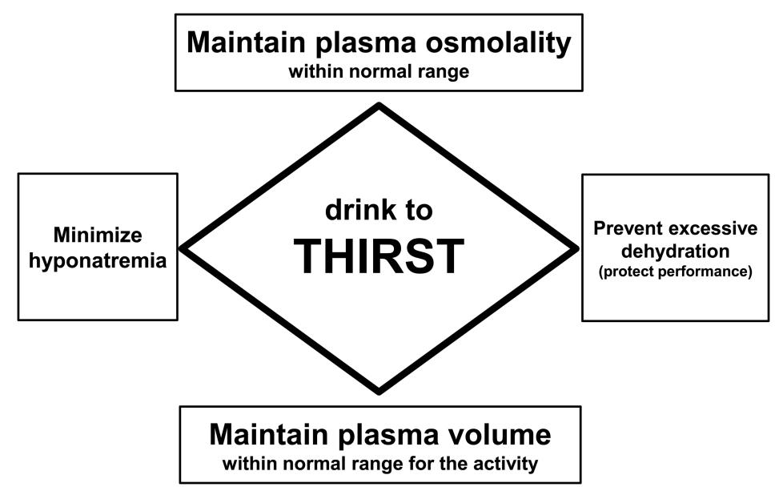

[Health Sciences Faculty Publications](https://cupola.gettysburg.edu/healthfac) [Health Sciences](https://cupola.gettysburg.edu/healthsci) 

7-2015

# Statement of the Third International Exercise-Associated Hyponatr Hyponatremia Consensus De emia Consensus Development Conf elopment Conference, Carlsbad, ence, Carlsbad, California, 2015

Tamara Hew-Butler Oakland University

Mitchell H. Rosner University of Virginia Health System

Sandra Fowkes-Godek West Chester University

#### Jonathan P. Dugas

The Vitality Group

Martin D. Hoffman

University of California Davis Medical Center

See next page for additional authors

Follow this and additional works at: [https://cupola.gettysburg.edu/healthfac](https://cupola.gettysburg.edu/healthfac?utm_source=cupola.gettysburg.edu%2Fhealthfac%2F66&utm_medium=PDF&utm_campaign=PDFCoverPages)

Part of the [Other Medicine and Health Sciences Commons,](https://network.bepress.com/hgg/discipline/772?utm_source=cupola.gettysburg.edu%2Fhealthfac%2F66&utm_medium=PDF&utm_campaign=PDFCoverPages) and the [Sports Sciences Commons](https://network.bepress.com/hgg/discipline/759?utm_source=cupola.gettysburg.edu%2Fhealthfac%2F66&utm_medium=PDF&utm_campaign=PDFCoverPages)

# Recommended Citation

Hew-Butler, Tamara, et al. "Statement of the Third International Exercise-Associated Hyponatremia Consensus Development Conference, Carlsbad, California, 2015." Clinical Journal of Sport Medicine 25.4 (July 2015), 303-320.

This is the publisher's version of the work. This publication appears in Gettysburg College's institutional repository by permission of the copyright owner for personal use, not for redistribution. Cupola permanent link: https://cupola.gettysburg.edu/healthfac/66

This open access article is brought to you by The Cupola: Scholarship at Gettysburg College. It has been accepted for inclusion by an authorized administrator of The Cupola. For more information, please contact [cupola@gettysburg.edu.](mailto:cupola@gettysburg.edu)

# Statement of the Third International Exercise-Associated Hyponatremia Consensus Development Conference, Carlsbad, California, 2015

#### Abstract

The third International Exercise-Associated Hyponatremia (EAH) Consensus Development Conference convened in Carlsbad, California in February 2015 with a panel of 17 international experts. The delegates represented 4 countries and 9 medical and scientific sub-specialties pertaining to athletic training, exercise physiology, sports medicine, water/sodium metabolism, and body fluid homeostasis. The primary goal of the panel was to review the existing data on EAH and update the 2008 Consensus

Statement.[1](http://journals.lww.com/cjsportsmed/Fulltext/2015/07000/Statement_of_the_Third_International.2.aspx#P184) This document serves to replace the second International EAH Consensus Development Conference Statement and launch an educational campaign designed to address the morbidity and mortality associated with a preventable and treatable fluid imbalance.

The following statement is a summary of the data synthesized by the 2015 EAH Consensus Panel and represents an evolution of the most current knowledge on EAH. This document will summarize the most current information on the prevalence, etiology, diagnosis, treatment and prevention of EAH for medical personnel, athletes, athletic trainers, and the greater public. The EAH Consensus Panel strove to clearly articulate what we agreed upon, did not agree upon, and did not know, including minority viewpoints that were supported by clinical experience and experimental data. Further updates will be necessary to both: (1) remain current with our understanding and (2) critically assess the effectiveness of our present recommendations. Suggestions for future research and educational strategies to reduce the incidence and prevalence of EAH are provided at the end of the document as well as areas of controversy that remain in this topic. [excerpt]

# Keywords

EAH, exercise-associated collapse, hydration

## Disciplines

Other Medicine and Health Sciences | Sports Sciences

#### Authors

Tamara Hew-Butler, Mitchell H. Rosner, Sandra Fowkes-Godek, Jonathan P. Dugas, Martin D. Hoffman, Douglas P. Lewis, Ronald J. Maughan, Kevin C. Miller, Scott J. Montain, Nancy J. Rehrer, William O. Roberts, Ian R. Rogers, Arthur J. Siegel, Kristin J. Stuempfle, James Winger, and Joseph G. Verbalis

# Statement of the Third International Exercise-Associated Hyponatremia Consensus Development Conference, Carlsbad, California, 2015

Tamara Hew-Butler, DPM, PhD,\* Mitchell H. Rosner, MD,† Sandra Fowkes-Godek, PhD, ATC,‡ Jonathan P. Dugas, PhD,§ Martin D. Hoffman, MD,¶ Douglas P. Lewis, MD,k Ronald J. Maughan, PhD,\*\* Kevin C. Miller, PhD, ATC,†† Scott J. Montain, PhD,‡‡ Nancy J. Rehrer, PhD,§§ William O. Roberts, MD, MSc,¶¶ Ian R. Rogers, MBBS,kk Arthur J. Siegel, MD,\*\*\* Kristin J. Stuempfle, PhD,††† James M. Winger, MD,‡‡‡ and Joseph G. Verbalis, MD§§§

Key Words: EAH, exercise-associated collapse, hydration

(Clin J Sport Med 2015;25:303–320)

#### INTRODUCTION

The third International Exercise-Associated Hyponatremia (EAH) Consensus Development Conference convened in Carlsbad, California in February 2015 with a panel of 17 international experts. The delegates represented 4 countries and 9 medical and scientific sub-specialties pertaining to athletic training, exercise physiology, sports medicine, water/sodium metabolism, and body fluid homeostasis. The primary goal of the panel was to review the existing data on EAH and update the 2008 Consensus Statement.1 This document serves to replace the second International EAH Consensus Development Conference Statement and launch an educational campaign designed to address the morbidity and mortality associated with a preventable and treatable fluid imbalance.

The following statement is a summary of the data synthesized by the 2015 EAH Consensus Panel and represents an evolution of the most current knowledge on EAH. This document will summarize the most current information on the prevalence, etiology, diagnosis, treatment and prevention of EAH for medical personnel, athletes, athletic trainers, and the greater public. The EAH Consensus Panel strove to clearly articulate what we agreed upon, did not agree upon, and did not know, including minority viewpoints that were supported by clinical experience and experimental data. Further updates will be necessary to both: (1) remain current with our understanding and (2) critically assess the effectiveness of our present recommendations. Suggestions for future research and educational strategies to reduce the incidence and prevalence of EAH are provided at the end of the document as well as areas of controversy that remain in this topic.

#### CONSENSUS METHODOLOGY

The third International Exercise-Associated Hyponatremia Consensus Development Conference utilized National Institutes of Health guidelines, amended for a more holistic approach to fit the needs of both the group and the topic. Twenty-two individuals (17 accepted) were invited to participate in the consensus conference who: (1) have made scientific and/or clinical contributions to the topic of water and sodium homeostasis and/or hyponatremia and (2) represented a specific group (eg, nephrology, endurance medicine, etc.) or had unique topical expertise (eg, cystic fibrosis, muscle cramps, fluid balance, etc.). The present document is intended to serve as the scientific record of the conference with intent to widely disseminate this information to achieve

Submitted for publication April 30, 2015; accepted May 10, 2015.

From the \*Exercise Science Program, Oakland University, Rochester, Michigan; †Division of Nephrology, University of Virginia Health System, Charlottesville, Virginia; ‡Department of Sports Medicine, West Chester University, West Chester, Pennsylvania; §The Vitality Group, Chicago, Illinois; ¶Department of Physical Medicine and Rehabilitation, VA Northern California Health Care System and University of California Davis, Sacramento, California; kFamily Medicine Residency Program, Via Christi Hospitals Wichita, Inc, Wichita, Kansas; \*\*Department of Sport and Exercise Nutrition, Loughborough University, Leicestershire, United Kingdom; ††Athletic Training Program, Central Michigan University, Mount Pleasant, Michigan; ‡‡Military Nutrition Division, United States Army Research Institute of Environmental Medicine, Natick, Massachusetts; §§School of Physical Education, Sport and Exercise Science, University of Otago, Dunedin, New Zealand; ¶¶Department of Family Medicine and Community Health, University of Minnesota, Minneapolis, Minnesota; kkDepartment of Emergency Medicine, St John of God Murdoch Hospital and University of Notre Dame, Perth, Western Australia; \*\*\*Department of Internal Medicine, Harvard Medical School, Boston, Massachusetts; †††Health Sciences Department, Gettysburg College, Gettysburg, Pennsylvania; ‡‡‡Department of Family Medicine, Loyola University Chicago Stritch School of Medicine, Chicago, Illinois; and §§§Department of Endocrinology and Metabolism, Georgetown University Medical Center, Washington, District of Columbia.

R.J.M. has received research funding and consulting fees from the food and beverage industry. He is currently Chair of the Science Advisory Board of the European Hydration Institute. The remaining authors report no conflicts of interest.

Corresponding Author: Tamara Hew-Butler, DPM, PhD, School of Health Science, Oakland University, Rochester, MI 48309-4482 (hew@oakland.edu). Copyright © 2015 Hew-Butler T, Rosner MH, Fowkes-Godek S, Dugas JP, Hoffman MD, Lewis DP, Maughan RJ, Miller KC, Rehrer NJ, Roberts WO, Rogers IR, Siegel AJ, Stuempfle KJ, Winger JM, Verbalis JG, All rights reserved.

maximum impact on both current health care practice and future medical research.

The methodology governing the conduct of this consensus development conference is summarized below:

- 1. A broad based expert panel was assembled. Panel members included researchers and clinicians in endocrinology (J.G.V.), nephrology (M.H.R.), emergency medicine (I.R.R.), family medicine (W.O.R., J.M.W., D.P.L.), internal medicine (A.J.S.), physical medicine and rehabilitation (M.D.H.), sports medicine (W.O.R., J.M.W., D.P.L.), athletic training (S.F.-G., K.C.M.) and exercise physiology (J.P.D., S.F.-G., T.H.-B., M.D.H., R.J.M., S.J.M., N.J.R., K.J.S.).
- 2. These experts presented data on EAH in a day long public session, followed by open question/answer and discussion periods with the audience. The panel members met the following day in a closed session to prepare the consensus statement.
- 3. Workgroups were created 3 months prior to the February 2015 meeting to update the following EAH target areas: epidemiology, etiology and pathophysiology, diagnosis, treatment, and prevention. Each workgroup was asked to present updated drafts for discussion during the closed session.
- 4. A systematic, comprehensive and updated literature review was shared by the panel members prior to the February 2015 meeting, using a cloud storage service that was organized into workgroup categories (epidemiology, etiology and pathophysiology, diagnosis, treatment and prevention). All panel members had unlimited access to the cloud storage service and could add digital versions of published manuscripts to the EAH manuscript section at any time.

The panel chairperson (MHR) was responsible for monitoring the progress of each work group, directing the closed session and guiding the panel's deliberations. Using the previous 2 EAH consensus statements as a starting point, each work-group was asked to: (1) incorporate new data into each assigned section and (2) update any outdated information. All recommendations were graded based on clinical strength, using the grading scale described by the American College of Chest Physicians (Table 1).2 Particular emphasis was placed on creating more generalized recommendations so as to prevent and treat EAH across a wider variety of athletic events, rather than the endurance sports focus of the 2 prior EAH Consensus Statements.

#### Sponsorship

The travel (except R.J.M. and I.R.R., who supported their own travel), hotel and meal expenses for the participants were funded by CrossFit, Inc (Solana Beach, CA). The open conference was also sponsored by CrossFit, Inc. However, no members from CrossFit, Inc participated in any of the closed discussions or contributed to the development of the consensus guidelines. Furthermore, no members from CrossFit, Inc had access to the consensus document prior to publication.

#### RESULTS AND DISCUSSION

#### Definition

EAH is used to describe hyponatremia occurring during or up to 24 hours after physical activity. It is defined by a serum, plasma or blood sodium concentration ([Na+]) below the normal reference range of the laboratory performing the test. For most laboratories, this is a [Na+] less than 135 mmol/L.1 The main determinants of the serum [Na+] are the total content of exchangeable body sodium and potassium relative to total body water and thus hyponatremia can result

TABLE 1. American College of Chest Physicians Classification Scheme for Grading Evidence and Recommendations Utilized in This Statement2

| Grade Description Bene                 | fi ts vs     | Risks    | and Burdens                          |
|----------------------------------------|--------------|----------|--------------------------------------|
|                                        |              |          | Methodological Quality of            |
|                                        |              |          | Supporting Evidence                  |
| 1A Strong recommendation, high-quality |              |          |                                      |
| Bene fi ts                             | clearly      | outweigh | risks and                            |
| burdens                                | or           | vice     | versa                                |
|                                        |              |          | RCTs without important limitations   |
|                                        |              |          | or overwhelming evidence from        |
|                                        |              |          | observational studies                |
| 1B Strong recommendation, moderate    |              |          |                                      |
| quality evidence                       |              |          |                                      |
| Bene fi ts                             | clearly      | outweigh | risks and                            |
| burdens                                | or           | vice     | versa                                |
|                                        |              |          | RCTs with important limitations or   |
|                                        |              |          | exceptionally strong evidence from   |
|                                        |              |          | observational studies                |
| 1C Strong recommendation, low-quality  |              |          |                                      |
| or very low quality evidence           |              |          |                                      |
| Bene fi ts                             | clearly      | outweigh | risks and                            |
| burdens                                | or           | vice     | versa                                |
|                                        |              |          | Observational studies or case series |
| 2A Weak recommendation, high-quality   |              |          |                                      |
| Bene fi ts                             | closely      |          | balanced with risks                  |
| and                                    | burdens      |          |                                      |
|                                        |              |          | RCTs without important limitations   |
|                                        |              |          | or overwhelming evidence from        |
|                                        |              |          | observational studies                |
| 2B Weak recommendation, moderate      |              |          |                                      |
| quality evidence                       |              |          |                                      |
| Bene fi ts                             | closely      |          | balanced with risks                  |
| and                                    | burdens      |          |                                      |
|                                        |              |          | RCTs with important limitations or   |
|                                        |              |          | exceptionally strong evidence from   |
|                                        |              |          | observational studies                |
| 2C Weak recommendation, low-quality    |              |          |                                      |
| or very low quality evidence           |              |          |                                      |
| Uncertainty                            | in           | the      | estimates of                         |
| bene                                   | fi ts, risks |          | and burden; bene fi ts,              |
| risk                                   | and burden   |          | may be closely                       |
|                                        |              |          | Observational studies or case series |

from loss of solutes (sodium, potassium), a relative excess of total body water or a combination of both.3,4 However, in most clinical scenarios, the driving force for the development of hyponatremia is a relative excess of total body water.5,6 The symptoms associated with EAH depend on both the magnitude of the serum sodium decrease from baseline level along with the rate at which this decrease occurs. Symptomatic EAH can occur if the rate of fall approaches 7% to 10% within 24 hours.7 Thus, more severe degrees of hyponatremia (typically ,125 mmol/L) as well as more modest serum sodium values (in the range of 125-130 mmol/L), that develop over a short period of time, can both be associated with signs and symptoms.8

# Epidemiology

The vast majority of recreationally active individuals begin endurance races with a blood [Na+] above 135 mmol/L. Based on data pooled from 27 separate studies, encompassing 2262 participants with a verifiable pre-race blood [Na+] measurement, only 0.8% (19/2262) presented with hyponatremia prior to race start.9–35 These pooled data represent blood [Na+] measurements collected in 7 countries and between 5 minutes to 72 hours pre-competition. This 0.8% also includes 16 questionable below-normal [Na+] values possibly confounded by fingerstick hemolysis29 and/or outdated techniques.25 Thus, baseline (pre-event) hyponatremia in recreational exercisers appears to fall within the expected range for a normal population distribution (1%-2%), and at a frequency well below what has been observed in individuals presenting for non-hyponatremia related clinical treatment situations36 or in hospitalized patients.37 We thereby believe that EAH largely develops during or immediately following exercise.

Exercise-associated hyponatremia can present in 2 forms: asymptomatic or symptomatic. Asymptomatic athletes with [Na+] ,135 mmol/L have largely been detected by blood samples taken post-exercise from athletes participating in research protocols or obtained for reasons other than suspicion of EAH. Athletes with the symptomatic form of EAH can present with mild, non-specific symptoms (eg, lightheadedness, nausea) but typically present with headache, vomiting, and/or altered mental status (eg, confusion, seizure) resulting from cerebral edema (termed exercise-associated hyponatremic encephalopathy or EAHE) that may38–48 or may not49–52 be associated with noncardiogenic pulmonary edema. EAHE is a life-threatening condition that has been observed across a wide variety of activities (Table 2). The incidence of asymptomatic and symptomatic cases of EAH varies widely with regard to type and duration of activity, location of the event, characteristics of the participants (see risk factors) and heat or cold stress during the event.

#### Epidemiology of Asymptomatic EAH

The reported incidence of asymptomatic EAH has ranged from 0%30,53 to 51%54 immediately post-race. In a study of an ultramarathon, 67% of the participants were hyponatremic (asymptomatic) at some point during the race, but only 27% finished the with serum [Na+] ,135 mmol/L (40% self-corrected prior to finishing the event).11 The highest reported incidence of asymptomatic hyponatremia postrace has been consistently noted in 161-km ultramarathons, in which the reported incidence of EAH has ranged between 5% and 51%.18,54–56 The incidence of asymptomatic EAH in Ironman triathlons in different environments has been reported to range from negligible10 to as high as 18%57 and 25%.19 In studies on endurance cyclists the incidence of asymptomatic EAH has ranged from 0% in a 720-km race30 to 12% in a 109-km race.15 In a 26.4-km swim, 17% of swimmers developed asymptomatic hyponatremia.32 The reported incidences at the standard marathon distance run (42.2 km) have ranged from 0%53 to 12% to 13% of race finishers.28,58 Additionally, asymptomatic hyponatremia was observed in 33% of premier league UK rugby players following an 80 minutes rugby competition59 and 70% of elite rowers during a 28-day training camp.60

# Epidemiology of Symptomatic EAH

Symptomatic EAH is rare and occurs with considerably less frequency than asymptomatic EAH, but complications associated with EAH have led to at least 14 athlete related deaths since 1981.28,38,47,50,61–69 Symptomatic EAH generally occurs as an isolated case or in small clusters during or following endurance events with participants reporting to the race medical facilities or to hospital emergency departments within 24 hours after participation. In general, participants seek treatment for a constellation of symptoms ranging from feeling unwell to convulsions. Clusters of cases have occurred in military training exercises, marathons, Ironman triathlons and ultramarathons. The incidence of symptomatic EAH has been reported to be as high as 23%57 and 38%70 of athletes seeking medical care in an Ironman Triathlon and an ultramarathon, respectively, but most endurance events report no cases of symptomatic EAH, especially at the marathon distance and below.

Two studies have examined large compilations of data to help define the incidence of symptomatic and asymptomatic EAH.55,71 In the first study of 2135 athletes from 8 endurance events ranging in length from 42.2 to 161 km,71 the incidence of symptomatic EAH was 1% (compared to 6% with asymptomatic EAH) among study participants. In the

TABLE 2. Activities in Which Symptomatic EAH Has Been Reported. Those Activities in Which Known Deaths Have Occurred Are Noted With an Asterik (\*)

Documentation of Symptomatic EAH

Endurance competitions (marathon\*, canoe race\*, ultramarathon, triathlon,

swimming) Hiking\*

Military exercises\* Police training\* American rules football\* Fraternity hazing\* Bikram yoga Lawn bowling

second study of 669 161-km ultramarathon runners,55,72 only one case (0.1% among study participants) of symptomatic EAH presented during the 5-year sampling period (compared to 13% with asymptomatic EAH), but considering the total number of race participants over this time period, the actual incidence of symptomatic EAH was approximately 0.06%.

Symptomatic EAH has also been reported in hikers73–75 and military personnel.75–77 Symptomatic EAH accounted for 16% of Grand Canyon hikers seeking medical care for exercise-associated collapse or exhaustion from May 31, 1993 through September 31, 1993 providing an estimated incidence rate between 2 and 4 per 100,000 persons.73,78 Furthermore, suspected hyponatremia was found to account for 19% of non-fatal suspected heat-related incidents in the Grand Canyon National Park from April through September during 2004 through 2009 hiking seasons.74 In the US active duty military, the annual incidence rate of hyponatremia from 1999 through 2012 has ranged from ;4 to 13 cases per 100,000 person-years (averaged 6.7 cases per 100 000 person-years).77 However, this incidence is probably inflated as the data were derived from a medical coded database that does not have a specific designation for EAH and likely includes hyponatremia from both exercise and non-exercise related conditions.

Alarmingly, symptomatic EAH is now being reported in a more diverse set of sporting activities. For instance, symptomatic EAH has been reported in shorter distance endurance competitions, such as a half marathon79 with slower finishers completing the distance in 2 to 3 hours and a sprint triathlon with slower finishers taking approximately 2 hours to complete.80 In addition, EAH has been reported in US professional and college American rules football players40,41 and has led to the deaths of 3 US high school football players between 2008 and 2014.63,64,69 Symptomatic hyponatremia has also been reported in a 48 year old lawn bowler who was heterozygous for the Delta F508 cystic fibrosis (CF) mutation, although it is unclear if complete genetic analysis for all possible CF mutations was performed,81 a 34 year old woman following a Bikram Yoga session82 and in a 39 year old woman following a 2 hour workout including tennis and weightlifting.83 Cases of symptomatic EAH have also been induced in 2 separate laboratory studies involving low intensity exercise conducted in high ambient temperatures.84,85 Deaths from symptomatic EAH have occurred in a 25 year old male police officer participating in a 19-km bicycle training ride68 and at least partially contributed to a case of fraternity hazing involving a male pledge performing calisthenics.67 It is likely that other cases of symptomatic hyponatremia have either not been recognized or reported.

#### Risk Factors

The major risk factors for developing EAH are listed in Table 3. The single most important risk factor is sustained, excessive fluid (water, sports drinks or other hypotonic fluids) intake in volumes greater than loss through sweat, respiratory and renal water excretion so that a positive fluid balance accrues over time.86,87 Almost all cases of symptomatic EAH have occurred in individuals who have gained or maintained weight during activities in which some weight loss would represent fluid balance and euhydration.71,72 Body weight losses of ,0.75 kg after a standard marathon35 and ,1% after an 80 minutes rugby match59 have been associated with asymptomatic EAH. All sports beverages are hypotonic to plasma (typical sodium content in sports drinks are approximately 10-38 mmol/L88); thus the magnitude of excessive fluid volume ingestion will overwhelm any protective effect of the beverages' sodium content on maintaining serum [Na+].89,90

From a practical standpoint, it is the smaller individuals and those who participate at a slower pace and drink more than sweat losses that are more likely to develop EAH. Although the incidence of women experiencing EAH is greater than that of men,38,58,61 adjusted for BMI and racing time, the apparent sex difference is not statistically significant.58

Nonsteroidal anti-inflammatory drugs (NSAIDs) have been implicated as a risk factor in the development of EAH38,91,92 presumably by potentiating the water retention effects of arginine vasopressin (AVP) at the level of the kidney collecting duct.93,94 However, data are conflicting,26,58,61 and further investigation is necessary to determine whether NSAID usage—with respect to both classification and dosage—is a risk factor for the development of EAH. The possible pathophysiological contributions of intrinsic renal disease95 and low solute diets96–98 on water retention, high sweat sodium concentrations99 in extreme environments, and the potentiation of thirst by non-osmotic stimuli during exercise72,100–103 warrant further investigation as secondary risk factors for EAH. Whether common medications that are associated with hyponatremia and the syndrome of inappropriate anti-diuretic hormone secretion (SIADH) in the general population, such as selective serotonin reuptake inhibitors, can potentiate the development of EAH is not known and warrants further investigation.104

There is a paucity of evidence suggesting that those developing symptomatic EAH have either been a "salty sweater"99,105 or a heterozygous carrier of the cystic fibrosis genotype.106 Athletes with homozygous CF, however, are at risk for developing hyponatremia as demonstrated by numerous instances when an individual is diagnosed with CF after the development of hyponatremia during prolonged physical exertion105,107 or prolonged exposure to high ambient temperatures.108–110 As individuals with CF experience a longer lifespan (median predicted survival age in 2012 was 41.1 years111) and are encouraged to consider exercise as

TABLE 3. Risk Factors for the Development of Asymptomatic and Symptomatic EAH1

| Risk         | Factors      | for    | EAH                                          |
|--------------|--------------|--------|----------------------------------------------|
| Overdrinking |              | water, | sports drinks, and other hypotonic beverages |
| Weight       | gain         | during | exercise                                     |
| Exercise     | duration     |        | 4h                                           |
| Event        | inexperience |        | or inadequate training                       |
| Slow         | running      | or     | performance pace                             |
| High         | or low       | body   | mass index (BMI)                             |
| Readily      | available    |        | fl uids                                      |

one of their therapies,112 this population may be at increased risk for EAH due to the combination of high sweat fluid and sweat [Na+] loss.

#### Etiology and Pathophysiology of EAH

The predominant pathophysiology of EAH, and of most serious medical concern, is dilutional hyponatremia caused by sustained overdrinking and AVP induced impaired water clearance, which overwhelms the ability of the kidney to excrete the excess water load. Dilutional hyponatremia is the primary pathophysiological variant of clinically symptomatic EAH and largely (if not exclusively) associated with all reported cases of morbidity and mortality that are listed in Table 2. Dilutional EAH is an acute onset form of hyponatremia, which is now occurring in non-endurance sports, with 3 deaths, recently reported amongst the approximately 7.5 million American high school football player-years from 2008 through the 2014 seasons.63,64,69 These football players were encouraged to ingest copious volumes of hypotonic fluids and sports drinks to prevent or relieve exerciseassociated muscle cramps (EAMC),63,64,69 in the belief that EAMC was caused by dehydration and electrolyte imbalance.113 However, experimental114,115 and observational116,117 studies speculate that EAMC may reflect neurological changes due to fatigue rather than uncompensated water and sodium losses incurred during exercise in some cases. Muscle cramping and tremor have also been associated with overdrinking and hyponatremia in athletes,82,100,118,119 clinical populations,120 and animals.121

Symptoms associated with EAH are due to osmoticallyinduced shifts of water into the intracellular compartment. In the confined space of the cranium these shifts of water into the central nervous system (CNS) tissues lead to cellular edema and pathological increases in intracranial pressure. Acutely, this may manifest in symptoms previously described and in the extreme may lead to brain stem herniation and death.

### Etiology of Euvolemic/Hypervolemic EAH

Total body water expansion relative to the amount of total body exchangeable sodium is the main pathogenic cause of asymptomatic and symptomatic EAH.34,41,45,52,57,58,61,71,73,75,76,84,119,122–126 Dilutional EAH can be euvolemic (total body water expansion without changes in total exchangeable sodium) or hypervolemic (total body water expansion above concomitant increases in total exchangeable sodium). The primary etiologic factor in dilutional hyponatremia is consumption of fluids (water, sports drinks or other hypotonic fluids) in excess of total body fluid losses, which includes the sum of insensible (cutaneous, respiratory, and gastrointestinal),127,128 sweat and renal (urine) fluid losses.34,45,52,57,58,61,73,75,76,84,119,122–125

Hyponatremia caused solely by the overconsumption of fluids, above known maximal urine excretory rates of 800 to 1000 mL/,129 has been demonstrated at rest in athletes with and without a history of EAH.34,86,87 Although some cases of EAH may be due to pure water intoxication from overconsumption of fluids, non-osmotic AVP secretion is a key contributing factor in most athlete-related symptomatic cases.5,19 Known stimuli to AVP secretion that are commonly

associated with exercise include: nausea/vomiting130; interleukin-6 release11; plasma volume contraction13; hypoglycemia131; elevated body temperature132; and/or other hormonal mediators.16 Even small increases in circulating AVP levels can markedly reduce renal water excretion well below maximal levels,133 resulting in retained body water not only when drinking rates do not exceed those necessary to prevent excessive dehydration, but also when drinking rates are well in excess of fluid replacement need.49,134

#### SUMMARY STATEMENT

The primary etiology and pathophysiological mechanism underlying EAH—and all known fatalities—is the overconsumption of hypotonic fluids relative to exchangeable sodium in likely combination with non-osmotic AVP secretion (Grade 1A).

# Etiology of Hypovolemic EAH

There is persisting debate as to the relative contribution of under-replaced sodium losses to the lowered sodium concentrations observed in EAH. While in clinical medicine, electrolyte depletion without expansion of total body water or hypovolemic hyponatremia is well described,5,6,135–138 in EAH this variant has been more difficult to define and is much less likely to be encountered except in extreme events usually over prolonged periods (such as ultra-marathons)139 or hot Ironman distance triathlons.19,20 The data regarding sodium losses during exercise (as measured during recovery) and their potential contribution to the development of symptomatic hyponatremia in longer and hotter races139 have been consolidated in Table 4 against data collected from relatively shorter and cooler races123,140,141 where fluid overload hyponatremia has been verified. From the standpoint of the clinical literature, hypovolemic hyponatremia reflects a loss of total body exchangeable sodium that manifests as volume depletion.5,6,135,142,143 Hypovolemic EAH would be predicted89 to occur in athletes exercising for longer periods of time (such as 161 km ultramarathons; .20 hours),11,54–56 and/or in hotter11,19,20,55,108,109 environments and/or with higher sweat sodium losses.99,101 Clinical confirmation of the hypovolemic form of hyponatremia is supported by a spot urine sodium concentration (U[Na+]) below 30 mmol/L136,137,144 in conjunction with a serum or plasma [Na+] below 135 mmol/L. A spot U[Na+] ,30 mmol/L is 100% specific and 80% sensitive for predicting a sustained increase (.5 mmol/L) in serum [Na+] following isotonic saline administration136 in clinical patients. Elevated blood urea nitrogen levels (.20 mg/dL)136,139 and weight loss19,20,55 may also suggest volume depletion as a pathogenic contributor to EAH. However, these biochemical tests are not always available at the point of care and thus clinical assessment (vital signs, weight change, and physical examination) may be the only indication of volume depletion.

#### SUMMARY STATEMENT

Under-replaced sodium losses contribute to serum [Na+] independent of distance (Grade 1A). However, there is paucity of data supporting sodium loss as the primary mechanism of symptomatic EAH even in those who exercise for prolonged periods of time and in warm weather (Grade 2C). In these cases, relative over-drinking of hypotonic fluids with sustained non-osmotic AVP secretion is likely involved in the development of symptomatic EAH.

# The Role of Thirst

Since drinking fluid volume above sweat and urinary losses during and after activity is the main pathophysiological mechanism underlying asymptomatic, symptomatic and fatal cases of EAH, prevention is dependent on drinking less. Thirst should provide adequate stimulus for preventing excess dehydration and markedly reduce the risk of developing EAH in all sports. Physiologically-driven thirst has been defined as a "generalized, deep seated feeling of desire for water"145 and is an evolutionarily conserved, finely tuned, regulatory mechanism serving to protect both plasma osmolality and circulating plasma volume.146 Osmoreceptors located within the circumventricular organs of the brain (highly vascularized structures located around the third and fourth ventricles and characterized by the lack of a blood–brain barrier that are points of communication between the blood, the brain parenchyma, and the cerebral spinal fluid) and baroreceptors located within the aortic arch, carotid sinus and great veins provide "real-time" neural input to higher centers of the brain which continuously and simultaneously coordinate the regulation of both thirst and AVP secretion. Thus, there are physiological sensing mechanisms in place to prompt when to drink and therefore guard against excessive dehydration. Earlier published recommendations to begin drinking before thirst was largely meant for situations where sweating rates were high, above maximal rates of gastric emptying, and dehydration would

rapidly accrue over time. Unfortunately, this advice has fostered the misconception that thirst is a poor guide to fluid replacement and has facilitated inadvertent overdrinking and pathological dilutional EAH.

# Clinical Classification and Diagnosis of EAH

The diagnosis of EAH is made when the blood, serum or plasma [Na+] is below the normal reference range of the laboratory performing the test (typically ,135 mmol/L) and is associated with typical clinical constellation of symptoms and signs. In our collective experience, EAH is best classified by clinical severity (symptoms) and not the absolute numerical [Na+] value to best guide treatment strategies.

# Characteristics of Asymptomatic EAH

Asymptomatic EAH represents a biochemical finding, diagnosed by blood electrolyte testing for research or unrelated metabolic screening purposes.10,15,18,19,28,30,32,53–59 This group of subjects presents without any discernable symptoms or may have mild, generalized and transient complaints commonly experienced by other participants who do not typically seek medical care following exercise. In normally distributed populations, up to 5% of all athletes tested would fall outside of the normal range for [Na+], with half of those (2.5%) falling in the range of asymptomatic EAH values.

#### Characteristics of Mild EAH

Mildly symptomatic EAH typically presents with nonspecific signs and symptoms without clear signs of encephalopathy (Table 5). Athletes with mild EAH may have normal vital signs, may not have any orthostatic hypotension, and the symptoms do not resolve after placing athletes in the Trendelenburg position147 as would be expected with exercise

TABLE 4. Comparisons of Sodium and fluid Balance Measured During the Recovery Period After Exercise Demonstrating Race Characteristics and Biochemical Differences Between Fluid Overload Hyponatremia (Irving et al,123 Speedy et al,140 and Speedy et al141) Versus Suspected Hypovolemic Hyponatremia (Owen et al139)

| Variable                                                 | Irving et al 123     | Speedy et al 140 | Speedy et al (2 cases) 141 | Owen et al 139      |
|----------------------------------------------------------|---------------------------------|-----------------------------|---------------------------------------|--------------------------------|
| EAH subjects (classification)*                           | 8 (symptomatic)                 | 7 (symptomatic)             | 2 (symptomatic)                       | 26 (symptomatic)               |
| Peak race temperature (°C)                               | NR                              | 21                          | 21                                    | 33                             |
| Mean exercise duration (h)                               | <11 (mean NR)                   | 12                          | 13/12 (case 1/case 2)                 | 22                             |
| Monitored recovery time (h)                              | 16                              | 11.6                        | 11.7/13                               | 1                              |
| Presenting U[Na + ] (mmol/L)                  | NR                              | 17† (41 controls)*          | NR                                    | 15 pre-trial (22.3 post-trial) |
| Presenting BUN (mg/dL)                                   | 15.5 pre-trial (9.8 post-trial) | NR                          | NR                                    | 31 (pre and post-trial)        |
| Body sodium retained (mean value)‡                       | 48%                             | −84 mmol (0 mmol controls)* | 34%/0%                                | 96%                            |
| Excess fluid excreted (mL)§                              | +2953                           | +1670 (−441 controls)*      | +1500/+2500                           | +20                            |
| Presenting serum [Na + ] (mean ± SD) (mmol/L) | 122 ± 2                         | 127 ± 4                     | 131/130                               | 131 ± 3                        |
| Body weight change (post-race − pre-race) (%)            | NR                              | NR                          | +0.9/+2.5                             | −2.4 ± 3.1                     |

\*EAH data compared with control group of normonatremic triathletes partaking in the same event.

†All but one of these 7 athletes with EAH was released from the hospital with hyponatremia.

‡This represents the total amount of sodium retained by the body and expressed as a percentage of the total amount of sodium that was administered during the monitored recovery period (sodium deficit/sodium given). In Speedy et al 2000,140 this was expressed as a positive or negative amount (mmol) of sodium administered so that a negative value reflected the amount of sodium retained by the body (UNa+ output minus Na+ input).

§This represents the amount of fluid excreted (urine volume) during the recovery period compared with the amount of fluid that was administered during the recovery period. NR, not reported in the manuscript.

associated postural hypotension.148 The clinical symptoms of mild symptomatic EAH are not specific or sensitive, but should raise the index of suspicion for EAH and necessitate a low threshold for [Na+] measurement, as athletes can rapidly progress from mild symptoms to severe and lifethreatening EAHE (Table 5).

EAH must be differentiated from other causes of collapse that may present with similar signs and symptoms including exertional heat illness,73 acute mountain sickness,39 hypernatremia,149,150 and exercise associated postural hypotension.148 It is important for medical staff to perform a rapid history and physical examination to help determine the etiology of these nonspecific symptoms. However, any clinical suspicion of EAH should lead to prompt measurement of [Na+], if possible. It is common for athletes with EAH to maintain or gain weight during exercise.58,71,72 However, EAH in the presence of weight loss has been documented in ultra-endurance races in the heat.19,20,55,59 Thus, the presence of weight loss does not necessarily exclude EAH. Weight gain or weight maintenance associated with any symptoms listed in Table 5 is an indication to measure the athlete's [Na+] in order to confirm or exclude the diagnosis of EAH or to consider empiric treatment if on-site [Na+] cannot be measured, such as in remote settings.72,118,151

#### Characteristics of Severe EAH (EAHE)

Severe symptomatic EAH is characterized by neurological signs and symptoms due to cerebral edema that occur when water flows along the osmotic gradient from the extracellular fluid into the intracellular compartment (Table 3).38–52,152 Severe symptomatic EAH may38–48 or may not49–52 be accompanied by the respiratory distress of CNS-triggered non-cardiogenic pulmonary edema (Table 5). EAHE is a life threatening condition that requires urgent

intervention and should be evaluated with an immediate [Na+] measurement if available.

#### SUMMARY STATEMENT

EAH can present with a wide range of symptoms ranging from nonspecific mild complaints to severe encephalopathy. The severity of symptoms and not the absolute value of the [Na+] should guide the choice of therapy (Grade 1A). Rapid determination of [Na+] is critical in confirming clinical suspicion but may not always be available.

#### Treatment of EAH

Any athlete exhibiting signs or symptoms consistent with acute hyponatremia (Table 5) should be screened for EAH. The capacity for onsite [Na+] analysis is optimal for management of EAH and is recommended for any largescale endurance event. However, this capability is not always practical or possible (eg, small or remote events).118,151 Treatment should be based on the degree of neurological impairment, not simply the [Na+] level5,6; as brain edema is dependent upon both the magnitude and rate of fall of [Na+] not just the lowest level reached, as stated previously. The following treatment protocols are recommended for EAH and EAHE based on either [Na+] measurement and clinic assessment or clinical assessment alone if [Na+] measurement is not available.

#### Onsite Treatment of Asymptomatic EAH Found Via [Na+] Measurement

Asymptomatic hyponatremia is not normally detected unless an athlete has blood electrolyte concentrations tested for some other reason.10,15,18,19,28,30,32,53–59 In athletes with this incidental biochemical diagnosis, oral or intravenous hypotonic fluid intake should be restricted until the onset of urination (which suggest that AVP levels have fallen and that the urine is likely dilute) to reduce the risk of further decreasing [Na+] with continued AVP-mediated water retention.5,6,120 Furthermore, isotonic intravenous fluids should be administered with great caution or withheld until urination as, in the setting of elevated AVP levels and a concentrated urine, these fluids may lower the [Na+] 153 or delay recovery.91,151,154

Although there is no compelling reason to actively treat asymptomatic EAH, it is clinically appropriate to administer oral hypertonic saline solutions (HTS), to reduce the risk of progression to symptomatic hyponatremia139,155; this is particularly relevant for those with a [Na+] ,130 mmol/L. Upon departure from the event site, athletes with asymptomatic EAH should be advised to seek urgent medical attention if any neurologic signs or symptoms of EAH develop within 24 hours after event finish, since delayed-onset symptomatic EAH may frequently occur.40,42,46,52,72,80,82,91,100,122,156 Ideally, an athlete with asymptomatic EAH should have a companion upon discharge from the medical area to observe the affected athlete for signs and symptoms of evolving EAH, since the neurological impairments associated with EAH may limit the athlete's ability to accurately self-assess his or her status.

TABLE 5. Signs and Symptoms of Mild and Severe (Lifethreatening) EAH. Signs and Symptoms Related to Other Conditions Associated With Exercise-Associated Collapse Noted With an Asterisk (\*)

| Symptoms and Signs Associated With Mild EAH                                                           |
|--------------------------------------------------------------------------------------------------------------------|
| Lightheadedness*                                                                                                   |
| Dizziness*                                                                                                         |
| Nausea*                                                                                                            |
| Puffiness                                                                                                          |
| Body weight gain from baseline                                                                                     |
| Symptoms and Signs Associated With Severe EAH and EAHE                                                             |
| Vomiting*                                                                                                          |
| Headache*                                                                                                          |
| Altered mental status* (confusion, disorientation, agitation, delirium, feelings of "impending doom," obtundation) |
| Phantom running                                                                                                    |
| Seizure*                                                                                                           |
| Coma*                                                                                                              |
| Signs of impending brain herniation (decorticate posturing, mydriasis)                                             |
| Dyspnea (non-cardiogenic pulmonary edema)                                                                          |
| Frothy sputum (non-cardiogenic pulmonary edema)                                                                    |

#### SUMMARY STATEMENT

The major clinical relevance of asymptomatic EAH lies in its potential for asymptomatic athletes to quickly transition and progress into symptomatic stages if hypotonic fluids are given intravenously or ingested (Grade 1C). Thus, in patients identified with EAH, hypotonic or isotonic fluids should be withheld until urination is documented (Grade 1C).

#### Onsite Treatment of Symptomatic EAH Found Via [Na+] Measurement

#### Severe EAH (EAHE)

Acute severely symptomatic hyponatremia is a rapidly progressing, life threatening emergency that requires immediate administration of IV hypertonic saline (HTS) (such as 3% sodium chloride).38,42,49,51,62,72,82,91 Because EAH is an acute rather than chronic process, athletes presenting with symptomatic hyponatremia can and should be treated with HTS as there is no risk of osmotic demyelination after exposure to HTS, but there is grave risk of brain herniation and non-cardiogenic pulmonary edema if HTS is not administered.5,6,38,47,50,62

Any athlete with EAH associated with signs or symptoms of encephalopathy should be immediately treated with an IV bolus or infusion of HTS to acutely reduce brain edema, with additional IV boluses administered until there is clinical improvement42,51,72 (Table 6). The dose and route of HTS administration should be based upon the severity of clinical symptoms and the available HTS formulations, as discussed in Table 6. Numerous case reports and case series have validated the efficacy and safety use of IV HTS administration in symptomatic EAH8,38,48,49,52,62,72,82,91,100,122,154 with one runner receiving 950 mL of 3% over a 7-hour period

without complications42 and another swimmer receiving 40 mL of 20% HTS51 without complication.

In the event that an athlete presents with symptoms of severe, life-threatening encephalopathy (eg, seizures, coma, or signs of impending brain herniation) it is acceptable and highly recommended to administer the first bolus of HTS before [Na+] is measured. Confirmed symptomatic dilutional (euvolemic or hypervolemic) EAH is a contraindication to the administration of IV hypotonic fluids, lactated Ringer's, or isotonic (normal) saline, all of which can worsen the degree of hyponatremia41,47,50,134 or delay recovery.91,118,122,151,154,157

The efficacy of IV HTS as the definitive treatment of acute hyponatremic encephalopathy has been validated extensively in both hospital and field settings since it was first utilized successfully in 1938.158 This treatment is based on the capacity of an IV HTS bolus to increase the serum [Na+] 2 to 5 mmol/L, resulting in a concomitant decrease of intracranial pressure and improvement in symptoms.5,6 This approach does not pose any substantial danger to the patient, because osmotic demyelination syndrome has not been associated with either the rapid correction of acute hyponatremia (ie, ,48 hours duration) in clinical159 or exercise settings8,38,48,49,52,62,72,82,91,100,122,154 or with the limited increase in [Na+] produced by a single bolus of HT.139,160 Also, of note, if the athlete was wrongly assumed to have EAHE, the administration of HTS in small boluses is not associated with any negative consequences and serves as an excellent volume expander.139

The goal of this therapy is to stabilize the athlete for transfer to an advanced medical care facility for further evaluation, monitoring and treatment. Ideally, the athlete should be transported with knowledgeable event medical personnel able to maintain the same level of care en route and to ensure that the treatment is not interrupted for evaluation such as computerized tomography (CT) imaging of the brain or treatments that may worsen hyponatremia, such as administration of hypotonic fluids, lactated Ringer's, or isotonic (normal) saline. The diagnosis of EAH or EAHE must be communicated to the receiving physician upon transfer of care.

# SUMMARY STATEMENT

For those athletes presenting with signs and symptoms consistent with EAHE, emergent intravenous treatment therapy with hypertonic saline is indicated and should not be delayed pending laboratory measurement or other diagnostic testing (Grade 1B).

#### Mild EAH

Any athlete with mild EAH symptoms (Table 6) may be treated with an IV bolus of HTS as described above. Alternatively, a mildly symptomatic athlete may be treated with oral hypertonic solutions when tolerated139,155,160 (Table 6) or observation until urination, as seen in clinical settings.6,120 Oral sodium tablets may not be as efficacious as hypertonic solutions, as suggested in a single case report124 and requires further investigation. The efficacy and tolerance of oral HTS has been supported by limited field

TABLE 6. Recommended Treatment for Both Mild and Severe (Life-threatening) Symptomatic EAH in Field or in the Hospital Treatment of Mild EAH

Observation (restrict hypotonic and isotonic fluids until urinating freely) Administration of intravenous HTS (see below for severe symptomatology) Administration of oral HTS:

Concentrated bouillon (4 bouillon cubes in 125 mL, ½ cup, of water)

3% NaCl (100 mL), preferably with the addition of a flavoring (eg, Crystal Light, Kool Aid)

Equivalent volumes of other solutions of high sodium concentration (eg, 3%-9%)

#### Treatment of Severe EAH

Administration of intravenous HTS:

100 mL bolus of 3% NaCl, repeated twice if there is no clinical improvement (10 min intervals have been recommended, but this should be determined by the clinical judgment of the treating physician)

Comparable amounts of more concentrated Na+-containing solutions (eg, 10 mL of 20% NaCl; 50 mL of 8.4% NaHCO3) may be used as an alternative to 3% NaCl

In some situations (ie, more severe encephalopathic symptomatology such as seizures, coma or signs of impending brain herniation) it may be appropriate to administer larger HTS boluses initially rather than waiting to assess clinical improvement after repeated smaller boluses

HTS, hypertonic saline.

studies,139,155 and may offer practical advantages in some settings (eg, IV HTS or IV access is not available). In contrast to athletes with severe EAH, those with mild symptoms may be discharged from onsite medical care once symptoms have resolved and spontaneous urination has occurred. Repeat measurement of [Na+] is generally not required unless the patient has persistent symptoms after the initial treatment. As is recommended for asymptomatic EAH, upon departure from the event site athletes should be advised to seek urgent medical attention if any signs or symptoms of EAH develop after discharge and ideally should have a companion capable of monitoring for signs and symptoms of which the athlete may not be aware.

#### SUMMARY STATEMENT

Athletes presenting with mild symptoms associated with EAH can be treated with an IV bolus of HTS (Grade 1B), oral hypertonic saline fluids or observation until the onset of urination as dictated by clinical symptoms (Grade 2B).

#### Onsite Treatment of EAH Suspected Clinically but Unable to Confirm Via [Na+] Measurement

The situation may arise where EAH is strongly suspected based on the clinical evaluation of the athlete (ie, history and physical examination showing neurological symptoms or signs of EAH; Table 3) but [Na+] cannot be determined,72 such as in a remote setting.39,118,151 In this situation empiric treatment is justified using the same treatment recommendations described above for EAH documented with a [Na+] (Table 6). This empiric approach can be lifesaving and is unlikely to do harm, since: (1) the additional small increase in serum osmolality from a single bolus of HTS will not significantly worsen the neurological status and (2) a bolus of HTS will expand the intravascular volume by increasing the serum [Na+], partially reducing any hypovolemic component of the hyponatremia.139

#### In Hospital Treatment of Symptomatic EAH

Athletes presenting to a hospital or medical facility, whether primarily or as a transfer from the event site, with signs or symptoms of hyponatremia will require immediate measurement of electrolytes and should be treated as described above without delay once EAH is confirmed (Table 6). If symptomatic EAH persists or worsens following the initial intervention with IV HTS, current treatment guidelines for acute symptomatic hyponatremia should be instituted and the patient managed in an intensive or critical care setting with care provided or guided by a specialist familiar with this life threatening condition.5,6

#### SUMMARY STATEMENT

Athletes presenting to a medical facility with EAH should be treated as per other settings (Grade 1C). However, diagnostic testing in these scenarios should not delay potentially life-saving therapy with HTS (Grade 1C).

#### Prevention

Athletes and support crews need to carefully consider fluid and electrolyte supplementation during and after exercise and the rationale behind those decisions. Excessive fluid replacement beyond thirst (whether water, sports drinks or other hypotonic fluids) is not a panacea for all instances of fatigue, collapse, muscle cramping, or exertional heat stroke (Table 7). The drinking of fluid volumes sufficiently above sweat and urinary losses before, during and after activity and the accrual a positive water balance, is the primary underlying pathophysiological mechanism of symptomatic and fatal EAH cases.34,41,45,52,57,58,61,71,73,75,76,84,119,122–126,162,163 Therefore, prevention strategies must target drinking behavior. Fluid intake recommendations suggesting that athletes begin to drink fluids before the onset of the sensation of thirst were targeting those exercising in situations where high sweat rates were present and dehydration could evolve rapidly with known medical and performance outcomes. Unfortunately, this advice fostered the misconception that thirst is a poor guide to fluid replacement in lower sweat rate situations. We believe that this has facilitated individuals choosing to inadvertently adopt overdrinking and develop pathologic dilutional EAH, as demonstrated in 41 cases evaluated in Table 7.

Modest to moderate levels of dehydration are tolerable and pose little risk to life in otherwise healthy individuals. Laboratory and field studies indicate that fluid deficits less than and up to a volume approximately equal to 3% of normal body mass (or ;5% total body water) can be tolerated without a reduction in endurance performance or muscular power when in cool to temperate (2108C-208C) temperatures.164 Therefore, aggressive drinking to prevent dehydration is unnecessary and carries with it greater risk of developing symptomatic EAH.

Body weight is a reasonable surrogate measure of hydration state when measured day to day after sleep165 and can be used to relatively accurately assess changes in hydration state accompanying upwards to 1 to 2 hours of activity. However, it is a very imprecise measure during the athletic events where EAH is most likely to develop, that is, multiple hours of sustained activity. This is in large part due to body mass changes accompanying energy combustion128 and unknown amounts of food consumed, bathroom stops, etc. Moreover, consolidation of 4 studies (786 athletes) comparing body weight changes taken at registration (1-3 days prior) and again within 60 minutes of race start demonstrate an average 1% increase in body weight9,10,12,166 from registration to race start. However, this average value conceals that fact that large gains in weight (up to at least 4% of body mass)166,167 occur in some individuals while substantial weight losses occur in others over that last day or 2 before competition. This weight increase further confounds the accuracy of bodyweight as a proxy measure of body water in field events. With that said, a body mass measured after several hours of activity that is equal to or above the individuals normal body mass is a positive indicator for the presence of fluid overload.

The safest individualized hydration strategy before, during and immediately following exercise is to drink palatable fluids when thirsty (Figure). Marathon runners with hypernatremia report "thirstiness" as a physiologically expected symptom149 while a weak but statistically significant relationship has been demonstrated between thirst ratings and plasma [Na+] immediately following a 161 km race.168 Studies verify that participants allowed free access

TABLE 7. Thirteen Studies Representing 41 Cases of Symptomatic EAH Which Provided Comment on Drinking Plan or Motivation for Chosen Drinking Behaviors [\*Case Reports Involving Multiple Subjects: Total Number Subjects (Number of Female/Male Subjects)]

| Subjects Age (yo), Sex ( ♂♀ ),                                    |               |               |            |           |            |              |              |               |
|-------------------------------------------------------------------|---------------|---------------|------------|-----------|------------|--------------|--------------|---------------|
| Serum [Na+] mmol/L                                                |               |               |            |           |            |              |              |               |
| (Initial or Range)                                                |               |               |            |           |            |              |              |               |
|                                                                   | Symptomatic   |               | EAH        | With      |            | Drinking     | Above        | Thirst        |
|                                                                   |               |               | (Comments  |           | From       | Report)      |              |               |
| Frizzell et al122 24, ♂ /45, ♂ , Ultra-runners 123/118 Runners    | as            | a             | group are  | taught    | to         | “ push       | fl uids      | ”             |
| Athletes                                                          | are           |               | instructed | to        | drink      | more         | than their   | thirst        |
| Armstrong et al84 21, ♂ , Lab subject 122                         | voluntarily   |               | consumed   | this      | large      | volume       | of           | fl uid        |
|                                                                   | because       | he            | believed   | that      | drinking   |              | water        | copiously     |
| would                                                             |               | decrease      | his        | risk      | of heat    | illness      |              |               |
| Herfel et al41 22, ♂ , Football player 121 He was                 |               | diagnosed     | with       |           | muscle     | cramps       | secondary    | to            |
|                                                                   | dehydration.  |               | Therefore, | fi        | ve         | liters (L)   | of           | 0.45%         |
|                                                                   | normal        | saline        | in 5%      | dextrose  |            | was          | administered |               |
|                                                                   | intravenously |               | along      | with      | 3L of      | liquids      | by           | mouth over    |
| a fi                                                              | ve hour       |               | period     |           |            |              |              |               |
| Reynolds et al161 *6 (4 ♀ /2 ♂ ), Soldiers 118-134                | consuming     | large         |            | volumes   | of         | water as     | “            | protection    |
|                                                                   | against       | becoming      | a          | heat      | casualty   | ”            | predisposed  | these         |
| troops                                                            | to            | the           | physical   |           | impairment | that         | they         | intended to   |
| Backer et al73 *7 (6 ♀ /1 ♂ ), Hikers 109-127 Most                | patients      |               | diagnosed  | as        | having     |              | hyponatremia | have          |
| a                                                                 | distinct      | history       | of         | high      | fl uid     | intake       |              |               |
| unlike                                                            |               | heat          | exhaustion |           | patients,  | few          | of our       |               |
|                                                                   | hyponatremic  |               | patients   | were      |            | thirsty      | when         | evaluated,    |
|                                                                   | perhaps       | because       | they       | drank     |            | more fl      | uids and     | were          |
| Garigan and Ristedt45 18, ♂ , Soldier 121                         | complained    | of            | thirst,    | drank     | 3          | quarts       | then         |               |
|                                                                   | vomited       | told          | to         | drink 1   | quart      | every        | 30           | minutes.      |
| With                                                              |               | encouragement |            | by        | unit       | members,     | he           | consumed      |
| 10                                                                | quarts        | of            | water      | during    | the        | next 90      | minutes      |               |
| with                                                              |               | encouragement |            | by        | unit       | members      |              |               |
| Hew et al61 *21 (9 ♀ /8 ♂ ), Marathon runners 117-134 Advice      | given         | to            | runners    | was       | “          | drink until  | your         | urine is      |
| clear                                                             | ” and         | “ do          | not        | wait      | until      | you are      | thirsty      | to drink ”    |
| Dimeff40 27, ♂ , Football player 116                              | complained    | of            | feeling    | ill       |            | encouraged   | to           | consume       |
| sports                                                            |               | drinks        |            |           |            |              |              |               |
|                                                                   | Admits        | to            | drinking   | 2-3       | gallons    | water        | every        | day           |
|                                                                   | because       | he had        | been       | taught    |            | that “ water | is           | the best      |
|                                                                   | replacement   | fl            | uid ”      | and       | because    | that         | is what      | he was        |
|                                                                   | advised       | to do         | growing    | up        | in         | Texas        |              |               |
| Hew-Butler et al 8 41, ♂ , Ironman triathlete 132 (nadir) Subject |               | reports       | he was     | never     |            | thirsty, but | drank        | to “ stay     |
| ahead                                                             | of            | thirst        | ”          |           |            |              |              |               |
| Draper et al49 37, ♀ , Marathon runner 117 she                    | followed      |               | a strategy |           | (as        | advised      | by fellow    |               |
|                                                                   | experienced   |               | marathon   |           | runners)   | to           | begin the    | race          |
| “                                                                 | well-hydrated |               | ”          | (drinking | greater    |              | volumes      | than her      |
| thirst                                                            |               | dictated)     |            |           |            |              |              |               |
|                                                                   | warnings      | were          | issued     | over      | the        | public       | address      | system        |
| at                                                                | the race      | start         | relating   |           | to         | ensuring     | a high       | intake of     |
| fl                                                                | uids was      |               | maintained |           |            |              |              |               |
| Rothwell and Rosengren118 43, ♂ , Hiker 107                       | complained    | of            | abdominal  |           | pains      | and          | leg          | cramps for 24 |
| hours                                                             |               | leading       | up to      | collapse  |            |              |              |               |
| on                                                                | the           | evening       | before     | and       | day        | of           | collapse,    | fellow        |
|                                                                   | trekkers      | and           | guides     |           | encouraged | him          | to drink     | large         |
|                                                                   | amounts       | of            | water      |           |            |              |              |               |
| Coler et al151 85, ♂ , Hiker 120 Subject                          | was           |               | encouraged | to        | “          | Push fl      | uids ”       | above thirst  |
| Rogers et al 51 46, ♀ , Swimmer 118 Her                           | intended      | fl            | uid        | regimen   | was        | 200mL        | of           | fl uid every  |
| 20                                                                | minutes       |               |            |           |            |              |              |               |
| She                                                               | reported      | no            | sensation  |           | of thirst  |              | throughout   | the race      |
|                                                                   | although      | she           | did not    | feel      | thirsty,   | she          | was          | encouraged    |
| to                                                                | drink         | by the        | support    |           | staff      |              |              |               |

to fluids during treadmill walking in the heat169 or running 30 km under different ambient conditions170 maintain plasma osmolality by drinking to thirst. Moreover, the cues to drink provided by osmolality and blood volume persist in both hot101 and cold171 environments. Thus, drinking to thirst will, in most cases, prevent both dilutional EAH and performance decrements due to excessive dehydration.10 Potential exceptions to this fluid replacement strategy are thirst stimulated by confounding oral variables such as dry mouth (xerostomia),102,172 genetic influences,103

FIGURE. Primary recommended fluid intake strategy to prevent symptomatic EAH.

TABLE 8. Four Case Reports Reporting Symptomatic EAH While Drinking Either ad libitum (First 2 Cases) or in Response to Thirst (Second 2 Cases)

| Subjects Age (yo), Sex ( ♂♀ ),                    |             |             |              |                                           |
|---------------------------------------------------|-------------|-------------|--------------|-------------------------------------------|
| Activity Plasma [Na+] mmol/L (Initial)            |             |             |              |                                           |
| Symptomatic                                       |             | EAH         |              | With ad libitum Drinking (Comments        |
|                                                   |             |             |              | From Report)                              |
| Baker et al85 65, ♀ , Lab trial 126 46kg ♀        | drank       | 2.8L        | water        | and gained 2.4 kg in 2.5 hr intermittent  |
| cycling                                           | trial       | 30          | 8 C          |                                           |
| Subjects                                          | were        | not         | encouraged   | to drink but told that more fl uid        |
| was                                               | readily     | available   |              | if needed                                 |
| Hew-Butler134 28, ♀ , cyclist 114 Subject         | followed    |             | her          | normal practice of ingesting a GU packet  |
| with                                              | 200mL       | of          | water        | every                                     |
| 45 minutes                                        |             | with        | Coke         | and water ad libitum for an estimated     |
| fl uid                                            | consumption |             |              | rate of ; 550ml/hr                        |
| Subjects Age (yo), Sex ( ♂♀ ),                    |             |             |              |                                           |
| Plasma [Na+] mmol/L                               |             |             |              |                                           |
| Symptomatic                                       |             |             | EAH          | With Drinking in Response to Thirst       |
|                                                   |             |             | (Comments    | From Report)                              |
| Khodaee et al 100 44, ♂ , Mountain biker 116 84kg | ♂ drank     | 29L         | water        | and 5.3 g sodium during plus after race   |
| ( ;                                               | 14 hrs      | total)      |              |                                           |
| History                                           | of          | muscle      |              | cramping after 5-6hr cycling. Felt “ very |
| thirsty                                           | ”           | after       | the          | race                                      |
| Initial                                           | labwork     | in          | hospital:    | urine[Na+] = 31 mmol/L and BUN =          |
| 19                                                | mg/dl       |             |              |                                           |
| Labwork                                           | 2           | months      |              | after hospitalization: plasma [Na+] = 133 |
| mmol/L,                                           |             | BUN         | =            | 10 mg/dl                                  |
| Hoffman et al 72 53, ♂ , Ultra-runner 122 Subject | began       | using       |              | “ regular sodium supplementation ” and    |
| “ very                                            | thirsty     | ”           | at           | 100km                                     |
| 2.2%                                              | weight      | gain        |              | noted at 126km and dropped out of race at |
| 145km                                             | (28         | hrs)        |              |                                           |
| Initial                                           | labwork     |             | in hospital: | BUN = 22 mg/dl                            |
| 17 hrs                                            | later       | in hospital |              | ( 10.4L 0.9% saline), plasma [Na+]=       |
| 136                                               | mmol/L      |             | and          | BUN = 10 mg/dl                            |
| Subject                                           | received    |             | 20L          | of IV fl uids in hospital and discharged  |
| with                                              | positive    |             | fl uid       | balance of 6.6L                           |

known discrepancies between drinking "ad libitum" versus drinking according to the dictates of thirst,173 excessive sodium intake and/or other non-osmotic or hypovolemic factors that are yet to be determined and require further investigation (Table 8).72,100

# SUMMARY STATEMENT

Given that excessive fluid consumption is a primary etiologic factor in EAH, using the innate thirst mechanism to guide fluid consumption is a strategy that should limit drinking in excess and developing hyponatremia while providing sufficient fluid to prevent excessive dehydration (Grade 1C).

#### Additional Strategies to Prevent EAH

#### Sodium Supplementation

When fluid intake matches or even slightly exceeds sweat losses, the ingestion of sodium-containing sports drinks can attenuate the rate of fall of [Na+] over the course of 2 hours of continuous174 or intermittent85 cycling and ;4 hours of running.89,175 However, it is critical to emphasize that sodium containing sports drinks, which are hypotonic, will not prevent EAH in athletes who overdrink during exercise, as all sports drinks have a significantly lower [Na+] (10-38 mmol/L) than serum (;140 mmol/L). The dilutional effect of volume excess overwhelms any positive effect of sodium and electrolytes in sports drinks.90 Therefore, while modest salt replacement is likely not harmful and has been associated with significant increases176 or no change14,177 in serum [Na+] during competitive field events it will be of modest to no benefit in situations where excess fluids are being consumed. The potential detrimental effects of excessive sodium supplementation are not clear.72,178

# SUMMARY STATEMENT

Sodium supplementation is a strategy for attenuating sodium concentration reductions that can develop when fluid intakes approximate sweat losses during prolonged exercise but cannot prevent EAH in the setting of a persistent excessive fluid intake that produces fluid overload (Grade 1C).

# Education and Event Management Efforts

Athlete and support team educational strategies should be instituted to improve knowledge of safe hydration practices and reduce the overemphasis on high fluid intakes. For example, an education program for an Ironman triathlon advising athletes of the risks incurred by overdrinking coupled with decreasing the number of fluid stations to limit the fluid availability reduced the incidence of EAH.179–181 Dissemination of appropriate drinking advice alone has also been shown to reduce the incidence of EAH in a 90 km footrace.150,182

Past studies have demonstrated that cycling fluid stations placed 20 km apart in an Ironman triathlon and running fluid stations placed 5 km apart in a standard marathon have reduced or prevented EAH.53,180 However, this proposed strategy and its effect on the incidence of EAH needs further study to determine the optimal number

and spacing of fluid stations in different terrains and ambient temperatures. Furthermore, alternative strategies will be needed in settings where EAH has been noted but either aid stations are not provided or in situations where drinks are freely available and/or athletes transport their own fluids.

Athletes who seek more quantitative guidance are encouraged to weigh themselves before and after training to assess their sweating rates and fluid replacement needs. Some weight loss associated with activity will be unrelated to fluid status as non-water mass is lost as energy is expended (;0.23-0.24 g/kcal)128,183 and is increased with increasing duration and intensity of exercise.128 The presence of weight gain is positive indicator that fluid intake has been in excess of fluid losses and water overload is present.

#### SUMMARY STATEMENT

Educational efforts regarding the risks of overhydration should be encouraged and disseminated widely to athletes, coaches, and event management personnel (Grade 1C). These efforts should include all sporting events where EAH has been encountered. Event management strategies such as limiting access to fluids may be of benefit, but require broader study.

#### Dissemination of Advice for Prevention and Treatment of EAH

#### Athletes, Coaches, Parents

Educational strategies and programs are needed that effectively communicate to coaches, athletes, and parents rational fluid replacement, avoidance of overconsuming fluids (water, sports drinks or other hypotonic fluids), to recognize the signs and symptoms of EAH, and to understand the critical need for immediate medical attention for suspected casualties. Athletes, coaches and parents must be alert to the risks of excessive fluid consumption and understand that high fluid intakes will not necessarily prevent exercise-associated maladies such as muscle cramps or exertional heat stroke.

#### On-site Medical Professionals (Medics, Paramedics, Emergency Medical Technicians, Athletic Trainers, Physiotherapists, and Others)

The educational strategies for on-site medical personnel must address the circumstances (during or following events or practices during acclimatization), identification, evaluation and management of EAH and EAHE, and emphasize that the life-threatening nature of these rare conditions require immediate intervention. The pathophysiology of EAH and the drinking behaviours involved in the evolution of EAH must be clearly recognized. It should be stressed that: (1) EAH is caused primarily by the consumption of hypotonic fluid in excess of sweat and urinary losses and (2) excessive fluid intake (water, sports drinks or other hypotonic beverages) may not prevent muscle cramps or exertional heatstroke and in rare cases may even be associative.82,100,118–120,184 On-site personnel must understand that oral fluid intake and IV fluid infusion of hypotonic and isotonic fluids is contraindicated in all suspected cases of EAH and rapid transfer to a hospital is necessary. The potential life-saving role of HTS requires wide-spread education and should be considered the equivalent of automatic external defibrillators and ice/cold water immersion in the "first aid" of sudden cardiac arrest and exertional heat stroke, respectively.

#### Team Physicians and Medical Directors of Athletic Events

Team physicians and medical directors of athletic events should be involved in all decisions regarding medical management including overseeing medical protocols, medical supplies/equipment, strategies for fluid replacement that optimize safe hydration practices, placement of fluid stations, and the use of intravenous rehydration. Important athletic event decisions include spacing and placement of fluid stations, distribution of fluid replacement advice to athletes, and training of the aid station personnel and spectators. Drinking advice distributed to participants by sponsors should be reviewed by and approved by the event medical team to avoid conflict with the official race educational information.

Team physicians and event medical directors should ideally have onsite point of care [Na+] analysis available and hypertonic saline on hand for management of EAH and EAHE. The event organizer/medical director should be in contact with the local emergency medical services to ensure that transportation to an advanced care medical facility is available during events with high risk for EAH (Table 2).

A record of EAH cases should be kept, including follow up and outcome, to aid in planning for future events and to establish both incidence and prevalence for different events.

#### Emergency Medical Services and Hospitals

Prior to the race or athletic event, the medical team should establish a relationship with the local emergency response and transport teams, medical facilities and emergency department physicians. This may include specific collaborative education programs aimed at all of these groups and pre-event checklists to ensure that the appropriate course of action is taken and the needed supplies are available in the emergency room when an athlete arrives in extremis.

#### SUMMARY STATEMENT

Prevention of EAH requires broad educational programs with consistent messages that stress the importance of appropriate hydration practices, recognition of EAH and proper therapy (Grade 1C).

# Controversies in EAH

#### Hypovolemic Hyponatremia

It is unclear whether the hypovolemic variant of EAH has medical consequences. At present, we have apparent evidence of hypovolemic hyponatremia developing over the course of ultra-endurance event, but we lack data regarding: (1) the relative contribution of solute deficits versus fluid status and (2) whether or not the hypovolemic component is somehow compromising the afflicted individual. Most of the contributions of sweat and urinary sodium losses are negligible to the overall pathogenesis of EAH with the possible exception of volume depleted athletes with low serum sodium levels. Thermoregulatory sweat is hypotonic, with sweat sodium concentrations ranging between 10 and 70 mmol/L,164 which are well below the normal (isotonic) range of values for serum [Na+] (135-145 mmol/L). While there will always be some contribution of sodium loss to the pathogenesis of EAH which will vary significantly in magnitude depending on: exercise intensity, exercise duration, body size, and relative ambient temperature185–187—it is not clear whether or not sweat sodium losses alone can account for the changes in hypovolemic hyponatremia in athletes. The potential role of urinary sodium losses from exercise-induced brain natriuretic peptide secretion contributing to EAH is also unclear.16,188

There are 3 distinct groups of athletes that demonstrate extreme sodium conservation which may increase the susceptibility towards the development of hypovolemic hyponatremia: (1) runners participating in 161 km races under hot conditions139; (2) Ironman triathletes participating in hot and humid Ironman triathlons19,20 and (3) football players during the first week of training camp.189 These 3 groups would hypothetically be at greater risk for developing the hypovolemic variant of EAH from more vigorous and sustained sweating (and associated sweat sodium and potassium losses) coupled with an inability to eat sufficient foods to offset the sodium and potassium losses. Football players may also lack adequate adaptations to heat stress, at the onset of pre-season training, which would prevent excessive sweat sodium losses with repeated exposure.

#### Treatment of Hypovolemic Hyponatremia

Participants with suspected hypovolemic EAH and developing signs of encephalopathy would be best treated initially with an IV HTS bolus to reverse intracerebral edema and expand the intravascular volume. The initial bolus of HTS can be followed by IV 0.9% saline, if neurological symptoms improve. At least one panel member has successfully treated athletes who were clinically volume depleted, with measures of [Na+] as low as 124 mmol/L, with IV normal saline infusion. As in all cases of EAH, it would be harmful to treat with hypotonic IV solutions.

#### Clinical Importance of Asymptomatic EAH

The clinical relevance of the asymptomatic form of EAH continues to be disputed. We agree that the main clinical relevance of asymptomatic EAH lays in the potential for asymptomatic athletes to transition to symptomatic EAH with the continued ingestion of hypotonic fluids.36,120 Moreover, symptomatic EAH can rapidly progress to life-threatening symptomatic hyponatremia if large volumes of hypotonic fluids are ingested after identification of asymptomatic EAH is present82 or are administered intravenously134 during recovery from exercise.

# SUGGESTIONS FOR FUTURE RESEARCH

Prospective and controlled clinical trials should be performed both in the laboratory and in the field to best determine optimal preventative and therapeutic strategies. Some of the remaining issues for study include:

- Examining nutritional requirements and/or role of diet on the risk for EAH.
- Examining tolerance versus risk for various forms (tablets vs solution) and amounts of sodium supplementation on health, performance and natremia status.
- Gathering evidence with regards to the success of the "drink to thirst" strategy on prevention and/or reduction of the incidence of EAH in athletic events.
- Determining if the development of EAH increases the risk for recurrence and/or long-term health problems.
- Identifying genetic markers which may predispose individuals to developing EAH.
- Additional research is necessary to understand whether individuals consuming NSAIDS are at heightened risk of developing EAH.
- Investigating the efficacy of alternative treatments for nonlife threatening EAH, including oral hypertonic sodium solutions, sodium tablets and vasopressin receptor antagonists.
- Clarifying the etiology behind the apparent hypovolemic variant of EAH and the potential for pathophysiological consequences.
- Evaluating the variability in [Na+] in the days leading up to the event, at event start and during the event.
- Evaluating the variability in body weight in the days leading up to the event and at event start.

# SUMMARY OF RECOMMENDATIONS

#### Etiology of EAH

- 1. The primary etiology and pathophysiological mechanism underlying EAH—and all known fatalities—is the overconsumption of hypotonic fluids relative to exchangeable sodium in likely combination with non-osmotic AVP secretion (Grade 1A).
- 2. Under-replaced sodium losses contribute to serum [Na+] independent of distance (Grade 1A). However, there is paucity of data supporting sodium loss as the primary mechanism of symptomatic EAH even in those who exercise for prolonged periods of time and in warm weather (Grade 2C). In these cases, relative over-drinking of hypotonic fluids with sustained non-osmotic AVP secretion is likely involved in the development of symptomatic EAH.

Clinical Classification and Diagnosis of EAH

- 1. EAH can present with a wide range of symptoms ranging from nonspecific mild complaints to severe encephalopathy. The severity of symptoms and not the absolute value of the [Na+] should guide the choice of therapy (Grade 1A). Rapid determination of [Na+] is critical in confirming clinical suspicion but may not always be available.

#### Treatment of EAH

- 1. The major clinical relevance of asymptomatic EAH lies in is its potential for asymptomatic athletes to quickly transition progression into symptomatic stages if hypotonic fluids are given intravenously or ingested (Grade 1C). Thus, in patients

identified with EAH, hypotonic or isotonic fluids should be withheld until urination is documented (Grade 1C).

- 2. For those athletes presenting with signs and symptoms consistent with EAHE, emergent intravenous treatment therapy with hypertonic saline is indicated and should not be delayed pending laboratory measurement or other diagnostic testing (Grade 1B).
- 3. Athletes presenting with mild symptoms associated with EAH can be treated with an IV bolus of HTS (Grade 1B), oral hypertonic saline fluids or observation until the onset of urination as dictated by clinical symptoms (Grade 2B).
- 4. Athletes presenting to a medical facility with EAH should be treated as per other settings (Grade 1C). However, diagnostic testing in these scenarios should not delay potentially life-saving therapy with HTS (Grade 1C).

#### Prevention of EAH

- 1. Given that excessive fluid consumption is a primary etiologic factor in EAH, using the innate thirst mechanism to guide fluid consumption is a strategy that should limit drinking in excess and developing hyponatremia while providing sufficient fluid to prevent excessive dehydration (Grade 1C).
- 2. Prevention of EAH requires broad educational programs with consistent messages that stress the importance of appropriate hydration practices, recognition of EAH and proper therapy (Grade 1C).

#### ACKNOWLEDGMENTS

Dr. Dale Benjamin Speedy presented at the conference and had input into the initial drafts, but withdrew authorship before the final version. We thank CrossFit, Inc for support of this consensus conference.

#### REFERENCES

- 1. Hew-Butler TD, Ayus JC, Kipps C, et al. Statement of the second international exercise-associated hyponatremia consensus development conference, New Zealand, 2007. Clin J Sport Med. 2008;18:111–121.
- 2. Guyatt G, Gutterman D, Baumann MH, et al. Grading strength of recommendations and quality of evidence in clinical guidelines: report from an American College of Chest Physicians Task Force. Chest. 2006;129:174–181.
- 3. Edelman IS, Leibman J, O'Meara MP, et al. Interrelations between serum sodium concentration, serum osmolarity and total exchangeable sodium, total exchangeable potassium and total body water. J Clin Invest. 1958;37:1236–1256.
- 4. Nguyen MK, Kurtz I. Determinants of plasma water sodium concentration as reflected in the Edelman equation: role of osmotic and Gibbs-Donnan equilibrium. Am J Physiol Renal Physiol. 2004;286:F828–F837.
- 5. Spasovski G, Vanholder R, Allolio B, et al. Clinical practice guideline on diagnosis and treatment of hyponatraemia. Eur J Endocrinol. 2014; 170:G1–G47.
- 6. Verbalis JG, Goldsmith SR, Greenberg A, et al. Hyponatremia treatment guidelines 2007: expert panel recommendations. Am J Med. 2007; 120:S1–S21.
- 7. Ayus JC, Wheeler JM, Arieff AI. Postoperative hyponatremic encephalopathy in menstruant women. Ann Intern Med. 1992;117:891–897.
- 8. Hew-Butler T, Anley C, Schwartz P, et al. The treatment of symptomatic hyponatremia with hypertonic saline in an Ironman triathlete. Clin J Sport Med. 2007;17:68–69.
- 9. Tam N, Hew-Butler T, Papadopoulou E, et al. Fluid intake and changes in blood biochemistry, running speed and body mass during an 89km mountain trail race. Medicina Sportiva. 2009;13:108–115.

- 10. Sharwood K, Collins M, Goedecke J, et al. Weight changes, sodium levels, and performance in the South African Ironman Triathlon. Clin J Sport Med. 2002;12:391–399.
- 11. Cairns RS, Hew-Butler T. Incidence of exercise-associated hyponatremia and its association with nonosmotic stimuli of arginine vasopressin in the GNW100s ultra-endurance marathon. Clin J Sport Med. 2014;25: 347–354.
- 12. Hew-Butler T, Collins M, Bosch A, et al. Maintenance of plasma volume and serum sodium concentration despite body weight loss in ironman triathletes. Clin J Sport Med. 2007;17:116–122.
- 13. Hew-Butler T, Hoffman MD, Stuempfle KJ, et al. Changes in copeptin and bioactive vasopressin in runners with and without hyponatremia. Clin J Sport Med. 2011;21:211–217.
- 14. Hew-Butler TD, Sharwood K, Collins M, et al. Sodium supplementation is not required to maintain serum sodium concentrations during an Ironman triathlon. Br J Sports Med. 2006;40:255–259.
- 15. Hew-Butler T, Dugas JP, Noakes TD, et al. Changes in plasma vasopressin concentrations in cyclists participating in a 109 km cycle race. Br J Sports Med. 2010;44:594–598.
- 16. Hew-Butler T, Jordaan E, Stuempfle KJ, et al. Osmotic and non-osmotic regulation of arginine vasopressin during prolonged endurance exercise. J Clin Endocrinol Metab. 2008;93:2072–2078.
- 17. Stuempfle KJ, Lehmann DR, Case HS, et al. Change in serum sodium concentration during a cold weather ultradistance race. Clin J Sport Med. 2003;13:171–175.
- 18. Stuempfle KJ, Lehmann DR, Case HS, et al. Hyponatremia in a cold weather ultraendurance race. Alaska Med. 2002;4:51–55.
- 19. Hiller DB, O'Toole ML, Fortress EE, et al. Medical and physiological considerations in triathlons. Am J Sports Med. 1987;15:164–168.
- 20. O'Toole ML, Douglas PS, Laird RH, et al. Fluid and electrolyte status in athletes receiving medical care at an ultradistance triathlon. Clin J Sport Med. 1995;5:116–122.
- 21. Schmidt W, Boning D, Bernal H, et al. Plasma-electrolytes in natives to hypoxia after marathon races at different altitudes. Med Sci Sports Exerc. 1999;31:1406–1413.
- 22. Glace BW, Murphy CA, McHugh MP. Food intake and electrolyte status of ultramarathoners competing in extreme heat. J Am Coll Nutr. 2002;21:553–559.
- 23. Cohen I, Zimmerman AL. Changes in serum electrolyte levels during marathon running. S Afr Med J. 1978;53:449–453.
- 24. Rose LI, Carroll DR, Lowe SL, et al. Serum electrolyte changes after marathon running. J Appl Physiol. 1970;29:449–451.
- 25. Dancaster CP, Whereat SJ. Fluid and electrolyte balance during the comrades marathon. S Afr Med J. 1971;45:147–150.
- 26. Chlibkova D, Knechtle B, Rosemann T, et al. The prevalence of exercise-associated hyponatremia in 24-hour ultra-mountain bikers, 24-hour ultra-runners and multi-stage ultra-mountain bikers in the Czech Republic. J Int Soc Sports Nutr. 2014;11:3.
- 27. Scotney B, Reid S. Body weight, serum sodium levels, and renal function in an ultra-distance mountain run. Clin J Sport Med. 2014;25: 341–346.
- 28. Kipps C, Sharma S, Tunstall PD. The incidence of exercise-associated hyponatraemia in the London Marathon. Br J Sports Med. 2011;45:14–19.
- 29. Mohseni M, Silvers S, McNeil R, et al. Prevalence of hyponatremia, renal dysfunction, and other electrolyte abnormalities among runners before and after completing a marathon or half marathon. Sports Health. 2011;3:145–151.
- 30. Rust CA, Knechtle B, Knechtle P, et al. No case of exercise-associated hyponatraemia in top male ultra-endurance cyclists: the "Swiss Cycling Marathon." Eur J Appl Physiol. 2012;112:689–697.
- 31. Mettler S, Rusch C, Frey WO, et al. Hyponatremia among runners in the Zurich Marathon. Clin J Sport Med. 2008;18:344–349.
- 32. Wagner S, Knechtle B, Knechtle P, et al. Higher prevalence of exerciseassociated hyponatremia in female than in male open-water ultra-endurance swimmers: the "Marathon-Swim" in Lake Zurich. Eur J Appl Physiol. 2012;112:1095–1106.
- 33. Knechtle B, Knechtle P, Rosemann T. Low prevalence of exerciseassociated hyponatremia in male 100 km ultra-marathon runners in Switzerland. Eur J Appl Physiol. 2011;111:1007–1016.
- 34. Galun E, Tur-Kaspa I, Assia E, et al. Hyponatremia induced by exercise: a 24-hour endurance march study. Miner Electrolyte Metab. 1991; 17:315–320.
- 35. Chorley J, Cianca J, Divine J. Risk factors for exercise-associated hyponatremia in non-elite marathon runners. Clin J Sport Med. 2007;7: 471–477.
- 36. Bissram M, Scott FD, Liu L, et al. Risk factors for symptomatic hyponatraemia: the role of pre-existing asymptomatic hyponatraemia. Intern Med J. 2007;37:149–155.
- 37. Upadhyay A, Jaber BL, Madias NE. Epidemiology of hyponatremia. Semin Nephrol. 2009;29:227–238.
- 38. Ayus JC, Varon J, Arieff AI. Hyponatremia, cerebral edema, and noncardiogenic pulmonary edema in marathon runners. Ann Intern Med. 2000;132:711–714.
- 39. Spano SJ, Reagle Z, Evans T. Symptomatic hypotonic hyponatremia presenting at high altitude. Wilderness Environ Med. 2014;25: 69–74.
- 40. Dimeff RJ. Seizure disorder in a professional American football player. Curr Sports Med Rep. 2006;5:173–176.
- 41. Herfel R, Stone CK, Koury SI, et al. Iatrogenic acute hyponatraemia in a college athlete. Br J Sports Med. 1998;32:257–258.
- 42. Elsaesser TF, Pang PS, Malik S, et al. Large-volume hypertonic saline therapy in endurance athlete with exercise-associated hyponatremic encephalopathy. J Emerg Med. 2013;44:1132–1135.
- 43. Kashyap AS, Anand KP, Kashyap S. Sudden collapse of a young female cross country runner. Br J Sports Med. 2006;40:e11.
- 44. Flinn SD, Sherer RJ. Seizure after exercise in the heat. Phys Sports Med. 2000;28:61–67.
- 45. Garigan TP, Ristedt DE. Death from hyponatremia as a result of acute water intoxication in an Army basic trainee. Mil Med. 1999; 164:234–238.
- 46. Nelson PB, Robinson AG, Kapoor W, et al. Hyponatremia in a marathoner. Phys Sports Med. 1988;16:78–87.
- 47. Thompson J, Wolff AJ. Hyponatremic encephalopathy in a marathon runner. Chest. 2003;124:313S.
- 48. Stefanko G, Lancashire B, Coombes JS, et al. Learning from errors: pulmonary oedema and hyponatraemia after an ironman triathlon. BMJ Case Rep. 2009. Epub ahead of print. doi:10.1136/bcr.04.2009.1764.
- 49. Draper SB, Mori KJ, Lloyd-Owen S, et al. Overdrinking-induced hyponatraemia in the 2007 London Marathon. BMJ Case Rep. 2009;2009.
- 50. Petzold A, Keir G, Appleby I. Marathon related death due to brainstem herniation in rehydration-related hyponatremia: a case report. J Med Case Rep. 2007;1:186.
- 51. Rogers IR, Grainger S, Nagree Y. Exercise-associated hyponatremic encephalopathy in an endurance open water swimmer. Wilderness Environ Med. 2015;26:59–61.
- 52. Clark JM, Gennari FJ. Encephalopathy due to severe hyponatremia in an ultramarathon runner. West J Med. 1993;159:188–189.
- 53. Reid SA, Speedy DB, Thompson JM, et al. A study of haematological and biochemical parameters in runners completing a standard marathon. Clin J Sport Med. 2004;14:344–353.
- 54. Lebus DK, Casazza GA, Hoffman MD, et al. Can changes in body mass and total body water accurately predict hyponatremia following a 161 km running race? Clin J Sport Med. 2010;20:193–199.
- 55. Hoffman MD, Hew-Butler T, Stuempfle KJ. Exercise-associated hyponatremia and hydration status in 161-km ultramarathoners. Med Sci Sports Exerc. 2013;45:784–791.
- 56. Hoffman MD, Stuempfle KJ, Rogers IR, et al. Hyponatremia in the 2009 161-km western states endurance run. Int J Sports Physiol Perform. 2012;7:6–10.
- 57. Speedy DB, Noakes TD, Rogers IR, et al. Hyponatremia in ultradistance triathletes. Med Sci Sports Exerc. 1999;31:809–815.
- 58. Almond CS, Shin AY, Fortescue EB, et al. Hyponatremia among runners in the Boston Marathon. N Engl J Med. 2005;352:1550–1556.
- 59. Jones BL, O'Hara JP, Till K, et al. Dehydration and hyponatremia in professional rugby union players: a cohort study observing english premiership rugby union players during match play, field, and gym training in cool environmental conditions. J Strength Cond Res. 2015; 29:107–115.
- 60. Mayer CU, Treff G, Fenske WK, et al. Clinical research paper title: high incidence of hyponatremia in rowers during a four-week training camp. Am J Med. 2015. Epub ahead of print.
- 61. Hew TD, Chorley JN, Cianca JC, et al. The incidence, risk factors, and clinical manifestations of hyponatremia in marathon runners. Clin J Sport Med. 2003;13:41–47.

- 62. Siegel AJ, Verbalis JG, Clement S, et al. Hyponatremia in marathon runners due to inappropriate arginine vasopressin secretion. Am J Med. 2007;120:461.e11-467.e17.
- 63. Blevins R, Apel T. Preps sports report. The Clarion-Ledger. 2014. http://www.clarionledger.com/story/prepsreport/2014/08/25/walkerwilbanks-cause-of-death-related-to-over-hydration/14598215/. Accessed April 28, 2015.
- 64. Stevens A. Update: Douglas county football player has died. Atlanta J Const. 2015. http://www.ajc.com/news/news/family-douglas-countyfootball-player-has-no-brain/ngy2X/. Accessed April 28, 2015.
- 65. Sydney Morning Herald. Bushwalker died from drinking too much water. Sydney Morning Herald. September 17, 2012. http://www.smh. com.au/national/bushwalker-died-from-drinking-too-much-water-20120917-2621c.html. Accessed April 28, 2015.
- 66. Baumgarder A. Au Sable River Canoe Marathon pushes paddlers to the limits. The Bay City Times. 2009. http://www.mlive.com/sports/ saginaw/index.ssf/2009/07/au\_sable\_river\_canoe\_marathon.html. Accessed April 28, 2015.
- 67. Vega C. 8 charged in Chico hazing death. SFGate. 2005. http://www. sfgate.com/cgi-bin/article.cgi?file=/c/a/2005/03/04/HAZING.TMP. Accessed April 28, 2015.
- 68. Wilber DQ, Brown D. District officer dies after bike ride. Over-hydration cited as factor. Washington Post. 2005. http://www.washingtonpost.com/ wp-dyn/content/article/2005/08/10/AR200508100146. Accessed April 28, 2015.
- 69. Electrolyte imbalance blamed in death of football player. Coroner's office says athlete failed to replenish lost sodium. 2008. http://www. turnto23.com/print/17338293/detail.html. Accessed September 2, 2008.
- 70. Lee JK, Nio AQ, Ang WH, et al. First reported cases of exerciseassociated hyponatremia in Asia. Int J Sports Med. 2011;32: 297–302.
- 71. Noakes TD, Sharwood K, Speedy D, et al. Three independent biological mechanisms cause exercise-associated hyponatremia: evidence from 2,135 weighed competitive athletic performances. Proc Natl Acad Sci U S A. 2005;102:18550–18555.
- 72. Hoffman MD, Stuempfle KJ, Sullivan K, et al. Exercise-associated hyponatremia with exertional rhabdomyolysis: importance of proper treatment. Clin Nephrol. 2015;83:235–242.
- 73. Backer HD, Shopes E, Collins SL, et al. Exertional heat illness and hyponatremia in hikers. Am J Emerg Med. 1999;7:532–539.
- 74. Noe RS, Choudhary E, Cheng-Dobson J, et al. Exertional heat-related illnesses at the Grand Canyon National Park, 2004-2009. Wilderness Environ Med. 2013;24:422–428.
- 75. Zelingher J, Putterman C, Ilan Y, et al. Case series: hyponatremia associated with moderate exercise. Am J Med Sci. 1996;311:86–91.
- 76. O'Brien KK, Montain SJ, Corr WP, et al. Hyponatremia associated with overhydration in U.S. Army trainees. Mil Med. 2001;166:405–410.
- 77. Armed Forces Health Surveillance Center. Update: exertional hyponatremia, active component, U.S. Armed Forces, 1999-2013. Med Surveill Monthly Rep. 2014;21:18–21.
- 78. Backer H, Shopes E, Collins SL. Hyponatremia in recreational hikers in Grand Canyon National Park. Wilderness Med. 1993;4:391–406.
- 79. Glace B, Murphy C. Severe hyponatremia develops in a runner following a half-marathon. JAAPA. 2008;21:27–29.
- 80. Shapiro SA, Ejaz AA, Osborne MD, et al. Moderate exercise-induced hyponatremia. Clin J Sport Med. 2006;16:72–73.
- 81. Morton A. An unusual cause of exercise-induced hyponatremia. Emerg Med Australas. 2007;19:377–378.
- 82. Reynolds CJ, Cleaver BJ, Finlay SE. Exercise associated hyponatraemia leading to tonic-clonic seizure. BMJ Case Rep. 2012;2012.
- 83. Schucany WG. Exercise-associated hyponatremia. Proc (Bayl Univ Med Cent). 2007;20:398–401.
- 84. Armstrong LE, Curtis WC, Hubbard RW, et al. Symptomatic hyponatremia during prolonged exercise in heat. Med Sci Sports Exerc. 1993; 25:543–549.
- 85. Baker LB, Munce TA, Kenney WL. Sex differences in voluntary fluid intake by older adults during exercise. Med Sci Sports Exerc. 2005;37:789–796.
- 86. Noakes TD, Wilson G, Gray DA, et al. Peak rates of diuresis in healthy humans during oral fluid overload. S Afr Med J. 2001;91:852–857.
- 87. Speedy DB, Noakes TD, Boswell T, et al. Response to a fluid load in athletes with a history of exercise induced hyponatremia. Med Sci Sports Exerc. 2001;33:1434–1442.
- 88. Sports dietitions Australia. Fact sheet sports drinks. 2011. http:// sportsdietitians.com.au/resources/upload/110616%20Sports%20Drinks. pdf. Accessed April 28, 2105.
- 89. Montain SJ, Cheuvront SN, Sawka MN. Exercise associated hyponatraemia: quantitative analysis to understand the aetiology. Br J Sports Med. 2006;40:98–105.
- 90. Weschler LB. Exercise-associated hyponatremia: a mathematical review. Sports Med. 2005;35:899–922.
- 91. Davis DP, Videen JS, Marino A, et al. Exercise-associated hyponatremia in marathon runners: a two-year experience. J Emerg Med. 2001; 21:47–57.
- 92. Wharam PC, Speedy DB, Noakes TD, et al. NSAID use increases the risk of developing hyponatremia during an Ironman triathlon. Med Sci Sports Exerc. 2006;38:618–622.
- 93. Baker J, Cotter JD, Gerrard DF, et al. Effects of indomethacin and celecoxib on renal function in athletes. Med Sci Sports Exerc. 2005; 37:712–717.
- 94. Walker RJ, Fawcett JP, Flannery EM, et al. Indomethacin potentiates exercise-induced reduction in renal hemodynamics in athletes. Med Sci Sports Exerc. 1994;26:1302–1306.
- 95. Ayus JC, Olivero JJ, Frommer JP. Rapid correction of severe hyponatremia with intravenous hypertonic saline solution. Am J Med. 1982;72:43–48.
- 96. Finkel KW. Water intoxication presenting as a suspected contaminated urine sample for drug testing. South Med J. 2004;97:611–613.
- 97. Fox BD. Crash diet potomania. Lancet. 2002;359:942.
- 98. Thaler SM, Teitelbaum I, Berl T. "Beer potomania" in non-beer drinkers: effect of low dietary solute intake. Am J Kidney Dis. 1998; 31:1028–1031.
- 99. Brown MB, Haack KK, Pollack BP, et al. Low abundance of sweat duct Cl- channel CFTR in both healthy and cystic fibrosis athletes with exceptionally salty sweat during exercise. Am J Physiol Regul Integr Comp Physiol. 2011;300:R605–R615.
- 100. Khodaee M, Luyten D, Hew-Butler T. Exercise-associated hyponatremia in an ultra-endurance mountain biker: a case report. Sports Health. 2013;5:334–336.
- 101. Brown MB, McCarty NA, Millard-Stafford M. High-sweat Na+ in cystic fibrosis and healthy individuals does not diminish thirst during exercise in the heat. Am J Physiol Regul Integr Comp Physiol. 2011; 301:R1177–R1185.
- 102. Brunstrom JM, Tribbeck PM, MacRae AW. The role of mouth state in the termination of drinking behavior in humans. Physiol Behav. 2000; 68:579–583.
- 103. Saunders CJ, de Milander L, Hew-Butler T, et al. Dipsogenic genes associated with weight changes during Ironman Triathlons. Hum Mol Genet. 2006;15:2980–2987.
- 104. Rosner MH. Severe hyponatremia associated with the combined use of thiazide diuretics and selective serotonin reuptake inhibitors. Am J Med Sci. 2004;327:109–111.
- 105. Smith HR, Dhatt GS, Melia WM, et al. Cystic fibrosis presenting as hyponatraemic heat exhaustion. BMJ. 1995;310:579–580.
- 106. Lewis DP, Hoffman MD, Stuempfle KJ, et al. The need for salt: does a relationship exist between cystic fibrosis and exercise-associated hyponatremia? J Strength Cond Res. 2014;28:807–813.
- 107. Dave S, Honney S, Raymond J, et al. An unusual presentation of cystic fibrosis in an adult. Am J Kidney Dis. 2005;45:e41–e44.
- 108. Augusto JF, Sayegh J, Malinge MC, et al. Severe episodes of extra cellular dehydration: an atypical adult presentation of cystic fibrosis. Clin Nephrol. 2008;69:302–305.
- 109. Epaud R, Girodon E, Corvol H, et al. Mild cystic fibrosis revealed by persistent hyponatremia during the French 2003 heat wave, associated with the S1455X C-terminus CFTR mutation. Clin Genet. 2005;68: 552–553.
- 110. Priou-Guesdon M, Malinge MC, Augusto JF, et al. Hypochloremia and hyponatremia as the initial presentation of cystic fibrosis in three adults. Ann Endocrinol (Paris). 2010;71:46–50.
- 111. Cystic Fibrosis Foundation Patient Registry. 2012 Annual Data Report. Bethesda, MD: Cystic Fibrosis Foundation; 2012:1–32.
- 112. Wheatley CM, Wilkins BW, Snyder EM. Exercise is medicine in cystic fibrosis. Exerc Sport Sci Rev. 2011;39:155–160.
- 113. Stone M, Edwards J, Stemmans C, et al. Certified athletic trainers' perceptions of exercise associated muscle cramps. J Sport Rehabil. 2003;12:333–342.

- 114. Miller KC, Mack GW, Knight KL, et al. Three percent hypohydration does not affect threshold frequency of electrically induced cramps. Med Sci Sports Exerc. 2010;42:2056–2063.
- 115. Braulick KW, Miller KC, Albrecht JM, et al. Significant and serious dehydration does not affect skeletal muscle cramp threshold frequency. Br J Sports Med. 2013;47:710–714.
- 116. Schwellnus MP, Allie S, Derman W, et al. Increased running speed and pre-race muscle damage as risk factors for exercise-associated muscle cramps in a 56 km ultra-marathon: a prospective cohort study. Br J Sports Med. 2011;45:1132–1136.
- 117. Schwellnus MP, Nicol J, Laubscher R, et al. Serum electrolyte concentrations and hydration status are not associated with exercise associated muscle cramping (EAMC) in distance runners. Br J Sports Med. 2004;38:488–492.
- 118. Rothwell SP, Rosengren D. Severe exercise-associated hyponatremia on the Kokoda Trail, Papua New Guinea. Wilderness Environ Med. 2008; 19:42–44.
- 119. Noakes TD, Goodwin N, Rayner BL, et al. Water intoxication: a possible complication during endurance exercise. Med Sci Sports Exerc. 1985;17:370–375.
- 120. Schrier RW. Does "asymptomatic hyponatremia" exist? Nat Rev Nephrol. 2010;6:185.
- 121. Helwig FC, Schutz CB, Curry DE. Water intoxication: report of a fatal human case with clinical, pathologic and experimental studies. JAMA. 1935;104:1569–1575.
- 122. Frizzell RT, Lang GH, Lowance DC, et al. Hyponatremia and ultramarathon running. JAMA. 1986;255:772–774.
- 123. Irving RA, Noakes TD, Buck R, et al. Evaluation of renal function and fluid homeostasis during recovery from exercise-induced hyponatremia. J Appl Physiol. 1991;70:342–348.
- 124. Noakes TD, Sharwood K, Collins M, et al. The dipsomania of great distance: water intoxication in an Ironman triathlete. Br J Sports Med. 2004;38:E16.
- 125. Speedy DB, Rogers IR, Safih S, et al. Profound hyponatremia and seizures in an Ironman triathlete. J Emerg Med. 2000;18:41–44.
- 126. Rosner MH, Kirven J. Exercise-associated hyponatremia. Clin J Am Soc Nephrol. 2007;2:151–161.
- 127. Rehrer NJ. Fluid and electrolyte balance in ultra-endurance sport. Sports Med. 2001;31:701–715.
- 128. Maughan RJ, Shirreffs SM, Leiper JB. Errors in the estimation of hydration status from changes in body mass. J Sports Sci. 2007;25: 797–804.
- 129. Knepper MA. Urinary concentrating mechanism. In: Brenner B, ed. The Kidney. London, United Kingdom: W.B. Saunders; 2003.
- 130. Rowe JW, Shelton RL, Helderman JH, et al. Influence of the emetic reflex on vasopressin release in man. Kidney Int. 1979;16:729–735.
- 131. Baylis PH, Zerbe RL, Robertson GL. Arginine vasopressin response to insulin-induced hypoglycemia in man. J Clin Endocrinol Metab. 1981; 53:935–940.
- 132. Takamata A, Mack GW, Stachenfeld NS, et al. Body temperature modification of osmotically induced vasopressin secretion and thirst in humans. Am J Physiol. 1995;269:R874–R880.
- 133. Verbalis JG. Disorders of body water homeostasis. Best Pract Res Clin Endocrinol Metab. 2003;17:471–503.
- 134. Hew-Butler TD, Boulter J, Bhorat R, et al. Avoid adding insult to injury correct management of sick female endurance athletes. S Afr Med J. 2012; 102:927–930.
- 135. Leaf A. The clinical and physiologic significance of the serum sodium concentration. N Engl J Med. 1962;267:77–83.
- 136. Chung HM, Kluge R, Schrier RW, et al. Clinical assessment of extracellular fluid volume in hyponatremia. Am J Med. 1987;83:905–908.
- 137. Fenske W, Stork S, Koschker A, et al. Value of fractional uric acid excretion in differential diagnosis of hyponatremic patients on diuretics. J Clin Endocrinol Metab. 2008;93:2991–2997.
- 138. Fenske W, Maier KG, Blechschmidt A, et al. Utility and limitations of the traditional diagnostic approach to hyponatremia: a diagnostic study. Am J Med. 2010;123:652–657.
- 139. Owen BE, Rogers IR, Hoffman MD, et al. Efficacy of oral versus intravenous hypertonic saline in runners with hyponatremia. J Sci Med Sport. 2014;17:457–462.
- 140. Speedy DB, Rogers IR, Noakes TD, et al. Exercise-induced hyponatremia in ultradistance triathletes is caused by inappropriate fluid retention. Clin J Sport Med. 2000;10:272–278.
- 141. Speedy DB, Noakes TD, Rogers IR, et al. A prospective study of exercise-associated hyponatremia in two ultradistance triathletes. Clin J Sport Med. 2000;10:136–141.
- 142. McGee S, Abernathy WB, Simel D. IS this patient hypovolemic? JAMA. 1999;281:1022–1029.
- 143. Mange K, Matsuura D, Cizman B, et al. Language guiding therapy: the case of dehydration versus volume depletion. Ann Intern Med. 1997; 127:848–853.
- 144. Hato T, Ng R. Diagnostic value of urine sodium concentration in hyponatremia due to syndrome of inappropriate antidiuretic hormone secretion versus hypovolemia. Hawaii Med J. 2010;69:264–267.
- 145. Robertson GL. Abnormalities of thirst regulation. Kidney Int. 1984;25: 460–469.
- 146. Fitzsimons JT. Angiotensin, thirst, and sodium appetite. Physiol Rev. 1998;78:583–686.
- 147. Anley C, Noakes T, Collins M, et al. A comparison of two treatment protocols in the management of exercise-associated postural hypotension: a randomised clinical trial. Br J Sports Med. 2011;45:1113–1118.
- 148. Asplund CA, O'Connor FG, Noakes TD. Exercise-associated collapse: an evidence-based review and primer for clinicians. Br J Sports Med. 2011;45:1157–1162.
- 149. Au-Yeung KL, Wu WC, Yau WH, et al. A study of serum sodium level among Hong Kong runners. Clin J Sport Med. 2010;20:482–487.
- 150. Hew-Butler T, Boulter J, Godlonton J, et al. Hypernatremia and intravenous fluid Resuscitation in collapsed ultramarathon runners. Clin J Sport Med. 2008;18:273–278.
- 151. Coler C, Hoffman MD, Towle G, et al. Hyponatremia in an 85-year-old hiker: when depletion plus dilution produces delirium. Wilderness Environ Med. 2012;23:153–157.
- 152. Bunt C, O'Connor F. The "Phantom runner." Phys Sportsmed. 2004;32:32.
- 153. Schwartz WB, Bennett W, Curelop S, et al. A syndrome of renal sodium loss and hyponatremia probably resulting from inappropriate secretion of antidiuretic hormone. 1957. J Am Soc Nephrol. 2001;12: 2860–2870.
- 154. Hew-Butler T, Noakes TD, Siegel AJ. Practical management of exerciseassociated hyponatremic encephalopathy: the sodium Paradox of nonosmotic vasopressin secretion. Clin J Sport Med. 2008;18:350–354.
- 155. Siegel AJ, d'Hemecourt P, Adner MM, et al. Exertional dysnatremia in collapsed marathon runners: a critical role for point-of-care testing to guide appropriate therapy. Am J Clin Pathol. 2009;132:336–340.
- 156. Ellis C, Cuthill J, Hew-Butler T, et al. Exercise-associated hyponatremia with rhabdomyolysis during endurance exercise. Phys Sportsmed. 2009;37:126–132.
- 157. Young M, Sciurba F, Rinaldo J. Delirium and pulmonary edema after completing a marathon. Am Rev Respir Dis. 1987;136:737–739.
- 158. Helwig FC, Kuhn HP. Water intoxication. JAMA. 1938;110:644–645.
- 159. Cheng JC, Zikos D, Skopicki HA, et al. Long-term neurological outcome in psychogenic water drinkers with severe symptomatic hyponatremia: the effect of rapid correction. Am J Med. 1990;88:561–566.
- 160. Rogers IR, Hook G, Stuempfle KJ, et al. An intervention study of oral versus intravenous hypertonic saline administration in runners with exercise-associated hyponatremia. Clin.J Sport Med. 2011;21:200–203.
- 161. Reynolds NC Jr, Schumaker HD, Feighery S. Complications of fluid overload in heat casualty prevention during field training. Mil Med. 1998;163:789–791.
- 162. Gardner JW. Death by water intoxication. Mil Med. 2002;167:432–434.
- 163. Gardner JW, Gutmann FD. Fatal water intoxication of an Army trainee during urine drug testing. Mil Med. 2002;167:435–437.
- 164. Sawka MN, Burke LM, Eichner ER, et al. American College of Sports Medicine position stand. Exercise and fluid replacement. Med Sci Sports Exerc. 2007;39:377–390.
- 165. Cheuvront SN, Carter R III, Montain SJ, et al. Daily body mass variability and stability in active men undergoing exercise-heat stress. Int J Sport Nutr Exerc Metab. 2004;14:532–540.
- 166. Hoffman MD, Stuempfle KJ. Hydration strategies, weight change and performance in a 161 km ultramarathon. Res Sports Med. 2014;22:213–225.
- 167. Hoffman MD, Stuempfle KJ. Sodium supplementation and exerciseassociated hyponatremia during prolonged exercise. Med Sci Sports Exerc. 2014. Epub ahead of print.
- 168. Hoffman MD, Fogard K, Winger J, et al. Characteristics of those with exercise-associated hyponatremia after a 161-km run. Res Sports Med. 2012;21:164–175.

- 169. Armstrong LE, Maresh CM, Gabaree CV, et al. Thermal and circulatory responses during exercise: effects of hypohydration, dehydration, and water intake. J Appl Physiol. 1997;82:2028–2035.
- 170. Cheuvront SN, Haymes EM. Ad libitum fluid intakes and thermoregulatory responses of female distance runners in three environments. J Sports Sci. 2001;19:845–854.
- 171. Stricker EM, Verbalis JG. Hormones and behavior. Am Sci. 1988;76: 261–267.
- 172. Brunstrom JM. Effects of mouth dryness on drinking behavior and beverage acceptability. Physiol Behav. 2002;76:423–429.
- 173. Armstrong LE, Johnson EC, Kunces LJ, et al. Drinking to thirst versus drinking ad libitum during road cycling. J Athl Train. 2014;49:624–631.
- 174. Vrijens DM, Rehrer NJ. Sodium-free fluid ingestion decreases plasma sodium during exercise in the heat. J Appl Physiol. 1999; 86:1847–1851.
- 175. Twerenbold R, Knechtle B, Kakebeeke TH, et al. Effects of different sodium concentrations in replacement fluids during prolonged exercise in women. Br J Sports Med. 2003;37:300–303.
- 176. Del Coso J, Gonzalez-Millan C, Salinero JJ, et al. Effects of oral salt supplementation on physical performance during a half-ironman: a randomized controlled trial. Scand J Med Sci Sports. 2015. Epub ahead of print.
- 177. Speedy DB, Thompson JM, Rodgers I, et al. Oral salt supplementation during ultradistance exercise. Clin J Sport Med. 2002;12:279–284.
- 178. Luks AM, Robertson HT, Swenson ER. An ultracyclist with pulmonary edema during the Bicycle Race across America. Med Sci Sports Exerc. 2007;39:8–12.
- 179. Sharwood K, Collins M, Goedecke J, et al. Weight changes, medical complications and performance during an Ironman triathlon. Br J Sports Med. 2004;38:718–724.
- 180. Speedy DB, Rogers IR, Noakes TD, et al. Diagnosis and prevention of hyponatremia at an ultradistance triathlon. Clin J Sport Med. 2000;10: 52–58.
- 181. Reid SA, King MJ. Serum biochemistry and morbidity among runners presenting for medical care after an Australian mountain ultramarathon. Clin J Sport Med. 2007;17:307–310.
- 182. Hew-Butler T, Sharwood K, Boulter J, et al. Dysnatremia predicts a delayed recovery in collapsed ultramarathon runners. Clin J Sport Med. 2007;17:289–296.
- 183. Pugh LG, Corbett JL, Johnson RH. Rectal temperatures, weight losses, and sweat rates in marathon running. J Appl Physiol. 1967;23:347–352.
- 184. Nolte HW, Hew-Butler T, Noakes TD, et al. Exercise-associated hyponatremic encephalopathy and exertional heatstroke in a soldier: high rates of fluid intake during exercise caused rather than prevented a fatal outcome. Phys Sportsmed. 2015;43:93–98.
- 185. Shirreffs SM, Maughan RJ. Whole body sweat collection in humans: an improved method with preliminary data on electrolyte content. J Appl Physiol. 1997;82:336–341.
- 186. Fowkes-Godek S, Peduzzi C, Burkholder R, et al. Sweat rates, sweat sodium concentrations, and sodium losses in 3 groups of professional football players. J Athl Train. 2010;45:364–371.
- 187. Fowkes-Godek S, Bartolozzi AR, Godek JJ. Sweat rate and fluid turnover in American football players compared with runners in a hot and humid environment. Br J Sports Med. 2005;39:205–211.
- 188. Harris G, Reid S, Sikaris K, et al. Hyponatremia is associated with higher NT-proBNP than normonatremia after prolonged exercise. Clin J Sport Med. 2012;22:488–494.
- 189. Fowkes-Godek S, Godek JJ, Bartolozzi AR. Hydration status in college football players during consecutive days of twice-a-day preseason practices. Am J Sports Med. 2005;33:843–851.