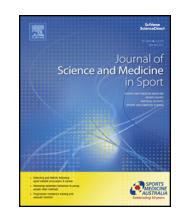
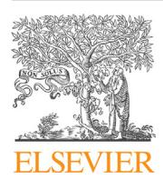
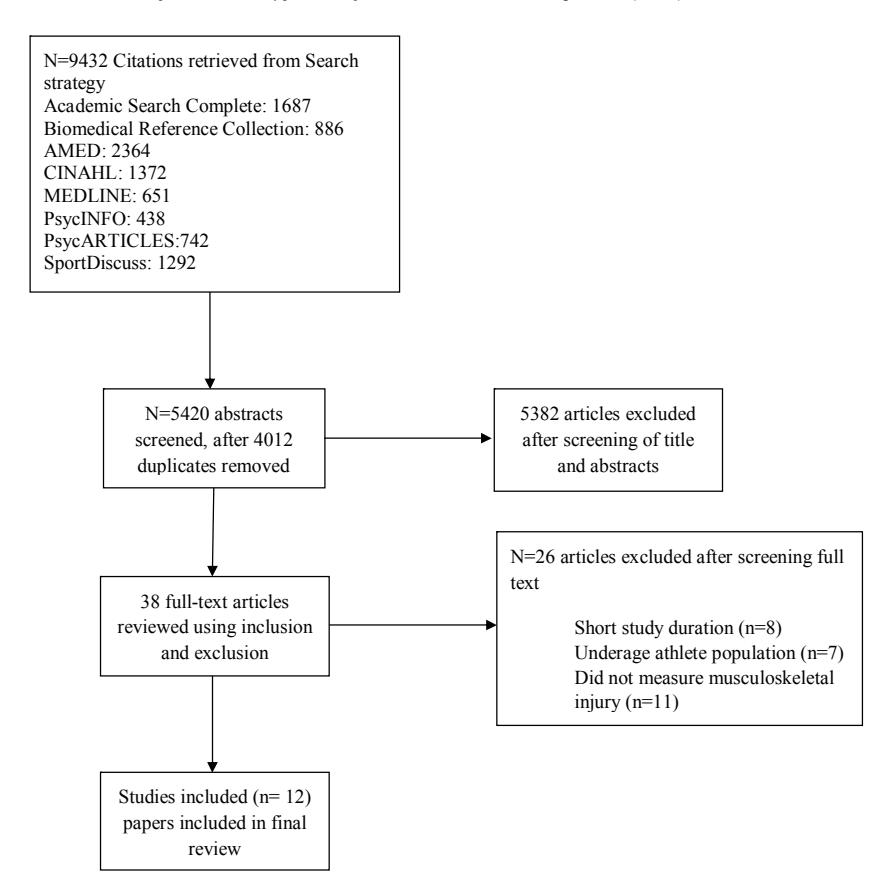

# Journal of Science and Medicine in Sport

# Review

# The associations between training load and baseline characteristics on musculoskeletal injury and pain in endurance sport populations: A systematic review

R. Johnstona,∗, R. Cahalanb, M. O'Keeffec, K. O'Sullivanb,d, T. Comyns a

a Department of Physical Education and Sport Sciences, University of Limerick, Ireland

b Department of Clinical Therapies, University of Limerick, Ireland c Department of Biological Sciences, University of Limerick, Ireland

#### a r t i c l e i n f o

#### Article history:

Received 9 June 2017

Received in revised form 11 February 2018

Accepted 7 March 2018

Available online xxx

#### Keywords:

Endurance

Surveillance

Musculoskeletal

Exercise

#### a b s t r a c t

Objectives: To determine the associations between training load, baseline characteristics (e.g. age or previous injury) and rate of musculoskeletal injury and/or pain specifically within an Endurance Sporting Population (ESP).

Design: Prospectively registered systematic review.

Methods: Eight electronic databases were searched by two independent reviewers. Studies were required to prospectively monitor both (i)training loads and (ii) musculoskeletal injury and/or pain for >3 months. Methodological quality and risk of bias were determined utilising the Critical Skills Appraisal Program (CASP). Reported effect sizes were categorised as small, medium or large.

Results: Twelve endurance sport studies were eligible (running,triathlon, rowing). Increased injury and/or pain risk was associated with: (i) high total training distances per week/month (medium effect size) (ii) training frequency <2 sessions/week (medium effect size) and (iii) both low weekly (<2 hours/week) and high monthly (large effect size) training durations. None of the studies reported internal training load data or acute:chronic workload ratios. Baseline characteristics found to increase the rate of injury and/or pain included: (i) a history of previous injury (medium effect size), (ii) age >45 years (small effect size), (iii) non-musculoskeletal comorbidities (large effect size), (iv) using older running shoes (small effect size) and (v) non-competitive behaviour.

Conclusions: This review identifies a range of external training load factors and baseline characteristics associated with an increased rate of injury and/or pain within ESPs. There is an absence of research relating to internal training loads and acute:chronic workload ratios in relation to rate of injury and/or pain within ESPs.

© 2018 Sports Medicine Australia. Published by Elsevier Ltd. All rights reserved.

### **1. Introduction**

The prevalence of injury and/or pain in Endurance Sporting Populations (ESPs) is considerable amongst both recreational and elite cohorts with a prevalence of 47–75% reported.[1,2](#page-7-0) Studies have identified, within non-ESPs and ESPs, significant financial,[3](#page-7-0) long-term health,[4](#page-7-0) and performance[5](#page-7-0) consequences of injury and/or pain. ESPs are defined as having the ability to withstand sustained bouts of aerobic and musculoskeletal stress to complete endurance disciplines such as triathlon, long distance running, rowing, swimming and cycling[.6](#page-7-0)

A unique characteristic of ESPs is the heterogeneity of the training undertaken across different disciplines, therefore clear definitions of training load are required. Training load can be defined as an external load (quantification of workload external to the athlete[\)7,8](#page-7-0) or an internal load (psychological measures or physiological responses to an external load)[.8](#page-7-0) The International Olympic Committee (IOC) consensus statement identified many different measures of external load including training/competition duration, frequency and distance[.7](#page-7-0) Measures of internal load include both objective (e.g. heart rate) and subjective measures (e.g. rating of perceived exertion (RPE))[.7,9,10](#page-7-0) Session RPE is calculated by multiplying the training session duration by the athlete's per-

d Sports Spine Centre, Aspetar Orthopaedic and Sports Medicine Hospital, Qatar

∗ Corresponding author.

E-mail address: [Richard.Johnston@ul.ie](mailto:Richard.Johnston@ul.ie) (R. Johnston).

<https://doi.org/10.1016/j.jsams.2018.03.001> 1440-2440/© 2018 Sports Medicine Australia. Published by Elsevier Ltd. All rights reserved.

ceived intensity of the session using Borg's category ratio-10.[9,11](#page-7-0) Research has shown session RPE to be a reliable and simple quantitative method of assessing subjective athlete training and performance.[11,12](#page-7-0) Whilst internal and external training loads provide a 'snap-shot' of training load at a particular point in time, acute:chronic workload ratios (ACWR) (or also referred to as training stress balance (TSB)) capture the variability in training load over time. They allow comparison of an athlete's 'acute' training load (e.g. over one week) to their 'chronic' training load (e.g. over one month) and help characterise the dynamic nature of training loads.[13](#page-7-0)

The InternationalAssociation ofAthletics Federation (IAAF) consensus statement[14](#page-7-0) on data collection procedures recommends the routine collection of baseline characteristics including age, sex, body mass index (BMI) and history of previous injury. Such baseline characteristics can be classified as modifiable (e.g. BMI) and non-modifiable (e.g. age). A complex relationship between baseline characteristics, training load and risk of injury and/or pain has been highlighted within non-ESPs[.13,10,15](#page-7-0) Two recently published systematic reviews[8,10](#page-7-0) focused on the association between training loads, baseline demographic characteristics and the prevalence of injury and/or pain. However, both contained very few ESP studies, with only four of the 68 studies included within the Jones et al[.10](#page-7-0) systematic review and only three of the 25 studies within the Drew and Finch[8](#page-7-0) systematic review focusing specifically on ESPs. Research has demonstrated training differences between ESPs (long-distance low-intensity training[\)16–19](#page-7-0) and non-ESPs such as soccer and rugby (greater emphasis on intermittent high-intensity training).[20,21](#page-7-0) Given these differences and the lack of focused research in this important growth area in sport, the aim of this systematic review is to focus specifically on ESPs and identify the association between (i) training factors or (ii) baseline demographic characteristics and the future rate ofmusculoskeletal injury and/or pain. The identification of any research gaps within ESPs could then guide the planning and development of future research.

# **2. Methodology**

The review was registered on the PROSPERO database (CRD42015026780) and has been reported in accordance with the PRISMA statement.[22](#page-7-0) All studies were identified via a computer aided search of Academic Search Complete, Biomedical Reference Collection, AMED, CINAHL, MEDLINE, PsycINFO, PsychARTICLES and SportDiscus databases during October 2016 from the period of inception, with an updated search in January 2017 [\(Fig.](#page-4-0) 1). The search was restricted to include only studies which involved humans and were published inEnglish. The searchstrategyhad four components which combined: (1) musculoskeletal injury and/or pain AND (2) training load AND (3) prospective study designs AND (4) baseline characteristics (Supplementary Table S1).

### **Study inclusion criteria:**

- ESPs participating in running, cycling, swimming, rowing or any other endurance discipline.
- All participants aged between 18–65.
- Recreational or elite ESPs.
- Outcomes measured to include both (i) training load (external or internal) and/or (ii) baseline characteristics in association with
  - (iii) data regarding injury and/or pain.
- Injury surveillance period greater than three months.
- Prospective studies.

# **Study exclusion criteria:**

**Table 1** Values used to determine effect size.[24](#page-7-0)

| Index Effect                     | size  |
|----------------------------------|-------|
| Between groups                   |       |
| Odds ratio (OR) Small:           | 1.5   |
| Medium:                          | 2     |
| Large:                           | 3     |
| Relative risk or risk ratio      |       |
| Small:                           | 2     |
| Medium:                          | 3     |
| Large:                           | 4     |
| Measures of association          |       |
| Pearson’s correlation (r) Small: | ± 0.2 |
| Medium:                          | ± 0.5 |
| Large:                           | ± 0.8 |
| Coefficient of determination     |       |
| Small:                           | 0.04  |
| Medium:                          | 0.25  |
| Large:                           | 0.64  |

- Studies which measured outcomes not relevantto this systematic review, in particular collision based injuries.
- Descriptive epidemiological studies where risk factors were not assessed.
- Cross-sectional studies

Two reviewers (RJ, MOK) searched the databases independently using the specified inclusion and exclusion criteria. Both reviewers (RJ, MOK) shortlisted suitable abstracts independently. A third reviewer (KOS) reviewed the shortlisted abstracts. The primary author (RJ) then screened this abstract list and obtained full texts of the studies which met the inclusion criteria to create a final list of studies for the review. The final list was then confirmed by one of the authors (KOS) to ensure studies met the defined inclusion and exclusion criteria. Two authors (RJ, MOK) independently assessed study quality using the reliable and vali[d23](#page-7-0) Critical Appraisal Skills Program (CASP). CASP utilises twelve questions evaluating the validity of study results, statistical analysis of the results and the conclusion/impact of the study results. CASP was used to measure specific criteria and assess each study for recruitment, study exposure, bias, confounding factors and strength ofthe results [\(Table](#page-2-0) 2 and Supplementary Table S2).

Data from each study was extracted and cross-checked by two authors (RJ, MOK). The following data was extracted: (i) study design including sample size and participant demographics (Supplementary Table S3) (ii) study methodology including training load outcomes measured and injury surveillance methods (Supplementary Table S4) and (iii) results [\(Table](#page-2-0) 2). Statistical results extracted included: (i) relative risk (RR), (ii) hazard ratio (HR) or other time to event analyses, (iii) odds ratios (OR) and (iv) descriptive statistics, along with reported 95% confidence intervals (CI) and p-values. The effect size were categorised as small, medium or large utilising parameters outlined by Sullivan and Feinn (Table 1).[24](#page-7-0)

The Oxford Centre of Evidence-Based Medicine (OCEBM)[25](#page-7-0) criteria was utilised to categorise studies from the highest to lowest level of evidence. All studies were prospective cohort studies and therefore OCEBM level 2b evidence.

### **3. Results**

Study identification is summarised in [Fig.](#page-4-0) 1. A total of 9432 potential studies were initially identified, which was reduced to 5420 after the removal of duplicates. Screening of study titles and abstracts identified 38 studies, which potentially met the inclusion criteria. Full texts of the 38 studies were reviewed independently by two authors (RJ and KOS) and a further 26 were discarded based

G Model

No. of Pages9

**Table2**Summaryofresults.

| Study                                 | Sport   | Statistical tests                                                                                                                                                                                                                                                                                     | Statistically significant associations                                                                                                                                                                                                                                                                                                                                                                                                                                                                                                                             | CASP criteria unfulfilled |
|---------------------------------------|---------|-------------------------------------------------------------------------------------------------------------------------------------------------------------------------------------------------------------------------------------------------------------------------------------------------------|--------------------------------------------------------------------------------------------------------------------------------------------------------------------------------------------------------------------------------------------------------------------------------------------------------------------------------------------------------------------------------------------------------------------------------------------------------------------------------------------------------------------------------------------------------------------|---------------------------|
| Bovens et al. 26           | Running | 1) Mann–Whitney tested differences between adequate and inadequate diaries. 2) Spearman's rank tested training volume and injury prevalence 3) Chi square tested differences with injuries                                                                                                      | 1) A significant association ( $p < 0.05$ ) was found between the number of injured runners and mean distance covered (km/day) at the first testing phase at 15 km ( $r^2 = 0.36$ , $p = 0.001$ ) and third testing phase at 42 km ( $r^2 = 0.16$ , $p = 0.0015$ ).                                                                                                                                                                                                                                                                                                | Criteria: 3 and 5         |
| Hein et al. 27             | Running | 1) Due to low sample an explorative evaluation of risk factors of AT was carried out without statistical tests. Descriptive statistical methods of means, standard deviations, medians, and 95% confidence intervals were carried out.                                                                | 1) No statistically significant associations reported.                                                                                                                                                                                                                                                                                                                                                                                                                                                                                                             | Criteria: 3               |
| Hespanhol Junior et al. 35 | Running | 1) Chi square, Mann–Whitney and Students's t-test were used to check for differences between those who developed a RRI. 2) Associations between training characteristics and RRI were tested with a univariate analysis using GEE. 3) Multivariate binary logistic analysis was also performed. | Factors found to statistically ( $p < 0.2$ ) increase the risk of RRI: 1) Previous RRI: (multivariate binary logistic analysis using generalised estimating equation) (OR = 1.88 (CI 95% = 1.01–3.51) $p = 0.046$ ) 2) Duration of training (minutes per session) (OR = 1.01 (CI 95% = 1.00–1.02) $p = 0.008$ ) 3) Speed training (times/week) (OR = 1.46 (CI 95% = 1.02–2.10) $p = 0.039$ ) Factors found to statistically ( $p < 0.2$ ) decrease the risk of RRI: 4) Interval training (times/week) (OR = 0.61 (CI 95% = 0.43–0.88) $p = 0.008$ ) | Criteria: 4               |
| Lysholm and Wiklander 28   | Running | 1) Student's t-test  2) Chi square test  3) Linear regression test                                                                                                                                                                                                                        | 1) A significant relationship ( $r = 0.59$ ) was found in long distance runners between distance covered during a given month and the number of injury days in the following month. 2) Injuries per 1000 h of training: Middle di                                                                                                                                                                                                                                                                                                                               |                           |

**ARTICLE IN PRESS** JSAMS-1822;

G Model

No. of Pages9

4

| Summary of results.                 |         |                                                                                                                                                                                                                                                      |                                                                                                                                                                                                                                                                                                                                                                                                                                                                                                                                                       |                           |
|-------------------------------------|---------|------------------------------------------------------------------------------------------------------------------------------------------------------------------------------------------------------------------------------------------------------|-------------------------------------------------------------------------------------------------------------------------------------------------------------------------------------------------------------------------------------------------------------------------------------------------------------------------------------------------------------------------------------------------------------------------------------------------------------------------------------------------------------------------------------------------------|---------------------------|
| Study                               | Sport   | Statistical tests                                                                                                                                                                                                                                    | Statistically significant associations                                                                                                                                                                                                                                                                                                                                                                                                                                                                                                                | CASP criteria unfulfilled |
| Newlands et al. 29       | Rowing  | 1) Pearson correlations determined the associations between total training volume and incidence of LBP 2) Multivariate logistic regression model determined associations between potential risk factors and a new episode of LBP.                 | Factors which were found to be statistically significant predictors of new LBP: 1) Previous history of LBP: OR = 2.06 (CI 95% = 1.22–3.48) p = 0.01                                                                                                                                                                                                                                                                                                                                                                                                | Criteria: 4 and 5         |
|                                     |         |                                                                                                                                                                                                                                                      | 2) Increasing age: (OR = 1.08 (CI 95% = 1.01–1.15) p = 0.02) 3) Significant associations between the number of new episodes of LBP and total training hours per month (r = 0.83, p = <0.01) 4) Number of new episodes of new LBP and the number of ergometer training hours per month (r = 0.80, p = <0.01) 5) Number of new LBP episodes and the average training hours per participant per month (r = 0.73, p = <0.01)                                                                                                                     |                           |
| Taunton et al. 37        | Running | 1) Multivariate logistic regression assessed contribution of predicted risk factors to number of injuries and to severe running injuries and new injuries. 2) Pearson's Chi-squared analysed baseline characteristics across sex and orthotic use | Factors which were found to be statistically significant predictors of injury risk (RR > 1):  1) Age category <30: RR = 0.575 (CI 95% = 0.342–0.967)  2) Age category >50: RR = 1.919 (CI 95% = 1.107–3.328) 3) Females running frequency <1 day/week vs overall injury: RR = 3.648 (CI 95% = 1.082–12.297) 4) Running shoe age 4–6 months in females compared to 1–3 months: RR = 1.735 (CI 95% = 1.009–2.984) 5) BMI >26 kg/m 2 in men was protective of injury for male runners: RR = 0.407 (CI 95% = 0.211–0.785) |                           |
| van Middelkoop et al. 36 | Running | 1) Logistic regression models used to determine prognostic factors (univariate logistic regression and multivariate logistic regression)                                                                                                             | Factors which were found to be statistically significant predictors of persistent injuries: 1) Non-MSK comorbidities at baseline: OR = 3.23 (CI 95% = 1.24–8.43, p = 0.02) 2) Location of injury                                                                                                                                                                                                                                                                                                                                                |                           |

ofresults.

**Fig. 1.** Flow chart of study selection procedure.

on the exclusion criteria, leaving 12 eligible prospective studies for final review.[26–37](#page-7-0)

The CASP assessment of each study is outlined in [Table](#page-2-0) 2 and Supplementary Table S2. Five studies did not appear to identify, or attempt to account for, confounding factors.[26,28,29,32,33](#page-7-0) Diagnostic inaccuracy may have had an influence in six studies as their outcome measures were based solely on subjective reporting of injuries by participants[.29,32–36](#page-7-0) One of the studies included only male participants,[36](#page-7-0) affecting generalisability of results. Recall bias may also be inherentin those studies where training and injury data were gathered on a monthly rather than weekly basis[.26,27,30–32](#page-7-0)

A detailed description of study characteristics is outlined in Supplementary Table S3. The mean ages of the participants were similarly broad, ranging from 18–65 years. Eleven studies included both male and female participants, whilst the remaining study[36](#page-7-0) involved only male runners. Nine studies involved a running population[,26–28,30–32,35–37](#page-7-0) two rowing[,29,33](#page-7-0) and one triathlon.[34](#page-7-0) Three studies recruited elite ESPs[,28,29,33](#page-7-0) eight studies recruited a recreational populatio[n26,27,30–32,35–37](#page-7-0) whilst one study recruited both elite and recreational ESPs.[34](#page-7-0) The length of follow-up varied from three months to three years.

Injury surveillance methods varied across the twelve studies. All studies utilised a subjective screening protocol asking ESPs to record injuries either within a written diary,[26,28,36,37](#page-7-0) electronic questionnaire[27,29–32,34,35](#page-7-0) or over the telephone.[33](#page-7-0) Three studies recorded data after each training session,[30–32](#page-7-0) two undertook weekly injury screening[,26,27](#page-7-0) one undertook fortnightly injury screening[35](#page-7-0) and six studies undertook monthly screening[.28,29,33,34,36,37](#page-7-0) In six studie[s26,28,30,31,33,37](#page-7-0) injuries were assessed by either a physiotherapist or medical doctor. Injury definitions varied across each study (Supplementary Table S5).

The statistically significant associations identified in each paper are summarised in [Table](#page-2-0) 2. Due to variability in the definitions of injury and/or pain, training factors, inclusion and exclusion criteria, baseline assessments and statistical tests reported, pooling of data in a meta-analysis was not possible. While injury and pain are complex and different phenomena, ESP have been found to use the terms interchangeably[.6,38](#page-7-0) Based on definitions provided by the twelve studies, nine studies [26–28,30,31,33,34,36,37](#page-7-0) reported musculoskeletal injury whilst thre[e29,32,35](#page-7-0) reported musculoskeletal pain episodes. Despite this differentiation a number of 'injury' definitions included pain in their description and likewise a number of 'pain' definitions included injury in their description. Therefore injury and pain were considered as overlapping and interchangeable. None of the studies within this review reported internal training load measures.

Training distance (kilometres (km) per day/month), a measure of external load, was reported by eigh[t26–31,35,36](#page-7-0) of the twelve studies within this review. Two of these studie[s27,31](#page-7-0) however, did not undertake any statistical analysis of the association between training distance and rate ofinjury and/or pain.Within an elite rowing population Newlands et al.[29](#page-7-0) identified a medium effect size (r = 0.71; CI = not reported, p = 0.01) between the number of new episodes of low back pain (LBP) and a higher average number of km/month rowed.Within an elite long distance running population Lysholm and Wiklander[28](#page-7-0) reported a medium effect size (r = 0.59; CI = not reported, p = not reported) between high training distances (km/day) covered during a givenmonth and a high number ofinjury days the following month. Bovens et al.[26](#page-7-0) studied a population of recreational long distance runners and identified a significant association, with a medium effect size (r2 = 0.36; CI = not reported, p = 0.001), between an increase in the number of injured runners and increased total mean distance covered (km/day). However,

studies of recreational runners by both Hespanhol et al[.35](#page-7-0) (OR = 1; CI = 0.99–1.01, p = 0.92) and van Middelkoop et al[.36](#page-7-0) (OR = 2.61; CI = 0.22–30.71, p = 0.45) did not demonstrate statistically significant associations between high training distances and rate of injury and/or pain. A study by Nielsen et al[.30](#page-7-0) demonstrated no statistically significant association between rate of injury and/or pain and an increase in weekly running distance by >30%, when compared to a <10% increase (HR = 1.59; CI = 0.96–2.66, p = 0.07). This was the only study to analyse the impact of percentage changes in external training load. In summary, thre[e26,28,29](#page-7-0) out of six studies identified a medium effect size association between high training distance and increased rate of injury and/or pain.

Of ten studie[s26–29,31–36](#page-7-0) which recorded total training duration (minutes/hours per week/month), fiv[e26–28,31,36](#page-7-0) did not perform any statistical analysis of the association between training duration and rate of injury and/or pain. However, within a recreational running population Malisoux et al[.32](#page-7-0) reported a training duration of <2 hours/week increased the rate of injury and/or pain (HR = 3.29; 95% CI = 2.27–4.79, p = not reported). Within a population of elite rowers Newlands et al.[29](#page-7-0) reported an association, with a large effect size, between LBP and high total training hours/month (r = 0.83; CI = not reported, p = <0.01). However, the number of training hours/month was not specified by Newlands et al.[29](#page-7-0) Studies of recreational runner[s35](#page-7-0) (OR = 1.01; CI = 1–1.02, p = 0.017), elite rower[s33](#page-7-0) (r = 0.543, p = 0.068) and both elite and recreational triathletes[34](#page-7-0) (p = 0.116) did not demonstrate statistically significant associations between training duration and rate of injury and/or pain. In summary, both low weekly and high total monthly training hours have been reported as having a large effect size association on increased rate of injury and/or pain.

Training frequency (training sessions/week) was reported by six studies[,27,28,32,35–37](#page-7-0) however three[27,28,36](#page-7-0) did not undertake statistical analysis of the association between training frequency and rate of injury and/or pain. Taunton et al[.37](#page-7-0) reported an association, with a medium effect size, between completing <1 training session/week and the overall rate of injury and/or pain (RR = 3.648; CI = 1.082–12.297, p = not reported) amongst female recreational runners. Malisoux et al[.32](#page-7-0) similarly reported an increased rate of injury and/or pain associated with <2 training sessions/week (HR = 2.41, CI = 1.71–3.42, p = not reported). However, another stud[y35](#page-7-0) did not demonstrate a statistically significant association between increased training frequency (sessions/week) and rate of injury and/or pain (OR = 1.01; CI = 0.87–1.18, p = 0.85).

Five studies of elite and recreational ESPs,[29–32,35](#page-7-0) demonstrated a medium size effect between a history of previous injury and new injury and/or pain. These studies, conducted in different ESPs, were: (i) Nielsen et al.[31](#page-7-0) (OR = 1.85; CI = 1.3–2.6, p = 0.0006), (ii) Nielsen et al[.30](#page-7-0) (OR = 1.78; CI = 1.22–2.61, p = 0.0027), (iii) Hespanhol et al[.35](#page-7-0) (OR = 1.88; CI = 1.01–3.51, p = 0.046), (iv) Malisoux et al[.32](#page-7-0) (OR = 2.14; CI = 1.47–3.12, p = 0.0001) and (v) Newlands et al[.29](#page-7-0) (OR = 2.06; CI = 1.22–3.48, p = 0.01). In contrast, van Middelkoop et al.[36](#page-7-0) did not demonstrate a statistically significant association between previous running related injury (RRI) and new injury and/or pain (OR = 1.41; CI = 0.48–4.09, p = 0.53) whilst Taunton et al.[37](#page-7-0) reported half of those participants who reported a new injury and/or pain had a history of previous RRI (no statistical analysis). An additional two studie[s27,33](#page-7-0) collected data on previous injury but did not perform any statistical analysis of the association between previous injury and new injury and/or pain.

A further non-modifiable baseline characteristic, increased participant age, was found to have a significant association with increased rate of injury and/or pain in four[29–31,37](#page-7-0) of five studies. Both Taunton et al.[37](#page-7-0) and Nielsen et al[.31](#page-7-0) demonstrated a statistically significant, but small effect size, between injury and/or pain and age >45 (RR = 1.32; CI = 1.04–1.66, p = 0.01)[31](#page-7-0) and >50 years (RR = 1.919; CI = 1.107–3.328, p = not reported).[37](#page-7-0) Nielsen et al[.30](#page-7-0) observed the mean age of injured participants was greater than non-injured participants (p = <0.01) whilst Newlands et al.[29](#page-7-0) report an extremely small effect size (OR = 1.08; CI = 1.01–1.15, p = 0.02) with older participants more at risk of developing LBP than younger participants. Newlands et al.[29](#page-7-0) did not provide an age category for older and younger participants. Zwingenberger et al.[34](#page-7-0) reported athletes aged <35 years had slightly fewer injuries (22%) than athletes aged > 35 years (24.6%), however this was not statistically significant (p = 0.656).

Other baseline characteristics foundto be statistically associated with an increased rate of injury and/or pain were: Non-Musculoskeletal (MSK) co-morbidities (e.g. disorders of nervous system, gastro-intestinal tract and cardiac diseases) with a large effect size (OR = 3.23; CI = 1.24–8.43, p = 0.02)[,36](#page-7-0) increased age of running shoe with a small effect size (RR = 1.735; CI = 1.009–2.984, p = not reported)[37](#page-7-0) and Type B non-competitive behaviour (cumulative Injury Risk Differences (cIRD) = 11.9%; CI −0.5% to 23.3%, p = 0.04).[31](#page-7-0) Although Body Mass Index (BMI) was investigated in si[x29–32,35,37](#page-7-0) of the twelve studies, none of these demonstrated a statistically significant association with injury and/or pain.

### **4. Discussion**

From twelve studies which meet the inclusion criteria, five studies[26,28,29,32,37](#page-7-0) within this review reported statistically significant associations between at least one external training load factor (distance, frequency and duration) and rate of injury and/or pain within ESPs. Both high training distances[26,28,29](#page-7-0) and low/high training duration[s29](#page-7-0) were found to have, respectively, a medium and large effect size association on increased rate of injury and/or pain. These findings are particularly relevant to ESPs where training typically involves longer training distances and durations[16,17,39](#page-7-0) when compared to other non-ESPs[.21,40](#page-7-0) The identification of a medium effect size association between low training frequency (<2 sessions/week)[32,37](#page-7-0) and increased rate of injury and/or pain, and a large effect size association between short training duration (<2 hours/week[\)32](#page-7-0) and increased rate of injury and/or pain may be less applicable given that recreational endurance participation is defined by some as a training frequency of three to six training sessions/week[17,32](#page-7-0) and training duration of two to four hours/week.[41](#page-7-0) It is possible that these definitions are insensitive in capturing ESPs who train outside of these parameters, in particular those who train predominantly at the weekend. It should also be noted that five of the twelve studies which measured an external training load[30,33–36](#page-7-0) did not identify a statistically significant association between an external training load factor and rate of injury and/or pain. The conflicting findings across studies within ESPs suggests interpreting external training factors in isolation, as a risk factor for injury and/or pain, is likely an oversimplification[.42](#page-7-0)

Increasingly within non-ESP research there has been a shift from reporting traditional external training load factors in isolation and an increased appreciation of the complex relationship between internal and external training load factors and injury and/or pain risk[.8,10](#page-7-0) An important finding from this systematic review is the absence of reported data on internal training loads in relation to the rate of injury and/or pain within ESPs. Internal training loads capture the interaction between external training loads and the athlete's individual capacity to tolerate such external training loads. Recent research has demonstrated 70–75% of an endurance athletes training load is undertaken at continuous low training intensitie[s19,43,44](#page-7-0) whereas in non-ESP training, load favours repeated moderate to high training intensities, separated by periods of low intensity training.[20,45,46](#page-7-0) This highlights the

unique training undertaken by ESPs and the potential barriers to applying findings from non-ESP research to ESPs.

Interestingly both low[32](#page-7-0) and hig[h29](#page-7-0) training durations were identified as potential risk factors for injury and/or pain within this review. This likely relates to the 'Fitness–Fatigue model' proposed by Banister et al.[47](#page-8-0) which suggests training load not only elicits protective fitness responses which reduce risk of injury and/or pain, but also elicits 'harmful' fatigue responses which increase the risk of injury and/or pain. Recent research in non ESP disciplines has increasingly focused on the association between acute workloads (short term training load e.g. over one week) and chronic workloads (mean long-term training load e.g. over four weeks).[48,49](#page-8-0) High ACWR, that is a 'spike' in the acute workload relative to the mean chronic workload, have been reported to increase injury risk in rugby league players,[48](#page-8-0) cricket fast bowler[s50](#page-8-0) and Australian rules footballers.[49](#page-8-0) Research has also identified that each discipline likely has an unique acute:chronic workload ratio which is protective against injury and/or pain.[42](#page-7-0) No studies within this review reported acute:chronic workload ratios (TSB) and therefore an optimal acute:chronic workload ratio for ESPs requires investigation and characterization.

It is worth noting that more studies within this review identified an association between baseline ESP characteristics and rate of injury and/or pain, than an association between external training load factors and rate of injury and/or pain. A history of previous injury was themostfrequently identifiednon-modifiable risk factor with five studies[29–32,35](#page-7-0) reporting a medium effect size within ESPs. This is a finding replicated in a systematic review of middle and long distance runners whichconcluded the onlynon-modifiable risk factor which consistently increased the risk of RRI was a history of previous injury.[15](#page-7-0) The IAAF consensus group also identify previous injury as a contributing factor to future injury.[14](#page-7-0) This group highlightedthat'adetaileddescriptionas to time ofprevious injury/pain onset, location, severity, and degree of recovery' is required to predict future injury and/or pain.[14](#page-7-0) However, all the studies included in this review only reported subjective participant recall as to the presence or absence of a previous injury. Increased age has been associated with injury and or/pain within football and rugby,[13,51](#page-7-0) however the recent systematic review of runners found little scientific evidence to support age as an important risk factor for RRI development[.15](#page-7-0) This review has demonstrated a small effect size associatio[n31,37](#page-7-0) between age >45 years and increased rate of injury and or/pain within ESPs. As highlighted by Jones et al[.10](#page-7-0) it is likely older participants have experienced a greater number of injuries during their careers, and therefore age and previous injury risk factors should be considered in conjunction.

Non-MSK co-morbidities have not often been examined as a risk factor for injury and/or pain within ESPs. However, van Middelkoop et al.[36](#page-7-0) specifically demonstrated recreational marathon runners with non-MSK co-morbidities (e.g. cardiac or neurological disorders) were three times more likely to have persistent (>three months)injuries and/or pain following participation in a marathon. Increased age of running shoe, in female runners, was found to have a small effect size on RRI by one study within our review,[37](#page-7-0) however the diversity of footwear studied hinders definitive conclusions being drawn. Whilst Type B behaviour (non-competitive) was identified as a potential risk factor within our revie[w31](#page-7-0) this is in contradiction to the findings of the systematic review of runners which demonstrated Type A (competitive) behaviour to increase rate of injury and/or pain[.15](#page-7-0) One school of thought suggests that a competitive personality may ignore minor symptoms, thereby increasing the risk of overuse injuries[.52](#page-8-0) However competitive personalities may also be more likely to take minor symptoms seriously and seek medical assessment earlier.[53](#page-8-0) Despite half of the studies[29–32,35,37](#page-7-0) within this review reporting data on BMI as a risk factor for injury and/or pain in ESPs, none of the studies demonstrated a statistically significant association. These findings are consistent with the systematic review of middle and long-distance runner[s15](#page-7-0) which concluded there was no association between BMI and the rate of injury and/or pain. The diverse range of baseline characteristics identified, often in small study numbers, highlights the need for further prospective study of the impact of such characteristics on injury and/or pain risk in ESPs.

The plethora of varying definitions of 'injury' utilised by the studies in this review (Supplementary Table S4) limits comparability of injury and/or pain data[.8](#page-7-0) These definitions centre on two key aspects: (a) the identification of the injury as a 'musculoskeletal/physical complaint['26,31,35,54,55](#page-7-0) or 'pain['29,32,37,56](#page-7-0) and (b) the severity of the injury (i.e. restriction in training,[26,28–30,32,35,54–56](#page-7-0) need for medical attention[27,33](#page-7-0) or duration of symptoms[28–30,32\).](#page-7-0) This variation in injury definition was highlighted as a concern by both the IO[C7](#page-7-0) and the IAAF[.14](#page-7-0) Both committees stated their 'first step' was to agree upon a definition of key terms 'to serve as a foundation for consistent use in research and clinical practice'.[7](#page-7-0) Definitions relating to the severity of injury and/or pain have been updated to reflect the World Health Organisation (WHO) Injury Definitions Concept Framework (IDCF)[.57](#page-8-0) This highlights three subsets of injury severity definition: the sports performance narrative (competition days lost), the clinical examination narrative (illhealth requiring medical attention) and the athlete-self reporting narrative (injury and/or pain as perceived by the athlete).[57](#page-8-0)

### **5. Limitations**

The main limitation of this review is the varying methodologies employed across the included studies. There was variability in definitions of injury and/or pain, external training load, baseline assessments, data collection and statistical analysis. None of the studies within this review reported internal training load data or ACWR, both areas of increasing interest and emerging importance within non-ESPs. Lysholm and Wiklande[r28](#page-7-0) was the only study which introduced a lag period between analysis of training load and analysis of injury and/or pain in the following month. The generalisability of results should also be considered given that nine studies involved a recreational ESP whereas three involved an elite ESP. Only studies in English were included, and relevant studies in other languages may have been excluded. Whilst the CASP checklist allows one to focus on twelve key aspects of study design, data collection and results, it does not provide an overall quantitative score limiting comparability of the quality of the included studies.

# **6. Conclusion**

Prospective cohort studies of ESPs have identified statistically significant associations between external training load factors and an increased rate of injury and/or pain: (i) high total training distances per week/month (medium effect size)(ii)training frequency <2 sessions/week (medium effect size) and (iii) both low weekly (<2 hours/week) and high monthly (large effect size) training durations. However, an equal number of studies within this review did not identify a statistically significant association between an external training load factor and rate of injury and/or pain. The applicability of these findings may be limited as the relationship between internal and externaltraining load factors was not considered in these ESP studies. Further investigation of internal training loadmeasures (ACWRandRPE) withinanESPmaybemore accurate in analyzing the impact of reductions/spikes in weekly/monthly training loads upon injury and/or pain risk. Baseline characteristics were the most frequently reported factor to increase the rate of injury and/or pain, in particular: (i) a history of previous injury (medium effect size)(ii) age greater than 45 years (small effect size)

- (iii) non-MSK comorbidities (large effect size) (iv) increased age of running shoe (small effect size) and (v) Type B non-competitive behaviour. These conflicting findings are likely a reflection of the complex relationship between intrinsic/extrinsic ESP characteristics, external training load, internal training load and ACWR. This study highlights not only the wide range of both intrinsic and extrinsic factors which potentially impact upon injury and/or pain risk, but also the complex relationship between these factors. Future research within ESPs should aim to characterise the associationbetweeninternaltraining loads, acute:chronic workloadratios, baseline characteristics and rates of injury and/or pain. **Practical implications**
- Training volume, training distance and training frequency can influence the rate of injury and/or pain within Endurance Sporting Populations (ESPs). These training factors should be monitored, and gradually progressed, with a view to reducing rate of injury and/or pain within ESPs.
- Individual baseline characteristics, such as history of previous injury and non-musculoskeletal co-morbidities, can be used to help identify individuals who may be at increased risk of injury and/or pain within ESPs.
- Research within ESPs is required to determine the interaction and association between training load (internal, external, acute:chronic workload ratios), and intrinsic/extrinsic characteristics and the rate of injury and/or pain. **Acknowledgements** The Faculty of Education and Health Sciences at the University of Limerick funds RJ through a PhD scholarship. **Appendix A. Supplementary data** Supplementary data associated with this article can be found, in the online version, at <https://doi.org/10.1016/j.jsams.2018.03.001>. **References**
- 1. [Clarsen](http://refhub.elsevier.com/S1440-2440(18)30068-9/sbref0005) [B,](http://refhub.elsevier.com/S1440-2440(18)30068-9/sbref0005) [Bahr](http://refhub.elsevier.com/S1440-2440(18)30068-9/sbref0005) [R,](http://refhub.elsevier.com/S1440-2440(18)30068-9/sbref0005) [Heymans](http://refhub.elsevier.com/S1440-2440(18)30068-9/sbref0005) [MW](http://refhub.elsevier.com/S1440-2440(18)30068-9/sbref0005) [et](http://refhub.elsevier.com/S1440-2440(18)30068-9/sbref0005) [al.](http://refhub.elsevier.com/S1440-2440(18)30068-9/sbref0005) [The](http://refhub.elsevier.com/S1440-2440(18)30068-9/sbref0005) [prevalence](http://refhub.elsevier.com/S1440-2440(18)30068-9/sbref0005) [and](http://refhub.elsevier.com/S1440-2440(18)30068-9/sbref0005) [impact](http://refhub.elsevier.com/S1440-2440(18)30068-9/sbref0005) [of](http://refhub.elsevier.com/S1440-2440(18)30068-9/sbref0005) [overuse](http://refhub.elsevier.com/S1440-2440(18)30068-9/sbref0005) [injuries](http://refhub.elsevier.com/S1440-2440(18)30068-9/sbref0005) [in](http://refhub.elsevier.com/S1440-2440(18)30068-9/sbref0005) [five](http://refhub.elsevier.com/S1440-2440(18)30068-9/sbref0005) [Norwegian](http://refhub.elsevier.com/S1440-2440(18)30068-9/sbref0005) [sports:](http://refhub.elsevier.com/S1440-2440(18)30068-9/sbref0005) [application](http://refhub.elsevier.com/S1440-2440(18)30068-9/sbref0005) [of](http://refhub.elsevier.com/S1440-2440(18)30068-9/sbref0005) [a](http://refhub.elsevier.com/S1440-2440(18)30068-9/sbref0005) [new](http://refhub.elsevier.com/S1440-2440(18)30068-9/sbref0005) [surveillance](http://refhub.elsevier.com/S1440-2440(18)30068-9/sbref0005) [method.](http://refhub.elsevier.com/S1440-2440(18)30068-9/sbref0005) [Scand](http://refhub.elsevier.com/S1440-2440(18)30068-9/sbref0005) [J](http://refhub.elsevier.com/S1440-2440(18)30068-9/sbref0005) [Med](http://refhub.elsevier.com/S1440-2440(18)30068-9/sbref0005) [Sci](http://refhub.elsevier.com/S1440-2440(18)30068-9/sbref0005) [Sports](http://refhub.elsevier.com/S1440-2440(18)30068-9/sbref0005) [2015;](http://refhub.elsevier.com/S1440-2440(18)30068-9/sbref0005) [25\(3\):323–330.](http://refhub.elsevier.com/S1440-2440(18)30068-9/sbref0005)
- 2. [Andersen](http://refhub.elsevier.com/S1440-2440(18)30068-9/sbref0010) [CA,](http://refhub.elsevier.com/S1440-2440(18)30068-9/sbref0010) [Clarsen](http://refhub.elsevier.com/S1440-2440(18)30068-9/sbref0010) [B,](http://refhub.elsevier.com/S1440-2440(18)30068-9/sbref0010) [Johansen](http://refhub.elsevier.com/S1440-2440(18)30068-9/sbref0010) [TV](http://refhub.elsevier.com/S1440-2440(18)30068-9/sbref0010) [et](http://refhub.elsevier.com/S1440-2440(18)30068-9/sbref0010) [al.](http://refhub.elsevier.com/S1440-2440(18)30068-9/sbref0010) [High](http://refhub.elsevier.com/S1440-2440(18)30068-9/sbref0010) [prevalence](http://refhub.elsevier.com/S1440-2440(18)30068-9/sbref0010) [of](http://refhub.elsevier.com/S1440-2440(18)30068-9/sbref0010) [overuse](http://refhub.elsevier.com/S1440-2440(18)30068-9/sbref0010) [injury](http://refhub.elsevier.com/S1440-2440(18)30068-9/sbref0010) [among](http://refhub.elsevier.com/S1440-2440(18)30068-9/sbref0010) [iron-distance](http://refhub.elsevier.com/S1440-2440(18)30068-9/sbref0010) [triathletes.](http://refhub.elsevier.com/S1440-2440(18)30068-9/sbref0010) [Br](http://refhub.elsevier.com/S1440-2440(18)30068-9/sbref0010) [J](http://refhub.elsevier.com/S1440-2440(18)30068-9/sbref0010) [Sports](http://refhub.elsevier.com/S1440-2440(18)30068-9/sbref0010) [Med](http://refhub.elsevier.com/S1440-2440(18)30068-9/sbref0010) [2013;](http://refhub.elsevier.com/S1440-2440(18)30068-9/sbref0010) [47\(13\):857–861.](http://refhub.elsevier.com/S1440-2440(18)30068-9/sbref0010)
- 3. [Hickey](http://refhub.elsevier.com/S1440-2440(18)30068-9/sbref0015) [J,](http://refhub.elsevier.com/S1440-2440(18)30068-9/sbref0015) [Shield](http://refhub.elsevier.com/S1440-2440(18)30068-9/sbref0015) [AJ,](http://refhub.elsevier.com/S1440-2440(18)30068-9/sbref0015) [Williams](http://refhub.elsevier.com/S1440-2440(18)30068-9/sbref0015) [MD](http://refhub.elsevier.com/S1440-2440(18)30068-9/sbref0015) [et](http://refhub.elsevier.com/S1440-2440(18)30068-9/sbref0015) [al.](http://refhub.elsevier.com/S1440-2440(18)30068-9/sbref0015) [The](http://refhub.elsevier.com/S1440-2440(18)30068-9/sbref0015) [financial](http://refhub.elsevier.com/S1440-2440(18)30068-9/sbref0015) [cost](http://refhub.elsevier.com/S1440-2440(18)30068-9/sbref0015) [of](http://refhub.elsevier.com/S1440-2440(18)30068-9/sbref0015) [hamstring](http://refhub.elsevier.com/S1440-2440(18)30068-9/sbref0015) [strain](http://refhub.elsevier.com/S1440-2440(18)30068-9/sbref0015) [injuries](http://refhub.elsevier.com/S1440-2440(18)30068-9/sbref0015) [in](http://refhub.elsevier.com/S1440-2440(18)30068-9/sbref0015) [the](http://refhub.elsevier.com/S1440-2440(18)30068-9/sbref0015) [Australian](http://refhub.elsevier.com/S1440-2440(18)30068-9/sbref0015) [Football](http://refhub.elsevier.com/S1440-2440(18)30068-9/sbref0015) [League.](http://refhub.elsevier.com/S1440-2440(18)30068-9/sbref0015) [Br](http://refhub.elsevier.com/S1440-2440(18)30068-9/sbref0015) [J](http://refhub.elsevier.com/S1440-2440(18)30068-9/sbref0015) [Sports](http://refhub.elsevier.com/S1440-2440(18)30068-9/sbref0015) [Med](http://refhub.elsevier.com/S1440-2440(18)30068-9/sbref0015) [2014;](http://refhub.elsevier.com/S1440-2440(18)30068-9/sbref0015) [48\(8\):729–730.](http://refhub.elsevier.com/S1440-2440(18)30068-9/sbref0015)
- 4. [Saxon](http://refhub.elsevier.com/S1440-2440(18)30068-9/sbref0020) [L,](http://refhub.elsevier.com/S1440-2440(18)30068-9/sbref0020) [Finch](http://refhub.elsevier.com/S1440-2440(18)30068-9/sbref0020) [C,](http://refhub.elsevier.com/S1440-2440(18)30068-9/sbref0020) [Bass](http://refhub.elsevier.com/S1440-2440(18)30068-9/sbref0020) [S.](http://refhub.elsevier.com/S1440-2440(18)30068-9/sbref0020) [Sports](http://refhub.elsevier.com/S1440-2440(18)30068-9/sbref0020) [participation,](http://refhub.elsevier.com/S1440-2440(18)30068-9/sbref0020) [sports](http://refhub.elsevier.com/S1440-2440(18)30068-9/sbref0020) [injuries](http://refhub.elsevier.com/S1440-2440(18)30068-9/sbref0020) [and](http://refhub.elsevier.com/S1440-2440(18)30068-9/sbref0020) [osteoarthritis:](http://refhub.elsevier.com/S1440-2440(18)30068-9/sbref0020) [implications](http://refhub.elsevier.com/S1440-2440(18)30068-9/sbref0020) [for](http://refhub.elsevier.com/S1440-2440(18)30068-9/sbref0020) [prevention.](http://refhub.elsevier.com/S1440-2440(18)30068-9/sbref0020) [Sports](http://refhub.elsevier.com/S1440-2440(18)30068-9/sbref0020) [Med](http://refhub.elsevier.com/S1440-2440(18)30068-9/sbref0020) [1999;](http://refhub.elsevier.com/S1440-2440(18)30068-9/sbref0020) [28\(2\):123](http://refhub.elsevier.com/S1440-2440(18)30068-9/sbref0020)–[135.](http://refhub.elsevier.com/S1440-2440(18)30068-9/sbref0020)
- 5. [Raysmith](http://refhub.elsevier.com/S1440-2440(18)30068-9/sbref0025) [BP,](http://refhub.elsevier.com/S1440-2440(18)30068-9/sbref0025) [Drew](http://refhub.elsevier.com/S1440-2440(18)30068-9/sbref0025) [MK.](http://refhub.elsevier.com/S1440-2440(18)30068-9/sbref0025) [Performance](http://refhub.elsevier.com/S1440-2440(18)30068-9/sbref0025) [success](http://refhub.elsevier.com/S1440-2440(18)30068-9/sbref0025) [or](http://refhub.elsevier.com/S1440-2440(18)30068-9/sbref0025) [failure](http://refhub.elsevier.com/S1440-2440(18)30068-9/sbref0025) [is](http://refhub.elsevier.com/S1440-2440(18)30068-9/sbref0025) [influenced](http://refhub.elsevier.com/S1440-2440(18)30068-9/sbref0025) [by](http://refhub.elsevier.com/S1440-2440(18)30068-9/sbref0025) [weeks](http://refhub.elsevier.com/S1440-2440(18)30068-9/sbref0025) [lost](http://refhub.elsevier.com/S1440-2440(18)30068-9/sbref0025) [to](http://refhub.elsevier.com/S1440-2440(18)30068-9/sbref0025) [injury](http://refhub.elsevier.com/S1440-2440(18)30068-9/sbref0025) [and](http://refhub.elsevier.com/S1440-2440(18)30068-9/sbref0025) [illness](http://refhub.elsevier.com/S1440-2440(18)30068-9/sbref0025) [in](http://refhub.elsevier.com/S1440-2440(18)30068-9/sbref0025) [elite](http://refhub.elsevier.com/S1440-2440(18)30068-9/sbref0025) [Australian](http://refhub.elsevier.com/S1440-2440(18)30068-9/sbref0025) [track](http://refhub.elsevier.com/S1440-2440(18)30068-9/sbref0025) [and](http://refhub.elsevier.com/S1440-2440(18)30068-9/sbref0025) [field](http://refhub.elsevier.com/S1440-2440(18)30068-9/sbref0025) [athletes:](http://refhub.elsevier.com/S1440-2440(18)30068-9/sbref0025) [a](http://refhub.elsevier.com/S1440-2440(18)30068-9/sbref0025) [5-year](http://refhub.elsevier.com/S1440-2440(18)30068-9/sbref0025) [prospective](http://refhub.elsevier.com/S1440-2440(18)30068-9/sbref0025) [study.](http://refhub.elsevier.com/S1440-2440(18)30068-9/sbref0025) [J](http://refhub.elsevier.com/S1440-2440(18)30068-9/sbref0025) [Sci](http://refhub.elsevier.com/S1440-2440(18)30068-9/sbref0025) [Med](http://refhub.elsevier.com/S1440-2440(18)30068-9/sbref0025) [Sport](http://refhub.elsevier.com/S1440-2440(18)30068-9/sbref0025) [2016;](http://refhub.elsevier.com/S1440-2440(18)30068-9/sbref0025) [19\(10\):778](http://refhub.elsevier.com/S1440-2440(18)30068-9/sbref0025)–[783.](http://refhub.elsevier.com/S1440-2440(18)30068-9/sbref0025)
- 6. [Geva](http://refhub.elsevier.com/S1440-2440(18)30068-9/sbref0030) [N,](http://refhub.elsevier.com/S1440-2440(18)30068-9/sbref0030) [Defrin](http://refhub.elsevier.com/S1440-2440(18)30068-9/sbref0030) [R.](http://refhub.elsevier.com/S1440-2440(18)30068-9/sbref0030) [Enhanced](http://refhub.elsevier.com/S1440-2440(18)30068-9/sbref0030) [pain](http://refhub.elsevier.com/S1440-2440(18)30068-9/sbref0030) [modulation](http://refhub.elsevier.com/S1440-2440(18)30068-9/sbref0030) [among](http://refhub.elsevier.com/S1440-2440(18)30068-9/sbref0030) [triathletes:](http://refhub.elsevier.com/S1440-2440(18)30068-9/sbref0030) [a](http://refhub.elsevier.com/S1440-2440(18)30068-9/sbref0030) [possible](http://refhub.elsevier.com/S1440-2440(18)30068-9/sbref0030) [expla](http://refhub.elsevier.com/S1440-2440(18)30068-9/sbref0030)[nation](http://refhub.elsevier.com/S1440-2440(18)30068-9/sbref0030) [for](http://refhub.elsevier.com/S1440-2440(18)30068-9/sbref0030) [their](http://refhub.elsevier.com/S1440-2440(18)30068-9/sbref0030) [exceptional](http://refhub.elsevier.com/S1440-2440(18)30068-9/sbref0030) [capabilities.](http://refhub.elsevier.com/S1440-2440(18)30068-9/sbref0030) [Pain](http://refhub.elsevier.com/S1440-2440(18)30068-9/sbref0030) [2013;](http://refhub.elsevier.com/S1440-2440(18)30068-9/sbref0030) [154\(11\):2317](http://refhub.elsevier.com/S1440-2440(18)30068-9/sbref0030)–[2323.](http://refhub.elsevier.com/S1440-2440(18)30068-9/sbref0030)
- 7. [Soligard](http://refhub.elsevier.com/S1440-2440(18)30068-9/sbref0035) [T,](http://refhub.elsevier.com/S1440-2440(18)30068-9/sbref0035) [Schwellnus](http://refhub.elsevier.com/S1440-2440(18)30068-9/sbref0035) [M,](http://refhub.elsevier.com/S1440-2440(18)30068-9/sbref0035) [Alonso](http://refhub.elsevier.com/S1440-2440(18)30068-9/sbref0035) [J-M](http://refhub.elsevier.com/S1440-2440(18)30068-9/sbref0035) [et](http://refhub.elsevier.com/S1440-2440(18)30068-9/sbref0035) [al.](http://refhub.elsevier.com/S1440-2440(18)30068-9/sbref0035) [How](http://refhub.elsevier.com/S1440-2440(18)30068-9/sbref0035) [much](http://refhub.elsevier.com/S1440-2440(18)30068-9/sbref0035) [is](http://refhub.elsevier.com/S1440-2440(18)30068-9/sbref0035) [too](http://refhub.elsevier.com/S1440-2440(18)30068-9/sbref0035) [much?](http://refhub.elsevier.com/S1440-2440(18)30068-9/sbref0035) [\(Part](http://refhub.elsevier.com/S1440-2440(18)30068-9/sbref0035) [1\)](http://refhub.elsevier.com/S1440-2440(18)30068-9/sbref0035) [International](http://refhub.elsevier.com/S1440-2440(18)30068-9/sbref0035) [Olympic](http://refhub.elsevier.com/S1440-2440(18)30068-9/sbref0035) [Committee](http://refhub.elsevier.com/S1440-2440(18)30068-9/sbref0035) [consensus](http://refhub.elsevier.com/S1440-2440(18)30068-9/sbref0035) [statement](http://refhub.elsevier.com/S1440-2440(18)30068-9/sbref0035) [on](http://refhub.elsevier.com/S1440-2440(18)30068-9/sbref0035) [load](http://refhub.elsevier.com/S1440-2440(18)30068-9/sbref0035) [in](http://refhub.elsevier.com/S1440-2440(18)30068-9/sbref0035) [sport](http://refhub.elsevier.com/S1440-2440(18)30068-9/sbref0035) [and](http://refhub.elsevier.com/S1440-2440(18)30068-9/sbref0035) [risk](http://refhub.elsevier.com/S1440-2440(18)30068-9/sbref0035) [of](http://refhub.elsevier.com/S1440-2440(18)30068-9/sbref0035) [injury.](http://refhub.elsevier.com/S1440-2440(18)30068-9/sbref0035) [Br](http://refhub.elsevier.com/S1440-2440(18)30068-9/sbref0035) [J](http://refhub.elsevier.com/S1440-2440(18)30068-9/sbref0035) [Sports](http://refhub.elsevier.com/S1440-2440(18)30068-9/sbref0035) [Med](http://refhub.elsevier.com/S1440-2440(18)30068-9/sbref0035) [2016;](http://refhub.elsevier.com/S1440-2440(18)30068-9/sbref0035) [50\(17\):1030](http://refhub.elsevier.com/S1440-2440(18)30068-9/sbref0035)–[1041.](http://refhub.elsevier.com/S1440-2440(18)30068-9/sbref0035)
- 8. [Drew](http://refhub.elsevier.com/S1440-2440(18)30068-9/sbref0040) [MK,](http://refhub.elsevier.com/S1440-2440(18)30068-9/sbref0040) [Finch](http://refhub.elsevier.com/S1440-2440(18)30068-9/sbref0040) [CF.](http://refhub.elsevier.com/S1440-2440(18)30068-9/sbref0040) [The](http://refhub.elsevier.com/S1440-2440(18)30068-9/sbref0040) [relationship](http://refhub.elsevier.com/S1440-2440(18)30068-9/sbref0040) [between](http://refhub.elsevier.com/S1440-2440(18)30068-9/sbref0040) [training](http://refhub.elsevier.com/S1440-2440(18)30068-9/sbref0040) [load](http://refhub.elsevier.com/S1440-2440(18)30068-9/sbref0040) [and](http://refhub.elsevier.com/S1440-2440(18)30068-9/sbref0040) [injury,](http://refhub.elsevier.com/S1440-2440(18)30068-9/sbref0040) [ill](http://refhub.elsevier.com/S1440-2440(18)30068-9/sbref0040)[ness](http://refhub.elsevier.com/S1440-2440(18)30068-9/sbref0040) [and](http://refhub.elsevier.com/S1440-2440(18)30068-9/sbref0040) [soreness:](http://refhub.elsevier.com/S1440-2440(18)30068-9/sbref0040) [a](http://refhub.elsevier.com/S1440-2440(18)30068-9/sbref0040) [systematic](http://refhub.elsevier.com/S1440-2440(18)30068-9/sbref0040) [and](http://refhub.elsevier.com/S1440-2440(18)30068-9/sbref0040) [literature](http://refhub.elsevier.com/S1440-2440(18)30068-9/sbref0040) [review.](http://refhub.elsevier.com/S1440-2440(18)30068-9/sbref0040) [Sports](http://refhub.elsevier.com/S1440-2440(18)30068-9/sbref0040) [Med](http://refhub.elsevier.com/S1440-2440(18)30068-9/sbref0040) [2016;](http://refhub.elsevier.com/S1440-2440(18)30068-9/sbref0040) [46\(6\):861–883.](http://refhub.elsevier.com/S1440-2440(18)30068-9/sbref0040)
- 9. [Comyns](http://refhub.elsevier.com/S1440-2440(18)30068-9/sbref0045) [T,](http://refhub.elsevier.com/S1440-2440(18)30068-9/sbref0045) [Flanagan](http://refhub.elsevier.com/S1440-2440(18)30068-9/sbref0045) [EP.](http://refhub.elsevier.com/S1440-2440(18)30068-9/sbref0045) [Applications](http://refhub.elsevier.com/S1440-2440(18)30068-9/sbref0045) [of](http://refhub.elsevier.com/S1440-2440(18)30068-9/sbref0045) [the](http://refhub.elsevier.com/S1440-2440(18)30068-9/sbref0045) [session](http://refhub.elsevier.com/S1440-2440(18)30068-9/sbref0045) [rating](http://refhub.elsevier.com/S1440-2440(18)30068-9/sbref0045) [of](http://refhub.elsevier.com/S1440-2440(18)30068-9/sbref0045) [perceived](http://refhub.elsevier.com/S1440-2440(18)30068-9/sbref0045) [exertion](http://refhub.elsevier.com/S1440-2440(18)30068-9/sbref0045) [system](http://refhub.elsevier.com/S1440-2440(18)30068-9/sbref0045) [in](http://refhub.elsevier.com/S1440-2440(18)30068-9/sbref0045) [professional](http://refhub.elsevier.com/S1440-2440(18)30068-9/sbref0045) [rugby](http://refhub.elsevier.com/S1440-2440(18)30068-9/sbref0045) [union.](http://refhub.elsevier.com/S1440-2440(18)30068-9/sbref0045) [Strength](http://refhub.elsevier.com/S1440-2440(18)30068-9/sbref0045) [Cond](http://refhub.elsevier.com/S1440-2440(18)30068-9/sbref0045) [2013;](http://refhub.elsevier.com/S1440-2440(18)30068-9/sbref0045) [35\(6\):78–85.](http://refhub.elsevier.com/S1440-2440(18)30068-9/sbref0045)
- 10. [Jones](http://refhub.elsevier.com/S1440-2440(18)30068-9/sbref0050) [CM,](http://refhub.elsevier.com/S1440-2440(18)30068-9/sbref0050) [Griffiths](http://refhub.elsevier.com/S1440-2440(18)30068-9/sbref0050) [PC,](http://refhub.elsevier.com/S1440-2440(18)30068-9/sbref0050) [Mellalieu](http://refhub.elsevier.com/S1440-2440(18)30068-9/sbref0050) [SD.](http://refhub.elsevier.com/S1440-2440(18)30068-9/sbref0050) [Training](http://refhub.elsevier.com/S1440-2440(18)30068-9/sbref0050) [load](http://refhub.elsevier.com/S1440-2440(18)30068-9/sbref0050) [and](http://refhub.elsevier.com/S1440-2440(18)30068-9/sbref0050) [fatigue](http://refhub.elsevier.com/S1440-2440(18)30068-9/sbref0050) [marker](http://refhub.elsevier.com/S1440-2440(18)30068-9/sbref0050) [associa](http://refhub.elsevier.com/S1440-2440(18)30068-9/sbref0050)[tions](http://refhub.elsevier.com/S1440-2440(18)30068-9/sbref0050) [with](http://refhub.elsevier.com/S1440-2440(18)30068-9/sbref0050) [injury](http://refhub.elsevier.com/S1440-2440(18)30068-9/sbref0050) [and](http://refhub.elsevier.com/S1440-2440(18)30068-9/sbref0050) [illness:](http://refhub.elsevier.com/S1440-2440(18)30068-9/sbref0050) [a](http://refhub.elsevier.com/S1440-2440(18)30068-9/sbref0050) [systematic](http://refhub.elsevier.com/S1440-2440(18)30068-9/sbref0050) [review](http://refhub.elsevier.com/S1440-2440(18)30068-9/sbref0050) [of](http://refhub.elsevier.com/S1440-2440(18)30068-9/sbref0050) [longitudinal](http://refhub.elsevier.com/S1440-2440(18)30068-9/sbref0050) [studies.](http://refhub.elsevier.com/S1440-2440(18)30068-9/sbref0050) [Sports](http://refhub.elsevier.com/S1440-2440(18)30068-9/sbref0050) [Med](http://refhub.elsevier.com/S1440-2440(18)30068-9/sbref0050) [2016;](http://refhub.elsevier.com/S1440-2440(18)30068-9/sbref0050) [47\(5\):943](http://refhub.elsevier.com/S1440-2440(18)30068-9/sbref0050)–[974.](http://refhub.elsevier.com/S1440-2440(18)30068-9/sbref0050)
- 11. [Foster](http://refhub.elsevier.com/S1440-2440(18)30068-9/sbref0055) [C.](http://refhub.elsevier.com/S1440-2440(18)30068-9/sbref0055) [Monitoring](http://refhub.elsevier.com/S1440-2440(18)30068-9/sbref0055) [training](http://refhub.elsevier.com/S1440-2440(18)30068-9/sbref0055) [in](http://refhub.elsevier.com/S1440-2440(18)30068-9/sbref0055) [athletes](http://refhub.elsevier.com/S1440-2440(18)30068-9/sbref0055) [with](http://refhub.elsevier.com/S1440-2440(18)30068-9/sbref0055) [reference](http://refhub.elsevier.com/S1440-2440(18)30068-9/sbref0055) [to](http://refhub.elsevier.com/S1440-2440(18)30068-9/sbref0055) [overtraining](http://refhub.elsevier.com/S1440-2440(18)30068-9/sbref0055) [syn](http://refhub.elsevier.com/S1440-2440(18)30068-9/sbref0055)[drome.](http://refhub.elsevier.com/S1440-2440(18)30068-9/sbref0055) [Med](http://refhub.elsevier.com/S1440-2440(18)30068-9/sbref0055) [Sci](http://refhub.elsevier.com/S1440-2440(18)30068-9/sbref0055) [Sports](http://refhub.elsevier.com/S1440-2440(18)30068-9/sbref0055) [Exerc](http://refhub.elsevier.com/S1440-2440(18)30068-9/sbref0055) [1998;](http://refhub.elsevier.com/S1440-2440(18)30068-9/sbref0055) [30\(7\):1164–1168.](http://refhub.elsevier.com/S1440-2440(18)30068-9/sbref0055)
- 12. [Saw](http://refhub.elsevier.com/S1440-2440(18)30068-9/sbref0060) [AE,](http://refhub.elsevier.com/S1440-2440(18)30068-9/sbref0060) [Main](http://refhub.elsevier.com/S1440-2440(18)30068-9/sbref0060) [LC,](http://refhub.elsevier.com/S1440-2440(18)30068-9/sbref0060) [Gastin](http://refhub.elsevier.com/S1440-2440(18)30068-9/sbref0060) [PB.](http://refhub.elsevier.com/S1440-2440(18)30068-9/sbref0060) [Monitoring](http://refhub.elsevier.com/S1440-2440(18)30068-9/sbref0060) [the](http://refhub.elsevier.com/S1440-2440(18)30068-9/sbref0060) [athlete](http://refhub.elsevier.com/S1440-2440(18)30068-9/sbref0060) [training](http://refhub.elsevier.com/S1440-2440(18)30068-9/sbref0060) [response:](http://refhub.elsevier.com/S1440-2440(18)30068-9/sbref0060) [subjective](http://refhub.elsevier.com/S1440-2440(18)30068-9/sbref0060) [self-reported](http://refhub.elsevier.com/S1440-2440(18)30068-9/sbref0060) [measures](http://refhub.elsevier.com/S1440-2440(18)30068-9/sbref0060) [trump](http://refhub.elsevier.com/S1440-2440(18)30068-9/sbref0060) [commonly](http://refhub.elsevier.com/S1440-2440(18)30068-9/sbref0060) [used](http://refhub.elsevier.com/S1440-2440(18)30068-9/sbref0060) [objective](http://refhub.elsevier.com/S1440-2440(18)30068-9/sbref0060) [measures:](http://refhub.elsevier.com/S1440-2440(18)30068-9/sbref0060) [a](http://refhub.elsevier.com/S1440-2440(18)30068-9/sbref0060) [systematic](http://refhub.elsevier.com/S1440-2440(18)30068-9/sbref0060) [review.](http://refhub.elsevier.com/S1440-2440(18)30068-9/sbref0060) [Br](http://refhub.elsevier.com/S1440-2440(18)30068-9/sbref0060) [J](http://refhub.elsevier.com/S1440-2440(18)30068-9/sbref0060) [Sports](http://refhub.elsevier.com/S1440-2440(18)30068-9/sbref0060) [Med](http://refhub.elsevier.com/S1440-2440(18)30068-9/sbref0060) [2016;](http://refhub.elsevier.com/S1440-2440(18)30068-9/sbref0060) [50\(5\):281–291.](http://refhub.elsevier.com/S1440-2440(18)30068-9/sbref0060)
- 13. [Gabbett](http://refhub.elsevier.com/S1440-2440(18)30068-9/sbref0065) [TJ.](http://refhub.elsevier.com/S1440-2440(18)30068-9/sbref0065) [The](http://refhub.elsevier.com/S1440-2440(18)30068-9/sbref0065) [training-injury](http://refhub.elsevier.com/S1440-2440(18)30068-9/sbref0065) [prevention](http://refhub.elsevier.com/S1440-2440(18)30068-9/sbref0065) [paradox:](http://refhub.elsevier.com/S1440-2440(18)30068-9/sbref0065) [should](http://refhub.elsevier.com/S1440-2440(18)30068-9/sbref0065) [athletes](http://refhub.elsevier.com/S1440-2440(18)30068-9/sbref0065) [be](http://refhub.elsevier.com/S1440-2440(18)30068-9/sbref0065) [training](http://refhub.elsevier.com/S1440-2440(18)30068-9/sbref0065) [smarter](http://refhub.elsevier.com/S1440-2440(18)30068-9/sbref0065) [and](http://refhub.elsevier.com/S1440-2440(18)30068-9/sbref0065) [harder?](http://refhub.elsevier.com/S1440-2440(18)30068-9/sbref0065) [Br](http://refhub.elsevier.com/S1440-2440(18)30068-9/sbref0065) [J](http://refhub.elsevier.com/S1440-2440(18)30068-9/sbref0065) [Sports](http://refhub.elsevier.com/S1440-2440(18)30068-9/sbref0065) [Med](http://refhub.elsevier.com/S1440-2440(18)30068-9/sbref0065) [2016;](http://refhub.elsevier.com/S1440-2440(18)30068-9/sbref0065) [50\(5\):273–280.](http://refhub.elsevier.com/S1440-2440(18)30068-9/sbref0065)
- 14. [Timpka](http://refhub.elsevier.com/S1440-2440(18)30068-9/sbref0070) [T,](http://refhub.elsevier.com/S1440-2440(18)30068-9/sbref0070) [Alonso](http://refhub.elsevier.com/S1440-2440(18)30068-9/sbref0070) [JM,](http://refhub.elsevier.com/S1440-2440(18)30068-9/sbref0070) [Jacobsson](http://refhub.elsevier.com/S1440-2440(18)30068-9/sbref0070) [J](http://refhub.elsevier.com/S1440-2440(18)30068-9/sbref0070) [et](http://refhub.elsevier.com/S1440-2440(18)30068-9/sbref0070) [al.](http://refhub.elsevier.com/S1440-2440(18)30068-9/sbref0070) [Injury](http://refhub.elsevier.com/S1440-2440(18)30068-9/sbref0070) [and](http://refhub.elsevier.com/S1440-2440(18)30068-9/sbref0070) [illness](http://refhub.elsevier.com/S1440-2440(18)30068-9/sbref0070) [definitions](http://refhub.elsevier.com/S1440-2440(18)30068-9/sbref0070) [and](http://refhub.elsevier.com/S1440-2440(18)30068-9/sbref0070) [data](http://refhub.elsevier.com/S1440-2440(18)30068-9/sbref0070) [collection](http://refhub.elsevier.com/S1440-2440(18)30068-9/sbref0070) [procedures](http://refhub.elsevier.com/S1440-2440(18)30068-9/sbref0070) [for](http://refhub.elsevier.com/S1440-2440(18)30068-9/sbref0070) [use](http://refhub.elsevier.com/S1440-2440(18)30068-9/sbref0070) [in](http://refhub.elsevier.com/S1440-2440(18)30068-9/sbref0070) [epidemiological](http://refhub.elsevier.com/S1440-2440(18)30068-9/sbref0070) [studies](http://refhub.elsevier.com/S1440-2440(18)30068-9/sbref0070) [in](http://refhub.elsevier.com/S1440-2440(18)30068-9/sbref0070) [Athletics](http://refhub.elsevier.com/S1440-2440(18)30068-9/sbref0070) [\(track](http://refhub.elsevier.com/S1440-2440(18)30068-9/sbref0070) [and](http://refhub.elsevier.com/S1440-2440(18)30068-9/sbref0070) [field\):](http://refhub.elsevier.com/S1440-2440(18)30068-9/sbref0070) [consensus](http://refhub.elsevier.com/S1440-2440(18)30068-9/sbref0070) [statement.](http://refhub.elsevier.com/S1440-2440(18)30068-9/sbref0070) [Br](http://refhub.elsevier.com/S1440-2440(18)30068-9/sbref0070) [J](http://refhub.elsevier.com/S1440-2440(18)30068-9/sbref0070) [Sports](http://refhub.elsevier.com/S1440-2440(18)30068-9/sbref0070) [Med](http://refhub.elsevier.com/S1440-2440(18)30068-9/sbref0070) [2014;](http://refhub.elsevier.com/S1440-2440(18)30068-9/sbref0070) [48\(7\):483](http://refhub.elsevier.com/S1440-2440(18)30068-9/sbref0070)–[490.](http://refhub.elsevier.com/S1440-2440(18)30068-9/sbref0070)
- 15. [Hulme](http://refhub.elsevier.com/S1440-2440(18)30068-9/sbref0075) [A,](http://refhub.elsevier.com/S1440-2440(18)30068-9/sbref0075) [Nielsen](http://refhub.elsevier.com/S1440-2440(18)30068-9/sbref0075) [RO,](http://refhub.elsevier.com/S1440-2440(18)30068-9/sbref0075) [Timpka](http://refhub.elsevier.com/S1440-2440(18)30068-9/sbref0075) [T](http://refhub.elsevier.com/S1440-2440(18)30068-9/sbref0075) [et](http://refhub.elsevier.com/S1440-2440(18)30068-9/sbref0075) [al.](http://refhub.elsevier.com/S1440-2440(18)30068-9/sbref0075) [Risk](http://refhub.elsevier.com/S1440-2440(18)30068-9/sbref0075) [and](http://refhub.elsevier.com/S1440-2440(18)30068-9/sbref0075) [protective](http://refhub.elsevier.com/S1440-2440(18)30068-9/sbref0075) [factors](http://refhub.elsevier.com/S1440-2440(18)30068-9/sbref0075) [for](http://refhub.elsevier.com/S1440-2440(18)30068-9/sbref0075) [middle-](http://refhub.elsevier.com/S1440-2440(18)30068-9/sbref0075) [and](http://refhub.elsevier.com/S1440-2440(18)30068-9/sbref0075) [long-distance](http://refhub.elsevier.com/S1440-2440(18)30068-9/sbref0075) [running-related](http://refhub.elsevier.com/S1440-2440(18)30068-9/sbref0075) [injury.](http://refhub.elsevier.com/S1440-2440(18)30068-9/sbref0075) [Sports](http://refhub.elsevier.com/S1440-2440(18)30068-9/sbref0075) [Med](http://refhub.elsevier.com/S1440-2440(18)30068-9/sbref0075) [2017;](http://refhub.elsevier.com/S1440-2440(18)30068-9/sbref0075) [47\(5\):869](http://refhub.elsevier.com/S1440-2440(18)30068-9/sbref0075)–[886.](http://refhub.elsevier.com/S1440-2440(18)30068-9/sbref0075)
- 16. [Gómez-Molina](http://refhub.elsevier.com/S1440-2440(18)30068-9/sbref0080) [J,](http://refhub.elsevier.com/S1440-2440(18)30068-9/sbref0080) [Ogueta-Alday](http://refhub.elsevier.com/S1440-2440(18)30068-9/sbref0080) [A,](http://refhub.elsevier.com/S1440-2440(18)30068-9/sbref0080) [Camara](http://refhub.elsevier.com/S1440-2440(18)30068-9/sbref0080) [J](http://refhub.elsevier.com/S1440-2440(18)30068-9/sbref0080) [et](http://refhub.elsevier.com/S1440-2440(18)30068-9/sbref0080) [al.](http://refhub.elsevier.com/S1440-2440(18)30068-9/sbref0080) [Predictive](http://refhub.elsevier.com/S1440-2440(18)30068-9/sbref0080) [variables](http://refhub.elsevier.com/S1440-2440(18)30068-9/sbref0080) [of](http://refhub.elsevier.com/S1440-2440(18)30068-9/sbref0080) [half](http://refhub.elsevier.com/S1440-2440(18)30068-9/sbref0080)[marathon](http://refhub.elsevier.com/S1440-2440(18)30068-9/sbref0080) [performance](http://refhub.elsevier.com/S1440-2440(18)30068-9/sbref0080) [for](http://refhub.elsevier.com/S1440-2440(18)30068-9/sbref0080) [male](http://refhub.elsevier.com/S1440-2440(18)30068-9/sbref0080) [runners.](http://refhub.elsevier.com/S1440-2440(18)30068-9/sbref0080) [J](http://refhub.elsevier.com/S1440-2440(18)30068-9/sbref0080) [Sports](http://refhub.elsevier.com/S1440-2440(18)30068-9/sbref0080) [Sci](http://refhub.elsevier.com/S1440-2440(18)30068-9/sbref0080) [Med](http://refhub.elsevier.com/S1440-2440(18)30068-9/sbref0080) [2017;](http://refhub.elsevier.com/S1440-2440(18)30068-9/sbref0080) [16:187](http://refhub.elsevier.com/S1440-2440(18)30068-9/sbref0080)–[194.](http://refhub.elsevier.com/S1440-2440(18)30068-9/sbref0080)
- 17. [Lopes](http://refhub.elsevier.com/S1440-2440(18)30068-9/sbref0085) [AD,](http://refhub.elsevier.com/S1440-2440(18)30068-9/sbref0085) [Costa](http://refhub.elsevier.com/S1440-2440(18)30068-9/sbref0085) [LO,](http://refhub.elsevier.com/S1440-2440(18)30068-9/sbref0085) [Saragiotto](http://refhub.elsevier.com/S1440-2440(18)30068-9/sbref0085) [BT](http://refhub.elsevier.com/S1440-2440(18)30068-9/sbref0085) [et](http://refhub.elsevier.com/S1440-2440(18)30068-9/sbref0085) [al.](http://refhub.elsevier.com/S1440-2440(18)30068-9/sbref0085) [Musculoskeletal](http://refhub.elsevier.com/S1440-2440(18)30068-9/sbref0085) [pain](http://refhub.elsevier.com/S1440-2440(18)30068-9/sbref0085) [is](http://refhub.elsevier.com/S1440-2440(18)30068-9/sbref0085) [prevalent](http://refhub.elsevier.com/S1440-2440(18)30068-9/sbref0085) [among](http://refhub.elsevier.com/S1440-2440(18)30068-9/sbref0085) [recreational](http://refhub.elsevier.com/S1440-2440(18)30068-9/sbref0085) [runners](http://refhub.elsevier.com/S1440-2440(18)30068-9/sbref0085) [who](http://refhub.elsevier.com/S1440-2440(18)30068-9/sbref0085) [are](http://refhub.elsevier.com/S1440-2440(18)30068-9/sbref0085) [about](http://refhub.elsevier.com/S1440-2440(18)30068-9/sbref0085) [to](http://refhub.elsevier.com/S1440-2440(18)30068-9/sbref0085) [compete:](http://refhub.elsevier.com/S1440-2440(18)30068-9/sbref0085) [an](http://refhub.elsevier.com/S1440-2440(18)30068-9/sbref0085) [observational](http://refhub.elsevier.com/S1440-2440(18)30068-9/sbref0085) [study](http://refhub.elsevier.com/S1440-2440(18)30068-9/sbref0085) [of](http://refhub.elsevier.com/S1440-2440(18)30068-9/sbref0085) [1049](http://refhub.elsevier.com/S1440-2440(18)30068-9/sbref0085) [runners.](http://refhub.elsevier.com/S1440-2440(18)30068-9/sbref0085) [J](http://refhub.elsevier.com/S1440-2440(18)30068-9/sbref0085) [Physiother](http://refhub.elsevier.com/S1440-2440(18)30068-9/sbref0085) [2011;](http://refhub.elsevier.com/S1440-2440(18)30068-9/sbref0085) [57\(3\):179](http://refhub.elsevier.com/S1440-2440(18)30068-9/sbref0085)–[182.](http://refhub.elsevier.com/S1440-2440(18)30068-9/sbref0085)
- 18. [Saragiotto](http://refhub.elsevier.com/S1440-2440(18)30068-9/sbref0090) [BT,](http://refhub.elsevier.com/S1440-2440(18)30068-9/sbref0090) [Yamato](http://refhub.elsevier.com/S1440-2440(18)30068-9/sbref0090) [TP,](http://refhub.elsevier.com/S1440-2440(18)30068-9/sbref0090) [Lopes](http://refhub.elsevier.com/S1440-2440(18)30068-9/sbref0090) [AD.](http://refhub.elsevier.com/S1440-2440(18)30068-9/sbref0090) [What](http://refhub.elsevier.com/S1440-2440(18)30068-9/sbref0090) [do](http://refhub.elsevier.com/S1440-2440(18)30068-9/sbref0090) [recreational](http://refhub.elsevier.com/S1440-2440(18)30068-9/sbref0090) [runners](http://refhub.elsevier.com/S1440-2440(18)30068-9/sbref0090) [think](http://refhub.elsevier.com/S1440-2440(18)30068-9/sbref0090) [about](http://refhub.elsevier.com/S1440-2440(18)30068-9/sbref0090) [risk](http://refhub.elsevier.com/S1440-2440(18)30068-9/sbref0090) [factors](http://refhub.elsevier.com/S1440-2440(18)30068-9/sbref0090) [for](http://refhub.elsevier.com/S1440-2440(18)30068-9/sbref0090) [running](http://refhub.elsevier.com/S1440-2440(18)30068-9/sbref0090) [injuries?Adescriptive](http://refhub.elsevier.com/S1440-2440(18)30068-9/sbref0090) [study](http://refhub.elsevier.com/S1440-2440(18)30068-9/sbref0090) [oftheir](http://refhub.elsevier.com/S1440-2440(18)30068-9/sbref0090) [beliefs](http://refhub.elsevier.com/S1440-2440(18)30068-9/sbref0090) [and](http://refhub.elsevier.com/S1440-2440(18)30068-9/sbref0090) [opinions.](http://refhub.elsevier.com/S1440-2440(18)30068-9/sbref0090) [J](http://refhub.elsevier.com/S1440-2440(18)30068-9/sbref0090) [Orthop](http://refhub.elsevier.com/S1440-2440(18)30068-9/sbref0090) [Sports](http://refhub.elsevier.com/S1440-2440(18)30068-9/sbref0090) [Phys](http://refhub.elsevier.com/S1440-2440(18)30068-9/sbref0090) [Ther](http://refhub.elsevier.com/S1440-2440(18)30068-9/sbref0090) [2014;](http://refhub.elsevier.com/S1440-2440(18)30068-9/sbref0090) [44\(10\):733–738.](http://refhub.elsevier.com/S1440-2440(18)30068-9/sbref0090)
- 19. [Manzi](http://refhub.elsevier.com/S1440-2440(18)30068-9/sbref0095) [V,](http://refhub.elsevier.com/S1440-2440(18)30068-9/sbref0095) [Bovenzi](http://refhub.elsevier.com/S1440-2440(18)30068-9/sbref0095) [A,](http://refhub.elsevier.com/S1440-2440(18)30068-9/sbref0095) [Castagna](http://refhub.elsevier.com/S1440-2440(18)30068-9/sbref0095) [C](http://refhub.elsevier.com/S1440-2440(18)30068-9/sbref0095) [et](http://refhub.elsevier.com/S1440-2440(18)30068-9/sbref0095) [al.](http://refhub.elsevier.com/S1440-2440(18)30068-9/sbref0095) [Training-load](http://refhub.elsevier.com/S1440-2440(18)30068-9/sbref0095) [distribution](http://refhub.elsevier.com/S1440-2440(18)30068-9/sbref0095) [in](http://refhub.elsevier.com/S1440-2440(18)30068-9/sbref0095) [endurance](http://refhub.elsevier.com/S1440-2440(18)30068-9/sbref0095) [runners:](http://refhub.elsevier.com/S1440-2440(18)30068-9/sbref0095) [objective](http://refhub.elsevier.com/S1440-2440(18)30068-9/sbref0095) [versus](http://refhub.elsevier.com/S1440-2440(18)30068-9/sbref0095) [subjective](http://refhub.elsevier.com/S1440-2440(18)30068-9/sbref0095) [assessment.](http://refhub.elsevier.com/S1440-2440(18)30068-9/sbref0095) [Int](http://refhub.elsevier.com/S1440-2440(18)30068-9/sbref0095) [J](http://refhub.elsevier.com/S1440-2440(18)30068-9/sbref0095) [Sports](http://refhub.elsevier.com/S1440-2440(18)30068-9/sbref0095) [Physiol](http://refhub.elsevier.com/S1440-2440(18)30068-9/sbref0095) [Perform](http://refhub.elsevier.com/S1440-2440(18)30068-9/sbref0095) [2015;](http://refhub.elsevier.com/S1440-2440(18)30068-9/sbref0095) [10\(8\):1023–1028.](http://refhub.elsevier.com/S1440-2440(18)30068-9/sbref0095)
- 20. [Quarrie](http://refhub.elsevier.com/S1440-2440(18)30068-9/sbref0100) [KL,](http://refhub.elsevier.com/S1440-2440(18)30068-9/sbref0100) [Raftery](http://refhub.elsevier.com/S1440-2440(18)30068-9/sbref0100) [M,](http://refhub.elsevier.com/S1440-2440(18)30068-9/sbref0100) [Blackie](http://refhub.elsevier.com/S1440-2440(18)30068-9/sbref0100) [J](http://refhub.elsevier.com/S1440-2440(18)30068-9/sbref0100) [et](http://refhub.elsevier.com/S1440-2440(18)30068-9/sbref0100) [al.](http://refhub.elsevier.com/S1440-2440(18)30068-9/sbref0100) [Managing](http://refhub.elsevier.com/S1440-2440(18)30068-9/sbref0100) [player](http://refhub.elsevier.com/S1440-2440(18)30068-9/sbref0100) [load](http://refhub.elsevier.com/S1440-2440(18)30068-9/sbref0100) [in](http://refhub.elsevier.com/S1440-2440(18)30068-9/sbref0100) [professional](http://refhub.elsevier.com/S1440-2440(18)30068-9/sbref0100) [rugby](http://refhub.elsevier.com/S1440-2440(18)30068-9/sbref0100) [union:](http://refhub.elsevier.com/S1440-2440(18)30068-9/sbref0100) [a](http://refhub.elsevier.com/S1440-2440(18)30068-9/sbref0100) [review](http://refhub.elsevier.com/S1440-2440(18)30068-9/sbref0100) [of](http://refhub.elsevier.com/S1440-2440(18)30068-9/sbref0100) [current](http://refhub.elsevier.com/S1440-2440(18)30068-9/sbref0100) [knowledge](http://refhub.elsevier.com/S1440-2440(18)30068-9/sbref0100) [and](http://refhub.elsevier.com/S1440-2440(18)30068-9/sbref0100) [practices.](http://refhub.elsevier.com/S1440-2440(18)30068-9/sbref0100) [Br](http://refhub.elsevier.com/S1440-2440(18)30068-9/sbref0100) [J](http://refhub.elsevier.com/S1440-2440(18)30068-9/sbref0100) [Sports](http://refhub.elsevier.com/S1440-2440(18)30068-9/sbref0100) [Med](http://refhub.elsevier.com/S1440-2440(18)30068-9/sbref0100) [2016;](http://refhub.elsevier.com/S1440-2440(18)30068-9/sbref0100) [51:421–427.](http://refhub.elsevier.com/S1440-2440(18)30068-9/sbref0100)
- 21. [Bishop](http://refhub.elsevier.com/S1440-2440(18)30068-9/sbref0105) [DJ,](http://refhub.elsevier.com/S1440-2440(18)30068-9/sbref0105) [Girard](http://refhub.elsevier.com/S1440-2440(18)30068-9/sbref0105) [O.](http://refhub.elsevier.com/S1440-2440(18)30068-9/sbref0105) [Determinants](http://refhub.elsevier.com/S1440-2440(18)30068-9/sbref0105) [of](http://refhub.elsevier.com/S1440-2440(18)30068-9/sbref0105) [team-sport](http://refhub.elsevier.com/S1440-2440(18)30068-9/sbref0105) [performance:](http://refhub.elsevier.com/S1440-2440(18)30068-9/sbref0105) [implications](http://refhub.elsevier.com/S1440-2440(18)30068-9/sbref0105) [for](http://refhub.elsevier.com/S1440-2440(18)30068-9/sbref0105) [altitude](http://refhub.elsevier.com/S1440-2440(18)30068-9/sbref0105) [training](http://refhub.elsevier.com/S1440-2440(18)30068-9/sbref0105) [by](http://refhub.elsevier.com/S1440-2440(18)30068-9/sbref0105) [team-sport](http://refhub.elsevier.com/S1440-2440(18)30068-9/sbref0105) [athletes.](http://refhub.elsevier.com/S1440-2440(18)30068-9/sbref0105) [Br](http://refhub.elsevier.com/S1440-2440(18)30068-9/sbref0105) [J](http://refhub.elsevier.com/S1440-2440(18)30068-9/sbref0105) [Sports](http://refhub.elsevier.com/S1440-2440(18)30068-9/sbref0105) [Med](http://refhub.elsevier.com/S1440-2440(18)30068-9/sbref0105) [2013;](http://refhub.elsevier.com/S1440-2440(18)30068-9/sbref0105) [47\(Suppl.](http://refhub.elsevier.com/S1440-2440(18)30068-9/sbref0105) [1\):i17–i21.](http://refhub.elsevier.com/S1440-2440(18)30068-9/sbref0105)
- 22. [Moher](http://refhub.elsevier.com/S1440-2440(18)30068-9/sbref0110) [D,](http://refhub.elsevier.com/S1440-2440(18)30068-9/sbref0110) [Liberati](http://refhub.elsevier.com/S1440-2440(18)30068-9/sbref0110) [A,](http://refhub.elsevier.com/S1440-2440(18)30068-9/sbref0110) [Tetzlaff](http://refhub.elsevier.com/S1440-2440(18)30068-9/sbref0110) [J](http://refhub.elsevier.com/S1440-2440(18)30068-9/sbref0110) [et](http://refhub.elsevier.com/S1440-2440(18)30068-9/sbref0110) [al.](http://refhub.elsevier.com/S1440-2440(18)30068-9/sbref0110) [Preferred](http://refhub.elsevier.com/S1440-2440(18)30068-9/sbref0110) [reporting](http://refhub.elsevier.com/S1440-2440(18)30068-9/sbref0110) [items](http://refhub.elsevier.com/S1440-2440(18)30068-9/sbref0110) [for](http://refhub.elsevier.com/S1440-2440(18)30068-9/sbref0110) [system](http://refhub.elsevier.com/S1440-2440(18)30068-9/sbref0110)[atic](http://refhub.elsevier.com/S1440-2440(18)30068-9/sbref0110) [reviews](http://refhub.elsevier.com/S1440-2440(18)30068-9/sbref0110) [and](http://refhub.elsevier.com/S1440-2440(18)30068-9/sbref0110) [meta-analyses:](http://refhub.elsevier.com/S1440-2440(18)30068-9/sbref0110) [the](http://refhub.elsevier.com/S1440-2440(18)30068-9/sbref0110) [PRISMA](http://refhub.elsevier.com/S1440-2440(18)30068-9/sbref0110) [statement.](http://refhub.elsevier.com/S1440-2440(18)30068-9/sbref0110) [J](http://refhub.elsevier.com/S1440-2440(18)30068-9/sbref0110) [Clin](http://refhub.elsevier.com/S1440-2440(18)30068-9/sbref0110) [Epidemiol](http://refhub.elsevier.com/S1440-2440(18)30068-9/sbref0110) [2009;](http://refhub.elsevier.com/S1440-2440(18)30068-9/sbref0110) [62\(10\):1006](http://refhub.elsevier.com/S1440-2440(18)30068-9/sbref0110)–[1012.](http://refhub.elsevier.com/S1440-2440(18)30068-9/sbref0110)
- 23. [Singh](http://refhub.elsevier.com/S1440-2440(18)30068-9/sbref0115) [S.](http://refhub.elsevier.com/S1440-2440(18)30068-9/sbref0115) [Critical](http://refhub.elsevier.com/S1440-2440(18)30068-9/sbref0115) [appraisal](http://refhub.elsevier.com/S1440-2440(18)30068-9/sbref0115) [skills](http://refhub.elsevier.com/S1440-2440(18)30068-9/sbref0115) [programme.](http://refhub.elsevier.com/S1440-2440(18)30068-9/sbref0115) [J](http://refhub.elsevier.com/S1440-2440(18)30068-9/sbref0115) [Pharmacol](http://refhub.elsevier.com/S1440-2440(18)30068-9/sbref0115) [Pharmacother](http://refhub.elsevier.com/S1440-2440(18)30068-9/sbref0115) [2013;](http://refhub.elsevier.com/S1440-2440(18)30068-9/sbref0115) [4\(1\):76](http://refhub.elsevier.com/S1440-2440(18)30068-9/sbref0115)–[77.](http://refhub.elsevier.com/S1440-2440(18)30068-9/sbref0115)
- 24. [Sullivan](http://refhub.elsevier.com/S1440-2440(18)30068-9/sbref0120) [GM,](http://refhub.elsevier.com/S1440-2440(18)30068-9/sbref0120) [Feinn](http://refhub.elsevier.com/S1440-2440(18)30068-9/sbref0120) [R.](http://refhub.elsevier.com/S1440-2440(18)30068-9/sbref0120) [Using](http://refhub.elsevier.com/S1440-2440(18)30068-9/sbref0120) [effect](http://refhub.elsevier.com/S1440-2440(18)30068-9/sbref0120) [size](http://refhub.elsevier.com/S1440-2440(18)30068-9/sbref0120)—[or](http://refhub.elsevier.com/S1440-2440(18)30068-9/sbref0120) [why](http://refhub.elsevier.com/S1440-2440(18)30068-9/sbref0120) [the](http://refhub.elsevier.com/S1440-2440(18)30068-9/sbref0120) [P](http://refhub.elsevier.com/S1440-2440(18)30068-9/sbref0120) [value](http://refhub.elsevier.com/S1440-2440(18)30068-9/sbref0120) [is](http://refhub.elsevier.com/S1440-2440(18)30068-9/sbref0120) [not](http://refhub.elsevier.com/S1440-2440(18)30068-9/sbref0120) [enough.](http://refhub.elsevier.com/S1440-2440(18)30068-9/sbref0120) [J](http://refhub.elsevier.com/S1440-2440(18)30068-9/sbref0120) [Grad](http://refhub.elsevier.com/S1440-2440(18)30068-9/sbref0120) [Med](http://refhub.elsevier.com/S1440-2440(18)30068-9/sbref0120) [Educ](http://refhub.elsevier.com/S1440-2440(18)30068-9/sbref0120) [2012;](http://refhub.elsevier.com/S1440-2440(18)30068-9/sbref0120) [4\(3\):279–282.](http://refhub.elsevier.com/S1440-2440(18)30068-9/sbref0120)
- 25. [Phillip](http://refhub.elsevier.com/S1440-2440(18)30068-9/sbref0125) [B,](http://refhub.elsevier.com/S1440-2440(18)30068-9/sbref0125) [Ball](http://refhub.elsevier.com/S1440-2440(18)30068-9/sbref0125) [C,](http://refhub.elsevier.com/S1440-2440(18)30068-9/sbref0125) [Badenoch](http://refhub.elsevier.com/S1440-2440(18)30068-9/sbref0125) [D.](http://refhub.elsevier.com/S1440-2440(18)30068-9/sbref0125) [Oxford](http://refhub.elsevier.com/S1440-2440(18)30068-9/sbref0125) [Centre](http://refhub.elsevier.com/S1440-2440(18)30068-9/sbref0125) [for](http://refhub.elsevier.com/S1440-2440(18)30068-9/sbref0125) [Evidence-based](http://refhub.elsevier.com/S1440-2440(18)30068-9/sbref0125) [Medicine-Levels](http://refhub.elsevier.com/S1440-2440(18)30068-9/sbref0125) [of](http://refhub.elsevier.com/S1440-2440(18)30068-9/sbref0125) [Evidence](http://refhub.elsevier.com/S1440-2440(18)30068-9/sbref0125) [\(March](http://refhub.elsevier.com/S1440-2440(18)30068-9/sbref0125) [2009\)](http://refhub.elsevier.com/S1440-2440(18)30068-9/sbref0125)[,](http://refhub.elsevier.com/S1440-2440(18)30068-9/sbref0125) [Oxford,](http://refhub.elsevier.com/S1440-2440(18)30068-9/sbref0125) [CEBM,](http://refhub.elsevier.com/S1440-2440(18)30068-9/sbref0125) [2009.](http://refhub.elsevier.com/S1440-2440(18)30068-9/sbref0125)
- 26. [Bovens](http://refhub.elsevier.com/S1440-2440(18)30068-9/sbref0130) [AMP,](http://refhub.elsevier.com/S1440-2440(18)30068-9/sbref0130) [Janssen](http://refhub.elsevier.com/S1440-2440(18)30068-9/sbref0130) [GME,](http://refhub.elsevier.com/S1440-2440(18)30068-9/sbref0130) [Vermeer](http://refhub.elsevier.com/S1440-2440(18)30068-9/sbref0130) [HGW](http://refhub.elsevier.com/S1440-2440(18)30068-9/sbref0130) [et](http://refhub.elsevier.com/S1440-2440(18)30068-9/sbref0130) [al.](http://refhub.elsevier.com/S1440-2440(18)30068-9/sbref0130) [Occurrence](http://refhub.elsevier.com/S1440-2440(18)30068-9/sbref0130) [of](http://refhub.elsevier.com/S1440-2440(18)30068-9/sbref0130) [running](http://refhub.elsevier.com/S1440-2440(18)30068-9/sbref0130) [injuries](http://refhub.elsevier.com/S1440-2440(18)30068-9/sbref0130) [in](http://refhub.elsevier.com/S1440-2440(18)30068-9/sbref0130) [adults](http://refhub.elsevier.com/S1440-2440(18)30068-9/sbref0130) [following](http://refhub.elsevier.com/S1440-2440(18)30068-9/sbref0130) [a](http://refhub.elsevier.com/S1440-2440(18)30068-9/sbref0130) [supervised](http://refhub.elsevier.com/S1440-2440(18)30068-9/sbref0130) [training-program.](http://refhub.elsevier.com/S1440-2440(18)30068-9/sbref0130) [Int](http://refhub.elsevier.com/S1440-2440(18)30068-9/sbref0130) [J](http://refhub.elsevier.com/S1440-2440(18)30068-9/sbref0130) [Sports](http://refhub.elsevier.com/S1440-2440(18)30068-9/sbref0130) [Med](http://refhub.elsevier.com/S1440-2440(18)30068-9/sbref0130) [1989;](http://refhub.elsevier.com/S1440-2440(18)30068-9/sbref0130) [10:S186](http://refhub.elsevier.com/S1440-2440(18)30068-9/sbref0130)–[S190.](http://refhub.elsevier.com/S1440-2440(18)30068-9/sbref0130)
- 27. [Hein](http://refhub.elsevier.com/S1440-2440(18)30068-9/sbref0135) [T,](http://refhub.elsevier.com/S1440-2440(18)30068-9/sbref0135) [Janssen](http://refhub.elsevier.com/S1440-2440(18)30068-9/sbref0135) [P,](http://refhub.elsevier.com/S1440-2440(18)30068-9/sbref0135) [Wagner-Fritz](http://refhub.elsevier.com/S1440-2440(18)30068-9/sbref0135) [U](http://refhub.elsevier.com/S1440-2440(18)30068-9/sbref0135) [et](http://refhub.elsevier.com/S1440-2440(18)30068-9/sbref0135) [al.](http://refhub.elsevier.com/S1440-2440(18)30068-9/sbref0135) [Prospective](http://refhub.elsevier.com/S1440-2440(18)30068-9/sbref0135) [analysis](http://refhub.elsevier.com/S1440-2440(18)30068-9/sbref0135) [of](http://refhub.elsevier.com/S1440-2440(18)30068-9/sbref0135) [intrinsic](http://refhub.elsevier.com/S1440-2440(18)30068-9/sbref0135) [and](http://refhub.elsevier.com/S1440-2440(18)30068-9/sbref0135) [extrinsic](http://refhub.elsevier.com/S1440-2440(18)30068-9/sbref0135) [risk](http://refhub.elsevier.com/S1440-2440(18)30068-9/sbref0135) [factors](http://refhub.elsevier.com/S1440-2440(18)30068-9/sbref0135) [on](http://refhub.elsevier.com/S1440-2440(18)30068-9/sbref0135) [the](http://refhub.elsevier.com/S1440-2440(18)30068-9/sbref0135) [development](http://refhub.elsevier.com/S1440-2440(18)30068-9/sbref0135) [of](http://refhub.elsevier.com/S1440-2440(18)30068-9/sbref0135) [Achilles](http://refhub.elsevier.com/S1440-2440(18)30068-9/sbref0135) [tendon](http://refhub.elsevier.com/S1440-2440(18)30068-9/sbref0135) [pain](http://refhub.elsevier.com/S1440-2440(18)30068-9/sbref0135) [in](http://refhub.elsevier.com/S1440-2440(18)30068-9/sbref0135) [runners.](http://refhub.elsevier.com/S1440-2440(18)30068-9/sbref0135) [Scan](http://refhub.elsevier.com/S1440-2440(18)30068-9/sbref0135) [J](http://refhub.elsevier.com/S1440-2440(18)30068-9/sbref0135) [Med](http://refhub.elsevier.com/S1440-2440(18)30068-9/sbref0135) [Sci](http://refhub.elsevier.com/S1440-2440(18)30068-9/sbref0135) [Sports](http://refhub.elsevier.com/S1440-2440(18)30068-9/sbref0135) [2014;](http://refhub.elsevier.com/S1440-2440(18)30068-9/sbref0135) [24\(3\):e201](http://refhub.elsevier.com/S1440-2440(18)30068-9/sbref0135)–[e212.](http://refhub.elsevier.com/S1440-2440(18)30068-9/sbref0135)
- 28. [LysholmJ,Wiklander](http://refhub.elsevier.com/S1440-2440(18)30068-9/sbref0140) [J.Injuries](http://refhub.elsevier.com/S1440-2440(18)30068-9/sbref0140) [in](http://refhub.elsevier.com/S1440-2440(18)30068-9/sbref0140) [runners.](http://refhub.elsevier.com/S1440-2440(18)30068-9/sbref0140) [Am](http://refhub.elsevier.com/S1440-2440(18)30068-9/sbref0140) [J](http://refhub.elsevier.com/S1440-2440(18)30068-9/sbref0140) [Sports](http://refhub.elsevier.com/S1440-2440(18)30068-9/sbref0140) [Med](http://refhub.elsevier.com/S1440-2440(18)30068-9/sbref0140) [1987;](http://refhub.elsevier.com/S1440-2440(18)30068-9/sbref0140) [15\(2\):168](http://refhub.elsevier.com/S1440-2440(18)30068-9/sbref0140)–[171.](http://refhub.elsevier.com/S1440-2440(18)30068-9/sbref0140)
- 29. [Newlands](http://refhub.elsevier.com/S1440-2440(18)30068-9/sbref0145) [C,](http://refhub.elsevier.com/S1440-2440(18)30068-9/sbref0145) [Reid](http://refhub.elsevier.com/S1440-2440(18)30068-9/sbref0145) [D,](http://refhub.elsevier.com/S1440-2440(18)30068-9/sbref0145) [Parmar](http://refhub.elsevier.com/S1440-2440(18)30068-9/sbref0145) [P.](http://refhub.elsevier.com/S1440-2440(18)30068-9/sbref0145) [The](http://refhub.elsevier.com/S1440-2440(18)30068-9/sbref0145) [prevalence,](http://refhub.elsevier.com/S1440-2440(18)30068-9/sbref0145) [incidence](http://refhub.elsevier.com/S1440-2440(18)30068-9/sbref0145) [and](http://refhub.elsevier.com/S1440-2440(18)30068-9/sbref0145) [severity](http://refhub.elsevier.com/S1440-2440(18)30068-9/sbref0145) [oflow](http://refhub.elsevier.com/S1440-2440(18)30068-9/sbref0145) [back](http://refhub.elsevier.com/S1440-2440(18)30068-9/sbref0145) [pain](http://refhub.elsevier.com/S1440-2440(18)30068-9/sbref0145) [among](http://refhub.elsevier.com/S1440-2440(18)30068-9/sbref0145) [international-level](http://refhub.elsevier.com/S1440-2440(18)30068-9/sbref0145) [rowers.](http://refhub.elsevier.com/S1440-2440(18)30068-9/sbref0145) [Br](http://refhub.elsevier.com/S1440-2440(18)30068-9/sbref0145) [J](http://refhub.elsevier.com/S1440-2440(18)30068-9/sbref0145) [Sports](http://refhub.elsevier.com/S1440-2440(18)30068-9/sbref0145) [Med](http://refhub.elsevier.com/S1440-2440(18)30068-9/sbref0145) [2015;](http://refhub.elsevier.com/S1440-2440(18)30068-9/sbref0145) [49\(14\):951](http://refhub.elsevier.com/S1440-2440(18)30068-9/sbref0145)–[956.](http://refhub.elsevier.com/S1440-2440(18)30068-9/sbref0145)
- 30. [Nielsen](http://refhub.elsevier.com/S1440-2440(18)30068-9/sbref0150) [RO,](http://refhub.elsevier.com/S1440-2440(18)30068-9/sbref0150) [Parner](http://refhub.elsevier.com/S1440-2440(18)30068-9/sbref0150) [ET,](http://refhub.elsevier.com/S1440-2440(18)30068-9/sbref0150) [Nohr](http://refhub.elsevier.com/S1440-2440(18)30068-9/sbref0150) [EA](http://refhub.elsevier.com/S1440-2440(18)30068-9/sbref0150) [et](http://refhub.elsevier.com/S1440-2440(18)30068-9/sbref0150) [al.](http://refhub.elsevier.com/S1440-2440(18)30068-9/sbref0150) [Excessive](http://refhub.elsevier.com/S1440-2440(18)30068-9/sbref0150) [progression](http://refhub.elsevier.com/S1440-2440(18)30068-9/sbref0150) [in](http://refhub.elsevier.com/S1440-2440(18)30068-9/sbref0150) [weekly](http://refhub.elsevier.com/S1440-2440(18)30068-9/sbref0150) [run](http://refhub.elsevier.com/S1440-2440(18)30068-9/sbref0150)[ning](http://refhub.elsevier.com/S1440-2440(18)30068-9/sbref0150) [distance](http://refhub.elsevier.com/S1440-2440(18)30068-9/sbref0150) [and](http://refhub.elsevier.com/S1440-2440(18)30068-9/sbref0150) [risk](http://refhub.elsevier.com/S1440-2440(18)30068-9/sbref0150) [of](http://refhub.elsevier.com/S1440-2440(18)30068-9/sbref0150) [running-related](http://refhub.elsevier.com/S1440-2440(18)30068-9/sbref0150) [injuries:](http://refhub.elsevier.com/S1440-2440(18)30068-9/sbref0150) [an](http://refhub.elsevier.com/S1440-2440(18)30068-9/sbref0150) [association](http://refhub.elsevier.com/S1440-2440(18)30068-9/sbref0150) [which](http://refhub.elsevier.com/S1440-2440(18)30068-9/sbref0150) [varies](http://refhub.elsevier.com/S1440-2440(18)30068-9/sbref0150) [according](http://refhub.elsevier.com/S1440-2440(18)30068-9/sbref0150) [to](http://refhub.elsevier.com/S1440-2440(18)30068-9/sbref0150) [type](http://refhub.elsevier.com/S1440-2440(18)30068-9/sbref0150) [of](http://refhub.elsevier.com/S1440-2440(18)30068-9/sbref0150) [injury.](http://refhub.elsevier.com/S1440-2440(18)30068-9/sbref0150) [J](http://refhub.elsevier.com/S1440-2440(18)30068-9/sbref0150) [Orthop](http://refhub.elsevier.com/S1440-2440(18)30068-9/sbref0150) [Sports](http://refhub.elsevier.com/S1440-2440(18)30068-9/sbref0150) [Phys](http://refhub.elsevier.com/S1440-2440(18)30068-9/sbref0150) [Ther](http://refhub.elsevier.com/S1440-2440(18)30068-9/sbref0150) [2014;](http://refhub.elsevier.com/S1440-2440(18)30068-9/sbref0150) [44\(10\):739–747.](http://refhub.elsevier.com/S1440-2440(18)30068-9/sbref0150)
- 31. [Nielsen](http://refhub.elsevier.com/S1440-2440(18)30068-9/sbref0155) [RO,](http://refhub.elsevier.com/S1440-2440(18)30068-9/sbref0155) [Buist](http://refhub.elsevier.com/S1440-2440(18)30068-9/sbref0155) [I,](http://refhub.elsevier.com/S1440-2440(18)30068-9/sbref0155) [Parner](http://refhub.elsevier.com/S1440-2440(18)30068-9/sbref0155) [ET](http://refhub.elsevier.com/S1440-2440(18)30068-9/sbref0155) [et](http://refhub.elsevier.com/S1440-2440(18)30068-9/sbref0155) [al.](http://refhub.elsevier.com/S1440-2440(18)30068-9/sbref0155) [Predictors](http://refhub.elsevier.com/S1440-2440(18)30068-9/sbref0155) [of](http://refhub.elsevier.com/S1440-2440(18)30068-9/sbref0155) [running-related](http://refhub.elsevier.com/S1440-2440(18)30068-9/sbref0155) [injuries](http://refhub.elsevier.com/S1440-2440(18)30068-9/sbref0155) [among](http://refhub.elsevier.com/S1440-2440(18)30068-9/sbref0155) [930](http://refhub.elsevier.com/S1440-2440(18)30068-9/sbref0155) [novice](http://refhub.elsevier.com/S1440-2440(18)30068-9/sbref0155) [runners:](http://refhub.elsevier.com/S1440-2440(18)30068-9/sbref0155) [a](http://refhub.elsevier.com/S1440-2440(18)30068-9/sbref0155) [1-year](http://refhub.elsevier.com/S1440-2440(18)30068-9/sbref0155) [prospective](http://refhub.elsevier.com/S1440-2440(18)30068-9/sbref0155) [follow-up](http://refhub.elsevier.com/S1440-2440(18)30068-9/sbref0155) [study.](http://refhub.elsevier.com/S1440-2440(18)30068-9/sbref0155) [Orthop](http://refhub.elsevier.com/S1440-2440(18)30068-9/sbref0155) [J](http://refhub.elsevier.com/S1440-2440(18)30068-9/sbref0155) [Sports](http://refhub.elsevier.com/S1440-2440(18)30068-9/sbref0155) [Med](http://refhub.elsevier.com/S1440-2440(18)30068-9/sbref0155) [2013;](http://refhub.elsevier.com/S1440-2440(18)30068-9/sbref0155) [1\(1\).](http://refhub.elsevier.com/S1440-2440(18)30068-9/sbref0155)
- 32. [Malisoux](http://refhub.elsevier.com/S1440-2440(18)30068-9/sbref0160) [L,](http://refhub.elsevier.com/S1440-2440(18)30068-9/sbref0160) [Nielsen](http://refhub.elsevier.com/S1440-2440(18)30068-9/sbref0160) [RO,](http://refhub.elsevier.com/S1440-2440(18)30068-9/sbref0160) [Urhausen](http://refhub.elsevier.com/S1440-2440(18)30068-9/sbref0160) [A](http://refhub.elsevier.com/S1440-2440(18)30068-9/sbref0160) [et](http://refhub.elsevier.com/S1440-2440(18)30068-9/sbref0160) [al.](http://refhub.elsevier.com/S1440-2440(18)30068-9/sbref0160) [A](http://refhub.elsevier.com/S1440-2440(18)30068-9/sbref0160) [step](http://refhub.elsevier.com/S1440-2440(18)30068-9/sbref0160) [towards](http://refhub.elsevier.com/S1440-2440(18)30068-9/sbref0160) [understanding](http://refhub.elsevier.com/S1440-2440(18)30068-9/sbref0160) [the](http://refhub.elsevier.com/S1440-2440(18)30068-9/sbref0160) [mechanisms](http://refhub.elsevier.com/S1440-2440(18)30068-9/sbref0160) [of](http://refhub.elsevier.com/S1440-2440(18)30068-9/sbref0160) [running-related](http://refhub.elsevier.com/S1440-2440(18)30068-9/sbref0160) [injuries.](http://refhub.elsevier.com/S1440-2440(18)30068-9/sbref0160) [J](http://refhub.elsevier.com/S1440-2440(18)30068-9/sbref0160) [Sci](http://refhub.elsevier.com/S1440-2440(18)30068-9/sbref0160) [Med](http://refhub.elsevier.com/S1440-2440(18)30068-9/sbref0160) [Sport](http://refhub.elsevier.com/S1440-2440(18)30068-9/sbref0160) [2015;](http://refhub.elsevier.com/S1440-2440(18)30068-9/sbref0160) [18\(5\):523–528.](http://refhub.elsevier.com/S1440-2440(18)30068-9/sbref0160)
- 33. [Wilson](http://refhub.elsevier.com/S1440-2440(18)30068-9/sbref0165) [F,](http://refhub.elsevier.com/S1440-2440(18)30068-9/sbref0165) [Gissane](http://refhub.elsevier.com/S1440-2440(18)30068-9/sbref0165) [C,](http://refhub.elsevier.com/S1440-2440(18)30068-9/sbref0165) [Gormley](http://refhub.elsevier.com/S1440-2440(18)30068-9/sbref0165) [J](http://refhub.elsevier.com/S1440-2440(18)30068-9/sbref0165) [et](http://refhub.elsevier.com/S1440-2440(18)30068-9/sbref0165) [al.](http://refhub.elsevier.com/S1440-2440(18)30068-9/sbref0165) [A](http://refhub.elsevier.com/S1440-2440(18)30068-9/sbref0165) [12-month](http://refhub.elsevier.com/S1440-2440(18)30068-9/sbref0165) [prospective](http://refhub.elsevier.com/S1440-2440(18)30068-9/sbref0165) [cohort](http://refhub.elsevier.com/S1440-2440(18)30068-9/sbref0165) [study](http://refhub.elsevier.com/S1440-2440(18)30068-9/sbref0165) [of](http://refhub.elsevier.com/S1440-2440(18)30068-9/sbref0165) [injury](http://refhub.elsevier.com/S1440-2440(18)30068-9/sbref0165) [in](http://refhub.elsevier.com/S1440-2440(18)30068-9/sbref0165) [international](http://refhub.elsevier.com/S1440-2440(18)30068-9/sbref0165) [rowers.](http://refhub.elsevier.com/S1440-2440(18)30068-9/sbref0165) [Br](http://refhub.elsevier.com/S1440-2440(18)30068-9/sbref0165) [J](http://refhub.elsevier.com/S1440-2440(18)30068-9/sbref0165) [Sports](http://refhub.elsevier.com/S1440-2440(18)30068-9/sbref0165) [Med](http://refhub.elsevier.com/S1440-2440(18)30068-9/sbref0165) [2010;](http://refhub.elsevier.com/S1440-2440(18)30068-9/sbref0165) [44\(3\):207–214.](http://refhub.elsevier.com/S1440-2440(18)30068-9/sbref0165)
- 34. [Zwingenberger](http://refhub.elsevier.com/S1440-2440(18)30068-9/sbref0170) [S,](http://refhub.elsevier.com/S1440-2440(18)30068-9/sbref0170) [Valladares](http://refhub.elsevier.com/S1440-2440(18)30068-9/sbref0170) [RD,](http://refhub.elsevier.com/S1440-2440(18)30068-9/sbref0170) [Walther](http://refhub.elsevier.com/S1440-2440(18)30068-9/sbref0170) [A](http://refhub.elsevier.com/S1440-2440(18)30068-9/sbref0170) [et](http://refhub.elsevier.com/S1440-2440(18)30068-9/sbref0170) [al.](http://refhub.elsevier.com/S1440-2440(18)30068-9/sbref0170) [An](http://refhub.elsevier.com/S1440-2440(18)30068-9/sbref0170) [epidemiological](http://refhub.elsevier.com/S1440-2440(18)30068-9/sbref0170) [inves](http://refhub.elsevier.com/S1440-2440(18)30068-9/sbref0170)[tigation](http://refhub.elsevier.com/S1440-2440(18)30068-9/sbref0170) [of](http://refhub.elsevier.com/S1440-2440(18)30068-9/sbref0170) [training](http://refhub.elsevier.com/S1440-2440(18)30068-9/sbref0170) [and](http://refhub.elsevier.com/S1440-2440(18)30068-9/sbref0170) [injury](http://refhub.elsevier.com/S1440-2440(18)30068-9/sbref0170) [patterns](http://refhub.elsevier.com/S1440-2440(18)30068-9/sbref0170) [in](http://refhub.elsevier.com/S1440-2440(18)30068-9/sbref0170) [triathletes.](http://refhub.elsevier.com/S1440-2440(18)30068-9/sbref0170) [J](http://refhub.elsevier.com/S1440-2440(18)30068-9/sbref0170) [Sports](http://refhub.elsevier.com/S1440-2440(18)30068-9/sbref0170) [Sci](http://refhub.elsevier.com/S1440-2440(18)30068-9/sbref0170) [2014;](http://refhub.elsevier.com/S1440-2440(18)30068-9/sbref0170) [32\(6\):583–590.](http://refhub.elsevier.com/S1440-2440(18)30068-9/sbref0170)
- 35. [Hespanhol](http://refhub.elsevier.com/S1440-2440(18)30068-9/sbref0175) [Junior](http://refhub.elsevier.com/S1440-2440(18)30068-9/sbref0175) [LC,](http://refhub.elsevier.com/S1440-2440(18)30068-9/sbref0175) [Pena](http://refhub.elsevier.com/S1440-2440(18)30068-9/sbref0175) [Costa](http://refhub.elsevier.com/S1440-2440(18)30068-9/sbref0175) [LO,](http://refhub.elsevier.com/S1440-2440(18)30068-9/sbref0175) [Lopes](http://refhub.elsevier.com/S1440-2440(18)30068-9/sbref0175) [AD.](http://refhub.elsevier.com/S1440-2440(18)30068-9/sbref0175) [Previous](http://refhub.elsevier.com/S1440-2440(18)30068-9/sbref0175) [injuries](http://refhub.elsevier.com/S1440-2440(18)30068-9/sbref0175) [and](http://refhub.elsevier.com/S1440-2440(18)30068-9/sbref0175) [some](http://refhub.elsevier.com/S1440-2440(18)30068-9/sbref0175) [train](http://refhub.elsevier.com/S1440-2440(18)30068-9/sbref0175)[ing](http://refhub.elsevier.com/S1440-2440(18)30068-9/sbref0175) [characteristics](http://refhub.elsevier.com/S1440-2440(18)30068-9/sbref0175) [predict](http://refhub.elsevier.com/S1440-2440(18)30068-9/sbref0175) [running-related](http://refhub.elsevier.com/S1440-2440(18)30068-9/sbref0175) [injuries](http://refhub.elsevier.com/S1440-2440(18)30068-9/sbref0175) [in](http://refhub.elsevier.com/S1440-2440(18)30068-9/sbref0175) [recreational](http://refhub.elsevier.com/S1440-2440(18)30068-9/sbref0175) [runners:](http://refhub.elsevier.com/S1440-2440(18)30068-9/sbref0175) [a](http://refhub.elsevier.com/S1440-2440(18)30068-9/sbref0175) [prospective](http://refhub.elsevier.com/S1440-2440(18)30068-9/sbref0175) [cohort](http://refhub.elsevier.com/S1440-2440(18)30068-9/sbref0175) [study.](http://refhub.elsevier.com/S1440-2440(18)30068-9/sbref0175) [J](http://refhub.elsevier.com/S1440-2440(18)30068-9/sbref0175) [Physiother](http://refhub.elsevier.com/S1440-2440(18)30068-9/sbref0175) [2013;](http://refhub.elsevier.com/S1440-2440(18)30068-9/sbref0175) [59\(4\):263–269.](http://refhub.elsevier.com/S1440-2440(18)30068-9/sbref0175)
- 36. [van](http://refhub.elsevier.com/S1440-2440(18)30068-9/sbref0180) [Middelkoop](http://refhub.elsevier.com/S1440-2440(18)30068-9/sbref0180) [M,](http://refhub.elsevier.com/S1440-2440(18)30068-9/sbref0180) [Kolkman](http://refhub.elsevier.com/S1440-2440(18)30068-9/sbref0180) [J,](http://refhub.elsevier.com/S1440-2440(18)30068-9/sbref0180) [van](http://refhub.elsevier.com/S1440-2440(18)30068-9/sbref0180) [Ochten](http://refhub.elsevier.com/S1440-2440(18)30068-9/sbref0180) [J](http://refhub.elsevier.com/S1440-2440(18)30068-9/sbref0180) [et](http://refhub.elsevier.com/S1440-2440(18)30068-9/sbref0180) [al.](http://refhub.elsevier.com/S1440-2440(18)30068-9/sbref0180) [Course](http://refhub.elsevier.com/S1440-2440(18)30068-9/sbref0180) [and](http://refhub.elsevier.com/S1440-2440(18)30068-9/sbref0180) [predicting](http://refhub.elsevier.com/S1440-2440(18)30068-9/sbref0180) [factors](http://refhub.elsevier.com/S1440-2440(18)30068-9/sbref0180) [of](http://refhub.elsevier.com/S1440-2440(18)30068-9/sbref0180) [lower-extremity](http://refhub.elsevier.com/S1440-2440(18)30068-9/sbref0180) [injuries](http://refhub.elsevier.com/S1440-2440(18)30068-9/sbref0180) [after](http://refhub.elsevier.com/S1440-2440(18)30068-9/sbref0180) [running](http://refhub.elsevier.com/S1440-2440(18)30068-9/sbref0180) [a](http://refhub.elsevier.com/S1440-2440(18)30068-9/sbref0180) [marathon.](http://refhub.elsevier.com/S1440-2440(18)30068-9/sbref0180) [Clin](http://refhub.elsevier.com/S1440-2440(18)30068-9/sbref0180) [J](http://refhub.elsevier.com/S1440-2440(18)30068-9/sbref0180) [Sport](http://refhub.elsevier.com/S1440-2440(18)30068-9/sbref0180) [Med](http://refhub.elsevier.com/S1440-2440(18)30068-9/sbref0180) [2007;](http://refhub.elsevier.com/S1440-2440(18)30068-9/sbref0180) [17\(1\):25](http://refhub.elsevier.com/S1440-2440(18)30068-9/sbref0180)–[30.](http://refhub.elsevier.com/S1440-2440(18)30068-9/sbref0180)
- 37. [Taunton](http://refhub.elsevier.com/S1440-2440(18)30068-9/sbref0185) [JE,](http://refhub.elsevier.com/S1440-2440(18)30068-9/sbref0185) [Ryan](http://refhub.elsevier.com/S1440-2440(18)30068-9/sbref0185) [MB,](http://refhub.elsevier.com/S1440-2440(18)30068-9/sbref0185) [Clement](http://refhub.elsevier.com/S1440-2440(18)30068-9/sbref0185) [DB](http://refhub.elsevier.com/S1440-2440(18)30068-9/sbref0185) [et](http://refhub.elsevier.com/S1440-2440(18)30068-9/sbref0185) [al.](http://refhub.elsevier.com/S1440-2440(18)30068-9/sbref0185) [A](http://refhub.elsevier.com/S1440-2440(18)30068-9/sbref0185) [prospective](http://refhub.elsevier.com/S1440-2440(18)30068-9/sbref0185) [study](http://refhub.elsevier.com/S1440-2440(18)30068-9/sbref0185) [of](http://refhub.elsevier.com/S1440-2440(18)30068-9/sbref0185) [running](http://refhub.elsevier.com/S1440-2440(18)30068-9/sbref0185) [injuries:](http://refhub.elsevier.com/S1440-2440(18)30068-9/sbref0185) [the](http://refhub.elsevier.com/S1440-2440(18)30068-9/sbref0185) [Vancouver](http://refhub.elsevier.com/S1440-2440(18)30068-9/sbref0185) [Sun](http://refhub.elsevier.com/S1440-2440(18)30068-9/sbref0185) [Run](http://refhub.elsevier.com/S1440-2440(18)30068-9/sbref0185) ["In](http://refhub.elsevier.com/S1440-2440(18)30068-9/sbref0185) [Training"](http://refhub.elsevier.com/S1440-2440(18)30068-9/sbref0185) [clinics.](http://refhub.elsevier.com/S1440-2440(18)30068-9/sbref0185) [Br](http://refhub.elsevier.com/S1440-2440(18)30068-9/sbref0185) [J](http://refhub.elsevier.com/S1440-2440(18)30068-9/sbref0185) [Sports](http://refhub.elsevier.com/S1440-2440(18)30068-9/sbref0185) [Med](http://refhub.elsevier.com/S1440-2440(18)30068-9/sbref0185) [2003;](http://refhub.elsevier.com/S1440-2440(18)30068-9/sbref0185) [37\(3\):239](http://refhub.elsevier.com/S1440-2440(18)30068-9/sbref0185)–[244.](http://refhub.elsevier.com/S1440-2440(18)30068-9/sbref0185)
- 38. [Clarsen](http://refhub.elsevier.com/S1440-2440(18)30068-9/sbref0190) [B,](http://refhub.elsevier.com/S1440-2440(18)30068-9/sbref0190) [Bahr](http://refhub.elsevier.com/S1440-2440(18)30068-9/sbref0190) [R.](http://refhub.elsevier.com/S1440-2440(18)30068-9/sbref0190) [Matching](http://refhub.elsevier.com/S1440-2440(18)30068-9/sbref0190) [the](http://refhub.elsevier.com/S1440-2440(18)30068-9/sbref0190) [choice](http://refhub.elsevier.com/S1440-2440(18)30068-9/sbref0190) [of](http://refhub.elsevier.com/S1440-2440(18)30068-9/sbref0190) [injury/illness](http://refhub.elsevier.com/S1440-2440(18)30068-9/sbref0190) [definition](http://refhub.elsevier.com/S1440-2440(18)30068-9/sbref0190) [to](http://refhub.elsevier.com/S1440-2440(18)30068-9/sbref0190) [study](http://refhub.elsevier.com/S1440-2440(18)30068-9/sbref0190) [setting,](http://refhub.elsevier.com/S1440-2440(18)30068-9/sbref0190) [purpose](http://refhub.elsevier.com/S1440-2440(18)30068-9/sbref0190) [and](http://refhub.elsevier.com/S1440-2440(18)30068-9/sbref0190) [design:](http://refhub.elsevier.com/S1440-2440(18)30068-9/sbref0190) [one](http://refhub.elsevier.com/S1440-2440(18)30068-9/sbref0190) [size](http://refhub.elsevier.com/S1440-2440(18)30068-9/sbref0190) [does](http://refhub.elsevier.com/S1440-2440(18)30068-9/sbref0190) [not](http://refhub.elsevier.com/S1440-2440(18)30068-9/sbref0190) [fit](http://refhub.elsevier.com/S1440-2440(18)30068-9/sbref0190) [all!](http://refhub.elsevier.com/S1440-2440(18)30068-9/sbref0190) [Br](http://refhub.elsevier.com/S1440-2440(18)30068-9/sbref0190) [J](http://refhub.elsevier.com/S1440-2440(18)30068-9/sbref0190) [Sports](http://refhub.elsevier.com/S1440-2440(18)30068-9/sbref0190) [Med](http://refhub.elsevier.com/S1440-2440(18)30068-9/sbref0190) [2014;](http://refhub.elsevier.com/S1440-2440(18)30068-9/sbref0190) [48\(7\):510](http://refhub.elsevier.com/S1440-2440(18)30068-9/sbref0190)–[512.](http://refhub.elsevier.com/S1440-2440(18)30068-9/sbref0190)
- 39. [SjodinB,](http://refhub.elsevier.com/S1440-2440(18)30068-9/sbref0195) [Svedenhag](http://refhub.elsevier.com/S1440-2440(18)30068-9/sbref0195) [J.Appliedphysiology](http://refhub.elsevier.com/S1440-2440(18)30068-9/sbref0195) [ofmarathonrunning.](http://refhub.elsevier.com/S1440-2440(18)30068-9/sbref0195) [SportsMed](http://refhub.elsevier.com/S1440-2440(18)30068-9/sbref0195)[1985;](http://refhub.elsevier.com/S1440-2440(18)30068-9/sbref0195) [2\(2\):83](http://refhub.elsevier.com/S1440-2440(18)30068-9/sbref0195)–[99.](http://refhub.elsevier.com/S1440-2440(18)30068-9/sbref0195)
- 40. [Gabbett](http://refhub.elsevier.com/S1440-2440(18)30068-9/sbref0200) [TJ.](http://refhub.elsevier.com/S1440-2440(18)30068-9/sbref0200) [GPS](http://refhub.elsevier.com/S1440-2440(18)30068-9/sbref0200) [analysis](http://refhub.elsevier.com/S1440-2440(18)30068-9/sbref0200) [of](http://refhub.elsevier.com/S1440-2440(18)30068-9/sbref0200) [elite](http://refhub.elsevier.com/S1440-2440(18)30068-9/sbref0200) [women's](http://refhub.elsevier.com/S1440-2440(18)30068-9/sbref0200) [field](http://refhub.elsevier.com/S1440-2440(18)30068-9/sbref0200) [hockey](http://refhub.elsevier.com/S1440-2440(18)30068-9/sbref0200) [training](http://refhub.elsevier.com/S1440-2440(18)30068-9/sbref0200) [and](http://refhub.elsevier.com/S1440-2440(18)30068-9/sbref0200) [competition.](http://refhub.elsevier.com/S1440-2440(18)30068-9/sbref0200) [J](http://refhub.elsevier.com/S1440-2440(18)30068-9/sbref0200) [Strength](http://refhub.elsevier.com/S1440-2440(18)30068-9/sbref0200) [Cond](http://refhub.elsevier.com/S1440-2440(18)30068-9/sbref0200) [Res](http://refhub.elsevier.com/S1440-2440(18)30068-9/sbref0200) [2010;](http://refhub.elsevier.com/S1440-2440(18)30068-9/sbref0200) [24\(5\):1321](http://refhub.elsevier.com/S1440-2440(18)30068-9/sbref0200)–[1324.](http://refhub.elsevier.com/S1440-2440(18)30068-9/sbref0200)
- 41. [van](http://refhub.elsevier.com/S1440-2440(18)30068-9/sbref0205) [Middelkoop](http://refhub.elsevier.com/S1440-2440(18)30068-9/sbref0205) [M,](http://refhub.elsevier.com/S1440-2440(18)30068-9/sbref0205) [van](http://refhub.elsevier.com/S1440-2440(18)30068-9/sbref0205) [Linschoten](http://refhub.elsevier.com/S1440-2440(18)30068-9/sbref0205) [R,](http://refhub.elsevier.com/S1440-2440(18)30068-9/sbref0205) [Berger](http://refhub.elsevier.com/S1440-2440(18)30068-9/sbref0205) [MY](http://refhub.elsevier.com/S1440-2440(18)30068-9/sbref0205) [et](http://refhub.elsevier.com/S1440-2440(18)30068-9/sbref0205) [al.](http://refhub.elsevier.com/S1440-2440(18)30068-9/sbref0205) [Knee](http://refhub.elsevier.com/S1440-2440(18)30068-9/sbref0205) [complaints](http://refhub.elsevier.com/S1440-2440(18)30068-9/sbref0205) [seen](http://refhub.elsevier.com/S1440-2440(18)30068-9/sbref0205) [in](http://refhub.elsevier.com/S1440-2440(18)30068-9/sbref0205) [general](http://refhub.elsevier.com/S1440-2440(18)30068-9/sbref0205) [practice:](http://refhub.elsevier.com/S1440-2440(18)30068-9/sbref0205) [active](http://refhub.elsevier.com/S1440-2440(18)30068-9/sbref0205) [sport](http://refhub.elsevier.com/S1440-2440(18)30068-9/sbref0205) [participants](http://refhub.elsevier.com/S1440-2440(18)30068-9/sbref0205) [versus](http://refhub.elsevier.com/S1440-2440(18)30068-9/sbref0205) [non-sport](http://refhub.elsevier.com/S1440-2440(18)30068-9/sbref0205) [participants.](http://refhub.elsevier.com/S1440-2440(18)30068-9/sbref0205) [BMC](http://refhub.elsevier.com/S1440-2440(18)30068-9/sbref0205) [Musculoskelet](http://refhub.elsevier.com/S1440-2440(18)30068-9/sbref0205) [Disord](http://refhub.elsevier.com/S1440-2440(18)30068-9/sbref0205) [2008;](http://refhub.elsevier.com/S1440-2440(18)30068-9/sbref0205) [9\(1\):36.](http://refhub.elsevier.com/S1440-2440(18)30068-9/sbref0205)
- 42. [WindtJ,](http://refhub.elsevier.com/S1440-2440(18)30068-9/sbref0210) [Gabbett](http://refhub.elsevier.com/S1440-2440(18)30068-9/sbref0210) [TJ.](http://refhub.elsevier.com/S1440-2440(18)30068-9/sbref0210) [How](http://refhub.elsevier.com/S1440-2440(18)30068-9/sbref0210) [do](http://refhub.elsevier.com/S1440-2440(18)30068-9/sbref0210) [training](http://refhub.elsevier.com/S1440-2440(18)30068-9/sbref0210) [and](http://refhub.elsevier.com/S1440-2440(18)30068-9/sbref0210) [competition](http://refhub.elsevier.com/S1440-2440(18)30068-9/sbref0210) [workloads](http://refhub.elsevier.com/S1440-2440(18)30068-9/sbref0210) [relate](http://refhub.elsevier.com/S1440-2440(18)30068-9/sbref0210) [to](http://refhub.elsevier.com/S1440-2440(18)30068-9/sbref0210) [injury?](http://refhub.elsevier.com/S1440-2440(18)30068-9/sbref0210) [The](http://refhub.elsevier.com/S1440-2440(18)30068-9/sbref0210) [workload-injury](http://refhub.elsevier.com/S1440-2440(18)30068-9/sbref0210) [aetiology](http://refhub.elsevier.com/S1440-2440(18)30068-9/sbref0210) [model.](http://refhub.elsevier.com/S1440-2440(18)30068-9/sbref0210) [Br](http://refhub.elsevier.com/S1440-2440(18)30068-9/sbref0210) [J](http://refhub.elsevier.com/S1440-2440(18)30068-9/sbref0210) [Sports](http://refhub.elsevier.com/S1440-2440(18)30068-9/sbref0210) [Med](http://refhub.elsevier.com/S1440-2440(18)30068-9/sbref0210) [2016;](http://refhub.elsevier.com/S1440-2440(18)30068-9/sbref0210) [51:428–435.](http://refhub.elsevier.com/S1440-2440(18)30068-9/sbref0210)
- 43. [Seiler](http://refhub.elsevier.com/S1440-2440(18)30068-9/sbref0215) [KS,](http://refhub.elsevier.com/S1440-2440(18)30068-9/sbref0215) [Kjerland](http://refhub.elsevier.com/S1440-2440(18)30068-9/sbref0215) [GO.](http://refhub.elsevier.com/S1440-2440(18)30068-9/sbref0215) [Quantifying](http://refhub.elsevier.com/S1440-2440(18)30068-9/sbref0215) [training](http://refhub.elsevier.com/S1440-2440(18)30068-9/sbref0215) [intensity](http://refhub.elsevier.com/S1440-2440(18)30068-9/sbref0215) [distribution](http://refhub.elsevier.com/S1440-2440(18)30068-9/sbref0215) [in](http://refhub.elsevier.com/S1440-2440(18)30068-9/sbref0215) [elite](http://refhub.elsevier.com/S1440-2440(18)30068-9/sbref0215) [endurance](http://refhub.elsevier.com/S1440-2440(18)30068-9/sbref0215) [athletes:](http://refhub.elsevier.com/S1440-2440(18)30068-9/sbref0215) [is](http://refhub.elsevier.com/S1440-2440(18)30068-9/sbref0215) [there](http://refhub.elsevier.com/S1440-2440(18)30068-9/sbref0215) [evidence](http://refhub.elsevier.com/S1440-2440(18)30068-9/sbref0215) [for](http://refhub.elsevier.com/S1440-2440(18)30068-9/sbref0215) [an](http://refhub.elsevier.com/S1440-2440(18)30068-9/sbref0215) ["optimal"](http://refhub.elsevier.com/S1440-2440(18)30068-9/sbref0215) [distribution?](http://refhub.elsevier.com/S1440-2440(18)30068-9/sbref0215) [Scand](http://refhub.elsevier.com/S1440-2440(18)30068-9/sbref0215) [J](http://refhub.elsevier.com/S1440-2440(18)30068-9/sbref0215) [Med](http://refhub.elsevier.com/S1440-2440(18)30068-9/sbref0215) [Sci](http://refhub.elsevier.com/S1440-2440(18)30068-9/sbref0215) [Sports](http://refhub.elsevier.com/S1440-2440(18)30068-9/sbref0215) [2006;](http://refhub.elsevier.com/S1440-2440(18)30068-9/sbref0215) [16\(1\):49](http://refhub.elsevier.com/S1440-2440(18)30068-9/sbref0215)–[56.](http://refhub.elsevier.com/S1440-2440(18)30068-9/sbref0215)
- 44. [Buist](http://refhub.elsevier.com/S1440-2440(18)30068-9/sbref0220) [I,](http://refhub.elsevier.com/S1440-2440(18)30068-9/sbref0220) [Bredeweg](http://refhub.elsevier.com/S1440-2440(18)30068-9/sbref0220) [SW,](http://refhub.elsevier.com/S1440-2440(18)30068-9/sbref0220) [van](http://refhub.elsevier.com/S1440-2440(18)30068-9/sbref0220) [Mechelen](http://refhub.elsevier.com/S1440-2440(18)30068-9/sbref0220) [W](http://refhub.elsevier.com/S1440-2440(18)30068-9/sbref0220) [et](http://refhub.elsevier.com/S1440-2440(18)30068-9/sbref0220) [al.](http://refhub.elsevier.com/S1440-2440(18)30068-9/sbref0220) [No](http://refhub.elsevier.com/S1440-2440(18)30068-9/sbref0220) [effect](http://refhub.elsevier.com/S1440-2440(18)30068-9/sbref0220) [of](http://refhub.elsevier.com/S1440-2440(18)30068-9/sbref0220) [a](http://refhub.elsevier.com/S1440-2440(18)30068-9/sbref0220) [graded](http://refhub.elsevier.com/S1440-2440(18)30068-9/sbref0220) [training](http://refhub.elsevier.com/S1440-2440(18)30068-9/sbref0220) [pro](http://refhub.elsevier.com/S1440-2440(18)30068-9/sbref0220)[gram](http://refhub.elsevier.com/S1440-2440(18)30068-9/sbref0220) [on](http://refhub.elsevier.com/S1440-2440(18)30068-9/sbref0220) [the](http://refhub.elsevier.com/S1440-2440(18)30068-9/sbref0220) [number](http://refhub.elsevier.com/S1440-2440(18)30068-9/sbref0220) [of](http://refhub.elsevier.com/S1440-2440(18)30068-9/sbref0220) [running-related](http://refhub.elsevier.com/S1440-2440(18)30068-9/sbref0220) [injuries](http://refhub.elsevier.com/S1440-2440(18)30068-9/sbref0220) [in](http://refhub.elsevier.com/S1440-2440(18)30068-9/sbref0220) [novice](http://refhub.elsevier.com/S1440-2440(18)30068-9/sbref0220) [runners:](http://refhub.elsevier.com/S1440-2440(18)30068-9/sbref0220) [a](http://refhub.elsevier.com/S1440-2440(18)30068-9/sbref0220) [randomized](http://refhub.elsevier.com/S1440-2440(18)30068-9/sbref0220) [controlled](http://refhub.elsevier.com/S1440-2440(18)30068-9/sbref0220) [trial.](http://refhub.elsevier.com/S1440-2440(18)30068-9/sbref0220) [Am](http://refhub.elsevier.com/S1440-2440(18)30068-9/sbref0220) [J](http://refhub.elsevier.com/S1440-2440(18)30068-9/sbref0220) [Sports](http://refhub.elsevier.com/S1440-2440(18)30068-9/sbref0220) [Med](http://refhub.elsevier.com/S1440-2440(18)30068-9/sbref0220) [2008;](http://refhub.elsevier.com/S1440-2440(18)30068-9/sbref0220) [36\(1\):33–39.](http://refhub.elsevier.com/S1440-2440(18)30068-9/sbref0220)
- 45. [Buchheit](http://refhub.elsevier.com/S1440-2440(18)30068-9/sbref0225) [M.](http://refhub.elsevier.com/S1440-2440(18)30068-9/sbref0225) [Applying](http://refhub.elsevier.com/S1440-2440(18)30068-9/sbref0225) [the](http://refhub.elsevier.com/S1440-2440(18)30068-9/sbref0225) [acute:chronic](http://refhub.elsevier.com/S1440-2440(18)30068-9/sbref0225) [workload](http://refhub.elsevier.com/S1440-2440(18)30068-9/sbref0225) [ratio](http://refhub.elsevier.com/S1440-2440(18)30068-9/sbref0225) [in](http://refhub.elsevier.com/S1440-2440(18)30068-9/sbref0225) [elite](http://refhub.elsevier.com/S1440-2440(18)30068-9/sbref0225) [football:](http://refhub.elsevier.com/S1440-2440(18)30068-9/sbref0225) [worth](http://refhub.elsevier.com/S1440-2440(18)30068-9/sbref0225) [the](http://refhub.elsevier.com/S1440-2440(18)30068-9/sbref0225) [effort?](http://refhub.elsevier.com/S1440-2440(18)30068-9/sbref0225) [Br](http://refhub.elsevier.com/S1440-2440(18)30068-9/sbref0225) [J](http://refhub.elsevier.com/S1440-2440(18)30068-9/sbref0225) [Sports](http://refhub.elsevier.com/S1440-2440(18)30068-9/sbref0225) [Med](http://refhub.elsevier.com/S1440-2440(18)30068-9/sbref0225) [2016.](http://refhub.elsevier.com/S1440-2440(18)30068-9/sbref0225)
- 46. [Manchado-Lopez](http://refhub.elsevier.com/S1440-2440(18)30068-9/sbref0230) [C,](http://refhub.elsevier.com/S1440-2440(18)30068-9/sbref0230) [Platen](http://refhub.elsevier.com/S1440-2440(18)30068-9/sbref0230) [P.](http://refhub.elsevier.com/S1440-2440(18)30068-9/sbref0230) [Physiological](http://refhub.elsevier.com/S1440-2440(18)30068-9/sbref0230) [Demands](http://refhub.elsevier.com/S1440-2440(18)30068-9/sbref0230) [in](http://refhub.elsevier.com/S1440-2440(18)30068-9/sbref0230) [Top](http://refhub.elsevier.com/S1440-2440(18)30068-9/sbref0230) [Level](http://refhub.elsevier.com/S1440-2440(18)30068-9/sbref0230) [Female](http://refhub.elsevier.com/S1440-2440(18)30068-9/sbref0230) [Team](http://refhub.elsevier.com/S1440-2440(18)30068-9/sbref0230) [Sports](http://refhub.elsevier.com/S1440-2440(18)30068-9/sbref0230) [with](http://refhub.elsevier.com/S1440-2440(18)30068-9/sbref0230) [a](http://refhub.elsevier.com/S1440-2440(18)30068-9/sbref0230) [Special](http://refhub.elsevier.com/S1440-2440(18)30068-9/sbref0230) [Focus](http://refhub.elsevier.com/S1440-2440(18)30068-9/sbref0230) [on](http://refhub.elsevier.com/S1440-2440(18)30068-9/sbref0230) [Handball](http://refhub.elsevier.com/S1440-2440(18)30068-9/sbref0230)[,](http://refhub.elsevier.com/S1440-2440(18)30068-9/sbref0230) [Routledge](http://refhub.elsevier.com/S1440-2440(18)30068-9/sbref0230) [Handbook](http://refhub.elsevier.com/S1440-2440(18)30068-9/sbref0230) [of](http://refhub.elsevier.com/S1440-2440(18)30068-9/sbref0230) [Strength](http://refhub.elsevier.com/S1440-2440(18)30068-9/sbref0230) [and](http://refhub.elsevier.com/S1440-2440(18)30068-9/sbref0230) [Conditioning:](http://refhub.elsevier.com/S1440-2440(18)30068-9/sbref0230) [Sport-specific](http://refhub.elsevier.com/S1440-2440(18)30068-9/sbref0230) [Programming,](http://refhub.elsevier.com/S1440-2440(18)30068-9/sbref0230) [1998.](http://refhub.elsevier.com/S1440-2440(18)30068-9/sbref0230)

- 47. [Calvert](http://refhub.elsevier.com/S1440-2440(18)30068-9/sbref0235) [TW,Banister](http://refhub.elsevier.com/S1440-2440(18)30068-9/sbref0235) [EW,](http://refhub.elsevier.com/S1440-2440(18)30068-9/sbref0235) [SavageMVet](http://refhub.elsevier.com/S1440-2440(18)30068-9/sbref0235) [al.Asystemsmodel](http://refhub.elsevier.com/S1440-2440(18)30068-9/sbref0235) [oftraining](http://refhub.elsevier.com/S1440-2440(18)30068-9/sbref0235) [for](http://refhub.elsevier.com/S1440-2440(18)30068-9/sbref0235) [athletic](http://refhub.elsevier.com/S1440-2440(18)30068-9/sbref0235) [performance.](http://refhub.elsevier.com/S1440-2440(18)30068-9/sbref0235) [Aust](http://refhub.elsevier.com/S1440-2440(18)30068-9/sbref0235) [J](http://refhub.elsevier.com/S1440-2440(18)30068-9/sbref0235) [Sports](http://refhub.elsevier.com/S1440-2440(18)30068-9/sbref0235) [Med](http://refhub.elsevier.com/S1440-2440(18)30068-9/sbref0235) [1975;](http://refhub.elsevier.com/S1440-2440(18)30068-9/sbref0235) [7:170](http://refhub.elsevier.com/S1440-2440(18)30068-9/sbref0235)–[176.](http://refhub.elsevier.com/S1440-2440(18)30068-9/sbref0235)
- 48. [Hulin](http://refhub.elsevier.com/S1440-2440(18)30068-9/sbref0240) [BT,](http://refhub.elsevier.com/S1440-2440(18)30068-9/sbref0240) [Gabbett](http://refhub.elsevier.com/S1440-2440(18)30068-9/sbref0240) [TJ,](http://refhub.elsevier.com/S1440-2440(18)30068-9/sbref0240) [Lawson](http://refhub.elsevier.com/S1440-2440(18)30068-9/sbref0240) [DWet](http://refhub.elsevier.com/S1440-2440(18)30068-9/sbref0240) [al.](http://refhub.elsevier.com/S1440-2440(18)30068-9/sbref0240) [The](http://refhub.elsevier.com/S1440-2440(18)30068-9/sbref0240) [acute:chronic](http://refhub.elsevier.com/S1440-2440(18)30068-9/sbref0240) [workload](http://refhub.elsevier.com/S1440-2440(18)30068-9/sbref0240) [ratio](http://refhub.elsevier.com/S1440-2440(18)30068-9/sbref0240) [predicts](http://refhub.elsevier.com/S1440-2440(18)30068-9/sbref0240) [injury:](http://refhub.elsevier.com/S1440-2440(18)30068-9/sbref0240) [high](http://refhub.elsevier.com/S1440-2440(18)30068-9/sbref0240) [chronic](http://refhub.elsevier.com/S1440-2440(18)30068-9/sbref0240) [workload](http://refhub.elsevier.com/S1440-2440(18)30068-9/sbref0240) [may](http://refhub.elsevier.com/S1440-2440(18)30068-9/sbref0240) [decrease](http://refhub.elsevier.com/S1440-2440(18)30068-9/sbref0240) [injury](http://refhub.elsevier.com/S1440-2440(18)30068-9/sbref0240) [risk](http://refhub.elsevier.com/S1440-2440(18)30068-9/sbref0240) [in](http://refhub.elsevier.com/S1440-2440(18)30068-9/sbref0240) [elite](http://refhub.elsevier.com/S1440-2440(18)30068-9/sbref0240) [rugby](http://refhub.elsevier.com/S1440-2440(18)30068-9/sbref0240) [league](http://refhub.elsevier.com/S1440-2440(18)30068-9/sbref0240) [players.](http://refhub.elsevier.com/S1440-2440(18)30068-9/sbref0240) [Br](http://refhub.elsevier.com/S1440-2440(18)30068-9/sbref0240) [J](http://refhub.elsevier.com/S1440-2440(18)30068-9/sbref0240) [Sports](http://refhub.elsevier.com/S1440-2440(18)30068-9/sbref0240) [Med](http://refhub.elsevier.com/S1440-2440(18)30068-9/sbref0240) [2016;](http://refhub.elsevier.com/S1440-2440(18)30068-9/sbref0240) [50\(4\):231](http://refhub.elsevier.com/S1440-2440(18)30068-9/sbref0240)–[236.](http://refhub.elsevier.com/S1440-2440(18)30068-9/sbref0240)
- 49. [Carey](http://refhub.elsevier.com/S1440-2440(18)30068-9/sbref0245) [DL,](http://refhub.elsevier.com/S1440-2440(18)30068-9/sbref0245) [Blanch](http://refhub.elsevier.com/S1440-2440(18)30068-9/sbref0245) [P,](http://refhub.elsevier.com/S1440-2440(18)30068-9/sbref0245) [Ong](http://refhub.elsevier.com/S1440-2440(18)30068-9/sbref0245) [K-L](http://refhub.elsevier.com/S1440-2440(18)30068-9/sbref0245) [et](http://refhub.elsevier.com/S1440-2440(18)30068-9/sbref0245) [al.](http://refhub.elsevier.com/S1440-2440(18)30068-9/sbref0245) [Training](http://refhub.elsevier.com/S1440-2440(18)30068-9/sbref0245) [loads](http://refhub.elsevier.com/S1440-2440(18)30068-9/sbref0245) [and](http://refhub.elsevier.com/S1440-2440(18)30068-9/sbref0245) [injury](http://refhub.elsevier.com/S1440-2440(18)30068-9/sbref0245) [risk](http://refhub.elsevier.com/S1440-2440(18)30068-9/sbref0245) [in](http://refhub.elsevier.com/S1440-2440(18)30068-9/sbref0245) [Australian](http://refhub.elsevier.com/S1440-2440(18)30068-9/sbref0245) [football](http://refhub.elsevier.com/S1440-2440(18)30068-9/sbref0245)—[differing](http://refhub.elsevier.com/S1440-2440(18)30068-9/sbref0245) [acute:](http://refhub.elsevier.com/S1440-2440(18)30068-9/sbref0245) [chronic](http://refhub.elsevier.com/S1440-2440(18)30068-9/sbref0245) [workload](http://refhub.elsevier.com/S1440-2440(18)30068-9/sbref0245) [ratios](http://refhub.elsevier.com/S1440-2440(18)30068-9/sbref0245) [influence](http://refhub.elsevier.com/S1440-2440(18)30068-9/sbref0245) [match](http://refhub.elsevier.com/S1440-2440(18)30068-9/sbref0245) [injury](http://refhub.elsevier.com/S1440-2440(18)30068-9/sbref0245) [risk.](http://refhub.elsevier.com/S1440-2440(18)30068-9/sbref0245) [Br](http://refhub.elsevier.com/S1440-2440(18)30068-9/sbref0245) [J](http://refhub.elsevier.com/S1440-2440(18)30068-9/sbref0245) [Sports](http://refhub.elsevier.com/S1440-2440(18)30068-9/sbref0245) [Med](http://refhub.elsevier.com/S1440-2440(18)30068-9/sbref0245) [2016;](http://refhub.elsevier.com/S1440-2440(18)30068-9/sbref0245) [51:1215](http://refhub.elsevier.com/S1440-2440(18)30068-9/sbref0245)–[1220.](http://refhub.elsevier.com/S1440-2440(18)30068-9/sbref0245)
- 50. [Hulin](http://refhub.elsevier.com/S1440-2440(18)30068-9/sbref0250) [BT,](http://refhub.elsevier.com/S1440-2440(18)30068-9/sbref0250) [Gabbett](http://refhub.elsevier.com/S1440-2440(18)30068-9/sbref0250) [TJ,](http://refhub.elsevier.com/S1440-2440(18)30068-9/sbref0250) [Blanch](http://refhub.elsevier.com/S1440-2440(18)30068-9/sbref0250) [P](http://refhub.elsevier.com/S1440-2440(18)30068-9/sbref0250) [et](http://refhub.elsevier.com/S1440-2440(18)30068-9/sbref0250) [al.](http://refhub.elsevier.com/S1440-2440(18)30068-9/sbref0250) [Spikes](http://refhub.elsevier.com/S1440-2440(18)30068-9/sbref0250) [in](http://refhub.elsevier.com/S1440-2440(18)30068-9/sbref0250) [acute](http://refhub.elsevier.com/S1440-2440(18)30068-9/sbref0250) [workload](http://refhub.elsevier.com/S1440-2440(18)30068-9/sbref0250) [are](http://refhub.elsevier.com/S1440-2440(18)30068-9/sbref0250) [associated](http://refhub.elsevier.com/S1440-2440(18)30068-9/sbref0250) [with](http://refhub.elsevier.com/S1440-2440(18)30068-9/sbref0250) [increased](http://refhub.elsevier.com/S1440-2440(18)30068-9/sbref0250) [injury](http://refhub.elsevier.com/S1440-2440(18)30068-9/sbref0250) [risk](http://refhub.elsevier.com/S1440-2440(18)30068-9/sbref0250) [in](http://refhub.elsevier.com/S1440-2440(18)30068-9/sbref0250) [elite](http://refhub.elsevier.com/S1440-2440(18)30068-9/sbref0250) [cricket](http://refhub.elsevier.com/S1440-2440(18)30068-9/sbref0250) [fast](http://refhub.elsevier.com/S1440-2440(18)30068-9/sbref0250) [bowlers.](http://refhub.elsevier.com/S1440-2440(18)30068-9/sbref0250) [Br](http://refhub.elsevier.com/S1440-2440(18)30068-9/sbref0250) [J](http://refhub.elsevier.com/S1440-2440(18)30068-9/sbref0250) [Sports](http://refhub.elsevier.com/S1440-2440(18)30068-9/sbref0250) [Med](http://refhub.elsevier.com/S1440-2440(18)30068-9/sbref0250) [2013;](http://refhub.elsevier.com/S1440-2440(18)30068-9/sbref0250) [48\(8\):708–712.](http://refhub.elsevier.com/S1440-2440(18)30068-9/sbref0250)
- 51. [Ekstrand](http://refhub.elsevier.com/S1440-2440(18)30068-9/sbref0255) [J,](http://refhub.elsevier.com/S1440-2440(18)30068-9/sbref0255) [Hagglund](http://refhub.elsevier.com/S1440-2440(18)30068-9/sbref0255) [M,](http://refhub.elsevier.com/S1440-2440(18)30068-9/sbref0255) [Walden](http://refhub.elsevier.com/S1440-2440(18)30068-9/sbref0255) [M.](http://refhub.elsevier.com/S1440-2440(18)30068-9/sbref0255) [Epidemiology](http://refhub.elsevier.com/S1440-2440(18)30068-9/sbref0255) [of](http://refhub.elsevier.com/S1440-2440(18)30068-9/sbref0255) [muscle](http://refhub.elsevier.com/S1440-2440(18)30068-9/sbref0255) [injuries](http://refhub.elsevier.com/S1440-2440(18)30068-9/sbref0255) [in](http://refhub.elsevier.com/S1440-2440(18)30068-9/sbref0255) [profes](http://refhub.elsevier.com/S1440-2440(18)30068-9/sbref0255)[sional](http://refhub.elsevier.com/S1440-2440(18)30068-9/sbref0255) [football](http://refhub.elsevier.com/S1440-2440(18)30068-9/sbref0255) [\(soccer\).](http://refhub.elsevier.com/S1440-2440(18)30068-9/sbref0255) [Am](http://refhub.elsevier.com/S1440-2440(18)30068-9/sbref0255) [J](http://refhub.elsevier.com/S1440-2440(18)30068-9/sbref0255) [Sports](http://refhub.elsevier.com/S1440-2440(18)30068-9/sbref0255) [Med](http://refhub.elsevier.com/S1440-2440(18)30068-9/sbref0255) [2011;](http://refhub.elsevier.com/S1440-2440(18)30068-9/sbref0255) [39\(6\):1226–1232.](http://refhub.elsevier.com/S1440-2440(18)30068-9/sbref0255)
- 52. [Fields](http://refhub.elsevier.com/S1440-2440(18)30068-9/sbref0260) [KB,](http://refhub.elsevier.com/S1440-2440(18)30068-9/sbref0260) [Delaney](http://refhub.elsevier.com/S1440-2440(18)30068-9/sbref0260) [M,](http://refhub.elsevier.com/S1440-2440(18)30068-9/sbref0260) [Hinkle](http://refhub.elsevier.com/S1440-2440(18)30068-9/sbref0260) [JS.](http://refhub.elsevier.com/S1440-2440(18)30068-9/sbref0260) [A](http://refhub.elsevier.com/S1440-2440(18)30068-9/sbref0260) [prospective](http://refhub.elsevier.com/S1440-2440(18)30068-9/sbref0260) [study](http://refhub.elsevier.com/S1440-2440(18)30068-9/sbref0260) [of](http://refhub.elsevier.com/S1440-2440(18)30068-9/sbref0260) [type](http://refhub.elsevier.com/S1440-2440(18)30068-9/sbref0260) [A](http://refhub.elsevier.com/S1440-2440(18)30068-9/sbref0260) [behavior](http://refhub.elsevier.com/S1440-2440(18)30068-9/sbref0260) [and](http://refhub.elsevier.com/S1440-2440(18)30068-9/sbref0260) [running](http://refhub.elsevier.com/S1440-2440(18)30068-9/sbref0260) [injuries.](http://refhub.elsevier.com/S1440-2440(18)30068-9/sbref0260) [J](http://refhub.elsevier.com/S1440-2440(18)30068-9/sbref0260) [Fam](http://refhub.elsevier.com/S1440-2440(18)30068-9/sbref0260) [Pract](http://refhub.elsevier.com/S1440-2440(18)30068-9/sbref0260) [1990;](http://refhub.elsevier.com/S1440-2440(18)30068-9/sbref0260) [30\(4\):425–429.](http://refhub.elsevier.com/S1440-2440(18)30068-9/sbref0260)
- 53. [Forsdyke](http://refhub.elsevier.com/S1440-2440(18)30068-9/sbref0265) [D,](http://refhub.elsevier.com/S1440-2440(18)30068-9/sbref0265) [Gledhill](http://refhub.elsevier.com/S1440-2440(18)30068-9/sbref0265) [A,](http://refhub.elsevier.com/S1440-2440(18)30068-9/sbref0265) [Ardern](http://refhub.elsevier.com/S1440-2440(18)30068-9/sbref0265) [C.](http://refhub.elsevier.com/S1440-2440(18)30068-9/sbref0265) [Psychological](http://refhub.elsevier.com/S1440-2440(18)30068-9/sbref0265) [readiness](http://refhub.elsevier.com/S1440-2440(18)30068-9/sbref0265) [to](http://refhub.elsevier.com/S1440-2440(18)30068-9/sbref0265) [return](http://refhub.elsevier.com/S1440-2440(18)30068-9/sbref0265) [to](http://refhub.elsevier.com/S1440-2440(18)30068-9/sbref0265) [sport:](http://refhub.elsevier.com/S1440-2440(18)30068-9/sbref0265) [three](http://refhub.elsevier.com/S1440-2440(18)30068-9/sbref0265) [key](http://refhub.elsevier.com/S1440-2440(18)30068-9/sbref0265) [elements](http://refhub.elsevier.com/S1440-2440(18)30068-9/sbref0265) [to](http://refhub.elsevier.com/S1440-2440(18)30068-9/sbref0265) [help](http://refhub.elsevier.com/S1440-2440(18)30068-9/sbref0265) [the](http://refhub.elsevier.com/S1440-2440(18)30068-9/sbref0265) [practitioner](http://refhub.elsevier.com/S1440-2440(18)30068-9/sbref0265) [decide](http://refhub.elsevier.com/S1440-2440(18)30068-9/sbref0265) [whether](http://refhub.elsevier.com/S1440-2440(18)30068-9/sbref0265) [the](http://refhub.elsevier.com/S1440-2440(18)30068-9/sbref0265) [athlete](http://refhub.elsevier.com/S1440-2440(18)30068-9/sbref0265) [is](http://refhub.elsevier.com/S1440-2440(18)30068-9/sbref0265) [REALLY](http://refhub.elsevier.com/S1440-2440(18)30068-9/sbref0265) [ready?](http://refhub.elsevier.com/S1440-2440(18)30068-9/sbref0265) [Br](http://refhub.elsevier.com/S1440-2440(18)30068-9/sbref0265) [J](http://refhub.elsevier.com/S1440-2440(18)30068-9/sbref0265) [Sports](http://refhub.elsevier.com/S1440-2440(18)30068-9/sbref0265) [Med](http://refhub.elsevier.com/S1440-2440(18)30068-9/sbref0265) [2016;](http://refhub.elsevier.com/S1440-2440(18)30068-9/sbref0265) [51\(7\):555–556.](http://refhub.elsevier.com/S1440-2440(18)30068-9/sbref0265)
- 54. [Jacobsson](http://refhub.elsevier.com/S1440-2440(18)30068-9/sbref0270) [J,](http://refhub.elsevier.com/S1440-2440(18)30068-9/sbref0270) [Timpka](http://refhub.elsevier.com/S1440-2440(18)30068-9/sbref0270) [T,](http://refhub.elsevier.com/S1440-2440(18)30068-9/sbref0270) [Kowalski](http://refhub.elsevier.com/S1440-2440(18)30068-9/sbref0270) [J](http://refhub.elsevier.com/S1440-2440(18)30068-9/sbref0270) [et](http://refhub.elsevier.com/S1440-2440(18)30068-9/sbref0270) [al.](http://refhub.elsevier.com/S1440-2440(18)30068-9/sbref0270) [Injury](http://refhub.elsevier.com/S1440-2440(18)30068-9/sbref0270) [patterns](http://refhub.elsevier.com/S1440-2440(18)30068-9/sbref0270) [in](http://refhub.elsevier.com/S1440-2440(18)30068-9/sbref0270) [Swedish](http://refhub.elsevier.com/S1440-2440(18)30068-9/sbref0270) [elite](http://refhub.elsevier.com/S1440-2440(18)30068-9/sbref0270) [athletics:](http://refhub.elsevier.com/S1440-2440(18)30068-9/sbref0270) [annual](http://refhub.elsevier.com/S1440-2440(18)30068-9/sbref0270) [incidence,](http://refhub.elsevier.com/S1440-2440(18)30068-9/sbref0270) [injury](http://refhub.elsevier.com/S1440-2440(18)30068-9/sbref0270) [types](http://refhub.elsevier.com/S1440-2440(18)30068-9/sbref0270) [and](http://refhub.elsevier.com/S1440-2440(18)30068-9/sbref0270) [risk](http://refhub.elsevier.com/S1440-2440(18)30068-9/sbref0270) [factors.](http://refhub.elsevier.com/S1440-2440(18)30068-9/sbref0270) [Br](http://refhub.elsevier.com/S1440-2440(18)30068-9/sbref0270) [J](http://refhub.elsevier.com/S1440-2440(18)30068-9/sbref0270) [Sports](http://refhub.elsevier.com/S1440-2440(18)30068-9/sbref0270) [Med](http://refhub.elsevier.com/S1440-2440(18)30068-9/sbref0270) [2013;](http://refhub.elsevier.com/S1440-2440(18)30068-9/sbref0270) [47\(15\):13.](http://refhub.elsevier.com/S1440-2440(18)30068-9/sbref0270)
- 55. [Van](http://refhub.elsevier.com/S1440-2440(18)30068-9/sbref0275) [Middelkoop](http://refhub.elsevier.com/S1440-2440(18)30068-9/sbref0275) [M,](http://refhub.elsevier.com/S1440-2440(18)30068-9/sbref0275) [Kolkman](http://refhub.elsevier.com/S1440-2440(18)30068-9/sbref0275) [J,](http://refhub.elsevier.com/S1440-2440(18)30068-9/sbref0275) [Van](http://refhub.elsevier.com/S1440-2440(18)30068-9/sbref0275) [Ochten](http://refhub.elsevier.com/S1440-2440(18)30068-9/sbref0275) [J](http://refhub.elsevier.com/S1440-2440(18)30068-9/sbref0275) [et](http://refhub.elsevier.com/S1440-2440(18)30068-9/sbref0275) [al.](http://refhub.elsevier.com/S1440-2440(18)30068-9/sbref0275) [Prevalence](http://refhub.elsevier.com/S1440-2440(18)30068-9/sbref0275) [and](http://refhub.elsevier.com/S1440-2440(18)30068-9/sbref0275) [incidence](http://refhub.elsevier.com/S1440-2440(18)30068-9/sbref0275) [of](http://refhub.elsevier.com/S1440-2440(18)30068-9/sbref0275) [lower](http://refhub.elsevier.com/S1440-2440(18)30068-9/sbref0275) [extremity](http://refhub.elsevier.com/S1440-2440(18)30068-9/sbref0275) [injuries](http://refhub.elsevier.com/S1440-2440(18)30068-9/sbref0275) [in](http://refhub.elsevier.com/S1440-2440(18)30068-9/sbref0275) [male](http://refhub.elsevier.com/S1440-2440(18)30068-9/sbref0275) [marathon](http://refhub.elsevier.com/S1440-2440(18)30068-9/sbref0275) [runners.](http://refhub.elsevier.com/S1440-2440(18)30068-9/sbref0275) [Scand](http://refhub.elsevier.com/S1440-2440(18)30068-9/sbref0275) [J](http://refhub.elsevier.com/S1440-2440(18)30068-9/sbref0275) [Med](http://refhub.elsevier.com/S1440-2440(18)30068-9/sbref0275) [Sci](http://refhub.elsevier.com/S1440-2440(18)30068-9/sbref0275) [Sports](http://refhub.elsevier.com/S1440-2440(18)30068-9/sbref0275) [2008;](http://refhub.elsevier.com/S1440-2440(18)30068-9/sbref0275) [18\(2\):140](http://refhub.elsevier.com/S1440-2440(18)30068-9/sbref0275)–[144.](http://refhub.elsevier.com/S1440-2440(18)30068-9/sbref0275)
- 56. [Walker](http://refhub.elsevier.com/S1440-2440(18)30068-9/sbref0280) [H,](http://refhub.elsevier.com/S1440-2440(18)30068-9/sbref0280) [Gabbe](http://refhub.elsevier.com/S1440-2440(18)30068-9/sbref0280) [B,](http://refhub.elsevier.com/S1440-2440(18)30068-9/sbref0280) [Wajswelner](http://refhub.elsevier.com/S1440-2440(18)30068-9/sbref0280) [H](http://refhub.elsevier.com/S1440-2440(18)30068-9/sbref0280) [et](http://refhub.elsevier.com/S1440-2440(18)30068-9/sbref0280) [al.](http://refhub.elsevier.com/S1440-2440(18)30068-9/sbref0280) [Shoulder](http://refhub.elsevier.com/S1440-2440(18)30068-9/sbref0280) [pain](http://refhub.elsevier.com/S1440-2440(18)30068-9/sbref0280) [in](http://refhub.elsevier.com/S1440-2440(18)30068-9/sbref0280) [swimmers:](http://refhub.elsevier.com/S1440-2440(18)30068-9/sbref0280) [a](http://refhub.elsevier.com/S1440-2440(18)30068-9/sbref0280) [12-month](http://refhub.elsevier.com/S1440-2440(18)30068-9/sbref0280) [prospective](http://refhub.elsevier.com/S1440-2440(18)30068-9/sbref0280) [cohort](http://refhub.elsevier.com/S1440-2440(18)30068-9/sbref0280) [study](http://refhub.elsevier.com/S1440-2440(18)30068-9/sbref0280) [of](http://refhub.elsevier.com/S1440-2440(18)30068-9/sbref0280) [incidence](http://refhub.elsevier.com/S1440-2440(18)30068-9/sbref0280) [and](http://refhub.elsevier.com/S1440-2440(18)30068-9/sbref0280) [risk](http://refhub.elsevier.com/S1440-2440(18)30068-9/sbref0280) [factors.](http://refhub.elsevier.com/S1440-2440(18)30068-9/sbref0280) [Phys](http://refhub.elsevier.com/S1440-2440(18)30068-9/sbref0280) [Ther](http://refhub.elsevier.com/S1440-2440(18)30068-9/sbref0280) [Sport](http://refhub.elsevier.com/S1440-2440(18)30068-9/sbref0280) [2012;](http://refhub.elsevier.com/S1440-2440(18)30068-9/sbref0280) [13\(4\):243–249.](http://refhub.elsevier.com/S1440-2440(18)30068-9/sbref0280)
- 57. [Timpka](http://refhub.elsevier.com/S1440-2440(18)30068-9/sbref0285) [T,](http://refhub.elsevier.com/S1440-2440(18)30068-9/sbref0285) [Jacobsson](http://refhub.elsevier.com/S1440-2440(18)30068-9/sbref0285) [J,](http://refhub.elsevier.com/S1440-2440(18)30068-9/sbref0285) [Ekberg](http://refhub.elsevier.com/S1440-2440(18)30068-9/sbref0285) [J](http://refhub.elsevier.com/S1440-2440(18)30068-9/sbref0285) [et](http://refhub.elsevier.com/S1440-2440(18)30068-9/sbref0285) [al.](http://refhub.elsevier.com/S1440-2440(18)30068-9/sbref0285) [Meta-narrative](http://refhub.elsevier.com/S1440-2440(18)30068-9/sbref0285) [analysis](http://refhub.elsevier.com/S1440-2440(18)30068-9/sbref0285) [of](http://refhub.elsevier.com/S1440-2440(18)30068-9/sbref0285) [sports](http://refhub.elsevier.com/S1440-2440(18)30068-9/sbref0285) [injury](http://refhub.elsevier.com/S1440-2440(18)30068-9/sbref0285) [reporting](http://refhub.elsevier.com/S1440-2440(18)30068-9/sbref0285) [practices](http://refhub.elsevier.com/S1440-2440(18)30068-9/sbref0285) [based](http://refhub.elsevier.com/S1440-2440(18)30068-9/sbref0285) [on](http://refhub.elsevier.com/S1440-2440(18)30068-9/sbref0285) [the](http://refhub.elsevier.com/S1440-2440(18)30068-9/sbref0285) [Injury](http://refhub.elsevier.com/S1440-2440(18)30068-9/sbref0285) [Definitions](http://refhub.elsevier.com/S1440-2440(18)30068-9/sbref0285) [Concept](http://refhub.elsevier.com/S1440-2440(18)30068-9/sbref0285) [Framework](http://refhub.elsevier.com/S1440-2440(18)30068-9/sbref0285) [\(IDCF\):](http://refhub.elsevier.com/S1440-2440(18)30068-9/sbref0285) [a](http://refhub.elsevier.com/S1440-2440(18)30068-9/sbref0285) [review](http://refhub.elsevier.com/S1440-2440(18)30068-9/sbref0285) [of](http://refhub.elsevier.com/S1440-2440(18)30068-9/sbref0285) [consensus](http://refhub.elsevier.com/S1440-2440(18)30068-9/sbref0285) [statements](http://refhub.elsevier.com/S1440-2440(18)30068-9/sbref0285) [and](http://refhub.elsevier.com/S1440-2440(18)30068-9/sbref0285) [epidemiological](http://refhub.elsevier.com/S1440-2440(18)30068-9/sbref0285) [studies](http://refhub.elsevier.com/S1440-2440(18)30068-9/sbref0285) [in](http://refhub.elsevier.com/S1440-2440(18)30068-9/sbref0285) [athletics](http://refhub.elsevier.com/S1440-2440(18)30068-9/sbref0285) [\(track](http://refhub.elsevier.com/S1440-2440(18)30068-9/sbref0285) [and](http://refhub.elsevier.com/S1440-2440(18)30068-9/sbref0285) [field\).](http://refhub.elsevier.com/S1440-2440(18)30068-9/sbref0285) [J](http://refhub.elsevier.com/S1440-2440(18)30068-9/sbref0285) [Sci](http://refhub.elsevier.com/S1440-2440(18)30068-9/sbref0285) [Med](http://refhub.elsevier.com/S1440-2440(18)30068-9/sbref0285) [Sport](http://refhub.elsevier.com/S1440-2440(18)30068-9/sbref0285) [2015;](http://refhub.elsevier.com/S1440-2440(18)30068-9/sbref0285) [18\(6\):643–650.](http://refhub.elsevier.com/S1440-2440(18)30068-9/sbref0285)