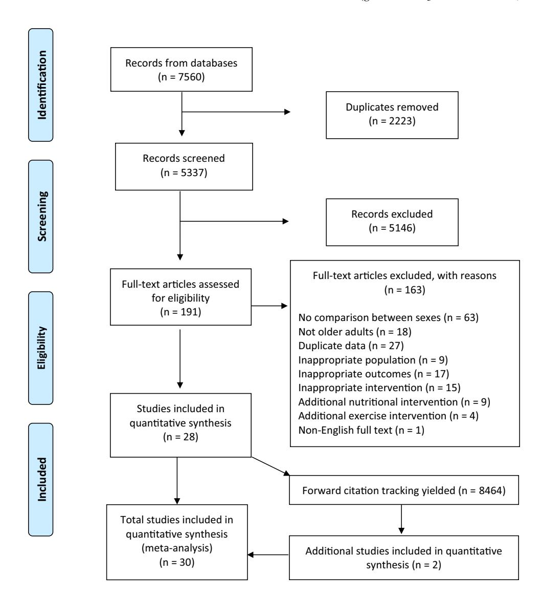
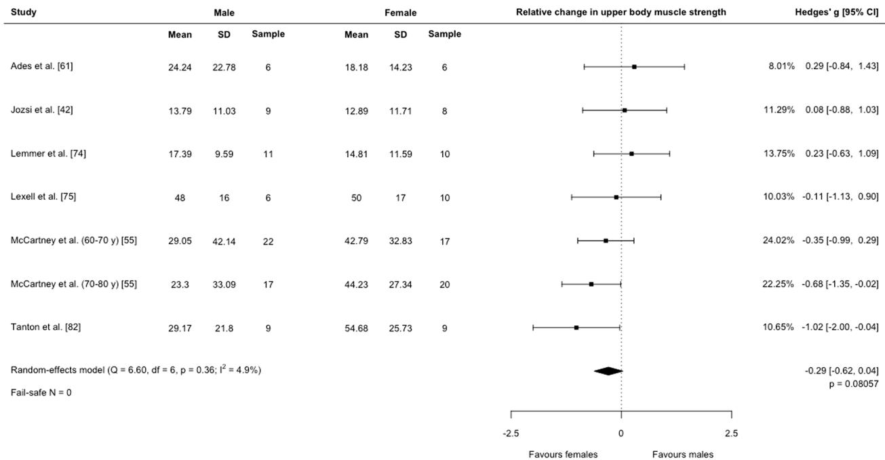
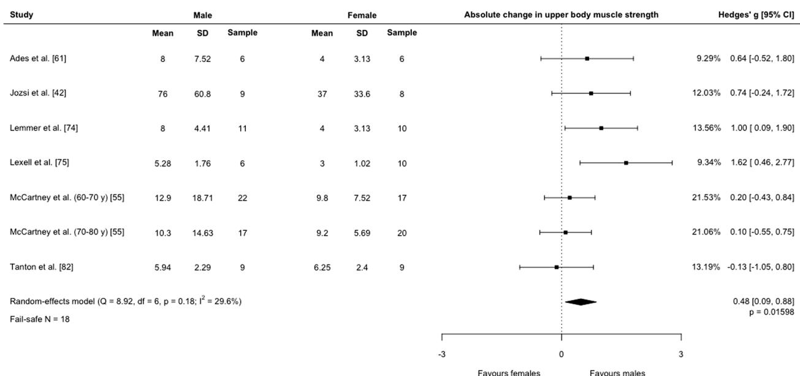
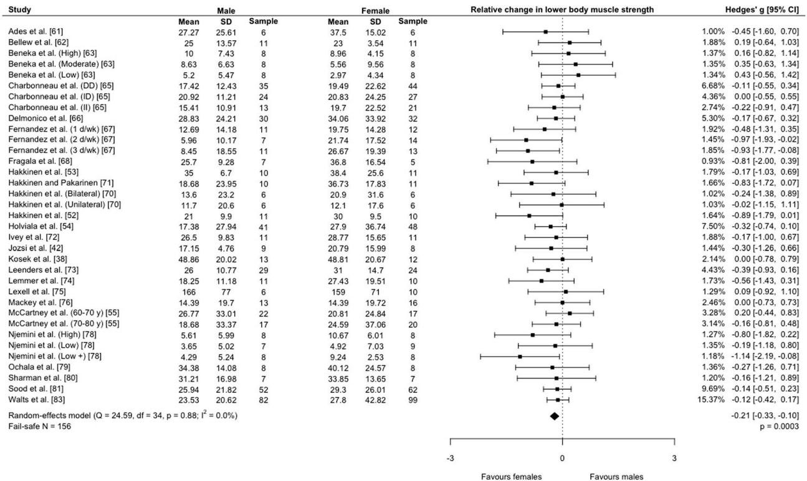
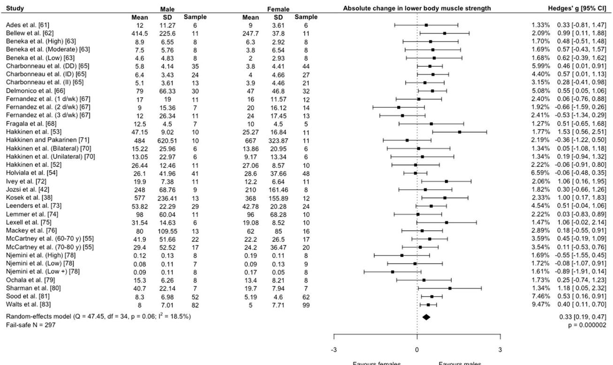
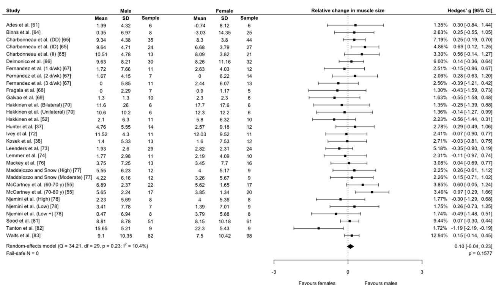
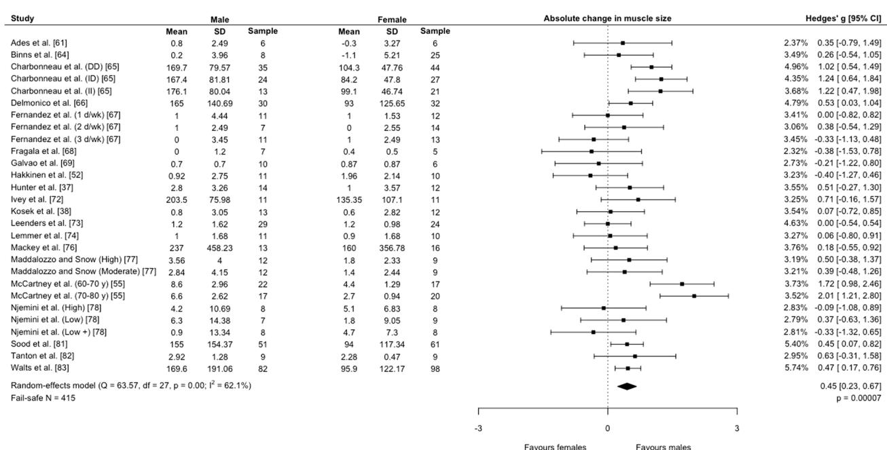

# Sex Differences in Adaptations in Muscle Strength and Size Following Resistance Training in Older Adults: A Systematic Review and Meta-analysis

© Springer Nature Switzerland AG 2020

## Abstract

**Background** Reductions in muscle size and strength occur with aging. These changes can be mitigated by participation in resistance training. At present, it is unknown if sex contributes to differences in adaptation to resistance training in older adults.

**Objective** The aim of this systematic review was to determine if sex differences are apparent in adaptations to resistance training in older adults.

**Design** Systematic review with meta-analysis.

**Data Sources** Web of Science; Science Direct; SPORTDiscus; CINAHL; and MEDLINE were searched from inception to June 2020.

**Eligibility Criteria** Studies where males and females older than 50 years of age performed identical resistance training interventions and had outcome measures of muscle strength or size.

**Results** We initially screened 5337 studies. 30 studies (with 41 comparison groups) were included in our review (1410 participants; 651 males, 759 females). Mean study quality was 14.7/29 on a modified Downs and Black checklist, considered moderate quality. Females gained more relative lower-body strength than males ( $g = -0.21$  [95% CI  $-0.33, -0.10$ ],  $p = 0.0003$ ) but there were no differences in relative change for upper-body strength ( $g = -0.29$  [95% CI  $-0.62, 0.04$ ],  $p = 0.08$ ) or relative muscle size ( $g = 0.10$  [95% CI  $-0.04, 0.23$ ],  $p = 0.16$ ). Males gained more absolute upper-body strength ( $g = 0.48$  [95% CI  $0.09, 0.88$ ],  $p = 0.016$ ), absolute lower-body strength ( $g = 0.33$  [95% CI  $0.19, 0.47$ ],  $p < 0.0001$ ), and absolute muscle size ( $g = 0.45$  [95% CI  $0.23, 0.66$ ],  $p < 0.0001$ ).

**Conclusion** Our results indicate that sex differences in adaptations to resistance training are apparent in older adults. However, it is evident that the interpretation of sex-dependent adaptations to resistance training is heavily influenced by the presentation of the results in either an absolute or relative context.

**Study Registration** Open Science Framework (osf.io/afn3y/).

---

Matthew D. Jones and Michael A. Wewege equally contributed to the manuscript and are joint first authors.

---

**Electronic supplementary material** The online version of this article (<https://doi.org/10.1007/s40279-020-01388-4>) contains supplementary material, which is available to authorized users.

## Key Points

Following resistance training, older males gain more absolute upper and lower-body strength than older females.

Older females gain more relative lower-body strength than older males.

Older males gain more absolute muscle size than older females.

There are no sex differences in changes in relative muscle size or upper-body strength in older adults.

Older males may benefit from higher intensity programs, whereas older females may benefit from higher weekly repetitions (volume).

## 1 Introduction

Reductions in muscle size, strength and function (physical performance) along with changes in fiber type occur with aging [1], with these age-related changes referred to as sarcopenia [2]. The definition and diagnostic criteria for sarcopenia have evolved considerably within the last decade. Examples of common consensus statements include the International Working Group on Sarcopenia (IWGS), European Working Group on Sarcopenia in Older People (EWGSOP) and the Asian Working Group for Sarcopenia (AWGS), with the AWGS and EWGSOP recently updating their initial consensus statements [3–5]. While each of these consensus statements utilises slightly different strategies to define sarcopenia and cutpoints, all recommend formal assessment of muscle mass, muscle strength and physical performance. Sarcopenia is significantly associated with many adverse events and diseases in older age [6–8] and predicts disability later in life [2]. Specifically, individuals with sarcopenia have a significantly higher risk of falls and falls-related fractures compared to individuals with normal levels of skeletal muscle [9], with falls among females more common than in males [10]. Higher levels of muscle size and strength are associated with greater bone mineral density; conversely, sarcopenic individuals are much more likely to have osteopenia or osteoporosis [11].

While males typically have greater absolute levels of muscle size and strength than females, the absolute age-related decreases in muscle size and strength for males may be almost twice that compared to females [13, 14]. These sex-related differences in the maximal amount of muscle

size and strength accrued across the lifespan, and the magnitude of age-related decline, suggest there is the potential for differences in the prevalence and risk factors of sarcopenia in different cohorts of older adults. Currently, there is equivalence in the sarcopenia prevalence literature, with some studies reporting greater prevalence in males [6, 8], females [15] or no sex-related differences [7, 16]. Regardless of this equivalence, sex-related differences in risk factors for developing sarcopenia have been identified [7, 17]. The sex-related differences in levels of muscle size and strength, sarcopenia prevalence, and risk factors may need to be taken into account when looking to develop sex-specific interventions to minimise these age-related losses of muscle mass and strength.

Resistance training (RT) is an exercise modality that elicits numerous health benefits, especially for older adults. RT is the current gold standard exercise modality for accrual of skeletal muscle [18], with adaptations possible throughout the lifespan, even in nonagenarians [19]. RT also plays an important role in the preservation and maintenance of bone mineral density [20] and has numerous documented benefits in both the prevention and treatment of chronic disease [21, 22]. RT contributes to healthy aging [23] including unique benefits like improving functional movements, such as stair climbing power and chair rise time [24], and improving depressive symptoms, morale, and quality of life in depressed older adults [25]. Recently, the National Strength and Conditioning Association released a position statement regarding RT for older adults [26]. The statement concluded that RT is safe and beneficial for older adults and can improve muscle strength, power, ability to perform activities of daily living, physical functioning, and psychosocial well-being [26]. In addition to evidence surrounding the efficacy of RT in this population, a series of prescriptive recommendations were made regarding intensity, volume, etc. However, these recommendations, and current governing body recommendations for adults regarding prescriptive parameters for RT do not consider sex [27, 28].

There is a physiological rationale as to why sex differences in adaptation to RT may be present. For example, there are known variations between sexes in fatiguability [29–31], inflammatory responses following muscle damaging eccentric exercise [32], and the time course of recovery after RT [33]. Sex differences are also present in muscle fibre size and composition [34, 35]. Sex differences in adaptations to RT were first examined by Wilmore [36], who found that both sexes made similar relative gains in muscle strength and lean body mass. Since then, numerous studies have examined this topic with equivocal results [37–42], possibly in part due to whether the results are presented in a relative or absolute manner. Recently, Roberts and colleagues conducted a meta-analysis on sex differences following RT in adults aged 18–50 years [43]. These authors found that males and

females responded similarly with regard to relative changes in muscle size, and lower-body strength, but that females had greater levels of relative strength gain in the upper body. At present, it is unclear whether sex differences in these responses are present in an aging population. As such, the aim of this systematic review and meta-analysis was to determine if there are sex differences in changes in absolute and relative muscle size and strength following RT in older adults. We hypothesised that older females would gain more relative muscle strength, whereas older males would gain more absolute muscle strength, size, and relative size.

## 2 Methods

### 2.1 Protocol, Registration, and Data Availability

This review followed the Preferred Reporting Items for Systematic Reviews and Meta-Analyses (PRISMA) statement [44]. The review protocol was uploaded to the Open Science Framework under a 1-year embargo in October 2019 (<https://osf.io/afn3y/>). The data and analytic codes used in the meta-analyses are also available on the Open Science Framework.

#### 2.1.1 Deviations from Protocol

We made two deviations from our registered protocol. First, this review originally intended to analyse three groups: adults, older adults, and youth. During our conduct of the review, a similar review was published for adults between 18 and 50 years of age [43], with results near identical to our own. On the advice of peer reviewers, we reframed our manuscript to focus exclusively on older adults (as only three studies in youth were identified, rendering inconclusive results). Second, we included a modified Downs and Black checklist to provide a numerical indicator of study quality.

### 2.2 Eligibility Criteria

We included prospective trials published in English that examined a RT intervention in healthy males and females older than 50 years of age. While 50 years is not typically considered an ‘older adult’, we selected 50 as the threshold a priori because of important changes that occur during menopause that alter hormone levels and may moderate the effect of RT interventions. Studies must have utilised dynamic RT against constant external load, and males and females must have performed the same program (i.e. frequency, volume, intensity). Studies were excluded if participants were diagnosed with medical conditions or musculoskeletal injuries or when RT was delivered concurrently with nutritional or other exercise interventions (e.g. aerobic training). Placebo groups in nutritional studies were also excluded. Outcomes

were changes in maximal upper and lower-body muscle strength, and changes in muscle size. Only studies that presented relevant outcome data for males and females separately were included, regardless of whether the groups were directly compared within the study.

### 2.3 Literature Search

Five electronic databases were searched from inception to June 2019: Web of Science; Science Direct; SPORTDiscus; CINAHL; and MEDLINE. The complete search strategy for MEDLINE was as follows: ("Resistance exercise" OR "Resistance training" OR "Strength training" OR "Strength Exercise" OR "Weightlifting" OR "Weight training") AND ("female and male" OR "women and men" OR "sex difference" OR "gender difference" OR "gender" OR "sex" OR "boys and girls"). Following duplicate deletion, two authors (MJ, MW) independently screened articles via title/abstract and then full text using Rayyan [45]. At each stage, discrepancies were resolved via discussion, with arbitration by a third author (AH) if required. Additional articles were identified by conducting manual searches of the reference lists of included articles and by forward citation tracking of included articles using Google Scholar.

### 2.4 Outcomes

The outcomes for this review were the differences in adaptations following RT between males and females for (1) maximal upper-body strength; (2) maximal lower-body strength; and (3) muscle size. Absolute and relative (percentage) changes were determined for each of these three general outcomes.

Changes in maximal dynamic muscle strength for the upper and lower bodies were extracted separately using the following hierarchy [46]: 1 repetition maximum (RM); multiple repetition maximum (e.g. 3-RM or 10-RM); isokinetic dynamometry. For the lower body, the following hierarchy was used: leg press; squat; deadlift; leg extension; leg curl; calf raise. That is, if a study reported results for leg press and leg extension, data for the leg press were used for the meta-analysis. For the upper body, the hierarchy was: chest press; bench press; military press; biceps curl; triceps extension. The hierarchies were chosen so that less-skilled biarticular movements were a priority, followed by biarticular skilled movements, and lastly, uniarticular movements.

For changes in muscle size, the following hierarchy was used: dual-energy X-ray absorptiometry (DXA); hydrodensitometry; whole-body air plethysmography; magnetic resonance imaging (MRI); computerized tomography (CT); ultrasound. Whole-body measures of body composition were preferred, but if a study presented multiple outcomes for muscle size, we extracted the measure most relevant to the

RT intervention. That is, if the intervention focused solely on the lower body and provided measures of whole-body lean mass and quadriceps thickness, we extracted the measure for quadriceps thickness. Any of the above outcome measurements were termed ‘muscle size’ for the purposes of this review. DXA was chosen as the top of the hierarchy as it is accurate and repeatable when compared to MRI [47], yet more accessible and likely used in a greater number of studies. We chose to exclude muscle fiber size analyses and focus only on macroscopic methods of whole body or local muscle size as Haun et al. [48] note that fiber CSA changes in response to resistance training are often larger than any other methods of assessing hypertrophy, and as such, we did not want to overestimate the potential effect of RT on improving measures of whole body or local muscle mass.

## 2.5 Data Extraction

All authors except J.K. extracted data. Two authors independently extracted data from each study into a custom-built spreadsheet, after which discrepancies were resolved via discussion. For all relevant outcomes, the absolute [mean and standard deviation (SD)] and relative (percentage change and SD) changes from baseline for males and females were extracted. If only absolute change was reported, we calculated percentage change and SD by dividing both absolute change and SD by the group’s baseline mean. If only relative change was reported, we back-calculated absolute change and SD by rearranging the aforementioned formula.

If change scores were not reported, we extracted baseline and post-intervention outcome data to estimate absolute change from baseline using paired-samples formulae in the Cochrane Handbook for Interventions [49] and Borenstein et al. [50]. Correlations required for calculating paired-samples SD were estimated using available data from the included studies in our original review, due to the scarcity of data for the older adult age group. We pooled available correlations for each outcome across males and females, identified the median correlation, and subtracted 0.1 to establish a conservative estimate for our analysis. For the primary analysis, we used  $r=0.78$  for upper-body strength,  $r=0.7$  for lower-body strength, and  $r=0.87$  for muscle size. To investigate the influence of these decisions, we also performed sensitivity analyses with  $r=0.5$  for all analyses. The exact correlations used are provided in Electronic Supplementary Material Table S1.

If no data were available, we contacted the study’s corresponding author via email twice in a two-week period to request data. If data were still unavailable (due to the age of the data or no reply from authors), we estimated values from the study’s figures using the data extraction software GRABIT (MATLAB version R2016b, MA, USA), then converted

data into a form appropriate for meta-analysis [51]. This was done for four studies [52–55].

## 2.6 Study Quality and Reporting

A modified version of the Downs and Black checklist was used to evaluate the included studies’ quality as reported in a previous review [46, 56]. Briefly, the tool consists of 29 items rated as  $N_0=0$ , Unable to be determined = 0 (for certain items) and  $Y_e=1$ . Additionally, some items were rated as partially  $m_e=0.5$  (for example, if blinding of assessors was reported for muscle size but not strength (item 15). Studies were rated by one reviewer (D.H.), with scores entered into our spreadsheet. Scores could range from 0 to 29 points, with higher scores reflecting higher study quality. Scores above 20 were considered good; scores of 11–20 were considered moderate; and scores below 11 were considered poor methodological quality [57]. In addition, we utilised the Consensus on Exercise Reporting Template (CERT), a 16-item checklist that provides the minimum requirements for describing exercise interventions [58]. While CERT is not typically a tool used to measure study quality, it is relevant in the context of this review because our study question related to whether or not males and females responded differently to the same RT intervention. Therefore, adequate reporting of the RT intervention was required.

## 2.7 Data Synthesis

Meta-analyses were performed in R using the *metafor* package with a random-effects model and “restricted maximum-likelihood estimator” method to calculate summary effect sizes (Hedges’  $g$ ) and 95% confidence intervals. We considered the threshold for significance as  $p < 0.05$ . We calculated heterogeneity and inconsistency between studies, which we considered important with Cochran  $Q$  ( $p < 0.1$ ) and Higgins’  $I^2$  ( $> 50\%$ ). We assessed publication bias using contour-enhanced funnel plots and, if  $> 10$  studies were available, Egger’s regression test. In all analyses, positive values favoured males and negative values favoured females. We considered  $g < 0.2$  as a small difference,  $0.5$  as a moderate difference, and  $> 0.8$  as a large difference [59].

For each analysis, we performed univariate meta-regression with three variables: study duration (weeks); weekly repetitions/volume, calculated as number of exercises  $\times$  sets  $\times$  repetitions; and intensity, calculated as percentage of 1-RM. To minimise heterogeneity between training methodologies and offer more practical interpretation, we limited meta-regression only to studies that performed full-body programs. For studies that prescribed training intensities based on RM, the relative loads (%1-RM) were calculated using an estimated repetitions at %1-RM chart [60]. When prescriptive ranges were provided (i.e. 8–12

repetitions per set, or 2–4 sets), the midpoint was chosen for input into the analysis (i.e. 10 repetitions, 3 sets for the above example). Positive associations (coefficients above zero) indicated effects favouring males while negative associations (coefficients below zero) indicated effects favouring females, in line with the way we conducted the meta-analysis.

# **3 Results**

## **3.1 Included Studies**

We screened 5337 records from electronic databases, assessed 191 articles for eligibility, and included 28 studies (Fig. [1\)](#page-4-0). We also searched reference lists and conducted forward citation tracking on the included studies, from which we added two more studies. Ultimately, 30 studies [\[37](#page-12-3), [38,](#page-12-21) [42](#page-12-4), [52](#page-12-14)–[55,](#page-12-15) [61–](#page-12-22)[83](#page-13-0)] were included in the review, comprising 41 comparison groups for older adults. The details of included studies are outlined in Electronic Supplementary Material Table S2. Briefly, RT interventions averaged 19 weeks in duration and consisted of 3 sessions per week at approximately 70% 1-RM for 3 sets of 9 repetitions per exercise. Average ages of included participants ranged from 53.1±2.7 to 76.9±10.1 years and the majority of participants were inactive with no resistance training experience (Electronic Supplementary Material Table S3). No studies reported sarcopenia status. Moreover, functional outcomes often used as surrogates for sarcopenia (e.g. grip strength, gait speed) were only measured in two studies [[54,](#page-12-23) [73](#page-13-1)]. Hence, we are unable to make any inference about the sarcopenia status of participants in the included studies.

# **3.2 Meta‑analyses**

For upper-body strength (7 comparison outcomes; 80 males, 80 females), there was no difference in relative change between males and females (*g* =−0.29 [95% CI −0.62,

**Fig. 1**PRISMA flow diagram

0.04],  $p=0.08$ ;  $I^2=5\%$ ,  $p=0.36$ ; Fig. 2). Males gained more absolute upper-body strength ( $g=0.48$  [95% CI 0.09, 0.88],  $p=0.016$ ;  $I^2=30\%$ ,  $p=0.18$ ; Fig. 3).

For lower-body strength (35 comparison outcomes; 566 males, 630 females), females displayed greater relative

change ( $g=-0.21$  [95% CI -0.33, -0.10],  $p=0.0003$ ;  $I^2=0\%$ ,  $p=0.88$ ; Fig. 4). Males gained more absolute lower-body strength ( $g=0.33$  [95% CI 0.19, 0.47],  $p<0.0001$ ;  $I^2=19\%$ ,  $p=0.06$ ; Fig. 5).

**Fig. 2** Forest plot of effect sizes with 95% confidence intervals for the effects of resistance training on sex differences in relative changes in upper-body strength. y years

**Fig. 3** Forest plot of effect sizes with 95% confidence intervals for the effects of resistance training on sex differences in absolute changes in upper-body strength. y years

**Fig. 4** Forest plot of effect sizes with 95% confidence intervals for the effects of resistance training on sex differences in relative changes in lower-body strength. *d/wk* days per week, *DD ACE* genotype DD polymorphism, *ID ACE* genotype ID polymorphism, *II ACE* genotype II polymorphism, *High* high intensity, *Low* low intensity, *Low +* mixed low intensity, *Moderate* moderate intensity, *y* years

For muscle size (30 comparison outcomes; 504 males, 560 females), there was no difference in relative changes between males and females ( $g = 0.10$  [95% CI  $-0.04, 0.23$ ],  $p = 0.16$ ;  $I^2 = 10\%$ ,  $p = 0.23$ ; Fig. 6). Two comparisons did not provide absolute change data for muscle size [70]. In 28 comparisons (492 males, 548 females), males gained more absolute muscle size ( $g = 0.45$  [95% CI  $0.23, 0.67$ ],  $p < 0.0001$ ;  $I^2 = 62\%$ ,  $p < 0.0001$ ; Fig. 7).

### 3.3 Sensitivity Analyses and Publication Bias

Sensitivity analyses (with correlation set to 0.5) are available in Electronic Supplementary Figures S1–S6. One effect changed to cross the null: absolute change in upper-body strength ( $g = 0.30$  [95% CI  $-0.01, 0.62$ ],  $p = 0.06$ ; Electronic Supplementary Figure S2). In all other analyses, effect sizes were not meaningfully changed (effects did not decrease substantially, nor did they cross the threshold for statistical significance). Funnel plots for each analysis are presented in Electronic Supplementary Figures S7–S18. We observed no evidence of publication asymmetry.

### 3.4 Meta-regression

Results from meta-regression are available in Electronic Supplementary Material Table S4. In summary, study duration was associated with effects favouring females for absolute changes in upper-body strength ( $\beta = -0.029$  [95% CI  $-0.054, -0.005$ ],  $p = 0.023$ ), while study duration was associated with effects favouring males for relative ( $\beta = 0.023$  [95% CI  $0.005, 0.041$ ],  $p = 0.013$ ) and absolute changes ( $\beta = 0.039$  [95% CI  $0.012, 0.065$ ],  $p = 0.004$ ) in muscle size; weekly repetitions was associated with effects favouring females for relative [ $\beta = -0.0008$  [95% CI  $-0.0015, -0.0001$ ],  $p = 0.034$ ] and absolute changes [ $\beta = -0.0012$  [95% CI  $-0.0021, -0.0003$ ],  $p = 0.010$ ] in lower-body strength; and intensity was associated with effects favouring males for absolute changes in upper-body strength [ $\beta = 0.059$  [95% CI  $0.001, 0.106$ ],  $p = 0.016$ ] and lower-body strength [ $\beta = 0.019$  [95% CI  $0.004, 0.034$ ],  $p = 0.012$ ]. In addition, meta-regressions were performed individually for studies utilising an upper or lower body only design (Electronic Supplementary Table S4). No meta-regression was performed for upper body only designs due to a lack of studies. No relationships were found for lower-body strength.

**Fig. 5** Forest plot of effect sizes with 95% confidence intervals for the effects of resistance training on sex differences in absolute changes in lower-body strength. *d/wk* days per week, *DD ACE* genotype DD polymorphism, *ID ACE* genotype ID polymorphism, *II ACE* genotype II polymorphism, *High* high intensity, *Low* low intensity, *Low +* mixed low intensity, *Moderate* moderate intensity, *y* years

For absolute muscle size in lower body only programs, a significant effect was found for weekly repetitions favouring females [ $\beta = -0.0047$ , (95% CI  $-0.0072$ ,  $-0.0021$ ),  $p = 0.0004$ ].

### 3.5 Study Quality and Reporting

The mean quality rating score was  $14.7 \pm 3.4$  out of a possible score of 29 (Electronic Supplementary Material Table S5), which was considered moderate-study quality. All studies reported aims or purpose, main outcomes, characteristics of subjects, clearly defined interventions, overall findings, and estimates of random variability. Additionally, all studies utilised interventions considered to be representative of RT for the subject population, any evidence of data dredging was made clear, appropriate statistical tests were used, and outcome measures used were accurate (valid and reliable). Five studies performed a power calculation to determine the sample size required for the study. Exercise adherence was reported in 11 studies (37%) and supervision of training was reported in 18 studies (60%), with 1 study reporting partial supervision (1 out of 3 sessions supervised). Reporting of each individual item on the CERT varied from 0 to 94% (Electronic Supplementary Material

Table S6). In general, the description and progression of the RT intervention was well reported. In contrast, reporting of supervisor qualifications, adherence, and individual tailoring was not well achieved.

## 4 Discussion

This systematic review determined that sex differences in adaptations following RT are apparent in older adults. Females displayed greater relative changes in lower-body strength; males displayed greater absolute changes in upper-body strength, lower-body strength, and muscle size, while no differences were identified for relative changes in upper-body strength and muscle size. In addition, we identified associations between RT characteristics and effects.

### 4.1 Muscle Strength

In older adults, females exhibited greater relative increases compared to males in lower-body strength, with no sex differences in change in relative upper-body strength. Absolute changes in muscle strength were greater for older adult males.

| Study                               | Mean  |      | Female |       | Female |        | Relative change in muscle size | Hedges' g [95% CI] |                    |
|-------------------------------------|-------|------|--------|-------|--------|--------|--------------------------------|--------------------|--------------------|
|                                     | Mean  | SD   | Sample | Mean  | SD     | Sample |                                |                    |                    |
| Ades et al. [61]                    | 1.39  | 4.32 | 6      | -0.74 | 8.12   | 6      |                                | 1.35%              | -0.31[-0.84, 1.44] |
| Binns et al. [64]                   | 0.35  | 6.97 | 8      | -3.03 | 14.35  | 25     |                                | 2.63%              | -0.25[-0.55, 0.70] |
| Charbonneau et al. (DD) [65]        | 9.34  | 4.38 | 35     | 8.3   | 3.8    | 25     |                                | 7.19%              | -0.25[-0.19, 0.70] |
| Charbonneau et al. (ID) [65]        | 9.64  | 4.71 | 24     | 6.68  | 3.79   | 27     |                                | 4.86%              | -0.91[-0.12, 1.27] |
| Charbonneau et al. (II) [65]        | 10.51 | 4.78 | 13     | 8.09  | 3.82   | 21     |                                | 3.30%              | -0.56[-0.14, 1.27] |
| Delmonico et al. [66]               | 9.63  | 8.21 | 30     | 8.26  | 11.16  | 32     |                                | 6.00%              | -1.14[-0.36, 0.64] |
| Dermandez et al. (1 d/wk) [67]      | 1.72  | 7.66 | 11     | 2.63  | 4.03   | 12     |                                | 2.51%              | -0.15[-0.96, 0.67] |
| Fernandez et al. (2 d/wk) [67]      | 1.67  | 4.15 | 7      | 0     | 6.22   | 14     |                                | 2.06%              | -0.28[-0.63, 1.20] |
| Fernandez et al. (3 d/wk) [67]      | 0     | 5.85 | 11     | 2.44  | 6.07   | 13     |                                | 2.56%              | -0.39[-1.21, 0.42] |
| Fragale et al. [68]                 | 0     | 2.29 | 7      | 0.9   | 1.17   | 5      |                                | 1.30%              | -0.43[-1.59, 0.73] |
| Gaivao et al. [69]                  | 1.3   | 1.3  | 10     | 2.3   | 2.3    | 6      |                                | 1.63%              | -0.55[-1.58, 0.48] |
| Hakkinen et al. (Bilateral) [70]    | 11.6  | 2.6  | 6      | 17.7  | 17.6   | 6      |                                | 1.35%              | -0.25[-1.39, 0.88] |
| Hakkinen et al. (Unilateral) [70]   | 10.6  | 10.2 | 6      | 12.3  | 12.2   | 6      |                                | 1.36%              | -0.14[-1.27, 0.99] |
| Hakkinen et al. [52]                | 2.1   | 6.3  | 11     | 5.8   | 6.32   | 10     |                                | 2.23%              | -0.56[-1.44, 0.31] |
| Hunter et al. [37]                  | 4.76  | 5.55 | 14     | 2.57  | 9.18   | 12     |                                | 2.78%              | -0.29[-0.49, 1.06] |
| Ivey et al. [72]                    | 11.52 | 4.3  | 11     | 12.03 | 9.52   | 11     |                                | 2.41%              | -0.07[-0.90, 0.77] |
| Kosek et al. [38]                   | 1.4   | 5.33 | 13     | 1.6   | 7.53   | 12     |                                | 2.71%              | -0.03[-0.81, 0.75] |
| Leenders et al. [73]                | 1.93  | 2.6  | 29     | 2.82  | 2.31   | 24     |                                | 5.18%              | -0.35[-0.90, 0.19] |
| Lemmer et al. [74]                  | 1.77  | 2.98 | 11     | 2.19  | 4.09   | 10     |                                | 2.31%              | -0.11[-0.97, 0.74] |
| Mackey et al. [76]                  | 3.75  | 7.25 | 13     | 3.45  | 7.7    | 16     |                                | 3.08%              | -0.04[-0.69, 0.77] |
| Maddalozzo and Snow (High) [77]     | 5.55  | 6.23 | 12     | 4     | 5.17   | 9      |                                | 2.25%              | -0.26[-0.61, 1.12] |
| Maddalozzo and Snow (Moderate) [77] | 4.22  | 6.16 | 12     | 3.26  | 5.67   | 9      |                                | 2.26               |                    |

**Fig. 6**Forest plot of effect sizes with 95% confidence intervals for the effects of resistance training on sex differences in relative changes in muscle size. *d/wk* days per week, *DD ACE* genotype DD polymor-

| Study                               | Male  |        | Female |     | Absolute change in muscle size |        | Hedges' g (95% CI) |       |
|-------------------------------------|-------|--------|--------|-----|--------------------------------|--------|--------------------|-------|
|                                     | Mean  | SD     | Mean   | SD  | Mean                           | SD     | Mean               | SD    |
| Alex et al. [61]                    | 0.8   | 2.49   | 0.6    | 6   | -3.27                          | 2.67   | -                  | 2.37  |
| Binns et al. [64]                   | 0.2   | 3.96   | -      | 1.5 | -1.1                           | 5.21   | 0.5                | 3.49% |
| Charbonneau et al. (DD) [65]        | 169.7 | 79.57  | 35     |     | 104.3                          | 47.76  | -                  | 4.96% |
| Charbonneau et al. (ID) [65]        | 167.4 | 81.81  | 24     |     | 84.2                           | 47.8   | -                  | 4.35% |
| Charbonneau et al. (II) [65]        | 176.1 | 80.04  | 13     |     | 99.1                           | 46.74  | -                  | 3.68% |
| Delmonico et al. [66]               | 165   | 140.69 | 30     |     | 93                             | 125.65 | -                  | 4.79% |
| Fernandez et al. (1 d/wk) [67]      | 1     | 4.44   | 1      |     | 1                              | 5.53   | -                  | 3.41% |
| Fernandez et al. (2 d/wk) [67]      | 1     | 2.49   | 7      |     | 0                              | 2.55   | -                  | 3.06% |
| Fernandez et al. (3 d/wk) [67]      | 0     | 3.45   | 11     |     | 1                              | 2.49   | 13                 | 3.45% |
| Fragala et al. [68]                 | 0     | 1.2    | 7      |     | 0.4                            | 0.5    | -                  | 2.32% |
| Galvao et al. [69]                  | 0.7   | 0.7    | 10     |     | 0.87                           | 0.87   | -                  | 2.73% |
| Hakkinen et al. [52]                | 0.92  | 2.75   | 11     |     | 1.96                           | 2.14   | 10                 | 3.23% |
| Hunter et al. [37]                  | 2.8   | 3.26   | 14     |     | 1                              | 3.57   | 12                 | 3.55% |
| Ivey et al. [72]                    | 203.5 | 79.98  | 11     |     | 1.07                           | 1.07   | -                  | 3.25% |
| Kosek et al. [38]                   | 0.8   | 3.05   | 13     |     | 0.6                            | 2.82   | 12                 | 3.54% |
| Leenders et al. [73]                | 1.2   | 1.62   | 29     |     | 1.2                            | 0.98   | -                  | 4.63% |
| Lemmer et al. [74]                  | 1     | 1.6    | 9      |     | 0.9                            | 1.0    | -                  | 3.27% |
| Mackey et al. [76]                  | 237   | 458.23 | 13     |     | 160                            | 356.78 | 16                 | 3.76% |
| Maddalozzo and Snow (High) [77]     | 5.6   | 4      | 12     |     | 1.8                            | 2.33   | 9                  | 3.19% |
| Maddalozzo and Snow (Moderate) [77] | 2.84  | 4.15   | 12     |     | 1.4                            | 2.44   | 9                  | 3.21% |
| McCartney et al. (60-70 y) [55]     | 8.6   | 2.96   | 22     |     | 4.4                            | 1.29   | 17                 | 3.73% |
| McCartney et al. (70-80 y) [55]     | 6.6   | 2.62   | 17     |     | 2.7                            | 0.94   | 20                 | 3.52% |
| Njemini et al. (High) [78]          | 4.2   | 10.69  | 8      |     | 5.1                            | 6.83   | -                  | 2.83% |
| Njemini et al. (Low) [78]           | 6.3   | 14.38  | 7      |     | 1.8                            | 9.05   | 9                  | 2.79% |
| Njemini et al. (Low +) [78]         | 0.9   | 13.34  | 8      |     | 4.7                            | 2.3    | 8                  | 2.61% |
| Sood et al. [81]                    | 155   | 154.37 | 51     |     | 94                             | 137.34 | -                  | 5.40% |
| Tanton et al. [82]                  | 2.92  | 1.28   | 9      |     | 2.28                           | 0.47   | 9                  | 3.95% |
| Walts et al. [83]                   | 169.6 | 201.06 | 82     |     | 95.9                           | -      | -                  | 5.74% |

phism, *ID ACE* genotype ID polymorphism, *II ACE* genotype II polymorphism, *High* high intensity, *Low* low intensity, *Low+* mixed low intensity, *Moderate* moderate intensity, *y* years

**Fig. 7**Forest plot of effect sizes with 95% confidence intervals for the effects of resistance training on sex differences in absolute changes in muscle size. *d/wk* days per week, *DD ACE* genotype DD polymor-

phism, *ID ACE* genotype ID polymorphism, *II ACE* genotype II polymorphism, *High* high intensity, *Low* low intensity, *Low+* mixed low intensity, *Moderate* moderate intensity, *y* years

In general, baseline strength is greater in adult males than females, which is likely due to greater muscle size in males [84, 85], rather than a sex difference in the nervous system's ability to drive the muscle voluntarily (i.e., voluntary activation) [86]. Interestingly, the baseline sex difference in upper-body strength is greater than the baseline sex difference in lower-body strength [84, 85], which has been attributed to males possessing a greater proportion of their muscle in their upper bodies [87]. The overall absolute increases in strength seen with RT may be a function of males' larger stature and subsequent larger baseline strength values [84, 85]. For example, an untrained older male who has a baseline bench press of 45 kg and makes a 20% relative improvement, would see a 9 kg increase in their 1-RM. Conversely, an older untrained female who had a baseline bench press of 30 kg, who also makes a 20% relative improvement, would see a 6 kg absolute increase.

When examining the results with respect to relative changes, females demonstrated a greater relative improvement in lower-body strength, yet no sex-related difference was observed for the upper body. However, few studies included in this review conducted upper-body strength assessments; further, those that were included were predominantly made up of small sample sizes. As such it is plausible that a sex difference may become apparent with additional large-scale studies. Alternatively, greater increases in relative strength for females may be due to the same reason outlined regarding absolute changes. When maximal strength testing is conducted, often the smallest increment of increase is typically 2.5 kg. Therefore, if an older female has a lower absolute strength than a male at baseline, an increase of the smallest increment (2.5 kg) would result in a greater relative strength increase. In the context of the above example, if older females' and males' baseline bench press strength scores were 30 and 45 kg, respectively, a female who improves her bench press by 2.5 kg has experienced an 8.3% increase compared to a 5.6% increase for the male. We encourage researchers and exercise professionals who work with older adults to use fractional weight plates (i.e. 0.25, 0.5, 0.75 and 1 kg) in their exercise assessments and prescriptions to allow the most accurate assessment of changes in muscular strength and progressions in training load.

Our findings are interesting when compared to the recent Roberts et al. meta-analyses [43] as the direction of the sex effect appears to differ between young and older participants. Accelerated losses in strength appear to occur in the lower body in ageing males [88] which may explain our findings showing greater relative lower-body strength adaptations in older females compared to older males. In terms of the upper body, Roberts et al. [43] found greater relative increases in upper-body strength, compared to the lack of difference observed in our study. We suggest that this may simply be a function of the aforementioned sensitivity of

the tests, whereby the incremental jumps may have been a much larger portion of the older women's initial baseline values. However, we cannot discount that additional factors are likely at play here. Perhaps the aging population differs in their movement patterns, physical activity choices, nutrition, and recovery which may influence adaptation differently between the upper and lower body.

## 4.2 Muscle Size

Results from our analyses revealed no between sex differences in changes in relative muscle size, and that changes in absolute muscle size favoured older adult males.

These findings are supported by recent advances in our understanding of the mechanisms underpinning changes in muscle size. Historically, it was thought that hormonal responses to RT were key to eliciting muscle growth [89]; however, recent evidence has shown that systemic circulating hormones, including testosterone, are not significantly associated with changes in muscle size in adults [90]. Conversely, androgen receptor (AR) content appears to be more associated with the magnitude of adaptation to RT [90]. AR content, however, is not altered by training [90], nor are levels different between the sexes [91], though human studies examining this question are lacking. Adaptation to RT is also associated with protein synthesis and mTOR signalling rates, neither of which differ between the sexes [92].

Similar to the findings regarding absolute strength increases favouring males, the absolute gain in muscle size may also reflect stature differences. Although males have greater levels of muscle size than females, they also lose more absolute size with aging [13] and may have a greater prevalence of sarcopenia [6, 8]. As such, older males may have potential for a greater degree of muscle size adaptation when exposed to an exercise stimulus, such as RT [93], although such responses may not occur in individuals whose sarcopenia was a result of some underlying health condition or medication that may blunt the hypertrophic effects of resistance training. It is also possible that some of the sex-related differences in sarcopenia risk factors/behaviours may account for this greater absolute muscle size response in men. While exercise that is more intense, and perhaps frequent, than regular daily activities acts as a stimulus for increasing muscle size, additional factors are required to optimise the hypertrophy response. For example, increasing muscle size in older adults may also require additional nutritional intake (e.g. some degree of calorie surplus, increased protein and vitamin D) and the ability to digest and transport the nutrients to the muscles in the required time frame [94, 95]. Therefore, any sex-related differences in levels of physical activity (particularly vigorous) [96], nutritional intake [97] and digestive symptoms [98] may also influence the

degree of relative and absolute muscle size gain associated with RT in older males and females.

### 4.3 RT Programming

Our meta-regression determined small associations between sex-specific adaptations to RT and the prescriptive parameters. Longer exercise interventions appeared to favour females in absolute upper-body strength adaptations and males for relative and absolute muscle size changes. Increasing weekly repetitions seemed to favour females in both relative and absolute changes in lower-body strength. In terms of absolute changes in both upper and lower-body strength, increasing exercise intensity (i.e. %1-RM) favoured males' adaptation. When programs had a lower body only focus, increasing weekly repetitions (volume) favoured females for adaptations in muscle size. It is possible that the increasing weekly repetitions favoured females due to females' higher fatigue resistance [29, 31]. The use of higher weekly repetitions inherently means a lower intensity must be utilised. Our regression also showed that the use of higher intensity loads favoured males, and as such it is logical that lower repetitions would need to be applied for these higher intensities. As manipulation of prescriptive parameters impacts other parameters, it is necessary to consider these implications together. For example, it has previously been shown that the optimal exercise prescription for improving muscular strength is slightly different than for improving muscle size in older adults [99]. Specifically, the greatest gains in muscle size required one additional training session compared to muscle strength (3 vs 2 sessions per week, respectively). However, this increase in training frequency to improve muscle size required a reduction in the optimal training loads for increasing strength (70–79% 1RM) to 51–69% for increasing muscle size [99]. As such, logical recommendations may be that exercise prescriptions for older women should have a focus on higher weekly repetitions (volume), whereas older males may benefit from focusing on higher intensity prescriptions. However, the decision surrounding the use of sex-based prescriptive parameters should still relate to individual goals and will require the trainer or exercise professional to have an understanding of the relationship of these variables as well as the clients' exercise preferences.

### 4.4 Strengths and Limitations

Strengths of this review include the pre-registration of the study protocol, the comprehensive search strategy that included both forward and backward citation tracking, and the open access to the data and analysis code used to enable replication of our results. A potential limitation was the heterogeneity of the measurements used to assess muscle size and strength in the included studies. We chose to include a

variety of measurement tools as they have been shown to be valid and reliable. However, some of these outcomes were only presented for regional, not full body, lean mass. We chose to include these outcomes so that we could utilise the studies that employed either single limb training, or upper/lower body only; however, attempts were made to address this by specifying a priori the outcomes that would be used for the meta-analysis. Studies included in our review did not clearly define the sarcopenia status of their participants, and as such we cannot be sure how many of the individuals included in this analyses would have been classified as being sarcopenic, or that our findings extend to those individuals with sarcopenia. The influence of sarcopenia on muscle adaptation in this cohort is an area of interest for future research.

## 5 Conclusion

Our results indicate that sex differences in adaptations to RT do exist in older adults; however, it is evident that the interpretation of sex-dependent adaptations to RT is heavily influenced by the presentation of the results in either an absolute or relative context. Exercise specialists can expect older males to gain more absolute strength and size compared to females in response to the same program. Conversely, it is expected that in a relative context, adaptations will tend to favour females, or not be sex-dependent. The sexes also appear to be differentially influenced by specific program variables, suggesting that older males and females may benefit from some slight alterations in RT prescription. For example, older females may require longer training durations to increase absolute upper-body strength and an increased number of repetitions per week to increase their relative and absolute lower-body strength. Further, older males may benefit from a higher exercise intensity to improve absolute upper and lower-body strength as well as longer training durations to increase relative and absolute muscle size.

## Declarations

**Funding** Michael Wewege was supported by a University Postgraduate Award and a School of Medical Sciences Top-Up Scholarship from the University of New South Wales, and a Postgraduate Scholarship from the National Health and Medical Research Council of Australia. No other sources of funding were used to assist in the preparation of this article.

**Conflict of interest** Matthew Jones, Michael Wewege, Daniel Hackett, Justin Keogh and Amanda Hagstrom declare that they have no conflicts of interest relevant to the content of this review.

**Ethics approval** Not applicable.

**Consent to participate** Not applicable.

**Consent for publication** Not applicable.

**Code availability** Data and code are available on the Open Science Framework (osf.io/afn3y).

**Availability of data and material** All data and analysis code will be available after publication on the Open Science Framework (osf.io/afn3y).

**Author contributions** ADH study design, literature search, and writing of the manuscript. MJ screening, study quality, results and methods manuscript writing. MW screening, statistical analysis, results. DH study quality. ADH, MJ, MW, and DH contributed to data extraction. JK contributed to writing of the manuscript. All authors reviewed the final manuscript.

## References

1. Frontera WR, Hughes VA, Fielding RA, et al. Aging of skeletal muscle: a 12-year longitudinal study. *J Appl Physiol*. 2000;88(4):1321–6.
2. Fielding RA, Vellas B, Evans WJ, et al. Sarcopenia: an undiagnosed condition in older adults. Current consensus definition: prevalence, etiology, and consequences. *International working group on sarcopenia*. *J Am Med Dir Assoc*. 2011;12(4):249–56.
3. Chen L-K, Woo J, Assantachai P, et al. Asian Working Group for Sarcopenia: 2019 consensus update on sarcopenia diagnosis and treatment. *J Am Med Dir Assoc*. 2020;21(3):300–7.
4. Chumlea WC, Cesari M, Evans W, et al. International working group on Sarcopenia. *J Nutr Health Aging*. 2011;15(6):450–5.
5. Cruz-Jentoft AJ, Bahat G, Bauer J, et al. Sarcopenia: revised European consensus on definition and diagnosis. *Age Ageing*. 2019;48(1):16–31.
6. Senior HE, Henwood TR, Beller EM, et al. Prevalence and risk factors of sarcopenia among adults living in nursing homes. *Maturitas*. 2015;82(4):418–23.
7. Tay L, Ding YY, Leung BP, et al. Sex-specific differences in risk factors for sarcopenia amongst community-dwelling older adults. *Age*. 2015;37(6):121. <https://doi.org/10.1007/s11357-015-9860-3>.
8. Du Y, Wang X, Xie H, et al. Sex differences in the prevalence and adverse outcomes of sarcopenia and sarcopenic obesity in community dwelling elderly in East China using the AWGS criteria. *BMC Endocr Disord*. 2019;19(1):109. <https://doi.org/10.1186/s12902-019-0432-x>.
9. Yeung SS, Reijnierse EM, Pham VK, et al. Sarcopenia and its association with falls and fractures in older adults: a systematic review and meta-analysis. *J Cachexia Sarcopenia Muscle*. 2019;10(3):485–500.
10. Gale CR, Cooper C, Aihie SA. Prevalence and risk factors for falls in older men and women: the English longitudinal study of ageing. *Age Ageing*. 2016;45(6):789–94.
11. He H, Liu Y, Tian Q, et al. Relationship of sarcopenia and body composition with osteoporosis. *Osteoporosis Int*. 2016;27(2):473–82.
12. Pinedo-Villanueva R, Westbury LD, Syddall HE, et al. Health care costs associated with muscle weakness: a UK population-based estimate. *Calcif Tissue Int*. 2019;104(2):137–44. <https://doi.org/10.1007/s00223-018-0478-1>.
13. Gallagher D, Visser M, De Meersman RE, et al. Appendicular skeletal muscle mass: effects of age, gender, and ethnicity. *J Appl Physiol*. 1997;83(1):229–39.
14. Kozakai R, Ando F, Kim HY, et al. Sex-differences in age-related grip strength decline: a 10-year longitudinal study of community-living middle-aged and older Japanese. *J Phys Fit Sports Med*. 2016;5(1):87–94. <https://doi.org/10.7600/jpfsm.5.87>.
15. Ishii S, Tanaka T, Shibasaki K, et al. Development of a simple screening test for sarcopenia in older adults. *Geriatr Gerontol Int*. 2014;14(Suppl 1):93–101. <https://doi.org/10.1111/ggi.12197>.
16. Yamada M, Nishiguchi S, Fukutani N, et al. Prevalence of sarcopenia in community-dwelling Japanese older adults. *J Am Med Dir Assoc*. 2013;14(12):911–5. <https://doi.org/10.1016/j.jamda.2013.08.015>.
17. Shaw SC, Dennison EM, Cooper C. Epidemiology of sarcopenia: determinants throughout the lifecourse. *Calcif Tissue Int*. 2017;101(3):229–47. <https://doi.org/10.1007/s00223-017-0277-0>.
18. Schoenfeld BJ. The mechanisms of muscle hypertrophy and their application to resistance training. *J Strength Cond Res*. 2010;24(10):2857–72.
19. Fiatarone MA, Marks EC, Ryan ND, et al. High-intensity strength training in nonagenarians: effects on skeletal muscle. *JAMA*. 1990;263(22):3029–34.
20. Nelson ME, Fiatarone MA, Morganti CM, et al. Effects of high-intensity strength training on multiple risk factors for osteoporotic fractures: a randomized controlled trial. *JAMA*. 1994;272(24):1909–14.
21. MacDonald HV, Johnson BT, Huedo-Medina TB, et al. Dynamic resistance training as stand-alone antihypertensive lifestyle therapy: a meta-analysis. *J Am Heart Assoc*. 2016;5(10):e003231.
22. Gordon B, Benson A, Bird S, et al. Resistance training improves metabolic health in type 2 diabetes: a systematic review. *Diabetes Res Clin Pract*. 2009;83(2):157–75.
23. Papa EV, Dong X, Hassan M. Resistance training for activity limitations in older adults with skeletal muscle function deficits: a systematic review. *Clin Interv Aging*. 2017;12:955–61.
24. Seynnes O, Fiatarone Singh MA, Hue O, et al. Physiological and functional responses to low-moderate versus high-intensity progressive resistance training in frail elders. *J Gerontol Ser A Biol Sci Med Sci*. 2004;59(5):M503–9.
25. Singh NA, Clements KM, Fiatarone MA. A randomized controlled trial of progressive resistance training in depressed elders. *J Gerontol A Biol Sci Med Sci*. 1997;52(1):M27–35.
26. Fragala MS, Cadore EL, Dorgo S, et al. Resistance training for older adults: position statement from the National Strength and Conditioning Association. *J Strength Cond Res*. 2019;33(8):2019–52.
27. Ratamess NA, Alvar BA, Evetoch TE, et al. Progression models in resistance training for healthy adults. *Med Sci Sport Exerc*. 2009;41(3):687–708.
28. Faigenbaum AD, Kraemer WJ, Blimkie CJ, et al. Youth resistance training: updated position statement paper from the National Strength and Conditioning Association. *J Strength Cond Res*. 2009;23:S60–79.
29. Hunter SK. Sex differences in fatigability of dynamic contractions. *Exp Physiol*. 2016;101(2):250–5.
30. Marshall PW, Metcalf E, Hagstrom AD, et al. Changes in fatigue are the same for trained men and women after resistance exercise. *Med Sci Sport Ex*. 2020;52(1):196–204.
31. Metcalf E, Hagstrom AD, Marshall PW. Trained females exhibit less fatigability than trained males after a heavy knee extensor resistance exercise session. *Eur J Appl Physiol*. 2019;119(1):181–90.
32. Stupka N, Lowther S, Chorneyko K, et al. Gender differences in muscle inflammation after eccentric exercise. *J Appl Physiol*. 2000;89(6):2325–32.
33. Flores DF, Gentil P, Brown LE, et al. Dissociated time course of recovery between genders after resistance exercise. *J Strength Cond Res*. 2011;25(11):3039–44.

34. Haizlip K, Harrison B, Leinwand L. Sex-based differences in skeletal muscle kinetics and fiber-type composition. *J Physiol*. 2015;30(1):30–9.

35. Staron RS, Hagerman FC, Hikida RS, et al. Fiber type composition of the vastus lateralis muscle of young men and women. *J Histochem Cytochem*. 2000;48(5):623–9.

36. Wilmore JH. Alterations in strength, body composition and anthropometric measurements consequent to a 10-week weight training program. *Med Sci Sports*. 1974;6(2):133–8.

37. Hunter GR, Bryan DR, Wetzstein CJ, et al. Resistance training and intra-abdominal adipose tissue in older men and women. *Med Sci Sport Ex*. 2002;34(6):1023–8.

38. Kosek DJ, Kim J-S, Petrella JK, et al. Efficacy of 3 days/week resistance training on myofiber hypertrophy and myogenic mechanisms in young vs. older adults. *J Appl Physiol*. 2006;101(2):531–44.

39. Kell RT. The influence of periodized resistance training on strength changes in men and women. *J Strength Cond Res*. 2011;25(3):735–44.

40. Hurlbut D, Lott M, Ryan A, et al. Does age, sex, or ACE genotype affect glucose and insulin responses to strength training? *J Appl Physiol*. 2002;92(2):643–50.

41. Staron R, Karapondo D, Kraemer W, et al. Skeletal muscle adaptations during early phase of heavy-resistance training in men and women. *J Appl Physiol*. 1994;76(3):1247–55.

42. Jozsi A, Campbell W, Joseph L, et al. Changes in power with resistance training in older and younger men and women. *J Gerontol Ser A Biol Sci Med Sci*. 1999;54(11):M591–6.

43. Roberts BM, Nuckols G, Krieger JW. Sex differences in resistance training: a systematic review and meta-analysis. *J Strength Cond Res*. 2020. <https://doi.org/10.1519/JSC.0000000000003521>.

44. Moher D, Liberati A, Tetzlaff J, et al. Preferred reporting items for systematic reviews and meta-analyses: the PRISMA statement. *BMJ (Clin Res Ed)*. 2009;339:b2535. <https://doi.org/10.1136/bmj.b2535>.

45. Ouzzani M, Hammady H, Fedorowicz Z, et al. Rayyan-a web and mobile app for systematic reviews. *Syst Rev*. 2016;5(1):210. <https://doi.org/10.1186/s13643-016-0384-4>.

46. Hagstrom AD, Marshall PW, Halaki M, et al. The effect of resistance training in women on dynamic strength and muscular hypertrophy: a systematic review with meta-analysis. *Sports Med*. 2020;50:1075–93.

47. Borga M, West J, Bell JD, et al. Advanced body composition assessment: from body mass index to body composition profiling. *J Invest Med*. 2018;66(5):1–9.

48. Haun CT, Vann CG, Roberts BM, et al. A critical evaluation of the biological construct skeletal muscle hypertrophy: size matters but so does the measurement. *Front Physiol*. 2019;10:247.

49. Higgins JPT, Deeks JJ, Altman DG (editors). Chapter 16: Special topics in statistics. In: Higgins JPT, Green S, editors. Cochrane handbook for systematic reviews of interventions version 5.1.0 (updated March 2011). The Cochrane Collaboration; 2011. Available from [www.handbook.cochrane.org](http://www.handbook.cochrane.org).

50. Borenstein M, Hedges LV, Higgins JPT, et al. Introduction to meta-analysis. Chinchester: Wiley; 2009.

51. Higgins JPT, Deeks JJ (editors). Chapter 7: Selecting studies and collecting data. In: Higgins JPT, Green S, editors. Cochrane handbook for systematic reviews of interventions version 5.1.0 (updated March 2011). The Cochrane Collaboration; 2011. Available from [www.handbook.cochrane.org](http://www.handbook.cochrane.org).

52. Hakkinen K, Kallinen M, Izquierdo M, et al. Changes in agonist-antagonist EMG, muscle CSA, and force during strength training in middle-aged and older people. *J Appl Physiol*. 1998;84(4):1341–9. <https://doi.org/10.1152/jappl.1998.84.4.1341>.

53. Hakkinen K, Kraemer WJ, Pakarinen A, et al. Effects of heavy resistance/power training on maximal strength, muscle morphology, and hormonal response patterns in 60–75-year-old men and women. *Can J Appl Physiol*. 2002;27(3):213–31.

54. Holviala J, Hakkinen A, Alen M, et al. Effects of prolonged and maintenance strength training on force production, walking, and balance in aging women and men. *Scand J Med Sci Sports*. 2014;24(1):224–33. <https://doi.org/10.1111/j.1600-0838.2012.01470.x>.

55. McCartney N, Hicks AL, Martin J, et al. Long-term resistance training in the elderly: effects on dynamic strength, exercise capacity, muscle, and bone. *J Gerontol A Biol Sci Med Sci*. 1995;50A(2):B97-104.

56. Downs SH, Black N. The feasibility of creating a checklist for the assessment of the methodological quality both of randomised and non-randomised studies of health care interventions. *J Epidemiol Community Health*. 1998;52(6):377–84.

57. Laframboise MA, deGraauw C. The effects of aerobic physical activity on adiposity in school-aged children and youth: a systematic review of randomized controlled trials. *J Can Chirop Assoc*. 2011;55(4):256.

58. Slade SC, Dionne CE, Underwood M, et al. Consensus on exercise reporting template (CERT): explanation and elaboration statement. *Br J Sports Med*. 2016;50(23):1428–37.

59. Cohen J. Statistical power analysis for the behavioral sciences. New York: Academic press; 2013.

60. Haff GG, Triplett NT. Essentials of strength training and conditioning. 4th ed. London: Human Kinetics Publishers; 2015.

61. Ades PA, Ballor DL, Ashikaga T, et al. Weight training improves walking endurance in healthy elderly persons. *Ann Intern Med*. 1996;124(6):568–72. <https://doi.org/10.7326/0003-4819-124-6-199603150-00005>.

62. Bellew JW, Yates JW, Gater DR. The initial effects of low-volume strength training on balance in untrained older men and women. *J Strength Cond Res*. 2003;17(1):121–8.

63. Beneka A, Malliou P, Fatouros I, et al. Resistance training effects on muscular strength of elderly are related to intensity and gender. *J Sci Med Sport*. 2005;8(3):274–83. [https://doi.org/10.1016/s1440-2440\(05\)80038-6](https://doi.org/10.1016/s1440-2440(05)80038-6).

64. Binns A, Gray M, Henson A, et al. Changes in lean mass and serum myostatin with habitual protein intake and high-velocity resistance training. *J Nutr Health Aging*. 2017;21(10):1111–7. <https://doi.org/10.1007/s12603-017-0883-6>.

65. Charbonneau DE, Hanson ED, Ludlow AT, et al. ACE genotype and the muscle hypertrophic and strength responses to strength training. *Med Sci Sport Exerc*. 2008;40(4):677–83. <https://doi.org/10.1249/MSS.0b013e318161eab9>.

66. Delmonico MJ, Kostek MC, Doldo NA, et al. Effects of moderate-velocity strength training on peak muscle power and movement velocity: do women respond differently than men? *J Appl Physiol*. 2005;99(5):1712–8.

67. Fernández-Lezaun E, Schumann M, Mäkinen T, et al. Effects of resistance training frequency on cardiorespiratory fitness in older men and women during intervention and follow-up. *Exp Gerontol*. 2017;95:44–53. <https://doi.org/10.1016/j.expger.2017.05.012>.

68. Fragala MS, Jajtner AR, Beyer KS, et al. Biomarkers of muscle quality: N-terminal propeptide of type III procollagen and C-terminal agrin fragment responses to resistance exercise training in older adults. *J Cachexia Sarcopenia Muscle*. 2014;5(2):139–48. <https://doi.org/10.1007/s13539-013-0120-z>.

69. Galvão DA, Newton RU, Taaffe DR. Does sex affect the muscle strength and regional lean tissue mass response to resistance training in older adults? *J Sport Health Sci*. 2006;4:36–43.

70. Häkkinen K, Kallinen M, Linnamo V, et al. Neuromuscular adaptations during bilateral versus unilateral strength training in middle-aged and elderly men and women. *Acta Physiol Scand*. 1996;158(1):77–88.

71. Hakkinen K, Pakarinen A. Serum hormones and strength development during strength training in middle-aged and elderly males and females. *Acta Physiol Scand.* 1994;150(2):211–9. <https://doi.org/10.1111/j.1748-1716.1994.tb09678.x>.

72. Ivey FM, Tracy BL, Lemmer JT, et al. Effects of strength training and detraining on muscle quality: age and gender comparisons. *J Gerentol A Biol Sci Med Sci.* 2000;55(3):B152–7. <https://doi.org/10.1093/gerona/55.3.B152>.

73. Leenders M, Verdijk LB, van der Hoeven L, et al. Elderly men and women benefit equally from prolonged resistance-type exercise training. *J Gerentol A Biol Sci Med Sci.* 2013;68(7):769–79. <https://doi.org/10.1093/gerona/gls241>.

74. Lemmer JT, Ivey FM, Ryan AS, et al. Effect of strength training on resting metabolic rate and physical activity: age and gender comparisons. *Med Sci Sport Exerc.* 2001;33(4):532–41.

75. Lexell J, Downham DY, Larsson Y, et al. Heavy-resistance training in older Scandinavian men and women: short- and long-term effects on arm and leg muscles. *Scand J Med Sci Sports.* 1995;5(6):329–41.

76. Mackey AL, Esmarck B, Kadi F, et al. Enhanced satellite cell proliferation with resistance training in elderly men and women. *Scand J Med Sci Sports.* 2007;17(1):34–42. <https://doi.org/10.1111/j.1600-0838.2006.00534.x>.

77. Maddalozzo GF, Snow CM. High intensity resistance training: effects on bone in older men and women. *Calcif Tissue Int.* 2000;66(6):399–404. <https://doi.org/10.1007/s002230010081>.

78. Njemini R, Forti LN, Mets T, et al. Sex difference in the heat shock response to high external load resistance training in older humans. *Exp Gerontol.* 2017;93:46–53. <https://doi.org/10.1016/j.exger.2017.04.005>.

79. Ochala J, Lambertz D, Van Hoecke J, et al. Changes in muscle and joint elasticity following long-term strength training in old age. *Eur J Appl Physiol.* 2007;100(5):491–8. <https://doi.org/10.1007/s00421-006-0184-y>.

80. Sharman MJ, Newton RU, Triplett-McBride T, et al. Changes in myosin heavy chain composition with heavy resistance training in 60- to 75-year-old men and women. *Eur J Appl Physiol.* 2001;84(1–2):127–32. <https://doi.org/10.1007/s004210000334>.

81. Sood S, Hanson ED, Delmonico MJ, et al. Does insulin-like growth factor 1 genotype influence muscle power response to strength training in older men and women? *Eur J Appl Physiol.* 2012;112(2):743–53. <https://doi.org/10.1007/s00421-011-2028-7>.

82. Tanton LC, Cappeart TA, Gordon PM, et al. Strength, size, and muscle quality in the upper arm following unilateral training in younger and older males and females. *Clin Med Arthritis Musculoskelet Disord.* 2009;2:9–18.

83. Walts CT, Hanson ED, Delmonico MJ, et al. Do sex or race differences influence strength training effects on muscle or fat? *Med Sci Sport Exerc.* 2008;40(4):669–76.

84. Bishop P, Cureton K, Collins M. Sex difference in muscular strength in equally-trained men and women. *Ergonomics.* 1987;30(4):675–87.

85. Hosler WW, Morrow JR Jr. Arm and leg strength compared between young women and men after allowing for differences in body size and composition. *Ergonomics.* 1982;25(4):309–13.

86. Molenaar JP, McNeil CJ, Bredius MS, et al. Effects of aging and sex on voluntary activation and peak relaxation rate of human elbow flexors studied with motor cortical stimulation. *Age.* 2013;35(4):1327–37.

87. Miller AEJ, MacDougall J, Tarnopolsky M, et al. Gender differences in strength and muscle fiber characteristics. *Eur J Appl Physiol Occup Physiol.* 1993;66(3):254–62.

88. Cheng S-J, Yang Y-R, Cheng F-Y, et al. The changes of muscle strength and functional activities during aging in male and female populations. *Int J Gerontol.* 2014;8(4):197–202.

89. Kraemer WJ, Ratamess NA. Hormonal responses and adaptations to resistance exercise and training. *Sports Med.* 2005;35(4):339–61.

90. Morton RW, Sato K, Gallaugher MP, et al. Muscle androgen receptor content but not systemic hormones is associated with resistance training-induced skeletal muscle hypertrophy in healthy, young men. *Front Physiol.* 2018;9:1373.

91. Lee D-M, Bajracharya P, Lee EJ, et al. Effects of gender-specific adult bovine serum on myogenic satellite cell proliferation, differentiation and lipid accumulation. *Vitro Cell Dev Biol Anim.* 2011;47(7):438–44.

92. Dreyer HC, Fujita S, Glynn EL, et al. Resistance exercise increases leg muscle protein synthesis and mTOR signalling independent of sex. *Acta physiol.* 2010;199(1):71–81.

93. Lavin KM, Roberts BM, Fry CS, et al. The importance of resistance exercise training to combat neuromuscular aging. *Physiology.* 2019;34(2):112–22.

94. Morley JE, Argiles JM, Evans WJ, et al. Nutritional recommendations for the management of sarcopenia. *J Am Med Dir Assoc.* 2010;11(6):391–6. <https://doi.org/10.1016/j.jamda.2010.04.014>.

95. Loenneke JP, Loprinzi PD, Murphy CH, et al. Per meal dose and frequency of protein consumption is associated with lean mass and muscle performance. *Clin Nutr.* 2016;35(6):1506–11. <https://doi.org/10.1016/j.clnu.2016.04.002>.

96. National Health Service. Health survey for England 2016 physical activity in adults. 2017. <https://files.digital.nhs.uk/publication/m/3/hse16-adult-phy-act.pdf>. Accessed 10 June 2020.

97. Waters DL, Wayne SJ, Andrieu S, et al. Sexually dimorphic patterns of nutritional intake and eating behaviors in community-dwelling older adults with normal and slow gait speed. *J Nutr Health Aging.* 2014;18(3):228–33. <https://doi.org/10.1007/s12603-014-0004-8>.

98. Alameel T, Basheikh M, Andrew MK. Digestive symptoms in older adults: prevalence and associations with institutionalization and mortality. *Can J Gastroenterol.* 2012;26(12):881–4. <https://doi.org/10.1155/2012/324602>.

99. Borde R, Hortobágyi T, Granacher U. Dose–response relationships of resistance training in healthy old adults: a systematic review and meta-analysis. *Sports Med.* 2015;45(12):1693–720.

## Affiliations

Matthew D. Jones1,2 • Michael A. Wewege1,2 • Daniel A. Hackett3 • Justin W. L. Keogh4,5,6,7 • Amanda D. Hagstrom1 •

1 School of Medical Sciences, University of New South Wales, Sydney, NSW, Australia

2 Centre for Pain IMPACT, Neuroscience Research Australia, Sydney, NSW, Australia

3 Physical Activity, Lifestyle, Ageing and Wellbeing Faculty Research Group, School of Health Sciences, Faculty of Medicine and Health, The University of Sydney, Lidcombe, NSW, Australia

4 Faculty of Health Sciences and Medicine, Bond University, Gold Coast, QLD, Australia 5 Human Potential Centre, AUT University, Auckland, New Zealand 6 Cluster for Health Improvement, Faculty of Science, Health, Education and Engineering, University of the Sunshine Coast, Sunshine Coast, QLD, Australia 7 Kasturba Medical College, Mangalore, Manipal Academy of Higher Education, Manipal, Karnataka, India