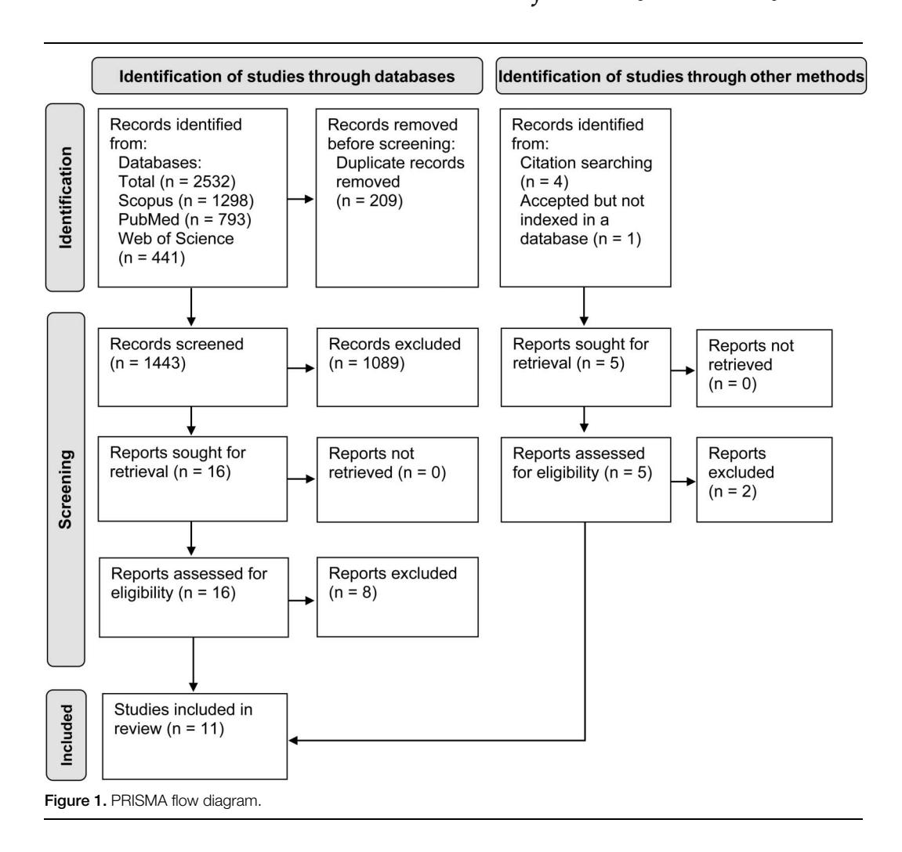

# Which ROMs Lead to Rome? A Systematic Review of the Effects of Range of Motion on Muscle Hypertrophy

Witalo Kassiano,1 Bruna Costa,1 Joa˜ o Pedro Nunes,1 Alex S. Ribeiro,2 Brad J. Schoenfeld,3 and Edilson S. Cyrino1

1 Metabolism, Nutrition and Exercise Laboratory, Physical Education and Sport Center, State University of Londrina, Londrina, PR, Brazil; 2 Center for Research in Health Sciences, University Pit ´agoras UNOPAR, Londrina, PR, Brazil; 3 Health Sciences Department, CUNY Lehman College, Bronx, New York

#### Abstract

Kassiano, W, Costa, B, Nunes, JP, Ribeiro, AS, Schoenfeld, BJ, and Cyrino, ES. Which ROMs lead to Rome? a systematic review of the effects of range of motion on muscle hypertrophy. J Strength Cond Res 37(5): 1135–1144, 2022—Resistance exercise range of motion (ROM) influences muscular adaptations. However, there are no consistent practical guidelines about the optimal ROM for maximizing muscle hypertrophy. The objective of this article was to systematically review the literature for studies that compared the effects of full ROM (fROM) and partial ROM (pROM) on muscle hypertrophy. PubMed/MEDLINE, Scopus, and Web of Science databases were searched to identify articles from the earliest record up to and including April 2022. We calculated the effect size (ES) scores of the variables of interest. Eleven studies were included in the review. Full ROM and pROM performed in the initial part of the ROM elicited greater muscle hypertrophy of the rectus femoris, vastus lateralis, biceps brachii, and brachialis distal sites (between-groups ES: 0.20–0.90) than pROM performed in the final part of the ROM. fROM elicited greater muscle growth on the gluteus maximus and adductors than pROM in the final part of the ROM (between-groups ES: 0.24–0.25). Initial pROM produced more favorable proximal rectus femoris hypertrophy than fROM (between-groups ES: 0.35–0.38). pROM in the middle part of the ROM elicited greater triceps brachii hypertrophy than fROM (between-group ES: 1.21). In conclusion, evidence suggests that when training at a longer muscle length—through either pROM or fROM—some muscles, such as quadriceps femoris, biceps brachii, and triceps brachii, tend to experience optimal growth. Thus, the use pROM in the initial part of the excursion in combination with fROM training should be considered when prescribing hypertrophy-oriented resistance training programs.

Key Words: strength training, resistance training, excursion, regional hypertrophy, muscle length, length-tension relationship

#### Introduction

Range of motion (ROM) can be operationally defined as the degree of movement that occurs in a given joint during exercise performance (11). Range of motion plays a substantial role in the manifestations of muscular adaptations (e.g., muscle hypertrophy and increased strength) in response to resistance exercise (25,37), which can be attributed to the fact that the capacity of a muscle for producing force during dynamic actions changes across joint angles. That is, depending on the specific ROM, factors such as muscle activation, internal moment arm length, and lengthtension relationship will be differentially affected (17,25), potentially influencing the magnitude of hypertrophy. For instance, training with a greater ROM generally requires the muscle to produce force in a more elongated position (21). Depending on the mechanical characteristics of a muscle (e.g., if its fibers work on the ascending, plateau, or descending limb of the lengthtension curve), it may experience differential degrees of mechanical tension from active and passive elements (10,15), which in turn may affect the hypertrophic stimulus (41).

A full ROM (fROM) has been described as dynamic resistance exercise performed without movement restrictions (11). By contrast, training through a limited degree of excursion has been termed "partial ROM" (pROM) (25,26). Despite the widespread belief that fROM training is superior to pROM to induce muscular adaptations (25,26), evidence remains equivocal on the topic (12,25,26). Traditionally, researchers have addressed the question as to how ROM affects muscular adaptations by comparing fROM with pROM, wherein pROM is a part of fROM (8,16,33). More recently, some studies have compared pROM training at different parts of the complete excursion (e.g., initial versus final parts of the ROM), which may or may not overlap (31,35). Based on the first group of studies that exclusively compared fROM versus pROM, a recent meta-analysis found consistently favorable results for fROM compared with pROM for muscular strength gains (30). On the other hand, the results were more inconclusive for lower-limb muscle hypertrophy (12,30).

It is important to note that most studies investigating hypertrophy outcomes involved performing the pROM only in the final portion of the ROM, which hinders the ability to conclude that fROM would necessarily be superior to other pROMs (e.g., training at the initial or middle portions) (12). For instance, recent studies have found that pROM performed in the initial part of the ROM of the concentric muscle action (i.e., at longer muscle lengths) elicits greater hypertrophy compared with

Journal of Strength and Conditioning Research 37(5)/1135–1144 ª 2023 National Strength and Conditioning Association

Submitted for publication July 11, 2022; accepted September 23, 2022. Address correspondence to Witalo Kassiano, [acc.witalo@gmail.com.](mailto:acc.witalo@gmail.com)

pROM performed in the final part of the ROM (i.e., at shorter muscle lengths) (35) and is comparable with or even more effective than training with fROM (31). These conflicting findings impair the ability to draw practical conclusions regarding the optimal ROM to maximize muscle hypertrophy. Consideration of recent studies that compared different ROMs with fROM may help to reconcile limitations of previous reviews and allow for more insightful practical recommendations and isolating gaps in the current literature and thus helping to direct future research on the topic. The aim of this article was to comprehensively review the literature and compare the effects of fROM and different pROMs on muscle hypertrophy.

#### Methods

#### Experimental Approach to the Problem

The current systematic review was performed according to the guidelines set forth by PRISMA and Prisma in Exercise, Rehabilitation, Sport Medicine, and Sports Science (PERSiST) (1,29). The research questions were defined by population, intervention, comparator, outcomes, and study design (PICOS) model following the PRISMA guidelines, as follows.

Population. Adults (18 years or older) with or without RT experience, with no restrictions on sex. Investigations including individuals with chronic diseases, musculoskeletal disorders, or injuries were excluded.

Intervention. Studies implementing dynamic resistance training programs lasting \$4 weeks. Investigations involving isometric actions were excluded because this form of training is restricted to a specific point of the ROM.

Comparator. An experimental trial comparing resistance training with fROM versus pROM or comparison between 2 pROMs performed at different parts of the ROM—i.e., initial versus final part of the ROM.

Outcomes. Changes in muscle size using a site-specific measurement (muscle thickness, cross-sectional area, or volume [through ultrasound, magnetic resonance imaging, or computed tomography]).

Study Design. Longitudinal randomized control trials using either parallel group(s) or within-subject designs comparing fROM and pROM at different parts of the ROM.

# Literature Search

To perform this review, we searched PubMed/MEDLINE, Scopus, and Web of Science through December 2021 and updated the search in April 2022. Only peer-reviewed articles in English were selected for inclusion; citations from scientific conferences were excluded from analysis. The search included the following syntax: "range of motion" AND ("muscle thickness" OR "crosssectional area" OR "muscle volume" OR "muscle mass" OR "hypertrophy" OR "muscle growth"). The title and abstract of each study were inspected for relevance, and the full text was then scrutinized for those initially appearing to meet inclusion criteria. Studies in which the abstracts did not provide enough information according to our inclusion criteria were retrieved for full-text evaluation. In the selected articles, the reference lists and

Google Scholar citations were screened for additional manuscripts. In addition, the list of articles that cited the included studies was screened. Two authors (W.K. and BC.) performed the search independently. In the case of any disagreement as to inclusion, a third assessor (J.P.N.) resolved the dispute.

#### Study Coding, Data Extraction, and Analysis

The following data were extracted from the included studies: (a) study characteristics (author, year, sample size, and study design), (b) subject demographics (age, sex, and resistance training experience), (c) resistance training protocols and how the ROM was measured, and (d) outcome measures (muscle hypertrophy). We then coded data for the pretraining and posttraining means and standard deviations of the included studies. We calculated average percentage changes (d%) and effect size (ES) scores of the variables of interest. Values of d% were calculated as follows: ([posttraining mean/pretraining mean \* 100] – 100). The ES of each training group was calculated using the following formula: ([posttraining mean – pretraining mean]/[pooled pretraining standard deviation]) (23). Values of ES regarding the pre-to-post changes, as well as the differences between groups (e.g., group 1 ES minus group 2 ES), were considered as follows: ,0.20, trivial/ negligible; 0.20–0.49, small; 0.50–0.79, moderate; and \$ 0.80, large (5). In cases where studies did not provide sufficient information as to results, we contacted the authors to request the missing data (2,8,21,31,33,40,42,43). In the case of no response and where applicable, values were extracted from the studies' figures using WebPlotDigitizer (2,8,33,43). We opted to interpret the findings based on the calculated ES for each study (13).

# Quality Assessment

The modified Physiotherapy Evidence Database (PEDro) scale and Oxford's level of evidence were used by 2 independent investigators (W.K. and B.C.) to assess the methodological quality of the articles included in the review. Given that it is not possible to blind the subjects and investigators in supervised resistance exercise interventions, items 5–7 from the scale, which are specific to blinding, were removed. This approach has been used in previous systematic reviews in the area of resistance training (13,37). With the removal of these items, the maximum score on the modified "PEDro 8-point" scale was 7 because the first item, related to eligibility criteria, is not included in the total score. Oxford's level of evidence ranges from 1a to 5, with 1a being systematic reviews of high-quality, randomized controlled trials, and 5 being expert opinions.

#### Results

The search strategy initially yielded 2,532 studies. After removing duplicates, 1,443 titles and abstracts were screened, resulting in 16 potentially eligible full texts, plus 5 articles found through other sources (citations searching: 4 articles and accepted but not indexed in a data base: 1 article). After the full-text screening, 11 investigations were considered for inclusion in the present systematic review. The PRISMA flow diagram is presented in Figure 1.

# Study Characteristics

Details of the 11 studies (n 5 297) included in the systematic review are presented in Table 1. The average duration of studies was 10

weeks (ranging from 5 to 15 weeks). Eight studies compared fROM versus pROM (2,8,16,20,33,40,42,43), 2 compared pROM at the initial part of the ROM versus at the final part of the ROM (21,35), and 1 compared multiple groups and ROMs (31). Three studies measured the excursed ROM with a goniometer (8,20,21), 1 used a potentiometer (31), 1 used isokinetic dynamometry (40), and 6 studies did not specify the type of measurement assessment (2,16,33,35,42,43). Resistance training interventions involved male-only samples in 5 studies (2,8,16,33,40), female-only in 1 study (31), and mixed samples in 5 studies (20,21,35,42,43). Eight studies used lower-limb exercises, 3 of them used the squat (2,16,43), 2 used the knee extension (31,40), 2 used a combination of lower-limb exercises (20,21), and 1 used the 45° leg press exercise (42). Three studies investigated upperlimb exercises (8,33,35), 2 of them used the preacher curl exercise (33,35) and the other used the lying elbow extension (8). Four studies assessed changes in muscle size through muscle thickness (33,35,42,43), 4 through CSA (8,20,21,31), 1 through both muscle thickness and CSA (2), 1 through muscle volume (16), and 1 through CSA and volume (40).

# Muscle Hypertrophy in Response to Different ROMs

Pedrosa et al. (31) compared the effects of performing knee extension with fROM versus initial and final pROM (i.e., initial and final half of the angles of fROM, taking the concentric action as reference) and a group that alternated between training in the initial pROM and final pROM from session to session. The results showed greater increases in CSA of the proximal rectus femoris for the initial pROM training performed at longer muscle lengths (65–100° of knee flexion; 0° 5 knee fully extended) compared with fROM (30–100° of knee flexion) and final pROM training performed at shorter muscle lengths (30–65° of knee flexion). Moreover, there was a greater CSA increase at the distal sites of the rectus femoris and vastus lateralis in fROM and initial pROM groups than the final pROM condition (31). Valamatos et al. (40) also investigated the effects of performing knee extension at different ROMs; however, the training protocol was performed using an isokinetic dynamometer. The authors compared knee extension with fROM (0–100° of knee flexion; 0° 5 knee fully extended) versus final pROM training (0–60° of knee flexion). The results showed similar increases in vastus lateralis muscle volume and anatomic CSA at proximal, middle, and distal sites in both groups (40).

Bloomquist et al. (2) compared the effects of performing the back squat with fROM (0–120° of knee flexion; 0° 5 knee fully extended) versus final pROM (0–60° of knee flexion). The authors observed greater increases in CSA of the middle and distal sites of the anterior thigh in the fROM group; only one of the more proximal sites of the back of thigh increased, without differences between groups. Moreover, vastus lateralis muscle thickness increased to a small magnitude in both groups. Kubo et al. (16) compared the effects of performing the back squat with

# Table 1

#### Characteristics of included studies and main results.\*

| Characteristics of included studies and main results.*    |               |             |                |
|-----------------------------------------------------------|---------------|-------------|----------------|
| Study Sample Duration/Frequency Groups Exercises Outcomes |               | Findings    |                |
| et al. (2)†                                               |               |             |                |
| young men ( n 5 17)                                       |               |             |                |
| 12 wk, 3 d wk 2 1 Shallow squat (0–60˚ of                 |               |             |                |
| knee flexion); deep squat                                 |               |             |                |
| (0–120˚ of knee flexion)                                  |               |             |                |
| Back squat (free weight) CSA by MRI of front and          |               |             |                |
| posterior thigh at                                        |               |             |                |
| proximo-distal femur                                      |               |             |                |
| lengths; MT of the vastus                                 |               |             |                |
| lateralis by US measured                                  |               |             |                |
| at 50% of femur length                                    |               |             |                |
| Deep                                                      | squat         |             | induced        |
| greater                                                   |               | increases   | in 5 of 6      |
| sites                                                     | of            | front       | thigh          |
| (4.3–6.1%                                                 |               |             | vs. 2          |
| 2.3–2.3%).                                                |               |             | The            |
| exception                                                 |               | was         | the most       |
| proximal                                                  |               | site        | of front thigh |
| that                                                      | grew          | in          | similar        |
| magnitude                                                 |               | (7.1        | vs. 4.6%)      |
| Changes                                                   |               | in          | back thigh did |
| not                                                       | differ        | between     | groups         |
| ( 2                                                       | 1.2–3.0%      |             | vs. 2          |
| The                                                       | changes       |             | in vastus      |
| lateralis                                                 |               | MT          | were similar   |
| for                                                       | both          | groups      |                |
| (2.8–3.6%,                                                |               |             | ES 5           |
| Goto et al. (8) Resistance-trained young                  |               |             |                |
| men ( n 5 44)                                             |               |             |                |
| 8 wk, 3 d wk 2 1 pROM (45–90˚ of elbow                    |               |             |                |
| fROM (0–120˚ of elbow                                     |               |             |                |
| Lying elbow extension                                     |               |             |                |
| (free weight)                                             |               |             |                |
| CSA triceps brachii at                                    |               |             |                |
| 60% of humerus length                                     |               |             |                |
| by US and arm                                             |               |             |                |
| pROM                                                      |               | induced     | greater        |
| increases                                                 |               | in          | CSA triceps    |
| brachii                                                   |               | than        | fROM           |
| (49.5%,                                                   |               | ES          | 5 2.88 vs.     |
| 27.6%,                                                    |               | ES          | 5 1.67)        |
| Kubo et al.                                               |               |             |                |
| Physically active young                                   |               |             |                |
| men ( n 5 17)                                             |               |             |                |
| 10 wk, 2 d wk 2 1 Half squat (0–90˚ of knee               |               |             |                |
| flexion); full squat                                      |               |             |                |
| (0–140˚ of knee flexion);                                 |               |             |                |
| Back squat (free weight) Muscle volume by MRI of          |               |             |                |
| rectus femoris, vastus                                    |               |             |                |
| lateralis, vastus                                         |               |             |                |
| intermedius, vastus                                       |               |             |                |
| medialis, biceps femoris                                  |               |             |                |
| short head, biceps                                        |               |             |                |
| femoris long head,                                        |               |             |                |
| adductor magnus,                                          |               |             |                |
| adductor longus,                                          |               |             |                |
| adductor brevis, and                                      |               |             |                |
| gluteus maximum                                           |               |             |                |
| Full                                                      | squat         | induced     | greater        |
| increases                                                 |               | than        | half squat     |
| in                                                        | size          | of gluteus  |                |
| maximum                                                   |               | (6.4%,      | ES 5           |
| 0.38                                                      | vs.           | 2.1%,       | ES 5           |
| 0.13)                                                     | and           | adductors   |                |
| (5.1%,                                                    |               | ES 5        | 0.47 vs.       |
| 2.7%,                                                     |               | ES 5        | 0.23); while   |
| the                                                       | increases     |             | in vastii      |
| were                                                      | similar       |             | (3.5–6.8%,     |
| ES                                                        | 5 0.24–0.52); |             | rectus         |
| femoris,                                                  |               | biceps      | femoris        |
| short                                                     | and           | long        | heads,         |
| semitendinosus                                            |               |             | and            |
| semimembranosus                                           |               |             | did            |
| not                                                       | change        |             | in both groups |
| ( 2                                                       | 0.5–1.3%,     |             | ES 52          |
| et al. (20)                                               |               |             |                |
| young men and women                                       |               |             |                |
| ( n 5 26)                                                 |               |             |                |
| 8 wk, 3 d wk 2 1 (2                                       |               |             |                |
| supervised, 1 home                                       |               |             |                |
| based session)                                            |               |             |                |
| Shorter ROM (0–50˚ of                                     |               |             |                |
| knee flexion); longer ROM                                 |               |             |                |
| (0–90˚ of knee flexion);                                  |               |             |                |
| control (no exercise)                                     |               |             |                |
| Barbell back squat, knee                                  |               |             |                |
| extension, Bulgarian split                                |               |             |                |
| squat, double- and                                        |               |             |                |
| single-legged Sampson                                     |               |             |                |
| chair, leg press, and                                     |               |             |                |
| CSA vastus lateralis by US                                |               |             |                |
| at 25, 50, and 75% of                                     |               |             |                |
| femur length                                              |               |             |                |
| Longer                                                    |               | ROM         | induced        |
| greater                                                   |               | CSA         | increases      |
| than                                                      | shorter       |             | ROM at         |
| proximal                                                  |               | (33.8%,     | ES 5           |
| 0.92                                                      | vs.           | 19.0%,      | ES 5           |
| 0.55)                                                     | and           | distal      | sites          |
| (40.1%,                                                   |               | ES          | 5 0.78 vs.     |
| 7.5%,                                                     |               | ES 5        | 0.15);         |
| similar                                                   |               | increases   | were           |
| observed                                                  |               | at          | middle site    |
| (18.0%,                                                   |               | ES          | 5 0.54 vs.     |
| 22.0%,                                                    |               | ES          | 5 0.66,        |
| longer                                                    |               | and         | shorter ROM,   |
| et al. (21)                                               |               |             |                |
| young men and women                                       |               |             |                |
| ( n 5 31)                                                 |               |             |                |
| 8 wk, 3 d wk 2 1 (2                                       |               |             |                |
| supervised, 1 home                                       |               |             |                |
| based session)                                            |               |             |                |
| Final pROM (0–50˚ of                                      |               |             |                |
| knee flexion); middle                                     |               |             |                |
| pROM (40–90˚ of knee                                      |               |             |                |
| flexion); control (no                                     |               |             |                |
| Bilateral barbell squat,                                  |               |             |                |
| seated leg press, seated                                  |               |             |                |
| knee extension, Bulgarian                                 |               |             |                |
| split squat, and Sampson                                  |               |             |                |
| CSA vastus lateralis by US                                |               |             |                |
| at 25, 50, and 75% of                                     |               |             |                |
| femur length                                              |               |             |                |
| Middle                                                    |               | pROM        | induced        |
| greater                                                   |               | increases   | in CSA         |
| vastus                                                    |               | lateralis   | than final     |
| pROM                                                      |               | at proximal |                |
| (30.5%,                                                   |               | ES          | 5 1.23 vs.     |
| 17.4%,                                                    |               | ES          | 5 0.75),       |
| middle                                                    |               | (35.8%,     | ES 5           |
| 1.33                                                      | vs.           | 21.6%,      | ES 5           |
| 0.89),                                                    |               | and distal  | (50.7%,        |

# Table 1

#### Characteristics of included studies and main results.\* (Continued)

| of included studies and main results.* (Continued) Study Sample Groups Exercises Outcomes ES 5 12 wk, 3 d wk 2 1 INITIALROM (65–100˚ of CSA of the rectus femoris Pedrosa Knee extension in a young women ( n 5 45) and vastus lateralis by US et al. (31) knee flexion); FINALROM weight-stack machine (30–65˚ of knee flexion); | 5 1.27 0.36) Rectus INITIALROM | Findings vs. 13.5%, ES sites femoris: and VARROM |
|-----------------------------------------------------------------------------------------------------------------------------------------------------------------------------------------------------------------------------------------------------------------------------------------------------------------------------------|--------------------------------|--------------------------------------------------|
| FULLROM (30–100˚ of                                                                                                                                                                                                                                                                                                               |                                |                                                  |
| knee flexion); VARROM                                                                                                                                                                                                                                                                                                             |                                |                                                  |
| (daily alternated between                                                                                                                                                                                                                                                                                                         |                                |                                                  |
| 30–65˚ and 65–100˚ of                                                                                                                                                                                                                                                                                                             |                                |                                                  |
| knee flexion); control (no                                                                                                                                                                                                                                                                                                        |                                |                                                  |
| at 40, 50, 60, and 70% of                                                                                                                                                                                                                                                                                                         |                                |                                                  |
| femur length                                                                                                                                                                                                                                                                                                                      |                                |                                                  |
| induced                                                                                                                                                                                                                                                                                                                           | greater                        |                                                  |
| increases                                                                                                                                                                                                                                                                                                                         |                                | at more                                          |
| proximal                                                                                                                                                                                                                                                                                                                          | sites                          | than                                             |
| FINALROM                                                                                                                                                                                                                                                                                                                          |                                | and FULLROM                                      |
| (16.9–24.9%,                                                                                                                                                                                                                                                                                                                      |                                | ES 5                                             |
| 0.57–0.73                                                                                                                                                                                                                                                                                                                         |                                | vs.                                              |
| 9.7–13.0%, exercise)                                                                                                                                                                                                                                                                                                              |                                | ES 5                                             |
| 0.32–0.38);                                                                                                                                                                                                                                                                                                                       |                                | INITIALROM,                                      |
| VARROM,                                                                                                                                                                                                                                                                                                                           | and                            | FULLROM                                          |
| induced                                                                                                                                                                                                                                                                                                                           | greater                        |                                                  |
| increases                                                                                                                                                                                                                                                                                                                         |                                | at more distal                                   |
| sites                                                                                                                                                                                                                                                                                                                             | than                           | FINALROM                                         |
| (17.7–23.7%,                                                                                                                                                                                                                                                                                                                      |                                | ES 5                                             |
| 0.38–0.68                                                                                                                                                                                                                                                                                                                         |                                | vs. 1.2–9.1%,                                    |
| ES                                                                                                                                                                                                                                                                                                                                | 5 0.02–0.24)                   |                                                  |
| Vastus                                                                                                                                                                                                                                                                                                                            | lateralis:                     | VARROM                                           |
| induced                                                                                                                                                                                                                                                                                                                           | greater                        |                                                  |
| increases                                                                                                                                                                                                                                                                                                                         |                                | at more                                          |
| proximal                                                                                                                                                                                                                                                                                                                          | site                           | than                                             |
| INITIALROM,                                                                                                                                                                                                                                                                                                                       |                                | FINALROM,                                        |
| and                                                                                                                                                                                                                                                                                                                               | FULLROM                        | (18.4%, ES                                       |
| 5 0.96                                                                                                                                                                                                                                                                                                                            | vs.                            | 12.2–15.4%,                                      |
| ES                                                                                                                                                                                                                                                                                                                                | 5 0.65–0.73);                  |                                                  |
| INITIALROM                                                                                                                                                                                                                                                                                                                        |                                | and VARROM                                       |
| induced                                                                                                                                                                                                                                                                                                                           | greater                        |                                                  |
| increases                                                                                                                                                                                                                                                                                                                         |                                | at middle site                                   |
| than                                                                                                                                                                                                                                                                                                                              | FINALROM                       | and                                              |
| FULLROM                                                                                                                                                                                                                                                                                                                           | (15.5–16.0%,                   |                                                  |
| ES                                                                                                                                                                                                                                                                                                                                | 5 0.78–0.79                    | vs.                                              |
| 9.1–12.4%,                                                                                                                                                                                                                                                                                                                        |                                | ES 5                                             |
| 0.44–0.54);                                                                                                                                                                                                                                                                                                                       |                                | INITIALROM,                                      |
| VARROM,                                                                                                                                                                                                                                                                                                                           | and                            | FULLROM                                          |
| induced                                                                                                                                                                                                                                                                                                                           | greater                        |                                                  |
| increases                                                                                                                                                                                                                                                                                                                         |                                | at more distal                                   |
| sites                                                                                                                                                                                                                                                                                                                             | than                           | FINALROM                                         |
| (10.2–15.6%,                                                                                                                                                                                                                                                                                                                      |                                | ES 5                                             |
| 0.32–0.58                                                                                                                                                                                                                                                                                                                         |                                | vs. 1.1–4.8%,                                    |
| ES                                                                                                                                                                                                                                                                                                                                | 5 0.04–0.19)                   |                                                  |
| Pinto et al.                                                                                                                                                                                                                                                                                                                      |                                |                                                  |
| young men ( n 5 35)                                                                                                                                                                                                                                                                                                               |                                |                                                  |
| 10 wk, 2 d wk 2 1 pROM (50–100˚ of elbow                                                                                                                                                                                                                                                                                          |                                |                                                  |
| flexion); fROM (0–130˚ of                                                                                                                                                                                                                                                                                                         |                                |                                                  |
| elbow flexion); control (no                                                                                                                                                                                                                                                                                                       |                                |                                                  |
| Preacher curl using a                                                                                                                                                                                                                                                                                                             |                                |                                                  |
| curling bar                                                                                                                                                                                                                                                                                                                       |                                |                                                  |
| MT of elbow flexors                                                                                                                                                                                                                                                                                                               |                                |                                                  |
| (biceps brachii and                                                                                                                                                                                                                                                                                                               |                                |                                                  |
| brachialis) by US                                                                                                                                                                                                                                                                                                                 |                                |                                                  |
| measured at 60% of                                                                                                                                                                                                                                                                                                                |                                |                                                  |
| humerus length                                                                                                                                                                                                                                                                                                                    |                                |                                                  |
| pROM                                                                                                                                                                                                                                                                                                                              | and                            | fROM induced                                     |
| similar (33)                                                                                                                                                                                                                                                                                                                      | increases                      | in MT of                                         |
| elbow                                                                                                                                                                                                                                                                                                                             | flexors                        | (7.2–7.8%,                                       |
| ES exercise)                                                                                                                                                                                                                                                                                                                      | 5 0.42–0.44)                   |                                                  |
| Sato et al.                                                                                                                                                                                                                                                                                                                       |                                |                                                  |
| young men and women                                                                                                                                                                                                                                                                                                               |                                |                                                  |
| ( n 5 32)                                                                                                                                                                                                                                                                                                                         |                                |                                                  |
| 5 wk, 2 d wk 2 1 Final pROM (80–130˚ of                                                                                                                                                                                                                                                                                           |                                |                                                  |
| elbow flexion); initial                                                                                                                                                                                                                                                                                                           |                                |                                                  |
| pROM (0–50˚ of elbow                                                                                                                                                                                                                                                                                                              |                                |                                                  |
| flexion); control (no                                                                                                                                                                                                                                                                                                             |                                |                                                  |
| Preacher curl using a                                                                                                                                                                                                                                                                                                             |                                |                                                  |
| MT of elbow flexors                                                                                                                                                                                                                                                                                                               |                                |                                                  |
| (biceps brachii and                                                                                                                                                                                                                                                                                                               |                                |                                                  |
| brachialis) by US                                                                                                                                                                                                                                                                                                                 |                                |                                                  |
| measured at 50, 60, and                                                                                                                                                                                                                                                                                                           |                                |                                                  |
| 70% of humerus length                                                                                                                                                                                                                                                                                                             |                                |                                                  |
| Initial                                                                                                                                                                                                                                                                                                                           | pROM                           | induced                                          |
| greater (35) dumbbell                                                                                                                                                                                                                                                                                                             | MT                             | increases                                        |
| than                                                                                                                                                                                                                                                                                                                              | final                          | pROM at distal                                   |
| site                                                                                                                                                                                                                                                                                                                              | (12.7%,                        | ES 5 0.68                                        |
| vs. exercise)                                                                                                                                                                                                                                                                                                                     | 2.1%,                          | ES 5 0.11);                                      |
| while                                                                                                                                                                                                                                                                                                                             | the                            | increases were                                   |
| similar                                                                                                                                                                                                                                                                                                                           | at                             | proximal and                                     |
| middle                                                                                                                                                                                                                                                                                                                            | portions                       |                                                  |
| (3.7–6.9%,                                                                                                                                                                                                                                                                                                                        |                                | ES 5                                             |
| 0.18–0.32)                                                                                                                                                                                                                                                                                                                        |                                | for both                                         |
| training                                                                                                                                                                                                                                                                                                                          | groups                         |                                                  |
| et al. (40)                                                                                                                                                                                                                                                                                                                       |                                |                                                  |
| Untrained young men                                                                                                                                                                                                                                                                                                               |                                |                                                  |
| ( n 5 19)                                                                                                                                                                                                                                                                                                                         |                                |                                                  |
| 15 wk, 3 d wk 2 1 pROM (0–60˚ of knee                                                                                                                                                                                                                                                                                             |                                |                                                  |
| flexion); fROM (0–100˚ of                                                                                                                                                                                                                                                                                                         |                                |                                                  |
| knee flexion); control (no                                                                                                                                                                                                                                                                                                        |                                |                                                  |
| Isokinetic knee extension Vastus lateralis muscle                                                                                                                                                                                                                                                                                 |                                |                                                  |
| volume by MRI and                                                                                                                                                                                                                                                                                                                 |                                |                                                  |
| anatomic CSA by US at                                                                                                                                                                                                                                                                                                             |                                |                                                  |
| 25, 50, and 75% of the                                                                                                                                                                                                                                                                                                            |                                |                                                  |
| total muscle length                                                                                                                                                                                                                                                                                                               |                                |                                                  |
| Muscle Valamatos                                                                                                                                                                                                                                                                                                                  | volume                         | and                                              |
| anatomical                                                                                                                                                                                                                                                                                                                        |                                | CSA at                                           |
| proximal,                                                                                                                                                                                                                                                                                                                         |                                | middle, and                                      |
| distal exercise)                                                                                                                                                                                                                                                                                                                  | portions                       | increased                                        |
| similarly                                                                                                                                                                                                                                                                                                                         | (3.0–7.6%,                     | ES                                               |
| 5 0.25–0.58)                                                                                                                                                                                                                                                                                                                      |                                |                                                  |

fROM (0–140° of knee flexion) versus pROM from the initial to final part of the ROM (0–90° of knee flexion). The authors reported similar increases in muscle volume of the vastus lateralis, intermedius, and medialis. Importantly, muscle volume of the gluteus maximus and adductors increased to a greater magnitude in fROM than pROM; the size of the rectus femoris, semitendinosus, semimembranosus, and biceps femoris short and long heads did not significantly change pre-to-post study in either group.

McMahon et al. (20) compared the effect of different lowerlimb exercises with pROM performed from the initial to final part of the ROM (0–90° of knee flexion) versus pROM performed exclusively at the final part of the ROM (0–50° of knee flexion). The results showed that pROM from initial to final part of the excursion induced greater CSA increases of the vastus lateralis at the proximal and distal sites, but not at the middle site. In another study from the same laboratory, McMahon et al. (21) compared a pROM group that trained from the initial to final part of the ROM, but without reaching terminal extension (40–90° of knee flexion) versus another pROM group that trained in the final part of the ROM (0–50° of knee flexion) using a combination of different lower-limb resistance exercises. The researchers found that pROM focusing on the initial part of the excursion experienced greater vastus lateralis CSA increases at proximal, middle, and distal sites.

Yoshiko and Watanabe (43) compared the effects of performing a deep squat versus a shallow squat (ROMs not specified) on lower-limb muscle growth in older adults. The results indicated superior rectus femoris and vastus intermedius (anterior aspect) muscle thickness increases in deep squat training. Werkhausen et al. (42) compared the effects of performing poweroriented training on the 45° leg press with a longer ROM (0–90° of knee flexion) versus pROM performed in the initial part of the ROM (81–90° of knee flexion) in resistance-trained men and women. There were no observed differences in changes of vastus lateralis muscle thickness between groups nor were there any substantial changes from pre-to-post study in either condition.

Pinto et al. (33) compared the effects of performing the preacher curl using fROM (0–130° of elbow flexion; 0° as elbow fully extended) versus pROM at the middle part of the ROM (50–100° of elbow flexion) on elbow flexors muscle size in non–resistance-trained men. The results showed similar increases in muscle thickness between ROMs. Sato et al. (35) compared the effects of performing the preacher curl in pROM in the initial part of the ROM (0–50° of elbow flexion; 0° as elbow fully extended) versus pROM in the final part of the ROM (80130° of elbow flexion) on regional (proximo-distal) elbow flexors muscle thickness. The pROM performed in the initial part of the ROM induced greater muscle growth at the distal site than the pROM performed in the final part of the ROM; the increases at proximal and middle sites were similar between conditions. Goto et al. (8) compared the effects of performing the lying elbow extension in fROM (0–120° of elbow flexion; 0° as elbow fully extended) versus pROM performed in the middle part of the ROM (45–90° of elbow flexion) on triceps brachii CSA in resistance-trained men. The results showed a superior increase in CSA in the pROM group compared with fROM.

# Quality of Studies and Level of Evidence

The PEDro score for the studies in this review ranged from 5 to 7 (mean 5 6.3 6 0.9), indicating "good" to "excellent" methodological quality (Table 2). Of the 11 studies, 7 achieved a total score of 7, 1 achieved a total score of 6, and 3 achieved a total score of 5. According to Oxford's level of evidence, 7 of the 11 studies had an evidence level 1b (high-quality randomized controlled trials) and 4 of the 11 studies had an evidence level of 2b (individual cohort study or low-quality randomized controlled trials).

#### Table 1

Characteristics of included studies and main results.\* (Continued)

| Study Sample Duration/Frequency Groups Exercises Outcomes |             |           | Findings |             |
|-----------------------------------------------------------|-------------|-----------|----------|-------------|
| et al. (42)                                               |             |           |          |             |
| Resistance-trained young                                  |             |           |          |             |
| men and women ( n 5 15)                                   |             |           |          |             |
| 10 wk, 3 d wk 2 1 pROM (81–90˚ of knee                    |             |           |          |             |
| flexion); fROM (0–90˚ of                                  |             |           |          |             |
| knee flexion)                                             |             |           |          |             |
| 45˚ leg press MT of the vastus lateralis                  |             |           |          |             |
| by US measured at 60%                                     |             |           |          |             |
| of femur length                                           |             |           |          |             |
| The                                                       | groups      |           | did      | not differ  |
| in                                                        | the         | magnitude |          | of MT       |
|                                                           | changes     |           | (pROM:   | 2 1%,       |
| ES                                                        | 52          | 0.08      | vs.      | fROM:       |
| 2                                                         | 2%,         | ES        | 52       | 0.16)       |
| Yoshiko et al.                                            |             |           |          |             |
| Physically active older                                   |             |           |          |             |
| men and women ( n 5 16)                                   |             |           |          |             |
| 12 wk, 3 d wk 2 1 (home                                  |             |           |          |             |
| based sessions)                                           |             |           |          |             |
| Shallow squat (not                                        |             |           |          |             |
| specified); deep squat                                    |             |           |          |             |
| (not specified)‡                                          |             |           |          |             |
| Weight-bearing squat MT of rectus femoris,                |             |           |          |             |
| vastus intermedius                                        |             |           |          |             |
| anterior and lateral, and                                 |             |           |          |             |
| vastus lateralis by US                                    |             |           |          |             |
| Deep                                                      |             | squat     | induced  |             |
|                                                           | higher      | increases |          | in MT of    |
|                                                           | rectus      | femoris   |          | (9.3%, ES   |
| 5                                                         | 0.41        | vs.       | 1.3%,    | ES 5        |
| 0.06)                                                     |             | and       | vastus   |             |
|                                                           | intermedius |           | anterior |             |
|                                                           | (20.3%,     | ES        | 5        | 0.81 vs.    |
|                                                           | 1.4%,       | ES 5      | 0.06),   | but         |
| not                                                       | in          | vastus    |          | intermedius |
|                                                           | lateral     | (1.7%,    | ES       | 5 0.07      |
| vs.                                                       | 2           | 6.0%,     | ES       | 52          |
| 0.24)                                                     |             | and       | vastus   | lateralis   |
|                                                           | (6.7%,      | ES 5      | 0.29     | vs.         |
|                                                           | 3.1%,       | ES 5      | 0.14)    | than        |
|                                                           | shallow     | squat     |          |             |

\*fROM 5 full range of motion; pROM 5 partial range of motion; CSA 5 cross-sectional area; MRI 5 magnetic resonance imaging; US 5 ultrasound; MT 5 muscle thickness. ES 5 effect size. †We were unable to calculate the ES because we got no response from the authors, and the figures do not allow for data extraction of premean and postmean and standard deviation. In this sense, we obtained the relative changes (%) using WebPlotDigitizer.

‡ROM was controlled by chair height of 40 cm and a cushion of 20 cm. The shallow group performed squat training with the cushion and deep group without this implement.

#### Discussion

The purpose of this study was to comprehensively review the literature on the effects of fROM and different pROMs (e.g., initial and final pROM) on muscle hypertrophy. The findings of this systematic review point to a differential effect of the distinct ROM configurations on muscle size. Specifically, some muscles experience more favorable hypertrophy when trained at longer muscle lengths, through fROM or initial pROM training (i.e., initial angles of fROM, taking the concentric action as reference); this seems to be the case for the quadriceps femoris and biceps brachii. In some cases, muscle hypertrophy was greater in pROM compared with fROM. Conversely, training at short muscle lengths through the final pROM often elicits less favorable muscle hypertrophy, and no study to date shows a beneficial effect when training at shorter muscle lengths in the muscles studied. Potential mechanisms and practical applications for our findings are discussed in the following sections.

Two studies compared the effects of different ROMs on hypertrophic adaptations of the elbow flexors (33,35). In the first study, Pinto et al. (33) observed similar increases in muscle thickness at the middle site of the elbow flexors when performing the preacher curl with fROM and pROM at the midrange of the ROM. Such findings conceivably can be explained at least in part by muscle mechanical properties (e.g., length-tension relationship) (9,15,17). Some evidence indicates that the elbow flexors work mainly in the ascending limb and plateau region of the length-tension curve (24), suggesting their sarcomeres reach near maximal active force generation at longer muscle lengths. Because the passive elements (e.g., giant molecule titin) contribute more to force generation in the descending limb of the length-tension curve and less in the ascending and plateau portion (9,15), it is possible that most fibers of the elbow flexors do not experience additional mechanical tension induced by passive elements on reaching longer muscle lengths. However, other research indicates that the sarcomeres of the biceps brachii and brachialis reside primarily on the descending limb (4), which seemingly would refute this hypothesis and raise the possibility that heightened passive force production might in fact be involved. It is important to note that Pinto et al. (33) measured the muscle thickness of the elbow flexors only in the middle site, thus precluding the ability to draw inferences as to the potential effect of the studied ROM configurations on regional growth of the elbow flexors. Because hypertrophy during training at long muscle lengths often occurs to a greater extent in the distal region of the muscle, this might explain the null finding observed in Pinto et al. (33).

In the second study that investigated the effects of different ROM configurations in the elbow flexors, Sato et al. (35) found greater distal increases in muscle thickness when performing the preacher curl with pROM in the initial part of the ROM (i.e., initial angles of fROM, taking the concentric action as reference) than pROM in the final portion of the ROM (i.e., final angles of fROM, taking the concentric action as reference); similar gains were observed in proximo-middle sites. Based on findings that the sarcomeres of biceps brachii and brachialis work on the ascending limb of the length-tension curve (24), it can be speculated that training this muscle at shortened lengths may decrease force production by the active elements (36), whereas at longer muscle lengths, there is a greater active force production. This aspect would explain the inferior gains in the distal region of the elbow flexors in the group that trained with pROM in the top of the preacher curl exercise. Alternatively, evidence indicating that the biceps brachii and brachialis operate primarily on the descending limb (4) might suggest that findings involved greater passive tension. When taken together, the findings of Pinto et al. (33) and Sato et al. (35) suggest that training at longer muscle lengths may preferentially hypertrophy the distal region of the elbow flexors; whether this is due to active or passive factors remains underdetermined. Considering that only 2 studies have investigated the effects of different ROMs in the biceps brachii, these conclusions should be considered preliminary; further research is need to draw stronger inferences on the topic.

Importantly, in the aforementioned studies (33,35), the preacher curl exercise was performed using free weights (i.e., curling bar and dumbbell). Based on the horizontal distance between the weight and the elbow joint axis, the greater external moment arm imposed by the exercise in both studies seemingly occurred at the middle to the bottom portions of the ROM (28). This requires the muscles to produce higher forces at the initial part of the exercise than in the final part. Such factors (i.e., external moment arm length and forces produced by the elbow flexors) potentially influence the stimulus for trained muscles (14,22). Therefore, it remains to be determined whether the modification of the exercise strength curve through, for example, the use of cables and machines could induce differential hypertrophic responses through the manipulation of different ROMs.

A single study directly compared the effects of different ROMs on triceps brachii muscle hypertrophy (8), thus providing only preliminary insights on the topic. Goto et al. (8) reported superior triceps brachii hypertrophy in response to performing the lying elbow extension with pROM at the midrange of the ROM when compared with fROM. Given that the fROM overlapped the ROM performed in the pROM, one might expect that gains would be similar between conditions, but this was not the case. When examining the length-tension curve of the triceps brachii from a cadaver study (24), the fibers of the long head seem to work almost exclusively on the plateau limb, whereas the lateral head seems to work on the plateau and early part of the descending limb (24). Such characteristics contribute to explain, at least in part, the effectiveness of performing the lying elbow extension with pROM at a moderate muscle length. Importantly, the cadaver study referenced herein (24) was only concerned with

Table 2

Physiotherapy Evidence Database (PEDro) ratings and Oxford evidence levels of the included studies.\*

| Studies                | 1   | 2 | 3 | 4 | 8 | 9 | 10 | 11 | Total | Evidence level |
|------------------------|-----|---|---|---|---|---|----|----|-------|----------------|
| Bloomquist et al. (2)  | Yes | 1 | 1 | 1 | 1 | 1 | 1  | 1  | 7     | 1b             |
| Goto et al. (8)        | Yes | 1 | 1 | 1 | 1 | 1 | 1  | 1  | 7     | 1b             |
| Kubo et al. (16)       | No  | 0 | 0 | 1 | 1 | 1 | 1  | 1  | 5     | 2b             |
| McMahon et al. (20)    | Yes | 1 | 1 | 1 | 1 | 1 | 1  | 1  | 7     | 1b             |
| McMahon et al. (21)    | Yes | 1 | 1 | 1 | 1 | 1 | 1  | 1  | 7     | 1b             |
| Pedrosa et al. (31)    | No  | 0 | 0 | 1 | 1 | 1 | 1  | 1  | 5     | 2b             |
| Pinto et al. (33)      | Yes | 0 | 0 | 1 | 1 | 1 | 1  | 1  | 5     | 1b             |
| Sato et al. (35)       | No  | 1 | 1 | 1 | 1 | 1 | 1  | 1  | 7     | 1b             |
| Valamatos et al. (40)  | Yes | 1 | 1 | 1 | 1 | 1 | 1  | 1  | 7     | 1b             |
| Werkhausen et al. (42) | Yes | 1 | 1 | 1 | 1 | 1 | 1  | 1  | 7     | 2b             |
| Yoshiko et al. (43)    | Yes | 1 | 0 | 1 | 1 | 1 | 1  | 1  | 6     | 2b             |

\*Items in the PEDro scale: 1 5 eligibility criteria were specified; 2 5 subjects were randomly allocated to groups; 3 5 allocation was concealed; 4 5 the groups were similar at baseline regarding the most important prognostic indicators; 8 5 measures of one key outcome were obtained from 85% of subjects initially allocated to groups; 9 5 all subjects for whom outcome measures were available received the treatment or control condition as allocated or, where this was not the case, data for at least 1 key outcome were analyzed by "intention to treat"; 10 5 the results of between-group statistical comparisons are reported for at least 1 key outcome; 11 5 this study provides both point measures and measures of variability for at least 1 key outcome.

muscles that cross the elbow without taking into account proximal attachments and thus discounting the fact that the long head is biarticular. Moreover, the referenced study (24) made no mention of shoulder position because they analyzed frozen upper extremities. Although the length-tension of the long head may work only on the plateau, this is probably not the case in an overhead position in which the long head at stretched position. Indeed, biomechanical models suggest that long head works on the descending limb in the overhead arm position (19); based on this information, it is possible that triceps brachii long head may experience additional mechanical tension from passive elements and potentially achieve a greater hypertrophic stimulus (27).

Although no other studies to date have directly compared the effects of different ROMs on triceps brachii hypertrophy, it is possible to contrast the study by Goto et al. (8) with other research that investigated the hypertrophic effects of different exercises (3,19,39). For example, Maeo et al. (19) compared the effects of performing elbow extension with the arm elevated (shoulder joint fixed at 180° flexion) versus the neutral arm position (shoulder joint fixed at 0°; anatomical position) on changes in CSA of the triceps brachii heads (long head and lateral plus medial heads) in young adults; both exercises had the same total ROM (90° of ROM). Because the long head is biarticular, performing an overhead elbow extension exercise places the muscle in a more stretched position, while the neutral arm position places the muscle in a shortened position (19). After 12 weeks of training, the elevated arm position elicited superior hypertrophy in the triceps brachii long head (28.5 vs. 19.6%) and lateral plus medial heads (14.6 vs. 10.5%) than the neutral arm position (19). Taken together, the findings of Goto et al. (8) and Maeo et al. (19) support the hypothesis that the triceps brachii—especially the long head—does appear to hypertrophy more when using exercises that place this muscle in a moderate to stretched position, conceivably because it works on the plateau and descending limb of the length-tension curve (19,24).

It should be noted that the current evidence is not fully consistent on the topic. For instance, Stasinaki et al. (39) compared the effects of performing the cable overhead elbow extension versus the cable push down on changes in muscle thickness of the triceps brachii long head; both exercises had the same total ROM (80° of ROM). After 6 weeks of training, both exercises induced relatively similar hypertrophy of the triceps brachii long head in the proximal and distal sites (13.7–19.4% vs. 10.7–15.5%, overhead elbow extension and push down, respectively). Although speculative, discrepancies between studies may be explained, at least in part, by a shorter training period in Stasinaki et al. (39) relative to Maeo et al. (19) study (6 vs. 12 weeks) and likely an insufficient sample size in Stasinaki et al. (39) (n 5 9/ condition). Further investigations are needed to bring clarity to the topic.

It is important to highlight that while the length-tension curve explanation proposed in the present review seems plausible, other mechanisms may be involved in the differential hypertrophic adaptation to distinct ROM configurations. For example, Goto et al. (8) observed greater muscle activation in the pROM and greater hypoxia; this latter finding explained 49% of the observed hypertrophy variance in results when performing the lying elbow extension. Thus, physiological aspects (i.e., heightened muscle hypoxia) may have been influential in addition to biomechanical factors in mediating hypertrophy under the conditions studied. Also, of note, the study by Goto et al. (8) measured total triceps CSA at a single site, thus precluding the ability to draw specific inferences regarding the effects of ROM on regional growth of the triceps brachii. As previously discussed, this limitation is relevant when investigating the effects of different ROMs and needs further scrutiny because performing the lying overhead elbow extension seems to be effective to inducing muscle hypertrophy of triceps brachii long and medial heads, but not the lateral head (3).

Seven studies directly compared the effects of different ROMs on quadriceps hypertrophy (2,16,20,21,31,40,42). When synthesizing the body of evidence, it can be inferred that training this muscle complex at more elongated muscle lengths, either through pROM or fROM, elicited greater hypertrophy than pROM at shorter muscle lengths, especially in the more distal region of the quadriceps. For instance, Pedrosa et al. (31) reported greater increases at more distal sites of the rectus femoris and vastus lateralis in training groups that performed the knee extension exercise at a longer muscle length (i.e., initial pROM, varied ROM, and fROM) than in a shortened muscle position (i.e., final pROM). Similarly, Bloomquist et al. (2) and Yoshiko and Watanabe (43) observed that the deep back squat induced more favorable quadriceps hypertrophy than the shallow back squat. The same pattern of adaptive responses was observed by McMahon et al. in 2 different studies (20,21). The authors reported that achieving greater degrees of knee flexion, and consequently a longer muscle length, in different lower-limb resistance exercises through fROM (20) and pROM (21) induced greater increases in distal CSA of vastus lateralis. Interestingly, the vastus medialis, vastus lateralis, and rectus femoris seem to work on the plateau and descending limb of the length-tension curve (6,38), which suggests that these muscles indeed may experience additional mechanical tension from passive elements when reaching elongated muscle lengths (9,15). This conceivably helps to explain the greater hypertrophy observed in the aforementioned studies.

Despite the convergent findings of different studies showing a hypertrophic advantage to training the quadriceps at a longer muscle length, these results are not universal (16,42). For example, Kubo et al. (16) did not observe differences in quadriceps muscle hypertrophy when training with half and full squats. A possible explanation for this finding may be that the half squat group in Kubo et al. (16) reached 90° of knee flexion, which may achieve a sufficient muscle length to optimally stimulate the vastus lateralis (12,38). Moreover, the findings of Werkhausen et al. (42) did not observe hypertrophy of the vastus lateralis when performing the 45° leg press either with pROM at a longer muscle length or with fROM (42). A possible explanation for these findings may lie in the fact that the training protocol composed exclusively of concentric actions, which attenuates the contribution of passive forces that occur during eccentric muscle actions. In addition, this study used a power-oriented protocol wherein subjects performed repetitions in an explosive fashion. Based on the force-velocity relationship (32), it is possible that muscular actions performed at high velocities generate lower levels of mechanical tension, despite the high level of motor unit recruitment (7,17,32).

In addition to the quadriceps, studies also investigated hypertrophy of the hamstrings (2), gluteus maximus, and adductors (16) when performing squats in different ROMs. Regarding gluteus maximum and adductors, Kubo et al. (16) observed greater increases in these muscles in the deep squat than half squat. Although speculative, it is possible that the gluteus maximus and adductor fibers experience greater mechanical tension when reaching greater muscle lengths, as occurs in the deep squat. Notably, to the best of our knowledge, there are no studies that have investigated the sarcomere length ranges of the gluteus maximus and adductors; therefore, the potential mechanistic explanation for this finding remains to be determined. Furthermore, the assumptions that gluteus maximus and adductors respond better to training at longer muscle lengths are made from a single study that exclusively investigated the effects of different ROMs on the squat (16). Thus, it is necessary to investigate other exercises, especially those that impose greater torque at different muscle lengths, such as the barbell hip thrust.

Regarding the hamstrings, 2 studies compared the effects of different ROMs on the hypertrophy of this muscle group; both studies employed the squat (2,16). Multiple lines of evidence suggest that the squat is not an effective exercise for inducing hamstring hypertrophy (34), which was essentially demonstrated in the aforementioned studies (2,16). Hence, it is not possible to evaluate the potential effect of different ROMs on hamstrings hypertrophy from the available evidence. That said, it is possible to make some indirect inferences from studies that measured or estimated the fiber sarcomere length ranges of the hamstrings and the effects of performing different exercises for this muscle group. For example, it seems that the sarcomeres contained in the semitendinosus, semimembranosus, and biceps femoris muscle fibers seem to work on the descending limb of the length-tension curve (6), which, in theory, could favor greater hypertrophy when training these muscles with fROM or pROM at longer muscle length. In fact, a recent study (18) that compared performing the prone leg curl versus the seated leg curl (where the hamstrings muscles were at shortened and longer lengths, respectively) supported this hypothesis. The authors (18) observed greater increases in muscle volume in the seated leg curl than the prone leg curl for the whole hamstrings and each individual biarticular muscle (i.e., semitendinosus, semimembranosus, and biceps femoris). Importantly, despite the plausibility of the hypotheses presented above, studies that compare exercises specific to targeting the hamstrings (e.g., stiff leg deadlift and seated leg curl) in different ROM configurations are necessary to draw stronger inferences.

Although this review provides relevant insights into the role of ROM on hypertrophic adaptations, several limitations must be acknowledged. First, most research on the topic has focused on hypertrophy of the quadriceps femoris; findings for other muscle groups are limited or nonexistent, and thus, the evidence on these muscles should be considered preliminary. Future studies are needed to advance our understanding of the effects of ROM on the hypertrophic adaptations of muscles already investigated (i.e., biceps brachii and triceps brachii) and on others that have not yet been studied (e.g., pectoralis major, triceps surae, and hamstrings). Second, given that there may be longitudinal fascicle growth with ROMs reaching greater muscle lengths, it is conceivable that this longitudinal growth in response to training may reduce passive tension at long muscle lengths (10). Future research should consider the measurement of fascicle length and estimation of potential changes at ultrastructural levels (e.g., sarcomerogenesis or extension of existing sarcomeres) (10) in response to ROMs that stimulate the muscle at different lengths. Third, resistance exercises impose greater torque in different parts of the ROM (14,22,28), and therefore, in different muscle lengths, thus, it is necessary to conduct investigations on exercises with different strength curves such as ascending, descending, and bell-shaped. Fourth, because different ROMs seem to affect muscle growth in an inhomogeneous manner (13,44), future studies should consider measuring the muscle size along its length (i.e., proximo-distal sites) and the different heads of each muscle group. This approach will allow for more comprehensive conclusions about the potential effects of specific ROMs on muscle hypertrophy. Fifth, our pooled sample displayed considerable heterogeneity in characteristics (e.g., sex, age, and training status) and the mode of resistance training incorporated across the included studies. The extent to which this may influence results warrants further research. Finally, the absence of information on the ROM assessment method in several of the studies should be considered a limitation of the current literature because this can hamper the ability to make comparisons across studies and thus potentially create threats to experimental validity. To address this issue, future studies should clearly report the method of ROM assessment.

The findings of this systematic review indicate that training in a lengthened muscle position elicits more favorable muscle hypertrophy compared with training at shorter muscle lengths; such results have been observed in several muscles (i.e., quadriceps, biceps, and triceps brachii) using both fROM and initial pROM training. These findings are relevant for healthy individuals who seek to optimize muscle hypertrophy and indicating the need for research focused on the effects of altering ROM in rehabilitation populations. Moreover, given the paucity of studies in muscles other than the limbs, further research is necessary to expand the current knowledge and, consequently, practical generalizability.

#### Practical Applications

The current evidence suggests that ROM configuration can affect muscle hypertrophy, and this influential effect seems to be related to the muscle length in specific resistance exercise. Specifically, the results of our systematic review generally support the recommendation to perform resistance training with fROM training to elicit optimal muscle growth. Importantly, we observed that when reaching a more stretched length through traversing the initial pROM, some muscles, such as the quadriceps and biceps brachii, seem to grow optimally, in some cases, to an even greater magnitude than fROM. Limited research suggests that some muscles may experience favorable hypertrophic adaptations across a wider spectrum of muscle lengths (e.g., moderate and lengthened positions); this may be the case for the triceps brachii. On the other hand, training at short muscle lengths through the final pROM (i.e., final angles of fROM, taking the concentric action as reference) seems to elicit less favorable muscle hypertrophy, with the caveat that research is limited on the topic to the muscles of the upper arms and thighs. From a practical perspective, strength and conditioning practitioners should consider the selective use of pROM in the initial part of the excursion in combination with fROM training when prescribing hypertrophy-oriented training programs. Alternatively, it remains questionable as to the benefit of training at short muscle lengths because this can impair the force production by the active contractile elements (i.e., active insufficiency), especially in biarticular muscles, and thus potentially hinder the hypertrophic stimulus. Research on a broader array of muscles, particularly those of the trunk, is warranted to determine whether certain muscles may respond more favorably to training at shorter muscle lengths.

# Acknowledgments

The authors thank the Coordination of Improvement of Higher Education Personnel (CAPES/Brazil) for the scholarship

- conferred to WK and JPN (master), BC (doctoral), and the National Council of Technological and Scientific Development (CNPq/Brazil) for the grants conceded to ESC. B.J. Schoenfeld serves on the scientific advisory board for Tonal Corporation, a manufacturer of exercise equipment. The other authors declare that they have no conflict of interest regarding the publication of this article. The authors report no conflicts of interests. This research did not receive any specific grant from funding agencies in the public, commercial, or not-for-profit sectors. References
- 1. Ardern CL, B ¨uttner F, Andrade R, et al. Implementing the 27 PRISMA 2020 statement items for systematic reviews in the sport and exercise medicine, musculoskeletal rehabilitation and sports science fields: The PERSiST (implementing Prisma in exercise, rehabilitation, Sport medicine and SporTs science) guidance. Br J Sports Med 56: 175–195, 2022.
- 2. Bloomquist K, Langberg H, Karlsen S, et al. Effect of range of motion in heavy load squatting on muscle and tendon adaptations. Eur J Appl Physiol 113: 2133–2142, 2013.
- 3. Brandão L, de Salles Painelli V, Lasevicius T, et al. Varying the order of combinations of single- and multi-joint exercises differentially affects resistance training adaptations. J Strength Cond Res 34: 1254–1263, 2020.
- 4. Chang YW, Su FC, Wu HW, An KN. Optimum length of muscle contraction. Clin Biomech 14: 537–542, 1999.
- 5. Cohen J. A power primer. Psychol Bull 112: 155–159, 1992.
- 6. Cutts A. The range of sarcomere lengths in the muscles of the human lower limb. J Anat 160: 79–88, 1988.
- 7. Gandevia SC, Herbert RD, Leeper JB. Voluntary activation of human elbow flexor muscles during maximal concentric contractions. J Physiol 512: 595–602, 1998.
- 8. Goto M, Maeda C, Hirayama T, et al. Partial range of motion exercise is effective for facilitating muscle hypertrophy and function through sustained intramuscular hypoxia in young trained men. J Strength Cond Res 33: 1286–1294, 2019.
- 9. Herzog W. Why are muscles strong, and why do they require little energy in eccentric action?. J Sport Health Sci 7: 255–264, 2018.
- 10. Hinks A, Franchi MV, Power GA. The influence of longitudinal muscle fascicle growth on mechanical function. J Appl Physiol 133: 87–103, 2022.
- 11. Jeffreys I. Warm-up and flexibility training. In: Essentials of Strength Training and Conditioning (4th ed.). Haff GG, Triplett NT, eds.Champaign, IL: Human kinetics, 2015. p. 320.
- 12. Kassiano W, Costa B, Nunes JP, et al. Partial range of motion and muscle hypertrophy: Not all ROMs lead to Rome. Scand J Med Sci Sports 32: 632–633, 2022.
- 13. Kassiano W, Nunes JP, Costa B, et al. Does varying resistance exercises promote superior muscle hypertrophy and strength gains? A systematic review. J Strength Cond Res 36: 1753–1762, 2022.
- 14. Kompf J, Arandjelovic O. Understanding and overcoming the sticking point in resistance exercise. Sports Med 46: 751–762, 2016.
- 15. Kruse A, Rivares C, Weide G, Tilp M, Jaspers RT. Stimuli for adaptations in muscle length and the length range of active force exertion—A narrative review. Front Physiol 12: 742034, 2021.
- 16. Kubo K, Ikebukuro T, Yata H. Effects of squat training with different depths on lower limb muscle volumes. Eur J Appl Physiol 119: 1933–1942, 2019.
- 17. Lieber RL, Ward SR. Skeletal muscle design to meet functional demands. Philos Trans R Soc Lond B Biol Sci 366: 1466–1476, 2011.
- 18. Maeo S, Meng H, Yuhang W, et al. Greater hamstrings muscle hypertrophy but similar damage protection after training at long versus short muscle lengths. Med Sci Sports Exerc 53: 825–837, 2020.
- 19. Maeo S, Wu Y, Huang M, et al. Triceps brachii hypertrophy is substantially greater after elbow extension training performed in the overhead versus neutral arm position. Eur J Sport Sci 11: 1–11, 2022.
- 20. McMahon GE, Morse CI, Burden A, Winwood K, Onambel´ e GL. Impact ´ of range of motion during ecologically valid resistance training protocols on muscle size, subcutaneous fat, and strength. J Strength Cond Res 28: 245–255, 2014.
- 21. McMahon GE, Morse CI, Burden A, Winwood K, Onambel´ e GL. Mus- ´ cular adaptations and insulin-like growth factor-1 responses to resistance training are stretch-mediated. Muscle Nerve 49: 108–119, 2014.
- 22. McMaster DT, Cronin J, McGuigan M. Forms of variable resistance training. Strength Cond J 31: 52–63, 2009.
- 23. Morris SB. Estimating effect sizes from pretest-posttest-control group designs. Organ Res Methods 11: 364–386, 2008.
- 24. Murray WM, Buchanan TS, Delp SL. The isometric functional capacity of muscles that cross the elbow. J Biomech 33: 943–952, 2000.
- 25. Newmire DE, Willoughby DS. Partial compared with full range of motion resistance training for muscle hypertrophy: A brief review and an identification of potential mechanisms. J Strength Cond Res 32: 2652–2664, 2018.
- 26. Newmire DE, Willoughby DS. Partial range of motion resistance training: A feasible bodybuilding training regimen for local or regional muscle hypertrophy? Strength Cond J 42: 87–93, 2020.
- 27. Nishikawa K. Titin: A tunable spring in active muscle. Physiology 35: 209–217, 2020.
- 28. Nunes JP, Jacinto JL, Ribeiro AS, et al. Placing greater torque at shorter or longer muscle lengths? Effects of cable vs. barbell preacher curl training on muscular strength and hypertrophy in young adults. Int J Environ Res Public Health 17: 5859, 2020.
- 29. Page MJ, McKenzie JE, Bossuyt PM, et al. The PRISMA 2020 statement: An updated guideline for reporting systematic reviews. BMJ 372: n71, 2021.
- 30. Pallares JG, Hern ´ andez-Belmonte A, Mart ´ ´ınez-Cava A, et al. Effects of range of motion on resistance training adaptations: A systematic review and meta-analysis. Scand J Med Sci Sports 31: 1866–1881, 2021.
- 31. Pedrosa GF, Lima FV, Schoenfeld BJ, et al. Partial range of motion training elicits favorable improvements in muscular adaptations when carried out at long muscle lengths. Eur J Sport Sci 22: 1250–1260, 2022.
- 32. Piazzesi G, Reconditi M, Linari M, et al. Skeletal muscle performance determined by modulation of number of myosin motors rather than motor force or stroke size. Cell 131: 784–795, 2007.
- 33. Pinto RS, Gomes N, Radaelli R, Botton CE, Brown LE, Bottaro M. Effect of range of motion on muscle strength and thickness. J Strength Cond Res 26: 2140–2145, 2012.
- 34. Ribeiro AS, Santos ED, Nunes JP, et al. A brief review on the effects of the squat exercise on lower-limb muscle hypertrophy. Strength Cond J 45: 58–66, 2023.
- 35. Sato S, Yoshida R, Ryosuke K, et al. Elbow joint angles in elbow flexor unilateral resistance exercise training determine its effects on muscle strength and thickness of trained and non-trained arms. Front Physiol 12: 734509, 2021.
- 36. Schoenfeld BJ. Accentuating muscular development through active insufficiency and passive tension. Strength Cond J 24: 20–22, 2002.
- 37. Schoenfeld BJ, Grgic J. Effects of range of motion on muscle development during resistance training interventions: A systematic review. SAGE Open Med 8: 2050312120901559, 2020.
- 38. Son J, Indresano A, Sheppard K, Ward SR, Lieber RL. Intraoperative and biomechanical studies of human vastus lateralis and vastus medialis sarcomere length operating range. J Biomech 67: 91–97, 2018.
- 39. Stasinaki AN, Zaras N, Methenitis S, et al. Triceps brachii muscle strength and architectural adaptations with resistance training exercises at short or long fascicle length. J Funct Morphol Kinesiol 3: 28, 2018.
- 40. Valamatos MJ, Tavares F, Santos RM, Veloso AP, Mil-Homens P. Influence of full range of motion vs. equalized partial range of motion training on muscle architecture and mechanical properties. Eur J Appl Physiol 118: 1969–1983, 2018.
- 41. Wackerhage H, Schoenfeld BJ, Hamilton DL, Lehti M, Hulmi JJ. Stimuli and sensors that initiate skeletal muscle hypertrophy following resistance exercise. J Appl Physiol 126: 30–43, 2018.
- 42. Werkhausen A, Solberg CE, Paulsen G, Bojsen-Møller J, Seynnes OR. Adaptations to explosive resistance training with partial range of motion are not inferior to full range of motion. Scand J Med Sci Sports 31: 1026–1035, 2021.
- 43. Yoshiko A, Watanabe K. Impact of home-based squat training with twodepths on lower limb muscle parameters and physical functional tests in older adults. Sci Rep 11: 6855, 2021.
- 44. Zabaleta-Korta A, Fernandez-Peña E, Santos-Concejero J. Regional hy- ´ pertrophy, the inhomogeneous muscle growth: A systematic review. Strength Cond J 42: 94–101, 2020.