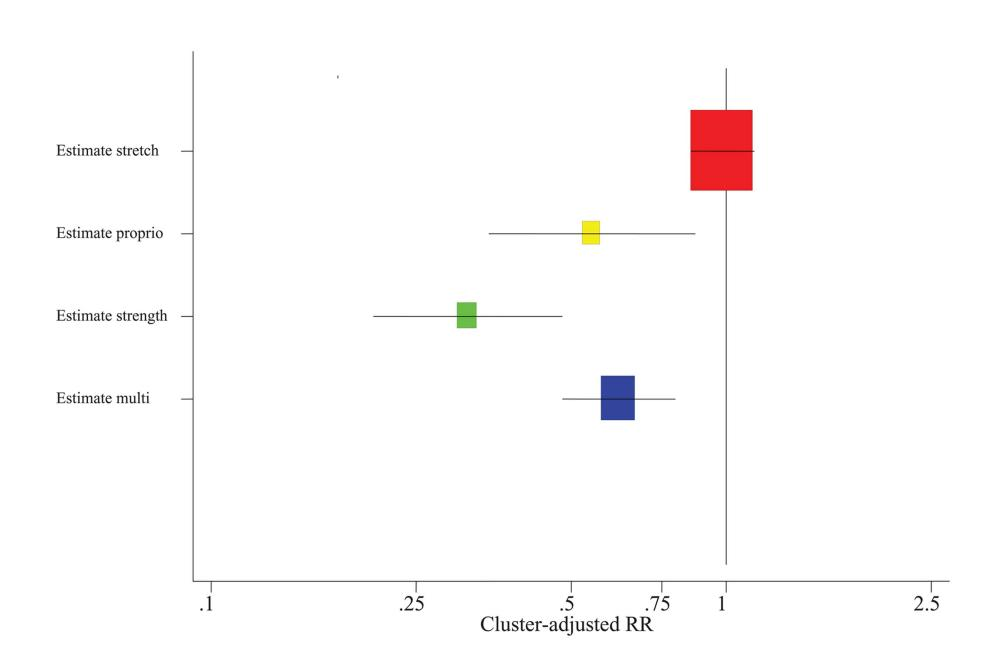
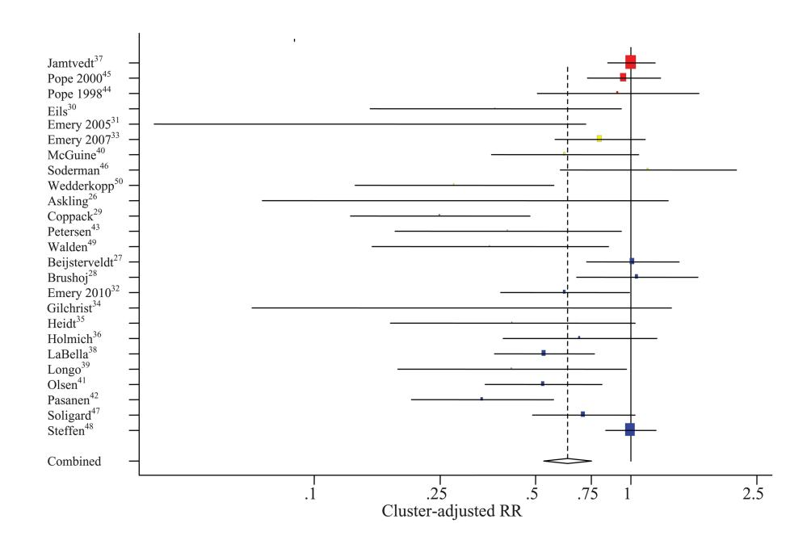
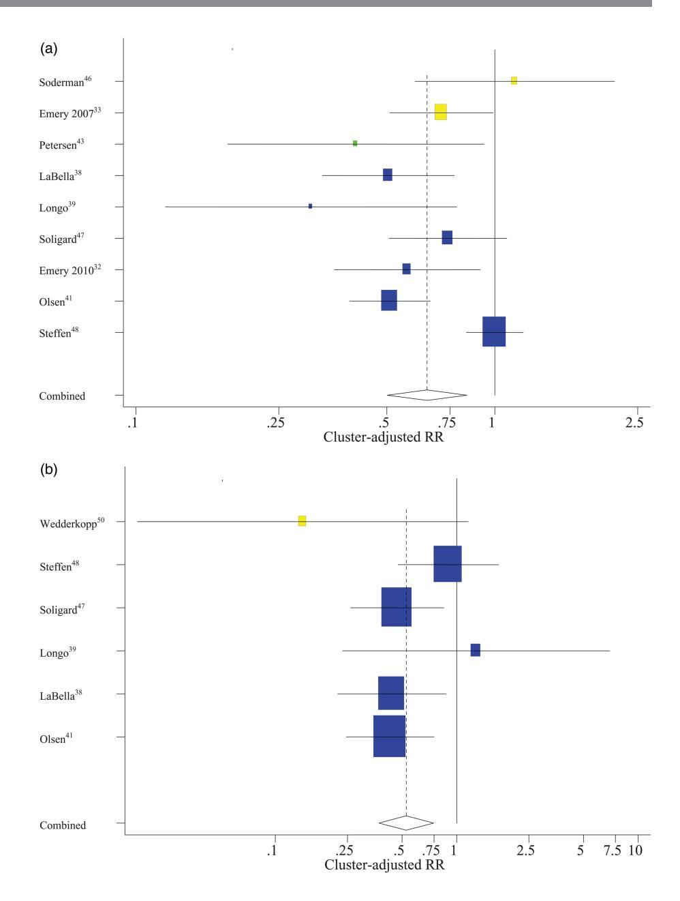

# The effectiveness of exercise interventions to prevent sports injuries: a systematic review and meta-analysis of randomised controlled trials

Jeppe Bo Lauersen,1 Ditte Marie Bertelsen,2 Lars Bo Andersen3,4

▸ Additional material is published online only. To view please visit the journal online [\(http://dx.doi.org/10.1136/](http://dx.doi.org/10.1136/bjsports-2013-092538) [bjsports-2013-092538](http://dx.doi.org/10.1136/bjsports-2013-092538)).

1 Institute of Sports Medicine Copenhagen, Bispebjerg Hospital, Copenhagen NV, Denmark

2 Faculty of Health and Medical Sciences, Copenhagen N, Denmark

3 Department of Exercise Epidemiology, Institute of Sport Sciences and Clinical Biomechanics University of Southern Denmark, Odense,

Denmark 4 Department of Sports Medicine, Norwegian School of Sport Sciences, Oslo, Norway

#### Correspondence to

Jeppe Bo Lauersen, Institute of Sports Medicine Copenhagen, Bispebjerg Hospital, Building 8, 1. Floor, Bispebjerg Bakke 23, 2400 Copenhagen NV, Sealand 2400, Denmark; jeppelauersen@stud.ku.dk

Accepted 31 August 2013

To cite: Lauersen JB, Bertelsen DM, Andersen LB. Br J Sports Med Published Online First: [please include Day Month Year] doi:10.1136/bjsports-2013- 092538

## ABSTRACT

Background Physical activity is important in both prevention and treatment of many common diseases, but sports injuries can pose serious problems.

Objective To determine whether physical activity exercises can reduce sports injuries and perform stratified analyses of strength training, stretching, proprioception and combinations of these, and provide separate acute and overuse injury estimates.

Material and methods PubMed, EMBASE, Web of Science and SPORTDiscus were searched and yielded 3462 results. Two independent authors selected relevant randomised, controlled trials and quality assessments were conducted by all authors of this paper using the Cochrane collaboration domain-based quality assessment tool. Twelve studies that neglected to account for clustering effects were adjusted. Quantitative analyses were performed in STATA V.12 and sensitivity analysed by intention-to-treat. Heterogeneity (I2 ) and publication bias

(Harbord's small-study effects) were formally tested. Results 25 trials, including 26 610 participants with 3464 injuries, were analysed. The overall effect estimate on injury prevention was heterogeneous. Stratified exposure analyses proved no beneficial effect for stretching (RR 0.963 (0.846–1.095)), whereas studies with multiple exposures (RR 0.655 (0.520–0.826)), proprioception training (RR 0.550 (0.347–0.869)), and strength training (RR 0.315 (0.207–0.480)) showed a tendency towards increasing effect. Both acute injuries (RR 0.647 (0.502– 0.836)) and overuse injuries (RR 0.527 (0.373–0.746)) could be reduced by physical activity programmes. Intention-to-treat sensitivity analyses consistently revealed even more robust effect estimates.

Conclusions Despite a few outlying studies, consistently favourable estimates were obtained for all injury prevention measures except for stretching. Strength training reduced sports injuries to less than 1/3 and overuse injuries could be almost halved.

#### INTRODUCTION

Increasing evidence exists, for all age groups, that physical activity is important in both prevention and treatment of some of the most sizable conditions of our time,1–3 including cardiovascular disease, diabetes, cancer, hypertension, obesity, osteoporosis, and depression. Although overall population levels of physical activity is a general concern, increasing levels of leisure time physical activity and sports participation have been reported in some population groups.4 Injuries are virtually the sole drawback of exercise, but may be a common consequence of physical activity and have been shown to pose substantial problems.5–7 Management of sports injuries is difficult, time-consuming and expensive, both for the society and for the individual.8–10 However, sports injury prevention by different kinds of strength training, proprioception exercises, stretching activities, and combinations of these, is accessible to essentially everyone and requires limited medical staff assistance. This adds several interesting aspects regarding the potential dispersion, applicability, and compliance to these programmes.

Most studies on musculoskeletal injuries have focused on one particular intervention, injury type/ location, sport or studied other relatively narrowly defined research questions. This applies to most reviews and meta-analyses as well.11–18 However, Parkkari et al19 described 16 controlled trials in a narrative review. Central concepts of sports injury prevention such as extrinsic (including exposures, environment, equipment) and intrinsic (including physical characteristics, fitness, ability, age, gender, psychology) risk factors and the 'sequence of prevention' model of van Mechelen20 were summarised. Aaltonen et al21 presented an overview of all sports injury prevention measures, but as in the literature up until their search in January 2006, the focus of this review was primarily on extrinsic risk factors.22 Recently, and with less restrictive exclusion criteria, Schiff et al23 covered the same topic with additional studies. Aaltonen et al and Schiff et al were unable to obtain full quantification of intervention effect estimates. Steffen et al24 presented a narrative review of acute sports injury prevention written by field experts for each location of injury, but an examination and quantification of specific training exposures and a differentiation of acute and overuse outcome effect estimates is still lacking.

This review and meta-analysis will broaden the scope of previous reviews and meta-analyses on sports injury prevention and focus on the preventive effect of several different forms of physical activity programmes and complement the existing summative literature on extrinsic risk factor reduction. Valuable summary literature exists for both neuromuscular proprioception14 15 and stretching exercises.17 18 However, aggregation of effect estimates and comparison with the effect of strength training and an intervention group with multiple exposures (combining ex strength, proprioception, stretch etc) could reveal new and interesting information, enabling proposals for future directions in the field of sports injury prevention. This study consequently aimed at performing stratified analyses of different injury prevention exercise programmes and additionally provides separate effect estimates for acute and overuse injuries.

# MATERIAL AND METHODS

# Search strategy and study selection

A review protocol was composed, comprising a priori specification of analyses, inclusion/exclusion criteria, injury definition and search strategy. Injury was defined according to the F-MARC consensus statement for football, merely broadened to fit all forms of physical activity.25 See online supplements eMethods1–3 and eFigure 1 for full injury definition, detailed search entries, study selection description and flow chart. PubMed, EMBASE, Web of Science and SPORTDiscus databases were searched to October 2012 with no publication date restrictions. The search was performed by four blocks of keywords related to prevention, injury and diagnoses, sports, and randomised controlled trials. The searches were customised to accommodate the layout and search methods of each search engine and the application of additional free text words were based on the coverage of subject terms. Reference lists of retrieved articles were hand searched for trials of potential interest and the search was later updated to January 2013.

Search results yielded 3462 hits, which were screened by title to yield 90 titles. After exclusion by abstract, 40 were read in full text and 22 were included. Another three studies were included from reference lists and updated search. Study selection followed a priori-specified inclusion and exclusion criteria.

| Inclusion         | criteria             | Exclusion criteria                       |
|-------------------|----------------------|------------------------------------------|
| ▸ Primary         | prevention           |                                          |
| ▸ Free of         | injury at inclusion  |                                          |
| ▸ Sports/physical | activity             | injuries                                 |
| ▸ Randomised      | controlled           | trials                                   |
| ▸ Appropriate     | intervention/control |                                          |
| ▸ Conducted       | in humans            |                                          |
| ▸ Reported        | in English           |                                          |
| ▸ Peer-reviewed   | publications         |                                          |
|                   |                      | ▸ Influencing pathology                  |
|                   |                      | ▸ Surrogate measures of injury           |
|                   |                      | ▸ Any use of devices (kinesiotaping,     |
|                   |                      | insoles, etc)                            |
|                   |                      | ▸ Any means of transportation (bicycles, |
|                   |                      | motor driven, skies, equestrian, etc)    |
|                   |                      | ▸ Inadequate follow-up                   |

Two reviewers ( JBL and DMB) independently assessed the eligibility criteria with subsequent consensus by discussion. If unanimous consensus could not be reached, this was arbitrated by a third person (LBA).

In total, 25 studies were included.26–50

#### Data extraction

All included studies were assessed using the domain-based evaluation tool recommended by the Cochrane collaboration.51 Two reviewers ( JBL and DMB) independently collected the support for judgement and final judgements required consensus from all authors of this paper. If reporting was inadequate or unclear, efforts were made to contact the corresponding authors and ask by 'open questions' in order to reduce the risk of overly positive answers. Weighting of studies by quality assessment was considered but not performed, as such appraisals would inevitably involve subjective decisions and no evidence in support of this approach exists.51

Data extraction for total estimate and exposure subgroup estimates covered the primary outcome, defined by each study. Injuries were classified as acute or overuse according to definitions used by each study and proprioception was defined as exercises aiming at improving joint proprioception and/or joint stability. For the outcome subgroups, acute and overuse injuries, we additionally extracted appropriate secondary data from studies where information was available in order to optimise the power of these analyses. Overlapping entities were omitted so no injury was analysed more than once.

The stratification of studies into less heterogeneous exposure subgroups was, with the exception of Beijsterveldt et al, 27 performed after completion of the literature search. Beijsterveldt et al was added from the updated literature search and was unambiguously fitted into the multiple exposures group.

As compliance plays a central role in the robustness of results, sensitivity analyses without studies that neglected to analyse by intention-to-treat were conducted.

During the iterative process of hypothesis generation and preliminary searches the prespecified eligibility criteria were elaborated but not changed. All a priori-specified analyses were performed as planned.

### Statistics

Whenever possible, only first-time injuries were taken into account as repeated outcomes are likely to be dependent of each other and therefore would introduce bias. Most studies have analysed by calculation of either RR, injury rate RR or Cox regression RR. When no appropriate effect estimates were reported or studies neglected to adjust for clustering effects, we adjusted for clustering effects and calculated a RR. Twelve included studies were not originally adjusted for cluster randomisation. As individuals in clusters potentially lack independence of each other, a regulation of sample size calculations is often required. The equation for cluster adjustment is

$$\text{IF} = 1 + (n-1)\rho$$

where ρ is the intracluster correlation coefficient, n the average cluster size and IF the inflation factor. Effective sample size is calculated by dividing sample size with IF.52 The intracluster correlation coefficient was calculated by

$$\rho = s_c^2 / (s_c^2 + s_w^2)$$

where s2 w is the within cluster variance of observations taken from individuals in the same cluster and s2 c the variance of true cluster means.53 In the nine studies where the corresponding authors did not provide us with sufficient data for ρ calculation, we achieved this by calculating an average intracluster correlation coefficient based on p values from studies, which were appropriately adjusted for clustering effects.

In order to address reporting bias formally, we sought to test all analyses by the Harbord small-study effect test with a modified Galbraith plot.54 This follows the recommendations by the Cochrane handbook for systematic reviews of interventions and is available in STATAV.12.51 55 Effective sample sizes for intervention and control group populations were used for the required binary data input to achieve a cluster-adjusted result for this test.

The heterogeneity for all analyses was assessed by I2 and the χ2 (Q) p value. I2 is calculated from the Stata given Q value and number of studies (n) by

$$\Gamma^2 = \frac{Q - (n-1)}{Q}$$

A rough interpretation guide of I2 has been proposed by Higgins et al.51

All analyses were computed in STATA V.12 by user-written commands described by Egger et al56 The random effects model was used for the weighting of studies. Statistically heterogeneous estimates were graphically explored by the metainf command, displaying the influence of each individual study on the effect estimate. These analyses did not reveal conclusive information of particular studies primarily causing the heterogeneity and will not be reported throughout this article.

#### RESULTS

#### Study characteristics

Table 1 summarises the characteristics of 25 included studies. A full study characteristics table is available in the online supplements eTable 2. In total 26 610 individuals were included in the analysis and effect estimates were based on 3464 injuries. Thirteen studies were performed on adult participants, 11 studies on adolescents and one study included both.

We contacted nine authors and four supplied clarifying answers with subsequent change in their data or quality assessment. For detailed quality assessments and quality assessment summary see online supplementary eMethods 4, eTable 1 and eFigure 2.

### Total estimate

The total effect estimate was RR 0.632 (95% CI 0.533 to 0.750, I2 =70% with a χ2 p<0.001). Brushoj et al, 28 Eils et al, 30 Gilchrist et al, 34 Holmich et al36 and Soderman et al46 did not report intention-to-treat data. When performing a sensitivity analysis on the 20 studies with intention-to-treat data, an estimate of RR 0.608 (0.503–0.736, I2 =74%, χ2 p<0.001) was found. A post hoc analysis stratified for age showed RR 0.577 (0.453–0.736, I2 =68%, χ2 p<0.001) for adolescents and RR 0.683 (0.526–0.885, I2 =72%, p<0.001) for adults (figure 1).

Table 1 Study characteristics summary

| Table 1 Study characteristics summary                               |      |         |      |           |         |              |     |         |     |             |                      |
|---------------------------------------------------------------------|------|---------|------|-----------|---------|--------------|-----|---------|-----|-------------|----------------------|
| Study Intervention Population Completion                            |      |         |      | Follow-up |         | Injuries     |     |         |     | Primary     | out                  |
| Askling et al 26 Strength Soccer, male, elite Intervention          | 15   | Control | 15   | 10        | weeks + | 1            |     |         |     |             |                      |
|                                                                     |      |         |      |           |         | Intervention | 3   | Control | 10  | Hamstring   | injury               |
| Beijsterveldt et al 27 Multi Soccer, 18 – 40, male                  |      |         |      |           |         |              |     |         |     |             |                      |
| Intervention                                                        | 223  | Control | 233  | 9         | months  | Intervention | 135 | Control | 139 | All         | injuries             |
| Brushoj et al 28 Multi Conscripts,                                  |      |         |      |           |         |              |     |         |     |             |                      |
| 19 – 26 years                                                       |      |         |      |           |         |              |     |         |     |             |                      |
| Intervention                                                        | 487  | Control | 490  | 12        | weeks   | Intervention | 50  | Control | 48  | Overuse     | knee injury          |
| Coppack et al 29 Strength Recruits, 17 – 30 years Intervention      | 759  | Control | 743  | 14        | weeks   | Intervention | 10  | Control | 36  | Overuse     | ant. knee            |
| Eils et al 30 Proprioception Basketball, 1st – 7th                  |      |         |      |           |         |              |     |         |     |             |                      |
| Intervention                                                        | 81   | Control | 91   | 1         | season  | Intervention | 7   | Control | 21  | Ankle       | injury               |
| Emery et al 31 Proprioception Students, 14 – 19 years Intervention  | 60   | Control | 54   | 6         | weeks + |              |     |         |     |             |                      |
|                                                                     |      |         |      | 6         | months  |              |     |         |     |             |                      |
|                                                                     |      |         |      |           |         | Intervention | 2   | Control | 10  | All         | injuries             |
| Emery and                                                           |      |         |      |           |         |              |     |         |     |             |                      |
| Meeuwisse 32                                                        |      |         |      |           |         |              |     |         |     |             |                      |
| Multi Soccer, 13 – 18 years Intervention                            | 380  | Control | 364  | 1         | year    | Intervention | 50  | Control | 79  | All         | injuries             |
| Emery et al 33 Proprioception Basketball,                           |      |         |      |           |         |              |     |         |     |             |                      |
| 12 – 18 years                                                       |      |         |      |           |         |              |     |         |     |             |                      |
| Intervention                                                        | 494  | Control | 426  | 1         | year    | Intervention | 130 | Control | 141 | All         | injuries             |
| Gilchrist et al 34 Multi Soccer, collegiate Intervention            | 583  | Control | 852  | 12        | weeks   | Intervention | 2   | Control | 10  | Non-contact | ACL                  |
| Heidt et al 35 Proprioception H. school, female,                    |      |         |      |           |         |              |     |         |     |             |                      |
| Intervention                                                        | 42   | Control | 258  | 1         | year    | Intervention | 6   | Control | 87  | All         | injuries             |
| Holmich et al 36 Multi Football, 2nd – 5th                          |      |         |      |           |         |              |     |         |     |             |                      |
| Intervention                                                        | 477  | Control | 430  | 42        | weeks   | Intervention | 23  | Control | 30  | Groin       | injuries             |
| Jamtvedt et al 37 Stretch Internet, >18 years Intervention          | 1079 | Control | 1046 | 12        | weeks   | Intervention | 339 | Control | 348 | Lower       | limb + trunk         |
| LaBella et al 38 Multi Athletes, female Intervention                | 737  | Control | 755  | 1         | season  | Intervention | 50  | Control | 96  | Lower       | extremity            |
| Longo et al 39 Multi Basketball, male Intervention                  | 80   | Control | 41   | 9         | months  | Intervention | 14  | Control | 17  | All         | injuries             |
| McGuine and                                                         |      |         |      |           |         |              |     |         |     |             |                      |
| Proprioception Basketball, adolescent Intervention                  | 373  | Control | 392  | 4         | weeks + | 1            |     |         |     |             |                      |
|                                                                     |      |         |      |           |         | Intervention | 23  | Control | 39  | Ankle       | sprain               |
| Olsen et al 41 Multi Handball, 15 – 17 years Intervention           | 958  | Control | 879  | 8         | months  | Intervention | 48  | Control | 81  | Knee        | and ankle            |
| Pasanen et al 42 Multi Floorball, female, elite Intervention        | 256  | Control | 201  | 6         | months  | Intervention | 20  | Control | 52  | Non-contact | injuries             |
| Petersen et al 43 Strength Soccer, male, elite Intervention         | 461  | Control | 481  | 12        | months  | Intervention | 12  | Control | 32  | Hamstring   | injuries             |
| Pope et al 44 Stretch Recruits, 17 – 35 years Intervention          | 549  | Control | 544  | 12        | weeks   | Intervention | 23  | Control | 25  | 4           | specific LE injuries |
| Pope et al 2000 45 Stretch Recruits, male Intervention              | 666  | Control | 702  | 12        | weeks   | Intervention | 158 | Control | 175 | Lower       | limb injuries        |
| Soderman et al 46 Proprioception Soccer, female, elite Intervention | 62   | Control | 78   | 7         | months  | Intervention | 28  | Control | 31  | Lower       | extremity            |
| Soligard et al 47 Multi Football, 13 – 17,                          |      |         |      |           |         |              |     |         |     |             |                      |
| Intervention                                                        | 1055 | Control | 837  | 8         | months  | Intervention | 121 | Control | 143 | Lower       | extremity            |
| Steffen et al 48 Multi Soccer, female Intervention                  | 1073 | Control | 947  | 8         | weeks + | 1            |     |         |     |             |                      |
|                                                                     |      |         |      |           |         | Intervention | 242 | Control | 241 | All         | injuries             |
| Walden et al 49 Strength Soccer, 12 – 17, female Intervention       | 2479 | Control | 2085 | 7         | months  | Intervention | 7   | Control | 14  | ACL         | injuries             |
| Wedderkopp et al 50 Proprioception Handball, 16 – 18,               |      |         |      |           |         |              |     |         |     |             |                      |
| Intervention                                                        | 111  | Control | 126  | 10        | months  | Intervention | 11  | Control | 45  | All         | injuries             |

# Stratified exposure analyses

The strength training estimate including four studies was RR 0.315 (0.207–0.480, I2 =0%, χ2 p=0.808). All studies in the strength training group were analysed by intention-to-treat. For stratified exposure Forest plots see online supplementary eFigure 4–7.

The pooled effect estimate for six studies with proprioception training as the primary exposure showed a RR of 0.550 (0.347–0.869, I2 =66%, χ2 p=0.012). Sensitivity analysis of intention-to-treat ruled out Eils et al30 and Soderman et al46 and revealed RR 0.480 (0.268–0.862, I2 =71%, χ2 p=0.017).

Unlike the above two exposures, the overall estimate for stretching did not prove significant with RR 0.963 (0.846–1.095, I2 =0%, χ2 p=0.975) based on three studies. All studies in the stretching group were analysed by intention-to-treat.

The combined effect estimate for the 12 studies with multiple exposure interventions revealed a RR of 0.655 (0.520–0.826, I 2 =69%, χ2 p<0.001). Sensitivity analysis of intention-to-treat excluded Brushoj et al28 Gilchrist et al34 and Holmich et al36 and revealed RR 0.625 (0.477–0.820, I2 =75%, χ2 p<0.001; figure 2).

#### Stratified outcome analyses

On the basis of primary or secondary data from nine studies, the RR for all types of exposures against acute injury was 0.647 (0.502–0.836, I2 =73%, χ2 p<0.001). One study had strength training as exposure, two studies did proprioception training and the remaining six studies were from the group of multiple exposure studies. Sensitivity analysis of eight intention-to-treat analysed studies (Soderman et al46 was excluded) showed a RR 0.615 (0.470–0.803, I2 =75%, χ2 p<0.001).

Figure 1 Total estimate Forest plot. Stretching studies are denoted by red, proprioception exercises yellow, strength training green, and multiple component studies blue.

Figure 2 Exposure estimates Forest plot. Stretching studies are denoted by red, proprioception exercises yellow, strength training green, and multiple component studies blue.

Six studies provided data on overuse injuries. RR from these six studies was 0.527 (0.373–0.746, I2 =19%, χ2 p=0.287). All studies in this analysis, except one proprioception training study, were multiple exposure studies. All analysed studies reported intention-to-treat data (figure 3A,B).

# Small-study effect

The Harbord test for the total estimate of all 25 studies showed a highly significant small-study effect test. Exposure and outcome subgroups revealed significant test for only the multiple exposures group. See online supplementary eFigure 7 for modified-Galbraith plot and online supplementary eTable 3 for Harbord tests.

# DISCUSSION

An overall RR estimate for physical activity for injury prevention, adjusted for clustering effects, was 0.632 (0.532–0.750), and slightly lower when sensitivity analysed by intention-to-treat (RR 0.607 (0.501–0.735)). A preventive effect of this size should be considered convincing, but the analysis was heterogeneous and the result is, therefore, clinically useless. However, it also suggests that some types of interventions may prove better than others.

Stretching did not show any protective effect (RR=0.961 (0.836–1.106)), while strength training proved highly significant (RR 0.315 (0.207–0.480)). Results from stretching and strength training studies were not heterogeneous despite different programmes were used and outcomes of interest were different. This points towards a strong generalisability of results. Proprioception training and multiple exposure programmes were also effective (RR=0.480 (0.266–0.864) and 0.625 (0.477–0.820), respectively), but results were relatively heterogeneous.

The effect estimate of stretching and proprioception training analyses in this article corresponds to earlier reviews.14 15 17 18 Our data do not support the use of stretching for injury prevention purposes, neither before or after exercise, however it

Figure 3 (A) Acute outcomes estimate Forest plot. Proprioception studies are denoted by yellow, strength training green, and multiple component studies blue. (B) Overuse outcomes estimate Forest plot. Proprioception studies are denoted by yellow and multiple component studies blue.

should be noted that this analysis only included two studies on army recruits and one internet-based study on the general population. Strength training showed a trend towards better preventive effect than proprioception training and proved significantly better than multiple exposure studies, even though all multiple exposure studies included a strength training component. Further research of strength training for a wider range of injuries is still needed, as our analyses suggest great sports injury prevention potential for this type of intervention. With a growing number of randomised controlled trials containing numerous exposure types, it was of interest to assess intervention studies with multiple exposures separately, although, as expected, still being a heterogeneous subgroup. Though it makes intuitive sense to design an array of exposures for prevention of all injuries, it is important to note that each component may be reduced quantitatively and/or qualitatively by doing so. Multiple exposure programmes may therefore reduce the proportion of proven beneficial exposures and consequently reduce the overall preventive effect on sports injury. Additionally, the risk of designing too extensive prevention programmes will unavoidably be enhanced with growing amounts of applied exposures and compliance may suffer as a consequence. Although most multiple intervention studies in this analysis were well designed and carried out in a satisfactory way, this subgroup did not exhibit an unambiguous preventive effect on sports injuries. Our findings suggest that designs of multiple exposure interventions should at least be built from well-proven single exposures and that further research into single exposures remains pivotal.

When analyses were stratified by outcome, both acute (RR 0.615 (0.470–0.803)) and overuse (RR 0.527 (0.373–0.746)) injuries were effectively reduced by preventive physical activity, although overuse injuries fared slightly better.

Five of six studies analysing overuse injuries were multiple exposure studies, and estimates were not particularly heterogeneous. Six of nine studies analysing acute injuries were multiple exposure studies with heterogeneous effect sizes. It is not possible to derive which parts of these interventions manifested the preventive effect. Future studies should report acute and overuse injuries separately and test specific exposures against these in order to acquire further knowledge in this import area.

# Strengths and limitations

The aim of this meta-analysis was to aggregate a wide array of populations, exposures and outcomes to augment the external validity while maintaining the suitability of combining studies. Physical activity is broadly defined and populations include army recruits, recreational and professional athletes. In this regard, it should be pointed out that the diversity of included studies should not be interchanged with the I2 measure of statistical heterogeneity, which exclusively concerns inconsistency in effect sizes. The statistically homogeneous analyses of strength training and stretching studies differing in population, intervention, and outcome, prove the generalisability of results. The statistically heterogeneous analyses of this meta-analysis should be interpreted with caution as this heterogeneity could arise from true variation (diversity in design) and/or artefactual variation (bias by conduct, attrition, etc).

Omission of intention-to-treat analysis and cluster adjustment are two sources of potentially serious bias. As compliance to intervention programmes appears to vary and remains a disputed phenomenon, the analysis by intention-to-treat plays a central role in the robustness of results.57–61 In the present meta-analysis we extracted data from intention-to-treat analyses whenever possible and performed sensitivity analysis by exclusion of five studies with no report of intention-to-treat analysis. Contrary to the expected more conservative effect estimate, the intention-to-treat sensitivity analyses revealed even more beneficial effect estimates. As a result we can conclude that physical activity as primary prevention against sports injuries is effective, even if it has been argued that compliance issues could diminish the implementation and effect of these programmes. We speculate the above to result from an association between using intention-to-treat analysis and study conduct in general. For example, Brushoj et al28 added concurrent training in the critical high risk period of military training initiation, which intuitively appears detrimental to overuse injuries. Soderman et al46 exhibited several methodological issues and reported adverse effects of major injuries that have not been reproduced by other studies. None of them analysed by intention-to-treat and exclusion of such studies improved the quality of included studies and subsequently the effect estimate.

Cluster adjustment is similarly important in order not to overestimate the power of the study. A strength of this meta-analysis is the adjustment of these studies that report the same effect estimate but underestimate the width of CIs. Corresponding authors of studies without cluster adjustment were contacted and three provided data for ρ calculation. For the remaining nine studies we calculated an average p value extracted from 12 reported values of 10 studies that performed correct adjustment methods. This caused, in some cases, a dramatic, downregulation of effective sample size which affected the study weight in the quantitative analyses.

A short discussion of the allocation concealment and participant blinding quality assessments is advocated. As true participant blinding is frequently argued to be impossible in sports injury prevention and allocation, concealment makes less sense in non-pharmacological interventions, these quality assessment items should be interpreted with caution. In spite of this, some of the included studies made qualified efforts to alleviate these, which, in this review, resulted in a lower risk of bias judgement. The domain-based tool was chosen as evaluation tool of this review as recommended by the Cochrane collaboration with the most convincing validation evidence in this area. Although not being perfectly suited for assessment of sports injury prevention studies, assessment of these parameters still holds relevance as these factors can greatly influence analyses.62 63

A Harbord's small-study effect test and a modified Galbraith's plot were performed for this meta-analysis to assess publication bias. The small-study effect test for the total estimate was highly significant, while the multiple exposures subgroup was the only subgroup showing a statistically significant test. According to Egger et al64 65 significant small-study effects may arise from a number of reasons, including true publication bias, heterogeneity, chance, and methodological differences between smaller and larger studies. As the p value of the small-study effects increased when the total estimate test was divided into less heterogeneous subgroups, it is likely that a substantial part of the total estimate small-study effect originates in heterogeneity. Owing to the relatively heavy burden of implementing physical activity interventions, it should be noted that smaller studies often would be able to pay greater attention to the intervention for each team/individual, thereby enabling them to obtain more thorough intervention quality. Hence, a methodological difference may exist as well.

# CONCLUSION

In general, physical activity was shown to effectively reduce sports injuries. Stretching proved no beneficial effect, whereas multiple exposure programmes, proprioception training, and strength training, in that order, showed a tendency towards increasing effect. Strength training reduced sports injuries to less than one-third. We advocate that multiple exposure interventions should be constructed on the basis of well-proven single exposures and that further research into single exposures, particularly strength training, remains crucial. Both acute and overuse injuries could be significantly reduced, overuse injuries by almost a half. Apart from a few outlying studies, consistently favourable estimates were obtained for all injury prevention measures except for stretching. What this study adds This meta-analysis provides quantitative effect estimates of different exercise programmes on sports injury prevention. Comparison of exposures reveals a highly effective strength training estimate, significantly better than multicomponent studies. Acknowledgements The authors would like to thank Thor Einar Andersen, associate professor, Department of Sport Medicine, Norwegian School of Sport Sciences and Ashley Cooper, professor, Centre for Exercise, Nutrition and Health Sciences, University of Bristol for comments and manuscript revision. Contributors All authors of this paper have contributed substantially to conception and design, analysis and interpretation of the data, drafting the article or revising it critically for important intellectual content and final approval of the version to be published. Competing interests None. Provenance and peer review Not commissioned; externally peer reviewed. REFERENCES 1 Strong WB, Malina RM, Blimkie CJ, et al. Evidence based physical activity for school-age youth. J Pediatr 2005;146:732–7. 2 Warburton DE, Nicol CW, Bredin SS. Health benefits of physical activity: the evidence. CMAJ 2006;174:801–9. 3 Nelson ME, Rejeski WJ, Blair SN, et al. Physical activity and public health in older adults: recommendation from the American College of Sports Medicine and the American Heart Association. Med Sci Sports Exerc 2007;39:1435–45. 4 Knuth AG, Hallal PC. Temporal trends in physical activity: a systematic review. J Phys Act Health 2009;6:548–59. 5 Blair S, Franks A, Shelton D, et al. Chapter 4—the effects of physical activity on health and disease in physical activity and health—a report of the surgeon general. U.S. Department of Health and Human Services, Centers for Disease Control and Prevention, 1996. 6 Janda DH. Sports injury surveillance has everything to do with sports medicine. Sports Med 1997;24:169–71. 7 Campbell K, Foster-Schubert K, Xiao L, et al. Injuries in sedentary individuals enrolled in a 12-month, randomized, controlled, exercise trial. J Phys Act Health 2012;9:198–207. 8 De Loes M. Medical treatment and costs of sports-related injuries in a total population. Int J Sports Med 1990;11:66–72. 9 Khan KM, Thompson AM, Blair SN, et al. Sport and exercise as contributors to the health of nations. Lancet 2012;380:59–64. 10 Smidt N, De Vet HC, Bouter LM, et al. Effectiveness of exercise therapy: a best-evidence summary of systematic reviews. Aust J Physiother 2005;51:71–85. 11 Petersen J, Holmich P. Evidence based prevention of hamstring injuries in sport. Br J Sports Med 2005;39:319–23. 12 Pluim BM, Staal JB, Windler GE, et al. Tennis injuries: occurrence, aetiology, and prevention. Br J Sports Med 2006;40:415–23. 13 Fong DT, Hong Y, Chan LK, et al. A systematic review on ankle injury and ankle sprain in sports. Sports Med 2007;37:73–94. 14 Hubscher M, Zech A, Pfeifer K, et al. Neuromuscular training for sports injury prevention: a systematic review. Med Sci Sports Exerc 2010;42:413–21. 15 Herman K, Barton C, Malliaras P, et al. The effectiveness of neuromuscular warm-up strategies, that require no additional equipment, for preventing lower limb injuries during sports participation: a systematic review. BMC Med 2012;10:75. 16 McBain K, Shrier I, Shultz R, et al. Prevention of sport injury II: a systematic review of clinical science research. Br J Sports Med 2012;46:174–9. 17 Thacker SB, Gilchrist J, Stroup DF, et al. The impact of stretching on sports injury risk: a systematic review of the literature. Med Sci Sports Exerc 2004;36:371–8. 18 Herbert RD, Gabriel M. Effects of stretching before and after exercising on muscle soreness and risk of injury: systematic review. BMJ 2002;325:468. 19 Parkkari J, Kujala UM, Kannus P. Is it possible to prevent sports injuries? Review of controlled clinical trials and recommendations for future work. Sports Med 2001;31:985–95. 20 Van Mechelen W, Hlobil H, Kemper HC. Incidence, severity, aetiology and prevention of sports injuries. A review of concepts. Sports Med 1992;14:82–99. 21 Aaltonen S, Karjalainen H, Heinonen A, et al. Prevention of sports injuries: systematic review of randomized controlled trials. Arch Intern Med 2007;167:1585–92. 22 McBain K, Shrier I, Shultz R, et al. Prevention of sports injury I: a systematic review of applied biomechanics and physiology outcomes research. Br J Sports Med 2012;46:169–73. 23 Schiff MA, Caine DJ, O'Halloran R. Injury prevention in sports. Am J Lifestyle Med 2010;4:42–64. 24 Steffen K, Andersen TE, Krosshaug T, et al. ECSS Position Statement 2009: prevention of acute sports injuries. EJSS 2010;10:223–36. 25 Fuller CW, Ekstrand J, Junge A, et al. Consensus statement on injury definitions and data collection procedures in studies of football (soccer) injuries. Br J Sports Med 2006;40:193–201. 26 Askling C, Karlsson J, Thorstensson A. Hamstring injury occurrence in elite soccer players after preseason strength training with eccentric overload. Scand J Med Sci Sports 2003;13:244–50. 27 Van Beijsterveldt AM, Van de Port IG, Krist MR, et al. Effectiveness of an injury prevention programme for adult male amateur soccer players: a cluster-randomised controlled trial. Br J Sports Med 2012;46:1114–18. 28 Brushoj C, Larsen K, Albrecht-Beste E, et al. Prevention of overuse injuries by a concurrent exercise program in subjects exposed to an increase in training load: a randomized controlled trial of 1020 army recruits. Am J Sports Med 2008;36:663–70. 29 Coppack RJ, Etherington J, Wills AK. The effects of exercise for the prevention of overuse anterior knee pain: a randomized controlled trial. Am J Sports Med 2011;39:940–8. 30 Eils E, Schroter R, Schroder M, et al. Multistation proprioceptive exercise program prevents ankle injuries in basketball. Med Sci Sports Exerc 2010;42:2098–105. 31 Emery CA, Cassidy JD, Klassen TP, et al. Effectiveness of a home-based balance-training program in reducing sports-related injuries among healthy adolescents: a cluster randomized controlled trial. CMAJ 2005;172:749–54. 32 Emery CA, Meeuwisse WH. The effectiveness of a neuromuscular prevention strategy to reduce injuries in youth soccer: a cluster-randomised controlled trial. Br J Sports Med 2010;44:555–62. 33 Emery CA, Rose MS, McAllister JR, et al. A prevention strategy to reduce the incidence of injury in high school basketball: a cluster randomized controlled trial. Clin J Sport Med 2007;17:17–24. 34 Gilchrist J, Mandelbaum BR, Melancon H, et al. A randomized controlled trial to prevent noncontact anterior cruciate ligament injury in female collegiate soccer players. Am J Sports Med 2008;36:1476–83. 35 Heidt RS Jr, Sweeterman LM, Carlonas RL, et al. Avoidance of soccer injuries with preseason conditioning. Am J Sports Med 2000;28:659–62. 36 Holmich P, Larsen K, Krogsgaard K, et al. Exercise program for prevention of groin pain in football players: a cluster-randomized trial. Scand J Med Sci Sports 2010;20:814–21. 37 Jamtvedt G, Herbert RD, Flottorp S, et al. A pragmatic randomised trial of stretching before and after physical activity to prevent injury and soreness. Br J Sports Med 2010;44:1002–9. 38 LaBella CR, Huxford MR, Grissom J, et al. Effect of neuromuscular warm-up on injuries in female soccer and basketball athletes in urban public high schools: cluster randomized controlled trial. Arch Pediatr Adolesc Med 2011;165:1033–40. 39 Longo UG, Loppini M, Berton A, et al. The FIFA 11+ program is effective in preventing injuries in elite male basketball players: a cluster randomized controlled trial. Am J Sports Med 2012;40:996–1005. 40 McGuine TA, Keene JS. The effect of a balance training program on the risk of ankle sprains in high school athletes. Am J Sports Med 2006;34:1103–11. 41 Olsen OE, Myklebust G, Engebretsen L, et al. Exercises to prevent lower limb injuries in youth sports: cluster randomised controlled trial. BMJ 2005;330:449. 42 Pasanen K, Parkkari J, Pasanen M, et al. Neuromuscular training and the risk of leg injuries in female floorball players: cluster randomised controlled study. BMJ 2008;337:a295. 43 Petersen J, Thorborg K, Nielsen MB, et al. Preventive effect of eccentric training on acute hamstring injuries in men's soccer: a cluster-randomized controlled trial. Am J Sports Med 2011;39:2296–303. 44 Pope R, Herbert R, Kirwan J. Effects of ankle dorsiflexion range and pre-exercise calf muscle stretching on injury risk in Army recruits. Aust J Physiother 1998; 44:165–72.

45 Pope RP, Herbert RD, Kirwan JD, et al. A randomized trial of preexercise stretching for prevention of lower-limb injury. Med Sci Sports Exerc 2000;32:271–7. 46 Soderman K, Werner S, Pietila T, et al. Balance board training: prevention of traumatic injuries of the lower extremities in female soccer players? A prospective randomized intervention study. Knee Surg Sports Traumatol Arthrosc 2000;8:356–63. 47 Soligard T, Myklebust G, Steffen K, et al. Comprehensive warm-up programme to prevent injuries in young female footballers: cluster randomised controlled trial. BMJ 2008;337:a2469. 48 Steffen K, Myklebust G, Olsen OE, et al. Preventing injuries in female youth football —a cluster-randomized controlled trial. Scand J Med Sci Sports 2008;18:605–14. 49 Walden M, Atroshi I, Magnusson H, et al. Prevention of acute knee injuries in adolescent female football players: cluster randomised controlled trial. BMJ 2012;344:e3042. 50 Wedderkopp N, Kaltoft M, Lundgaard B, et al. Prevention of injuries in young female players in European team handball. A prospective intervention study. Scand J Med Sci Sports 1999;9:41–7. 51 Higgins JPT, Green S. eds. Cochrane Handbook for Systematic Reviews of Interventions Version 5.1.0 [updated March 2011].The Cochrane Collaboration, 2011.<http://www.cochrane-handbook.org> 52 Emery CA. Considering cluster analysis in sport medicine and injury prevention research. Clin J Sport Med 2007;17:211–14. 53 Kerry SM, Bland JM. The intracluster correlation coefficient in cluster randomisation. BMJ 1998;316:1455. 54 Harbord RM, Egger M, Sterne JA. A modified test for small-study effects in meta-analyses of controlled trials with binary endpoints. Stat Med 2006;25:3443–57. 55 Harbord RM, Harris RJ, Sterne JAC. Updated tests for small-study effects in meta-analyses. Stata J 2009;9:197–210. 56 Egger M, Smith GD, Altman DG. Systematic reviews in health care: meta-analysis in context. 2nd edn. London, UK: BMJ Publishing Group, 2008. 57 Braham R, Finch C, McCrory P. Non-participation in sports injury research: why football players choose not to be involved. Br J Sports Med 2004;38:238–9. 58 Finch CF. No longer lost in translation: the art and science of sports injury prevention implementation research. Br J Sports Med 2011;45:1253–7. 59 Keats MR, Emery CA, Finch CF. Are we having fun yet? Fostering adherence to injury preventive exercise recommendations in young athletes. Sports Med 2012;42:175–84. 60 Verhagen EA, Hupperets MD, Finch CF, et al. The impact of adherence on sports injury prevention effect estimates in randomised controlled trials: looking beyond the CONSORT statement. J Sci Med Sport 2011;14:287–92. 61 Soligard T, Nilstad A, Steffen K, et al. Compliance with a comprehensive warm-up programme to prevent injuries in youth football. Br J Sports Med 2010;44:787–93. 62 Juni P, Altman DG, Egger M. Systematic reviews in health care: assessing the quality of controlled clinical trials. BMJ 2001;323:42–6. 63 Moher D, Cook DJ, Eastwood S, et al. Improving the quality of reports of meta-analyses of randomised controlled trials: the QUOROM statement. Quality of Reporting of Meta-analyses. Lancet 1999;354:1896–900. 64 Sterne JA, Gavaghan D, Egger M. Publication and related bias in meta-analysis: power of statistical tests and prevalence in the literature. J Clin Epidemiol 2000;53:1119–29. 65 Egger M, Davey Smith G, Schneider M, et al. Bias in meta-analysis detected by a simple, graphical test. BMJ 1997;315:629–34.

doi: 10.1136/bjsports-2013-092538 Br J Sports Med published online October 7, 2013

Jeppe Bo Lauersen, Ditte Marie Bertelsen and Lars Bo Andersen

# **controlled trials review and meta-analysis of randomised to prevent sports injuries: a systematic The effectiveness of exercise interventions**

**<http://bjsm.bmj.com/content/early/2013/10/07/bjsports-2013-092538.full.html>** Updated information and services can be found at:

These include:

## **Data Supplement**

**<http://bjsm.bmj.com/content/suppl/2013/10/08/bjsports-2013-092538.DC1.html>** "Supplementary Data"

**References** This article cites 62 articles, 29 of which can be accessed free at:

**<http://bjsm.bmj.com/content/early/2013/10/07/bjsports-2013-092538.full.html#ref-list-1>**

**P<P** Published online October 7, 2013 in advance of the print journal.

**service Email alerting** the box at the top right corner of the online article. Receive free email alerts when new articles cite this article. Sign up in

(DOIs) and date of initial publication. publication. Citations to Advance online articles must include the digital object identifier citable and establish publication priority; they are indexed by PubMed from initial typeset, but have not not yet appeared in the paper journal. Advance online articles are Advance online articles have been peer reviewed, accepted for publication, edited and

**<http://journals.bmj.com/cgi/reprintform>** To order reprints go to:

**<http://group.bmj.com/subscribe/>** To subscribe to BMJ go to:

**<http://group.bmj.com/group/rights-licensing/permissions>** To request permissions go to:

#### **Collections Topic**

[Health education](http://bjsm.bmj.com/cgi/collection/health_education) (395 articles) [Trauma](http://bjsm.bmj.com/cgi/collection/trauma) (742 articles) [Injury](http://bjsm.bmj.com/cgi/collection/injury) (822 articles) [Editor's choice](http://bjsm.bmj.com/cgi/collection/editors_choice) (207 articles)

Articles on similar topics can be found in the following collections

#### **Notes**

(DOIs) and date of initial publication. publication. Citations to Advance online articles must include the digital object identifier citable and establish publication priority; they are indexed by PubMed from initial typeset, but have not not yet appeared in the paper journal. Advance online articles are Advance online articles have been peer reviewed, accepted for publication, edited and

**<http://group.bmj.com/group/rights-licensing/permissions>** To request permissions go to:

**<http://journals.bmj.com/cgi/reprintform>** To order reprints go to:

**<http://group.bmj.com/subscribe/>** To subscribe to BMJ go to: