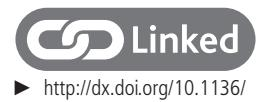
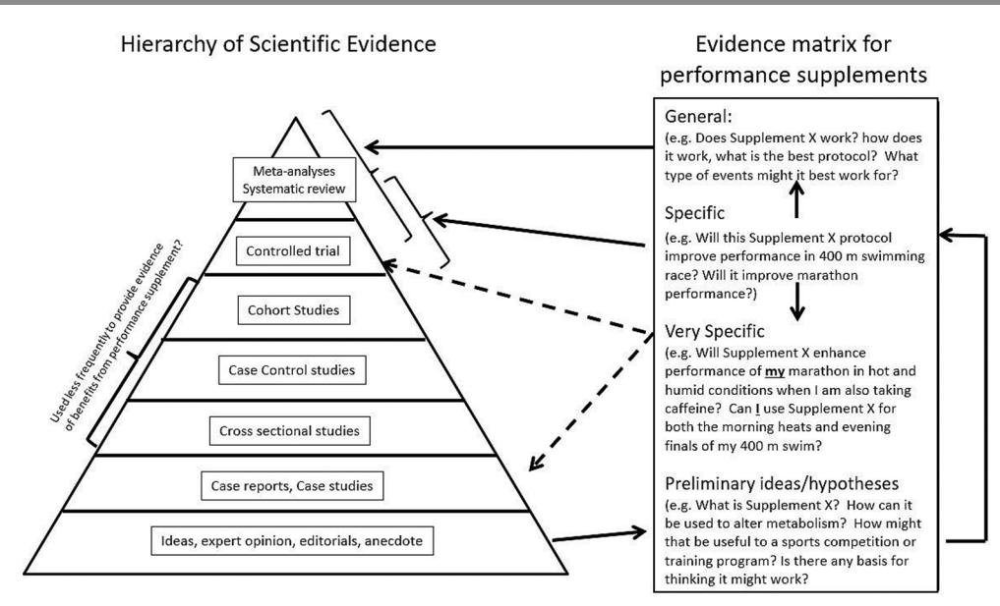
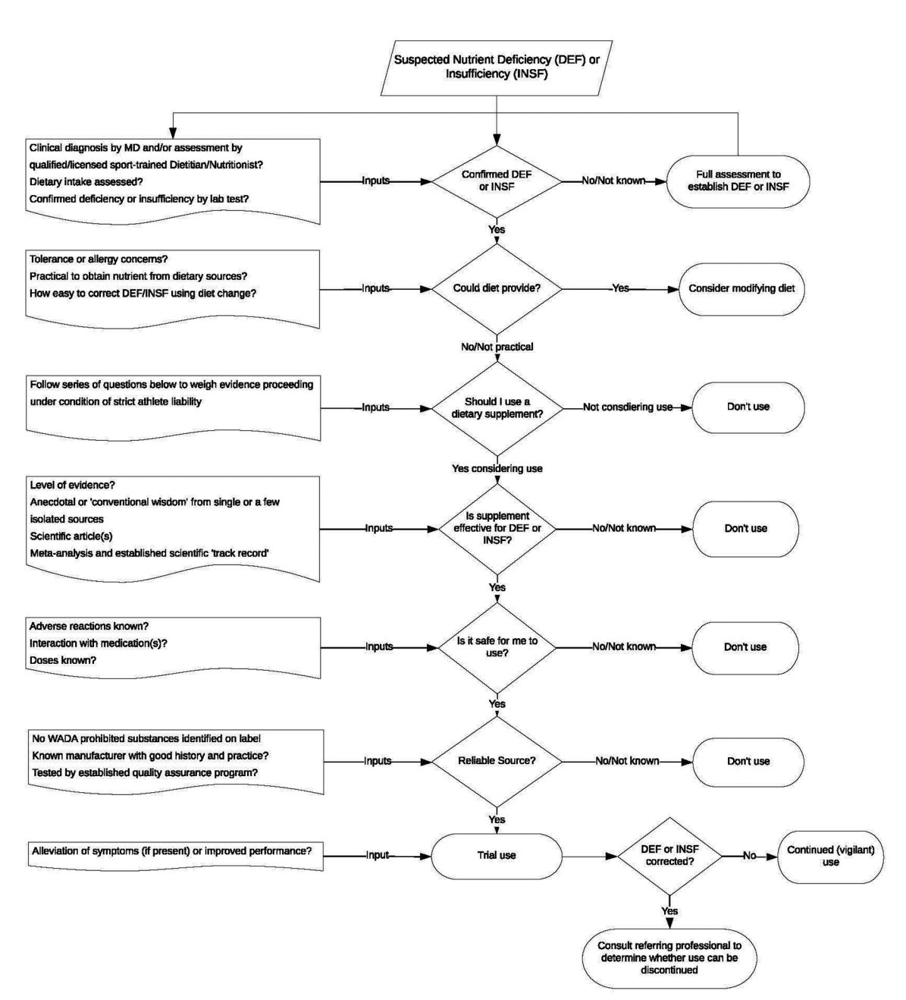
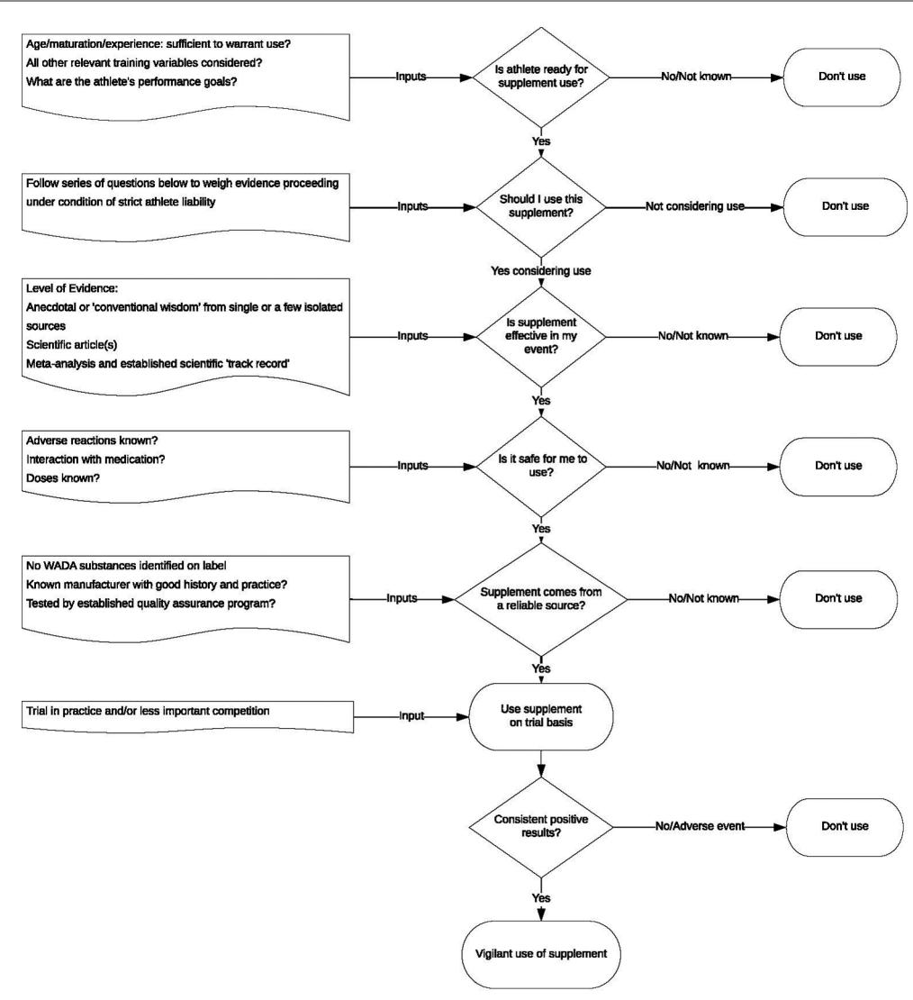

# IOC consensus statement: dietary supplements and the high-performance athlete

Ronald J Maughan,1 Louise M Burke,2,3 Jiri Dvorak,4 D Enette Larson-Meyer,5 Peter Peeling,6,7 Stuart M Phillips,8 Eric S Rawson,9 Neil P Walsh,10 Ina Garthe,11 Hans Geyer,12 Romain Meeusen,13 Lucas J C van Loon,3,14 Susan M Shirreffs,1 Lawrence L Spriet,15 Mark Stuart,16 Alan Vernec,17 Kevin Currell,18 Vidya M Ali,19 Richard GM Budgett,20 Arne Ljungqvist,21 Margo Mountjoy,22,23 Yannis P Pitsiladis,19 Torbjørn Soligard,20 Uğur Erdener,19 Lars Engebretsen20

**To cite:** Maughan RJ, Burke LM, Dvorak J, et al. Br J Sports Med Epub ahead of print: [please include Day Month Year]. doi:10.1136/ bjsports-2018-099027

For numbered affiliations see end of article.

### **Correspondence to**

Professor Ronald J Maughan, School of Medicine, St Andrews University, St Andrews, UK; ronmaughan@st-andrews.ac.uk

Accepted 3 February 2018

[bjsports-2018-099199](http://dx.doi.org/10.1136/bjsports-2018-099199)

### **Abstract**

Nutrition usually makes a small but potentially valuable contribution to successful performance in elite athletes, and dietary supplements can make a minor contribution to this nutrition programme. Nonetheless, supplement use is widespread at all levels of sport. Products described as supplements target different issues, including (1) the management of micronutrient deficiencies, (2) supply of convenient forms of energy and macronutrients, and (3) provision of direct benefits to performance or (4) indirect benefits such as supporting intense training regimens. The appropriate use of some supplements can benefit the athlete, but others may harm the athlete's health, performance, and/or livelihood and reputation (if an antidoping rule violation results). A complete nutritional assessment should be undertaken before decisions regarding supplement use are made. Supplements claiming to directly or indirectly enhance performance are typically the largest group of products marketed to athletes, but only a few (including caffeine, creatine, specific buffering agents and nitrate) have good evidence of benefits. However, responses are affected by the scenario of use and may vary widely between individuals because of factors that include genetics, the microbiome and habitual diet. Supplements intended to enhance performance should be thoroughly trialled in training or simulated competition before being used in competition. Inadvertent ingestion of substances prohibited under the antidoping codes that govern elite sport is a known risk of taking some supplements. Protection of the athlete's health and awareness of the potential for harm must be paramount; expert professional opinion and assistance is strongly advised before an athlete embarks on supplement use.

# **Introduction**

Dietary supplements are used by athletes at all levels of sport, reflecting the prevalence of their use in the wider society. About half of the adult US population uses some form of dietary supplements,[1](#page-13-0) and although there are regional, cultural and economic differences, a similar prevalence is likely in many other countries. Athletes describe a range of different reasons for their supplement choices,[2](#page-13-1) and products that fit the description of 'supplement' can target various roles within the athlete's performance plan. These include the maintenance of good health by contributing to the required intake of specific nutrients, the management of micronutrient deficiencies, and the provision of energy and macronutrient needs that might be difficult to achieve through food intake alone. Other specific uses of supplements reported by athletes include direct performance enhancement or the indirect benefits that arise from the provision of support for hard training, the manipulation of physique, the alleviation of musculoskeletal pain, rapid recovery from injury and enhancement of mood.

Some sporting bodies now support the pragmatic use of supplements that have passed a risk-versus-benefit analysis of being effective, safe and permitted for use, while also being appropriate to the athlete's age and maturation in their sport. This review summarises the issues faced by high-performance athletes and their support team (coach, trainer, nutritionist, physician) when considering the use of supplements, with the goal of providing information to assist them to make informed decisions.

# **What is a supplement?**

There is no single definition, either legal or within nutritional science, of what constitutes a dietary supplement. The US Congress, for example, in framing the 1994 Dietary Supplement Health and Education Act (DSHEA; [https://ods.od.nih.gov/](https://ods.od.nih.gov/About/DSHEA_Wording.aspx) [About/DSHEA\\_Wording.aspx](https://ods.od.nih.gov/About/DSHEA_Wording.aspx)), described a dietary supplement as:

'…a product, other than tobacco, which is used in conjunction with a healthy diet and contains one or more of the following dietary ingredients: a vitamin, mineral, herb or other botanical, an amino acid, a dietary substance for use by man to supplement the diet by increasing the total daily intake, or a concentrate, metabolite, constituent, extract, or combinations of these ingredients'.[3](#page-13-2)

This definition is unsatisfactory, as it depends on whether or not a 'healthy diet' is consumed. For the purposes of this overview, we define a dietary supplement as the following:

A food, food component, nutrient, or non-food compound that is purposefully ingested in addition to the habitually consumed diet with the aim of achieving a specific health and/or performance benefit.

Furthermore, we recognise that dietary supplements come in many forms, including the following:

- 1. functional foods, foods enriched with additional nutrients or components outside their typical nutrient composition (eg, mineral-fortified and vitamin-fortified, as well as nutrientenriched foods)
- 2. formulated foods and sports foods, products providing energy and nutrients in a more convenient form than normal foods for general nutrition support (eg, liquid meal replacements) or for targeted use around exercise (eg, sports drinks, gels, bars)
- 3. single nutrients and other components of foods or herbal products provided in isolated or concentrated forms
- 4. multi-ingredient products containing various combinations of those products described above that target similar outcomes.

# **Prevalence of, and rati onale for, use by athletes**

With such widespread use of supplements in the general population and with the specific focus of athletes on achieving peak performance, it is not surprising that a high prevalence of supplement use is reported in most surveys of athletes[.4](#page-13-3) Comparisons between surveys are confounded by numerous factors: these include differences in the definition of what constitutes a dietary supplement; ability to capture irregular use; inappropriate sample selection; and the use of non-validated and non-standardised survey instruments.[5](#page-13-4) Nevertheless, surveys generally suggest that supplement use:

- 1. varies across different sports and activities
- 2. increases with level of training/performance
- 3. increases with age
- 4. is higher in men than in women
- 5. is strongly influenced by perceived cultural norms (both sporting and non-sporting).

Although athletes often consume supplements to take advantage of intended/claimed effects or benefits, a range of motives underpin supplement use.[5](#page-13-4) For example, athletes use supplements:

- 1. to correct or prevent nutrient deficiencies that may impair health or performance
- 2. for convenient provision of energy and nutrients around an exercise session
- 3. to achieve a specific and direct performance benefit in competition
- 4. to gain a performance improvement indirectly accrued from outcomes such as allowing more effective training (ie, higher intensity, greater volume), better recovery from training sessions, optimising mass and body composition, or reducing risks of injury and illness
- 5. for financial gain (sponsorship) or because products are provided free of charge
- 6. as a 'just in case' insurance policy
- 7. because they know or believe that other athletes/competitors are using the supplement(s).

Some supplements may be used for multiple functions. Zinc, for example, may be taken with the aim of promoting wound healing and tissue repair[,6](#page-13-5) or reducing the severity and duration of the symptoms of an upper respiratory tract infection[.7](#page-13-6) Carbohydrate supplements are used to enhance performance in many events via the provision of fuel substrate,[8](#page-13-7) to support the immune system[9](#page-13-8) or to improve bioavailability of other supplements, for example, creatine.[10](#page-13-9) Similarly, creatine supplementation may directly enhance performance in strength and power events, and can assist in training harder, gaining lean body mass or maintaining lean mass during periods of immobilisation after injury[.11–13](#page-13-10) Decisions on supplement use therefore need to consider both the context of use and the specific protocol employed.

# **Assessing the evidence base for supplement use**

Supplements target a range of scenarios of use, so different approaches are needed to assess their effectiveness. Supplements aimed at correcting nutrient deficiencies need to be judged on their ability to prevent or treat suboptimal nutrient status, with the benefit accruing from the removal of the associated impairment of health, training capacity or performance. The effectiveness of sports foods might be hard to isolate when they are used within the general diet to meet everyday energy needs and nutrient targets. However, benefits may be more easily detected when they are specifically consumed before, during or after an event or training session to provide nutrients that are limiting for performance (eg, to provide fuel for the muscle or brain) or to defend homeostasis (eg, by replacing water and salt losses). Performance-enhancing supplements, which are claimed to achieve direct or indirect benefits, pose a greater challenge in terms of a sound evidence base. With only a few exceptions, there is a scarcity of research, and many of the available studies are not of sufficient quality to warrant their application to elite athletes.

Substantiating the claims made about performance supplements and sports foods is difficult[.14](#page-13-11) To various audiences, 'proof' comes in different forms. [Figure](#page-2-0) 1 provides a proposed hierarchical model of the relative strength of the evidence provided by different information sources. However, most of the information around supplement efficacy in sport comes from models with the lowest rigour: anecdotes/observations from athletes; and scientific or mechanistic hypotheses that explain how a supplement might target a critical/limiting factor in performance, but with little to no evidence. Systematic reviews and meta-analyses, which synthesise the outputs of many studies to yield a conclusive statement of efficacy in a broad sense, are at the top of the evidence hierarchy. While these summaries help to provide information about the general use of performance supplements, scientific trials that are properly controlled and well-conducted provide the basis for these reviews as well as an opportunity to address more specific questions about supplement applications. Thus, meta-analyses are a reflection only of the quality and quantity of the studies that are available for review, and may also be influenced by the inclusion and exclusion criteria applied to the available data.

The 'gold standard' for investigating the effects of supplements on sports performance is the prospective, randomised, controlled scientific trial, in which subjects are randomly allocated to receive either an experimental or placebo treatment (ideally in a double-blind manner) or crossed over to receive both treatments in counterbalanced order, under standardised conditions. Practical issues may cause some variations to ideal design, but sports scientists are encouraged, if they wish their results to be applicable to athletes in competition, to ensure that their studies include the following:

- 1. an adequate sample size and appropriate participant characteristics (eg, event, training status, calibre) to allow the results to have statistical power and to be applicable to highperformance athletes
- 2. mimicking, as far as possible, the conditions (eg, environment, nutrition preparation, event strategies) that exist in real-life competition

- 3. standardisation, to the extent that is possible, of variables that might influence the results (eg, pretrial exercise and diet, environmental conditions, external encouragement or distraction)—it is recognised that this conflicts to some extent with (2) above, and will limit the situations in which the results can be applied
- 4. use of a protocol of supplement use (eg, specific product, dose and timing of intake) that is likely to optimise any effects
- 5. an independent verification of the contents of the supplement under investigation to ensure that the product is truly unadulterated, both to ensure the integrity of the study and to avoid inadvertent doping positives if the subjects are athletes
- 6. verification that the supplement was taken and induced a biological response (eg, via muscle, blood, urine or saliva sampling)
- 7. a performance protocol that is valid and sufficiently reliable to detect small but potentially meaningful changes/differences in performance outcomes
- 8. interpretation of results in light of the limitations of the study design and the change that would be meaningful to real-life sport.

Given the specificity of the information that is required by some athletes and their support staff to assess the effectiveness of a supplement (eg, related to a targeted event and its conditions, the specific individual, the combination with other performance strategies), it is unreasonable to expect that definitive evidence will always be available. Issues that are particularly under-researched and should be considered of high priority include measurement of performance in the field or under 'reallife' conditions, investigation of the combined use of a number of supplements, and the repeated use of supplements as might occur in multiday competition or when heats and finals occur close together. Scenarios that fall outside the scope of the available literature or practical research design may need to be interrogated by individual or small group case studies. Recommended methodologies for these studies include repeated baseline performances before the introduction of the supplement, or an alternating series of presentation and absence of the supplement.[15](#page-13-12)

For the purposes of this overview, we rely primarily on studies of healthy adults that are relevant to athletes. We recognise that data from studies of elite athletes are almost entirely absent. We also recognise that mechanistic studies on animal and cell culture models are useful in identifying mechanisms, but a mechanism is not necessary to demonstrate an effect that may be meaningful to an athlete: what we think today to be the mechanism by which enhancement of performance or health occurs might be proved wrong by later studies. It must also be recognised that an individual's habitual diet can affect gene expression and their microbiota, and these in turn can affect response to supplementation. While the variation in the genome between individuals is less than 0.01%, the variation in microbiota is significant (80%– 90%), and emerging data suggest that both these factors could affect athletic performance.[16 17](#page-13-13) The following sections present an overview of the use of supplements to address different roles in sports nutrition, first by identifying the principles of use and then by examining some of the specific products that have a good or emerging evidence base to support this situation-specific use by athletes.

# **Supplements used to prevent or treat nutrient deficiencies**

Many micronutrients play an important role in the regulation of processes that underpin sports performance, ranging from energy production to the manufacture of new cells and proteins. A frank deficiency of one or more of these nutrients may lead to a measurable impairment of sports performance—either directly or by reducing the athlete's ability to train effectively (eg, iron deficiency anaemia) or to stay free from illness or injury (eg, impact of vitamin D deficiency on bone health). Athletes are not immune to the inadequate eating practices or the increased nutrient loss/requirements found in some members of the general population and may even be at greater risk of deficiencies because of increased nutrient turnover or increased losses. A further challenge is the occurrence of subclinical deficiencies that may be both hard to assess (ie, they lack a clear metric or universal threshold of what is 'adequate') as well as being subject to debate about whether there is an 'optimal' level for performance that differs from the usual classification systems of nutrient status (deficiency/ subclinical deficiency/normal). When suboptimal nutritional status is diagnosed, the use of a nutrient supplement to reverse

**Figure 1** Hierarchy of evidence used to establish good practice focused on the issue of nutritional supplements.

or prevent further deficiencies can contribute to the overall treatment plan.

Nutritional assessment of an athlete involves systematic protocols that obtain, verify and interpret evidence of nutrition-related problems, as well as their causes and significance. A complete assessment should ideally include a detailed medical and nutritional history, diet evaluation, anthropometry and body composition analysis, and biochemical testing.[18](#page-13-14) Unlike the ad hoc use of nutrient supplements taken by athletes as an insurance policy, this nutritional assessment should ensure that the athlete:

- 1. can address the factors that led to the nutrient deficiency, including ensuring that the athlete's nutrition plan is adequate in energy, macronutrients and micronutrients
- 2. would benefit from an acute or chronic period of supplementation to correct and/or prevent a nutrient deficiency and can understand the appropriate supplementation protocol
- 3. is not at risk for health issues associated with supplement use, including interactions with prescription or over-the-counter medications
- 4. has a baseline assessment against which future measures to assess progress can be compared.

Nutrients that often need to be supplemented under these circumstances include iron, calcium and vitamin D [\(table](#page-3-0) 1). Iodine (for those living in areas with low levels of iodine in foods or not using iodised salt), folate (for women who might become pregnant) and vitamin B12 (for those following a vegan or nearvegan diet) supplementation may be warranted in these population groups, but these considerations do not apply specifically to athletes.

### **Supplements (sports foods) used to provide a practical form of energy and nutrients**

Sports nutrition guidelines provide clear recommendations for targeted intake of energy and nutrients in a variety of contexts. In some situations, it is impractical for an athlete to consume 'everyday' or normal foods to meet their nutrition goals due to issues around preparation or storage, ease of consuming the foods due to training schedules, gut comfort, or the challenge of meeting nutrient targets within the available energy budget. In these cases, sports foods can provide a convenient, although usually more expensive, alternative option for meeting these nutrient goals. [Table](#page-4-0) 2 provides an overview of products that fit this description and their more common evidence-based uses.

# **Supplements that directly improve sports performance**

A few performance-enhancing supplements might, at the present time, be considered to have an adequate level of support to suggest that marginal performance gains may be possible. These supplements include caffeine, creatine (in the form of creatine monohydrate), nitrate, sodium bicarbonate and possibly also Beta-alanine. The mechanisms of action, typical dose, potential performance benefits and known side effects of each of these supplements are summarised in [table](#page-5-0) 3. Performance-enhancing supplements should be considered only where a strong evidence base supports their use as safe, legal and effective, and ideally after adequacy of sports nutrition dietary practices is ensured. Whenever possible, supplements should be trialled thoroughly by the athlete in training that mimics the competition milieu as closely as possible before committing to use in a competition setting. Athletes should do a careful risk analysis to see if the marginal gains would outweigh the risk of inadvertent doping due to contamination.

# **Supplements that improve performance indirectly**

Many dietary supplements claim to enhance performance indirectly—by supporting the athlete's health, body composition, and their ability to train hard, recovery quickly, adapt optimally, avoid or recover from injury, and tolerate pain or soreness. Illness is a major problem for athletes if it interrupts training or occurs at a critical time, such as during a selection event or a major competition. Susceptibility to illness is increased in situations where athletes are involved in a high volume of training or competition, and either intentionally or unintentionally experience deficits in energy intake (eg, weight loss diets), macronutrient intake (eg, train-low or sleep-low-carbohydrate) and micronutrient status (eg, vitamin D insufficiency in the winter).[19](#page-13-15) Athletes might benefit from nutritional supplements to support

**Table 1** Examples of micronutrients often requiring supplementation in athletes (see Larson-Meyer *et al*[18](#page-13-14) for additional information)

| Table 1                           | Examples of micronutrients often requiring supplementation in athletes (see Larson-Meyer et al for additional information) |
|-----------------------------------|----------------------------------------------------------------------------------------------------------------------------|
| Micronutrient Overview            | Diagnosis and outcomes of insufficiency Protocols and outcomes of supplementation                                          |
| Vitamin D                         | It is important in the regulation of                                                                                       |
| systems .42                       |                                                                                                                            |
|                                   | at various times throughout the year .43                                                                                   |
|                                   | monitoring is necessary to avoid toxicity .44                                                                              |
| Iron                              | Suboptimal iron status may result from                                                                                     |
| losses in sweat, urine or faeces. | 45                                                                                                                         |
|                                   | volume. 46                                                                                                                 |
|                                   | supplemental iron at doses greater than their RDA (ie, >18mg/                                                              |
|                                   | along with improved dietary iron intake .45 Numerous oral iron                                                             |
|                                   | as they are taken. 47 High-dose iron supplements, however, should                                                          |
| Calcium                           | Avoidance of dairy products and other                                                                                      |
|                                   | risk of suboptimal calcium status .45                                                                                      |
|                                   | energy availability or menstrual dysfunction .45                                                                           |

Note: Indiscriminate supplementation with any of the above nutrients is not recommended. Deficiencies should first be identified through nutritional assessment, which includes dietary intake and the appropriate blood or urinary marker, if available.[17](#page-13-16)

immunity in these scenarios and at other times when they are either susceptible to infection (eg, during the common cold season and after long-haul travel) or suffering from an infection. [Table](#page-7-0) 4 summarises evidence for some of the commonly promoted 'immune supportive' supplements, noting that the most promising candidates to assist in the prevention or treatment of upper respiratory symptoms are vitamin D and probiotics. Vitamin C during periods of heavy exertion and zinc lozenges at the onset of symptoms may be useful, but high doses of single antioxidants, particularly vitamins C and E, may blunt exercise-induced training adaptations[.20–22](#page-13-17) Probiotic supplementation may reduce the incidence of travellers' diarrhoea and gastrointestinal infection. Cochrane reviews have noted the low quality of many studies on nutritional supplements that are claimed to support immunity; specifically, small samples, poor controls and unclear procedures for randomisation and blinding were commonplace[.23 24](#page-13-18) Clearly, there is a pressing need for randomised controlled trials in high-level athletes with sufficient participant numbers, rigorous controls and procedures, appropriate supplementation regimens, and clinically meaningful measures of immunity.

Supplements that assist an athlete to train harder, recover more quickly and prevent injury, or accelerate return to play when injury does occur can obviously enhance the athlete's preparation and, indirectly, their competition outcomes. Many products claim to provide benefits of this nature; [table](#page-9-0) 5 summarises the evidence for some of the most popular compounds. Finally, the manipulation of body composition, including gaining lean (muscle) mass and reducing body fat levels, can contribute to performance in many events. This explains the large number of 'weight gainers' and 'fat burners' in the general and sports supplement market, although many of these are prohibited in sport. Protein is considered to be the premier ingredient in weight gain-promoting supplements, and evidence-based reviews conclude that protein is effective at promoting lean mass gain when combined with resistive exercise.[25](#page-13-19) Evidence of efficacy for 'fat burning' supplements is far from conclusive, however, and there is a complete absence of evidence for the effectiveness of the vast majority of supplements marketed in this category. Table 6 summarises the evidence for some of the most common ingredients or products of this type.[25](#page-13-19)

**Table 2** Summary of common sports foods and functional foods used by athletes.

| Sports food           | Form                                  | Typical composition Common sports-related use         |
|-----------------------|---------------------------------------|-------------------------------------------------------|
| Sports drink          | Powder or ready to drink liquid       | 5%–8%CHO                                              |
| Energy drink          | Ready-to-drink liquid or              |                                                       |
|                       | Gel: 30–40 g sachets confectionery:   |                                                       |
|                       | pouch of ~40–50 g)                    |                                                       |
|                       |                                       | ~25 g CHO per sachet or ~5 g CHO per confectionery    |
|                       | Powder sachets or tablets             | 50–60mmol/L sodium                                    |
|                       |                                       | Typically, low carbohydrate (2–4 g/100mL)             |
| Protein supplement    | Powder (mix with water or milk) or    |                                                       |
|                       |                                       | Provides 20–50 g protein in a single serve from high |
| Sports bar            | Bar                                   | 40–50 g CHO                                           |
|                       |                                       | 5–10 g protein                                        |
| Protein-enhanced food | Milk, yoghurt, ice cream, cereal bars |                                                       |
|                       |                                       | Typically allows normal portion to provide ~20 g      |

CHO, carbohydrate.

**Table 3** Supplements with good to strong evidence of achieving benefits to performance when used in specific scenarios

| Table 3 Supplements with good to strong evidence of achieving benefits to performance when used in specific scenarios                                        |                                                                                                                          |
|--------------------------------------------------------------------------------------------------------------------------------------------------------------|--------------------------------------------------------------------------------------------------------------------------|
| Overview Caffeine is a stimulant that possesses well-established benefits for athletic performance across endurance-based situations, and short-term,        |                                                                                                                          |
| Mechanism Adenosine receptor antagonism; increased endorphin release; improved neuromuscular function; improved vigilance and alertness; reduced the         |                                                                                                                          |
| perception of exertion during exercise                                                                                                                       | 29 48                                                                                                                    |
| Protocol of use 3–6mg/kg of body mass (BM), in the form of anhydrous caffeine (ie, pill or powder form), consumed ~60min prior to exercise                   | 49                                                                                                                       |
| Lower caffeine doses (<3mg/kg BM, ~200mg), provided both before and during exercise; consumed with a CHO source                                              | 48                                                                                                                       |
| Performance Impact Improved endurance capacity such as exercise time to fatigue                                                                              | 50 and endurance-based time-trial (TT) activities of varying duration (5–150min),                                        |
| across numerous exercise modalities (ie, cycling, running, rowing and others)                                                                                | 49                                                                                                                       |
| 3%–7% .51 52                                                                                                                                                 |                                                                                                                          |
| gains of >3%for task completion time, mean power output and peak power output during anaerobic activities of 1–2min in duration                              | ,53 and of                                                                                                               |
| 1%–8%for total work output and repeat sprint performances during intermittent team game activity                                                             | .54 55                                                                                                                   |
| Larger caffeine doses (≥9mg/kg BM) do not appear to increase the performance benefit                                                                         | ,56 and are more likely to increase the risk of negative                                                                 |
| side effects, including nausea, anxiety, insomnia and restlessness.                                                                                          | 29                                                                                                                       |
| Caffeine consumption during activity should be considered concurrent with carbohydrate (CHO) intake for improved efficacy.                                   | 52                                                                                                                       |
| performance. 57                                                                                                                                              |                                                                                                                          |
| Overview Creatine loading can acutely enhance the performance of sports involving repeated high-intensity exercise (eg, team sports), as well as the chronic |                                                                                                                          |
| muscular strength and power.                                                                                                                                 | 58 59                                                                                                                    |
| Mechanism Supplementation increases muscle creatine stores, augmenting the rate of PCr resynthesis, thereby enhancing short-term, high-intensity exercise    |                                                                                                                          |
| capacity 60 and the ability to perform repeated bouts of high-intensity effort.                                                                              |                                                                                                                          |
| Protocol of use Loading phase: ~20 g/day (divided into four equal daily doses), for 5–7                                                                      | days 61                                                                                                                  |
| Maintenance phase: 3–5                                                                                                                                       | g/day (single dose) for the duration of the supplementation perio d62                                                    |
| Note: concurrent consumption with a mixed protein/CHO source (~50                                                                                            | g of protein and CHO) may enhance muscle creatine uptake via insulin                                                     |
| stimulation .10                                                                                                                                              |                                                                                                                          |
| Performance Impact Enhanced maximum isometric strength                                                                                                       | 63 and the acute performance of single and repeated bouts of high-intensity exercise (<150 s duration); most             |
| pronounced effects evident during tasks <30                                                                                                                  | s                                                                                                                        |
| Chronic training adaptations include lean mass gains and improvements to muscular strength and power                                                         | .58 59                                                                                                                   |
| Less common: enhanced endurance performance resulting from increased/improved protein synthesis, glycogen storage and thermoregulatio                        | n64 65                                                                                                                   |
| Potential anti-inflammatory and antioxidant effects are noted                                                                                                | .66                                                                                                                      |
| No negative health effects are noted with long-term use (up to 4                                                                                             | years) when appropriate loading protocols are followed. 67                                                               |
| A potential 1–2 kg BM increase after creatine loading (primarily as a result of water retention                                                              | 66 68) may be detrimental for endurance performance                                                                      |
| Overview Dietary nitrate (NO3                                                                                                                                |                                                                                                                          |
| ) is a popular supplement that has been commonly investigated to assess any benefits for prolonged submaximal exercis                                        | e69                                                                                                                      |
| and high-intensity, intermittent, short-duration efforts                                                                                                     | .70 71                                                                                                                   |
| Mechanism Enhances nitric oxide (NO) bioavailability via the NO3                                                                                             |                                                                                                                          |
| function 72                                                                                                                                                  |                                                                                                                          |
| Nitrate augments exercise performance via an enhanced function of type II muscle fibre                                                                       | s73 ; a reduced ATP cost of muscle force production; an                                                                  |
|                                                                                                                                                              | heterogeneities .74                                                                                                      |
| Protocol of use High nitrate-containing foods include leafy green and root vegetables, including spinach, rocket salad, celery and beetroot.                 |                                                                                                                          |
| Acute performance benefits are generally seen within 2–3                                                                                                     | hours following an NO3                                                                                                   |
|                                                                                                                                                              | bolus of 5–9mmol (310–560mg) .75                                                                                         |
|                                                                                                                                                              | intake (>3 days) also appear beneficial to performance 70 76 and may be a positive strategy for highly trained athletes, |
|                                                                                                                                                              | supplementation appear harder to obtain .77                                                                              |
| Performance impact Supplementation has been associated with improvements of 4%–25% in exercise time to exhaustion and of 1%–3% in sport-specific TT          |                                                                                                                          |
| performances lasting <40min in duration.                                                                                                                     | 73 78                                                                                                                    |
| Supplementation is proposed to enhance type II muscle fibre function,                                                                                        | 73 resulting in the improvement (3%–5%) of high-intensity, intermittent,                                                 |
| team-sport exercise of 12–40min in duration.                                                                                                                 | 70 71                                                                                                                    |
| Evidence is equivocal for any benefit to exercise tasks lasting <12min.                                                                                      | 76 79                                                                                                                    |
| There appears to be an upper limit to the benefits of consumption (ie, no greater benefit from 16.8mmol (1041mg) vs 8.4mmol (521mg))                         | .80                                                                                                                      |
| Performance gains appear harder to obtain in highly trained athletes                                                                                         | .77                                                                                                                      |
| Overview Beta-alanine augments intracellular buffering capacity, having potential beneficial effects on sustained high-intensity exercise performance.       |                                                                                                                          |
| Mechanism A rate-limiting precursor to the endogenous intracellular (muscle) buffer, carnosine; the immediate defence against proton accumulation in the     |                                                                                                                          |
| contracting musculature during exercise                                                                                                                      | 81                                                                                                                       |
| Chronic, daily supplementation of Beta-alanine increases skeletal muscle carnosine content                                                                   | .82                                                                                                                      |

Continued

# **Adverse effects**

Adverse effects from the use of supplements may arise from a number of factors, including the safety and composition of the product per se and inappropriate patterns of use by athletes. Poor practices by athletes include the indiscriminate mixing and matching of many products without regard to total doses of some ingredients or problematic interactions between ingredients. Even commonly used products may have negative side effects, especially when used outside the optimal protocol. For example, iron supplementation in those with already adequate iron stores can result in symptoms that may begin with vomiting, diarrhoea and abdominal pain, and develop to haemochromatosis and liver failure.[26](#page-13-22) Bicarbonate may cause gastrointestinal distress when ingested in amounts sufficient to enhance performance; this can impair rather than improve performance and may counteract the benefits of other supplements taken at the same time.[27](#page-13-23) The 'more is better' philosophy, when applied to caffeine, may result in side effects, including nausea, anxiety, accelerated heart rate and insomnia, that outweigh the performance benefits.[28](#page-13-24) Unwanted outcomes become more common with caffeine doses ≥9mg/kg body mass, but maximal benefits are usually achieved with intakes of 3–6mg/kg.[29](#page-13-20) The possibility of more serious outcomes is illustrated by adverse, and potentially fatal, responses in two separate incidents in which very large doses (up to 30 g) of caffeine were administered to healthy volunteers participating in laboratory studies ([http://www.telegraph.co.uk/](http://www.telegraph.co.uk/news/2017/01/25/university-fined-400k-students-taking-part-caffeine-experiment/) [news/2017/01/25/university-fined-400k-students-taking-part](http://www.telegraph.co.uk/news/2017/01/25/university-fined-400k-students-taking-part-caffeine-experiment/)[caffeine-experiment/](http://www.telegraph.co.uk/news/2017/01/25/university-fined-400k-students-taking-part-caffeine-experiment/)). These incidents were due to errors in the dose calculation: if this can happen in a university research environment with supposed oversight by experienced staff, the potential clearly exists for similar errors by athletes and coaches.

Athletes and members of their support team should be aware of the regulations that govern the manufacture and marketing of supplements. According to the 1994 DSHEA ([https://ods.od.](https://ods.od.nih.gov/About/DSHEA_Wording.aspx) [nih.gov/About/DSHEA\\_Wording.aspx\)](https://ods.od.nih.gov/About/DSHEA_Wording.aspx) passed by US Congress, nutritional supplements sold in the USA that do not claim to diagnose, prevent or cure disease are not subject to regulation by the Food and Drugs Administration (FDA). Similar regulations apply in most other countries, where supplements are regulated in the same way as food ingredients and are therefore not subject to the stringent regulations that are applied to the pharmaceutical industry. This means that there is no requirement to prove claimed benefits, no requirement to show safety with acute or chronic administration, no quality assurance of content, and liberal labelling requirements. It is well-recognised that there are problems with some of the dietary supplements on sale, but the options open to those responsible for food safety are limited by the legislation that applies. The FDA regularly uses its powers to recall products in breach of the regulations, although they fully admit that their resources are insufficient for comprehensive monitoring, and recalls generally occur only after many people are harmed ([https://www.fda.gov/food/recall](https://www.fda.gov/food/recallsoutbreaksemergencies/recalls/default.htm)[soutbreaksemergencies/recalls/default.htm](https://www.fda.gov/food/recallsoutbreaksemergencies/recalls/default.htm)): they have recently recalled supplement products containing excessive doses of vitamins A, D, B6 and selenium because of potentially toxic levels of these components. Examples of product complaints have included the presence of impurities, including lead, broken glass and metal fragments, because of the failure of the producers to observe good manufacturing practice. The risk of gastrointestinal upset because of poor hygiene during the production and storage of products is also of concern. Although this may seem a minor inconvenience, and of similarity to food safety issues, the coincidence of problems around a crucial training period or competitive event may significantly interfere with the athlete's performance goals. It should be noted, though, that all of these problems are also regularly reported in normal foods.

| Beta-Alanine Coffeine                                                                                                                                        |                                                                                                                             |
|--------------------------------------------------------------------------------------------------------------------------------------------------------------|-----------------------------------------------------------------------------------------------------------------------------|
| Protocol of use Daily consumption of ~65mg/kg BM, ingested via a split-dose regimen (ie, 0.8–1.6                                                             | g every 3–4 hours) over an extended supplement time frame of                                                                |
| 10–12weeks 82                                                                                                                                                |                                                                                                                             |
| Performance impact Small, but potentially meaningful performance benefits (~0.2%–3%) during both continuous and intermittent exercise tasks of 30            | s to 10min in                                                                                                               |
| duration 82–84                                                                                                                                               |                                                                                                                             |
| A positive correlation between the magnitude of muscle carnosine change and performance benefit remains to be established. Further considerations and        | 82                                                                                                                          |
| Large interindividual variations in muscle carnosine synthesis have been reported potential side effects                                                     | .85                                                                                                                         |
| The supplement effectiveness appears harder to realise in well-trained athletes                                                                              | .86                                                                                                                         |
| There is a need for further investigation to establish the practical use in various sport-specific situations. Sodium bicarbonate                            | 82 87 Possible negative side effects include skin rashes and/or transient paraesthesia.                                     |
| Overview Sodium bicarbonate augments extracellular buffering capacity, having potential beneficial effects on sustained high-intensity exercise performance. |                                                                                                                             |
| Mechanism Acts as an extracellular (blood) buffer, aiding intracellular pH regulation by raising the extracellular pH, and HCO3                              |                                                                                                                             |
|                                                                                                                                                              | − concentration s81 88                                                                                                      |
| The resultant pH gradient between the intracellular and extracellular environments leads to efflux of H+ and                                                 | La− from the exercising muscle. 88 89                                                                                       |
| Protocol of use Single acute NaHCO3                                                                                                                          |                                                                                                                             |
|                                                                                                                                                              | dose of 0.2–0.4 g/kg BM, consumed 60–150min prior to exercise 90 91 Alternative strategies include the following:           |
| Split doses (ie, several smaller doses giving the same total intake) taken over a time period of 30–180min                                                   | 92                                                                                                                          |
| Serial loading with 3–4 smaller doses per day for 2–4 consecutive days prior to an event                                                                     | 93–95                                                                                                                       |
| Performance impact Enhanced performance (~2%) of short-term, high-intensity sprints lasting ~60                                                              | s in duration, with a reduced efficacy as the effort duration exceeds                                                       |
| 10min 90 Further considerations and potential side effects                                                                                                   | Well-established GI distress may be associated with this supplement. Strategies to minimise GI upset include the following: |
| Coingestion with a small, carbohydrate-rich meal (~1.5                                                                                                       | g/kg BM carbohydrates )96                                                                                                   |
| Use of sodium citrate as an alternative                                                                                                                      | 97                                                                                                                          |
| Split dose or stacking strategie setting.                                                                                                                    | s93–95                                                                                                                      |

**Table 3** Continued

**Table 4** Nutritional supplements for immune health in athletes: proposed mechanism of action and evidence for efficacy

| Supplement Proposed mechanism of action Evidence for efficacy                                                                                                                                                                                                                                                                    |                                                                                                                                                                                                             |
|----------------------------------------------------------------------------------------------------------------------------------------------------------------------------------------------------------------------------------------------------------------------------------------------------------------------------------|-------------------------------------------------------------------------------------------------------------------------------------------------------------------------------------------------------------|
| Vitamin D This is an essential fat-soluble vitamin known to influence Moderate support several aspects of immunity, particularly innate immunity (eg, expression of antimicrobial proteins). Skin exposure to skin sunlight exposure)                                                                                            | Deficiency has been associated with increased URS. Recommend 1000 IU/day D3 autumn-spring to maintain sufficiency                                                                                           |
| Further support required                                                                                                                                                                                                                                                                                                         | 98                                                                                                                                                                                                          |
| Probiotics Probiotics are live micro-organisms that when administered                                                                                                                                                                                                                                                            |                                                                                                                                                                                                             |
| Moderate support in athletes with daily dose of ~1010                                                                                                                                                                                                                                                                            | live bacteria                                                                                                                                                                                               |
| Cochrane review of 12 studies (n=3720) shows ~50%decrease in URS incidence and ~2 orally for several weeks can increase the numbers of beneficial bacteria in the gut. These have been associated with a range of potential benefits to gut health, as well as                                                                   | day shortening of URS; minor side effects. More evidence is required supporting efficacy to reduce gastrointestinal distress and                                                                            |
| infection, for example, in a travelling athlete modulation of immune function.                                                                                                                                                                                                                                                   | .23 99                                                                                                                                                                                                      |
| Vitamin C This is an essential water-soluble antioxidant vitamin that quenches ROS and augments immunity. It reduces                                                                                                                                                                                                             | Moderate support for ‘preventing URS’                                                                                                                                                                       |
| taking vitamin C (0.25–1.0 interleukin-6 and cortisol responses to exercise in humans. different from placebo                                                                                                                                                                                                                    | g/day). Further support required Unclear if antioxidants blunt adaptation in well-trained Relatively small effects on cortisol compared with carbohydrate; immune measures no No support for ‘treating URS’ |
| after onset of URS Carbohydrate (drinks, It maintains blood glucose during exercise, lowers stress Low-moderate support                                                                                                                                                                                                          | .100 101                                                                                                                                                                                                    |
| Ingestion of carbohydrate (30–60 gels) hormones, and thus counters immune dysfunction.                                                                                                                                                                                                                                           | g/hour) attenuates stress hormone and some, but not all, immune perturbations during exercise.                                                                                                              |
| Very limited evidence that this modifies infection risk in athlete                                                                                                                                                                                                                                                               | s19 102                                                                                                                                                                                                     |
| Bovine colostrum First milk of the cow that contains antibodies, growth factors and cytokines Claimed to improve mucosal immunity and increase                                                                                                                                                                                   | proteins after heavy exercise Some evidence in small numbers of participants that bovine colostrum decreases URS                                                                                            |
| Further support required resistance to infection Polyphenols, for These are plant flavonoids. In vitro studies show strong Low-moderate support example, Quercetin anti-inflammatory, antioxidant and antipathogenic effects. Animal data indicate an increase in mitochondrial biogenesis and endurance performance.            | 103 104 numbers of untrained subjects. Limited influence on markers of immunity Putative antiviral effect for Quercetin                                                                                     |
| Further support required                                                                                                                                                                                                                                                                                                         | 105 106                                                                                                                                                                                                     |
| Zinc This is an essential mineral that is claimed to reduce incidence and duration of colds. Zinc is required for DNA synthesis and as an enzyme cofactor for immune cells. Zinc deficiency results in impaired immunity (eg, lymphoid                                                                                           | No support for ‘preventing URS’ High doses of zinc can decrease immune function and should be avoided. Moderate support for ‘treating URS’                                                                  |
| URS; however, zinc must be taken <24 atrophy) and zinc deficiency is not uncommon in athletes.                                                                                                                                                                                                                                   | hours after onset of URS for duration of cold only.                                                                                                                                                         |
| Side effects include bad taste and nausea.                                                                                                                                                                                                                                                                                       | 24                                                                                                                                                                                                          |
| Glutamine This is a non-essential amino acid that is an important Limited support energy substrate for immune cells, particularly lymphocytes. Circulating glutamine is lowered after prolonged exercise                                                                                                                         | Supplementation before and after exercise does not alter immune perturbations. Some evidence of a reduction in URS after endurance events in competitors receiving                                          |
| glutamine supplementation (2×5 and very heavy training.                                                                                                                                                                                                                                                                          | g)                                                                                                                                                                                                          |
| Mechanism for therapeutic effect requires investigation                                                                                                                                                                                                                                                                          | .107 108                                                                                                                                                                                                    |
| Caffeine This is a stimulant found in a variety of foods and drinks Limited support (eg, coffee and sports drinks). Caffeine is an adenosine receptor antagonist and immune cells express adenosine                                                                                                                              | neutrophil function after exercise                                                                                                                                                                          |
| Efficacy for altering URS in athletes remains unknown. receptors.                                                                                                                                                                                                                                                                | 109 110                                                                                                                                                                                                     |
| Echinacea This is a herbal extract claimed to enhance immunity via Limited support stimulatory effects on macrophages. There is some in vitro evidence for this.                                                                                                                                                                 | Early human studies indicated possible beneficial effects, but more recent, larger scale                                                                                                                    |
| symptom severity.                                                                                                                                                                                                                                                                                                                | 111 112                                                                                                                                                                                                     |
| Omega-3 PUFAs Found in fish oil                                                                                                                                                                                                                                                                                                  |                                                                                                                                                                                                             |
| eccentric exercise in humans and no evidence of reducing URS in athletes May influence immune function by acting as a fuel, in their role as membrane constituents or by regulating eicosanoid formation, for example, prostaglandin Prostaglandin is immunosuppressive. Claimed to exert anti-inflammatory effects postexercise | 113 114                                                                                                                                                                                                     |
| Vitamin E An essential fat-soluble antioxidant vitamin that quenches No support exercise-induced ROS and augments immunity heavy exertion.                                                                                                                                                                                       | Immune-enhancing effects in the frail elderly but no benefit in young, healthy humans                                                                                                                       |
| High doses may be pro-oxidative.                                                                                                                                                                                                                                                                                                 | 115 116                                                                                                                                                                                                     |

Continued

Some supplements may actually cause harm to health, but these can be difficult to identify, and products are usually withdrawn only after a significant number of adverse events have occurred. For example, a range of products containing hydroxycitric acid were withdrawn from sale, but only after they were linked with the death of one consumer and with a substantial number of other cases of liver toxicity, cardiovascular problems and seizures ([https://www.fda.gov/downloads/safety/recalls/](https://www.fda.gov/downloads/safety/recalls/enforcementreports/ucm169089.pdf) [enforcementreports/ucm169089.pdf](https://www.fda.gov/downloads/safety/recalls/enforcementreports/ucm169089.pdf)). The extent of the problem is illustrated by the fact that, in the USA in 2015, approximately 23000 emergency department visits annually are reported to be associated with dietary supplement use[.30](#page-13-26) This figure can be viewed as substantial, or it can be seen as small compared with the total number of adverse responses associated with the use of medications.[15](#page-13-12) However, minor problems that do not require acute medical aid may still be sufficient to interrupt training or prevent participation, so this statistic probably underestimates the risk for athletes.

The biggest concern for athletes who compete under an antidoping code (usually the World Anti-Doping Code, as published by WADA) is that supplements can contain prohibited substances that result in an antidoping rule violation (ADRV). Athletes and their support teams—may be at risk for an ADRV if there is evidence that they have used or attempted to use products containing ingredients on the Prohibited List ([www.wada.ama.](www.wada.ama.org) [org\)](www.wada.ama.org). A common problem is the recording of an adverse analytical finding (AAF) of a prohibited substance in a urine sample ('positive drug test') as a result of supplement use[.31](#page-13-27) Millions of athletes may be subject to antidoping testing, although these are mostly professional-level, national-level or international-level athletes. For these athletes in particular, even if the ingestion of the prohibited substance was unintentional, the rules of strict liability within the World Anti-Doping Code mean that an AAF will be recorded, and may mean the loss of medals won or records set, and financial sanctions as well as temporary or permanent suspension from competition. It also damages the athlete's reputation and may lead to loss of employment and income through failed sponsorship opportunities. Where there has been deliberate cheating or benefit accrued from the use of a prohibited substance, these penalties seem entirely appropriate, but it is undoubtedly true that some ADRVs can be attributed to the innocent ingestion of prohibited substances in dietary supplements, with catastrophic results for the athlete.

One cause of an AAF arising from supplement use relates to an athlete's failure to read product labels to recognise the presence of prohibited substances. Many athletes consider supplements to be 'natural' or 'regulated' and therefore safe. Other athletes are confused by the number of chemical names for some prohibited substances and thus fail to recognise them on the product label. However, the most worrying cause of an inadvertent AAF is the use of supplements that contain prohibited substances as an undeclared ingredient or contaminant. Since the publication of the seminal study on the presence of undeclared prohibited substances in supplements,[32](#page-13-28) there have been numerous reports of supplement contamination[.31](#page-13-27) Recent reviews suggest that this problem remains[33](#page-13-29) ([http://www.informed-sport.com/news/](http://www.informed-sport.com/news/australian-supplements-survey-highlights-need-testing) [australian-supplements-survey-highlights-need-testing\)](http://www.informed-sport.com/news/australian-supplements-survey-highlights-need-testing). It is difficult to gain a perspective of the true prevalence of supplement contamination. Although the original study reported that ~15% of more than 600 products acquired from around the world contained undeclared prohormones[,32](#page-13-28) this and other investigations rarely include a truly random sample of the supplements and sports foods used by athletes. Some individual products or categories of products can be considered inherently more at risk of contamination due to the country of origin, the manufacturer, the type of product and the range of declared ingredients ([https://www.usada.org/substances/supplement-411/\)](https://www.usada.org/substances/supplement-411/). Nevertheless, it should also be recognised that common supplements, including vitamin C, multivitamins and minerals, have also been found, although rarely, to contain prohibited substances.[34](#page-14-41) The range of prohibited substances found as undeclared ingredients in supplements now includes products from many sections of WADA's List of Prohibited Substances and Methods, including stimulants, anabolic agents, selective androgen receptor modulators, diuretics, anorectics and β2 agonists.[33](#page-13-29)

In some cases, the amount of the prohibited substance in a supplement may be high, even higher than the normal therapeutic dose. For example, Geyer *et al*[35](#page-14-42) reported the analysis of metandienone (commonly known as methandrostenolone or Dianabol) in high amounts in a 'body building' supplement from England. The recommended amount of the supplement would have supplied a dose of 10–43mg; in comparison, the typical therapeutic dose of this drug was 2.5–5mg/day,[36](#page-14-43) although its medical use has been discontinued in most countries for many years. This amount would certainly have a potent anabolic effect, but would likely produce serious side effects, including psychiatric and behavioural effects, and significant damage to a range of body systems including the liver[.37](#page-14-44) Unlike many of the earlier cases involving steroids related to nandrolone and testosterone, this is not a trivial level of contamination and raises the possibility of deliberate adulteration of the product with the intention of producing a measurable effect on muscle strength and muscle mass. Most reports of adverse health outcomes resulting from supplement use have focused on liver problems of varying degrees of severity, but other organs are also affected. One epidemiological case–control study[38](#page-14-45) examined the association between use of muscle-building supplements and testicular germ cell cancer (TGCC) risk, with 356 TGCC cases and 513 controls from eastern USA. The OR for the use of musclebuilding supplements in relation to risk of TGCC was elevated (OR=1.65, 95% CI 1.11 to 2.46), with significantly stronger associations for early users and longer periods of use.

Ironically, supplements that are contaminated with extremely small amounts of prohibited substances—too low to have any physiological effect—may still cause a positive doping outcome. For instance, ingestion of 19-norandrostenedione, a precursor of nandrolone, will result in the appearance in the urine of 19-norandrosterone, the diagnostic metabolite for nandrolone. If the urinary concentration of 19-norandrosterone exceeds 2ng/mL, an AAF is recorded.[39](#page-14-46) The addition of as little as

| Supplement | Proposed mechanism of action                                 | Evidence for efficacy     |
|------------|--------------------------------------------------------------|---------------------------|
| β -glucans | Polysaccharides derived from the cell walls of yeast, fungi, |                           |
|            |                                                              | show no benefits. 117 118 |

PUFA, polyunsaturated fatty acids; ROS, reactive oxygen species; URS, upperrespiratory symptoms.

**Table 5** Supplements that may assist with training capacity, recovery, muscle soreness and injury management

| Supplement Proposed mechanism of action Evidence for efficac     | y41                                                 |
|------------------------------------------------------------------|-----------------------------------------------------|
| is 20 g/day for 5 days, followed by 3–5 g/                       |                                                     |
| response to exercise.                                            | 12 13 121                                           |
| (reviewed in ref 122 ).                                          |                                                     |
| Enhanced recovery from disuse or immobilisation/extreme          | inactivity has                                      |
| been reported in some, but not all studies (reviewed in ref      | 12)                                                 |
| tasks (reviewed in refs                                          | 11 123–125 ). The effects in athletes have not been |
| effects to athletic performance, although with a positive result | .126                                                |
| open-label trials in childre                                     | n127 128 and using animal models .129 These data    |
| is 3 g/day.                                                      |                                                     |
| apoptosis (reviewed in ref 130)                                  |                                                     |
| the effects on muscle damage are unclear.                        | 131                                                 |
| acid supplementation                                             | ,132–134 have not been reproduced and seem          |
| unlikely. 135                                                    |                                                     |
| following 10 days of bed rest.                                   | 136                                                 |
| normal dietary protein or whole protein supplements,             | 137 so HMB                                          |
| About 2 g/day                                                    |                                                     |
| cognitive impairment (reviewed in ref                            | 138 ). It is not known if these                     |
| (reviewed in refs 138–140)                                       | . Two case studies support these findings, 141 142  |
| protein synthesis ,143 144                                       | but this may not occur when protein is ingested     |
| after exercise in recommended amounts                            | .143 144                                            |
| decrease DOMS), but this is not a consistent finding.            | 145 146                                             |
| (reviewed in refs 114 139)                                       | , so the best recommendation may be to include      |

Continued

2.5µg of 19-norandrostenedione to a supplement can result in a urinary concentration of 19-norandrosterone that exceeds this threshold.[40](#page-14-48) These amounts are close to the limits of detection of the analytical methods currently applied to the analysis of dietary supplements, and are far below the levels of contamination deemed acceptable from a health and safety perspective. Various efforts are being made to address the problems, including the use of third-party auditing activities to

| Supplement                            | Proposed mechanism of action Evidence for efficac y41                      |
|---------------------------------------|----------------------------------------------------------------------------|
|                                       | in baseline vitamin D concentrations prior to supplementation .147–150     |
|                                       | risk in Finnish military recruits .151 US Naval recruits supplemented with |
|                                       | incidence by 20%. 152 More data are needed, but it appears that vitamin    |
| Recommended dose is 5–15              | g gelatin with                                                             |
| 50mg vitamin C.                       | 153                                                                        |
| Collagen hydrolysate dose is about 10 | g/                                                                         |
| day .154 155                          |                                                                            |
|                                       | Few data available, 153–155 but increased collagen production and          |
| 5 g/day.                              |                                                                            |
|                                       | damage with anti-inflammatory supplements such as curcumin 156–158 and     |
|                                       | tart cherry juice (reviewed in refs 159 160) have been reported.           |

DOMS, delayed-onset muscle soreness; mTBI, mild traumatic brain injury (concussion).

**Table 6** Supplements promoted to assist with physique changes: gain in lean mass and loss of body fat mass

| Supplement                                    | Proposed mechanism of action Evidence for efficacy 25                          |
|-----------------------------------------------|--------------------------------------------------------------------------------|
| Recommended daily dose: 1.6                   | g protein/kg/day                                                               |
| optimal (up to 2.2                            | g/kg/day with no adverse effects)                                              |
| Recommended per-meal doses: 0.3–0.5           | g protein/kg                                                                   |
|                                               | mass, 161 162 but effects are not large.                                       |
| Leucine                                       | Stimulates muscle protein synthesis and suppresses protein                     |
|                                               | Short-term mechanistic data available, 137 but no long-term                    |
|                                               | trials showing efficac y163                                                    |
|                                               | promote lean mass retention. 164 165                                           |
| Pyruvate                                      | No data Small to trivial effect 166                                            |
| Chromium                                      | Potentiates biological actions of insulin No effect 167                        |
| Green tea (polyphenol catechins and caffeine) | Thermogenic agent and/or lipolytic enhancing agent Small to trivial effect 168 |
| α -Lipoic acid                                | No clear role, but possible antioxidant Small to trivial effect 169            |
| Conjugated linolenic acid                     | Changes membrane fluidity favouring enhanced fat                               |
|                                               | Small to trivial effect 170                                                    |
| Konjac fibre (glucomannan)                    | Water-soluble polysaccharide—dietary fibre Small to trivial effect 171         |
| Omega-3 polyunsaturated fatty acids           | No clear role, but possible appetite suppression, improved                     |
|                                               | Small to trivial effect 172                                                    |
| Chitosan                                      | Lipid-binding agent to reduce lipid absorption Small to trivial effect 173     |

identify products that athletes may consider to be at 'low risk' of containing prohibited substances. There can be no absolute guarantee that any product is entirely safe, but these schemes do help the athlete to manage the risk. Athletes contemplating the use of dietary supplements should consider very carefully whether the possible benefits outweigh the risks of a doping offence that might end their career.

# **Practical implicati ons and decision tree**

Dietary supplements are an established part of the landscape of modern sport and are likely to remain so. Athletes who take supplements often have no clear understanding of the potential effects of supplements they are using, but supplements should be used only after a careful cost-benefit analysis has been conducted. On one side of the decision tree are the rewards, the most obvious of which are correction of nutrient deficiencies,

achievement of nutritional goals, or enhancement of one or another physiological/biochemical function to directly or indirectly improve performance. On the other side lie the costs, the possibility of using an ineffective supplement, the possible risks to health and the potential for an ADRV. A flow of questions that could be posed in reaching an informed decision is shown in figures [2 and 3](#page-11-0).

In deciding whether to use a supplement, athletes should consider all aspects of their maturation in, and preparation for, their event to ensure that the supplement under consideration provides an advantage that no other strategy can address. Whether the supplement is practical to use should also be assessed: is the product available, affordable, tolerated and compatible with the athlete's other goals? The input of the athlete's coaching team and medical/science support network is important. Athletes who do not have regular access to such

**Figure 2** Flow chart to guide informed decision making and reducing risk of antidoping rule violation during nutritional supplement use. MD, medical doctors.

a network should consider decisions around supplement use as an important reason to consult an independent sports nutrition expert as well as a physician. Analysis of the evidence around the effectiveness of supplements and their safety is often difficult. A complete nutritional assessment may provide an appropriate justification for the specific use of nutritional supplements and sports foods. For a small number of sports supplements, there is good evidence of a performance effect or indirect benefit for some athletes in some specific situations with little or no risk of adverse outcomes.[28 41](#page-13-24) Professional advice is often important in ensuring that the athlete is sufficiently knowledgeable about the appropriate protocol for use of these supplements, but individual athletes may respond very differently to a given supplement, with some exhibiting a markedly beneficial effect while others experiencing no benefit or even a negative effect on performance. Furthermore, the situation in which the athlete wishes to use the supplement may differ in important ways from its substantiated use. Repeated trials may be necessary to establish whether a true effect, rather than just random variation, is seen in response to use of any novel intervention. Some trial and error may also be involved in fine-tuning the supplement protocol to suit the needs of the specific situation of use or the individual athlete.

Evidence to support the effectiveness and safety of many of the supplements targeted at athletes, however, is largely absent. There seems to be little incentive for those selling supplements to invest the substantial sums needed to undertake detailed scientific evaluation of their products. Even where some evidence does exist, it may not be relevant to the high-performance athlete because of limitations in the study design (such as the specificity of the exercise tests), the study population or the context of use. Failure to verify the composition of the supplements used may also give misleading results. It seems sensible to exercise caution when using supplements, as any compound that has the potential to enhance health or exercise performance by altering physiological function must also have the potential for adverse effects in some individuals. Athletes should see good evidence of a performance or other benefit, and should be confident that it will not be harmful to health, before accepting the financial cost and the health or performance risks associated with any supplement. Finally, the athlete should be sure, if supplements or sports foods are to be used, that they have undertaken due diligence to source products that are at low risk of containing prohibited substances.

# **Conclusion**

Dietary supplements can play a small role in an athlete's sports nutrition plan, with products that include essential

**Figure 3** Flow chart to guide informed decision making and reducing risk of antidoping rule violation during ergogenic supplement use.

micronutrients, sports foods, performance supplements and health supplements all potentially providing benefits. Some supplements, when used appropriately, may help athletes to meet sports nutrition goals, train hard, and stay healthy and injury-free. A few supplements can directly enhance competition performance. However, it takes considerable effort and expert knowledge to identify which products are appropriate, how to integrate them into the athlete's sports nutrition plan, and how to ensure that any benefits outweigh the possible negative side effects, including the potential for an ADRV. A strict risk-benefit analysis involving a decision tree approach to the effectiveness, safety and risks should identify the small number of products that may benefit the athlete. Such an analysis requires the input of a well-informed sports nutrition professional. **Author affiliations** School of Medicine, St Andrews University, St Andrews, UK Sports Nutrition, Australian Institute of Sport, Canberra, Australia 3 Mary MacKillop Institute for Health Research, Melbourne, Australia 4 Department of Neurology, Schulthess Clinic, Zurich, Switzerland Department of Family & Consumer Sciences (Human Nutrition), University of Wyoming, Laramie, Wyoming, USA 6 School of Human Sciences (Exercise and Sport Science), The University of Western Australia, Crawley, Western Australia, Australia Western Australian Institute of Sport, Mount Claremont, Australia 8 Department of Kinesiology, McMaster University, Hamilton, Canada 9 Department of Health, Nutrition, and Exercise Science, Messiah College, Mechanicsburg, Pennsylvania, USA 10College of Health and Behavioural Sciences, Bangor University, Bangor, UK 11The Norwegian Olympic and Paralympic Committee and Confederation of Sport, Oslo, Norway 12Institute of Biochemistry, Center for Preventive Doping Research, German Sport University, Cologne, Germany 13Human Physiology Research Group, Vrije Universiteit Brussel, Brussel, Belgium 14Department of Human Biology and Movement Sciences, NUTRIM School of Nutrition and Translational Research in Metabolism, Maastricht University Medical Centre, Maastricht, The Netherlands 15Human Health & Nutritional Sciences, University of Guelph, Ontario, Canada 16BMJ, London, UK 17Department of Science and Medicine, World Anti-Doping Agency (WADA), Montreal, Canada 18English Institute of Sport, Loughborough, UK 19Medical and Scientific Commission, International Olympic Committee, Lausanne, Switzerland 20Medical and Scientific Department, International Olympic Committee, Lausanne, Switzerland 21Anti-Doping Foundation, Stockholm, Sweden 22Human Health and Nutritional Sciences, Health and Performance, Centre University of Guelph, Guelph, Ontario, Canada 23Medical and Scientific Commission Games Group, International Olympic Committee, Lausanne, Switzerland **Funding** This research received no specific grant from any funding agency in the public, commercial or not-for-profit sectors. **Competing interests** None declared. **Provenance and peer review** Not commissioned; externally peer reviewed. **Open Access** This is an Open Access article distributed in accordance with the Creative Commons Attribution Non Commercial (CC BY-NC 4.0) license, which permits others to distribute, remix, adapt, build upon this work non-commercially, and license their derivative works on different terms, provided the original work is properly cited and the use is non-commercial. See: [http://creativecommons.org/](http://creativecommons.org/licenses/by-nc/4.0/) [licenses/by-nc/4.0/](http://creativecommons.org/licenses/by-nc/4.0/) © Article author(s) (or their employer(s) unless otherwise stated in the text of the article) 2018. All rights reserved. No commercial use is permitted unless otherwise expressly granted. **References** 1 Bailey RL, Gahche JJ, Lentino CV, et al. Dietary supplement use in the United States, 2003-2006. [J Nutr](http://dx.doi.org/10.3945/jn.110.133025) 2011;141:261–6. 3 Supplements UNood. Dietary supplement health and education act of 1994. 1994. [https://ods.od.nih.gov/About/DSHEA\\_Wording.aspx#sec31994](https://ods.od.nih.gov/About/DSHEA_Wording.aspx#sec31994) (accessed 22 Nov 2017). 4 Maughan RJ, Depiesse F, Geyer H. International Association of Athletics Federations. The use of dietary supplements by athletes. [J Sports Sci](http://dx.doi.org/10.1080/02640410701607395) 2007;25(Suppl 1):S103–13. 5 Garthe I, Maughan MRJ. Athletes and Supplements - prevalance and perspectives. Int J Sport Nutr Exerc Metab. In Press. 2018. 6 Prasad AS. Zinc is an Antioxidant and Anti-Inflammatory Agent: Its Role in Human Health. [Front Nutr](http://dx.doi.org/10.3389/fnut.2014.00014) 2014;1:14. 7 Solomons NW. Mild human zinc deficiency produces an imbalance between cellmediated and humoral immunity. [Nutr Rev](http://dx.doi.org/10.1111/j.1753-4887.1998.tb01656.x) 1998;56():27–8. 8 Stellingwerff T, Cox GR. Systematic review: Carbohydrate supplementation on exercise performance or capacity of varying durations. [Appl Physiol Nutr Metab](http://dx.doi.org/10.1139/apnm-2014-0027) 2014;39:998–1011. 9 Peake JM, Neubauer O, Walsh NP, et al. Recovery of the immune system after exercise. [J Appl Physiol](http://dx.doi.org/10.1152/japplphysiol.00622.2016) 2017;122:1077–87. 10 Steenge GR, Simpson EJ, Greenhaff PL. Protein- and carbohydrate-induced augmentation of whole body creatine retention in humans. [J Appl Physiol](http://dx.doi.org/10.1152/jappl.2000.89.3.1165) 2000;89:1165–71. 11 Gualano B, Roschel H, Lancha AH, et al. In sickness and in health: the widespread application of creatine supplementation. [Amino Acids](http://dx.doi.org/10.1007/s00726-011-1132-7) 2012;43:519–29. 12 Heaton LE, Davis JK, Rawson ES, et al. Selected in-season nutritional strategies to enhance recovery for team sport athletes: a practical overview. [Sports Med](http://dx.doi.org/10.1007/s40279-017-0759-2) 2017;47:2201–18. 13 Branch JD. Effect of creatine supplementation on body composition and performance: a meta-analysis. [Int J Sport Nutr Exerc Metab](http://dx.doi.org/10.1123/ijsnem.13.2.198) 2003;13:198–226. 14 Burke LM, Peeling P. Methodologies for investigating performance changes with supplement use. [Int J Sport Nutr Exerc Metab](http://dx.doi.org/10.1123/ijsnem.2017-0325) 2018. doi: 10.1123/ ijsnem.2017-0325. [Epub ahead of print]. 15 Maughan RJ, Shirreffs SM, Vernec A. Making decisions about supplement use. Int J Sport Nutr Exerc Metab. In Press. 2018. 16 Clark A, Mach N. The Crosstalk between the gut microbiota and mitochondria during Exercise. [Front Physiol](http://dx.doi.org/10.3389/fphys.2017.00319) 2017;8:319. 17 Ribeiro IF, Miranda-Vilela AL, Klautau-Guimarães MN, et al. The influence of erythropoietin (EPO T → G) and α-actinin-3 (ACTN3 R577X) polymorphisms on runners' responses to the dietary ingestion of antioxidant supplementation based on pequi oil (Caryocar brasiliense Camb): a before-after study. [J Nutrigenet](http://dx.doi.org/10.1159/000357947)  [Nutrigenomics](http://dx.doi.org/10.1159/000357947) 2013;6:283–304. 18 Larson-Meyer DE, Woolf K, Burke LM. Assessment of nutrient status in athletes and the need for supplementation. [Int J Sport Nutr Exerc Metab](http://dx.doi.org/10.1123/ijsnem.2017-0338) 2018. doi: 10.1123/ ijsnem.2017-0338. [Epub ahead of print]. 19 Bermon S, Castell LM, Calder PC, et al. Consensus Statement Immunonutrition and Exercise. [Exerc Immunol Rev](http://www.ncbi.nlm.nih.gov/pubmed/28224969) 2017;23:8–50. 20 Nikolaidis MG, Kerksick CM, Lamprecht M, et al. Does Vitamin C and E supplementation impair the favorable adaptations of regular exercise? [Oxid Med](http://dx.doi.org/10.1155/2012/707941)  [Cell Longev](http://dx.doi.org/10.1155/2012/707941) 2012;2012:1–11. 21 Paulsen G, Cumming KT, Holden G, et al. Vitamin C and E supplementation hampers cellular adaptation to endurance training in humans: a double-blind, randomised, controlled trial. [J Physiol](http://dx.doi.org/10.1113/jphysiol.2013.267419) 2014;592:1887–901. 22 Powers S, Nelson WB, Larson-Meyer E. Antioxidant and Vitamin D supplements for athletes: sense or nonsense? [J Sports Sci](http://dx.doi.org/10.1080/02640414.2011.602098) 2011;29(Suppl 1):S47–S55. 23 Hao Q, Dong BR, Wu T. Probiotics for preventing acute upper respiratory tract infections. [Cochrane Database Syst Rev](http://dx.doi.org/10.1002/14651858.CD006895.pub3) 2015;2:CD006895. 24 Singh M, Das RR. Zinc for the common cold. Cochrane Database Syst Rev 2013;6:CD001364. 25 Hector AJ, Phillips SM. Protein recommendations for weight loss in elite athletes: a focus on body composition and performance. [Int J Sport Nutr Exerc Metab](http://dx.doi.org/10.1123/ijsnem.2017-0273) 2018. doi: 10.1123/ijsnem.2017-0273. [Epub ahead of print]. 26 Mettler S, Zimmermann MB. Iron excess in recreational marathon runners. [Eur J Clin](http://dx.doi.org/10.1038/ejcn.2010.16)  [Nutr](http://dx.doi.org/10.1038/ejcn.2010.16) 2010;64:490–4. 27 Carr AJ, Gore CJ, Dawson B. Induced alkalosis and caffeine supplementation: effects on 2,000-m rowing performance. [Int J Sport Nutr Exerc Metab](http://dx.doi.org/10.1123/ijsnem.21.5.357) 2011;21:357–64. 28 Peeling P, Binnie MJ, Goods PSR, et al. Evidence-based supplements for the enhancement of athletic performance. [Int J Sport Nutr Exerc Metab](http://dx.doi.org/10.1123/ijsnem.2017-0343) 2018. doi: 10.1123/ijsnem.2017-0343. [Epub ahead of print]. 29 Burke LM. Caffeine and sports performance. [Appl Physiol Nutr Metab](http://dx.doi.org/10.1139/H08-130) 2008;33:1319–34. 30 Geller AI, Shehab N, Weidle NJ, et al. Emergency department visits for adverse events related to dietary supplements. [N Engl J Med](http://dx.doi.org/10.1056/NEJMsa1504267) 2015;373:1531–40. 31 Maughan RJ. Contamination of dietary supplements and positive drug tests in sport. [J Sports Sci](http://dx.doi.org/10.1080/02640410400023258) 2005;23:883–9. 32 Geyer H, Parr MK, Mareck U, et al. Analysis of non-hormonal nutritional supplements for anabolic-androgenic steroids - results of an international study. [Int J Sports Med](http://dx.doi.org/10.1055/s-2004-819955) 2004;25:124–9. 33 Martínez-Sanz JM, Sospedra I, Ortiz CM, et al. Intended or unintended doping? A review of the presence of doping substances in dietary supplements used in sports.

2 Fennell D. Determinants of supplement usage. [Prev Med](http://dx.doi.org/10.1016/j.ypmed.2004.03.031) 2004;39:932–9. [Nutrients](http://dx.doi.org/10.3390/nu9101093) 2017;9:1093. 34 Geyer H, Parr MK, Koehler K, et al. Nutritional supplements cross-contaminated and faked with doping substances. [J Mass Spectrom](http://dx.doi.org/10.1002/jms.1452) 2008;43:892–902. 35 Geyer H, Bredehoft M, Marek U, et al. Hohe Dosen des Anabolikums Metandienon in Nahrungserganzungsmitteln. Deutsche Apotheke Zeit 2002;142:29. 36 Goodman LS, Gilman A. Pharmacological basis of therapeutics. 5th edn: Macmillan Publishing Co, 1975:1462. 37 Solimini R, Rotolo MC, Mastrobattista L, et al. Hepatotoxicity associated with illicit use of anabolic androgenic steroids in doping. [Eur Rev Med Pharmacol Sci](http://www.ncbi.nlm.nih.gov/pubmed/28379599) 2017;21:7–16. 38 Li N, Hauser R, Holford T, et al. Muscle-building supplement use and increased risk of testicular germ cell cancer in men from Connecticut and Massachusetts. [Br J Cancer](http://dx.doi.org/10.1038/bjc.2015.26) 2015;112:1247–50. 39 Baume N, Avois L, Schweizer C, et al. [13C]Nandrolone excretion in trained athletes: interindividual variability in metabolism. [Clin Chem](http://dx.doi.org/10.1373/clinchem.2003.022848) 2004;50:355–64. 40 Watson P, Judkins C, Houghton E, et al. Urinary nandrolone metabolite detection after ingestion of a nandrolone precursor. [Med Sci Sports Exerc](http://dx.doi.org/10.1249/MSS.0b013e31818edaeb) 2009;41:766–72. 41 Rawson ES, Miles MP, Larson-Meyer DE. Dietary supplements for health, adaptation, and recovery in athletes. [Int J Sport Nutr Exerc Metab](http://dx.doi.org/10.1123/ijsnem.2017-0340) 2018. doi: 10.1123/ ijsnem.2017-0340. [Epub ahead of print]. 42 Hossein-nezhad A, Holick MF. Vitamin D for health: a global perspective. [Mayo Clin](http://dx.doi.org/10.1016/j.mayocp.2013.05.011)  [Proc](http://dx.doi.org/10.1016/j.mayocp.2013.05.011) 2013;88:720–55. 43 Larson-Meyer DE, Willis KS. Vitamin D and athletes. [Curr Sports Med Rep](http://dx.doi.org/10.1249/JSR.0b013e3181e7dd45) 2010;9:220–6. 44 Heaney RP. Vitamin D: criteria for safety and efficacy. [Nutr Rev](http://dx.doi.org/10.1111/j.1753-4887.2008.00102.x) 2008;66:S178–S181. 45 Thomas DT, Erdman KA, Burke LM. American college of sports medicine joint position statement. Nutrition and athletic performance. [Med Sci Sports Exerc](http://dx.doi.org/10.1249/MSS.0000000000000852) 2016;48:543–68. 46 Gibson RS. Principles of nutritional assessment. Second Edn. New York, NY: Oxford University Press, 2005. 47 Moretti D, Goede JS, Zeder C, et al. Oral iron supplements increase hepcidin and decrease iron absorption from daily or twice-daily doses in iron-depleted young women. [Blood](http://dx.doi.org/10.1182/blood-2015-05-642223) 2015;126:1981–9. 48 Spriet LL. Exercise and sport performance with low doses of caffeine. [Sports Med](http://dx.doi.org/10.1007/s40279-014-0257-8) 2014;44 (Suppl 2):175–84. 49 Ganio MS, Klau JF, Casa DJ, et al. Effect of caffeine on sport-specific endurance performance: a systematic review. [J Strength Cond Res](http://dx.doi.org/10.1519/JSC.0b013e31818b979a) 2009;23:315–24. 50 French C, McNaughton L, Davies P, et al. Caffeine ingestion during exercise to exhaustion in elite distance runners. Revision. [J Sports Med Phys Fitness](http://www.ncbi.nlm.nih.gov/pubmed/1798317) 1991;31:425–32. 51 Paton C, Costa V, Guglielmo L. Effects of caffeine chewing gum on race performance and physiology in male and female cyclists. [J Sports Sci](http://dx.doi.org/10.1080/02640414.2014.984752) 2015;33:1076–83. 52 Talanian JL, Spriet LL. Low and moderate doses of caffeine late in exercise improve performance in trained cyclists. [Appl Physiol Nutr Metab](http://dx.doi.org/10.1139/apnm-2016-0053) 2016;41:850–5. 53 Wiles JD, Coleman D, Tegerdine M, et al. The effects of caffeine ingestion on performance time, speed and power during a laboratory-based 1 km cycling timetrial. [J Sports Sci](http://dx.doi.org/10.1080/02640410500457687) 2006;24:1165–71. 54 Schneiker KT, Bishop D, Dawson B, et al. Effects of caffeine on prolonged intermittent-sprint ability in team-sport athletes. [Med Sci Sports Exerc](http://dx.doi.org/10.1249/01.mss.0000188449.18968.62) 2006;38:578–85. 55 Wellington BM, Leveritt MD, Kelly VG. The effect of caffeine on repeat-highintensity-effort performance in rugby league players. [Int J Sports Physiol Perform](http://dx.doi.org/10.1123/ijspp.2015-0689) 2017;12:206–10. 56 Bruce CR, Anderson ME, Fraser SF, et al. Enhancement of 2000-m rowing performance after caffeine ingestion. [Med Sci Sports Exerc](http://dx.doi.org/10.1097/00005768-200011000-00021) 2000;32:1958–63. 57 Maughan RJ, Griffin J. Caffeine ingestion and fluid balance: a review. [J Hum Nutr](http://dx.doi.org/10.1046/j.1365-277X.2003.00477.x)  [Diet](http://dx.doi.org/10.1046/j.1365-277X.2003.00477.x) 2003;16:411–20. 58 Rawson ES, Persky AM. Mechanisms of muscular adaptations to creatine supplementation: review article. Int SportMed J 2007;8:43–53. 59 Volek JS, Rawson ES. Scientific basis and practical aspects of creatine supplementation for athletes. [Nutrition](http://dx.doi.org/10.1016/j.nut.2004.04.014) 2004;20(7-8):609–14. 60 Buford TW, Kreider RB, Stout JR, et al. International Society of Sports Nutrition position stand: creatine supplementation and exercise. [J Int Soc Sports Nutr](http://dx.doi.org/10.1186/1550-2783-4-6) 2007;4:6. 61 Lanhers C, Pereira B, Naughton G, et al. Creatine Supplementation and Upper Limb Strength Performance: A Systematic Review and Meta-Analysis. [Sports Med](http://dx.doi.org/10.1007/s40279-016-0571-4) 2017;47:163–73. 62 Hultman E, Soderlund K, Timmons JA, et al. Muscle creatine loading in men. [J Appl](http://dx.doi.org/10.1152/jappl.1996.81.1.232)  [Physiol](http://dx.doi.org/10.1152/jappl.1996.81.1.232) 1996;81:232–7. 63 Maganaris CN, Maughan RJ. Creatine supplementation enhances maximum voluntary isometric force and endurance capacity in resistance trained men. [Acta](http://dx.doi.org/10.1046/j.1365-201x.1998.00395.x)  [Physiol Scand](http://dx.doi.org/10.1046/j.1365-201x.1998.00395.x) 1998;163:279–87. 64 Cooper R, Naclerio F, Allgrove J, et al. Creatine supplementation with specific view to exercise/sports performance: an update. [J Int Soc Sports Nutr](http://dx.doi.org/10.1186/1550-2783-9-33) 2012;9:33. 65 Kreider RB, Kalman DS, Antonio J, et al. International Society of Sports Nutrition position stand: safety and efficacy of creatine supplementation in exercise, sport, and medicine. [J Int Soc Sports Nutr](http://dx.doi.org/10.1186/s12970-017-0173-z) 2017;14:18. 66 Deminice R, Rosa FT, Franco GS, et al. Effects of creatine supplementation on oxidative stress and inflammatory markers after repeated-sprint exercise in humans. [Nutrition](http://dx.doi.org/10.1016/j.nut.2013.03.003) 2013;29:1127–32. 67 Schilling BK, Stone MH, Utter A, et al. Creatine supplementation and health variables: a retrospective study. [Med Sci Sports Exerc](http://dx.doi.org/10.1097/00005768-200102000-00002) 2001;33:183–8. 68 Powers ME, Arnold BL, Weltman AL, et al. Creatine Supplementation Increases Total Body Water Without Altering Fluid Distribution. [J Athl Train](http://www.ncbi.nlm.nih.gov/pubmed/12937471) 2003;38:44–50. 69 Bailey SJ, Winyard P, Vanhatalo A, et al. Dietary nitrate supplementation reduces the O2 cost of low-intensity exercise and enhances tolerance to high-intensity exercise in humans. [J Appl Physiol](http://dx.doi.org/10.1152/japplphysiol.00722.2009) 2009;107:1144–55. 70 Thompson C, Wylie LJ, Fulford J, et al. Dietary nitrate improves sprint performance and cognitive function during prolonged intermittent exercise. [Eur J Appl Physiol](http://dx.doi.org/10.1007/s00421-015-3166-0) 2015;115:1825–34. 71 Wylie LJ, Bailey SJ, Kelly J, et al. Influence of beetroot juice supplementation on intermittent exercise performance. [Eur J Appl Physiol](http://dx.doi.org/10.1007/s00421-015-3296-4) 2016;116:415–25. 72 Jones AM. Dietary Nitrate Supplementation and Exercise Performance. [Sports](http://dx.doi.org/10.1007/s40279-014-0149-y)  [Medicine](http://dx.doi.org/10.1007/s40279-014-0149-y) 2014;44:35–45. 73 Bailey SJ, Varnham RL, DiMenna FJ, et al. Inorganic nitrate supplementation improves muscle oxygenation, O₂ uptake kinetics, and exercise tolerance at high but not low pedal rates. [J Appl Physiol](http://dx.doi.org/10.1152/japplphysiol.01141.2014) 2015;118:1396–405. 74 Bailey SJ, Fulford J, Vanhatalo A, et al. Dietary nitrate supplementation enhances muscle contractile efficiency during knee-extensor exercise in humans. [J Appl Physiol](http://dx.doi.org/10.1152/japplphysiol.00046.2010) 2010;109:135–48. 75 Hoon MW, Jones AM, Johnson NA, et al. The effect of variable doses of inorganic nitrate-rich beetroot juice on simulated 2,000-m rowing performance in trained athletes. [Int J Sports Physiol Perform](http://dx.doi.org/10.1123/ijspp.2013-0207) 2014;9:615–20. 76 Thompson C, Vanhatalo A, Jell H, et al. Dietary nitrate supplementation improves sprint and high-intensity intermittent running performance. [Nitric Oxide](http://dx.doi.org/10.1016/j.niox.2016.10.006) 2016;61:55–61. 77 Jones AM. Influence of dietary nitrate on the physiological determinants of exercise performance: a critical review. [Appl Physiol Nutr Metab](http://dx.doi.org/10.1139/apnm-2014-0036) 2014;39:1019–28. 78 McMahon NF, Leveritt MD, Pavey TG. The effect of dietary nitrate supplementation on endurance exercise performance in healthy adults: a systematic review and metaanalysis. [Sports Med](http://dx.doi.org/10.1007/s40279-016-0617-7) 2017;47:735-756. 79 Reynolds CME, Halpenny C, Hughes C, et al. Acute ingestion of beetroot juice does not improve repeated sprint performance in male team sport athletes. [Proc Nutr Soc](http://dx.doi.org/10.1017/S0029665116001129) 2016;75:E97. 80 Wylie LJ, Kelly J, Bailey SJ, et al. Beetroot juice and exercise: pharmacodynamic and dose-response relationships. [J Appl Physiol](http://dx.doi.org/10.1152/japplphysiol.00372.2013) 2013;115:325–36. 81 Lancha Junior AH, Painelli VS, Saunders B, et al. Nutritional strategies to modulate intracellular and extracellular buffering capacity during high-intensity exercise. [Sports](http://dx.doi.org/10.1007/s40279-015-0397-5) [Med](http://dx.doi.org/10.1007/s40279-015-0397-5) 2015;45 (Suppl 1):71–81. 82 Saunders B, Elliott-Sale K, Artioli GG, et al. β-alanine supplementation to improve exercise capacity and performance: a systematic review and meta-analysis. [Br J](http://dx.doi.org/10.1136/bjsports-2016-096396)  [Sports Med](http://dx.doi.org/10.1136/bjsports-2016-096396) 2017;51. 83 Baguet A, Bourgois J, Vanhee L, et al. Important role of muscle carnosine in rowing performance. [J Appl Physiol](http://dx.doi.org/10.1152/japplphysiol.00141.2010) 2010;109:1096–101. 84 Chung W, Shaw G, Anderson ME, et al. Effect of 10 week beta-alanine supplementation on competition and training performance in elite swimmers. [Nutrients](http://dx.doi.org/10.3390/nu4101441) 2012;4:1441–53. 85 Nassis GP, Sporer B, Stathis CG. β-alanine efficacy for sports performance improvement: from science to practice. [Br J Sports Med](http://dx.doi.org/10.1136/bjsports-2016-097038) 2017;51. 86 Bellinger PM. β-Alanine supplementation for athletic performance: an update. [J](http://dx.doi.org/10.1519/JSC.0000000000000327)  [Strength Cond Res](http://dx.doi.org/10.1519/JSC.0000000000000327) 2014;28:1751–70. 87 Hobson RM, Saunders B, Ball G, et al. Effects of β-alanine supplementation on exercise performance: a meta-analysis. [Amino Acids](http://dx.doi.org/10.1007/s00726-011-1200-z) 2012;43:25–37. 88 Katz A, Costill DL, King DS, et al. Maximal exercise tolerance after induced alkalosis. [Int J Sports Med](http://dx.doi.org/10.1055/s-2008-1025890) 1984;5:107–10. 89 Mainwood GW, Worsley-Brown P. The effects of extracellular pH and buffer concentration on the efflux of lactate from frog sartorius muscle. [J Physiol](http://dx.doi.org/10.1113/jphysiol.1975.sp011040) 1975;250:1–22. 90 Carr AJ, Hopkins WG, Gore CJ. Effects of acute alkalosis and acidosis on performance: a meta-analysis. [Sports Med](http://dx.doi.org/10.2165/11591440-000000000-00000) 2011;41:801–14. 91 Siegler JC, Marshall PW, Bray J, et al. Sodium bicarbonate supplementation and ingestion timing: does it matter? [J Strength Cond Res](http://dx.doi.org/10.1519/JSC.0b013e3182392960) 2012;26:1953–8. 92 Lambert CP, Greenhaff PL, Ball D, et al. Influence of sodium bicarbonate ingestion on plasma ammonia accumulation during incremental exercise in man. [Eur J Appl](http://dx.doi.org/10.1007/BF00863399)  [Physiol Occup Physiol](http://dx.doi.org/10.1007/BF00863399) 1993;66:49–54. 93 Douroudos II, Fatouros IG, Gourgoulis V, et al. Dose-related effects of prolonged NaHCO3 ingestion during high-intensity exercise. [Med Sci Sports Exerc](http://dx.doi.org/10.1249/01.mss.0000230210.60957.67) 2006;38:1746–53. 94 Burke LM. Practical considerations for bicarbonate loading and sports performance. [Nestle Nutr Inst Workshop Ser](http://dx.doi.org/10.1159/000345814) 2013;75:15–26. 95 Mc Naughton L, Thompson D. Acute versus chronic sodium bicarbonate ingestion and anaerobic work and power output. [J Sports Med Phys Fitness](http://www.ncbi.nlm.nih.gov/pubmed/11687764) 2001;41:456–62. 96 Carr AJ, Slater GJ, Gore CJ, et al. Effect of sodium bicarbonate on (HCO3-), pH, and gastrointestinal symptoms. [Int J Sport Nutr Exerc Metab](http://dx.doi.org/10.1123/ijsnem.21.3.189) 2011;21:189–94.

97 Requena B, Zabala M, Padial P, et al. Sodium bicarbonate and sodium citrate: ergogenic aids? [J Strength Cond Res](http://dx.doi.org/10.1519/13733.1) 2005;19:213–24. 98 He CS, Aw Yong XH, Walsh NP, et al. Is there an optimal vitamin D status for immunity in athletes and military personnel? [Exerc Immunol Rev](http://www.ncbi.nlm.nih.gov/pubmed/26853300) 2016;22:42–64. 99 Gleeson M, Bishop NC, Oliveira M, et al. Daily probiotic's (Lactobacillus casei Shirota) reduction of infection incidence in athletes. [Int J Sport Nutr Exerc Metab](http://dx.doi.org/10.1123/ijsnem.21.1.55) 2011;21:55–64. 100 Hemilä H, Chalker E. Vitamin C for preventing and treating the common cold. [Cochrane Database Syst Rev](http://dx.doi.org/10.1002/14651858.CD000980.pub4) 2013;1:CD000980. 101 Nieman DC, Henson DA, McAnulty SR, et al. Influence of vitamin C supplementation on oxidative and immune changes after an ultramarathon. [J Appl Physiol](http://dx.doi.org/10.1152/japplphysiol.00961.2001) 2002;92:1970–7. 102 Walsh NP, Gleeson M, Shephard RJ, et al. Position statement. part one: immune function and exercise. [Exerc Immunol Rev](http://www.ncbi.nlm.nih.gov/pubmed/21446352) 2011;17:6–63. 103 Brinkworth GD, Buckley JD. Concentrated bovine colostrum protein supplementation reduces the incidence of self-reported symptoms of upper respiratory tract infection in adult males. [Eur J Nutr](http://dx.doi.org/10.1007/s00394-003-0410-x) 2003;42:228–32. 104 Davison G, Diment BC. Bovine colostrum supplementation attenuates the decrease of salivary lysozyme and enhances the recovery of neutrophil function after prolonged exercise. [Br J Nutr](http://dx.doi.org/10.1017/S0007114509993503) 2010;103:1425–32. 105 Nieman DC, Henson DA, Gross SJ, et al. Quercetin reduces illness but not immune perturbations after intensive exercise. [Med Sci Sports Exerc](http://dx.doi.org/10.1249/mss.0b013e318076b566) 2007;39:1561–9. 106 Gleeson M. Immunological aspects of sport nutrition. [Immunol Cell Biol](http://dx.doi.org/10.1038/icb.2015.109) 2016;94:117–23. 107 Castell LM, Poortmans JR, Newsholme EA. Does glutamine have a role in reducing infections in athletes? [Eur J Appl Physiol Occup Physiol](http://dx.doi.org/10.1007/BF00334429) 1996;73:488–90. 108 Walsh NP, Blannin AK, Robson PJ, et al. Glutamine, exercise and immune function. Links and possible mechanisms. [Sports Med](http://www.ncbi.nlm.nih.gov/pubmed/9802174) 1998;26:177–91. 109 Dulson DK, Bishop NC. Effect of a high and low dose of caffeine on human lymphocyte activation in response to antigen stimulation. [Appl Physiol Nutr Metab](http://dx.doi.org/10.1139/apnm-2015-0456) 2016;41:224–7. 110 Walker GJ, Finlay O, Griffiths H, et al. Immunoendocrine response to cycling following ingestion of caffeine and carbohydrate. [Med Sci Sports Exerc](http://dx.doi.org/10.1249/mss.0b013e3180a74228) 2007;39:1554–60. 111 Linde K, Barrett B, Wölkart K, et al. Echinacea for preventing and treating the common cold. [Cochrane Database Syst Rev](http://dx.doi.org/10.1002/14651858.CD000530.pub2) 2006;1:CD000530. 112 Karsch-Völk M, Barrett B, Linde K. Echinacea for preventing and treating the common cold. [JAMA](http://dx.doi.org/10.1001/jama.2014.17145) 2015;313:618–9. 113 Jakeman JR, Lambrick DM, Wooley B, et al. Effect of an acute dose of omega-3 fish oil following exercise-induced muscle damage. [Eur J Appl Physiol](http://dx.doi.org/10.1007/s00421-017-3543-y) 2017;117:575–82. 114 Mickleborough TD. Omega-3 polyunsaturated fatty acids in physical performance optimization. [Int J Sport Nutr Exerc Metab](http://dx.doi.org/10.1123/ijsnem.23.1.83) 2013;23:83–96. 115 Meydani SN, Han SN, Hamer DH. Vitamin E and respiratory infection in the elderly. [Ann N Y Acad Sci](http://dx.doi.org/10.1196/annals.1331.021) 2004;1031:214–22. 116 Hemilä H, Virtamo J, Albanes D, et al. Physical activity and the common cold in men administered vitamin E and beta-carotene. [Med Sci Sports Exerc](http://dx.doi.org/10.1249/01.MSS.0000093616.60899.92) 2003;35:1815–20. 117 Nieman DC, Henson DA, McMahon M, et al. Beta-glucan, immune function, and upper respiratory tract infections in athletes. [Med Sci Sports Exerc](http://dx.doi.org/10.1249/MSS.0b013e31817057c2) 2008;40:1463–71. 118 Volman JJ, Ramakers JD, Plat J. Dietary modulation of immune function by betaglucans. [Physiol Behav](http://dx.doi.org/10.1016/j.physbeh.2007.11.045) 2008;94:276–84. 119 Harris RC, Söderlund K, Hultman E. Elevation of creatine in resting and exercised muscle of normal subjects by creatine supplementation. [Clin Sci](http://dx.doi.org/10.1042/cs0830367) 1992;83:367–74. 120 Hultman E, Söderlund K, Timmons JA, et al. Muscle creatine loading in men. [J Appl](http://dx.doi.org/10.1152/jappl.1996.81.1.232)  [Physiol](http://dx.doi.org/10.1152/jappl.1996.81.1.232)1996;81:232–7. 121 Rawson ES, Volek JS. Effects of creatine supplementation and resistance training on muscle strength and weightlifting performance. [J Strength Cond Res](http://www.ncbi.nlm.nih.gov/pubmed/14636102) 2003;17:822–31. 122 Rawson ES, Clarkson PM, Tarnopolsky MA. Perspectives on exertional rhabdomyolysis. [Sports Med](http://dx.doi.org/10.1007/s40279-017-0689-z) 2017;47:33–49. 123 Gualano B, Rawson ES, Candow DG, et al. Creatine supplementation in the aging population: effects on skeletal muscle, bone and brain. [Amino Acids](http://dx.doi.org/10.1007/s00726-016-2239-7) 2016;48:1793–805. 124 Rae CD, Bröer S. Creatine as a booster for human brain function. How might it work? [Neurochem Int](http://dx.doi.org/10.1016/j.neuint.2015.08.010) 2015;89:249–59. 125 Rawson ES, Venezia AC. Use of creatine in the elderly and evidence for effects on cognitive function in young and old. [Amino Acids](http://dx.doi.org/10.1007/s00726-011-0855-9) 2011;40:1349–62. 126 Cook CJ, Crewther BT, Kilduff LP, et al. Skill execution and sleep deprivation: effects of acute caffeine or creatine supplementation - a randomized placebo-controlled trial. [J Int Soc Sports Nutr](http://dx.doi.org/10.1186/1550-2783-8-2) 2011;8:2. 127 Sakellaris G, Kotsiou M, Tamiolaki M, et al. Prevention of complications related to traumatic brain injury in children and adolescents with creatine administration: an open label randomized pilot study. [J Trauma](http://dx.doi.org/10.1097/01.ta.0000230269.46108.d5) 2006;61:322–9. 128 Sakellaris G, Nasis G, Kotsiou M, et al. Prevention of traumatic headache, dizziness and fatigue with creatine administration. A pilot study. [Acta Paediatr](http://dx.doi.org/10.1111/j.1651-2227.2007.00529.x) 2008;97:31–4. 129 Sullivan PG, Geiger JD, Mattson MP, et al. Dietary supplement creatine protects against traumatic brain injury. [Ann Neurol](http://dx.doi.org/10.1002/1531-8249(200011)48:5<723::AID-ANA5>3.0.CO;2-W) 2000;48:723–9. 130 Szcześniak KA, Ostaszewski P, Fuller JC, et al. Dietary supplementation of β-hydroxyβ-methylbutyrate in animals - a review. [J Anim Physiol Anim Nutr](http://dx.doi.org/10.1111/jpn.12234) 2015;99:405–17. 131 Rowlands DS, Thomson JS. Effects of beta-hydroxy-beta-methylbutyrate supplementation during resistance training on strength, body composition, and muscle damage in trained and untrained young men: a meta-analysis. [J Strength](http://dx.doi.org/10.1519/JSC.0b013e3181a00c80)  [Cond Res](http://dx.doi.org/10.1519/JSC.0b013e3181a00c80) 2009;23:836–46. 132 Lowery RP, Joy JM, Rathmacher JA, et al. Interaction of beta-hydroxy-betamethylbutyrate free acid and adenosine triphosphate on muscle mass, strength, and power in resistance trained individuals. [J Strength Cond Res](http://dx.doi.org/10.1519/JSC.0000000000000482) 2016;30:1843–54. 133 Wilson JM, Lowery RP, Joy JM, et al. The effects of 12 weeks of beta-hydroxy-betamethylbutyrate free acid supplementation on muscle mass, strength, and power in resistance-trained individuals: a randomized, double-blind, placebo-controlled study. [Eur J Appl Physiol](http://dx.doi.org/10.1007/s00421-014-2854-5) 2014;114:1217–27. 134 Wilson JM, Lowery RP, Joy JM, et al. β-Hydroxy-β-methylbutyrate free acid reduces markers of exercise-induced muscle damage and improves recovery in resistancetrained men. [Br J Nutr](http://dx.doi.org/10.1017/S0007114512005387) 2013;110:538–44. 135 Phillips SM, Aragon AA, Arciero PJ, et al. Changes in body composition and performance with supplemental HMB-FA+ATP. [J Strength Cond Res](http://dx.doi.org/10.1519/JSC.0000000000001760) 2017:e71–e72. 136 Deutz NE, Pereira SL, Hays NP, et al. Effect of β-hydroxy-β-methylbutyrate (HMB) on lean body mass during 10 days of bed rest in older adults. [Clin Nutr](http://dx.doi.org/10.1016/j.clnu.2013.02.011) 2013;32:704–12. 137 Wilkinson DJ, Hossain T, Hill DS, et al. Effects of leucine and its metabolite β-hydroxy-β-methylbutyrate on human skeletal muscle protein metabolism. [J Physiol](http://dx.doi.org/10.1113/jphysiol.2013.253203) 2013;591:2911–23. 138 Barrett EC, McBurney MI, Ciappio ED. ω-3 fatty acid supplementation as a potential therapeutic aid for the recovery from mild traumatic brain injury/concussion. [Adv](http://dx.doi.org/10.3945/an.113.005280)  [Nutr](http://dx.doi.org/10.3945/an.113.005280) 2014;5:268–77. 139 Erdman J, Oria M, Pillsbury L. Nutrition and traumatic brain injury: improving acute and subacute health coutcomes in military personnel. Washington, DC: National Academies Press, 2011. 140 Tipton KD. Nutritional support for exercise-induced injuries. [Sports Med](http://dx.doi.org/10.1007/s40279-015-0398-4) 2015;45 (Suppl 1):93–104. 141 Lewis M, Ghassemi P, Hibbeln J. Therapeutic use of omega-3 fatty acids in severe head trauma. [Am J Emerg Med](http://dx.doi.org/10.1016/j.ajem.2012.05.014) 2013;31:273.e5–8. 142 Roberts L, Bailes J, Dedhia H, et al. Surviving a mine explosion. [J Am Coll Surg](http://dx.doi.org/10.1016/j.jamcollsurg.2008.02.015) 2008;207:276–83. 143 Smith GI, Atherton P, Reeds DN, et al. Omega-3 polyunsaturated fatty acids augment the muscle protein anabolic response to hyperinsulinaemia-hyperaminoacidaemia in healthy young and middle-aged men and women. [Clin Sci](http://dx.doi.org/10.1042/CS20100597) 2011;121:267–78. 144 Smith GI, Atherton P, Reeds DN, et al. Dietary omega-3 fatty acid supplementation increases the rate of muscle protein synthesis in older adults: a randomized controlled trial. [Am J Clin Nutr](http://dx.doi.org/10.3945/ajcn.110.005611) 2011;93:402–12. 145 Gray P, Chappell A, Jenkinson AM, et al. Fish oil supplementation reduces markers of oxidative stress but not muscle soreness after eccentric exercise. [Int J Sport Nutr](http://dx.doi.org/10.1123/ijsnem.2013-0081)  [Exerc Metab](http://dx.doi.org/10.1123/ijsnem.2013-0081) 2014;24:206–14. 146 Jouris KB, McDaniel JL, Weiss EP. The effect of Omega-3 fatty acid supplementation on the inflammatory response to eccentric strength exercise. [J Sports Sci Med](http://www.ncbi.nlm.nih.gov/pubmed/24150614) 2011;10:432–8. 147 Close GL, Hamilton DL, Philp A, et al. New strategies in sport nutrition to increase exercise performance. [Free Radic Biol Med](http://dx.doi.org/10.1016/j.freeradbiomed.2016.01.016) 2016;98:144–58. 148 Close GL, Russell J, Cobley JN, et al. Assessment of vitamin D concentration in nonsupplemented professional athletes and healthy adults during the winter months in the UK: implications for skeletal muscle function. [J Sports Sci](http://dx.doi.org/10.1080/02640414.2012.733822) 2013;31:344–53. 149 Owens DJ, Sharples AP, Polydorou I, et al. A systems-based investigation into vitamin D and skeletal muscle repair, regeneration, and hypertrophy. [Am J Physiol Endocrinol](http://dx.doi.org/10.1152/ajpendo.00375.2015)  [Metab](http://dx.doi.org/10.1152/ajpendo.00375.2015) 2015;309:E1019–31. 150 Owens DJ, Webber D, Impey SG, et al. Vitamin D supplementation does not improve human skeletal muscle contractile properties in insufficient young males. [Eur J Appl](http://dx.doi.org/10.1007/s00421-014-2865-2)  [Physiol](http://dx.doi.org/10.1007/s00421-014-2865-2) 2014;114:1309–20. 151 Ruohola JP, Laaksi I, Ylikomi T, et al. Association between serum 25(OH)D concentrations and bone stress fractures in Finnish young men. [J Bone Miner Res](http://dx.doi.org/10.1359/jbmr.060607) 2006;21:1483–8. 152 Lappe J, Cullen D, Haynatzki G, et al. Calcium and vitamin d supplementation decreases incidence of stress fractures in female navy recruits. [J Bone Miner Res](http://dx.doi.org/10.1359/jbmr.080102) 2008;23:741–9. 153 Shaw G, Lee-Barthel A, Ross ML, et al. Vitamin C-enriched gelatin supplementation before intermittent activity augments collagen synthesis. [Am J Clin Nutr](http://dx.doi.org/10.3945/ajcn.116.138594) 2017;105:136–43. 154 Clark KL, Sebastianelli W, Flechsenhar KR, et al. 24-Week study on the use of collagen hydrolysate as a dietary supplement in athletes with activity-related joint pain. [Curr Med Res Opin](http://dx.doi.org/10.1185/030079908X291967) 2008;24:1485–96. 155 McAlindon TE, Nuite M, Krishnan N, et al. Change in knee osteoarthritis cartilage detected by delayed gadolinium enhanced magnetic resonance imaging following treatment with collagen hydrolysate: a pilot randomized controlled trial. [Osteoarthritis Cartilage](http://dx.doi.org/10.1016/j.joca.2011.01.001) 2011;19:399–405. 156 McFarlin BK, Venable AS, Henning AL, et al. Reduced inflammatory and muscle damage biomarkers following oral supplementation with bioavailable curcumin. [BBA](http://dx.doi.org/10.1016/j.bbacli.2016.02.003)  [Clin](http://dx.doi.org/10.1016/j.bbacli.2016.02.003) 2016;5:72–8.

157 Nicol LM, Rowlands DS, Fazakerly R, et al. Curcumin supplementation likely attenuates delayed onset muscle soreness (DOMS). [Eur J Appl Physiol](http://dx.doi.org/10.1007/s00421-015-3152-6) 2015;115:1769–77. 158 Sciberras JN, Galloway SD, Fenech A, et al. The effect of turmeric (Curcumin) supplementation on cytokine and inflammatory marker responses following 2 hours of endurance cycling. [J Int Soc Sports Nutr](http://dx.doi.org/10.1186/s12970-014-0066-3) 2015;12:5. 159 Coelho Rabello Lima L, Oliveira Assumpção C, Prestes J, et al. Consumption of cherries as a strategy to attenuate exercise-induced muscle damage and inflammation in humans. [Nutr Hosp](http://dx.doi.org/10.3305/nh.2015.32.5.9709) 2015;32:1885–93. 160 Bell PG, McHugh MP, Stevenson E, et al. The role of cherries in exercise and health. [Scand J Med Sci Sports](http://dx.doi.org/10.1111/sms.12085) 2014;24:477–90. 161 Morton RW, Murphy KT, McKellar SR, et al. A systematic review, meta-analysis and meta-regression of the effect of protein supplementation on resistance traininginduced gains in muscle mass and strength in healthy adults. [Br J Sports Med](http://dx.doi.org/10.1136/bjsports-2017-097608) 2018;52:376–84. 162 Cermak NM, Res PT, de Groot LC, et al. Protein supplementation augments the adaptive response of skeletal muscle to resistance-type exercise training: a metaanalysis. [Am J Clin Nutr](http://dx.doi.org/10.3945/ajcn.112.037556) 2012;96:1454–64. 163 Aguiar AF, Grala AP, da Silva RA, et al. Free leucine supplementation during an 8-week resistance training program does not increase muscle mass and strength in untrained young adult subjects. [Amino Acids](http://dx.doi.org/10.1007/s00726-017-2427-0) 2017;49:1255–62. 164 Wycherley TP, Moran LJ, Clifton PM, et al. Effects of energy-restricted highprotein, low-fat compared with standard-protein, low-fat diets: a meta-analysis of randomized controlled trials. [Am J Clin Nutr](http://dx.doi.org/10.3945/ajcn.112.044321) 2012;96:1281–98. 165 Krieger JW, Sitren HS, Daniels MJ, et al. Effects of variation in protein and carbohydrate intake on body mass and composition during energy restriction: a meta-regression 1. [Am J Clin Nutr](http://www.ncbi.nlm.nih.gov/pubmed/16469983) 2006;83:260–74. 166 Onakpoya I, Hunt K, Wider B, et al. Pyruvate supplementation for weight loss: a systematic review and meta-analysis of randomized clinical trials. [Crit Rev Food Sci](http://dx.doi.org/10.1080/10408398.2011.565890)  [Nutr](http://dx.doi.org/10.1080/10408398.2011.565890) 2014;54:17–23. 167 Tian H, Guo X, Wang X, et al. Chromium picolinate supplementation for overweight or obese adults. Cochrane Database Syst Rev 2013;11:Cd010063. 168 Jurgens TM, Whelan AM, Killian L, et al. Green tea for weight loss and weight maintenance in overweight or obese adults. [Cochrane Database Syst Rev](http://dx.doi.org/10.1002/14651858.CD008650.pub2) 2012;12:Cd008650. 169 Kucukgoncu S, Zhou E, Lucas KB, et al. Alpha-lipoic acid (ALA) as a supplementation for weight loss: results from a meta-analysis of randomized controlled trials. [Obes](http://dx.doi.org/10.1111/obr.12528)  [Rev](http://dx.doi.org/10.1111/obr.12528) 2017;18:594–601. 170 Onakpoya IJ, Posadzki PP, Watson LK, et al. The efficacy of long-term conjugated linoleic acid (CLA) supplementation on body composition in overweight and obese individuals: a systematic review and meta-analysis of randomized clinical trials. [Eur J](http://dx.doi.org/10.1007/s00394-011-0253-9)  [Nutr](http://dx.doi.org/10.1007/s00394-011-0253-9) 2012;51:127–34. 171 Onakpoya I, Posadzki P, Ernst E. The efficacy of glucomannan supplementation in overweight and obesity: a systematic review and meta-analysis of randomized clinical trials. [J Am Coll Nutr](http://dx.doi.org/10.1080/07315724.2014.870013) 2014;33:70–8. 172 Zhang YY, Liu W, Zhao TY, et al. Efficacy of omega-3 polyunsaturated fatty acids supplementation in managing overweight and obesity: a meta-analysis of randomized clinical trials. [J Nutr Health Aging](http://dx.doi.org/10.1007/s12603-016-0755-5) 2017;21:187–92. 173 Jull AB, Ni Mhurchu C, Bennett DA, et al. Chitosan for overweight or obesity. Cochrane Database Syst Rev 2008;3:Cd003892.

# **athlete supplements and the high-performance IOC consensus statement: dietary**

Engebretsen Yannis P Pitsiladis, Torbjørn Soligard, Ugur Erdener and Lars Vidya M Ali, Richard GM Budgett, Arne Ljungqvist, Margo Mountjoy, Shirreffs, Lawrence L Spriet, Mark Stuart, Alan Vernec, Kevin Currell, Garthe, Hans Geyer, Romain Meeusen, Lucas J C van Loon, Susan M Peter Peeling, Stuart M Phillips, Eric S Rawson, Neil P Walsh, Ina Ronald J Maughan, Louise M Burke, Jiri Dvorak, D Enette Larson-Meyer,

Br J Sports Med published online March 14, 2018

**<http://bjsm.bmj.com/content/early/2018/03/13/bjsports-2018-099027>** Updated information and services can be found at:

These include:

# **References**

**[ef-list-1](http://bjsm.bmj.com/content/early/2018/03/13/bjsports-2018-099027#ref-list-1) [http://bjsm.bmj.com/content/early/2018/03/13/bjsports-2018-099027#r](http://bjsm.bmj.com/content/early/2018/03/13/bjsports-2018-099027#ref-list-1)** This article cites 159 articles, 10 of which you can access for free at:

**Open Access** non-commercial. See: <http://creativecommons.org/licenses/by-nc/4.0/> provided the original work is properly cited and the use is non-commercially, and license their derivative works on different terms, permits others to distribute, remix, adapt, build upon this work Commons Attribution Non Commercial (CC BY-NC 4.0) license, which This is an Open Access article distributed in accordance with the Creative

**service Email alerting** box at the top right corner of the online article. Receive free email alerts when new articles cite this article. Sign up in the

**Collections Topic** Articles on similar topics can be found in the following collections [Open access](http://bjsm.bmj.com//cgi/collection/unlocked) (314)

# **Notes**

**<http://group.bmj.com/group/rights-licensing/permissions>** To request permissions go to:

**<http://journals.bmj.com/cgi/reprintform>** To order reprints go to:

