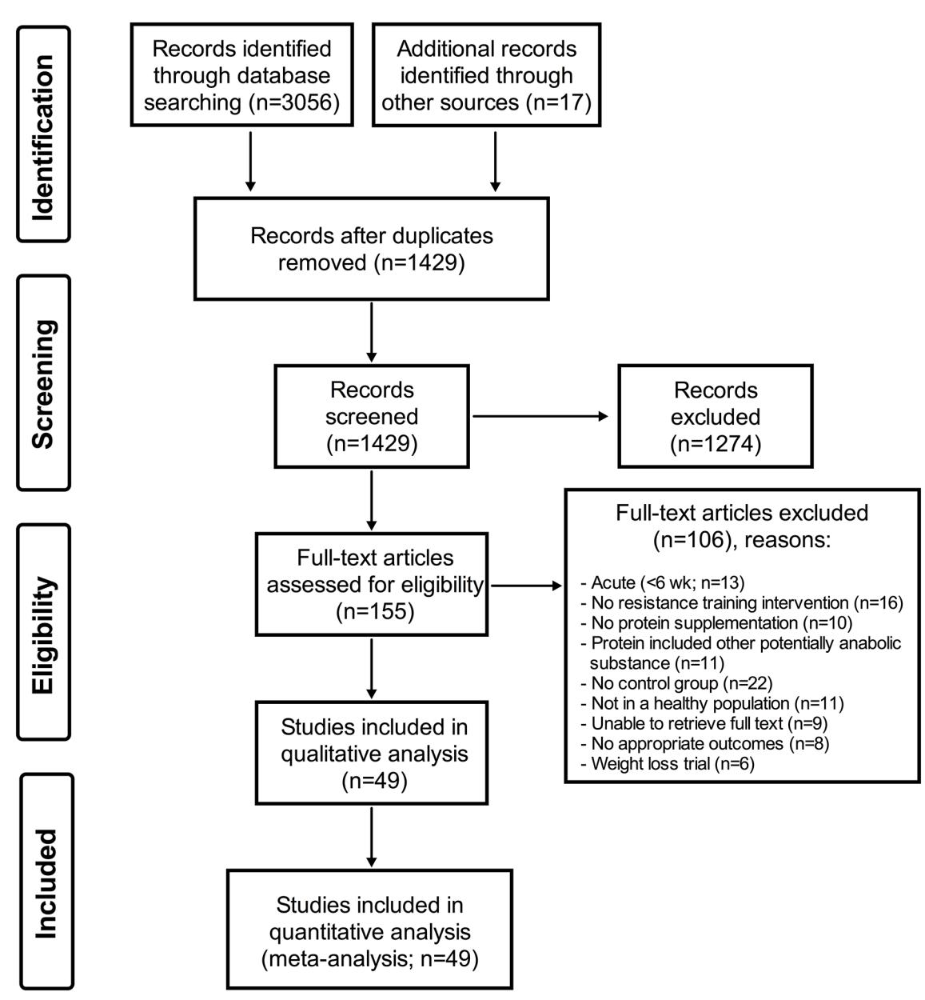
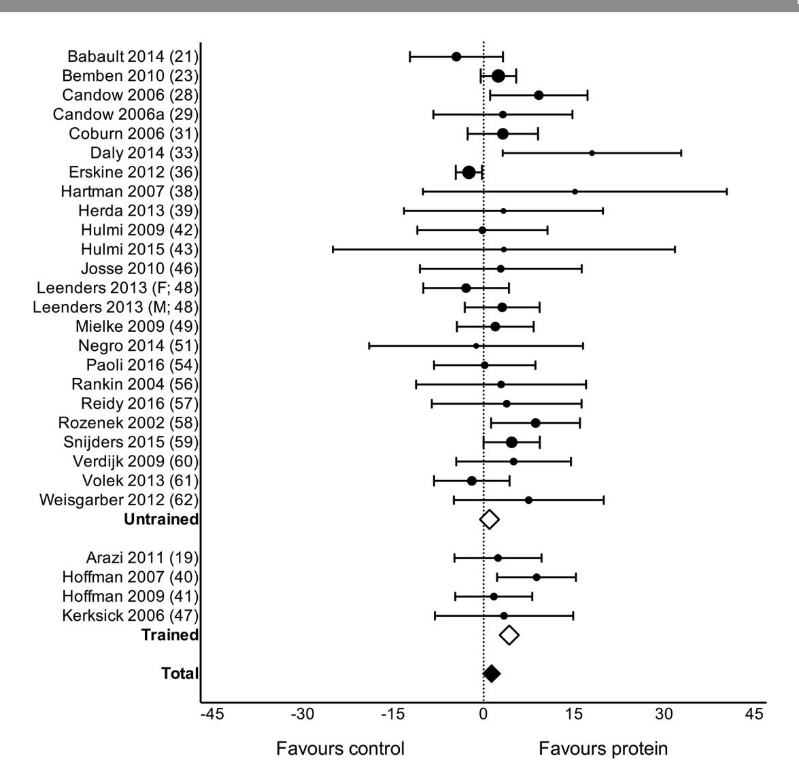
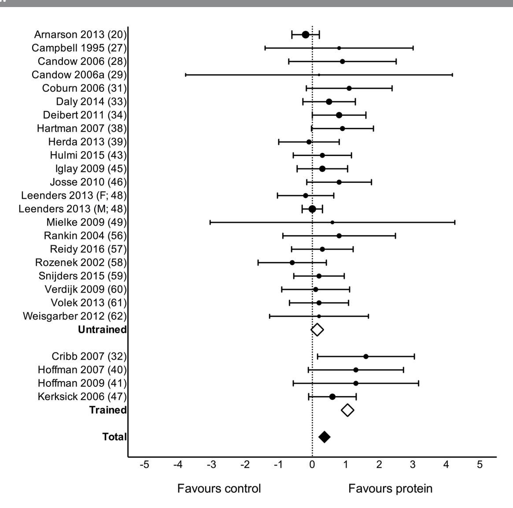
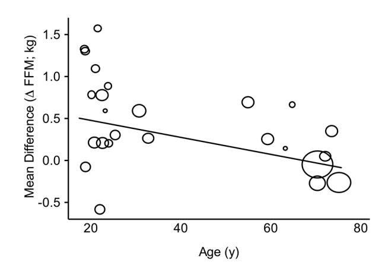
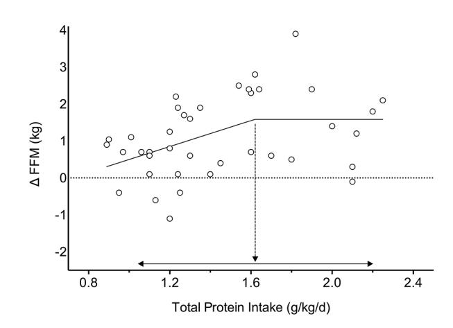

### **Abstract**

**Objective** We performed a systematic review, metaanalysis and meta-regression to determine if dietary protein supplementation augments resistance exercise training (RET)-induced gains in muscle mass and strength.

**Data sources** A systematic search of Medline, Embase, CINAHL and SportDiscus.

**Eligibility criteria** Only randomised controlled trials with RET ≥6weeks in duration and dietary protein supplementation.

**Design** Random-effects meta-analyses and metaregressions with four a priori determined covariates. Twophase break point analysis was used to determine the relationship between total protein intake and changes in fat-free mass (FFM).

**Results** Data from 49 studies with 1863 participants showed that dietary protein supplementation significantly (all p<0.05) increased changes (means (95% CI)) in: strength—one-repetition-maximum (2.49 kg (0.64, 4.33)), FFM (0.30 kg (0.09, 0.52)) and muscle size—muscle fibre cross-sectional area (CSA; 310 µm2 (51, 570)) and mid-femur CSA (7.2mm2 (0.20, 14.30)) during periods of prolonged RET. The impact of protein supplementation on gains in FFM was reduced with increasing age (−0.01 kg (−0.02,–0.00), p=0.002) and was more effective in resistance-trained individuals (0.75 kg (0.09, 1.40), p=0.03). Protein supplementation beyond total protein intakes of 1.62 g/kg/day resulted in no further RET-induced gains in FFM.

**Summary/conclusion** Dietary protein supplementation significantly enhanced changes in muscle strength and size during prolonged RET in healthy adults. Increasing age reduces and training experience increases the efficacy of protein supplementation during RET. With protein supplementation, protein intakes at amounts greater than ~1.6 g/kg/day do not further contribute RET-induced gains in FFM.

# **Introduction**

Resistance exercise training (RET) in combination with dietary protein supplementation is a common practice, in athletes and recreational exercisers alike, with the aim of enhancing RET-induced gains in muscle mass and strength. Recognised as a potent antisarcopenic stimulus, protein supplementation has also been advocated for ageing persons participating in RET. Despite a large volume of work in this area, narrative review[s1–5](#page-8-0) and even meta-analyses[6–12](#page-8-1) yield conflicting results as to the actual effectiveness of protein supplementation to enhance RET-mediated gains in muscle mass and strength. This lack of agreement on the efficacy of protein supplementation[6–12](#page-8-1) is likely due to the use of divergent study inclusion criteria and inclusion of subjects with differing: ages, training statuses, total protein intakes, protein sources and protein doses. Thus, an evidence-based answer to the main question of the efficacy of protein supplementation, while previously reported,[7](#page-8-2) now appears to be controversial.[4](#page-8-3)

We conducted a meta-analysis that was more inclusive in nature than previous meta-analyse[s6–12](#page-8-1) to provide a broad, systematic and evidence-based assessment on whether protein supplementation can augment changes in relevant RET outcomes. We used meta-regression to evaluate the impact of important potentially mediating covariates that were decided a priori to the meta-analysis. The present meta-analysis includes more than double the number of studies and participants than the largest published comprehensive meta-analysis on protein supplementation during RET to date[.7ST1](#page-9-0)

We also undertook an additional rational, mechanism-based analysis that had the aim of answering the following question: is there a protein intake beyond which protein supplementation ceases to provide a measurable benefit in increasing muscle mass during RET? To answer this question, we recognised that the process of muscle protein synthesis (MPS), as the primary determinant of muscle hypertrophy,[13](#page-8-4) shows a saturable dose-response relationship with increasing protein intake.[14](#page-8-5) Since measures of MPS show good agreement with hypertrophy[13](#page-8-4) we theorised that the effect of daily protein intake on RET-induced changes in muscle mass would show a dose-responsive relationship but that this would ultimately plateau.

# **Methods**

### **Inclusion criteria**

Any randomised controlled trials (RCTs) that combined a RET and protein supplement intervention were considered for this meta-analysis. Trials had to be at least six weeks in duration, participants

# A systematic review, meta-analysis and metaregression of the effect of protein supplementation on resistance training-induced gains in muscle mass and strength in healthy adults

Robert W Morton,1 Kevin T Murphy,1 Sean R McKellar,1 Brad J Schoenfeld,2 Menno Henselmans,3 Eric Helms,4 Alan A Aragon,5 Michaela C Devries,6 Laura Banfield,7 James W Krieger,8 Stuart M Phillips1

**To cite:** Morton RW, Murphy KT, McKellar SR, et al. Br J Sports Med Published Online First: [please include Day Month Year]. doi:10.1136/ bjsports-2017-097608

► Additional material is published online only. To view please visit the journal online (http://dx.doi.org/10.1136/ bjsports-2017-097608).

Department of Kinesiology, McMaster University, Hamilton, Canada

Department of Health Sciences, Lehman College of CUNY, Bronx, New York, USA 3 Bayesian Bodybuilding, Gorinchem, Netherlands 4 Sport Performance Research Institute New Zealand, AUT University, Auckland, New Zealand

California State University, Northridge, California, USA 6 Department of Kinesiology, University of Waterloo, Waterloo, Canada

Health Sciences Library, McMaster University, Hamilton, Canada

8 Weightology, LLC, Issaquah, Washington, USA

**Correspondence to** Dr Stuart M Phillips, Department of Kinesiology, McMaster University, 1280 Main Street, West Hamilton, Ontario, Canada; phillis@mcmaster.ca

Accepted 31 May 2017

had to be performing RET at least twice per week, and at least one group had to be given a protein supplement that was not co-ingested with other potentially hypertrophic agents (eg, creatine, β-HMB, or testosterone-enhancing compounds). Only trials with humans who were healthy and not energy-restricted were accepted. Manuscripts had to be original research (not a review or conference abstract) and be written in English.

# **Search strategy**

A systematic search of the literature was conducted (LB) in Medline, Embase, CINAHL and SportDiscus, current to January 2017 (see online [supplementary appendix 1](https://dx.doi.org/10.1136/bjsports-2017-097608)). As appropriate, a combination of keywords and subject headings was used for the following concepts: protein supplementation and resistance training or muscle strength. The original search yielded 3056 studies. Any overlooked trials were identified by consulting other reviews and meta-analyses on the subject and were added in manually (17 studies). After deduplication and screening for inclusion criteria, 155 articles were independently read/

reviewed by three authors (RWM, KTM and SRM). A total of 49 RCTs were selected for inclusion in this meta-analysis ([figure](#page-1-0) 1).

# **Data extraction**

Predetermined relevant variables from each included study were gathered independently by three investigators (RWM, KTM and SRM). Relevant variables included those regarding the study design, details of the RET intervention, participant characteristics, protein supplement information, placebo/ control information, performance outcomes, body composition outcomes and any other notable information (eg, sources of bias/conflict of interest). Where data were not presented in table or text and authors could not be reached, data were extracted using WebPlotDigitizer (Web Plot Digitizer, V.3.11. Texas, USA: Ankit Rohatgi, 2017) or calculated from baseline values and/or percentage change. Where there were any discrepancies between the three reviewers the manuscripts were revisited by all reviewers (RWM, KTM and SRM) and agreed on by discussion. We also conducted a post hoc reassessment

**Figure 1** PRISMA flow chart.

of 10 randomly selected studies and compared the extracted results[.15](#page-8-6) Coder drift was <10% in all cases for each investigator and inter-rater (RWM, KTM and SRM) reliability was excellent (>95%).

A total of 58 different body composition and 66 performance outcomes were extracted from the final 49 studies.[16–64](#page-8-7) Primary outcomes were limited and amalgamated to include two different performance outcomes and four different body composition outcomes based on those most commonly reported in the 49 RCTs. Performance outcomes were: one-repetition-maximum strength (1RM; measured by any 1RM strength test) and maximum voluntary contraction (MVC; measured by both isokinetic and/or isometric contractions using a dynamometer with any muscle group/action). Body anthropometric and composition outcomes included: total body mass (TBM; measured by any scale); fat-free mass (FFM) and bone-free mass (or lean mass if FFM was not available; FFM; measured by dual-energy X-ray absorptiometry (DXA), hydrodensitometry, or whole-body air plethysmography (BodPod)); fat mass (FM; measured by DXA, hydrodensitometry and/or BodPod); muscle fibre cross-sectional area (CSA; measured in any fibre subtype (I, IIa, and/or IIx) obtained from either vastus lateralis and/or latissimus dorsi biopsies using microscopy); and mid-femur whole muscle CSA (mid-femur CSA, measured by MRI and/or CT).

### **Data syntheses**

When data were reported in different units (eg, pounds vs kilograms) the data were converted to metric units. In all analyses the comparator group received an identical RET intervention but was non-supplemented or placebo-supplemented. If a study included a protein-supplemented group, a non-supplemented control group and a placebo-supplemented control group that were all part of the RET intervention, the protein-supplemented and placebo-supplemented groups were retrieved. If a study had multiple time points, only the preintervention and postintervention outcomes were retrieved. Where the change in SD (ΔSD) was available it was collected alongside the preintervention and postintervention SD. Where ΔSD was not reported, the correlation coefficient (corr) for each primary outcome was calculated according to the *Cochrane Handbook for Systematic Reviews of Interventions*: [65](#page-9-1)

$$\text{corr} = (\text{SD}_{\text{pre}}^2 + \text{SD}_{\text{post}}^2 - \text{SD}_{\text{change}}^2)/(2 \times \text{SD}_{\text{pre}} \times \text{SD}_{\text{post}})$$

**corr** = (SDpre2 + SDpost2 - SDchange2)/(2 × SDpre × SDpost)

and the ΔSD was then calculated as:

$$\Delta SD = \sqrt{(SD_{pre}^2 + SD_{post}^2 - 2 \times \text{corr} \times SD_{pre} \times SD_{post})}$$
The change in mean ( $\Delta \text{Mean}$ ) and  $\Delta SD$  were calculated for

$$\Delta SD = \sqrt{(SD_{pre}^2 + SD_{post}^2 - 2 \times \text{corr} \times SD_{pre} \times SD_{post})}.$$

The change in mean (ΔMean) and ΔSD were calculated for each condition and uploaded to RevMan (Review Manager (RevMan), V.5.3. Copenhagen: The Nordic Cochrane Centre, The Cochrane Collaboration, 2014). Where studies had more than one protein-supplemented group (eg, soy and whey), measure of MVC (eg, isokinetic and isometric) or measure of 1RM (eg, bench press and leg press) the ΔMean and ΔSD were independently calculated and later combined, unless otherwise stated, using the RevMan calculator (Review Manager (RevMan), V.5.3. Copenhagen: The Nordic Cochrane Centre, The Cochrane Collaboration, 2014).

# **Meta-analyses**

Random-effects meta-analyses were performed in RevMan (Review Manager (RevMan), V.5.3. Copenhagen: The Nordic Cochrane Centre, The Cochrane Collaboration, 2014) on the change in each outcome. Effect sizes are presented as mean difference (MD) with means±SD and 95% CIs for 1RM, TBM, FFM, FM, fibre CSA and mid-femur CSA and as standardised mean difference (SMD) and 95% CIs for MVC because it had multiple outcomes presented on non-comparable scales (eg, N and Nm).

# **Heterogeneity and risk of bias**

Heterogeneity was assessed by χ2 and *I* 2 and significance was set at p<0.05. The internal validity of each study was determined by domain-based evaluation to quantify risk of bias for each study[65](#page-9-1) and was independently performed by three investigators (RWM, KTM and SRM). The data included in the meta-analyses were restricted to studies with less than three reported high or unclear risk domains (predominately due to reported conflicts of interest and lack of blinding investigators and/or participants; (see online [supplementary appendix 2\)](https://dx.doi.org/10.1136/bjsports-2017-097608)). Funnel plots were visually inspected to determine publication bias. Multiple sensitivity analyses were performed to determine if any of the results were influenced by the studies that were removed.

# **Meta-regression**

In an effort to understand the sources of heterogeneity meta-regressions were performed on 1RM, FFM and fibre CSA because they were statistically significant, had considerable unexplained heterogeneity (*I 2* ) and had a sufficient number of studies (≥10). Meta-regression was used instead of subgroup analyses to allow for the use of continuous covariates and to allow for the inclusion of more than one covariate at a time. Four covariates were chosen a priori to be included in our meta-regression: baseline protein intake (g/kg/day), postexercise protein dose (g), chronological age and training status because there is evidence that baseline protein intake,[66](#page-9-2) protein dose[,14](#page-8-5) age[67](#page-9-3) and training status[68](#page-9-4) could influence the efficacy of protein supplementation; summarised here.[4 5](#page-8-3) These covariates were meta-regressed individually and together in a random-effects meta-regression model using Stata (StataCorp. 2011. *Stata Statistical Software: Release 12.* College Station, Texas, USA). The random-effects meta-regression used residual restricted maximum likelihood to measure between-study variance (τ 2 ) with a Knapp-Hartung modification as recommended.[69](#page-9-5) When all four covariates were analysed together permutation tests were performed (n=1000) to address the issue of multiple testing by calculating adjusted p values.[70](#page-9-6) Additional covariates were identified and individually analysed post hoc to further explore the unexplained variance of the effect of protein supplementation during RET on changes in 1RM and FFM. Continuous covariates were: MD in the change in protein intake (g/day), MD in the total relative protein intake (g/kg/day), number of repetitions/set, number of sets/exercise, number of exercises/session, number of sessions/week, number of weeks and total RET volume in kg: repetitions/set × sets/exercise × exercises/session × sessions/week × intervention duration in weeks. Categorical variables were: protein supplement source (whey vs soy), sex (male vs female), type (dietary-supplement vs RET-supplement), whole-body RET (whole-body RET vs not whole-body RET) and RET supervision (supervised vs not supervised). Protein supplement source was limited to soy and whey because there were few study groups that were provided either a casein (n=[321 59 60](#page-8-8)) or pea (n=1[22](#page-8-9)) protein supplement exclusively.

The Cochrane Collaboration, 2014). Subgroup analyses were performed on changes in FFM and 1RM with training status (untrained vs trained) as the subgroup to generate forest plots and neatly present training status as a categorical variable. Subgroup analyses were also performed on changes in FFM with age categorised into subgroups (old (>45 years) and young (<45 years)) to be presented below for the interested reader.

# **Break point analysis**

To investigate the influence of protein intake as a continuous variable on individual study arms (as opposed being limited to MDs between groups in a meta-regression) linear and segmental regressions on the change in FFM (measured by DXA) were plotted against daily and baseline protein intake. Linear and segmental regressions were performed using GraphPad Prism (V.6, GraphPad Software, La Jolla, California, USA) to determine models of best fit as has been previously done in acute tracer trials measuring MPS[.14](#page-8-5) Where segmental regression was the preferred model the slope of the second line was set to zero to determine the break point (biphasic regression). Each group from each study that presented daily or baseline protein intake with changes in FFM from DXA was included. Significance was set at p<0.05and data for the break point is presented as mean (95%CI).

# **Results**

# **Participant characteristics**

Participant details and outcomes are presented elsewhere (see online [supplementary table 1.](https://dx.doi.org/10.1136/bjsports-2017-097608) A total of 49 studies from 17 countries met the inclusion criteria [\(figure](#page-1-0) 1). There were 10 studies in resistance-trained participants and 14 study groups in exclusively female participants. Publications ranged from 1962 to 2016. There was a total of 1863 participants (mean±SD; 35±20 years).

# **RET characteristics**

The RET characteristics are also presented elsewhere (see online [supplementary table 1\)](https://dx.doi.org/10.1136/bjsports-2017-097608). The RET interventions lasted from 6 weeks to 52 weeks (13±8weeks) performing RET between 2 days and 5 days per week (3±1days/week) with between 1 to 14 exercises per session (7±3exercises/session), 1 to 12 sets per exercise (4±2sets/exercise) and anywhere between 3 to 25 repetitions per set (9±4repetitions/set). Four studies used just lower-body RET, two studies used just knee extensor RET, one study used elbow flexor RET only, and two studies used one lower-body and one upper-body exercise only.

# **Protein supplementation**

Details regarding the experimental (protein supplementation) and control (placebo- or no-supplement) groups are presented elsewhere (see online [supplementary table 2\)](https://dx.doi.org/10.1136/bjsports-2017-097608). A range of 4 g to 106 g of protein was supplemented per day to the protein group (36±30 g/day; young: 42±32 g/day; old: 20±18 g/day) with a range of 5 g to 44 g of protein supplemented postexercise on training days (24±11 g; young: 24±12 g; old: 23±10 g). Twenty-three conditions supplemented with whey protein, 3 with casein protein, 6 with soy protein, 1 with pea protein, 10 with milk or milk protein, 7 with whole food (eg, beef, yogurt, between-meal snack) and 13 with non-specific protein blends or blends containing multiple protein sources (eg, whey, casein, soy and egg). In 40 studies the participants consumed part or all of their daily protein supplement after their RET sessions. In 36 studies with 48 different conditions authors reported either total (g/day) or relative (g/kg/day or %kcal/day) daily protein intake preintervention and/or postintervention. There was an increase in daily protein intake in the protein group (mean±SD; range: 23±41 g/day; −25 g/day to 158 g/day; p=0.004) and no change in the control group (1±14 g/day; −17 g/day to 40 g/ day; p=0.83) such that the change in daily protein intake was significantly greater in the protein group (p=0.01). Relative daily protein intake (g/kg/day) increased in the protein group (pre: 1.4±0.4, post: 1.8±0.7, Δ: 0.3±0.5g/kg/day, p=0.002) and did not change in the control group (pre: 1.4±0.3, post: 1.3±0.3, Δ: −0.02±0.1g/kg/day, p=0.48) such that there was a greater change in the protein group (p<0.001). Daily energy intake (kcal/day) was gathered from 23 studies with 29 conditions and did not change with the prolonged RET and protein supplementation nor was it significantly different between the protein or control groups (Δ protein group: 50±293 kcal/day, Δ control group: 70±231kcal/day, p=0.71).

# **Heterogeneity and risk of bias**

Significant heterogeneity was found for changes in 1RM (χ2 =53.49, *I 2* =33%, p=0.003) and fibre CSA (χ2 =30.97, *I* =68%, p=0.0006). Nine studies were removed based on risk of bia[s17 18 25 26 50 63](#page-8-10) (see online [supplementary appendix 2\)](https://dx.doi.org/10.1136/bjsports-2017-097608) or publication bias assessmen[t24 32 64](#page-8-11) (see online [supplementary figure 1](https://dx.doi.org/10.1136/bjsports-2017-097608)). In particular, four studies were removed from 1RM,[17 26 32 50](#page-8-10) four from TBM,[17 18 63 64](#page-8-10) three from FM,[17 18 63](#page-8-10) five from FFM[,17 18 24 63](#page-8-10) [64](#page-8-10) three from MV[C25 26 50](#page-8-12) and one from fibre CSA[.50](#page-9-7)

### **Sensitivity analyses**

Sensitivity analysis was performed with the nine high-risk studies mentioned above included in the outcomes they were removed from to determine if their removal changed any of the results. The inclusion of those studies did not influence the difference in means or significance in 1RM, TBM, FFM or mid-femur CSA; however, when Mitchell *et al*[50](#page-9-7) was included in the fibre CSA assessment the effect of protein supplementation (310µm2 (51, 570), p=0.02) was eliminated (153µm2 (−137, 443), p=0.30). This is likely due to the small number of studies that included muscle biopsies but may warrant caution when interpreting the effect of protein supplementation on changes fibre CSA during RET. In no instance did fixed-effect meta-analysis deliver a different magnitude of effect or significance compared with random-effect meta-analysis.

### **Meta-analyses**

Protein supplementation during prolonged RET significantly improved gains in 1RM strength (MD: 2.49kg (0.64, 4.33), p=0.01; [figure](#page-4-0) 2) but had no effect on MVC (SMD: 0.04 (-0.09, 0.16), p=0.54). Protein supplementation did not have a significant effect on changes in TBM (MD: 0.11kg (−0.23, 0.46), p=0.52) but improved changes in FFM (MD: 0.30kg (0.09, 0.52), p=0.007; [figure](#page-5-0) 3), FM (MD: −0.41kg (−0.70,– 0.13), p=0.005), fibre CSA (MD: 310µm2 (51, 570), p=0.02; see online [supplementary figure 2](https://dx.doi.org/10.1136/bjsports-2017-097608): panel A) and mid-femur CSA (MD: 7.2mm2 (0.20, 14.30), p=0.04; see online [supplementary](https://dx.doi.org/10.1136/bjsports-2017-097608) [figure 2:](https://dx.doi.org/10.1136/bjsports-2017-097608) panel B) during prolonged RET.

# **Meta-regression.**

The results from the full model meta-regressions are presented in [table](#page-5-1) 1. When combined, baseline protein intake, protein dose, age and training status did not explain any of the variance in the changes in 1RM (15 studies, 1216 subjects, p=0.77) or FFM (15 studies, 642 participants, p=0.12). There were insufficient observations (<10) when all covariates were compared with the changes in fibre CSA.

Univariate meta-regressions on changes in 1RM and FFM following prolonged RET are also presented in [table](#page-5-1) 1. None of our covariates explained any of the heterogeneity of protein supplementation's effect on changes in 1RM: baseline protein intake (21 studies, 814 participants, p=0.59), age (27 studies, 802 participants, p=0.78), training status (28 studies, 858 participants, p=0.40) and post-exercise protein dose (23 studies, 589 participants, p=0.13). In contrast, when the ability of protein supplementation to affect changes in FFM was evaluated with univariate meta-regressions, the postexercise protein dose was the only covariate that did not influence the efficacy of protein supplementation on changes in FFM (20 studies, 793 participants, p=0.25) whereas baseline protein intake (22 studies, 988 participants, p=0.045; see online [supplementary figure 3:](https://dx.doi.org/10.1136/bjsports-2017-097608) panel A), age (25 studies, 1033 participants, p=0.02; [figure](#page-6-0) 4) and training status (26 studies, 1089 participants, p=0.03) all influenced the effect of protein supplementation. When the effect of protein supplementation on changes in FFM was evaluated with age stratified into two subgroups the difference between old (>45; 67±7 years; MD: 0.06 (-0.14, 0.26)) and young (<45; 24±4 years; MD: 0.55 (0.30, 0.81)) participants remained significant (χ2 =8.71, *I 2* =89%, p=0.003). There were no covariates that explained any of the variance in the change in fibre CSA following RET: age (10 studies, 474 participants, *I 2* =65%, Adj. R2 =-3%, p=0.50), baseline protein intake (8studies, 384 participants, *I 2* =43%, Adj. R2 =-44%, p=0.84), postexercise protein dose (10 studies, 270 participants, *I 2* =77%, Adj. R2 =- 38%, p=0.92) and training status (11 studies, 586 participants, *I 2* =71%, Adj. R2 =-24%, p=0.94).

Additional univariate meta-regressions are presented in elsewhere (see online [supplementary table 3](https://dx.doi.org/10.1136/bjsports-2017-097608)). Only whether the RET was whole-body (27 studies, including only 4 studies that were not whole-body RET, *I 2* =2%, Adj. R2 =76%, p=0.01) or supervised (28 studies, *I 2* =5%, Adj. R2 =58%, p=0.047) explained part of the variance in the effectiveness of protein supplementation on changes in 1RM. No other covariates explained any of the variance associated with the efficacy of protein supplementation on changes in 1RM or FFM.

**Figure 2** Forest plot of the results from a random-effects meta-analysis shown as mean difference with 95% CIs on one-repetition-maximum (1 RM; kg) in untrained and trained participants. For each study, the circle represents the mean difference of the intervention effect with the horizontal line intersecting it as the lower and upper limits of the 95%CI. The size of each circle is indicative of the relative weight that study carried in the metaanalysis. The rhombi represent the weighted untrained, trained and total group's mean difference. Total: 2.49 kg (0.64, 4.33), p=0.01, untrained: 0.99 kg (−0.27, 2.25), p=0.12 and trained: 4.27 kg (0.61, 7.94), p=0.02.

**Figure 3** Forest plot of the results from a random-effects meta-analysis shown as mean difference with 95% CIs on lean or fat-free mass (FFM; kg) in untrained and trained participants. For each study, the circle represents the mean difference of the intervention effect with the horizontal line intersecting it as the lower and upper limits of the 95%CI. The size of each circle represents the relative weight that study carried in the metaanalysis. The rhombi represent the weighted untrained, trained and total group's mean difference. Total: 0.30 kg (0.09, 0.52) p=0.007, untrained: 0.15 kg (−0.02, 0.31), p=0.08 and trained: 1.05 kg (0.61, 1.50), p<0.0001.

**Table 1** Meta-regression output.

| Table 1 Model            | Meta-regression output. N | 1RM (kg) Coeff. (95% CI) | τ 2  | Adj. R | 2 2 I | p Value | N  | Fat-free mass (kg) Coeff. (95% CI) | τ 2  | Adj. R | 2 I 2 | p Value |
|--------------------------|---------------------------|--------------------------|------|--------|-------|---------|----|------------------------------------|------|--------|-------|---------|
| No covariates Univariate | 28                        | 2.49 (0.64 to 4.33)      | 6.05 |        | 33%   | 0.01    | 27 | 0.30 (0.09 to 0.52)                | 0.05 |        | 7%    | <0.01   |
| Baseline protein intake  | 21                        | 2.85 (-8.15 to 13.84)    | 7.82 | 1%     | 37%   | 0.59    | 22 | 0.64 (0.02 to 1.27)                | 0    | 100%   | 0%    | 0.045   |
| Protein dose             | 23                        | 0.13 (-0.04 to 0.31)     | 3.16 | 40%    | 0%    | 0.13    | 20 | 0.02 (-0.01 to 0.04)               | 0.09 | 0%     | 0%    | 0.25    |
| Age                      | 27                        | 0.01 (-0.09 to 0.11)     | 6.51 | −9%    | 34%   | 0.78    | 25 | −0.01 (-0.02 to 0.00)              | 0    | 100%   | 0%    | 0.02    |
| Training status          | 28                        | 5.77 (-2.96 to 7.13)     | 5.77 | 5%     | 31%   | 0.40    | 26 | 0.75 (0.09 to 1.40)                | 0.03 | 49%    | 0%    | 0.03    |
| All covariates           | 15                        |                          | 5.36 | 10%    | 0%    | 0.77    | 15 |                                    | 0    | 100%   | 0%    | 0.12    |
| Baseline protein intake  | 15                        | 6.40 (-11.62 to 24.42)   |      |        |       | 0.43    | 15 | −0.57 (-2.50 to 1.37)              |      |        |       | 0.95    |
| Protein dose             | 15                        | 0.05 (-0.78 to 0.88)     |      |        |       | 0.70    | 15 | −0.01 (-0.07 to 0.06)              |      |        |       | 0.99    |
| Age                      | 15                        | 0.07 (-0.18 to 0.33)     |      |        |       | 0.23    | 15 | −0.01 (-0.02 to 0.00)              |      |        |       | 0.19    |
| Training status          | 15                        | −2.81 (-20.80 to 15.17)  |      |        |       | 0.63    | 15 | 1.19 (-1.34 to 2.19)               |      |        |       | 0.48    |

### **Break point analysis**

Biphasic regression (42 study arms, 723 participants) explained more variation than a linear regression between the change in FFM and daily protein intake (break point=1.62 (1.03, 2.20) g/kg/day, slope=1.75, R2 =0.19, df=36) and is presented as a segmental regression despite not being statistically significant (p=0.079[;figure](#page-6-1) 5) When plotting the change in FFM against baseline protein intake, linear regressions explained significantly more variance than biphasic regressions in both young (slope=−1.54g/kg/day, R2 =0.17, df=34) and old (slope=0.16g/kg/day, R2 =0.04, df=14) participants with a statistically significant difference between age groups (p=0.042; see online [supplementary figure 3](https://dx.doi.org/10.1136/bjsports-2017-097608): panel D).

# **Discussion**

This is the largest meta-analysis on interventions including dietary protein supplementation with muscle and strength-related outcomes during prolonged RET to date. Our main finding was that dietary protein supplementation augmented RET-induced increases in 1RM strength [\(figure](#page-4-0) 2) and FFM ([figure](#page-5-0) 3). For changes in FFM, dietary protein supplementation was more effective in resistance-trained individuals [\(table](#page-5-1) 1 and [figure](#page-5-0) 3), less effective with increasing chronological age ([table](#page-5-1) 1 and [figure](#page-6-0) 4) and did not increase beyond total protein intakes of ~1.6g/kg/day ([figure](#page-6-1) 5). Our data show dietary protein supplementation is both sufficient and necessary to optimise RET adaptations in muscle mass and strength.

Previous meta-analyses[6–12](#page-8-1) have reached varying conclusions when examining the impact of protein supplementation on changes in lean mass or FFM and 1RM strength during RET. The discrepancies are likely a consequence of differing study inclusion criteria. For example, previous meta-analyses have included only trained participants,[8](#page-8-13) only older adults[,9 11](#page-8-14) supplements containing more than just protein[,8 10](#page-8-13) only one source of protein[,8 12](#page-8-13) shorter RET interventions[,10 12](#page-8-15) frail/sarcopenic participant[s7 9 11](#page-8-2) and/or participants who were energy-restricted[.6 7 12](#page-8-1) Previously, the largest comprehensive meta-analysis to date on protein supplementation during RET included 22 studies and 680 participant[s7](#page-8-2) and did show a significant effect of protein supplementation on RET-stimulated gains in strength and FFM. In agreement with this previous

report[,7](#page-8-2) and strengthening the conclusion of that same report by including 49 studies and 1863 participants, we show that protein supplementation augmented gains in FFM and strength with RET.

### **Strength**

The average RET-induced increase, with all measures of 1RM included, was 27kg (mean±SD; 27±22k[g22 32](#page-8-9)). Notably, dietary protein supplementation augmented the increase in 1RM strength by 2.49kg (9%; [figure](#page-4-0) 2; see online [supplementary figure 4\)](https://dx.doi.org/10.1136/bjsports-2017-097608), which strongly suggests that the practice of RET is a far more potent stimulus for increasing muscle strength than the addition of dietary protein supplementation. None of our covariates (age, training status, postexercise protein dose or baseline protein intake) influenced the efficacy of protein supplementation on changes in 1RM strength. Improving performance of a specific task (eg, the 1RM of an exercise) is predominately determined by the practice of that task.[71](#page-9-0) Though protein supplementation may slightly augment changes in 1RM (~9%), which may be important for those competing in powerlifting or weightlifting, it is pragmatic to advocate that if an increase in 1RM is the objective of an RET programme, a sufficient amount of work and practice at or around the 1RM is far more influential than protein supplementation.

### **Muscle mass**

In addition to increasing changes in muscle strength, RET alone (≥6; 13±8weeks) resulted in an increase in FFM (1.1±1.2kg), an increase in fibre CSA (808±) and an increase in mid-femur CSA (52±30mm2 ). Dietary protein supplementation augmented the increase in FFM by 0.30kg (27%; [figure](#page-5-0) 3; see online [supplemen](https://dx.doi.org/10.1136/bjsports-2017-097608)[tary figure 4](https://dx.doi.org/10.1136/bjsports-2017-097608)), fibre CSA by 310µm2 (38%; seeonline [supplementary](https://dx.doi.org/10.1136/bjsports-2017-097608) [figure 2](https://dx.doi.org/10.1136/bjsports-2017-097608): panel A) and mid-femur CSA by 7.2mm2 (14%; see online [supplementary figure 2](https://dx.doi.org/10.1136/bjsports-2017-097608): panel B). The postexercise protein dose did not affect the efficacy of protein supplementation on RET-induced changes in FFM whereas training status (positive), age (negative) and baseline protein intake (positive) did. Relative to untrained participants, resistance-trained participants have a smaller potential for muscle growth[72](#page-9-8) and an attenuated postexercise muscle protein turnover[.73](#page-9-9) As a result, we speculate that trained persons may have less 'degrees of freedom' to change

**Figure 4** Random-effects univariate meta-regression between age and the mean difference in fat-free mass (FFM) between groups. Each circle represents a study and the size of the circle reflects the influence of that study on the model (inversely proportionate to the SE of that study). The regression prediction is represented by the solid line (−0.01 kg (−0.02,–0.00), p=0.02).

**Figure 5** Segmental linear regression between relative total protein intake (g/kg body mass/day) and the change in fat-free mass (ΔFFM) measured by dual energy X-ray absorptiometry. Each circle represents a single group from a study. Dashed arrow indicates the break point=1.62 g protein/kg/day, p=0.079. Solid arrow indicates 95% CI, (1.03 to 2.20).

with RET and therefore have a greater need for protein supplementation to see increases in muscle mass. Our thesis is supported by the observation of a more consistent impact of protein supplementation on gains in FFM in resistance-trained individuals than in novice trainees [\(figure](#page-5-0) 3).

Older individuals are anabolically resistant[74](#page-9-10) and require higher per-meal protein doses to achieve similar rates of MPS, the primary variable regulating changes in skeletal muscle mass,[75](#page-9-11) compared with younger participants.[14](#page-8-5) The average supplemental daily protein dose given to older participants was surprisingly low (20±18 g/day); thus, it is perhaps not surprising that we did not find that older individuals were responsive to protein supplementation ([figure](#page-6-0) 4). Though age did not affect the RET-induced change in fibre CSA, the negative effect age had on changes in FFM leads us to speculate that even though exercise sensitises muscle to the effect of protein ingestion,[3](#page-8-16) older persons have an increased need for higher protein intakes to optimally respond to this effect and see gains in FFM.[76](#page-9-12)

It has been theorised that the increased deviation from normal protein intake (g/kg/day) will positively affect the RET-induced gains in FFM.[77](#page-9-13) Contrary to this thesis, we found that a higher prestudy protein intake actually resulted in a greater effect of protein supplementation on changes in FFM [\(table](#page-5-1) 1); however, this was likely driven by the lower mean baseline protein intake (old: 1.2±0.2 g/kg/day, young: 1.5±0.4g/kg/day) and daily protein dose (old: 20±18 g/day, young: 42±32 g/day) in the studies that included older participants (see online [supplemen](https://dx.doi.org/10.1136/bjsports-2017-097608)[tary figure 3:](https://dx.doi.org/10.1136/bjsports-2017-097608) panel B and D). Indeed, a sensitivity analysis that did not include older (>45; 65±14 years) versus younger (<45; 24±4 years) individuals found that baseline protein intake had no effect on the efficacy of protein supplementation in young individuals (see online [supplementary figure 3](https://dx.doi.org/10.1136/bjsports-2017-097608), panel C). In an unadjusted meta-regression analysis, a higher baseline protein intake in young individuals actually attenuated the change in FFM (see online [supplementary figure 3,](https://dx.doi.org/10.1136/bjsports-2017-097608) panel D).

A goal of this meta-analysis was to deliver evidence-based recommendations that could be readily translated. A crucial point is that even though the mean baseline protein intake for the 1863 participants was ~1.4 g protein/kg/day, which is 75% greater than the current US/Canadian recommended dietary allowance (RDA)[,78](#page-9-14) an average supplementation of ~35 g protein/day still augmented RET-stimulated gain in FFM [\(figure](#page-5-0) 3) and 1RM strength [\(figure](#page-4-0) 2). Thus, consuming protein at the RDA of 0.8 g protein/ kg/day appears insufficient for those who have the goal of gaining greater strength and FFM with RET. This conclusion is emphasised for older me[n79](#page-9-15) and wome[n80 81](#page-9-16) wishing to obtain strength and gain lean mass with RET and protein supplementation.

A recent retrospective analysis showed a 'breakpoint' for the stimulation of MPS when ingesting an isolated protein source at 0.24 g protein/kg and 0.40 g protein/kg in younger and older participants, respectively[.14](#page-8-5) Given the observation of a dose-responsive relationship between protein intake and MPS[82–85](#page-9-17) and the fact that MPS is aligned with muscle hypertrophy,[13](#page-8-4) we elected to use an identical two-segment regression approach between total daily protein intake and changes in FFM [\(figure](#page-6-1) 5) as has been done for changes in protein dose and MPS[.14](#page-8-5) Here we provide significant insight (using 42 study arms including 723 young and old participants with protein intakes ranging from 0.9 g protein/kg/day to 2.4 g protein/kg/ day) by reporting an unadjusted plateau in RET-induced gains in FFM at 1.62 g protein/kg/day (95%CI: 1.03 to 2.20). These results are largely in congruence with previous narrative reviews that comment on the optimal nutritional strategies to augment skeletal muscle adaptation during RET[.3 86](#page-8-16) Given that the CI of this estimate spanned from 1.03 to 2.20, it may be prudent to recommend ~2.2 g protein/kg/d for those seeking to maximise resistance training-induced gains in FFM. Though we acknowledge that there are limitations to this approach, we propose that these findings are based on reasonable evidence and theory and provide a pragmatic estimate with an incumbent error that the reader could take into consideration.

Although the present analysis provides important and novel data, there are limitations that we acknowledge. First, the lack of RET research in older individuals has led to inconclusive recommendations from previous meta-analyses specifically focusing on older individuals[.9 11](#page-8-14) Indeed, in this manuscript there were only 13 studies that met our inclusion criteria in older (>45 years) individuals and only six of those studies reported baseline protein intakes with changes in FFM. In addition, only four studies[27 29 33 45](#page-8-17) in older individuals had participants that consumed what we consider to be close to optimal total protein intake (~1.2g/kg/day to 1.6g/kg/ day) in non-exercising adult[s5](#page-8-18) . Furthermore, only two studie[s23 30](#page-8-19) in older individuals provided a postexercise supplemental protein dose that we consider to be close to optimal (~35–40 g) to stimulate FFM accretion in elderly individuals[.76](#page-9-12) Given that older adults require more protein per day[,79–81](#page-9-15) consume less protein per da[y87](#page-9-18) and that dietary protein ingestion and RET are effective strategies to maintain muscle mass and function with age,[67](#page-9-3) future RET research should focus on using higher protein doses (or potentially higher leucine), larger sample sizes and longer interventions in ageing populations. Second, we included a variety of additional covariates into univariate meta-regressions to elucidate the variables that may modify whether protein supplementation affects RET-induced changes in muscle mass and strength. Such an approach is generally considered to be hypothesis generating. The only significant findings we found were that if the RET sessions were whole-body (adjusted R2 =76%, p=0.01) or supervised (adjusted R2 =58%, p=0.047), protein supplementation was more effective at augmenting changes in 1RM. No variable affected changes in FFM (see online [supple](https://dx.doi.org/10.1136/bjsports-2017-097608)[mentary table 3\)](https://dx.doi.org/10.1136/bjsports-2017-097608). Given the relatively small effect that protein supplementation has on changes in FFM and 1RM, clearly other variables as a component of RET programmes are of much greater importance. Our meta-analyses also only included studies with participants that were at or above their energy requirements, which may have omitted the significant impact protein has during periods of weight loss with RET[.88](#page-9-19) Lastly, we found that the postexercise protein dose did not affect the efficacy of protein supplementation on RET-induced changes in FFM. Our analysis, and those from others[,6](#page-8-1) leads us to conclude that the specifics of protein supplementation (eg, timing, postexercise protein dose or protein source) play a minor, if any, role in determining RET-induced gains in FFM and strength over a period of weeks. Instead, our results indicate that a daily protein intake of ~1.6g/kg/day, separated into ~0.25g/ kg doses,[14](#page-8-5) is more influential on adaptive changes with RET, at least for younger individuals.

# **Conclusion**

Dietary protein supplementation augments changes in muscle mass and strength during prolonged RET. Protein supplementation is more effective at improving FFM in young or resistance-trained individuals than in older or untrained individuals. Protein supplementation is sufficient at ~1.6g/kg/day in healthy adults during RET. Based on limited data we observed no overtly apparent sex-based differences but acknowledge that far less work has been done in women than men. This analysis shows that dietary protein supplementation can be, if protein intake is less than 1.6 g protein/kg/day, both sufficient and necessary to optimise RET-induced changes in FFM and 1RM strength. However, performance of RET alone is the much more potent stimulus, accounting, at least according to this meta-analysis, for a substantially greater portion of the variance in RET-induced gains in muscle mass and strength. **Summary box Background** ► There is no consensus on the efficacy of protein supplementation during prolonged resistance exercise training (RET). **Novel findings** ► Dietary protein supplementation augments changes in fat-free mass (FFM, (0.30 kg (0.09, 0.52), p=0.007) and one-repetition-maximum strength (2.49 kg (0.64, 4.33), p=0.01) during prolonged RET. ► Dietary protein supplementation during RET is more effective at increasing changes in FFM in resistance-trained individuals (0.75 kg (0.09, 1.40), p=0.03) and less effective in older individuals (−0.01 kg (−0.02,–0.00), p=0.02). ► Protein supplementation beyond a total daily protein intake of ~1.6 g/kg/day during RET provided no further benefit on gains in muscle mass or strength. **Acknowledgements** SMP thanks the Canada Research Chairs, Canadian Institutes for Health Research, and the Natural Science and Engineering Research Council of Canada for their support during the completion of this work. **Contributors** RWM, BJS, MH, EH, AAA, MCD, JWK and SMP contributed to the conception and design of the study. RWM, BJS, MH, EH, AAA, MCD, LB, JWK and SMP contributed to the development of the search strategy. LB conducted the systematic search. RWM, KTM and SRM completed the acquisition of data. RWM and SMP performed the data analysis. All authors assisted with the interpretation. RWM and SMP were the principal writers of the manuscript. All authors contributed to the drafting and revision of the final article. All authors approved the final submitted version of the manuscript. **Competing interests** SMP has received grant support, travel expenses, and honoraria for presentations from the US National Dairy Council. This agency has supported trials reviewed in this analysis. **Provenance and peer review** Not commissioned; externally peer reviewed. **Data sharing statement** All data are available in the submitted manuscript or as supplementary files. © Article author(s) (or their employer(s) unless otherwise stated in the text of the article) 2017. All rights reserved. No commercial use is permitted unless otherwise expressly granted. **References** 1 Dideriksen K, Reitelseder S, Holm L. Influence of amino acids, dietary protein, and physical activity on muscle mass development in humans. [Nutrients](http://dx.doi.org/10.3390/nu5030852) 2013;5:852–76. 2 Hulmi JJ, Lockwood CM, Stout JR. Effect of protein/essential amino acids and resistance training on skeletal muscle hypertrophy: a case for whey protein. [Nutr](http://dx.doi.org/10.1186/1743-7075-7-51)  [Metab](http://dx.doi.org/10.1186/1743-7075-7-51) 2010;7:51. 3 Morton RW, McGlory C, Phillips SM. Nutritional interventions to augment resistance training-induced skeletal muscle hypertrophy. [Front Physiol](http://dx.doi.org/10.3389/fphys.2015.00245) 2015;6:245. 4 Reidy PT, Rasmussen BB. Role of Ingested amino acids and protein in the Promotion of Resistance Exercise-Induced Muscle protein anabolism. [J Nutr](http://dx.doi.org/10.3945/jn.114.203208) 2016;146:155–83. 5 Phillips SM, Chevalier S, Leidy HJ. Protein "requirements" beyond the RDA: implications for optimizing health. [Appl Physiol Nutr Metab](http://dx.doi.org/10.1139/apnm-2015-0550) 2016;41:565–72. 6 Schoenfeld BJ, Aragon AA, Krieger JW. The effect of protein timing on muscle strength and hypertrophy: a meta-analysis. [J Int Soc Sports Nutr](http://dx.doi.org/10.1186/1550-2783-10-53) 2013;10:53. 7 Cermak NM, Res PT, de Groot LC, et al. Protein supplementation augments the adaptive response of skeletal muscle to resistance-type exercise training: a metaanalysis. [Am J Clin Nutr](http://dx.doi.org/10.3945/ajcn.112.037556) 2012;96:1454–64. 8 Naclerio F, Larumbe-Zabala E. Effects of Whey protein alone or as part of a Multiingredient Formulation on strength, Fat-Free Mass, or lean Body Mass in Resistance-Trained individuals: a Meta-analysis. [Sports Med](http://dx.doi.org/10.1007/s40279-015-0403-y) 2016;46:125–37. 9 Finger D, Goltz FR, Umpierre D, et al. Effects of protein supplementation in older adults undergoing resistance training: a systematic review and meta-analysis. [Sports](http://dx.doi.org/10.1007/s40279-014-0269-4)  [Med](http://dx.doi.org/10.1007/s40279-014-0269-4) 2015;45:245–55. 10 Nissen SL, Sharp RL. Effect of dietary supplements on lean mass and strength gains with resistance exercise: a meta-analysis. [J Appl Physiol](http://dx.doi.org/10.1152/japplphysiol.00755.2002) 2003;94:651–9. 11 Thomas DK, Quinn MA, Saunders DH, et al. Protein supplementation does not significantly augment the effects of resistance exercise training in older adults: a systematic review. [J Am Med Dir Assoc](http://dx.doi.org/10.1016/j.jamda.2016.07.002) 2016;17:959.e1–959.e9. 12 Miller PE, Alexander DD, Perez V. Effects of whey protein and resistance exercise on body composition: a meta-analysis of randomized controlled trials. [J Am Coll Nutr](http://dx.doi.org/10.1080/07315724.2013.875365) 2014;33:163–75. 13 Damas F, Phillips SM, Libardi CA, et al. Resistance training-induced changes in integrated myofibrillar protein synthesis are related to hypertrophy only after attenuation of muscle damage. [J Physiol](http://dx.doi.org/10.1113/JP272472) 2016;594:5209–22. 14 Moore DR, Churchward-Venne TA, Witard O, et al. Protein ingestion to stimulate myofibrillar protein synthesis requires greater relative protein intakes in healthy older versus younger men. [J Gerontol A Biol Sci Med Sci](http://dx.doi.org/10.1093/gerona/glu103) 2015;70:57–62. 15 Cooper H, Hedges L, Valentine J. The handbook of research synthesis and metaanalysis. New York: Russell Sage Foundation, 2009. 16 Andersen LL, Tufekovic G, Zebis MK, et al. The effect of resistance training combined with timed ingestion of protein on muscle fiber size and muscle strength. [Metabolism](http://dx.doi.org/10.1016/j.metabol.2004.07.012) 2005;54:151–6. 17 Antonio J, Ellerbroek A, Silver T, et al. A high protein diet (3.4 g/kg/d) combined with a heavy resistance training program improves body composition in healthy trained men and women--a follow-up investigation. [J Int Soc Sports Nutr](http://dx.doi.org/10.1186/s12970-015-0100-0) 2015;12:39. 18 Antonio J, Peacock CA, Ellerbroek A, et al. The effects of consuming a high protein diet (4.4 g/kg/d) on body composition in resistance-trained individuals. [J Int Soc](http://dx.doi.org/10.1186/1550-2783-11-19)  [Sports Nutr](http://dx.doi.org/10.1186/1550-2783-11-19) 2014;11:19. 19 Arazi H, Hakimi M, Hoseini K. The effects of Whey protein supplementation on Performance and hormonal adaptations following resistance training in Novice Men. [Balt J Health Phys Act](http://dx.doi.org/10.2478/v10131-011-0008-2) 2011;3. 20 Arnarson A, Gudny Geirsdottir O, Ramel A, et al. Effects of whey proteins and carbohydrates on the efficacy of resistance training in elderly people: double blind, randomised controlled trial. [Eur J Clin Nutr](http://dx.doi.org/10.1038/ejcn.2013.40) 2013;67:821–6. 21 Babault N, Deley G, Le Ruyet P, et al. Effects of soluble milk protein or casein supplementation on muscle fatigue following resistance training program: a randomized, double-blind, and placebo-controlled study. [J Int Soc Sports Nutr](http://dx.doi.org/10.1186/1550-2783-11-36) 2014;11:36. 22 Babault N, Païzis C, Deley G, et al. Pea proteins oral supplementation promotes muscle thickness gains during resistance training: a double-blind, randomized, Placebo-controlled clinical trial vs. whey protein. [J Int Soc Sports Nutr](http://dx.doi.org/10.1186/s12970-014-0064-5) 2015;12:3. 23 Bemben MG, Witten MS, Carter JM, et al. The effects of supplementation with creatine and protein on muscle strength following a traditional resistance training program in middle-aged and older men. [J Nutr Health Aging](http://dx.doi.org/10.1007/s12603-009-0124-8) 2010;14:155–9. 24 Brown EC, DiSilvestro RA, Babaknia A, et al. Soy versus whey protein bars: effects on exercise training impact on lean body mass and antioxidant status. [Nutr J](http://dx.doi.org/10.1186/1475-2891-3-22) 2004;3:22. 25 Bunout B, Barrera G, de la Maza P, et al. Effects of nutritional supplementation and resistance training on muscle strength in free living elders. results of one year follow. J Nutr Health Aging 2004;8:68–75. 26 Burke DG, Chilibeck PD, Davidson KS, et al. The effect of whey protein supplementation with and without creatine monohydrate combined with resistance training on lean tissue mass and muscle strength. [Int J Sport Nutr Exerc Metab](http://dx.doi.org/10.1123/ijsnem.11.3.349) 2001;11:349–64. 27 Campbell WW, Crim MC, Young VR, et al. Effects of resistance training and dietary protein intake on protein metabolism in older adults. Am J Physiol 1995;268(6 Pt 1):E1143–E53. 28 Candow DG, Burke NC, Smith-Palmer T, et al. Effect of whey and soy protein supplementation combined with resistance training in young adults. [Int J Sport Nutr](http://dx.doi.org/10.1123/ijsnem.16.3.233)  [Exerc Metab](http://dx.doi.org/10.1123/ijsnem.16.3.233) 2006;16:233–44. 29 Candow DG, Chilibeck PD, Facci M, et al. Protein supplementation before and after resistance training in older men. [Eur J Appl Physiol](http://dx.doi.org/10.1007/s00421-006-0223-8) 2006;97:548–56. 30 Carter JM, Bemben DA, Knehans AW, et al. Does nutritional supplementation influence adaptability of muscle to resistance training in men aged 48 to 72 years. [J](http://dx.doi.org/10.1519/00139143-200508000-00002)  [Geriatr Phys Ther](http://dx.doi.org/10.1519/00139143-200508000-00002) 2005;28:40–7. 31 Coburn JW, Housh DJ, Housh TJ, et al. Effects of leucine and whey protein supplementation during eight weeks of unilateral resistance training. [J Strength Cond](http://dx.doi.org/10.1519/00124278-200605000-00009)  [Res](http://dx.doi.org/10.1519/00124278-200605000-00009) 2006;20:284–91. 32 Cribb PJ, Williams AD, Stathis CG, et al. Effects of whey isolate, creatine, and resistance training on muscle hypertrophy. [Med Sci Sports Exerc](http://dx.doi.org/10.1249/01.mss.0000247002.32589.ef) 2007;39:298–307. 33 Daly RM, O'Connell SL, Mundell NL, et al. Protein-enriched diet, with the use of lean red meat, combined with progressive resistance training enhances lean tissue mass and muscle strength and reduces circulating IL-6 concentrations in elderly women: a cluster randomized controlled trial. [Am J Clin Nutr](http://dx.doi.org/10.3945/ajcn.113.064154) 2014;99:899–910. 34 Deibert P, Solleder F, König D, et al. Soy protein based supplementation supports metabolic effects of resistance training in previously untrained middle aged males. [Aging Male](http://dx.doi.org/10.3109/13685538.2011.565091) 2011;14:273–9.

- 35 Eliot KA, Knehans AW, Bemben DA, et al. The effects of creatine and whey protein supplementation on body composition in men aged 48 to 72 years during resistance training. [J Nutr Health Aging](http://dx.doi.org/10.1007/BF02982622) 2008;12:208–12. 36 Erskine RM, Fletcher G, Hanson B, et al. Whey protein does not enhance the adaptations to elbow flexor resistance training. [Med Sci Sports Exerc](http://dx.doi.org/10.1249/MSS.0b013e318256c48d) 2012;44:1791–800. 37 Farup J, Rahbek SK, Vendelbo MH, et al. Whey protein hydrolysate augments tendon and muscle hypertrophy independent of resistance exercise contraction mode. [Scand J](http://dx.doi.org/10.1111/sms.12083)  [Med Sci Sports](http://dx.doi.org/10.1111/sms.12083) 2014;24:788–98. 38 Hartman JW, Tang JE, Wilkinson SB, et al. Consumption of fat-free fluid milk after resistance exercise promotes greater lean mass accretion than does consumption of soy or carbohydrate in young, novice, male weightlifters. Am J Clin Nutr 2007;86:373–81. 39 Herda AA, Herda TJ, Costa PB, et al. Muscle performance, size, and safety responses after eight weeks of resistance training and protein supplementation: a randomized, double-blinded, placebo-controlled clinical trial. [J Strength Cond Res](http://dx.doi.org/10.1519/JSC.0b013e31828c289f) 2013;27:3091-
- 100. 40 Hoffman JR, Ratamess NA, Kang J, et al. Effects of protein supplementation on muscular performance and resting hormonal changes in college football players. J Sports Sci Med 2007;6:85–92. 41 Hoffman JR, Ratamess NA, Tranchina CP, et al. Effect of protein-supplement timing on strength, power, and body-composition changes in resistance-trained men. [Int J Sport](http://dx.doi.org/10.1123/ijsnem.19.2.172)  [Nutr Exerc Metab](http://dx.doi.org/10.1123/ijsnem.19.2.172) 2009;19:172–85. 42 Hulmi JJ, Kovanen V, Selänne H, et al. Acute and long-term effects of resistance exercise with or without protein ingestion on muscle hypertrophy and gene expression. [Amino Acids](http://dx.doi.org/10.1007/s00726-008-0150-6) 2009;37:297–308. 43 Hulmi JJ, Laakso M, Mero AA, et al. The effects of whey protein with or without carbohydrates on resistance training adaptations. [J Int Soc Sports Nutr](http://dx.doi.org/10.1186/s12970-015-0109-4) 2015;12:48. 44 Hulmi JJ, Tannerstedt J, Selänne H, et al. Resistance exercise with whey protein ingestion affects mTOR signaling pathway and myostatin in men. [J Appl Physiol](http://dx.doi.org/10.1152/japplphysiol.00087.2009) 2009;106:1720–9. 45 Iglay HB, Apolzan JW, Gerrard DE, et al. Moderately increased protein intake predominately from egg sources does not influence whole body, regional, or muscle composition responses to resistance training in older people. [J Nutr Health Aging](http://dx.doi.org/10.1007/s12603-009-0016-y) 2009;13:108–14. 46 Josse AR, Tang JE, Tarnopolsky MA, et al. Body composition and strength changes in women with milk and resistance exercise. [Med Sci Sports Exerc](http://dx.doi.org/10.1249/MSS.0b013e3181c854f6) 2010;42:1122–30. 47 Kerksick CM, Rasmussen CJ, Lancaster SL, et al. The effects of protein and amino acid supplementation on performance and training adaptations during ten weeks of resistance training. [J Strength Cond Res](http://dx.doi.org/10.1519/00124278-200608000-00028) 2006;20:643–53. 48 Leenders M, Verdijk LB, Van der Hoeven L, et al. Protein supplementation during resistance-type exercise training in the elderly. [Med Sci Sports Exerc](http://dx.doi.org/10.1249/MSS.0b013e318272fcdb) 2013;45:542–52. 49 Mielke M, Housh TJ, Malek MH, et al. The effects of whey protein and leucine supplementation on strength, muscular endurance, and body composition during resistance training. Journal of Exercise Physiology Online 2009;12:39–50. 50 Mitchell CJ, Oikawa SY, Ogborn DI, et al. Daily chocolate milk consumption does not enhance the effect of resistance training in young and old men: a randomized controlled trial. [Appl Physiol Nutr Metab](http://dx.doi.org/10.1139/apnm-2014-0329) 2015;40:199–202. 51 Negro M, Vandoni M, Ottobrini S, et al. Protein supplementation with low fat meat after resistance training: effects on body composition and strength. [Nutrients](http://dx.doi.org/10.3390/nu6083040) 2014;6:3040–9. 52 Oesen S, Halper B, Hofmann M, et al. Effects of elastic band resistance training and nutritional supplementation on physical performance of institutionalised elderly--A randomized controlled trial. [Exp Gerontol](http://dx.doi.org/10.1016/j.exger.2015.08.013) 2015;72:99–108. 53 Olsen S, Aagaard P, Kadi F, et al. Creatine supplementation augments the increase in satellite cell and myonuclei number in human skeletal muscle induced by strength training. [J Physiol](http://dx.doi.org/10.1113/jphysiol.2006.107359) 2006;573(Pt 2):525–34. 54 Paoli A, Pacelli Q, Cancellara P, et al. Protein supplementation does not further increase latissimus dorsi muscle fiber hypertrophy after eight weeks of resistance training in novice subjects, but partially counteracts the fast-to-slow muscle fiber transition. [Nutrients](http://dx.doi.org/10.3390/nu8060331) 2016;8:331. 55 Paoli A, Pacelli QF, Neri M, et al. Protein supplementation increases postexercise plasma myostatin concentration after 8 weeks of resistance training in young physically active subjects. [J Med Food](http://dx.doi.org/10.1089/jmf.2014.0004) 2015;18:137–43. 56 Rankin JW, Goldman LP, Puglisi MJ, et al. Effect of post-exercise supplement consumption on adaptations to resistance training. [J Am Coll Nutr](http://dx.doi.org/10.1080/07315724.2004.10719375) 2004;23:322–30. 57 Reidy PT, Borack MS, Markofski MM, et al. Protein supplementation has minimal effects on muscle adaptations during resistance exercise training in Young Men: a Double-Blind Randomized clinical trial. [J Nutr](http://dx.doi.org/10.3945/jn.116.231803) 2016;146:1660–9. 58 Rozenek R, Ward P, Long S, et al. Effects of high-calorie supplements on body composition and muscular strength following resistance training. J Sports Med Phys Fitness 2002;42:340–7. 59 Snijders T, Res PT, Smeets JS, et al. Protein ingestion before Sleep increases Muscle Mass and strength gains during prolonged Resistance-Type exercise training in healthy young men. [J Nutr](http://dx.doi.org/10.3945/jn.114.208371) 2015;145:1178–84. 60 Verdijk LB, Jonkers RA, Gleeson BG, et al. Protein supplementation before and after exercise does not further augment skeletal muscle hypertrophy after resistance training in elderly men. [Am J Clin Nutr](http://dx.doi.org/10.3945/ajcn.2008.26626) 2009;89:608–16. 61 Volek JS, Volk BM, Gómez AL, et al. Whey protein supplementation during resistance training augments lean body mass. [J Am Coll Nutr](http://dx.doi.org/10.1080/07315724.2013.793580) 2013;32:122–35. 62 Weisgarber KD, Candow DG, Vogt ES. Whey protein before and during resistance exercise has no effect on muscle mass and strength in untrained young adults. [Int J](http://dx.doi.org/10.1123/ijsnem.22.6.463)  [Sport Nutr Exerc Metab](http://dx.doi.org/10.1123/ijsnem.22.6.463) 2012;22:463–9. 63 White KM, Bauer SJ, Hartz KK, et al. Changes in body composition with yogurt consumption during resistance training in women. [Int J Sport Nutr Exerc Metab](http://dx.doi.org/10.1123/ijsnem.19.1.18) 2009;19:18–33. 64 Willoughby DS, Stout JR, Wilborn CD. Effects of resistance training and protein plus amino acid supplementation on muscle anabolism, mass, and strength. [Amino Acids](http://dx.doi.org/10.1007/s00726-006-0398-7) 2007;32:467–77. 65 Higgins JPT, Green S. Cochrane Handbook for Systematic Reviews of Interventions: The Cochrane Collaboration, 2011. <http://www.handbook.cochrane.org/> 66 Gorissen SH, Horstman AM, Franssen R, et al. Habituation to low or high protein intake does not modulate basal or postprandial muscle protein synthesis rates: a randomized trial. [Am J Clin Nutr](http://dx.doi.org/10.3945/ajcn.115.129924) 2017;105. 67 Bauer J, Biolo G, Cederholm T, et al. Evidence-based recommendations for optimal dietary protein intake in older people: a position paper from the PROT-AGE Study Group. [J Am Med Dir Assoc](http://dx.doi.org/10.1016/j.jamda.2013.05.021) 2013;14:542–59. 68 Pasiakos SM, McLellan TM, Lieberman HR. The effects of protein supplements on muscle mass, strength, and aerobic and anaerobic power in healthy adults: a systematic review. [Sports Med](http://dx.doi.org/10.1007/s40279-014-0242-2) 2015;45:111–31. 69 Higgins JP, Thompson SG. Controlling the risk of spurious findings from metaregression. [Stat Med](http://dx.doi.org/10.1002/sim.1752) 2004;23:1663–82. 70 Harbord RM, Higgins JP. Meta-regression in Stata. The Stata Journal 2008;8:493–519. 71 Buckner SL, Jessee MB, Mattocks KT, et al. Determining strength: a case for multiple methods of measurement. Sports Med 2016. 72 Brook MS, Wilkinson DJ, Mitchell WK, et al. Skeletal muscle hypertrophy adaptations predominate in the early stages of resistance exercise training, matching deuterium oxide-derived measures of muscle protein synthesis and mechanistic target of rapamycin complex 1 signaling. [FASEB J](http://dx.doi.org/10.1096/fj.15-273755) 2015;29:4485–96. 73 Kim PL, Staron RS, Phillips SM. Fasted-state skeletal muscle protein synthesis after resistance exercise is altered with training. [J Physiol](http://dx.doi.org/10.1113/jphysiol.2005.093708) 2005;568(Pt 1):283–90. 74 Wall BT, Gorissen SH, Pennings B, et al. Aging is accompanied by a blunted muscle protein synthetic response to protein ingestion. [PLoS One](http://dx.doi.org/10.1371/journal.pone.0140903) 2015;10:e0140903. 75 Rennie MJ, Wackerhage H, Spangenburg EE, et al. Control of the size of the human muscle mass. [Annu Rev Physiol](http://dx.doi.org/10.1146/annurev.physiol.66.052102.134444) 2004;66:799–828. 76 Churchward-Venne TA, Holwerda AM, Phillips SM, et al. What is the optimal amount of protein to support Post-Exercise skeletal muscle reconditioning in the older adult? [Sports Med](http://dx.doi.org/10.1007/s40279-016-0504-2) 2016;46:1205–12. 77 Bosse JD, Dixon BM. Dietary protein to maximize resistance training: a review and examination of protein spread and change theories. [J Int Soc Sports Nutr](http://dx.doi.org/10.1186/1550-2783-9-42) 2012;9:42. 78 Trumbo P, Schlicker S, Yates AA, et al. Dietary reference intakes for energy, carbohydrate, fiber, fat, fatty acids, cholesterol, protein and amino acids. [J Am Diet](http://dx.doi.org/10.1016/S0002-8223(02)90346-9)  [Assoc](http://dx.doi.org/10.1016/S0002-8223(02)90346-9) 2002;102:1621–30. 79 Rafii M, Chapman K, Elango R, et al. Dietary protein requirement of men >65 years old determined by the indicator amino acid oxidation technique is higher than the current estimated average requirement. [J Nutr](http://dx.doi.org/10.3945/jn.115.225631) 2016;146:681–7. 80 Tang M, McCabe GP, Elango R, et al. Assessment of protein requirement in octogenarian women with use of the indicator amino acid oxidation technique. [Am J](http://dx.doi.org/10.3945/ajcn.112.042325)  [Clin Nutr](http://dx.doi.org/10.3945/ajcn.112.042325) 2014;99:891–8. 81 Rafii M, Chapman K, Owens J, et al. Dietary protein requirement of female adults >65 years determined by the indicator amino acid oxidation technique is higher than current recommendations. [J Nutr](http://dx.doi.org/10.3945/jn.114.197517) 2015;145:18–24. 82 Moore DR, Robinson MJ, Fry JL, et al. Ingested protein dose response of muscle and albumin protein synthesis after resistance exercise in young men. [Am J Clin Nutr](http://dx.doi.org/10.3945/ajcn.2008.26401) 2009;89:161–8. 83 Yang Y, Breen L, Burd NA, et al. Resistance exercise enhances myofibrillar protein synthesis with graded intakes of whey protein in older men. [Br J Nutr](http://dx.doi.org/10.1017/S0007114511007422) 2012;108:1780–8. 84 Pennings B, Groen B, de Lange A, et al. Amino acid absorption and subsequent muscle protein accretion following graded intakes of whey protein in elderly men. [Am J](http://dx.doi.org/10.1152/ajpendo.00517.2011)  [Physiol Endocrinol Metab](http://dx.doi.org/10.1152/ajpendo.00517.2011) 2012;302:E992–E999. 85 Robinson MJ, Burd NA, Breen L, et al. Dose-dependent responses of myofibrillar protein synthesis with beef ingestion are enhanced with resistance exercise in middleaged men. [Appl Physiol Nutr Metab](http://dx.doi.org/10.1139/apnm-2012-0092) 2013;38:120–5. 86 Phillips SM, Van Loon LJ. Dietary protein for athletes: from requirements to optimum adaptation. [J Sports Sci](http://dx.doi.org/10.1080/02640414.2011.619204) 2011;29 Suppl 1(Suppl 1):S29–S38. 87 U.S. Department of Agriculture ARS. Nutrient intakes from food and beverages: mean amounts consumed per individual, by gender and age. What We Eat In America 2014: NHANES, 2011:12. 88 Longland TM, Oikawa SY, Mitchell CJ, et al. Higher compared with lower dietary protein during an energy deficit combined with intense exercise promotes greater lean mass gain and fat mass loss: a randomized trial. [Am J Clin Nutr](http://dx.doi.org/10.3945/ajcn.115.119339) 2016;103:738–46.

# **strength in healthy adults training-induced gains in muscle mass and supplementation on resistance meta-regression of the effect of protein A systematic review, meta-analysis and**

Laura Banfield, James W Krieger and Stuart M Phillips Menno Henselmans, Eric Helms, Alan A Aragon, Michaela C Devries, Robert W Morton, Kevin T Murphy, Sean R McKellar, Brad J Schoenfeld,

Br J Sports Med published online July 11, 2017

**<http://bjsm.bmj.com/content/early/2017/08/08/bjsports-2017-097608>** Updated information and services can be found at:

These include:

**References [ef-list-1](http://bjsm.bmj.com/content/early/2017/08/08/bjsports-2017-097608#ref-list-1) [http://bjsm.bmj.com/content/early/2017/08/08/bjsports-2017-097608#r](http://bjsm.bmj.com/content/early/2017/08/08/bjsports-2017-097608#ref-list-1)** This article cites 82 articles, 13 of which you can access for free at:

**service Email alerting** box at the top right corner of the online article. Receive free email alerts when new articles cite this article. Sign up in the

# **Notes**

**<http://group.bmj.com/group/rights-licensing/permissions>** To request permissions go to:

**<http://journals.bmj.com/cgi/reprintform>** To order reprints go to:

