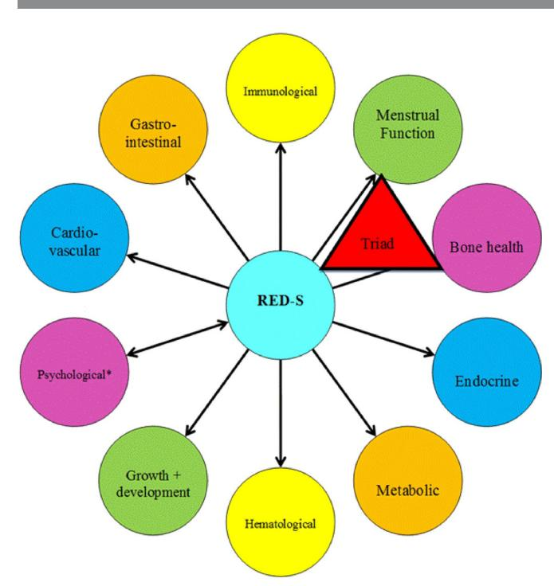
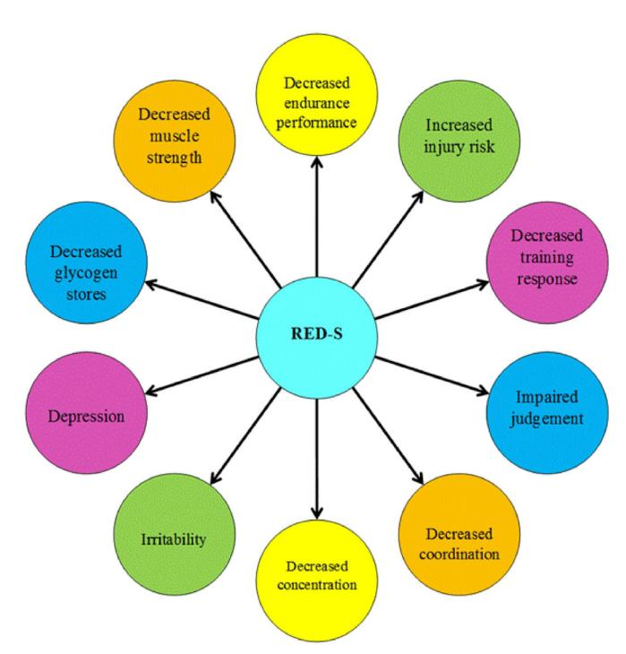

# IOC consensus statement on relative energy deficiency in sport (RED-S): 2018 update

Margo Mountjoy,1 Jorunn Kaiander Sundgot-Borgen,2 Louise M Burke,3,4 Kathryn E Ackerman,5,6 Cheri Blauwet,7 Naama Constantini,8 Constance Lebrun,9 Bronwen Lundy,3 Anna Katarina Melin,10 Nanna L Meyer,11 Roberta T Sherman,12 Adam S Tenforde,13 Monica Klungland Torstveit,14 Richard Budgett15

**To cite:** Mountjoy M, Sundgot-Borgen JK, Burke LM, et al. Br J Sports Med 2018;**52**:687–697.

For numbered affiliations see end of article.

#### **Correspondence to**

Dr Margo Mountjoy, Department of Family Medicine, Michael G. DeGroote School of Medicine, McMaster University, Hamilton, ON N2G 1C5, Canada;

mmsportdoc@mcmaster.ca

This article has been copublished in the International Journal of Sport Nutrition and Exercise Metabolism; doi: 10.1123/IJSNEM.2018-0136.

Accepted 17 April 2018

#### **Introduction**

In 2014, the IOC published a consensus statement entitled 'Beyond the Female Athlete Triad: Relative Energy Deficiency in Sport (RED-S)'. The syndrome of RED-S refers to 'impaired physiological functioning caused by relative energy deficiency and includes, but is not limited to, impairments of metabolic rate, menstrual function, bone health, immunity, protein synthesis and cardiovascular health'. The aetiological factor of this syndrome is low energy availability (LEA)[.1](#page-6-0)

The publication of the RED-S consensus statement stimulated activity in the field of Female Athlete Triad science, including some initial controversy[2 3](#page-6-1) followed by numerous scientific publications addressing:

- 1. The health parameters identified in the RED-S conceptual model ([figure](#page-1-0) 1)[.1 4](#page-6-0)
- 2. Relative energy deficiency in male athletes.
- 3. The measurement of LEA.
- 4. The performance parameters identified in the RED-S conceptual model ([figure](#page-1-1) 2)[.1 4](#page-6-0)

The IOC RED-S consensus authors have reconvened to provide an update summary of the interim scientific progress in the field of relative energy deficiency with the ultimate goal of stimulating advances in RED-S awareness, clinical application and scientific research to address current gaps in knowledge.

#### **Low energy availability**

LEA, which underpins the concept of RED-S, is a mismatch between an athlete's energy intake (diet) and the energy expended in exercise, leaving inadequate energy to support the functions required by the body to maintain optimal health and performance. Operationally, energy availability (EA) is defined as:

Energy Availability (EA)

= Energy Intake (EI) (kcal)

*−*Exercise Energy Expenditure (EEE) (kcal)/

Fat Free Mass (FFM) (kg) where exercise energy expenditure (EEE) is calculated as the additional energy expended above that of daily living during the exercise bout, and the overall result is expressed relative to fat-free mass (FFM), reflecting the body's most metabolically active tissues.[5 6](#page-6-2) Rigorously controlled laboratory trials in women have shown that optimal EA for healthy physiological function is typically achieved at an EA of 45 kcal/kg FFM/day (188kJ/ kg FFM/day).[7 8](#page-6-3) Meanwhile, although some caveats are noted in relation to differential responses of various body systems,[9](#page-6-4) many of these systems are substantially perturbed at an EA <30kcal/kg FFM/ day (125kJ/kg FFM/day), making it historically a targeted threshold for LEA. However, recent evidence suggests that this cut-off does not predict amenorrhoea in all women[.10 11](#page-6-5) In addition, and not withstanding differences across body sizes and pubertal age, it is noted that an EA of 30 kcal/kg/ FFM roughly equates to the average resting metabolic rate (RMR).[5](#page-6-2) Because LEA has proven robust in explaining markers of suboptimal health and function in both laboratory[7 8](#page-6-3) and field settings[,12 13](#page-7-0) it seems logical that an EA assessment could serve as a diagnostic tool in the prevention or management of RED-S.

#### **Measurement of EA**

Despite the primary importance of determining whether an athlete has adequate EA, several barriers prohibit the direct measurement of EA from being a practical and reliable option. First, there is no standardised or reference protocol for undertaking an EA assessment (eg, the number of collection days, methodologies for assessing energy intake, exercise energy expenditure or FFM). Furthermore, there are significant concerns over the reliability and validity of each of these metrics. The greatest challenge is to gain an accurate record of usual energy intake from self-reported sources.[9 14](#page-6-4) Other challenges include the measuring of exercise energy expenditure during many of the training/competition activities performed by athletes and accounting for their additional recreational/lifestyle activity.[9 15](#page-6-4) These problems may partially explain why many field studies report considerable discrepancies between EA calculations and symptoms associated with LEA.[9 14 16–18](#page-6-4) However, other explanations for these observations include: (1) the temporal dissociation between the period of mismatched eating and exercise behaviour that created the LEA problems and the occasion on which the EA assessment was undertaken and (2) the interaction of other dietary characteristics that often co-exist with LEA and may exacerbate its effects (eg, high intake of fibre, stimulants and artificial sweeteners; low energy density foods; high dietary restraint and poor spread of energy within a day)[.19–23](#page-7-1) Even if these problems

could be solved, EA calculations would likely involve specialised equipment and expertise (eg, dual energy X-ray absorptiometry measurement of body composition), good motivation and compliance of the athlete (eg, keeping a food record or comprehensive activity diary) and considerable time and expertise to

process the information. Additionally, LEA states may develop at different stages of training and competition due to varying physiological demands. An EA assessment may achieve some valuable outcomes, such as strengthening the interaction between the practitioner and athlete, which can create rapport, trust and an appreciation of EA needs. However, the considerable effort needed to assess EA and its frailties as a stand-alone diagnostic tool prevent expert bodies from instituting it as a universally recommended measurement.

## **Low energy availability in male athletes**

Similar to female athletes, there is growing evidence that males may experience LEA in situations when there is a mismatch between energy intake and the exercise energy expenditure of training or competition. Populations of male athletes at increased risk for LEA and resulting health consequences of RED-S include cyclists, rowers, runners, jockeys and athletes in weight class combat sports.[24–30](#page-7-2) Factors that contribute to LEA in male athletes are varied and often unique to the sport. They include the cyclical changes in body mass and composition ('making weight'), prolonged inadequate energy intake to meet high exercise energy expenditure of endurance sport, punctuated changes in training volume/intensity and participation in strenuous endurance events without accompanied changes in nutrition.[26](#page-7-3) Inadequate food availability, including food insecurity from cultural practices or lack of financial resources may also contribute risk for LEA in some male athletes, even among high calibre athletes, as it undoubtedly also does in female athletes.[26](#page-7-3)

While RED-S may occur in both sexes, there are likely differences in biological responses to LEA in male athletes compared with their female counterparts. The prevalence of LEA has been suggested to be higher in females than in males, although precise differences are unknown[.31](#page-7-4) The threshold and duration of the LEA state required to induce RED-S in men is unknown. Reduction in the sex hormone testosterone is likely to be of greater health concern in male athletes.[28 32 33](#page-7-5)

#### **Low energy availability in para-athletes**

The prevalence of LEA in para-athletes is incompletely characterised[.34](#page-7-6) When extrapolating from trends noted in general populations of individuals with disability, it can be assumed that athletes who use a wheelchair for daily mobility are likely to have reduced baseline energy needs.[35 36](#page-7-7) Despite this, male and female athletes with spinal cord injury (SCI) may monitor or restrict body weight for sport and are at risk for nutrient deficiencies.[37 38](#page-7-8) Athletes with central neurological injury, such as cerebral palsy, who demonstrate aberrant movement patterns that include dyskinesis or athetosis, may have higher energy expenditures than similar athletes without such non-purposeful movements.[39](#page-7-9) Additionally, the presence of central neurological injury may result in alterations of the hypothalamic–pituitary axis and baseline menstrual function, regardless of energy status.[40–42](#page-7-10) Amputee athletes may have higher energy needs in the setting of prosthetic use and resultant gait asymmetry[.43](#page-7-11)

Para-athletes are at high risk for impaired bone health and bone-related injury secondary to many factors, including altered skeletal loading. For example, in unilateral amputees, the affected limb may exhibit reduced bone mineral density (BMD)[.44](#page-7-12) Athletes with SCI have disuse osteopenia/osteoporosis affecting the lower extremities; however, positive adaptive changes in upper body BMD values have been reported in wheelchair basketball players compared with non-athletes (greater radial BMD and trend towards increased lumbar BMD).[45C](#page-7-13)haracterising effects of

**Figure 1** Health consequences of Relative Energy Deficiency in Sport (RED-S) showing an expanded concept of the Female Athlete Triad to acknowledge a wider range of outcomes and the application to male athletes (\*Psychological consequences can either precede RED-S or be the result of RED-S).[1 4](#page-6-0)

**Figure 2** Potential Performance consequences of Relative Energy Deficiency in Sport (\*Aerobic and anerobic performance).[1 4](#page-6-0)

LEA on bone in para-athletes requires consideration of baseline effects of each individual's underlying disability. More work is needed in this area.

Given rising participation in para sport from grass roots to elite levels, further research is needed to investigate the impact of LEA in athletes with a disability. The para-athlete population requires screening for LEA to reduce complications of RED-S, including low BMD.

### **Race and low energy availability**

Whether race plays a role in the incidence and underlying aetiology of RED-S remains speculative. Research shows a lower risk of disordered eating (DE) in African-American, but not Latino female high-school athletes compared with Caucasians[.46 47](#page-7-14) It is currently unknown whether the prevalence of menstrual disorders differs among racially diverse athletic groups. Stress fractures in African-American military recruits are lower than in Caucasian recruits.[48](#page-7-15) Meanwhile, male Kenyan runners have been observed to have greater BMD at weight-bearing sites (eg, proximal femur) than healthy controls, but not at the lumbar spine, where Z scores were reported to be below −2.0 in 40% of study subjects[.49](#page-7-16) Such runners may have LEA resulting from low energy intake and high exercise energy expenditure associated with heavy training loads,[49](#page-7-16) as has been previously shown.[50 51](#page-7-17) In another study of young Kenyan female athletes, middle-distance and long-distance runners were found to exhibit one or more subclinical and/or clinical components of the RED-S, including a greater risk for LEA and menstrual dysfunction than controls.[52](#page-7-18) A study of sport nutrition knowledge, behaviours and beliefs across sex, race/ethnicity and socioeconomic status in high school soccer players identified that general sports nutrition knowledge is lower in adolescent soccer players compared with prior reports in adolescent athletes and that specifically females and Latinos may benefit from sport nutrition education.[53](#page-7-19) Published research is greatly lacking on RED-S in African-American, Hispanic and Asian athletes, with a few exceptions.[54 55](#page-7-20) Thus, there is a need to include more diverse athlete populations in RED-S research and to integrate race/ethnicity in the prevention and treatment of RED-S.

# **Health effects of low energy availability**

#### **Endocrine**

Effects of LEA on the endocrine system have been described predominantly in female athletes and only recently in male athletes. Findings in some female athletes in LEA states (measured EA and/or athletes with amenorrhoea) include disruption of the hypothalamic–pituitary–gonadal axis, alterations in thyroid function, changes in appetite-regulating hormones (eg, decreased leptin and oxytocin, increased ghrelin, peptide YY and adiponectin), decreases in insulin and insulin-like growth factor 1 (IGF-1), increased growth hormone (GH) resistance and elevations in cortisol.[8 56–59](#page-6-6) Many of these hormonal changes likely occur to conserve energy for more important bodily functions or to use the body's energy reserves for vital processes.[60 61](#page-7-21)

Specific changes in men are not completely understood; however, reduced leutinizing hormone (LH) pulsatility and amplitude have been described in a case series of male marathon runners, a population at high risk for LEA.[62](#page-7-22) Other studies, primarily in endurance male athlete populations, have shown reductions in testosterone and inconsistent findings in differences in basal LH parameters.[63 64](#page-7-23) Koehler *et al* assessed the effects of short-term EA manipulation through diet and exercise on various hormonal parameters in six male habitual exercisers.[65](#page-7-24)

Each male experienced four separate 4-day conditions: LEA (15 kcal/kg FFM/day with and without exercise) and adequate EA (40 kcal/kg FFM/day with and without exercise). Following both LEA conditions, regardless of exercise, leptin and insulin were reduced compared with baseline (−53% to −56% and −34% to −38%, respectively). LEA did not significantly affect ghrelin, triiodothyronine (T3 ), testosterone or IGF-1 levels. Thus, the LEA state, often in combination with disruptions to endocrine function in women and possibly men, may contribute to multiple physiological disease states described by RED-S. However, the relationship is likely to be subject to a large degree of within-participant and between-participant variability; more research is needed, particularly in men[.11 66 67](#page-6-7)

#### **Menstrual function**

The effects of LEA on reproductive hormones and menstrual function in female athletes have been well described,[8 68 69](#page-6-6) although the complex hormonal signalling pathways underpinning these effects are still being fully elucidated. Current evidence supports a LEA-associated disruption of gonadotropin releasing hormone (GnRH) pulsatility at the hypothalamus, followed by alterations of LH and follicle stimulating hormone release from the pituitary and decreased oestradiol and progesterone levels; this is considered a form of functional hypothalamic amenorrhoea (FHA).[68 70](#page-7-25) The duration and severity of LEA needed to create such disturbances are also unclear, reflecting both the complex nature of the problem and discrepancies associated with the different methodologies used to study it. For example, Loucks and Thuma studied previously sedentary women in a laboratory setting and identified that well-controlled interventions reducing EA below 30 kcal/kg FFM/day via the shortterm (5day) manipulation of exercise energy expenditure and energy intake were associated with a dose–response decrease in LH pulsatility[.8](#page-6-6) More recently, Williams *et al* reduced EA via manipulation of energy intake and exercise energy expenditure over several menstrual cycles in untrained, previously eumenorrhoeic subjects.[11](#page-6-7) The researchers found that the frequency of menstrual disturbances (including luteal phase defects, anovulation and oligomenorrhoea) was affected by the magnitude of energy deficit compared with baseline needs[,11](#page-6-7) but a specific threshold of EA below which menstrual disturbances occurred was not identified[.10](#page-6-5)

Meanwhile, Reed *et al* performed a cross-sectional analysis of EA (measured using 3-day diet logs to determine energy intake and a combination of exercise logs and heart rate monitoring to measure estimated exercise energy expenditure) in female athletes with eumenorrhoea and various menstrual disturbances.[71](#page-7-26) These investigators reported mean EA was >30.0kcal/kg FFM/day in all the groups (amenorrhoeic, oligomenorrhoeic, ovulatory eumenorrhoeic, inconsistent subclinical menstrual dysfunction eumenorrhoeic and anovulatory eumenorrhoeic athletes) and EA did not discriminate subclinical forms of menstrual disturbance; however, EA was lower in amenorrhoeic athletes compared with eumenorrhoeic athletes (mean 30.9 vs 36.9 kcal/kg FFM/day).[71](#page-7-26) Thus, severe energy deficiency is known to lead to amenorrhoea, but more work is needed to better understand the interplay of change in short-term and long-term EA and more subtle menstrual disruption.

# **Bone health**

It is established that LEA contributes to impaired bone health in athletes, particularly women. Cross-sectional studies of physically active female athletes with oligomenorrhoea/amenorrhoea or measured LEA have demonstrated decreased BMD, altered bone microarchitecture and bone turnover markers, decreased estimates of bone strength and increased risk for bone stress injuries compared with eumenorrhoeic athletes and those who are energy replete.[66 69 72–74](#page-7-27) Short-term LEA (via diet and exercise) has prospectively been shown to negatively affect bone turnover markers in women and some men[.57 67](#page-7-28) Specific female and male sport populations are at increased risk for lower BMD, including jockeys, runners, swimmers and cyclists[.24 29 30 75–83](#page-7-2) Anatomical sites with less bone loading and/or greater trabecular versus cortical bone content (lumbar spine and radius vs total hip) are at greater risk for low BMD and impaired microarchitecture in populations susceptible to LEA.[72 73 77 78 84](#page-7-29)

Low body mass index (BMI) is an imperfect surrogate marker for LEA. However, BMI ≤17.5kg/m2 , <85% expected body weight for adolescents or ≥10%weight loss in 1month are proposed indicators of LEA,[85](#page-8-0) and indeed both BMI and expected body weight cut-offs are associated with increased risk for low BMD in both sexes.[24 82 86](#page-7-2) LEA may be accompanied by DE/eating disorders (EDs), menstrual dysfunction and low BMD, and the combination of factors places athletes at higher risk for bone stress injury[.87–89](#page-8-1)

### **Metabolic**

LEA has been correlated with decreased RMR in female endurance athletes.[90](#page-8-2) Prospectively, increasing training load while maintaining constant EI over 4 weeks in male and female elite rowers led to a significant reduction in RMR[.91](#page-8-3) In normal weight women with induced energy deficits via exercise and dietary manipulation, measured weight loss over 3 months was less than predicted.[92](#page-8-4) Subjects who were moderately energy deficient had a significant decrease in RMR, and those who were severely energy deficient demonstrated significant decreases in leptin, T3 , IGF-1 and an increase in ghrelin[.92](#page-8-4)

#### **Haematological**

Iron is essential for haematopoiesis and subsequent oxygen carrying capacity. Iron deficiency, often seen in female athletes, can contribute directly and indirectly to energy deficiency. This is due to a potential reduction in appetite, decreased metabolic fuel availability and impaired metabolic efficiency, leading to an increase in energy expenditure during exercise and rest[.93](#page-8-5) Iron deficiency may also interact with bone health via dysregulation of the GH/IGF-1 axis, hypoxia and hypothyroidism, in addition to playing an important role in thyroid function, fertility and even psychological well-being[.93](#page-8-5) Thus, LEA may be partially induced by, and may contribute to, iron deficiency.[93](#page-8-5) Surrogates for LEA have been correlated with haematological dysfunction, including low ferritin and iron deficiency anaemia, in adolescent and young adult female athletes.[94](#page-8-6)

# **Growth and development**

Linear growth retardation has been reported in various studies of male and female adolescents with severe anorexia nervosa, with studies demonstrating partial, but not always complete, catch-up growth after recovery.[95–97](#page-8-7) Decreases in IGF-1, increases in GH and increased GH resistance are consistently noted in those with anorexia nervosa.[98](#page-8-8) Studies in amenorrhoeic athletes have demonstrated disorderly GH secretory patterns, decreased GH and IGF-1 secretory response to exercise accompanied by increased interpulse GH levels and decreased IGF-1/IGFBP-1 ratios, with more research needed to understand training and growth implications.[99 100](#page-8-9)

#### **Cardiovascular**

Early atherosclerosis may be associated with hypoestrogenism and FHA in young athletes.[101](#page-8-10) Endothelial dysfunction and unfavourable lipid profiles have been reported in amenorrhoeic athletes,[102](#page-8-11) with resumption of menses leading to improvements in vascular endothelial function.[103](#page-8-12) In one study, amenorrhoeic athletes demonstrated lower heart rates and systolic blood pressure compared with eumenorrhoeic athletes, in addition to disruptions of the normal renin–angiotensin–aldosterone response to an orthostatic challenge.[104](#page-8-13) In the more severe LEA state of anorexia nervosa, significant cardiovascular changes can occur, including valve abnormalities, pericardial effusion, severe bradycardia, hypotension and arrhythmias[.105](#page-8-14)

# **Gastrointestinal**

In the severe LEA state of AN, negative health influences on the full gastrointestinal tract such as altered sphincter function, delayed gastric emptying, constipation and increased intestinal transit time, have been described.[106](#page-8-15) Melin *et al* measured EA and developed the Low Energy Availability among Female Athletes Questionnaire (LEAF-Q), both of which found a negative correlation with EA and gastrointestinal symptoms in elite Swedish and Danish athletes[.12](#page-7-0) These findings were supported in a survey of adolescent American female athletes with surrogate markers of LEA, who also reported a higher incidence of stool leakage and constipation than those considered to have adequate EA.[94](#page-8-6)

#### **Immunological**

The immune system may be altered by LEA. A study of 21 Japanese elite, collegiate runners reported more upper respiratory symptoms and lower immunoglobulin A secretion rates in the amenorrhoeic versus eumenorrhoeic athletes.[107](#page-8-16) Meanwhile, in observational studies of elite Australian athletes in preparation for the 2016 Rio Olympic Games, LEA, as measured by the LEAF-Q in female athletes, was associated with increased likelihood of illnesses (including those of the upper respiratory tract and gastrointestinal tract), bodily aches and head-related symptoms in the previous month.[108 109](#page-8-17)

## **Psychological**

Psychological problems can precede or be caused by LEA[.1](#page-6-0) LEA in athletes has been shown to have negative correlates with various aspects of psychological well-being. Higher drive for thinness may be a proxy for LEA, as higher drive for thinness scores on the Eating Disorder Inventory have been associated with reduced resting energy expenditure, lower T3 levels, and higher ghrelin levels in female athletes.[110](#page-8-18) Athletes who scored higher on DT also scored higher in domains of ineffectiveness, cognitive restraint, and bulimic tendencies.[110](#page-8-18) Adolescent females with FHA have been found to have a higher incidence of mild depressive traits, psychosomatic disorders, and a decreased ability to manage stress.[111 112](#page-8-19) A separate study found overlap in adolescents with anorexia nervosa and those with FHA: both groups demonstrated increased depression, social insecurity and introversion and fears of weight gain compared with healthy controls[.113](#page-8-20) More profound psychological disturbances were seen in the presumably more restricted EA (anorexia nervosa) group versus the FHA group.[113](#page-8-20) Results from a study with male athletes indicated that dietary restraint and muscle building behaviours were associated with bulimic symptomatology.[114](#page-8-21) Additionally, studies of male body builders indicate that a prolonged EA of approximately 20–25 kcal/kg FFM/day, as seen in the final stage of contest diets, might be pathological and have negative psychological effects for males[.27](#page-7-30) The restrictive diet patterns observed resulted in a reduction in muscle mass and a loss of strength, with reports of endocrine dysfunction and mood disturbances in those athletes with body composition measurements of approximately 4% total body fat.[27](#page-7-30)

## **Disordered eating and eating disorders**

Disordered eating and eating disorders are more prevalent among female and male athletes in weight-sensitive sports in comparison to athletes representing sports in which leanness is a less important performance variable[.115–119](#page-8-22) In a Norwegian study of adolescent elite male and female athletes, a higher prevalence of disordered eating in non-athletes as compared with athletes was found when using questionnaires[,120](#page-8-23) but when using a clinical interview, the prevalence of eating disorders was higher in athletes versus controls.[121](#page-8-24) These findings suggest the need for personal interviews to diagnose eating disorders in athletes.[117 121 122](#page-8-25) It should be noted that the revised diagnostic criteria for eating disorders (Diagnostic and Statistical Manual, fifth edition) may influence the prevalence of the different diagnoses among athletes.[123 124](#page-8-26)

The pathogenesis of eating disorders is multifactorial with cultural, familial, individual and genetic/biochemical factors playing roles.[125](#page-8-27) Weight pressure and unique eating disorder risk and trigger factors have been reported and include performance pressure, sudden increase in training volume, injury, teammate modelling of eating disorder behaviours and team weigh-ins.[126–128](#page-8-28) A desire to be leaner to enhance performance seems to predict later disordered eatin[g127](#page-8-29) and the risk of eating pathology increases when the coach–athlete relationship is characterised by high conflict and low support.[129](#page-8-30) Disordered eating seems to be influenced by perfectionism, competitiveness, pain tolerance and the perceived performance advantage of weight loss.[130](#page-8-31) These suggested risk factors need to be validated to demonstrate a causal relationship. However, these findings serve as a call to action for enhanced screening for eating disorder risk among athletes who experience weight pressure, are injured, or who have teammates with known disordered eating/eating disorders.[126](#page-8-28)

## **Performance consequences of low energy availability**

Associations between various surrogates of LEA (eg, hormonal aberrations, oligomenorrhoea/amenorrhoea, leanness sport participation and increased scores on ED/DE/LEA screening tools) and factors negatively influencing performance (eg, illness, injury, iron deficiency, impaired cognition and mood) have been reported.[87 93 94 131–137](#page-8-1) Intervention studies on long-term energy restriction and sport performance are lacking.[138](#page-9-0) However, it has been postulated that persistent LEA could impair sport performance through a variety of different indirect mechanisms (eg, impaired recovery leading to premature reduction in physical, psychological and mental capacity and impairment of optimal muscle mass and function).[139](#page-9-1) Indeed, LEA could be expected to impair performance or interfere with optimal performance gains via acute impairment of key processes such as glycogen storage[140](#page-9-2) or protein synthesis[,141](#page-9-3) or by preventing consistent and high quality training due to the increased risk of injury and illness.[108 109](#page-8-17)

Despite the importance of these associations, it is only recently that studies have tried to measure the direct impact of LEA on sports performance. For example, Silva and Paiva reported that athletic performance, measured as competition ranking, negatively correlated with EA in elite rhythmic gymnasts[.142](#page-9-4) Furthermore, Tornberg *et al* found no difference in aerobic capacity (VO2 , O2 (mL/min/kg)) between elite eumenorrhoeic endurance athletes and elite endurance athletes with secondary FHA, despite lower body weight and fat mass in the athletes with FHA[.143](#page-9-5) However, subjects with FHA had decreased neuromuscular performance (measured as knee muscular strength and endurance) and reaction time compared with the eumenorrhoeic athletes.[143](#page-9-5) Overall, lower neuromuscular performance was associated with higher cortisol levels, and lower blood glucose, T3 , oestrogen and FFM in the tested leg.[143](#page-9-5) Although striving for a greater power to mass ratio is commonly regarded as important for running performance, this study suggests that achieving an idealised body weight or body composition through severe and persistent energy restriction is likely to negatively affect performance and health.[143](#page-9-5) This finding is supported in a study of East African runners.[144](#page-9-6) Woods *et al* followed male and female national team rowers through a 4-week intensified training period, which was accompanied by a lack of increase in energy intake despite a 21% increase in training load.[91](#page-8-3) It was concluded that inadequate EA likely negatively affected training recovery, at least partially explaining the alterations in 5km time trial pacing strategy and reduced performance.[91](#page-8-3)

Considering the reported high prevalence of menstrual dysfunction caused by energy deficiency,[145](#page-9-7) surprisingly, only one study has investigated the direct impact of LEA on sport performance. Vanheest *et al* reported a 10% decline in swimming velocity over a 400m time trial (after 12 weeks of training) among young elite swimmers with ovarian suppression secondary to energy deficiency compared with an 8% improvement in their eumenorrhoeic teammates.[13](#page-7-31) Clearly, more investigations, including robust protocols involving random allocation of athletes to intervention groups, are needed to provide further evidence and explanation of the effects of LEA on training adaptations and sport performance.

# **Prevention of relative energy deficiency in sport**

The prevention of RED-S requires increased awareness among athletes and their entourage. Current evidence suggests that there is much work to be done. Surveys have reported that less than 50% of physicians, coaches, physiotherapists and athletic trainers could identify the triad components (LEA with or without an eating disorder, menstrual dysfunction and low BMD)[,70 146–152](#page-7-32) and only 19% of 370 US high school nurses could identify all three triad components.[153](#page-9-8) In a survey of 931 multispecialty physicians, only 37% were aware of the triad, and only one-half of these were comfortable treating or referring a patient.[70](#page-7-32) In a group of exercising Australian women, one-third believed irregular periods were 'normal' for active females, and approximately half reported knowing that menstrual dysfunction was a risk factor for poor bone health.[154](#page-9-9) Educational programmes typically identify their target audiences as health professionals, coaches, athletic trainers, teachers, school administrators, athletes and parents.[155](#page-9-10) However, a survey of International Sport Federations (IFs) identified that only 2 of 28 Olympic IFs had programmes on RED-S, indicating the need to also involve a top-down approach.[156](#page-9-11) Peer-based eating disorder/ body image/triad education and cognitive-dissonance based programmes have shown promise,[157–160](#page-9-12) and similar RED-S peer-led programmes should be developed.

Effective eating disorder prevention programmes should be multimodal, interactive and target athletes and coaching staff[.161](#page-9-13) One successful intervention is a peer-led educational programme for female athletes that resulted in improved bulimic pathology 1year postintervention.[162](#page-9-14) A Norwegian school-based controlled intervention programme, including elite male and female athlete[s163](#page-9-15) and coaches,[164](#page-9-16) resulted in no new cases of eating disorders among females in the intervention schools as opposed to eight (13%) in females at the control schools.[163](#page-9-15) There was only one new eating disorder case in a male at a control school and none in males from the intervention schools.[163](#page-9-15) These results suggest that effective disordered eating and eating disorder prevention should target individuals beyond athletes and coaches, be gender specific, involve significant others and include changes to sport regulations, policy measures and the healthcare system.[165](#page-9-17)

# **Screening for relative energy deficiency in sport**

Early detection of athletes at risk for energy deficiency is critical to prevent long-term health sequelae.[1 69 85](#page-6-0) There are several disordered eating/eating disorder screening tools intended for general population.[166–169](#page-9-18) Some tools have been developed to target athletes, although none are validated for Diagnostic and Statistical Manual of Mental Disorders, Fifth Edition criteria.[170–172](#page-9-19) Additionally, due to stigma associated with eating disorders, athletes may be motivated to hide their illness. An elevated Eating Disorder Inventory—drive for thinness score[168](#page-9-20) has been reported to indicate energy deficiency in exercising women,[173](#page-9-21) and amenorrhoeic athletes seem more likely to have an elevated drive for thinness score compared with eumenorrhoeic athletes.[173](#page-9-21) In order to diagnose an eating disorder, additional in-depth personal interviews must be performed.[117 121 122 166](#page-8-25) However, the prevalence of energy deficiency is reported to be high in some athletes even without the presence of disordered eating/eating disorders.[90 145](#page-8-2)

Although coaches are in an ideal situation to identify athletes with disordered eating/eating disorders, they sometimes have difficulty distinguishing between athletes whose appearance or body composition metrics meets their sport-type expectations (eg, thin) from those with an eating disorder, especially if the athlete's performance is good.[174](#page-9-22) Even if disordered eating is identified, coaches may have difficulty convincing athletes to seek treatment.[175](#page-9-23)

The Periodic Health Examination[176](#page-9-24) and the Preparticipation Physical Evaluatio[n177](#page-9-25) include relevant questions that may be helpful for early detection. Recently, the LEAF-Q was developed[12](#page-7-0) as a brief questionnaire on physiological symptoms linked to energy deficiency, and the Low Energy Availability in Males Questionnaire is in development. Expanded testing of these questionnaires in various athletic populations is needed. There is limited evidence for the efficacy of self-reported questionnaires, and additional individual evaluation is recommended.[1 85](#page-6-0) The RED-S Clinical Assessment Tool (RED-S CAT) can assist clinicians in screening for RED-S and the management of return to play decisions,[178](#page-9-26) although validation is needed.

#### **Treatment of relative energy deficiency in sport Non-pharmacological management**

If LEA is due to unintentional under eating, then simple nutritional education may suffice. Regardless of the severity of the eating pathology, early involvement of an accredited or appropriately trained expert (eg, sports dietitian) is recommended to enhance the athlete's nutritional practices. Optimising EA can improve function of the hypothalamic–pituitary– gonadal axis, as well as other systems negatively affected by LEA in females.[15 179–181](#page-7-33) Energy deficits should be addressed via modification of exercise and nutrition practices[68 182](#page-7-25) in both female and male athletes and energy needs may be even higher in growing adolescents. Treatment is typically based on increased food intake but may also require changes in food choices, energy spread and other dietary characteristics; these changes must be individualised and periodised according to the athlete's energy expenditure and exercise goals. A reduction or cessation of exercise may be necessary, depending on the severity of the energy deficit, symptoms and compliance level.

Adequate bone-building nutrients are critical; for example, serum 25-hydroxy vitamin D levels <30ng/mL are associated with increased incidence of bone stress injury.[183 184](#page-9-27) Vitamin D intake of 600–800 IU daily is recommended by USDA dietary guidelines,[185](#page-9-28) but greater intake may be needed temporarily to reach goal serum 25-hydroxy vitamin D levels of >30ng/ mL.[186–188](#page-9-29) Improving 25-hydroxy vitamin D levels may also reduce healing time and facilitate earlier return to play for bone stress injury.[189](#page-9-30) Additionally, adequate consumption of calcium may help decrease the incidence of bone stress injury.[190 191](#page-9-31) The current recommendation for daily calcium intake is 1000mg/day of calcium for men and women aged 19–50 years, and 1300mg/ day for children and adolescents aged 9–18 years[.192](#page-9-32)

Cognitive behavioural therapy is another non-pharmacological treatment for RED-S that has been shown to contribute to the resumption of menses in some women with FHA[.193 194](#page-9-33) Initial non-pharmacological management of RED-S may restore menstrual function over months,[181 195](#page-9-34) while improvements in bone health take longer and may never reach optimal levels.[15](#page-7-33) Non-compliance with therapy may require removal of the athlete from training/competition. Examples of treatment contracts and clearance categories for return to play can be found in other publications.[1 85 196](#page-6-0) Current recommendations need further validation and may lead to the eventual inclusion of other progress parameters, such as RMR and blood biomarkers.

## **Pharmacological interventions**

The use of combined oral contraceptives for the intention of regaining menses or improving BMD in those with RED-S is not recommended. Data regarding the effects of combined oral contraceptives on BMD and fracture risk are inconsistent.[68 197–200](#page-7-25) If using combined oral contraceptives for contraception, the athlete should understand that combined oral contraceptives may mask the return of spontaneous menses, and bone loss may continue if the energy deficit is not corrected. If menstrual cycles do not return after a reasonable trial of nutritional, psychological and/or modified exercise interventions, transdermal oestradiol (E2) therapy with cyclic oral progestin can be considered for short-term use.[68](#page-7-25) Notably, transdermal E2 is not a reliable form of hormonal contraception and an athlete should be counselled to avoid unintended pregnancy if she receives transdermal E2 for bone health. Transdermal oestrogen does not affect IGF-1 secretion, a bone-trophic hormone that combined oral contraceptives downregulate, and has been shown to improve BMD in anorexia nervosa[201](#page-10-0) and BMD and bone microarchitecture in oligo-amenorrhoeic athletes[.202](#page-10-1) Recombinant parathyroid hormone 1–34 (rPTH) has been shown to improve BMD in A[N203](#page-10-2) and rare, short-term use may be considered in adults with LEA, FHA or RED-S in the setting of delayed fracture healing or very low BMD.[68](#page-7-25) Transdermal oestrogen or rPTH should only be prescribed in conjunction with a metabolic bone expert and it is important to note that rPTH is contraindicated in adolescents and young adults with open growth plates.[68](#page-7-25)

#### **Treatment strategies for disordered eating/eating disorders**

Apparent disordered eating/eating disorders should be treated with a multidisciplinary team including medical, dietary and mental health support. Inpatient treatment should be considered for patients with severe bradycardia, hypotension, orthostasis and/or electrolyte imbalance.[85 196 204](#page-8-0) Athletes' resistance to treatment usually increases with the severity of the problem.[205](#page-10-3) Because many patients with eating disorders see their disorders as purposeful and necessary,[206](#page-10-4) motivation to recover is a critical factor in treatment. With sport participation as leverage for athletes, the desire to be healthy enough to return to sport most often facilitates recovery for athletes with eating disorders[.207](#page-10-5)

As higher levels of depression and anxiety are observed in athletes with eating pathology,[208](#page-10-6) there is a need to treat these pathologies in athletes with disordered eating/eating disorders. Additionally, comorbid disorders of depression, anxiety and substance abuse complicate eating disorder treatment and require treatment modifications.[165 209](#page-9-17) Ideally, treatment should be provided by a mental health professional experienced in treating eating problems in athletes.[205](#page-10-3) For athletes, meeting the diagnostic criteria for severe eating disorders (eg, anorexia nervosa and bulimia nervosa), participation in competition is not recommended.[1](#page-6-0)

# **Conclusions**

Since the original publication of the IOC consensus statement on RED-S in 2014, there have been many scientific advances to improve our understanding of the health and performance effects of LEA in both female and male athletes. To address remaining gaps, the IOC RED-S consensus authors encourage scientific activity in the following domains:

- 1. Identification of athletes at risk for RED-S: it is evident that there is no practical tool for the measurement of EA; therefore, there is a recognised need to develop a methodology to screen and identify athletes at risk for RED-S that is both scientifically validated and relevant and applicable in clinical sport practice.
- 2. Prevention of RED-S: improved awareness of RED-S is required through educational initiatives for athletes, coaches, members of the entourage and sport organisations. The development of scientifically validated prevention interventions is encouraged.
- 3. Male athletes: despite the improvement in the knowledge base of RED-S in male athletes, there remains a gap in our understanding of RED-S in specific sports with differing energy demands, performance criteria, ethnicities and cultural perspectives.
- 4. Health and performance consequences of RED-S: there is still much to be learned about the psychological and physiological health risks and long-term consequences of RED-S in all athletes, particularly male athletes, para-athletes and athletes of various races. To best engage the attention of athletes and coaches, it is imperative to further increase our understanding of the performance effects of RED-S.
- 5. Treatment and 'return to play': practical guidelines for the treatment and safe return to play for athletes with RED-S need to be further developed to improve athletes' health and performance.

#### **Author affiliations**

1 Department of Family Medicine, Michael G DeGroote School of Medicine, McMaster

University, Hamilton, Ontario, Canada Department of Sports Medicine, The Norwegian School of Sport Sciences, Oslo, Norway

3 Sports Nutrition, Australian Institute of Sport, Beclonnen, Australia 4 Centre for Exercise and Nutrition, Mary MacKillop Institute for Health Research, Melbourne, Victoria, Australia Divisions of Sports Medicine and Endocrinology, Boston Children's Hospital, Boston, Massachusetts, USA 6 Neuroendocrine Unit, Massachuetts General Hospital, Harvard Medical School, Boston, Massachusetts, USA Department of Physical Medicine and Rehabilitation, Harvard Medical School, Spaulding Rehabilitation Hospital/Brigham and Women's Hospital, Boston, Massachusetts, USA 8 Heidi Rothberg Sport Medicine Center, Shaare Zedek Medical Center, Hebrew University, Jerusalem, Israel 9 Department of Family Medicine, Faculty of Medicine and Dentistry, Glen Sather Sports Medicine Clinic, University of Alberta, Edmonton, Alberta, Canada 10Department of Nutrition, Exercise and Sport, University of Copenhagen, Frederiksberg, Denmark 11Health Sciences Department Colorado Springs, University of Colorado, Denver, Colorado, USA 12Independent researcher, USA 13Department of Physical Medicine and Rehabilitation, Harvard Medical School, Spaulding Rehabilitation Hospital, Charlestown, Massachusetts, USA

14Faculty of Health and Sport Sciences, University of Agder, Kristiansand, Norway 15IOC Medical and Scientific Department, Lausanne, Switzerland

**Acknowledgements** The authors would like to gratefully acknowledge the work of Barbara Drinkwater in the field of the Female Athlete Triad and for her ongoing support of the advancement of science in this domain. A special thanks to Allyson L Parziale and Bryan Holtzman for their logistical and editorial assistance.

**Contributors** MM, JKS-B, LMB substantially contributed to the conception and design and are the co-coordinators of IOC Expert Group. MM, JKS-B, LMB and KEA substantially contributed to drafting and revising the manuscript. CB, NC, CL, BL, AKM, NLM, RTS, AST, MKT and RB are the members of IOC Expert Group and substantially contributed to drafting the manuscript. RB is the Director IOC Medical and Scientific Department and contributed to revising the manuscript. All authors confirmed the final version to be published.

**Funding** The authors have not declared a specific grant for this research from any funding agency in the public, commercial or not-for-profit sectors.

**Competing interests** None declared.

**Patient consent** Not required.

**Provenance and peer review** Not commissioned; externally peer reviewed.

**Data sharing statement** There is no unpublished data.

© Article author(s) (or their employer(s) unless otherwise stated in the text of the article) 2018. All rights reserved. No commercial use is permitted unless otherwise expressly granted.

# **References**

1 Mountjoy M, Sundgot-Borgen J, Burke L, et al. The IOC consensus statement: beyond the Female Athlete Triad – relative energy deficiency in sport (RED-S). [Br J Sports](http://dx.doi.org/10.1136/bjsports-2014-093502)  [Med](http://dx.doi.org/10.1136/bjsports-2014-093502) 2014;48:491–7. 2 De Souza MJ, Williams NI, Nattiv A, et al. Misunderstanding the female athlete triad: refuting the IOC consensus statement on Relative Energy Deficiency in Sport (RED-S). [Br J Sports Med](http://dx.doi.org/10.1136/bjsports-2014-093958) 2014;48:1461–5. 3 Mountjoy M, Sundgot-Borgen J, Burke L, et al. Authors' 2015 additions to the IOC consensus statement: Relative Energy Deficiency in Sport (RED-S). [Br J Sports Med](http://dx.doi.org/10.1136/bjsports-2014-094371) 2015;49:417–20. 4 Constantini N. Medical concerns of the dancer. IMS World Congress of Sports Medicine. Budapest, Hungary, 2011. 5 Loucks AB, Kiens B, Wright HH. Energy availability in athletes. [J Sports Sci](http://dx.doi.org/10.1080/02640414.2011.588958) 2011;29:S7–15. 6 Melin A, Lundy B. Measuring energy availability. In: Burke L, Deakin V, eds. Clinical Sports Nutrition. Sydney: McGraw-Hilll, 2015:146–57. 7 Loucks AB, Heath EM. Induction of low-T3 syndrome in exercising women occurs at a threshold of energy availability. [Am J Physiol Regul Integr Comp Physiol](http://dx.doi.org/10.1152/ajpregu.1994.266.3.R817) 1994;266:R817–R823. 8 Loucks AB, Thuma JR. Luteinizing hormone pulsatility is disrupted at a threshold of energy availability in regularly menstruating women. [J Clin Endocrinol Metab](http://dx.doi.org/10.1210/jc.2002-020369) 2003;88:297–311. 9 Burke LM, Deakin V. Clinical sports nutrition. 5th edn: McGraw-Hilll Education Australia, 2015. 10 Lieberman JL, DE Souza MJ, Wagstaff DA, et al. Menstrual disruption with exercise is not linked to an energy availability threshold. [Med Sci Sports Exerc](http://dx.doi.org/10.1249/MSS.0000000000001451) 2018;50:551–61. 11 Williams NI, Leidy HJ, Hill BR, et al. Magnitude of daily energy deficit predicts frequency but not severity of menstrual disturbances associated with exercise and caloric restriction. [Am J Physiol Endocrinol Metab](http://dx.doi.org/10.1152/ajpendo.00386.2013) 2015;308:E29–E39.

12 Melin A, Tornberg AB, Skouby S, et al. The LEAF questionnaire: a screening tool for the identification of female athletes at risk for the female athlete triad. [Br J Sports](http://dx.doi.org/10.1136/bjsports-2013-093240)  [Med](http://dx.doi.org/10.1136/bjsports-2013-093240) 2014;48:540–5. 13 Vanheest JL, Rodgers CD, Mahoney CE, et al. Ovarian suppression impairs sport performance in junior elite female swimmers. [Med Sci Sports Exerc](http://dx.doi.org/10.1249/MSS.0b013e3182a32b72) 2014;46:156–66. 14 Burke LM, Melin A, Lundy B. Pitfalls and problems with measuring energy availability. Int J Sport Nutr Exerc Metab 2018. In press. 15 Cialdella-Kam L, Guebels CP, Maddalozzo GF, et al. Dietary intervention restored menses in female athletes with exercise-associated menstrual dysfunction with limited impact on bone and muscle health. [Nutrients](http://dx.doi.org/10.3390/nu6083018) 2014;6:3018–39. 16 Aparicio-Ugarriza R, Mielgo-Ayuso J, Benito PJ, et al. Physical activity assessment in the general population; instrumental methods and new technologies. [Nutr Hosp](http://dx.doi.org/10.3305/nh.2015.31.sup3.8769) 2015;31(Suppl 3):219–26. 17 Levine JA. Measurement of energy expenditure. [Public Health Nutr](http://dx.doi.org/10.1079/PHN2005800) 2005;8:1123–32. 18 Pinheiro Volp AC, Esteves de Oliveira FC, Duarte Moreira Alves R, et al. Energy expenditure: components and evaluation methods. [Nutr Hosp](http://dx.doi.org/10.1590/S0212-16112011000300002) 2011;26:430–40. 19 Barron E, Cano Sokoloff N, Maffazioli GDN, et al. Diets high in fiber and vegetable protein are associated with low lumbar bone mineral density in young athletes with oligoamenorrhea. [J Acad Nutr Diet](http://dx.doi.org/10.1016/j.jand.2015.10.022) 2016;116:481–9. 20 Gaskins AJ, Mumford SL, Zhang C, et al. Effect of daily fiber intake on reproductive function: the BioCycle Study. [Am J Clin Nutr](http://dx.doi.org/10.3945/ajcn.2009.27990) 2009;90:1061–9. 21 Heikura IA, Uusitalo ALT, Stellingwerff T, et al. Low energy availability is difficult to assess but outcomes have large impact on bone injury rates in elite distance athletes. [Int J Sport Nutr Exerc Metab](http://dx.doi.org/10.1123/ijsnem.2017-0313) 2017:1–30. 22 Melin A, Tornberg ÅB, Skouby S, et al. Low-energy density and high fiber intake are dietary concerns in female endurance athletes. [Scand J Med Sci Sports](http://dx.doi.org/10.1111/sms.12516) 2016;26:1060–71. 23 Reed JL, De Souza MJ, Kindler JM, et al. Nutritional practices associated with low energy availability in Division I female soccer players. [J Sports Sci](http://dx.doi.org/10.1080/02640414.2014.908321) 2014;32:1499–509. 24 Barrack MT, Fredericson M, Tenforde AS, et al. Evidence of a cumulative effect for risk factors predicting low bone mass among male adolescent athletes. [Br J Sports Med](http://dx.doi.org/10.1136/bjsports-2016-096698) 2017;51:200–5. 25 Berkovich BE, Eliakim A, Nemet D, et al. Rapid weight loss among adolescents participating in competitive judo. [Int J Sport Nutr Exerc Metab](http://dx.doi.org/10.1123/ijsnem.2015-0196) 2016;26:276–84. 26 Burke LM, Tenforde AS, Morton JP, et al. Relative energy deficiency in sport (RED-S) in male athletes. Int J Sport Nutr Exerc Metab 2018. In press. 27 Fagerberg P. Negative consequences of low energy availability in natural male bodybuilding: a review. [Int J Sport Nutr Exerc Metab](http://dx.doi.org/10.1123/ijsnem.2016-0332) 2017:1–31. 28 Tenforde AS, Barrack MT, Nattiv A, et al. Parallels with the Female Athlete Triad in male athletes. [Sports Med](http://dx.doi.org/10.1007/s40279-015-0411-y) 2016;46:171–82. 29 Viner RT, Harris M, Berning JR, et al. Energy availability and dietary patterns of adult male and female competitive cyclists with lower than expected bone mineral density. [Int J Sport Nutr Exerc Metab](http://dx.doi.org/10.1123/ijsnem.2015-0073) 2015;25:594–602. 30 Wilson G, Hawken MB, Poole I, et al. Rapid weight-loss impairs simulated riding performance and strength in jockeys: implications for making-weight. [J Sports Sci](http://dx.doi.org/10.1080/02640414.2013.825732) 2014;32:383–91. 31 Loucks AB. Low energy availability in the marathon and other endurance sports. [Sports Med](http://dx.doi.org/10.2165/00007256-200737040-00019) 2007;37:348–52. 32 Hackney AC, Moore AW, Brownlee KK. Testosterone and endurance exercise: development of the "exercise-hypogonadal male condition". [Acta Physiol Hung](http://dx.doi.org/10.1556/APhysiol.92.2005.2.3) 2005;92:121–37. 33 Hooper DR, Kraemer WJ, Saenz C, et al. The presence of symptoms of testosterone deficiency in the exercise-hypogonadal male condition and the role of nutrition. [Eur J](http://dx.doi.org/10.1007/s00421-017-3623-z)  [Appl Physiol](http://dx.doi.org/10.1007/s00421-017-3623-z) 2017;117:1349–57. 34 Blauwet CA, Brook EM, Tenforde AS, et al. Low energy availability, menstrual dysfunction, and low bone mineral density in individuals with a disability: implications for the para athlete population. [Sports Med](http://dx.doi.org/10.1007/s40279-017-0696-0) 2017;47:1697–708. 35 Buchholz AC, Pencharz PB. Energy expenditure in chronic spinal cord injury. [Curr](http://dx.doi.org/10.1097/00075197-200411000-00008)  [Opin Clin Nutr Metab Care](http://dx.doi.org/10.1097/00075197-200411000-00008) 2004;7:635–9. 36 Price M. Energy expenditure and metabolism during exercise in persons with a spinal cord injury. [Sports Med](http://dx.doi.org/10.2165/11531960-000000000-00000) 2010;40:681–96. 37 Krempien JL, Barr SI. Risk of nutrient inadequacies in elite Canadian athletes with spinal cord injury. [Int J Sport Nutr Exerc Metab](http://dx.doi.org/10.1123/ijsnem.21.5.417) 2011;21:417–25. 38 Krempien JL, Barr SI. Eating attitudes and behaviours in elite Canadian athletes with a spinal cord injury. [Eat Behav](http://dx.doi.org/10.1016/j.eatbeh.2011.11.005) 2012;13:36–41. 39 Crosland J, Boyd C. Cerebral palsy and acquired brain injuries. Broad E, ed. Sports nutrition for paralympic athletes. Boca Raton, Florida, USA, 2014:91–105. 40 Colantonio A, Mar W, Escobar M, et al. Women's health outcomes after traumatic brain injury. [J Womens Health](http://dx.doi.org/10.1089/jwh.2009.1740) 2010;19:1109–16. 41 Ranganathan P, Kumar RG, Davis K, et al. Longitudinal sex and stress hormone profiles among reproductive age and post-menopausal women after severe TBI: a case series analysis. [Brain Inj](http://dx.doi.org/10.3109/02699052.2016.1144081) 2016;30:452–61. 42 Ripley DL, Harrison-Felix C, Sendroy-Terrill M, et al. The impact of female reproductive function on outcomes after traumatic brain injury. [Arch Phys Med](http://dx.doi.org/10.1016/j.apmr.2007.10.038)  [Rehabil](http://dx.doi.org/10.1016/j.apmr.2007.10.038) 2008;89:1090–6. 43 Gonzalez EG, Corcoran PJ, Reyes RL. Energy expenditure in below-knee amputees: correlation with stump length. [Arch Phys Med Rehabil](http://www.ncbi.nlm.nih.gov/pubmed/4817680) 1974;55:111–9. 44 Sherk VD, Bemben MG, Bemben DA. BMD and bone geometry in transtibial and transfemoral amputees. [J Bone Miner Res](http://dx.doi.org/10.1359/jbmr.080402) 2008;23:1449–57. 45 Goktepe AS, Yilmaz B, Alaca R, et al. Bone density loss after spinal cord injury: elite paraplegic basketball players vs. paraplegic sedentary persons. [Am J Phys Med](http://www.ncbi.nlm.nih.gov/pubmed/15024329)  [Rehabil](http://www.ncbi.nlm.nih.gov/pubmed/15024329) 2004;83:279–83. 46 Pernick Y, Nichols JF, Rauh MJ, et al. Disordered eating among a multi-racial/ethnic sample of female high-school athletes. [J Adolesc Health](http://dx.doi.org/10.1016/j.jadohealth.2005.07.003) 2006;38:689–95. 47 Rhea DJ. Eating disorder behaviors of ethnically diverse urban female adolescent athletes and non-athletes. [J Adolesc](http://dx.doi.org/10.1006/jado.1999.0229) 1999;22:379–88. 48 Lappe JM, Stegman MR, Recker RR. The impact of lifestyle factors on stress fractures in female Army recruits. [Osteoporos Int](http://dx.doi.org/10.1007/s001980170155) 2001;12:35–42. 49 Tam N, Santos-Concejero J, Tucker R, et al. Bone health in elite Kenyan runners. [J](http://dx.doi.org/10.1080/02640414.2017.1313998)  [Sports Sci](http://dx.doi.org/10.1080/02640414.2017.1313998) 2018;36:456–61. 50 Mukeshi M, Thairu K. Nutrition and body build: a Kenyan review. World Rev Nutr Diet 1993;72:218–26. 51 Beis LY, Willkomm L, Ross R, et al. Food and macronutrient intake of elite Ethiopian distance runners. [J Int Soc Sports Nutr](http://dx.doi.org/10.1186/1550-2783-8-7) 2011;8:7–19. 52 Muia EN, Wright HH, Onywera VO, et al. Adolescent elite Kenyan runners are at risk for energy deficiency, menstrual dysfunction and disordered eating. [J Sports Sci](http://dx.doi.org/10.1080/02640414.2015.1065340) 2016;34:598–606. 53 Manore MM, Patton-Lopez MM, Meng Y, et al. Sport nutrition knowledge, behaviors and beliefs of high school soccer players. [Nutrients](http://dx.doi.org/10.3390/nu9040350) 2017;9:350. 54 Iwamoto J, Sato Y, Takeda T, et al. Analysis of stress fractures in athletes based on our clinical experience. [World J Orthop](http://dx.doi.org/10.5312/wjo.v2.i1.7) 2011;2:7–12. 55 Quah YV, Poh BK, Ng LO, et al. The female athlete triad among elite Malaysian athletes: prevalence and associated factors. [Asia Pac J Clin Nutr](http://www.ncbi.nlm.nih.gov/pubmed/19713179) 2009;18:200–8. 56 Allaway HCM, Southmayd EA, De Souza MJ. The physiology of functional hypothalamic amenorrhea associated with energy deficiency in exercising women and in women with anorexia nervosa. [Horm Mol Biol Clin Investig](http://dx.doi.org/10.1515/hmbci-2015-0053) 2016;25:91–119. 57 Ihle R, Loucks AB. Dose-response relationships between energy availability and bone turnover in young exercising women. [J Bone Miner Res](http://dx.doi.org/10.1359/JBMR.040410) 2004;19:1231–40. 58 Logue D, Madigan SM, Delahunt E, et al. Low energy availability in athletes: a review of prevalence, dietary patterns, physiological health, and sports performance. [Sports](http://dx.doi.org/10.1007/s40279-017-0790-3)  [Med](http://dx.doi.org/10.1007/s40279-017-0790-3) 2018;48:73–96. 59 Misra M. Neuroendocrine mechanisms in athletes. [Handb Clin Neurol](http://dx.doi.org/10.1016/B978-0-444-59602-4.00025-3) 2014;124:373–86. 60 Jasienska G. Energy metabolism and the evolution of reproductive suppression in the human female. [Acta Biotheor](http://dx.doi.org/10.1023/A:1023035321162) 2003;51:1–18. 61 Wade GN, Jones JE. Neuroendocrinology of nutritional infertility. [Am J Physiol Regul](http://dx.doi.org/10.1152/ajpregu.00475.2004)  [Integr Comp Physiol](http://dx.doi.org/10.1152/ajpregu.00475.2004) 2004;287:R1277–96. 62 MacConnie SE, Barkan A, Lampman RM, et al. Decreased hypothalamic gonadotropin-releasing hormone secretion in male marathon runners. [N Engl J Med](http://dx.doi.org/10.1056/NEJM198608143150702) 1986;315:411–7. 63 Hackney AC, Sinning WE, Bruot BC. Reproductive hormonal profiles of endurancetrained and untrained males. [Med Sci Sports Exerc](http://dx.doi.org/10.1249/00005768-198802000-00009) 1988;20:60–5. 64 McColl EM, Wheeler GD, Gomes P, et al. The effects of acute exercise on pulsatile LH release in high-mileage male runners. [Clin Endocrinol](http://dx.doi.org/10.1111/j.1365-2265.1989.tb01286.x) 1989;31:617–22. 65 Koehler K, Hoerner NR, Gibbs JC, et al. Low energy availability in exercising men is associated with reduced leptin and insulin but not with changes in other metabolic hormones. [J Sports Sci](http://dx.doi.org/10.1080/02640414.2016.1142109) 2016;34:1921–9. 66 Papageorgiou M, Dolan E, Elliott-Sale KJ, et al. Reduced energy availability: implications for bone health in physically active populations. [Eur J Nutr](http://dx.doi.org/10.1007/s00394-017-1498-8) 2018;57:1. 67 Papageorgiou M, Elliott-Sale KJ, Parsons A, et al. Effects of reduced energy availability on bone metabolism in women and men. [Bone](http://dx.doi.org/10.1016/j.bone.2017.08.019) 2017;105:191–9. 68 Gordon CM, Ackerman KE, Berga SL, et al. Functional hypothalamic amenorrhea: an endocrine society clinical practice guideline. [J Clin Endocrinol Metab](http://dx.doi.org/10.1210/jc.2017-00131) 2017;102:1413–39. 69 Nattiv A, Loucks AB, Manore MM, et al. American College of Sports Medicine position stand. The female athlete triad. [Med Sci Sports Exerc](http://dx.doi.org/10.1249/mss.0b013e318149f111) 2007;39:1867–82. 70 Curry EJ, Logan C, Ackerman K, et al. Female athlete triad awareness among multispecialty physicians. [Sports Med Open](http://dx.doi.org/10.1186/s40798-015-0037-5) 2015;1:38. 71 Reed JL, De Souza MJ, Mallinson RJ, et al. Energy availability discriminates clinical menstrual status in exercising women. [J Int Soc Sports Nutr](http://dx.doi.org/10.1186/s12970-015-0072-0) 2015;12:11. 72 Ackerman KE, Nazem T, Chapko D, et al. Bone microarchitecture is impaired in adolescent amenorrheic athletes compared with eumenorrheic athletes and nonathletic controls. [J Clin Endocrinol Metab](http://dx.doi.org/10.1210/jc.2011-1614) 2011;96:3123–33. 73 Ackerman KE, Putman M, Guereca G, et al. Cortical microstructure and estimated bone strength in young amenorrheic athletes, eumenorrheic athletes and nonathletes. [Bone](http://dx.doi.org/10.1016/j.bone.2012.07.019) 2012;51:680–7. 74 De Souza MJ, West SL, Jamal SA, et al. The presence of both an energy deficiency and estrogen deficiency exacerbate alterations of bone metabolism in exercising women. [Bone](http://dx.doi.org/10.1016/j.bone.2008.03.013) 2008;43:140–8. 75 Andreoli A, Monteleone M, Van Loan M, et al. Effects of different sports on bone density and muscle mass in highly trained athletes. [Med Sci Sports Exerc](http://dx.doi.org/10.1097/00005768-200104000-00001) 2001;33:507–11. 76 Barrack MT, Rauh MJ, Nichols JF. Prevalence of and traits associated with low BMD among female adolescent runners. [Med Sci Sports Exerc](http://dx.doi.org/10.1249/MSS.0b013e3181822ea0) 2008;40:2015–21.

77 Fredericson M, Chew K, Ngo J, et al. Regional bone mineral density in male athletes: a comparison of soccer players, runners and controls. [Br J Sports Med](http://dx.doi.org/10.1136/bjsm.2006.030783) 2007;41:664–8. 78 Hind K, Truscott JG, Evans JA. Low lumbar spine bone mineral density in both male and female endurance runners. [Bone](http://dx.doi.org/10.1016/j.bone.2006.03.012) 2006;39:880–5. 79 Morel J, Combe B, Francisco J, et al. Bone mineral density of 704 amateur sportsmen involved in different physical activities. [Osteoporos Int](http://dx.doi.org/10.1007/s001980170148) 2001;12:152–7. 80 Nichols JF, Rauh MJ. Longitudinal changes in bone mineral density in male master cyclists and nonathletes. [J Strength Cond Res](http://dx.doi.org/10.1519/JSC.0b013e3181c6a116) 2011;25:727–34. 81 Stewart AD, Hannan J. Total and regional bone density in male runners, cyclists, and controls. [Med Sci Sports Exerc](http://dx.doi.org/10.1097/00005768-200008000-00003) 2000;32:1373–7. 82 Tenforde AS, Fredericson M, Sayres LC, et al. Identifying sex-specific risk factors for low bone mineral density in adolescent runners. [Am J Sports Med](http://dx.doi.org/10.1177/0363546515572142) 2015;43:1494–504. 83 Wilson G, Hill J, Sale C, et al. Elite male Flat jockeys display lower bone density and lower resting metabolic rate than their female counterparts: implications for athlete welfare. [Appl Physiol Nutr Metab](http://dx.doi.org/10.1139/apnm-2015-0354) 2015;40:1318–20. 84 Bilanin JE, Blanchard MS, Russek-Cohen E. Lower vertebral bone density in male long distance runners. [Med Sci Sports Exerc](http://dx.doi.org/10.1249/00005768-198902000-00012) 1989;21:66–70. 85 De Souza MJ, Nattiv A, Joy E, et al. Expert Panel. 2014 Female Athlete Triad Coalition Consensus Statement on Treatment and Return to Play of the Female Athlete Triad: 1st International Conference held in San Francisco, California, May 2012 and 2nd International Conference held in Indianapolis, Indiana, May 2013. [Br J Sports Med](http://dx.doi.org/10.1136/bjsports-2013-093218) 2014;48:289. 86 Thralls KJ, Nichols JF, Barrack MT, et al. Body mass-related predictors of the female athlete triad among adolescent athletes. [Int J Sport Nutr Exerc Metab](http://dx.doi.org/10.1123/ijsnem.2015-0072) 2016;26:17–25. 87 Ackerman KE, Cano Sokoloff N, DE Nardo Maffazioli G, et al. Fractures in relation to menstrual status and bone parameters in young athletes. [Med Sci Sports Exerc](http://dx.doi.org/10.1249/MSS.0000000000000574) 2015;47:1577–86. 88 Barrack MT, Gibbs JC, De Souza MJ, et al. Higher incidence of bone stress injuries with increasing female athlete triad-related risk factors: a prospective multisite study of exercising girls and women. [Am J Sports Med](http://dx.doi.org/10.1177/0363546513520295) 2014;42:949–58. 89 Tenforde AS, Carlson JL, Chang A, et al. Association of the female athlete triad risk assessment stratification to the development of bone stress injuries in collegiate athletes. [Am J Sports Med](http://dx.doi.org/10.1177/0363546516676262) 2017;45:302–10. 90 Melin A, Tornberg ÅB, Skouby S, et al. Energy availability and the female athlete triad in elite endurance athletes. [Scand J Med Sci Sports](http://dx.doi.org/10.1111/sms.12261) 2015;25:610–22. 91 Woods AL, Garvican-Lewis LA, Lundy B, et al. New approaches to determine fatigue in elite athletes during intensified training: Resting metabolic rate and pacing profile. [PLoS One](http://dx.doi.org/10.1371/journal.pone.0173807) 2017;12:e0173807–17. 92 Koehler K, De Souza MJ, Williams NI. Less-than-expected weight loss in normalweight women undergoing caloric restriction and exercise is accompanied by preservation of fat-free mass and metabolic adaptations. [Eur J Clin Nutr](http://dx.doi.org/10.1038/ejcn.2016.203) 2017;71:365–71. 93 Petkus DL, Murray-Kolb LE, De Souza MJ. The unexplored crossroads of the female athlete triad and iron deficiency: a narrative review. [Sports Med](http://dx.doi.org/10.1007/s40279-017-0706-2) 2017;47:1721–37. 94 Ackerman KE, Holtzman B, Cooper KM, et al. Low energy availability surrogates correlate with health and performance consequences of relative energy deficiency in sport (RED-S). Br J Sports Med 2018. In press. 95 Lantzouni E, Frank GR, Golden NH, et al. Reversibility of growth stunting in early onset anorexia nervosa: a prospective study. [J Adolesc Health](http://dx.doi.org/10.1016/S1054-139X(02)00342-7) 2002;31:162–5. 96 Modan-Moses D, Yaroslavsky A, Kochavi B, et al. Linear growth and final height characteristics in adolescent females with anorexia nervosa. [PLoS One](http://dx.doi.org/10.1371/journal.pone.0045504) 2012;7:e45504–8. 97 Modan-Moses D, Yaroslavsky A, Novikov I, et al. Stunting of growth as a major feature of anorexia nervosa in male adolescents. [Pediatrics](http://dx.doi.org/10.1542/peds.111.2.270) 2003;111:270–6. 98 Fazeli PK, Klibanski A. Determinants of GH resistance in malnutrition. [J Endocrinol](http://dx.doi.org/10.1530/JOE-13-0477) 2014;220:R57–R65. 99 Laughlin GA, Yen SS. Nutritional and endocrine-metabolic aberrations in amenorrheic athletes. [J Clin Endocrinol Metab](http://dx.doi.org/10.1210/jcem.81.12.8954031) 1996;81:4301–9. 100 Waters DL, Qualls CR, Dorin R, et al. Increased pulsatility, process irregularity, and nocturnal trough concentrations of growth hormone in amenorrheic compared to eumenorrheic athletes. [J Clin Endocrinol Metab](http://dx.doi.org/10.1210/jc.86.3.1013) 2001;86:1013–9. 101 O'Donnell E, Goodman JM, Harvey PJ. Clinical review: cardiovascular consequences of ovarian disruption: a focus on functional hypothalamic amenorrhea in physically active women. [J Clin Endocrinol Metab](http://dx.doi.org/10.1210/jc.2011-1223) 2011;96:3638–48. 102 Rickenlund A, Eriksson MJ, Schenck-Gustafsson K, et al. Amenorrhea in female athletes is associated with endothelial dysfunction and unfavorable lipid profile. [J](http://dx.doi.org/10.1210/jc.2004-1286)  [Clin Endocrinol Metab](http://dx.doi.org/10.1210/jc.2004-1286) 2005;90:1354–9. 103 Hoch AZ, Jurva JW, Staton MA, et al. Athletic amenorrhea and endothelial dysfunction. [WMJ](http://www.ncbi.nlm.nih.gov/pubmed/17970010) 2007;106:301–6. 104 O'Donnell E, Goodman JM, Mak S, et al. Discordant orthostatic reflex reninangiotensin and sympathoneural responses in premenopausal exercisinghypoestrogenic women. [Hypertension](http://dx.doi.org/10.1161/HYPERTENSIONAHA.114.04976) 2015;65:1089–95. 105 Spaulding-Barclay MA, Stern J, Mehler PS. Cardiac changes in anorexia nervosa. [Cardiol Young](http://dx.doi.org/10.1017/S104795111500267X) 2016;26:623–8. 106 Norris ML, Harrison ME, Isserlin L, et al. Gastrointestinal complications associated with anorexia nervosa: A systematic review. [Int J Eat Disord](http://dx.doi.org/10.1002/eat.22462) 2016;49:216–37. 107 Shimizu K, Suzuki N, Nakamura M, et al. Mucosal immune function comparison between amenorrheic and eumenorrheic distance runners. [J Strength Cond Res](http://dx.doi.org/10.1519/JSC.0b013e31822e7a6c) 2012;26:1402–6. 108 Drew M, Vlahovich N, Hughes D, et al. Prevalence of illness, poor mental health and sleep quality and low energy availability prior to the 2016 Summer Olympic Games. [Br J Sports Med](http://dx.doi.org/10.1136/bjsports-2017-098208) 2018;52:47–53. 109 Drew MK, Vlahovich N, Hughes D, et al. A multifactorial evaluation of illness risk factors in athletes preparing for the Summer Olympic Games. [J Sci Med Sport](http://dx.doi.org/10.1016/j.jsams.2017.02.010) 2017;20:745–50. 110 De Souza MJ, Hontscharuk R, Olmsted M, et al. Drive for thinness score is a proxy indicator of energy deficiency in exercising women. [Appetite](http://dx.doi.org/10.1016/j.appet.2006.10.009) 2007;48:359–67. 111 Bomba M, Gambera A, Bonini L, et al. Endocrine profiles and neuropsychologic correlates of functional hypothalamic amenorrhea in adolescents. [Fertil Steril](http://dx.doi.org/10.1016/j.fertnstert.2006.09.011) 2007;87:876–85. 112 Marcus MD, Loucks TL, Berga SL. Psychological correlates of functional hypothalamic amenorrhea. [Fertil Steril](http://dx.doi.org/10.1016/S0015-0282(01)01921-5) 2001;76:310–6. 113 Bomba M, Corbetta F, Bonini L, et al. Psychopathological traits of adolescents with functional hypothalamic amenorrhea: a comparison with anorexia nervosa. [Eat](http://dx.doi.org/10.1007/s40519-013-0056-5)  [Weight Disord](http://dx.doi.org/10.1007/s40519-013-0056-5) 2014;19:41–8. 114 Petrie T, Galli N, Greenleaf C, et al. Psychosocial correlates of bulimic symptomatology among male athletes. [Psychol Sport Exerc](http://dx.doi.org/10.1016/j.psychsport.2013.09.002) 2014;15:680–7. 115 Kong P, Harris LM. The sporting body: body image and eating disorder symptomatology among female athletes from leanness focused and nonleanness focused sports. [J Psychol](http://dx.doi.org/10.1080/00223980.2013.846291) 2015;149:141–60. 116 Sundgot-Borgen J. Prevalence of eating disorders in elite female athletes. [Int J Sport](http://dx.doi.org/10.1123/ijsn.3.1.29)  [Nutr](http://dx.doi.org/10.1123/ijsn.3.1.29) 1993;3:29–40. 117 Sundgot-Borgen J, Torstveit MK. Prevalence of eating disorders in elite athletes is higher than in the general population. [Clin J Sport Med](http://dx.doi.org/10.1097/00042752-200401000-00005) 2004;14:25–32. 118 Sykora C, Grilo CM, Wilfley DE, et al. Eating, weight, and dieting disturbances in male and female lightweight and heavyweight rowers. [Int J Eat Disord](http://dx.doi.org/10.1002/1098-108X(199309)14:2<203::AID-EAT2260140210>3.0.CO;2-V) 1993;14:203–11. 119 Thiemann P, Legenbauer T, Vocks S, et al. Eating disorders and their putative risk factors among female German professional athletes. [Eur Eat Disord Rev](http://dx.doi.org/10.1002/erv.2360) 2015;23:269–76. 120 Martinsen M, Bratland-Sanda S, Eriksson AK, et al. Dieting to win or to be thin? A study of dieting and disordered eating among adolescent elite athletes and nonathlete controls. [Br J Sports Med](http://dx.doi.org/10.1136/bjsm.2009.068668) 2010;44:70–6. 121 Martinsen M, Sundgot-Borgen J. Higher prevalence of eating disorders among adolescent elite athletes than controls. [Med Sci Sports Exerc](http://dx.doi.org/10.1249/MSS.0b013e318281a939) 2013;45:1188–97. 122 Fairburn CG, Cooper Z, O'Connor M. Eating disorder examination. Cogn Behav Ther Eat Disord 2008:270–308. 123 American Psychiatric Association. Diagnostic and statistical manual of mental disorders: DSM-5. Washington, D.C: American Psychiatric Association, 2013. 124 Vo M, Accurso EC, Goldschmidt AB, et al. The impact of DSM-5 on eating disorder diagnoses. [Int J Eat Disord](http://dx.doi.org/10.1002/eat.22628) 2017;50:578–81. 125 Stice E, South K, Shaw H. Future directions in etiologic, prevention, and treatment research for eating disorders. [J Clin Child Adolesc Psychol](http://dx.doi.org/10.1080/15374416.2012.728156) 2012;41:845–55. 126 Arthur-Cameselle J, Sossin K, Quatromoni P. A qualitative analysis of factors related to eating disorder onset in female collegiate athletes and non-athletes. [Eat Disord](http://dx.doi.org/10.1080/10640266.2016.1258940) 2017;25:199–215. 127 Krentz EM, Warschburger P. A longitudinal investigation of sports-related risk factors for disordered eating in aesthetic sports. [Scand J Med Sci Sports](http://dx.doi.org/10.1111/j.1600-0838.2011.01380.x) 2013;23:303–10. 128 Sundgot-Borgen J. Risk and trigger factors for the development of eating disorders in female elite athletes. [Med Sci Sports Exerc](http://dx.doi.org/10.1249/00005768-199404000-00003) 1994;26:414–9. 129 Shanmugam V, Jowett S, Meyer C. Interpersonal difficulties as a risk factor for athletes' eating psychopathology. [Scand J Med Sci Sports](http://dx.doi.org/10.1111/sms.12109) 2014;24:469–76. 130 Stirling A, Kerr G. Perceived vulnerabilities of female athletes to the development of disordered eating behaviours. [Eur J Sport Sci](http://dx.doi.org/10.1080/17461391.2011.586437) 2012;12:262–73. 131 Baskaran C, Plessow F, Ackerman KE, et al. A cross-sectional analysis of verbal memory and executive control across athletes with varying menstrual status and non-athletes. [Psychiatry Res](http://dx.doi.org/10.1016/j.psychres.2016.12.054) 2017;258:605–6. 132 Burden RJ, Morton K, Richards T, et al. Is iron treatment beneficial in, iron-deficient but non-anaemic (IDNA) endurance athletes? A systematic review and metaanalysis. [Br J Sports Med](http://dx.doi.org/10.1136/bjsports-2014-093624) 2015;49:1389–97. 133 Geesmann B, Gibbs JC, Mester J, et al. Association between energy balance and metabolic hormone suppression during ultraendurance exercise. [Int J Sports Physiol](http://dx.doi.org/10.1123/ijspp.2016-0061)  [Perform](http://dx.doi.org/10.1123/ijspp.2016-0061) 2017;12:984–9. 134 Hagmar M, Berglund B, Brismar K, et al. Body composition and endocrine profile of male Olympic athletes striving for leanness. [Clin J Sport Med](http://dx.doi.org/10.1097/JSM.0b013e31827a8809) 2013;23:197–201. 135 Harber VJ, Petersen SR, Chilibeck PD. Thyroid hormone concentrations and muscle metabolism in amenorrheic and eumenorrheic athletes. [Can J Appl Physiol](http://dx.doi.org/10.1139/h98-017) 1998;23:293–306. 136 Rauh MJ, Nichols JF, Barrack MT. Relationships among injury and disordered eating, menstrual dysfunction, and low bone mineral density in high school athletes: a prospective study. [J Athl Train](http://dx.doi.org/10.4085/1062-6050-45.3.243) 2010;45:243–52.

137 Thein-Nissenbaum JM, Carr KE, Hetzel S, et al. Disordered eating, menstrual irregularity, and musculoskeletal injury in high school athletes: a comparison of oral contraceptive pill users and nonusers. [Sports Health](http://dx.doi.org/10.1177/1941738113498852) 2014;6:313–20. 138 El Ghoch M, Soave F, Calugi S, et al. Eating disorders, physical fitness and sport performance: a systematic review. [Nutrients](http://dx.doi.org/10.3390/nu5125140) 2013;5:5140–60. 139 Fogelholm M. Effects of bodyweight reduction on sports performance. [Sports Med](http://dx.doi.org/10.2165/00007256-199418040-00004) 1994;18:249–67. 140 Tarnopolsky MA, Zawada C, Richmond LB, et al. Gender differences in carbohydrate loading are related to energy intake. [J Appl Physiol](http://dx.doi.org/10.1152/jappl.2001.91.1.225) 2001;91:225–30. 141 Areta JL, Burke LM, Camera DM, et al. Reduced resting skeletal muscle protein synthesis is rescued by resistance exercise and protein ingestion following short-term energy deficit. AJP Endocrinol Metab 2014;306:E989–97. 142 Silva MR, Paiva T. Poor precompetitive sleep habits, nutrients' deficiencies, inappropriate body composition and athletic performance in elite gymnasts. [Eur J](http://dx.doi.org/10.1080/17461391.2015.1103316)  [Sport Sci](http://dx.doi.org/10.1080/17461391.2015.1103316) 2016;16:726–35. 143 Tornberg ÅB, Melin A, Koivula FM, et al. Reduced neuromuscular performance in amenorrheic elite endurance athletes. [Med Sci Sports Exerc](http://dx.doi.org/10.1249/MSS.0000000000001383) 2017;49:2478–85. 144 Mooses M, Hackney AC. Anthropometrics and body composition in East African runners: potential impact on performance. [Int J Sports Physiol Perform](http://dx.doi.org/10.1123/ijspp.2016-0408) 2017;12:422–30. 145 Gibbs JC, Williams NI, De Souza MJ. Prevalence of individual and combined components of the female athlete triad. [Med Sci Sports Exerc](http://dx.doi.org/10.1249/MSS.0b013e31827e1bdc) 2013;45:985–96. 146 Brown KN, Wengreen HJ, Beals KA. Knowledge of the female athlete triad, and prevalence of triad risk factors among female high school athletes and their coaches. [J Pediatr Adolesc Gynecol](http://dx.doi.org/10.1016/j.jpag.2013.11.014) 2014;27:278–82. 147 Feldmann JM, Belsha JP, Eissa MA, et al. Female adolescent athletes' awareness of the connection between menstrual status and bone health. [J Pediatr Adolesc](http://dx.doi.org/10.1016/j.jpag.2011.05.011)  [Gynecol](http://dx.doi.org/10.1016/j.jpag.2011.05.011) 2011;24:311–4. 148 Kroshus E, Sherman RT, Thompson RA, et al. Gender differences in high school coaches' knowledge, attitudes, and communication about the female athlete triad. [Eat Disord](http://dx.doi.org/10.1080/10640266.2013.874827) 2014;22:193–208. 149 Mukherjee S, Chand V, Wong XX, et al. Perceptions, awareness and knowledge of the female athlete triad amongst coaches - are we meeting the expectations for athlete safety? Int J Sport Sci Coach 2016;11:545–51. 150 Pantano KJ. Current knowledge, perceptions, and interventions used by collegiate coaches in the U.S. regarding the prevention and treatment of the female athlete triad. [N Am J Sports Phys Ther](http://www.ncbi.nlm.nih.gov/pubmed/21522222) 2006;1:195–207. 151 Pantano KJ. Knowledge, attitude, and skill of high school coaches with regard to the female athlete triad. [J Pediatr Adolesc Gynecol](http://dx.doi.org/10.1016/j.jpag.2016.09.013) 2017;30:540–5. 152 Troy K, Hoch AZ, Stavrakos JE. Awareness and comfort in treating the female athlete triad: are we failing our athletes? [WMJ](http://www.ncbi.nlm.nih.gov/pubmed/17163082) 2006;105:21. 153 Kroshus E, Fischer AN, Nichols JF. Assessing the awareness and behaviors of U.S. high school nurses with respect to the female athlete triad. [J Sch Nurs](http://dx.doi.org/10.1177/1059840514563760) 2015;31:272–9. 154 Miller SM, Kukuljan S, Turner AI, et al. Energy deficiency, menstrual disturbances, and low bone mass: what do exercising Australian women know about the female athlete triad? [Int J Sport Nutr Exerc Metab](http://dx.doi.org/10.1123/ijsnem.22.2.131) 2012;22:131–8. 155 Torres-McGehee TM, Pritchett KL, Zippel D, et al. Sports nutrition knowledge among collegiate athletes, coaches, athletic trainers, and strength and conditioning specialists. [J Athl Train](http://dx.doi.org/10.4085/1062-6050-47.2.205) 2012;47:205–11. 156 Mountjoy M, Costa A, Budgett R, et al. Health promotion through sport: international sport federations' priorities, actions and opportunities. [Br J Sports Med](http://dx.doi.org/10.1136/bjsports-2017-097900) 2018;52:54–60. 157 Brown KN, Wengreen HJ, Beals KA, et al. Effects of peer-education on knowledge of the female athlete triad among high school track and field athletes: a pilot study. [Women Sport Phys Activity J](http://dx.doi.org/10.1123/wspaj.2014-0058) 2016;24:1–6. 158 Kilpela LS, Blomquist K, Verzijl C, et al. The body project 4 all: a pilot randomized controlled trial of a mixed-gender dissonance-based body image program. [Int J Eat](http://dx.doi.org/10.1002/eat.22562)  [Disord](http://dx.doi.org/10.1002/eat.22562) 2016;49:591–602. 159 Temme KE, Hoch AZ, Jonardi M, et al. Prevalence of the female athlete triad and effect of a peer-based mentoring program on triad knowledge in high school girls. Clin J Sport Med 2013;23:134–5. 160 Valliant MW, Emplaincourt HP, Wenzel RK, et al. Nutrition education by a registered dietitian improves dietary intake and nutrition knowledge of a NCAA female volleyball team. [Nutrients](http://dx.doi.org/10.3390/nu4060506) 2012;4:506–16. 161 Bar RJ, Cassin SE, Dionne MM, et al. Eating disorder prevention initiatives for athletes: a review. [Eur J Sport Sci](http://dx.doi.org/10.1080/17461391.2015.1013995) 2016;16:325–35. 162 Becker CB, McDaniel L, Bull S, et al. Can we reduce eating disorder risk factors in female college athletes? A randomized exploratory investigation of two peer-led interventions. [Body Image](http://dx.doi.org/10.1016/j.bodyim.2011.09.005) 2012;9:31–42. 163 Martinsen M, Bahr R, Børresen R, et al. Preventing eating disorders among young elite athletes: a randomized controlled trial. [Med Sci Sports Exerc](http://dx.doi.org/10.1249/MSS.0b013e3182a702fc) 2014;46:435–47. 164 Martinsen M, Sherman RT, Thompson RA, et al. Coaches' knowledge and management of eating disorders: a randomized controlled trial. [Med Sci Sports Exerc](http://dx.doi.org/10.1249/MSS.0000000000000489) 2015;47:1070–8. 165 de Bruin APK. Athletes with eating disorder symptomatology, a specific population with specific needs. [Curr Opin Psychol](http://dx.doi.org/10.1016/j.copsyc.2017.05.009) 2017;16:148–53. 166 Fairburn CG, Beglin SJ. Assessment of eating disorders: interview or self-report questionnaire? [Int J Eat Disord](http://www.ncbi.nlm.nih.gov/pubmed/7866415) 1994;16:363–70. 167 Garner DM, Garfinkel PE. The eating attitudes test: an index of the symptoms of anorexia nervosa. [Psychol Med](http://dx.doi.org/10.1017/S0033291700030762) 1979;9:273–9. 168 Garner DM, Olmstead MP, Polivy J. Development and validation of a multidimensional eating disorder inventory for anorexia nervosa and bulimia. [Int J](http://dx.doi.org/10.1002/1098-108X(198321)2:2<15::AID-EAT2260020203>3.0.CO;2-6)  [Eat Disord](http://dx.doi.org/10.1002/1098-108X(198321)2:2<15::AID-EAT2260020203>3.0.CO;2-6) 1983;2:15–34. 169 Hill LS, Reid F, Morgan JF, et al. SCOFF, the development of an eating disorder screening questionnaire. [Int J Eat Disord](http://dx.doi.org/10.1002/eat.20679) 2010;43:344–51. 170 Hinton PS, Kubas KL. Psychosocial correlates of disordered eating in female collegiate athletes: validation of the ATHLETE questionnaire. [J Am Coll Health](http://dx.doi.org/10.3200/JACH.54.3.149-156) 2005;54:149–56. 171 McNulty KY, Adams CH, Anderson JM, et al. Development and validation of a screening tool to identify eating disorders in female athletes. [J Am Diet Assoc](http://dx.doi.org/10.1016/S0002-8223(01)00218-8) 2001;101:886–92. 172 Steiner H, Pyle RP, Brassington GS, et al. The College Health Related Information Survey (C.h.R.I.s.-73): a screen for college student athletes. [Child Psychiatry Hum](http://dx.doi.org/10.1023/A:1027389923666)  [Dev](http://dx.doi.org/10.1023/A:1027389923666) 2003;34:97–109. 173 Gibbs JC, Williams NI, Scheid JL, et al. The association of a high drive for thinness with energy deficiency and severe menstrual disturbances: confirmation in a large population of exercising women. [Int J Sport Nutr Exerc Metab](http://dx.doi.org/10.1123/ijsnem.21.4.280) 2011;21:280–90. 174 Plateau CR, Mcdermott HJ, Arcelus J, et al. Identifying and preventing disordered eating among athletes. What can we learn from coaches? [Appetite](http://dx.doi.org/10.1016/j.appet.2013.06.052) 2013;71:483. 175 Plateau CR, Arcelus J, Leung N, et al. Female athlete experiences of seeking and receiving treatment for an eating disorder. [Eat Disord](http://dx.doi.org/10.1080/10640266.2016.1269551) 2017;25:273–7. 176 Ljungqvist A, Jenoure P, Engebretsen L, et al. The International Olympic Committee (IOC) consensus statement on periodic health evaluation of elite athletes March 2009. [Br J Sports Med](http://dx.doi.org/10.1136/bjsm.2009.064394) 2009;43:631–43. 177 American Academy of Family Physicians, American Academy of Pediatrics, American College of Sports Medicine. Preparticipation physical evaluation. 4th edn. Washington, DC: American Academy of Family Physicians, 2010. 178 Mountjoy M, Sundgot-Borgen J, Burke L, et al. RED-S CAT. Relative energy deficiency in sport (RED-S) clinical assessment tool (CAT). [Br J Sports Med](http://dx.doi.org/10.1136/bjsports-2015-094873) 2015;49:421–3. 179 a DC, Matt KS, Manore MM, et al. Treatment of athletic amenorrhea with a diet and training intervention program. Int J Sport Nutr 1996;6:24–40. 180 Kopp-Woodroffe SA, Manore MM, Dueck CA, et al. Energy and nutrient status of amenorrheic athletes participating in a diet and exercise training intervention program. [Int J Sport Nutr](http://dx.doi.org/10.1123/ijsn.9.1.70) 1999;9:70–88. 181 Mallinson RJ, Williams NI, Olmsted MP, et al. A case report of recovery of menstrual function following a nutritional intervention in two exercising women with amenorrhea of varying duration. [J Int Soc Sports Nutr](http://dx.doi.org/10.1186/1550-2783-10-34) 2013;10:34. 182 Bhasin S, Cunningham GR, Hayes FJ, et al. Task Force, Endocrine Society. Testosterone therapy in men with androgen deficiency syndromes: an endocrine society clinical practice guideline. [J Clin Endocrinol Metab](http://dx.doi.org/10.1210/jc.2009-2354) 2010;95:2536–59. 183 Moreira CA, Bilezikian JP. Stress Fractures: concepts and therapeutics. [J Clin](http://dx.doi.org/10.1210/jc.2016-2720)  [Endocrinol Metab](http://dx.doi.org/10.1210/jc.2016-2720) 2017;102:525–34. 184 Ruohola JP, Laaksi I, Ylikomi T, et al. Association between serum 25(OH)D concentrations and bone stress fractures in Finnish young men. [J Bone Miner Res](http://dx.doi.org/10.1359/jbmr.060607) 2006;21:1483–8. 185 U.S. Department of Agriculture. USDA national nutrient database for standard reference. 2011<http://www.ars.usda.gov/ba/bhnrc/ndl>. 186 Golden NH, Carey DE. Vitamin D in health and disease in adolescents: when to screen, whom to treat, and how to treat. [Adolesc Med State Art Rev](http://www.ncbi.nlm.nih.gov/pubmed/27363237) 2016;27:125–39. 187 Holick MF, Binkley NC, Bischoff-Ferrari HA, et al. Endocrine Society. Evaluation, treatment, and prevention of vitamin D deficiency: an Endocrine Society clinical practice guideline. [J Clin Endocrinol Metab](http://dx.doi.org/10.1210/jc.2011-0385) 2011;96:1911–30. 188 Sacheck JM, Van Rompay MI, Chomitz VR, et al. Impact of three doses of Vitamin D3 on serum 25(OH)D deficiency and insufficiency in at-risk schoolchildren. [J Clin](http://dx.doi.org/10.1210/jc.2017-01179)  [Endocrinol Metab](http://dx.doi.org/10.1210/jc.2017-01179) 2017;102:4496–505. 189 Kim BY, Kraus E, Fredericson M, et al. Serum vitamin D levels are inversely associated with time lost to bone stress injury in a cohort of NCAA Division I distance runners. Clin J Sport Med 2016:26. 190 Myburgh KH, Hutchins J, Fataar AB, et al. Low bone density is an etiologic factor for stress fractures in athletes. [Ann Intern Med](http://dx.doi.org/10.7326/0003-4819-113-10-754) 1990;113:754–9. 191 Nieves JW, Melsop K, Curtis M, et al. Nutritional factors that influence change in bone density and stress fracture risk among young female cross-country runners. [Pm](http://dx.doi.org/10.1016/j.pmrj.2010.04.020)  [R](http://dx.doi.org/10.1016/j.pmrj.2010.04.020) 2010;2:740–50. 192 US Department of Health and Human Services. 2015–2020 Dietary guidelines for Americans. Washington DC: USDA, 2015. 193 Berga SL, Loucks TL. Use of cognitive behavior therapy for functional hypothalamic amenorrhea. [Ann N Y Acad Sci](http://dx.doi.org/10.1196/annals.1365.010). , 2006:1092, 114–29. 194 Michopoulos V, Mancini F, Loucks TL, et al. Neuroendocrine recovery initiated by cognitive behavioral therapy in women with functional hypothalamic amenorrhea: a randomized, controlled trial. [Fertil Steril](http://dx.doi.org/10.1016/j.fertnstert.2013.02.036) 2013;99:2084–91. 195 Arends JC, Cheung MY, Barrack MT, et al. Restoration of menses with nonpharmacologic therapy in college athletes with menstrual disturbances: a 5-year retrospective study. [Int J Sport Nutr Exerc Metab](http://dx.doi.org/10.1123/ijsnem.22.2.98) 2012;22:98–108.

196 Joy E, Kussman A, Nattiv A. 2016 update on eating disorders in athletes: a comprehensive narrative review with a focus on clinical assessment and management. [Br J Sports Med](http://dx.doi.org/10.1136/bjsports-2015-095735) 2016;50:154–62. 197 Cobb KL, Bachrach LK, Sowers M, et al. The effect of oral contraceptives on bone mass and stress fractures in female runners. [Med Sci Sports Exerc](http://dx.doi.org/10.1249/mss.0b013e318074e532) 2007;39:1464–73. 198 Ducher G, Turner AI, Kukuljan S, et al. Obstacles in the optimization of bone health outcomes in the female athlete triad. [Sports Med](http://dx.doi.org/10.2165/11588770-000000000-00000) 2011;41:587–607. 199 Lopez LM, Chen M, Mullins Long S, et al. Steroidal contraceptives and bone fractures in women: evidence from observational studies. [Cochrane Database Syst Rev](http://dx.doi.org/10.1002/14651858.CD009849.pub3) 2015;7:CD009849. 200 Lopez LM, Grimes DA, Schulz KF, et al. Steroidal contraceptives: effect on bone fractures in women. [Cochrane Database Syst Rev](http://dx.doi.org/10.1002/14651858.CD006033.pub5) 2014:CD006033. 201 Misra M, Katzman D, Miller KK, et al. Physiologic estrogen replacement increases bone density in adolescent girls with anorexia nervosa. [Journal of Bone and Mineral](http://dx.doi.org/10.1002/jbmr.447)  [Research](http://dx.doi.org/10.1002/jbmr.447) 2011;26:2430–8. 202 Ackerman KE, Singhal V, Baskaran C, et al. Transdermal 17-*β* estradiol has a beneficial effect on bone parameters assessed using HRpQCT compared to oral ethinyl estradiol-progesterone combination pills in oligo-amenorrheic athletes: a randomized controlled trial. Denver, Colorado: ASBMR, 2017. 203 Fazeli PK, Wang IS, Miller KK, et al. Teriparatide increases bone formation and bone mineral density in adult women with anorexia nervosa. [The Journal of Clinical](http://dx.doi.org/10.1210/jc.2013-4105)  [Endocrinology & Metabolism](http://dx.doi.org/10.1210/jc.2013-4105) 2014;99:1322–9. 204 Temme KE, Hoch AZ. Recognition and rehabilitation of the female athlete triad/ tetrad: a multidisciplinary approach. [Curr Sports Med Rep](http://dx.doi.org/10.1249/JSR.0b013e318296190b) 2013;12:190–9. 205 Thompson RA, Sherman RT. Eating disorders in sport. Abingdon, UK: Routledge, 2011. 206 Clausen L, Lübeck M, Jones A. Motivation to change in the eating disorders: a systematic review. [Int J Eat Disord](http://dx.doi.org/10.1002/eat.22156) 2013;46:755–63. 207 Arthur-Cameselle JN, Quatromoni PA. Eating disorders in collegiate female athletes: factors that assist recovery. [Eat Disord](http://dx.doi.org/10.1080/10640266.2014.857518) 2014;22:50–61. 208 Giel KE, Hermann-Werner A, Mayer J, et al. GOAL study group. Eating disorder pathology in elite adolescent athletes. [Int J Eat Disord](http://dx.doi.org/10.1002/eat.22511) 2016;49:553–62. 209 Sansone RA, Sansone LA. Eating disorders and psychiatric co-morbidity: prevalence and treatment modifications. In: Yager J, Power PS, eds. Clinical manual of eating disorders. Washington DC: American Psychiatric Publishing Inc, 2007:79–112.