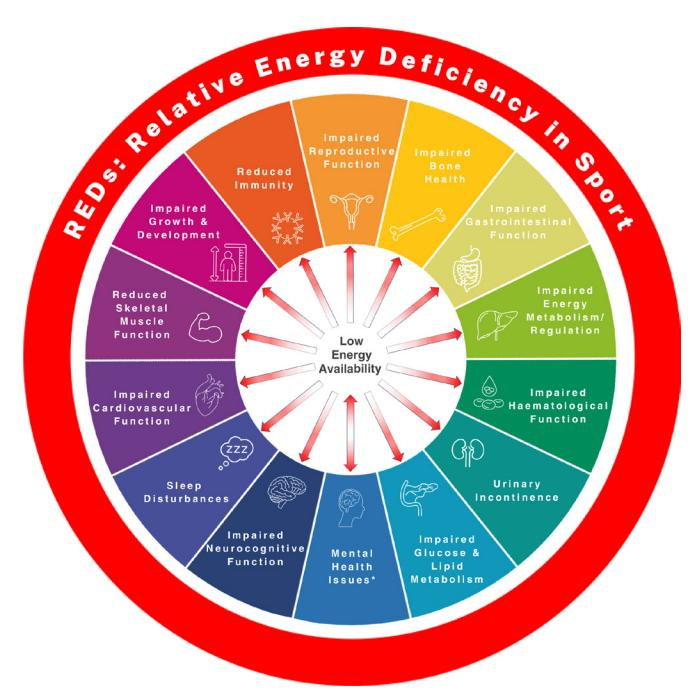
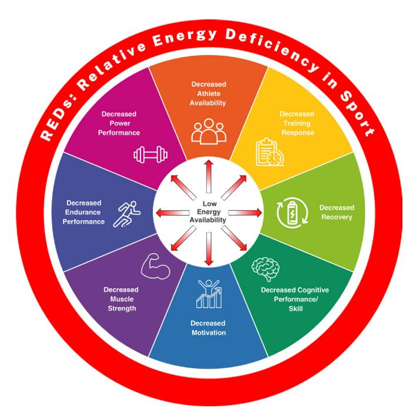
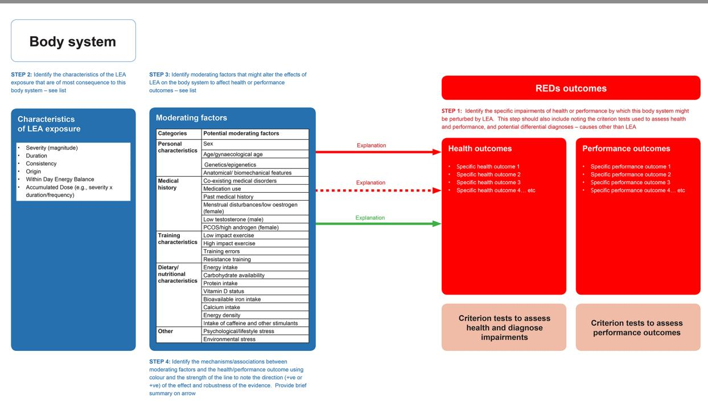
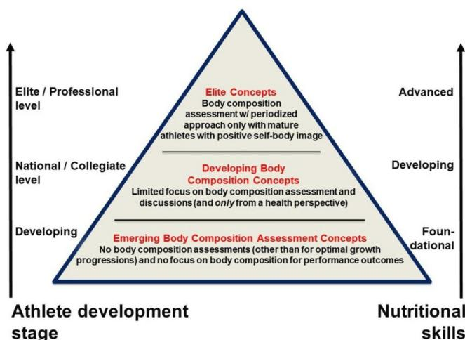
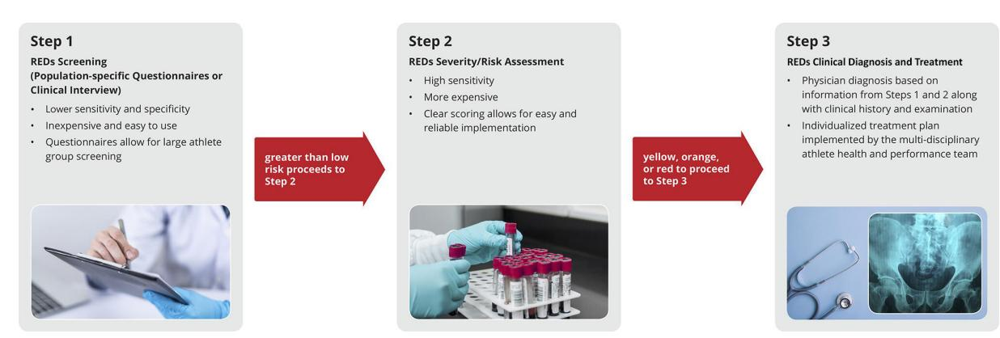
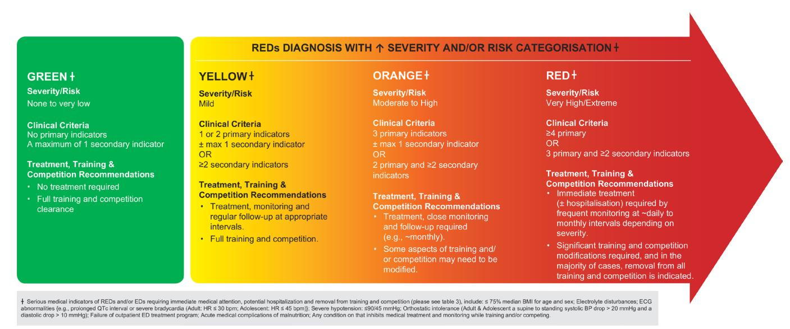

# 2023 International Olympic Committee's (IOC) consensus statement on Relative Energy Deficiency in Sport (REDs)

Margo Mountjoy ,1,2 Kathryn E Ackerman,3 David M Bailey,4 Louise M Burke,5 Naama Constantini,6 Anthony C Hackney ,7 Ida Aliisa Heikura ,8,9 Anna Melin,10 Anne Marte Pensgaard ,11 Trent Stellingwerff,8,9 Jorunn Kaiander Sundgot-Borgen ,12 Monica Klungland Torstveit ,13 Astrid Uhrenholdt Jacobsen,14 Evert Verhagen ,15 Richard Budgett,16 Lars Engebretsen,16 Uğur Erdener17,18

**To cite:** Mountjoy M, Ackerman KE, Bailey DM, et al. Br J Sports Med 2023;**57**:1073–1097.

► Additional supplemental material is published online only. To view, please visit the journal online ([http://dx.doi.](http://dx.doi.org/10.1136/bjsports-2023-106994) [org/10.1136/bjsports-2023-](http://dx.doi.org/10.1136/bjsports-2023-106994) [106994](http://dx.doi.org/10.1136/bjsports-2023-106994)).

For numbered affiliations see end of article.

#### **Correspondence to**

Clinical Professor Margo Mountjoy, Family Medicine, McMaster University Michael G DeGroote School of Medicine, Waterloo, ON, Canada; mountjm@mcmaster.ca

Accepted 20 August 2023

© Author(s) (or their employer(s)) 2023. No commercial re-use. See rights and permissions. Published by BMJ.

#### **Abstract**

Relative Energy Deficiency in Sport (REDs) was first introduced in 2014 by the International Olympic Committee's expert writing panel, identifying a syndrome of deleterious health and performance outcomes experienced by female and male athletes exposed to low energy availability (LEA; inadequate energy intake in relation to exercise energy expenditure). Since the 2018 REDs consensus, there have been >170 original research publications advancing the field of REDs science, including emerging data demonstrating the growing role of low carbohydrate availability, further evidence of the interplay between mental health and REDs and more data elucidating the impact of LEA in males. Our knowledge of REDs signs and symptoms has resulted in updated Health and Performance Conceptual Models and the development of a novel Physiological Model. This Physiological Model is designed to demonstrate the complexity of either problematic or adaptable LEA exposure, coupled with individual moderating factors, leading to changes in health and performance outcomes. Guidelines for safe and effective body composition assessment to help prevent REDs are also outlined. A new REDs Clinical Assessment Tool-Version 2 is introduced to facilitate the detection and clinical diagnosis of REDs based on accumulated severity and risk stratification, with associated training and competition recommendations. Prevention and treatment principles of REDs are presented to encourage best practices for sports organisations and clinicians. Finally, methodological best practices for REDs research are outlined to stimulate future high-quality research to address important knowledge gaps.

## **Introduction**

My body was just deteriorating because it was working harder, but with less food. It's a sign that everything was basically just shutting down. I'd completely lost control of it [body], yet still thought it was just something I had to go through, because the ultimate aim is a certain weight or look[.1](#page-16-0)

Athletes are driven by strong internal and external pressure to achieve optimal performance. Many forms of performance pressure contribute to scenarios that either, intentionally or unintentionally, alter energy intake (EI) and exercise energy expenditure (EEE), resulting in low energy availability (LEA). The mathematical formula for energy availability (EA) that identifies the amount of energy that the body can contribute to functions associated with health, well-being and performance is well-established in sports science/ medicine[2–4](#page-16-1):

EA [Energy Availability] = {EI Energy Intake (kcal)*−* EEE [Exercise Energy Expenditure (kcal)]} FFM [Fat*−*Free Mass (kg) / day]

Scenarios commonly encountered in sport include extreme volumes of EEE, attempts to improve power-to-weight ratios, desire for excessive leanness and sport-specific physique alterations. All of these scenarios can lead to problematic LEA (see Definitions [box](#page-1-0) 1), which can result in negative health and performance implications known as 'Relative Energy Deficiency in Sport' (REDs). REDs (altered from the original acronym 'RED-S' for improved comprehension and dissemination), was first introduced by the International Olympic Committee (IOC) in a consensus statement in 2014,[5](#page-16-2) and was updated in 2018.[6](#page-16-3) Since 2018, there have been considerable scientific advancements in the REDs research field including ~178 REDs and/ or LEA original research publications featuring ~23 822 participants; (80% female), with ~62% of these studies implementing a crosssectional design, ~14% as longitudinal observational and ~12% longitudinal intervention (see literature summary in [online supplemental file](https://dx.doi.org/10.1136/bjsports-2023-106994) [1](https://dx.doi.org/10.1136/bjsports-2023-106994)). These scientific advances have improved our understanding of the underpinning physiology and psychology of REDs and the different clinical presentations between the sexes. There is a wide range in the reported estimated prevalence of LEA/REDs indicators in female (23%– 79.5%[7–16\)](#page-16-4) and male (15%–70%[12–20](#page-16-5)) athletes across a variety of sports due to the lack of a singular definitive diagnosis, mistaken use of LEA and REDs as interchangeable terms, lack of standardisation and accuracy of research methodologies (eg, inaccurate EA measurements), variation in physiological demands among

| biases.                                                        | 21                                      |
|----------------------------------------------------------------|-----------------------------------------|
| the provision for dissent                                      | 22 23 ; (2) being supported by a dedi  |
| context to facilitate further understanding                    | 21 24–30 ; and (3)                      |
| nosis and treatment of REDs                                    | .25 27 29 For REDs scientists, in addi |
| recommended methodologies.                                     | 21 The outcomes of this consensus       |
| 2–5).                                                          | 31                                      |
| on the phase in the life cycle and other circumstances.        | 32–34 In                                |
| Box 1                                                          | Continued                               |
| increased injury risk and decreased sports performance         | .5                                      |
| the form of a mathematical formula 2–4:                        |                                         |
| EA [Energy Availability] ={ EI [Dietary energy Intake (kcal)]- |                                         |
| EEE [Exercise Energy Expenditure (kcal)]} / FFM [Fat-Free Mass |                                         |
| performance. 6                                                 |                                         |
| which effects are benign ( adaptable LEA ) and others in which |                                         |
| health and performance ( problematic LEA ).                    |                                         |
| excessive exercise, diuretic use)]. 172                        |                                         |

demands of exercise are accounted for. Inadequate EI or an increased energy commitment to one biological process favours trade-offs that allocate energy away from other processes, especially growth, reproduction or maintenance.[32](#page-17-4) In particular, such evolutionary selective pressures have favoured adaptations that allocate limited energy supplies during periods of LEA (eg, famines) to biological processes that support immediate survival, as well as long-term reproductive success[.32](#page-17-4) Therefore, humans, like other animals, are adapted to cope with periods of LEA by downregulating biological processes that are temporarily unnecessary or reducible[.32](#page-17-4) Some of these perturbations to body systems might be considered mild and/or transient, representing physiological plasticity[35](#page-17-5) and could be termed *adaptable* LEA (see Definitions [box](#page-1-0) 1).

However, although humans evolved to be physically active, they did not evolve to tolerate some modern elite training programs[36](#page-17-6) or sports-related practices. This is especially the case in endurance sports (often >30hours of training/week)[,37](#page-17-7) which can sometimes result in extreme EEE that exceeds the capacity of the human alimentary tract for sustained energy absorption.[38](#page-17-8) Indeed, the spectrum of exposure to LEA can include scenarios (eg, significant duration, magnitude, frequency—see Definitions [box](#page-1-0) 1), that in conjunction with moderating factors (eg, sex, age, health status), are associated with negative effects on various body systems. Such scenarios, termed *problematic* LEA manifest as impairments of health and well-being, as well as interruption to training (adaptation and enhancement of body systems via exposure to physiological stress) or competition (demonstration of optimal mental and physiological prowess).[39](#page-17-9) In the real world, athletes experience exposure to LEA (purposefully or inadvertently) in various manners along the continuum from adaptable to problematic.[3 40](#page-16-6) Indeed, under certain circumstances, some practices associated with LEA, such as body composition manipulation, periods of intensified training or competition workloads involving prodigious EEE, can be safely and effectively periodised into an athlete's annual plan (eg, the implementation is guided by experts, the athlete has the physical and psychological readiness, adequate recovery is included, and health is maintained)[.41 42](#page-17-10)

REDs is a clinically diagnosed, multifactorial syndrome characterised by the accumulation of the deleterious health and performance outcomes resulting from exposure to problematic LEA. Thus, given the significant scientific advances in the field, the updated 2023 definition of REDs is:

a syndrome of impaired physiological and/or psychological functioning experienced by female and male athletes that is caused by exposure to problematic (prolonged and/or severe) low energy availability. The detrimental outcomes include, but are not limited to, decreases in energy metabolism, reproductive function, musculoskeletal health, immunity, glycogen synthesis and cardiovascular and haematological health, which can all individually and synergistically lead to impaired well-being, increased injury risk and decreased sports performance.

### **Methodology and consensus results**

In addition to facilitating the synthesis of compiled information, consensus methodology also harnesses experts' insights to enable more validated recommendations to be made when the published evidence ranges from insufficient to adequate. The goal of consensus methods is to determine how much independent and diverse experts agree on nuanced and complex issues within a defined topic area while seeking to overcome some of the drawbacks associated with decision-making in groups or committees, which can be frequently dominated by one individual or coalitions representing vested interests.

This REDs consensus statement used the RAND-UCLA Appropriateness Method (RAM)[.43](#page-17-11) A diverse (ie, gender, geographic location, expertise) expert panel of authors was invited, consisting of sports medicine physicians, a sports endocrinologist, registered sports dietitians, sports physiologists, sports scientists, an athlete, a coach and a mental performance consultant. Authors were invited based on their expertise, as demonstrated by previous research, clinical and/or coaching experiences with REDs. From the entire group of authors, smaller working groups of content experts were tasked with preparing specific subtopics prior to the in-person consensus in the form of (1) a referenced summary of the existing scientific literature and (2) voting statements based on key novel and potentially controversial aspects identified in the literature review. These literature summaries and voting statements were compiled, then circulated for online confidential voting (Delphi metho[d44\)](#page-17-12). Answer categories were from strongly disagree, undecided, to strongly agree. We defined three levels of agreement based on which subsequent discussions were held:

- 1. Agreement: ≥80% of authors agreeing on the voting statement, without any author disagreeing.
- 2. Agreement with minority disagreement: ≥80% of authors agreeing on the voting statement, but with one or more authors disagreeing.
- 3. Disagreement: <80% of authors agreeing on the voting statement.

Statements without agreement were discussed at the subsequent meeting held at the Olympic House in Lausanne, Switzerland (September 2022). Authors were allowed to write a minority opinion in the event of disagreement with a statement when the consensus threshold was reached. The voting statements were revised after discussions and then subjected to a second round of confidential electronic voting at the end of the meeting (full details of voting statements, outcomes and actions are available via supplementary materials ([online supplemental files 2–4\)](https://dx.doi.org/10.1136/bjsports-2023-106994)).

## Consensus results

In the first round of online voting, we presented 135 evidence statements to the panel. Full agreement was reached for 76 of the statements. We have outlined our actions taken after in-person discussions in [table](#page-3-0) 1. In the second round of confidential voting, 44 statements were presented to the authors. Of these, 24 were previous statements with disagreement that required a revote, and 20 were new statements. All voting statements reached an agreement or minority disagreement after two rounds of voting, providing a total of 144 statements of which 27 remained with a minority disagreement (ie, 80% agreement was reached, but one or more individuals disagreed with the statement).

#### Equity, diversity and inclusion statement

A diverse expert panel of authors consisted of sports medicine physicians, registered sports dietitians, athletes, coaches, sports physiologists, sports scientists and mental performance consultants. Authors were invited based on their expertise, as demonstrated by previous research, clinical and/or coaching experiences with REDs. In total, 10 females and 7 males from four continents participated.

#### **Key scientific advances since the 2018 REDs consensus statement**

There has been significant growth in the number of studies clearly showing that problematic LEA is the underlying aetiology of REDs. The new evidence on this topic provides a deeper fundamental understanding of how problematic versus adaptable LEA, along with its moderating factors, influences the health and performance of athletes (see Definitions [box](#page-1-0) 1). The key emerging themes are (1) the additive impact of low carbohydrate availability (LCA) with LEA in the development of REDs; (2) the overlap of REDs and overtraining syndrome (OTS) symptomology; (3) the time-course of biomarker responses to problematic LEA in the development of REDs; (4) improved understanding of mental health associations of REDs; (5) advances in knowledge pertaining to REDs in male athletes and (6) para athletes.

# The magnifying impact of LCA in the context of REDs

Most LEA intervention studies are also accompanied by a substantial reduction (25%–60%, depending on magnitude of LEA) in carbohydrate (CHO) ingestion, resulting in concurrent LCA.[45–48](#page-17-13) In the real world, the magnitude of LCA is likely to be even greater considering the emphasis on protein intake during periods of calorie restriction.[49–51](#page-17-14) Recently, several investigations have elucidated CHO's energy-independent or magnifying role in REDsrelated health outcomes. There have been several shortterm (≤6 days) investigations in male endurance athletes comparing the effects of high energy and high CHO availability, high energy with low CHO (<3 g CHO/kg BM/day) but high fat (LCHF), or low energy with low to moderate CHO availability diets on bone, immunity and iron biomarkers. These studies have reported increases in bone resorption biomarkers[52 53](#page-17-15) with a concomitant impairment in biomarkers of bone formation,[53](#page-17-16) as well as increased postexercise concentrations of interleukin-6 (IL-6) and hepcidin after LCA.[54](#page-17-17) These findings suggest deleterious effects on bone, immunity and iron biomarkers as a result of LCA, sometimes in the absence of LEA. More recently, a 3-day intervention in young females also showed a 264% increase in hepcidin with a low energy, low CHO diet compared with only a 69% increase in hepcidin with isocaloric low energy but higher CHO diet.[55](#page-17-18) Additionally, ~3.5 weeks of LCHF diet in elite endurance athletes resulted in impaired markers of bone remodelling both at rest as well as around exercise (up to 3 hours postexercise),[56](#page-17-19) and elevated postexercise IL-6 concentrations compared with an isocaloric high CHO treatment.[57](#page-17-20) Six studies since 2019 have shown an energyindependent and/or magnifying impact of LCA in the accelerated development of REDs outcomes.[52–57](#page-17-15) Accordingly, LEA intervention studies need to also control and account for CHO intake and need to be of longer duration to determine long-term adaptation.

#### Symptomology overlap between REDs and OTS

REDs and OTS are syndromes involving the hypothalamic– pituitary–adrenal axis and have no single validated diagnostic biomarker; they feature a complex overlap of symptoms that hinge on a diagnosis utilising exclusion criteria.[37 58](#page-17-7) Accordingly, a recent narrative review found that 18 of 21 identified OTS-based studies showed indications of LEA and LCA due to large increases in training while failing to compensate with increased EI, and thus may have demonstrated REDs outcomes rather than OTS.[37](#page-17-7) It is important to note that LEA and/or LCA, although challenging to assess, should be *excluded* from an OTS diagnosis as LEA is the underlying aetiology for a REDs diagnosis.[37 59](#page-17-7)

#### Time-course of LEA resulting in REDs

Although acute mild periods of LEA do not always lead to adverse outcomes, problematic LEA exposure leads to REDs. Our scientific understanding of the time-course of LEA leading to validated physiological and psychological signs/ symptoms are still emerging, largely due to difficulties in accurately assessing and controlling for EA in prospective research.[21](#page-17-0) Emerging definitions highlight short-term LEA as a few days to weeks, medium-term as weeks to months and long-term as months to years.[37 40](#page-17-7) However, time-course cutoffs require further scientific validation, may differ between males and females and change with the severity and duration of LEA dose. Still, some signs/symptoms and REDs outcomes that appear to present temporally to various exposure periods of LEA have emerged. Importantly, some short-term signs or symptoms during the acute assessment may only represent a snapshot of a current LEA state and require the exclusion of other potential aetiologies (differential diagnoses). Such signs or symptoms do not always reflect a problematic LEA exposure leading to REDs.

#### Mental health outcomes of REDs

The sports community has prioritised the mental health of elitelevel athletes as evidenced by a sharp rise in consensus statements[60–62](#page-17-21) and prevalence studies[63–65](#page-17-22) on this theme. A parallel focus has been the increased awareness of the risk factors for and the consequences of REDs, where psychological factors contributing to LEA and mental health consequences have been highlighted,[5](#page-16-2) although less well understood.[6 35 66](#page-16-3) Recent qualitative studies[1 67](#page-16-0) involving mainly subelite endurance athletes provide support for this premise, reporting that LEA from intentional (eg, weight regulation) or unintentional (eg, failing to consciously increase EI with increased EEE) origins can be

**Table 1** Results of the online Delphi survey and subsequent actions taken

|                             | Total | Agreement* | Minority disagreement † | Disagreement‡ |
|-----------------------------|-------|------------|-------------------------|---------------|
| Round 1 voting Action taken | 135   | 76         | 29                      | 30            |
| Removed                     | 11    | –          | 2                       | 9             |
| Adjusted wording: revote    | 23    | –          | 3                       | 20            |
| Adjusted wording: no revote | 23    | 23         | –                       | –             |
| Revote                      | 1     | –          | –                       | 1             |
| Added statements            | 20    | –          | –                       | –             |
| Round 2 voting              | 44    | 41         | 3                       |               |
| Overall outcome             | 144   | 117        | 27                      |               |

associated with short-term positive results such as performance improvements or social approval from the coach and the sports culture[.1](#page-16-0) These short-term 'positive' outcomes make it more challenging for athletes to recognise the longer-term potential health and performance implications of exposure to problematic LEA.

Disordered eating (DE) behaviours, eating disorders (EDs) and/or REDs are common among certain athlete cohorts.[68](#page-17-23) LEA and DE behaviours, which exist along the spectrum between optimised nutrition and clinical EDs, may occur in isolation or together[.68](#page-17-23) A prior history of DE behaviours or an ED might perpetuate a continued under-fuelling of energy[1](#page-16-0) and must therefore be considered an important risk factor for developing REDs. DE behaviours and EDs may be exacerbated by social media influence, societal pressures, the athlete's training/coaching entourage, a belief that a specific physique/weight/appearance will improve performance and/or overall body dissatisfaction.[69](#page-17-24) Given the potentially serious outcomes of DE behaviours and EDs, prevention, early identification, and timely interventions should be prioritised.[60 70](#page-17-21)

Psychological indicators associated with problematic LEA and REDs are mood disturbances/fluctuations,[8 71 72](#page-16-7) cognitive dietary restraint,[73](#page-18-0) drive for thinness,[74 75](#page-18-1) reduced sleep qualit[y50 76](#page-17-25) and perfectionistic tendencies.[77](#page-18-2) Depressive symptoms and affective disorders,[8 78 79](#page-16-7) subjectively reported reduced well-being,[73](#page-18-0) primary or secondary exercise dependence/addiction,[80 81](#page-18-3) anxiety related to injury and/or recovery, sport-specific issues such as difficulty coping with weight requirements[67 76](#page-17-26) and the development of EDs[1 82](#page-16-0) are additional adverse mental health outcomes associated with problematic LEA and REDs. However, we must recognise that the picture is still unclear regarding the dynamics of mental health and DE behaviours according to sex and level of competition,[83](#page-18-4) as well as in athletes with physical disabilities.[84](#page-18-5) Furthermore, studies are required to (1) ascertain why many athletes experience few or no negative mental health consequences in the early stages of problematic LEA exposure[20 72 85](#page-17-27) and (2) to better understand the reciprocal function of the different psychological variables[.86 87](#page-18-6) As perceived stress appears to be common for many mental health concerns related to LEA and REDs, a heightened focus should be placed on developing psychologically safe environments surrounding athletes. Details on creating safe sport environments are outlined in the IOC consensus statement on mental health in elite athletes.[60](#page-17-21)

#### REDs in male athletes

Although the 2014 IOC REDs consensus statement[5](#page-16-2) and the 2018 update paper[6](#page-16-3) alluded to the impact of LEA and REDs in male athletes, the available research on males at the time was scant. Since then, although the research community has emphasised the need for studies in men, currently only 20% of original studies from 2018 to 2022 include male athletes as subjects (see literature search summary in [online supplemental file 1](https://dx.doi.org/10.1136/bjsports-2023-106994)).

While a universal cut-off of 30 kcal/kg FFM/day as a threshold of LEA leading to some REDs outcomes in females is debated,[88](#page-18-7) such a cut-off or range at which males experience REDs-related symptoms is even less understood,[89](#page-18-8) but appears to be lower (eg, ~9to 25 kcal/kg FFM/day)[.17 46 72 90 91](#page-17-28) Indeed, there is evidence that most males can sustain a lower EA before physiological and psychological disturbances manifest. Nevertheless, problematic LEA can occur in male athletes and is associated with negative effects on the hypothalamic–pituitary–gonadal (HPG) axis and associated hormones[72 92–100;](#page-18-9) changes in metabolic hormones[46 101–103;](#page-17-29) impairments to immune function[104;](#page-18-10) detriments to bone health[105;](#page-18-11) as well as negative performance outcomes[18 90 104 106](#page-17-30) and decreased lean body mass accrual[.107](#page-18-12) Although changes are comparable to those REDs outcomes found in female athletes, the magnitude of the effects on some physiological parameters and the threshold at which these effects manifest appear to be variable between the sexes. Two emerging potential indicators of REDs in males are the presence of low libido and decreased morning erections, which have been identified as physiological consequences of LEA[.108–111](#page-18-13)

#### REDs in para athletes

The estimated prevalence of REDs in para athletes is unknown; however, there are concerns that para athletes may be at even higher risk of problematic LEA than able-bodied athletes[.112](#page-18-14) Among US para athletes preparing for Paralympic Games, 62% attempted to alter weight or body composition to enhance performance, 32% had elevated scores on the Eating Disorder Examination Questionnaire (EDE-Q) pathological behaviour subscale scores and 44% of the female athletes reported menstrual dysfunction.[113](#page-18-15) Another study of EA estimates in wheelchair athletes reported that nearly the entire cohort fulfilled criteria of LEA across at least one 24-hour period during the week-long study. [114](#page-18-16) Whether negative body image, risk of LEA and/or DE behaviours and EDs are related to their disability, athletic status, competitive pressure, training environment or a combination of factors remains to be elucidated.

Problematic LEA can lead to impaired bone health and bonerelated injury secondary to factors such as altered skeletal loading experienced by para athletes (ie, the lack of loading stimulus experienced by wheelchair athletes and/or low-impact sports). Furthermore, in unilateral amputees, the affected limb may exhibit reduced bone mineral density (BMD).[115](#page-18-17) Additionally, the presence of central neurological injury may result in alterations of the HPG axis and baseline menstrual function, regardless of energy status[.116 117](#page-18-18) The risk of bone stress injury (BSI) is of particular concern in athletes with spinal cord injury who experience a substantial loss of BMD immediately postinjury and hence have a high incidence of low BMD for age and/ or osteoporosis.[118](#page-18-19) Dual-energy X-ray absorptiometry (DXA) is the most well-accepted tool for the measurement of BMD, but there are limitations in using standard population comparison reporting (eg, Z-scores); normative, reference datasets are determined from measurements in able-bodied populations and stratified by age-matched, sex-matched and limited race/ ethnicity-matched categories to determine diagnostic cut-offs for 'low BMD for age' and 'osteoporosis'[.119 120](#page-18-20) Therefore, there is a need for research in a wide variety of para athletes to develop BMD assessment techniques and reference ranges appropriate for the para athlete population.[112](#page-18-14)

#### REDs Conceptual Models

The REDs Conceptual Models were developed to raise awareness of the athletic, coach, sports science and sports medicine communities to this syndrome. [Figure](#page-5-0) 1 (REDs Health Model) and [figure](#page-5-1) 2 (REDs Performance Model) are conceptual models that demonstrate the range of body systems for which there is theoretical, empirical, and/or clinical evidence of impairments that manifest in different ways. Undoubtedly, these outcomes occur over different timeframes and with different severity and significance to the individual athlete due to various moderating factors[.24](#page-17-31)

Unlike earlier REDs models[,5 6](#page-16-2) LEA is placed at the centre of the hub to note its role as an exposure variable. Graded arrows

illustrate a continuum from adaptable LEA to problematic LEA exposure, with the former representing benign physiological adaptations to energy fluctuations (ie, physiological plasticity),[44](#page-16-8) while the outer region of the hub notes the range of health and performance concerns which can be associated with the latter. A spectrum of energy mismatches, with differing severity of consequences, was part of the original concept of EA.[2 4](#page-16-1) However, the updated model uses qualitative terms (adaptable, problematic) as an alternative to the previous focus on quantitative assessments with universally applied thresholds of concern. The most well-documented sequelae of problematic LEA are impairments of reproductive function and bone health in female and male athletes[.121–123](#page-18-21) Tables [2 and 3](#page-6-0) summarise these and many other conditions associated with LEA in athletes and other populations. Future updates will likely revise the range of recognised sequelae associated with REDs as we learn more about the effects of energy allocation and potential prioritisation of various body systems.

It is important to note that the REDs Health and Performance Conceptual Models are not separate entities; they involve considerable overlap. Indeed, presenting this information in two wheels simply offers different audiences an appreciation of the issues of greatest relevance to them. Each sign or symptom within the REDs Conceptual Models can occur due to aetiologies other than problematic LEA (tables [2 and 3\)](#page-6-0). Therefore, the exclusion of primary aetiologies (differential diagnoses) should occur when diagnosing REDs (see Clinical Assessment Tool section below).

# REDs Physiological Model

Experts in the field have long realised that applying LEA exposure (ie, severity, duration, frequency) on subsequent REDs short, medium and long-term outcomes is complex and dependent on many moderating factors. Accordingly, and novel to this 2023 consensus update, a more researched and clinically based unifying physiological model has been developed. To progress the REDs scientific field forward, we need integrated dynamic physiological models that can help explain the biological complexity and interaction within and between various body systems, as well as the inconsistencies in the manifestation of REDs signs and symptoms resulting from problematic LEA. Ideally, unique physiological models can be developed for each body system within the Health Conceptual Models (see [figure](#page-5-0) 1) before being integrated to acknowledge substantial physiological 'cross-talk' among systems.

*Step 1* of the REDs Physiological Model for each body system ([figure](#page-9-0) 3) is to identify the range of specific health and performance impairments that might occur from LEA exposure, along with details of the criterion tests and metrics that best assess the presence of such disturbances. *Step 2* is to focus on characteristics of an athlete's LEA exposure (see [figure](#page-9-0) 3 for examples) that might create a higher risk of it being problematic; for example, the duration, magnitude or origin of the LEA mismatch (see [figure](#page-9-0) 3 for examples). *Step 3* is to consider moderating factors in an individual athlete's makeup, behaviours or environment that may either exacerbate or protect against various LEA-associated health and/or performance dysfunctions as they related to the specific body system. A systematic identification of such moderating factors is proposed ([figure](#page-9-0) 3).

The development of a physiological model for each body system, underpinned by a 'systems biology mindset'[,124](#page-18-22) will enable a more nuanced assessment of the individual athlete and whether their specific combination of LEA exposure and

Figure 1 REDs Health Conceptual Model. The effects of LEA exist on a continuum. While some exposure to LEA is mild and transient termed adaptable LEA (arrow depicted in white), problematic LEA is associated with a variety of adverse REDs outcomes (arrow depicted in red). \*Mental Health Issues can either precede REDs or be the result of REDs. LEA, low energy availability; REDs, Relative Energy Deficiency in Sport.

Figure 2 REDs Performance Conceptual Model. The effects of LEA exist on a continuum. While some exposure to LEA is mild and transient, termed adaptable LEA (arrow depicted in white), problematic LEA is associated with a variety of adverse REDs performance outcomes (arrow depicted in red). LEA, low energy availability; REDs, Relative Energy Deficiency in Sport.

**Table 2** Potential REDs health outcomes resulting from problematic LEA

|                                                                                                                                                                                 | Populations with LEA (assessed directly or via surrogates) providing Examples of differential diagnoses (issues                                                                                                                                                                                   |
|---------------------------------------------------------------------------------------------------------------------------------------------------------------------------------|---------------------------------------------------------------------------------------------------------------------------------------------------------------------------------------------------------------------------------------------------------------------------------------------------|
| Spoke Examples of impairment                                                                                                                                                    | evidence of impairment to be excluded)                                                                                                                                                                                                                                                            |
| Impaired reproductive function Females                                                                                                                                          | Females                                                                                                                                                                                                                                                                                           |
| SF,                                                                                                                                                                             | 45 127 173–175 F A176–179                                                                                                                                                                                                                                                                         |
| SF                                                                                                                                                                              | ,88 F A168 180–184                                                                                                                                                                                                                                                                                |
| F A178                                                                                                                                                                          |                                                                                                                                                                                                                                                                                                   |
| F A185 186                                                                                                                                                                      |                                                                                                                                                                                                                                                                                                   |
| SF                                                                                                                                                                              | ,88 F A183 187 188                                                                                                                                                                                                                                                                                |
| F A181–183 187 189 190                                                                                                                                                          |                                                                                                                                                                                                                                                                                                   |
| SF                                                                                                                                                                              | ,88 174 F A187                                                                                                                                                                                                                                                                                    |
| SF                                                                                                                                                                              | ,88 F A187                                                                                                                                                                                                                                                                                        |
| M                                                                                                                                                                               | A18 90 98 102 191–193                                                                                                                                                                                                                                                                             |
| M                                                                                                                                                                               | A194                                                                                                                                                                                                                                                                                              |
| M                                                                                                                                                                               | A81 108 111                                                                                                                                                                                                                                                                                       |
| M                                                                                                                                                                               | A108 111 194                                                                                                                                                                                                                                                                                      |
| Alteration in LH concentrations or pulsatility Reduced oestrogen and progesterone Reduced testosterone                                                                          | Primary amenorrhoea : constitutionally delayed puberty, various genetic syndromes, anatomic abnormalities                                                                                                                                                                                         |
| Primary amenorrhoea Oligomenorrhoea/menstrual irregularities Secondary amenorrhoea (FHA)                                                                                        | Secondary amenorrhoea: pregnancy, PCOS, pituitary mass (eg, prolactinoma), thyroid abnormalities                                                                                                                                                                                                  |
| Luteal phase defects/deficiency Anovulatory cycles Males Reduced testosterone Sperm abnormalities Erectile dysfunction Females and males Decreased libido                       | Other menstrual dysfunction: use of hormonal birth control methods, physiologic stress Males Primary hypogonadism (gonadal disease), Hypogonadism (eg, hypothalamic/pituitary disease), toxic exposures, infection, psychosomatic neurological dysfunction                                        |
| Impaired bone health Longitudinal loss of BMD/lack of expected                                                                                                                  |                                                                                                                                                                                                                                                                                                   |
| ANF,                                                                                                                                                                            | 195 FA, 196 MA 197                                                                                                                                                                                                                                                                                |
| F A49 198–200                                                                                                                                                                   | MA 18 49 200 201                                                                                                                                                                                                                                                                                  |
| F A202–204                                                                                                                                                                      | MA 205                                                                                                                                                                                                                                                                                            |
| FA,                                                                                                                                                                             | 49 81 206–209 MA 49 81 210                                                                                                                                                                                                                                                                        |
| SF                                                                                                                                                                              | ,125 FA ,47 170 179 211 MA 53 212 213                                                                                                                                                                                                                                                             |
| bone accrual or maintenance (younger populations) Lower BMD/low Z-score Impaired bone strength or microarchitecture Bone stress injuries Change/differences in bone remodelling | Low BMD: genetic bone disorders (eg, osteogenesis imperfecta), hyperparathyroidism, poor micronutrient intake (eg, calcium and vitamin D), malabsorption disorders (eg, coeliac disease), malignancies (eg, leukaemia, lymphoma, metastasis), renal diseases, medications (eg, anabolic steroids) |
| biomarkers                                                                                                                                                                      | Bone stress injury : External reasons (eg, training errors, surface, shoes) or internal issues (eg, body build, medical predispositions as above)                                                                                                                                                 |
| Impaired GI function Abdominal pain/cramps/bloating/alteration                                                                                                                  |                                                                                                                                                                                                                                                                                                   |
| FA,                                                                                                                                                                             | 8 81 189 214 MA 81 GI diseases (eg, Coeliac disease, inflammatory                                                                                                                                                                                                                                 |
| in bowel movements                                                                                                                                                              | bowel disease, Helicobacter pylori , gastro oesophageal reflux, functional dyspepsia/ constipation), medications (eg, antidepressants, iron pills, narcotics, laxative/cathartic use in EDs)                                                                                                     |
| Impaired energy metabolism/ regulation Subclinically or clinically low T3                                                                                                       |                                                                                                                                                                                                                                                                                                   |
| SF,                                                                                                                                                                             | 127 165 215 216 FA ,49 168 170 184 188 190 217 218 Primary or central (secondary and tertiary)                                                                                                                                                                                                    |
| M                                                                                                                                                                               | A49 192 hypothyroidism, medications/supplements                                                                                                                                                                                                                                                   |
| F A182 189 190 217–222 Low RMR/RMR ratio                                                                                                                                        | MA 103 191 223                                                                                                                                                                                                                                                                                    |
| SF Reduced leptin                                                                                                                                                               | ,45 160 FA ,47 170 179 188 217 M A46 224                                                                                                                                                                                                                                                          |
| SF Increased cortisol                                                                                                                                                           | ,127 175 FA, 178 179 184 222 225 M A80 102                                                                                                                                                                                                                                                        |
|                                                                                                                                                                                 | Increased cortisol: physiologic stress, Cushing disease, steroid use                                                                                                                                                                                                                              |
| Impaired haematological status Low iron status                                                                                                                                  |                                                                                                                                                                                                                                                                                                   |
| FA                                                                                                                                                                              | 226 Acute or chronic blood loss (eg, menstrual                                                                                                                                                                                                                                                    |
| SF Increased hepcidin concentrations/response                                                                                                                                   | ,55 M A171 227 cycle, GI bleeding), RBC destruction                                                                                                                                                                                                                                               |
| M Reduced iron absorption                                                                                                                                                       | A227 (eg, haemolysis, haemoglobinopathy,                                                                                                                                                                                                                                                          |
| FA, Lower haemoglobin concentration/mass                                                                                                                                        | 228 MA 73 splenomegaly), poor micronutrient intake                                                                                                                                                                                                                                                |
| M Reduced response to altitude training                                                                                                                                         | A229 (eg, iron, vitamin B12, folate), bone marrow diseases                                                                                                                                                                                                                                        |
| Urinary incontinence Urinary incontinence FA                                                                                                                                    | 230–232 Persistent urinary incontinence: trauma (eg, childbirth, surgery, radiation), anatomical abnormalities, neurological diseases Temporary urinary incontinence: pregnancy, urinary tract infection, constipation, certain foods and drugs                                                   |
| Impaired glucose and lipid metabolism Reduced fasting/24-hour glucose                                                                                                           |                                                                                                                                                                                                                                                                                                   |
| SF,                                                                                                                                                                             | 127 FA ,184 214 219 M A233 Impaired glucose metabolism: insulinoma,                                                                                                                                                                                                                               |
| SF Reduced fasting/24-hour insulin                                                                                                                                              | ,127 FA ,47 MA 46 102 233 234 critical illness, medications, adrenal                                                                                                                                                                                                                              |
| FA, Elevated total cholesterol/LDL cholesterol                                                                                                                                  | 181 235 236 MA 72 192 193 insufficiency Impaired lipid metabolism: familial hyperlipidaemia                                                                                                                                                                                                       |
| Mental health issues Depression                                                                                                                                                 |                                                                                                                                                                                                                                                                                                   |
| FA,                                                                                                                                                                             | 8 78 79 M A79 Primary psychologic/mood disorders                                                                                                                                                                                                                                                  |
| FA, Exercise dependence/addiction                                                                                                                                               | 81 237 MA 80 81                                                                                                                                                                                                                                                                                   |
| FA, DE behaviours/EDs                                                                                                                                                           | 81 182 219 M A80 81                                                                                                                                                                                                                                                                               |
| Impaired neurocognitive function Reduced/impaired memory                                                                                                                        |                                                                                                                                                                                                                                                                                                   |
| FA,                                                                                                                                                                             | 238 ANF 239 Dementia (eg, Alzheimer’s disease), vitamin                                                                                                                                                                                                                                           |
| AN Reduced/impaired decision-making                                                                                                                                             | F240 deficiencies, infections, malignancies, ADHD,                                                                                                                                                                                                                                                |
| F A241 Reduced/impaired spatial awareness                                                                                                                                       | substance use disorder, primary psychologic/                                                                                                                                                                                                                                                      |
| AN Poor planning/cognitive flexibility                                                                                                                                          | F242 mood disorders, traumatic brain injury                                                                                                                                                                                                                                                       |
| F A238 Reduced executive function                                                                                                                                               |                                                                                                                                                                                                                                                                                                   |

Continued

secondary moderators is likely to lead to positive, neutral or negative health and/or performance outcomes.

# **Clinical applications**

#### Assessment of EA

Seminal researc[h45 125](#page-17-13) around EA in habitually sedentary females identified a continuum of zones ranging from low to high risk of harm (eg, high EA for mass gain and growth ≥45 kcal/kg FFM/day; adequate EA for weight maintenance and support of body function = ~45 kcal/kg FFM/day; reduced EA for body mass/fat loss=30–45 kcal/kg FFM/day; and LEA causing health implications ≤30 kcal/kg FFM/day).[126](#page-18-28) The concept of the LEA threshold (30 kcal/kg FFM/day), below which health problems occurred, was based on elegant but short-term laboratory studies that investigated stepwise changes in EA, perturbations of sex hormone[s45 127 128](#page-17-13) and changes in markers of bone turnover[125](#page-18-24) in a small sample of sedentary females. Although this concept was intended as a guide, rather than a diagnostic end-point, more recent information gleaned from real-life clinical observations, as well as short-term studies,[88](#page-18-7) theoretical constructs and methodological challenges in assessment, around the frailty of a single, universal threshold[,129](#page-19-7) have identified large differences in the EA level associated with health and performance concerns between individuals, the sexes, and among different body systems. Therefore, although EA calculations may inform research interventions or observations, there are risks in setting a definitive clinical threshold of EA due to many moderating factors.

Unfortunately, the measurement of EA in free-living athletes is challenged by a high level of burden (eg, time, effort) to the participant and assessor. Also, protocols to undertake EA assessments or EA-based diet prescription will continue to be challenged by the errors associated with accurately measuring EI, EEE and other contributing components (eg, FFM, resting metabolic rate (RMR)),[40 49 129](#page-17-33) but these can be better managed in the future by implementing a standardised approach. Protocols that achieve a harmonised time-course for assessment and the individual components of EA may assist in future LEA and REDs activities by standardising the errors and limitations of the assessment, and balancing the issues of time and resource burden, feasibility and measurement precision. Future use of standardised methodologies should assist in better assessment of EA, more nuanced interpretation of past and future data, and better replication or comparison of work in this area.

# Body composition assessment and management

Body composition assessment and management are important for optimising health and athletic performance, particularly in weight-sensitive and leanness-demanding sports[.130](#page-19-8) Athletes may experience internal and/or external pressure to attain an 'athletic look' (aesthetic), potentially leading to body dissatisfaction and LEA, and then to symptoms of REDs, DE behaviours or EDs[.76 131](#page-18-29) This is of concern, especially for young athletes, due to potentially long-lasting negative physical and psychological outcomes. Thus,

|                                  |                                                                                                                                                                                                                 | Populations with LEA (assessed directly or via surrogates) providing | Examples of differential diagnoses (issues                                                                                                                                 |
|----------------------------------|-----------------------------------------------------------------------------------------------------------------------------------------------------------------------------------------------------------------|----------------------------------------------------------------------|----------------------------------------------------------------------------------------------------------------------------------------------------------------------------|
| Spoke                            | Examples of impairment                                                                                                                                                                                          | evidence of impairment                                               | to be excluded)                                                                                                                                                            |
| Sleep disturbances               | Sleep disturbances (self-reported)                                                                                                                                                                              | FA,                                                                  |                                                                                                                                                                            |
|                                  |                                                                                                                                                                                                                 | 76 MA 50                                                             | Primary psychologic/mood disorders, shift work, obstructive sleep apnoea, chronic pain/ injury, nocturia, medications/substance use, restless legs syndrome               |
| Impaired cardiovascular function | ECG abnormalities (eg, sinus bradycardia,                                                                                                                                                                       |                                                                      |                                                                                                                                                                            |
|                                  |                                                                                                                                                                                                                 | FA, 189 243 MA ,72 244 ANM ,245 AN F246 247                          |                                                                                                                                                                            |
|                                  |                                                                                                                                                                                                                 | FA, 243 248 ANF, 249 MA 244                                          |                                                                                                                                                                            |
|                                  |                                                                                                                                                                                                                 | FA, 221 235 243 250–254 MA 255                                       |                                                                                                                                                                            |
|                                  |                                                                                                                                                                                                                 | ANF, 256 AN M245 256                                                 |                                                                                                                                                                            |
|                                  | QT prolongation and QT dispersion) Haemodynamic abnormalities (eg, hypotension and orthostatic hypotension, syncope) Impaired endothelial function/reduced blood flow Cardiac abnormalities (eg, MVP, decreased |                                                                      | Bradycardia : Genetic, ultra-endurance training, hypothyroidism, medications (eg, beta blockers), toxic exposures, electroconductive disorders, electrolyte abnormalities |
|                                  | left ventricular mass, decreased left ventricular systolic function, myocardial fibrosis)                                                                                                                       |                                                                      | Hypotension: illness, medications, dehydration                                                                                                                             |
| Reduced skeletal muscle function | Reduced rate of muscle protein synthesis                                                                                                                                                                        |                                                                      |                                                                                                                                                                            |
|                                  |                                                                                                                                                                                                                 | FA, 257–259 SM ,260 MA 257 258                                       | Inadequate protein intake                                                                                                                                                  |
|                                  | Reduced rates of muscle glycogen restoration                                                                                                                                                                    | FA, 261 MA 48 262                                                    | Inadequate CHO intake                                                                                                                                                      |
| Impaired growth and development  | Reduced IGF-1                                                                                                                                                                                                   |                                                                      |                                                                                                                                                                            |
|                                  |                                                                                                                                                                                                                 | SF, 127 215 FA, 168 170 M A192 234 263 264                           | Constitutional delayed puberty, chronic                                                                                                                                    |
|                                  | Increased GH/GH resistance                                                                                                                                                                                      | SF ,127 FA ,178 M A102 264                                           | diseases, GH deficiency, congenital or acquired                                                                                                                            |
|                                  | Deviation from the expected growth curve                                                                                                                                                                        | FA, 186 ANF, 265 266 ANM 267 268                                     | hypogonadotropic hypogonadism, genetic defects, hyperprolactinaemia, long-term drug use (eg, anabolic steroids, opioids, glucocorticosteroids)                             |
| Reduced immunity                 | Increased infection/illness susceptibility                                                                                                                                                                      |                                                                      |                                                                                                                                                                            |
|                                  |                                                                                                                                                                                                                 | FA, 10 269–271 MA 10 269 271                                         | Primary or acquired immune deficiency (eg,                                                                                                                                 |
|                                  | Change in immune biomarkers                                                                                                                                                                                     | FA, 272 MA 273                                                       | chemotherapy, viral infections) Intensive exercise without LEA                                                                                                             |

Each of these outcomes can occur in the absence of LEA, therefore the differential diagnosis should be considered in the assessment and diagnosis of REDs severity and/or risk. Populations providing evidence types: SF: sedentary females; FA: female athletes; ANF: females with anorexia nervosa; MA: male athletes; SM: sedentary males; ANM: males with anorexia nervosa.

ADHD, attention-deficit/hyperactivity disorder; CHO, carbohydrate; ECG, electrocardiogram; EDs, eating disorders; FHA, functional hypothalamic amenorrhoea; GH, growth hormone; GI, gastrointestinal; IGF-1, insulin-like growth factor-1; LDL, low density lipoprotein; LEA, low energy availability; LH, luteinising hormone; MVP, mitral valve prolapse; OCD, obsessive compulsive disorder; PCOS, polycystic ovary syndrome; RMR, resting metabolic rate; T3, triiodothyronine.

body composition assessment is recommended only for medical purposes under 18 years of age[26 132 133](#page-17-35) (see [figure](#page-9-1) 4). Exceptional circumstances may exist where body composition assessment may be justified for athletes <18 years. Still, such a decision warrants careful consideration and consensus among the athletes' health and performance team and requires guardian consent.

Many sports have engrained cultures where coaches and members of the athlete health and performance team exert subtle

**Table 3** Potential REDs performance outcomes that can result from problematic LEA

|                                                                                                                                                                                                          | Athletic populations with LEA (assessed directly or via surrogates) providing        |
|----------------------------------------------------------------------------------------------------------------------------------------------------------------------------------------------------------|--------------------------------------------------------------------------------------|
| Spoke Examples of direct or indirect impairment evidence of impairment                                                                                                                                   |                                                                                      |
| Tier 4* FA (n=85) and MA (n=47) Olympic athletes from 11 different sport Decreased athlete Increase in training days lost or modified due to illness or injury (eg, impaired preparation)                | s10                                                                                  |
| Tier 4 FA (n=55) and MA (n=26) Olympic athletes from 11 different sports availability (illness and                                                                                                       | 269                                                                                  |
| Tier 4 FA endurance athletes (n=45 injury)                                                                                                                                                               | )214                                                                                 |
| Tier 4 FA endurance athletes (n=13                                                                                                                                                                       | )274                                                                                 |
| Tier 3 FA college athletes (n=116) from endurance, power and team sport                                                                                                                                  | s275 Unspecified Tier FA high-school athletes (n=163) from endurance, power and team |
| sports 276                                                                                                                                                                                               | Unspecified Tier FA high-school athletes (n=249) from aesthetic, endurance and team  |
| sports 277                                                                                                                                                                                               |                                                                                      |
| A mix of Tier 1–4 FA (n=833                                                                                                                                                                              | )270                                                                                 |
| Tier 2 FA figure skaters (n=137)                                                                                                                                                                         | 278                                                                                  |
| Tier 4 FA endurance athletes (n=13 Inability to compete at key competitions due to illness or injury                                                                                                     | )274 Unspecified Tier FA high school athletes                                        |
| (n=163) from endurance, power and team sports                                                                                                                                                            | 276                                                                                  |
| Reduced performance of 5 km on-water rowing following a period of intensified training                                                                                                                   |                                                                                      |
| Decreased aerobic (4000m time trial) and anaerobic (15 s) performance after 2 weeks                                                                                                                      |                                                                                      |
| Tier 2 club level FA endurance runners (n=16) Decreased training Decreased rather than increased performance of treadmill protocol following 4 weeks response intensified training plus 2 weeks recovery | 71                                                                                   |
| Tier 4 national level MA (n=5) and FA rowers (n=5                                                                                                                                                        | )279                                                                                 |
| Tier 3 junior national level FA swimmers (n=10) Reduced swimming velocity in 400m time trial after 12 weeks of training                                                                                  | 168                                                                                  |
| Unspecified mixed tier FA (n=1000 Self-reported reduction in training response                                                                                                                           | )8                                                                                   |
| Tier 3 MA road cyclists (n=13 intensified training including inadequate energy intake                                                                                                                    | )106                                                                                 |
| Decreased recovery Direct: self-reported failure to recover between training sessions                                                                                                                    |                                                                                      |
| Tier 4 FA (n=8) and MA (n=4) lightweight rowers                                                                                                                                                          | 76                                                                                   |
| Tier 3 MA endurance runners (n=7) Indirect: reduced glycogen synthesis                                                                                                                                   | 48                                                                                   |
| Tier 1 MA (n=6) and FA (n=7) endurance athletes                                                                                                                                                          | 261                                                                                  |
| Unspecified tier resistance-trained FA (n=7) and MA (n=8 Indirect: reduced muscle protein synthesis                                                                                                      | )257                                                                                 |
| Tier 2 FA (n=19) endurance athlete Indirect: reduced PCr recovery                                                                                                                                        | s280                                                                                 |
| Tier 4 FA endurance athletes (n=30) Decreased cognitive Reduced reaction time                                                                                                                            | 184                                                                                  |
| Unspecified tier FA (n=1000) performance/skill Self-reported impaired judgement and decreased coordination and concentration                                                                             | 8                                                                                    |
| Decreased motivation Decreased well-being                                                                                                                                                                |                                                                                      |
| Tier 3 MA endurance athletes (n=18)                                                                                                                                                                      | 90                                                                                   |
| Tier 4 national level MA (n=5) and FA rowers (n=5 Increase in total mood disturbance (eg, fatigue, vigour)                                                                                               | )279                                                                                 |
| Unspecified tier FA (n=1000) Self-reported increase in irritability and depression                                                                                                                       | 8                                                                                    |
| Tier 2–4 Mix of sports FA (n=8) Emotional lability                                                                                                                                                       | 67                                                                                   |
| Tier 3 Endurance FA (n=10) and MA (n=2) Increased irritability                                                                                                                                           | 67                                                                                   |
| Tier 3 MA Road cyclists (n=13 Increase in total mood disturbance and general stress                                                                                                                      | )106                                                                                 |
| Tier 4 FA (n=8) and MA (n=4) lightweight rowers Self-reported decrease in mood, emotional self-regulation, concentration, social interaction, food anxiety                                               | 76                                                                                   |
| Decreased muscle strength Decreased neuromuscular strength                                                                                                                                               |                                                                                      |
| Tier 4 FA endurance athletes (n=30)                                                                                                                                                                      | 184                                                                                  |
| Tier 3 MA endurance athletes (n=18) Decreased explosive power (countermovement jump)                                                                                                                     | 90                                                                                   |
| Tier 2–3 MA bodybuilder (n=1 Decreased explosive power (countermovement jump, reactive jump)                                                                                                             | )281                                                                                 |
| Tier 2 junior elite FA cross country skiers (n=19 Decreased concentric hamstring peak torque                                                                                                             | )282                                                                                 |
| Tier 2–3 MA bodybuilder (n=1 Decreased isometric bench press                                                                                                                                             | )85                                                                                  |
| Tier 2–3 FA fitness competitors (n=27 Decreased one rep max squat, bench press, deadlift                                                                                                                 | )188                                                                                 |
| Tier 2–3 MA bodybuilder (n=1 Decreased concentric and eccentric peak force                                                                                                                               | )244                                                                                 |
| Tier 2–3 FA physique athlete (n=1                                                                                                                                                                        | )283                                                                                 |
| Reduced 5 km on-water rowing performance                                                                                                                                                                 |                                                                                      |
| Tier 2 club level FA endurance runners (n=16) Decreased endurance Decreased performance of treadmill run protocol                                                                                        | 71                                                                                   |
| Tier 4 national level MA (n=5) and FA rowers (n=5 performance                                                                                                                                            | )279                                                                                 |
| Tier 4 FA endurance athletes (n=30 Decreased neuromuscular endurance                                                                                                                                     | )184                                                                                 |
| Unspecified Tier FA athletes (n=1000 Self-reported reduction in endurance performance                                                                                                                    | )54                                                                                  |
| Tier 3–4 FA endurance athletes (n=33) Decreased VO2 max                                                                                                                                                  | 284                                                                                  |
| Tier 3 MA road cyclists (n=50 Apparent underperformance in 60min functional power threshold vs training load                                                                                             | )18                                                                                  |
| Tier 3 MA road cyclists (n=13 Decreased performance of 4000m time trial                                                                                                                                  | )106                                                                                 |
| Tier 4 FA (n=8) and M (n=4) lightweight rower Self-reported decrease in rowing performance                                                                                                               | s76                                                                                  |
| Decreased performance of 15 s cycling sprint                                                                                                                                                             |                                                                                      |
| Tier 3 junior national level FA swimmers (n=10) Decreased power Reduced velocity during 400m swim time trial                                                                                             | 168                                                                                  |
| Tier 2–3 MA bodybuilder (n=1 performance Decreased anaerobic (Wingate) performance                                                                                                                       | )50                                                                                  |
| Tier 2 MA second and third Dan black belt Judo athletes (n=11 Decreased number of throws in a Judo Specific Fitness Test                                                                                 | )104                                                                                 |
| Tier 3 MA road cyclists (n=13                                                                                                                                                                            | )106                                                                                 |
| *Tiering system according to McKay et al FA, female athlete; MA, male athlete; PCr, phosphorylated creatine; VO2 max, maximal oxygen consumption.                                                        |                                                                                      |

to extreme pressure on athletes to regulate body weight and composition.[131 134](#page-19-9) Unfortunately, many members of the athlete entourage appear to (1) lack the knowledge of safe regulation of body weight and composition and how it can be utilised to improve performance while maintaining health; (2) have ignorance of the suitability of various body composition methods and the possible negative health effects consequent to inappropriate assessment and (3) have inadequate communication skills, with lack of optimised protocols on how to manage and safely implement the data to promote health and performance without the added risk of developing REDs, DE behaviours or EDs. In some instances, erroneous and intensive body composition measurement could lead to allegations of harassment and abuse by athletes[.132 135](#page-19-10) It is important, therefore, to identify valid and reliable body composition assessment methods and develop clear guidelines on how to interpret, manage, and communicate safely to athletic populations.[132](#page-19-10)

Choosing an appropriate body composition assessment method involves consideration of its accuracy, repeatability, utility and cost. Some easy-to-use methods are 'doubly indirect', relying on regression equations to derive a body fat per cent; they do not provide valid data, use spurious assumptions and/or are influenced greatly by athlete presentation (eg, hydration levels).[136](#page-19-11) Conversely, with operator training and sampling several sites, reliable assessments of subcutaneous adipose tissue thicknesses can be obtained via skinfolds (compressed and skin included) and brightness-mode (B-mode) ultrasound (uncompressed) method demonstrating good accuracy and sensitivity, especially for lean individuals.[137](#page-19-12) Though costlier, DXA is a reliable method for assessing BMD and estimating fat and lean masses, provided standard test protocols are used.[138–140](#page-19-13) In summary, using skinfolds, DXA, and B-mode ultrasound are the proposed body composition assessment methods available at the time of publication. For para athletes, adjustments of the assessment protocol and analysis of results may be needed. If that is impossible, the assessment should not proceed.

To minimise the risk of problematic LEA and DE behaviours, assessment of body mass and body composition is best conducted by the athlete health and performance team who are trained in the specific methods and are competent to support the athlete and coach in making informed 'health first–performance second' decisions relating to body composition manipulation.[26 132](#page-17-35) This should include prescreening to assess body image concerns and problematic eating behaviours, as well as implementing appropriate dietary interventions and subsequent athlete monitoring. Finally, body composition data are considered health data

Figure 3 Integrated template of a clinical Physiological Model to show how problematic LEA 'exposure', with various associated moderating factors, can lead to various REDs 'outcomes', as represented by body system/health dysfunction(s) and potential performance impairment(s). This template outlines four steps to adapt and update the model as the future science of LEA/REDs evolves. Examples of moderating factors are also provided (step 3). LEA, low energy availability; REDs, Relative Energy Deficiency in Sport.

Figure 4 A conceptual framework on the implementation of body composition assessments (eg, height, weight, anthropometrics, skinfolds) within the context of athlete stage of development and their nutritional preparation skill[s132](#page-19-10) (reprinted with permission from BJSM).

and must be kept confidential with appropriate levels of data protection. Accordingly, each body composition assessment and outcome report requires athlete informed consent and should only be shared with those the athlete authorises to be privy to the results.[68](#page-17-23)

# IOC REDs Clinical Assessment Tool-Version 2 (IOC REDs CAT2)

Significant scientific progress in REDs severity and risk assessment has been made since the original IOC REDs Clinical Assessment Tool (CAT) was published in 2015.[141](#page-19-14) Because problematic LEA is the underlying aetiology for the health and performance outcomes of REDs, various LEA indicators (signs and symptoms) have emerged as the current best practice for clinical assessment and research purposes. These indicators underpin the new IOC REDs CAT2[25](#page-17-2) (figures [5 and 6,](#page-10-0) and tables [4 and 5](#page-11-0)), which has undergone internal expert voting statement validation (see

[online supplemental files 2–4](https://dx.doi.org/10.1136/bjsports-2023-106994)) and external REDs expert clinical cross-agreement validation[.25](#page-17-2)

The IOC REDs CAT2 consists of a three-step process ([figure](#page-10-0) 5): *Step 1*: implementation of population-specific validated REDs Screening Questionnaire(s) and/or clinical interviews, which are less sensitive and objective but inexpensive and easy to implement for the initial identification of athletes at risk; *Step 2*: implementation of the IOC REDs CAT2 Severity/ Risk Assessment (tables [4 and 5\)](#page-11-0) and Stratification with Sport Participation Guidelines ([figure](#page-10-1) 6). These tools are based on accumulating various primary and secondary risk indicators (eg, biomarkers, BMD, injury history (tables [4 and 5\)](#page-11-0), resulting in the stratification of an athlete's severity and risk as either green, yellow, orange or red light; and *Step 3*: an expert physician diagnosis including a treatment plan ideally integrating a collaborative multidisciplinary team (see Definitions [box](#page-12-0) 2).

Figure 5 The IOC REDs CAT2 three-step protocol including: Step (1) screening; Step (2) severity and risk assessment and stratification; and Step (3) clinical diagnosis and treatment. CAT, Clinical Assessment Tool; IOC, International Olympic Committee; REDs: Relative Energy Deficiency in Sport.

Figure 6 IOC REDs CAT2 Severity/Risk stratification with sport participation guidelines implementing the associated IOC REDs Severity/Risk Assessment tool (see [table 4](#page-11-0)), with varying clinical management recommendations. Please see [online supplemental file 5](https://dx.doi.org/10.1136/bjsports-2023-106994) for the IOC REDs CAT2 scoring tool. *Disclaimer*: these guidelines are not to be used in isolation and are not to be solely used for diagnosis. Furthermore, these guidelines are less reliable when it is impossible to assess all indicators in [table 4](#page-11-0). These guidelines are not a substitute for professional clinical diagnosis, advice and/or treatment from a team of REDs health and performance experts led by a physician. along with the evaluation of health status presented here, Severity/Risk stratification and sport participation decisions need to be made in the context of various decision modifiers, such as performance level of the athlete, sport type, participation risk, conflict of interest, athlete/coach pressures, timing and season.[285](#page-21-32) bpm, beats per minute; BMI, body mass index; bp, blood pressure; ECG, electrocardiogram; EDs, eating disorders; HR, heart rate; REDs, Relative Energy

The IOC REDs CAT2[25](#page-17-2) introduces a four-colour traffic-light severity/risk categorisation, in contrast to the three-colour stratification in the 2015 RED-S CAT,[141](#page-19-14) due to the appreciation that the 2015 yellow zone had an extensive clinical severity/risk range of very low (a few minor symptoms) to very high (a few indicators away from removal from sport). Furthermore, each REDs traffic-light outcome is associated with varying severity/risk and sport participation recommendations ([figure](#page-10-1) 6), ranging from full participation in training and competition (green) to continued monitoring (yellow) to intensive medical interventions and monitoring (orange) all the way to full medical support coupled with consideration for removal from competition and training

**Table 4** IOC REDs CAT2 Severity/Risk Assessment tool that implements primary, secondary and potential indicators into a trafficlight criterion outlined in [figure 6](#page-10-1)

| REDs indicator                                                        | References                                     |
|-----------------------------------------------------------------------|------------------------------------------------|
| Primary amenorrhoea ( females                                         | : primary amenorrhoea is indicated             |
| mean of 13 years), or within 5                                        | years after breast development if that         |
| Clinically low free or total testosterone (                           | males: below the reference                     |
| Secondary amenorrhoea ( females                                       | : absence of 3–11 consecutive                  |
| Subclinically low total or free testosterone (                        | males : within the lowest                      |
| Pre-menopausal females and males                                      | <50 years old: BMD Z-score*                    |
| Children/adolescents                                                  | : BMD Z-score* <−1 at the lumbar spine or TBLH |
| ( only one primary indicator for either or both outcomes              | )                                              |
| Oligomenorrhoea caused by FHA (>35                                    | days between periods for a                     |
| the previous 2 years and                                              | absence of <6 months from training due to      |
| Elevated total or LDL cholesterol (above reference range)             | 191 235 299                                    |
| Clinically diagnosed depression and/or anxiety (                      | only one secondary                             |
| indicator for either or both outcomes                                 | )                                              |
| Potential indicators (not scored, emerging)                           | ††                                             |
| Clinically low blood glucose (below the reference range)              | 11 80                                          |
| Clinically low blood insulin (below the reference range)              | 45 127 290                                     |
| Lack of ovulation (via urinary ovulation detection)                   | 287 305–307                                    |
| Urinary incontinence ( females )                                      | 230 308 309                                    |
| Reduced or low RMR <30 kcal/kg FFM/day or RMR ratio <0.90             | 9 219 311 312                                  |
| Symptomatic orthostatic hypotension                                   | 294 313 314                                    |
| Bradycardia (HR <40 in adult athletes; HR <50 in adolescent athletes) | 294 295 313                                    |
| Low systolic or diastolic BP (<90/60mm Hg)                            | 315 316                                        |
| Sleep disturbances                                                    | 50 76 317                                      |
| Exercise dependence/addiction                                         | 68 80 319 320                                  |
| Low BMI                                                               | 286 294 295                                    |

**Table 4** Continued

**Table 5** Serious medical indicators of REDs and/or EDS requiring immediate medical attention, potential hospitalisation and removal from training and competition (adapted from ED clinical management recommendations, paediatric and adult ED papers and athlete cardiovascular health consensus papers.[294 295 313 315 316 322 323](#page-22-0) *Disclaimer: this list should not be used in isolation and should be based on a thorough clinical assessment that considers the severity of the athlete's physical and mental health.*

Serious medical indicators ► ≤75% median BMI for age and sex ► Electrolyte disturbances (eg, hypokalaemia, hyponatraemia, hypophosphataemia) ► ECG abnormalities (eg, prolonged QTc interval or severe bradycardia (adult: HR≤30 bpm; adolescent: HR≤45 bpm)) ► Severe hypotension: ≤90/45mm Hg ► Orthostatic intolerance (adult and adolescent: a supine to standing systolic BP drop>20mm Hg and a diastolic drop>10mm Hg) ► Failure of outpatient ED treatment programme ► Acute medical complications of malnutrition (eg, syncope, seizures, cardiac failure, pancreatitis) ► Any condition that inhibits medical treatment and monitoring while training and/ or competing

BMI, body mass index; BPM, beats per minute; ECG, electrocardiogram; ED, eating disorder; HR, heart rate; QTc, corrected QT.

(red). The IOC REDs CAT2 also provides a more concrete scientific framework and, where scientifically supported, a scoring system identified for each indicator. It is important to note that despite diagnostic progress, there is no singular validated diagnostic method for REDs, as the syndrome has a complex mosaic of signs and symptoms, necessitating the exclusion of other potential aetiologies in the differential diagnosis for each REDs indicator. Over time, the IOC REDs CAT2 will be modified to reflect advances in scientific knowledge and feedback from widespread utilisation.

#### Prevention and treatment of REDs

# *Primary and secondary prevention of REDs*

Primary prevention includes tackling inadequate awareness and knowledge of the health and performance sequelae of REDs and sports nutrition among athlete[s113 142–144](#page-18-15) and their entourage (eg, coaches[,145–147](#page-19-16) parents, athlete health and performance team).[142 148 149](#page-19-17) For example, less than half of coaches and physicians surveyed were able to identify the three components of the female athlete triad[147 148 150 151;](#page-19-18) other studies reported similar knowledge gaps among physiotherapists and athletic trainers[.142 145](#page-19-17) Short-term education programmes, using various delivery methods and focusing on factors associated with EDs, DE behaviours, and REDs have been shown to improve nutritional knowledge and reduce signs of dieting and body image concerns in female and male athletes.[70 152–158](#page-18-36) Furthermore, early identification of symptoms using screening instruments, individual health interviews and objective assessment of REDs biomarkers may be useful as secondary prevention.[25](#page-17-2) However, the REDs education and behaviour modification research field is underdeveloped, and specific REDs education programmes targeting athletes and other key personnel require further exploration and validation.[27](#page-17-36)

# *Treatment (tertiary prevention) principles of REDs*

Clinical treatment of diagnosed REDs cases (risk stratified in the yellow, orange and red light) should prevent further long-term health and performance sequelae,[27](#page-17-36) sometimes requiring adjuvant treatment of body system dysfunction(s) (eg, low BMD, GI dysfunction, depression (see figures [1 and 2](#page-5-0))) while reversing problematic LEA and its various underpinning causes.[69](#page-17-24) The primary approach to treating REDs should be a restoration of

#### **Box 2 Definitions - IOC REDs-Clinical Assessment Tool-2 (IOC REDs CAT2)**

#### **REDs CAT primary indicators**

Outcome parameters most consistently resulting from problematic LEA leading to REDs signs and/or symptoms identified in the scientific literature and/or with the greatest measurement validity (ie, sensitivity, specificity) and/or indicative of increased severity and risk of REDs. Accordingly, these indicators hold the most evidence and impact in the overall IOC REDs CAT2 Severity/Risk Assessment and Stratification Tool.

#### **REDs CAT secondary indicators**

Outcome parameters with some scientific evidence, resulting from problematic LEA leading to REDs signs and/or symptoms identified in the scientific literature and/or with lower measurement validity (ie, sensitivity, specificity) and/or have shown less severity and risk of REDs. Accordingly, these indicators hold a secondary level of evidence and impact in the overall IOC REDs CAT2 Severity/Risk Assessment and Stratification Tool.

#### **REDs CAT potential indicators**

Emerging outcome parameters lacking robust scientific evidence but may possibly be linked to problematic LEA leading to REDs signs and/or symptoms. These parameters generally demonstrate many of the following:

⇒ poor and/or inconsistent evidence ⇒ lack of existing validated screening tool, including a lack of validated cut-offs or thresholds in athletes ⇒ poor measurement validity (ie, sensitivity, specificity or high variability)

# ⇒ high cost and/or poor global availability

Accordingly, these indicators are listed as supportive in the Severity/Risk Assessment of REDs but are not directly involved in the IOC REDs CAT2 Severity/Risk Assessment and Stratification Tool. Potential indicators may move up to secondary or primary designation or off any list, pending more research validity and/or improved availability and/or cost.

#### **REDs symptoms**

Any REDs primary, secondary or potential indicator parameter(s) that an athlete directly reports or experiences (eg, pain from a BSI, amenorrhoea, depression, hunger, low libido, performance and training plateaus or declines) in the IOC REDs CAT2 Severity/ Risk Assessment and Stratification Tool.

#### **REDs signs**

Any REDs primary, secondary or potential indicator parameter(s) that a clinician identifies on the IOC REDs CAT2 Severity/Risk Assessment Tool. A REDs sign may also be a significant individual change in a primary, secondary or potential indicator from the athlete's baseline within the context of REDs, with or without athlete symptoms (eg, a significant change in sex hormones, resting metabolic rate, cholesterol). *Note*: some indicators can be both signs and symptoms (eg, amenorrhoea).

#### **IOC REDs CAT2 Severity/Risk Assessment and Stratification with Sport Participation Guidelines**

A clinical tool to assist with identifying the current severity and/ or the future risk of REDs that is comprised of an accumulation of primary and secondary indicators of REDs. The IOC REDs CAT2 Severity/Risk Stratification with Sport Participation Guidelines identifies the severity and/or risk of REDs for a given athlete

Continued

**Box 2 Continued**

along a spectrum characterised by a traffic light continuum from healthy (green) to mild (yellow), to moderate (orange), to severe (red), and provides sport participation guidelines for each level.

#### **REDs diagnosis**

A diagnosis of REDs results from the clinical assessment by a physician with expertise in REDs, using information collected from a multidisciplinary team (eg, sports medicine physician, sports dietitian, sports physiologist, sports psychologist/ psychiatrist), which ideally includes: (1) appropriately validated questionnaires and/or clinical interview; (2) physical assessment; and (3) laboratory and imaging data as indicated in the IOC REDs Severity/Risk Assessment and Stratification Tool. A REDs diagnosis is predicated on excluding other aetiologies in the differential diagnosis for each REDs indicator and ranges from yellow to orange to red severity/risk.

**Table 6** Methods (preferred, used and recommended, and potential) for studying various health and performance outcomes of REDs

| Health outcome                        | Methods and notes                                                                                                                                                                                                                                                                                                                                                                                                                                                                                                                                                                                                                                                                                                                                                                                                                                                                                                                                                                                                                                                                                                                                                                                                                                                                                                                                                                                                                                                                                                                                                                                                                                                                                                                                                                                                     |
|---------------------------------------|-----------------------------------------------------------------------------------------------------------------------------------------------------------------------------------------------------------------------------------------------------------------------------------------------------------------------------------------------------------------------------------------------------------------------------------------------------------------------------------------------------------------------------------------------------------------------------------------------------------------------------------------------------------------------------------------------------------------------------------------------------------------------------------------------------------------------------------------------------------------------------------------------------------------------------------------------------------------------------------------------------------------------------------------------------------------------------------------------------------------------------------------------------------------------------------------------------------------------------------------------------------------------------------------------------------------------------------------------------------------------------------------------------------------------------------------------------------------------------------------------------------------------------------------------------------------------------------------------------------------------------------------------------------------------------------------------------------------------------------------------------------------------------------------------------------------------|
| Impaired reproductive function        | 
<i>Preferred</i>
 <ul> <li>Overnight sampling of LH and FSH324</li> <li>Menstruating females: phase-based hormonal approach using urinary ovulation kits (testing mid-cycle LH surge) and blood sampling287</li> <li>Postpubertal males: morning total and free testosterone level325-326</li> </ul> 
<i>Used and recommended</i>
 <ul> <li>Females: self-reported menstrual history, urinary ovulation testing,287-327 LEAF-Q171</li> <li>Males: self-reported libido/morning erection (eg, LEAM-Q328 or ADAM-Q111-325)</li> </ul>                                                                                                                                                                                                                                                                                                                                                                                                                                                                                                                                                                                                                                                                                                                                                                                                                                                                                                                                                                                                                                                                                                                                                                                           |
| Impaired bone health                  | 
<i>Preferred</i>
 <ul> <li>DXA123-330 <ul> <li>Using age-appropriate and medically appropriate body-site scanning330</li> <li>Using age-appropriate, sex-appropriate and activity-appropriate interpretation (eg, Z-score vs T-score)</li> </ul> </li> </ul> 
<i>Used and recommended</i>
 <ul> <li>Bone stress injury and fracture history</li> </ul> 
<i>Potential</i>
 <ul> <li>HRpQCT</li> </ul>                                                                                                                                                                                                                                                                                                                                                                                                                                                                                                                                                                                                                                                                                                                                                                                                                                                                                                                                                                                                                                                                                                                                                                                                                                                                                                                                                                            |
| Impaired gastrointestinal function    | 
<i>Preferred</i>
 <ul> <li>Oesophageal motility: oesophageal manometry, barium swallow</li> <li>GERD: upper endoscopy</li> <li>Gastric motility: electrogastrography331-332</li> <li>Gastroparesis: gastric emptying study</li> <li>Pancreatitis: ≥2 of: (a) lipase ≥3× upper limit of normal; (b) imaging findings consistent with pancreatitis; (c) characteristic epigastric pain</li> <li>Intestinal transit: radiopaque marker study,333 orocaecal transit time test334-335</li> <li>SMA syndrome: upper GI oral contrasted study, MRI or CT336-338</li> </ul> 
<i>Used and recommended</i>
 <ul> <li>GERD: many questionnaires,339 including GerdQ340</li> <li>Constipation: Wexner Constipation Score,341 Bristol Stool Scale342</li> <li>Diarrhoea: Bristol Stool Scale342</li> <li>Irritable bowel syndrome: Rome IV Criteria343</li> </ul> 
<b>Elevated transaminases</b>344-345
 <ul> <li>Defecatory disorders, faecal incontinence346: Faecal Incontinence Questionnaire,8-347 Faecal Incontinence Severity Index (FISI),348 Altomare's Obstructed Defecation Scale (ODS) score349</li> <li>Multiple GI symptoms: Rome II questionnaire350</li> <li>GI symptoms during exercise351-352</li> <li>LEAF-Q GI subsection score ≥2 indicative of LEA214-253</li> <li>Athlete-specific GI symptom inventory354</li> <li>Feeding challenge during exercise354-355</li> </ul> 
<i>Potential</i>
 <ul> <li>Intestinal transit: wireless motility capsule</li> <li>Gut bacterial profile</li> <li>Faecal or plasma short-chain fatty acid concentration</li> </ul> |
| Impaired energy metabolism/regulation | 
<i>Preferred</i>
 <ul> <li>Thyroid function tests: TSH, free T4, total and free T3165</li> <li>Leptin: overnight sampling356</li> <li>Cortisol: overnight sampling,179-240-hour urinary free cortisol357</li> <li>Laboratory/expert-controlled measurements/estimates of all compartmentalised energetic intakes and total daily expenditures (exercise, non-exercise activity, basal metabolic rate, thermic effect of food)358</li> </ul> 
<i>Used and recommended</i>
 <ul> <li>Cortisol: morning serum cortisol, late-night salivary cortisol357</li> <li>RMR: indirect calorimetry,359 room calorimetry311</li> </ul>                                                                                                                                                                                                                                                                                                                                                                                                                                                                                                                                                                                                                                                                                                                                                                                                                                                                                                                                                                                                                                                                                         |
| Impaired haematological status        | 
<i>Preferred</i>
 <ul> <li>CBC with differential</li> <li>Iron studies (iron, ferritin, transferrin, total iron binding capacity) with age-appropriate, sex-appropriate and laboratory-appropriate cut-offs</li> <li>Carbon monoxide haemoglobin mass measurement360-361</li> </ul> 
<i>Used and recommended</i>
 <ul> <li>Self-reported history of iron deficiency or anaemia</li> </ul> 
<i>Potential</i>
 <ul> <li>App-based self-assessment362</li> </ul>                                                                                                                                                                                                                                                                                                                                                                                                                                                                                                                                                                                                                                                                                                                                                                                                                                                                                                                                                                                                                                                                                                                                                                                                                                                                                                                   |
| Urinary incontinence                  | 
<i>Preferred</i>
 <ul> <li>Stress urinary incontinence: bladder stress test363</li> <li>International Consultation on Incontinence-Urinary Incontinence Short Form (ICIQ-UI-SF)230-231</li> <li>3 Incontinence Questionnaire (3IQ)264</li> </ul> 
<i>Potential</i>
 <ul> <li>Pelvic Floor Dysfunction-ScrEeNing Tool IN female athletes (PFD-SENTINEL)365</li> </ul>                                                                                                                                                                                                                                                                                                                                                                                                                                                                                                                                                                                                                                                                                                                                                                                                                                                                                                                                                                                                                                                                                                                                                                                                                                                                                                                                                                                           |
| Impaired glucose and lipid metabolism | 
<i>Preferred</i>
 <ul> <li>Fasting blood glucose (serial measures)366</li> <li>Fasting insulin366</li> <li>Lipid panel: HDL, LDL, total cholesterol, triglycerides299</li> </ul> 
<i>Used and recommended</i>
 <ul> <li>Continuous glucose monitor367</li> </ul>                                                                                                                                                                                                                                                                                                                                                                                                                                                                                                                                                                                                                                                                                                                                                                                                                                                                                                                                                                                                                                                                                                                                                                                                                                                                                                                                                                                                                                                                                               |
| Mental health issues                  | 
<i>Preferred</i>
 <ul> <li>Clinical interview with psychiatrist or psychologist, DSM-5-TR368</li> </ul> 
<i>Used and recommended</i>
 <ul> <li>Depression: PHQ369 Centre for Epidemiological Studies Depression Scale,370 Beck Depression Inventory371</li> <li>Generalised anxiety: GAD-7,164-372 DASS-217278-269-373-374</li> <li>Stress: Perceived Stress Scale375</li> <li>Brunel Mood Scale376</li> <li>Profile of Mood States377-378</li> <li>Eating disorders: EDE-Q,379-381 BEDA-Q,382 Eating Disorder Inventory,383 self-report</li> </ul>                                                                                                                                                                                                                                                                                                                                                                                                                                                                                                                                                                                                                                                                                                                                                                                                                                                                                                                                                                                                                                                                                                                    |
| Impaired neurocognitive function      | 
<i>Preferred</i>
 <ul> <li>Clinical neuropsychological assessment</li> </ul> 
<i>Used and recommended</i>
 <ul> <li>Multiple domains: CogState assessment battery384</li> <li>Planning/cognitive flexibility: Wisconsin Card Sorting Test442</li> <li>Attention: Stroop Colour and Word Test485-487</li> <li>Decision making: Iowa Gambling Test388-389</li> <li>Verbal memory: California Verbal Learning Test-II390</li> <li>Executive function: Delis-Kaplan Executive Function System Color-Word Interference Test,238 BRIEF-A391</li> </ul>                                                                                                                                                                                                                                                                                                                                                                                                                                                                                                                                                                                                                                                                                                                                                                                                                                                                                                                                                                                                                                                                                                                                                                              |

Continued

**Table 6** Continued

| Health outcome                        | Methods and notes                                                                                                                                                                                                                                                                                                                                                                                                                                                                                                                                                                                                                                                                                                                                                                                                                                                                                                                                                                                            |
|---------------------------------------|--------------------------------------------------------------------------------------------------------------------------------------------------------------------------------------------------------------------------------------------------------------------------------------------------------------------------------------------------------------------------------------------------------------------------------------------------------------------------------------------------------------------------------------------------------------------------------------------------------------------------------------------------------------------------------------------------------------------------------------------------------------------------------------------------------------------------------------------------------------------------------------------------------------------------------------------------------------------------------------------------------------|
| Sleep disturbances                    | 
<i>Preferred</i>
 <ul> <li>Polysomnography392</li> <li><i>Used and recommended</i>392</li> <li>Research-grade actigraphy</li> <li>Sleep diaries</li> <li>Numerous questionnaires, including Athlete Sleep Screening Questionnaire (ASSQ)393, Athlete Sleep Behaviour Questionnaire (ASBQ)394, Epworth Sleepiness Scale,395 Pittsburgh Sleep Quality Index,103 396 Insomnia Severity Index164 397</li> <li><i>Potential</i></li> <li>Sport wearables398</li> </ul>                                                                                                                                                                                                                                                                                                                                                                                                                                              |
| Impaired cardiovascular function      | 
<i>Preferred</i>
 <ul> <li>Conduction, rhythm abnormalities: ECG313</li> <li>Rate abnormalities: cardiac telemetry, Holter monitor</li> <li>Haemodynamics: sphygmomanometery, orthostatic sphygmomanometery (≥20 mm Hg drop in systolic pressure, ≥10 mm Hg drop in diastolic pressure on standing from supine)313 399</li> <li>Autonomic function: heart rate variability by Holter monitor,400 401 baroreflex sensitivity testing,402 bedside tests (eg, Valsalva, tilt testing)</li> <li>Structural abnormalities: transthoracic echocardiogram313</li> <li>Endothelial dysfunction: brachial artery flow-mediated dilatation235 403</li> <li><i>Used and recommended</i></li> <li>Heart rate: chest-mounted electrode-containing heart rate strap404 405</li> <li>Haemodynamics: self-reported episodes of orthostatic (pre-) syncope</li> <li><i>Potential</i></li> <li>Sport wearables398 406</li> </ul> |
| Reduced skeletal muscle function      | 
<i>Preferred</i>
 <ul> <li>Muscle protein synthesis: isotopic amino acid labelling,407 deuterated water ingestion408 409</li> <li>Muscle glycogen content: histochemical analysis of biopsy-derived muscle samples,410 13 C-magnetic resonance spectroscopy48 411</li> <li><i>Used and recommended</i></li> <li>None-exclude assessment if unable to directly measure as above</li> </ul>                                                                                                                                                                                                                                                                                                                                                                                                                                                                                                                                                                  |
| Impaired growth and development       | 
<i>Preferred</i>
 <ul> <li>Paediatric patients: clinical assessment with growth charts <ul> <li>Deviation from baseline growth trajectory, defined as a dynamic change with time (vs a single measurement)</li> <li>Decrease in growth Z-score by &gt;1254 412</li> </ul> </li> <li>Growth hormone: overnight sampling413</li> <li>IGF-1: serum levels, IGFBP-3 levels414</li> <li><i>Used and recommended</i></li> <li>Paediatric patients: delayed markers of puberty (thelarche, menarche, spermarche)</li> </ul>                                                                                                                                                                                                                                                                                                                                                                                                                                                  |
| Reduced immunity                      | 
<i>Preferred</i>
 <ul> <li>To be determined</li> <li><i>Used and recommended</i></li> <li>Self-reported illness frequency107 271 415</li> <li><i>Potential</i></li> <li>CBC, with differential, immunoglobulin G glycome, leucocyte transcriptome and cytokine profile272</li> </ul>                                                                                                                                                                                                                                                                                                                                                                                                                                                                                                                                                                                                                                                                                             |
| Performance outcome                   | Methods and notes                                                                                                                                                                                                                                                                                                                                                                                                                                                                                                                                                                                                                                                                                                                                                                                                                                                                                                                                                                                            |
| Decreased athlete availability        | 
<i>Preferred</i>
 <ul> <li>Self-reported days of training/competition lost or modified due to illness or injury10 274 416</li> </ul>                                                                                                                                                                                                                                                                                                                                                                                                                                                                                                                                                                                                                                                                                                                                                                                                                                                        |
| Decreased training response           | 
<i>Preferred</i>
 <ul> <li>Longitudinal tracking of valid performance-related metric specific to athlete/sport (eg, sport-related time trial)168 417 418</li> <li><i>Used and recommended</i></li> <li>Self-reported plateauing of ability/performance despite training progression419</li> <li>Exercise lactate profile420 421</li> <li>Lactate: RPE ratio422 423</li> <li>Catecholamine concentrations424</li> </ul>                                                                                                                                                                                                                                                                                                                                                                                                                                                                                                                          |
| Decreased recovery                    | 
<i>Preferred</i>
 <ul> <li>To be determined</li> <li><i>Used and recommended</i></li> <li>Lab-based studies: <ul> <li>Creatine phosphate system: 31P magnetic resonance spectroscopy425</li> <li>Exercise-induced muscle damage: muscle biopsy426</li> </ul> </li> <li>Field-based studies: <ul> <li>Questionnaires: Recovery-Stress Questionnaire (REST-Q),10 427 self-reported perceptions of recovery, Profile of Moods State (POMS),377 Hooper MacKinnon Questionnaire428</li> <li>Creatine kinase (total, muscle)429</li> </ul> </li> <li>Athlete's subjective report of readiness430</li> <li><i>Potential</i></li> <li>Wearable/commercialised recovery/readiness algorithms431</li> </ul>                                                                                                                                                                                                   |
| Decreased cognitive performance/skill | 
<i>Preferred</i>
 <ul> <li>Skill: sport-specific measures (eg, Loughborough Soccer Passing Test)432 433</li> <li><i>Used and recommended</i></li> <li>Reaction time: consider sport-specific tests434</li> <li>Spatial awareness: mental rotation test411</li> </ul>                                                                                                                                                                                                                                                                                                                                                                                                                                                                                                                                                                                                                                                                                                  |
| Decreased drive/motivation            | 
<i>Preferred</i>
 <ul> <li>To be determined</li> <li><i>Used and recommended</i></li> <li>Motivation: Behavioural Regulation in Sport Questionnaire (BRSQ),435 Psychological Need States in Sport-Scale (PNSS-S)436</li> <li>Athlete Burnout Questionnaire (ABQ)437</li> <li>Maslach Burnout Inventory438</li> </ul>                                                                                                                                                                                                                                                                                                                                                                                                                                                                                                                                                                                                                                       |
| Decreased muscle strength             | 
<i>Preferred</i>
 <ul> <li>Longitudinal tracking of valid performance-related metric specific to athlete/sport (eg, sport-related strength test, such as snatch or clean and jerk for weightlifting, or throw distance for shot put)439</li> <li><i>Used and recommended</i></li> <li>Isokinetic dynamometry440 441</li> <li>One repetition maximum, specific movement (eg, bench press)442 443</li> </ul>                                                                                                                                                                                                                                                                                                                                                                                                                                                                                                                                                            |

Continued

optimal EA via non-pharmacological approaches, including changes to diet and exercise to achieve sustained optimal EA with appropriate contributions of macronutrients and micronutrients.[159](#page-19-23)

Studies of LEA exposure have identified a somewhat more prominent effect of poor EI, rather than excessive EEE, in causing most of the physiological perturbations.[127 160](#page-18-25) Longterm, well-controlled dietary and/or exercise intervention studies of REDs are needed, but numerous practical and methodological challenges exist. Indeed, in the one intentionto-treat 12-month, randomised controlled clinical trial that implemented dietary changes to increase EI in exercising females with REDs-related biomarkers, there was a high drop-out rate (57%), and improvement in some (eg, menstrual function resumption in select participants),[161](#page-19-24) but not all symptoms (eg, inability to retard bone loss).[162](#page-19-25) Such findings may indicate that optimal dietary interventions are not yet identified, dietary changes are difficult to accept or implement, various REDs sequelae improve at different rates, the dose of LEA may influence time to recovery, or a combination of these and other factors.

There are some useful pharmacological and psychological approaches emerging to treat clinical issues associated with REDs.[27](#page-17-36) One example is 17β-oestradiol transdermal patch continuously with cyclic oral micronised progesterone administration, which demonstrated increased BMD Z-scores at the spine (2.75%), femoral neck (5.25%) and total hip (1.85%) at the end of a 12-month intervention in oligo-amenorrhoeic endurance athletes; those randomised to combined oral contraceptive pills (ethinyl oestradiol and desogestrel) or no treatment had inferior BMD results[.163](#page-19-26)

A comprehensive team approach of the athlete health and performance team, including sports medicine, nutrition, psychology and sports science personnel, together with coach and family engagement is recommended. The team approach is especially important in athletes with severe REDs stemming from DE behaviours or EDs.[27 68 164](#page-17-36) Treatment goals should ensure safe sport participation while undergoing long-term treatment and monitoring, including risk stratification to assess the safety of continued sports participation.

Although the seminal REDs research implemented randomised clinical trials with strict laboratory-controlled EA interventions in habitually sedentary females[,45 125 127 160 165](#page-17-13) most of the research since has involved cross-sectional study designs investigating the prevalence of various LEA indicators (indirectly via questionnaires or directly via indicators)[.8 11 21 49 78 166 167](#page-16-7) While results have confirmed the aetiology of REDs is problematic LEA, findings also show significant individualised responses concerning the type, prevalence and severity of the impairments of various body systems associated with this exposure,[8 11 49 78 166 167](#page-16-7) as well as a lack of a universal EA threshold below which problems are observed.[88](#page-18-7) Cross-sectional studies are useful for clinical REDs assessment and prevalence, but an analysis of this literature reveals multiple limitations (eg, lack of a classification of subject calibre/training status; lack of a standardisation of recruitment and assessment protocols; poor characterisation of menstrual status and hormonal contraceptive use; varied use of indicators of physiological, hormonal and performance status; and poor or non-existent assessment of EA). It is noted that there are few prospective or cohort studies in which groups of athletes with and without signs of LEA have been monitored longitudinally to note changes in health and performance[.168 169](#page-19-2) Finally, there is also a need for controlled intervention studies in which EA manipulations are implemented with rigorous designs and careful assessment of the dose–response, time-course and variability in the development of perturbations to body systems and functional impairments.[46–48 53 54 170 171](#page-17-29) By the triangulation of data from these various approaches (crosssectional/longitudinal/interventional studies), the complexity of the relationship between LEA and REDs can be realised. It is recommended that future REDs research be conducted using standardised methodology to provide more accurate insights and to facilitate cross-study comparisons[.21](#page-17-0)

[Table](#page-13-0) 6 summarises methods that are considered to be preferred techniques for assessing health and performance outcomes associated with REDs, as well as others that do not reach that criterion but are commonly used *and* considered acceptable in terms of validity (ie, variability and precision) and feasibility (eg, availability, cost). Some tests have standards and diagnostic criteria for what is considered 'normal' versus 'impaired'. Meanwhile, the assessment of other features provides quantitative data that can be compared over time or between individuals and interpreted with consideration of the known precision/errors of measurement.

| Performance outcome             | Methods and notes   |                                                                                                                                |
|---------------------------------|---------------------|--------------------------------------------------------------------------------------------------------------------------------|
| Decreased endurance performance | Preferred           |                                                                                                                                |
| ►                               |                     | Longitudinal tracking of valid performance-related metric specific to athlete/sport (eg, sport-related time-trial )168 417 418 |
| ►                               |                     | Laboratory-based VO2                                                                                                           |
|                                 |                     | max testing (via indirect calorimetry )444                                                                                     |
| ►                               |                     | Laboratory-based lactate threshold testin g445                                                                                 |
| ►                               |                     | Multistage shuttle run 446 447                                                                                                 |
| ►                               | Cycling ramp test   | 448                                                                                                                            |
| Decreased power performance     | Preferred           |                                                                                                                                |
| ►                               | Wingate test        | 449                                                                                                                            |
| ►                               |                     | Counter-movement jump 73                                                                                                       |
| ►                               | Standing broad jump | 450 451                                                                                                                        |
| ►                               | Bosco test          | 452 453                                                                                                                        |

\*While various methods have been used clinically and in research settings, many have not been validated or used in athletes or specifically used to assess the effects of REDs. Therefore, this table proposes methods that have been used for outcomes of interest and that the authors recommend to date.

ADAM-Q, Androgen Deficiency in Ageing Males Questionnaire; BEDA-Q, Brief Eating Disorder in Athletes Questionnaire; BRIEF-A, Behaviour Rating Inventory of Executive Function–Adult Version; CBC, complete blood count; DASS-21, Depression Anxiety Stress Scale-21; DSM-5 TR, Diagnostic and Statistical Manual of Mental Disorders– fifth edition, text revision; DXA, dual-energy X-ray absorptiometry; EDE-Q, Eating Disorder Examination Questionnaire; FSH, follicle stimulating hormone; GAD-7, General Anxiety Disorder-7; GERD, Gastro-oesophageal reflux disease; GerdQ, Gastro-oesophageal Reflux Disease Questionnaire; GI, gastrointestinal; HDL, high-density lipoprotein; HRpQCT, high-resolution peripheral quantitative computed tomography; IGF-1, Insulin-like growth factor 1; IGFBP-3, Insulin-like growth binding protein-3; LDL, low-density lipoprotein; LEA, low energy availability; LEAF-Q, Low Energy Availability in Females Questionnaire; LH, luteinising hormone; PHQ, Patient Health Questionnaire; RMR, Resting Metabolic Rate; RPE, rating of perceived exertion; SMA, superior mesenteric artery; T3, triiodothyronine; T4, thyroxine; TSH, thyroid stimulating hormone; VO2 max, Maximal oxygen consumption.

publication of the 2018 IOC consensus update statement[6](#page-16-3) : from new scientific concepts around our understanding of the evolution of various REDs signs and symptoms to the development of a Physiological Model depicting the nuanced complexity of how LEA exposure (either problematic or adaptable), with associated moderating factors, leading to changes in health and/or performance outcomes in individual athletes. Our understanding of the outcomes of problematic LEA exposure causing REDs on athlete mental health and in male athletes has also been further refined.

In addition to the scientific advances, we have presented a summary of practical clinical guidelines for assessing LEA and for safe body composition measurement. We have also reviewed the scientific literature on the prevention and treatment of REDs and introduced an updated, validated IOC REDs CAT2 to aid in diagnosis and Severity/Risk Assessment. Finally, by providing standardised guidelines for research methodology, we look forward to high-quality REDs research outcomes in the future. Most importantly, our work aims to stimulate action by sports organisations, sports scientists, and the athlete health and performance team to protect the health and well-being of the many athletes at risk for developing this syndrome.

#### **Author affiliations**

Family Medicine, McMaster University Michael G DeGroote School of Medicine, Waterloo, Ontario, Canada

2 Games Group, International Olympic Committee, Lausanne, Switzerland

3 Wu Tsai Female Athlete Program, Harvard Medical School, Boston Children's

Hospital, Boston, Massachusetts, USA

4 Israel Cycling Academy, Tel Aviv, Israel

5 Mary MacKillop Institute for Health Research, Australian Catholic University, Melbourne, Victoria, Australia

6 Sports Medicine Center, Shaare Zedek Medical Center, The Hebrew University, Jerusalem, Israel

Exercise and Sport Science, University of North Carolina, Chapel Hill, North Carolina, USA

8 Canada Sport Institute Pacific, Victoria, British Columbia, Canada

9 Exercise Science, Physical & Health Education, University of Victoria, Victoria, British Columbia, Canada

10Department of Sport Science - Swedish Olympic Committee Research Fellow, Linnaeus University, Kalmar, Sweden

11Department of Sport and Social Sciences, Norwegian School of Sports Sciences, Oslo, Norway

12Department of Sport Medicine, Norwegian School of Sports Sciences Department of Sport and Social Sciences, Oslo, Norway

13Department of Sport Science and Physical Education, University of Agder, Kristiansand, Norway

14International Olympic Committee Athlete's Committee, Lausanne, Switzerland 15Amsterdam Collaboration on Health & Safety in Sports, Department of Public

and Occupational Health, Amsterdam Movement Science, Amsterdam UMC Locatie VUmc, Amsterdam, The Netherlands

16Medical and Scientific Department, International Olympic Committee, Lausanne, Switzerland

17Department of Ophthalmology, Hacettepe University, Ankara, Turkey 18World Archery, Lausanne, Switzerland

**Twitter** Margo Mountjoy [@margo.mountjoy,](https://twitter.com/margo.mountjoy) Kathryn E Ackerman [@DrKateAckerman](https://twitter.com/DrKateAckerman), Louise M Burke [@LouiseMBurke](https://twitter.com/LouiseMBurke), Anthony C Hackney [@AC\\_Hackney](https://twitter.com/AC_Hackney), Ida Aliisa Heikura [@IdaHeikura,](https://twitter.com/IdaHeikura) Anna Melin [@AnnaMelin4](https://twitter.com/AnnaMelin4), Trent Stellingwerff [@TStellingwerff,](https://twitter.com/TStellingwerff) Jorunn Kaiander Sundgot-Borgen [@Jorunn\\_SB](https://twitter.com/Jorunn_SB), Monica Klungland Torstveit [@MMonicakt](https://twitter.com/MMonicakt) and Evert Verhagen [@Evertverhagen](https://twitter.com/Evertverhagen)

**Acknowledgements** The authors would like to thank the International Olympic Committee for prioritising and supporting athlete health, Bryan Holtzman, Margot Rodgers and Grace Saville for citation and editorial assistance and Joe DeLeo for graphic support.

**Contributors** All authors were involved in the conception, drafting, voting, inperson discussion, revising and approval of the final manuscript prior to submission. MM was responsible for leading the consensus project and for coordinating the consensus statement manuscript. AUJ represented the athlete's voice, and DMB

represented the coach's voice. RB, UE and LE represented the International Olympic Committee's Medical and Scientific Department.

**Funding** The authors have not declared a specific grant for this research from any funding agency in the public, commercial or not-for-profit sectors.

**Competing interests** MM is a Deputy Editor of the BJSM and a member of the BJSM IPHP Editorial Board. KEA is a Deputy Editor of the BJSM and an Associate Editor of the BJSM IPHP. EV is an Associate Editor of the BJSM, an Associate Editor of the BJSM IPHP and Editor in Chief of BMJ Open Sports and Exercise Medicine. RB is the IOC Medical and Scientific Director. LE is the IOC Head of Science Activities and an Editor of BJSM IPHP. UE is an IOC member and the Chair of the IOC Medical and Scientific Commission.

**Patient consent for publication** Not applicable.

**Ethics approval** Not applicable.

**Provenance and peer review** Not commissioned; externally peer reviewed.

**Supplemental material** This content has been supplied by the author(s). It has not been vetted by BMJ Publishing Group Limited (BMJ) and may not have been peer-reviewed. Any opinions or recommendations discussed are solely those of the author(s) and are not endorsed by BMJ. BMJ disclaims all liability and responsibility arising from any reliance placed on the content. Where the content includes any translated material, BMJ does not warrant the accuracy and reliability of the translations (including but not limited to local regulations, clinical guidelines, terminology, drug names and drug dosages), and is not responsible for any error and/or omissions arising from translation and adaptation or otherwise.

#### **ORCID iDs**

Margo Mountjoy<http://orcid.org/0000-0001-8604-2014>

Kathryn E Ackerman <http://orcid.org/0000-0003-2626-7785> Louise M Burke<http://orcid.org/0000-0001-8866-5637>

Anthony C Hackney <http://orcid.org/0000-0002-6607-1472> Ida Aliisa Heikura <http://orcid.org/0000-0002-1088-428X>

Anne Marte Pensgaard<http://orcid.org/0000-0003-4690-9888>

Trent Stellingwerff<http://orcid.org/0000-0002-4704-8250> Jorunn Kaiander Sundgot-Borgen <http://orcid.org/0000-0002-1149-0442>

Monica Klungland Torstveit<http://orcid.org/0000-0003-2798-9675>

Evert Verhagen<http://orcid.org/0000-0001-9227-8234>

#### **References**

1 Langbein RK, Martin D, Allen-Collinson J, et al. ""I'd got self-destruction down to a fine art": a qualitative exploration of relative energy deficiency in sport (RED-S) in endurance athletes". [J Sports Sci](http://dx.doi.org/10.1080/02640414.2021.1883312) 2021;39:1555–64. 2 Loucks AB. Energy balance and body composition in sports and exercise. [J Sports Sci](http://dx.doi.org/10.1080/0264041031000140518) 2004;22:1–14. 3 Areta JL, Taylor HL, Koehler K. Low energy availability: history, definition and evidence of its endocrine, metabolic and physiological effects in prospective studies in females and males. [Eur J Appl Physiol](http://dx.doi.org/10.1007/s00421-020-04516-0) 2021;121:1–21. 4 Loucks AB. Chapter 5: energy balance and energy availability. In: Maughan R, ed. [The encyclopaedia of sports medicine](http://dx.doi.org/10.1002/9781118692318). New Jersey, USA: John Wiley & Sons Ltd, 2013. 5 Mountjoy M, Sundgot-Borgen J, Burke L, et al. The IOC consensus statement: beyond the female athlete triad-relative energy deficiency in sport (RED-S). [Br J Sports Med](http://dx.doi.org/10.1136/bjsports-2014-093502) 2014;48:491–7. 6 Mountjoy M, Sundgot-Borgen JK, Burke LM, et al. IOC consensus statement on relative energy deficiency in sport (RED-S): 2018 update. [Br J Sports Med](http://dx.doi.org/10.1136/bjsports-2018-099193) 2018;52:687–97. 7 Condo D, Lohman R, Kelly M, et al. Nutritional intake, sports nutrition knowledge and energy availability in female Australian rules football players. [Nutrients](http://dx.doi.org/10.3390/nu11050971) 2019;11:971. 8 Ackerman KE, Holtzman B, Cooper KM, et al. Low energy availability surrogates correlate with health and performance consequences of relative energy deficiency in sport. [Br J Sports Med](http://dx.doi.org/10.1136/bjsports-2017-098958) 2019;53:628–33. 9 Staal S, Sjödin A, Fahrenholtz I, et al. Low RMRRatio as a Surrogate marker for energy deficiency, the choice of predictive equation vital for correctly identifying male and female ballet dancers at risk. [Int J Sport Nutr Exerc Metab](http://dx.doi.org/10.1123/ijsnem.2017-0327) 2018;28:412–8. 10 Drew M, Vlahovich N, Hughes D, et al. Prevalence of illness, poor mental health and sleep quality and low energy availability prior to the 2016 Summer Olympic Games. [Br J Sports Med](http://dx.doi.org/10.1136/bjsports-2017-098208) 2018;52:47–53. 11 Sygo J, Coates AM, Sesbreno E, et al. Prevalence of indicators of low energy availability in elite female sprinters. [Int J Sport Nutr Exerc Metab](http://dx.doi.org/10.1123/ijsnem.2017-0397) 2018;28:490–6. 12 Jesus F, Castela I, Silva AM, et al. Risk of low energy availability among female and male elite runners competing at the 26th European cross-country championships. [Nutrients](http://dx.doi.org/10.3390/nu13030873) 2021;13:873. 13 McCormack WP, Shoepe TC, LaBrie J, et al. Bone mineral density, energy availability, and dietary restraint in collegiate cross-country runners and non-running controls. [Eur J Appl Physiol](http://dx.doi.org/10.1007/s00421-019-04164-z) 2019;119:1747–56.

14 Keay N, Overseas A, Francis G. Indicators and correlates of low energy availability in male and female dancers. [BMJ Open Sport Exerc Med](http://dx.doi.org/10.1136/bmjsem-2020-000906) 2020;6:e000906. 15 Høeg TB, Olson EM, Skaggs K, et al. Prevalence of female and male athlete triad risk factors in ultramarathon runners. [Clin J Sport Med](http://dx.doi.org/10.1097/JSM.0000000000000956) 2022;32:375–81. 16 Monedero J, Duff C, Egan B. Dietary intakes and the risk of low energy availability in male and female advanced and elite rock climbers. [J Strength Cond Res](http://dx.doi.org/10.1519/JSC.0000000000004317) 2023;37:e8–15. 17 Lane AR, Hackney AC, Smith-Ryan A, et al. Prevalence of low energy availability in competitively trained male endurance athletes. [Medicina \(Kaunas\)](http://dx.doi.org/10.3390/medicina55100665) 2019;55:665. 18 Keay N, Francis G, Hind K. Low energy availability assessed by a sport-specific questionnaire and clinical interview indicative of bone health, endocrine profile and cycling performance in competitive male cyclists. [BMJ Open Sport Exerc Med](http://dx.doi.org/10.1136/bmjsem-2018-000424) 2018;4:e000424. 19 Moris JM, Olendorff SA, Zajac CM, et al. Collegiate male athletes exhibit conditions of the male athlete triad. [Appl Physiol Nutr Metab](http://dx.doi.org/10.1139/apnm-2021-0512) 2022;47:328–36. 20 Lane AR, Hackney AC, Smith-Ryan AE, et al. Energy availability and RED-S risk factors in competitive, non-elite male endurance athletes. [Transl Med Exerc Prescr](http://dx.doi.org/10.53941/tmep.v1i1.29) 2021;1:25–32. 21 Ackerman KE, RogersMA, HeikuraIA, et al. Methodology for studying relative energy deficiency in sport (REDs): a narrative review by a sub-group of the IOC consensus on REDs. Br J Sports Med bjsports-2023-107359 [Preprint] 2023. 22 Blazey P, Crossley KM, Ardern CL, et al. "It is time for consensus on 'consensus statements'" [Br J Sports Med](http://dx.doi.org/10.1136/bjsports-2021-104578) 2022;56:306–7. 23 Shrier I. Consensus statements that fail to recognise dissent are flawed by design: a narrative review with 10 suggested improvements. [Br J Sports Med](http://dx.doi.org/10.1136/bjsports-2020-102545) 2020. 24 Burke LM, Ackerman KE, Heikura I, et al. Mapping the complexities of relative energy deficiency in sport (REDs): development of a physiological model by a subgroup of the IOC consensus on REDs. Br J Sports Med bjsports-2023-107335 [Preprint] 2023. 25 Stellingwerff T, Mountjoy M, McCluskeyW, et al. The scientific rationale, development and validation of the Internaional Olympic Committee Relative Energy Deficiency in Sport Clinical Assessment Tool 2 (IOC REDs CAT2) - a review by a subgroup of the IOC consensus on REDs. Br J Sports Med bjsports-2023-106914 [Preprint] 2023. 26 Mathisen T, Ackland TR, Burke LM, et al. Best practice recommendations for body composition considerations in sport to reduce health and performance risks: a critical review, original survey, and expert opinion by a subgroup of the IOC consensus on Relative Energy Deficiency in sport (REDs). Br J Sports Med bjsports-2023-106812 [Preprint] 2023. 27 Torstveit MK, Ackerman KE, Constantini N, et al. Primary, secondary, and tertiary prevention of Relative Energy Deficiency in sport (REDs): a narrative review by a sub-group of the IOC consensus on REDs. Br J Sports Med bjsports-2023-106932 [Preprint] 2023. 28 Hackney AC, Ackerman KE. REDs Alert: Male Athletes Be Wary and Scientists Take Action! An editorial by a sub-group of the IOC consensus statement on Relative Energy Deficiency in Sport (REDs). Br J Sports Med [Preprint] 2023. 29 Pensgaard AM, Sundgot-Borgen J, Edwards C, et al. Iintersection of mental health issues and Relative Energy Deficiency in sport (REDs): a narrative review by a subgroup of the IOC Consensuson REDs. [Preprint] 2023. 30 Mountjoy ML, Ackerman KE, Bailey DM, et al. Avoiding the 'Reds card'. We all have a role in the mitigation of Reds in athletes. B J Sports Med [Preprint] 2023. 31 McKay AKA, Stellingwerff T, Smith ES, et al. Defining training and performance caliber: a participant classification framework. [Int J Sports Physiol Perform](http://dx.doi.org/10.1123/ijspp.2021-0451) 2022;17:317–31. 32 Shirley MK, Longman DP, Elliott-Sale KJ, et al. Life history perspective on athletes with low energy availability. [Sports Med](http://dx.doi.org/10.1007/s40279-022-01643-w) 2022;52:1223–34. 33 Gadgil M, Bossert WH. Life historical consequences of natural selection. [Am Nat](http://dx.doi.org/10.1086/282637) 1970;104:1–24. 34 Stearns SC. The evolution of life histories. Oxford, NY: Oxford University Press, 1992. 35 De Souza MJ, Strock NCA, Ricker EA, et al. The path towards progress: a critical review to advance the science of the female and male athlete Triad and relative energy deficiency in sport. [Sports Med](http://dx.doi.org/10.1007/s40279-021-01568-w) 2022;52:13–23. 36 Lieberman DE. Exercised: why something we never evolved to do is healthy and rewarding. New York: Vintage Books, 2021. 37 Stellingwerff T, Heikura IA, Meeusen R, et al. Overtraining syndrome (OTS) and relative energy deficiency in sport (RED-S): shared pathways, symptoms and complexities. [Sports Med](http://dx.doi.org/10.1007/s40279-021-01491-0) 2021;51:2251–80. 38 Thurber C, Dugas LR, Ocobock C, et al. Extreme events reveal an alimentary limit on sustained maximal human energy expenditure. [Sci Adv](http://dx.doi.org/10.1126/sciadv.aaw0341) 2019;5:eaaw0341. 39 Burke LM, Hawley JA. Swifter, higher, stronger: what's on the menu? [Science](http://dx.doi.org/10.1126/science.aau2093) 2018;362:781–7. 40 Heikura IA, Stellingwerff T, Areta JL. Low energy availability in female athletes: from the lab to the field. [Eur J Sport Sci](http://dx.doi.org/10.1080/17461391.2021.1915391) 2022;22:709–19. 41 Mujika I, Halson S, Burke LM, et al. An integrated, multifactorial approach to periodization for optimal performance in individual and team sports. [Int J Sports](http://dx.doi.org/10.1123/ijspp.2018-0093)  [Physiol Perform](http://dx.doi.org/10.1123/ijspp.2018-0093) 2018;13:538–61. 42 Stellingwerff T. Case study: body composition periodization in an olympic-level female middle-distance runner over a 9-year career. [Int J Sport Nutr Exerc Metab](http://dx.doi.org/10.1123/ijsnem.2017-0312) 2018;28:428–33. 43 Fitch K, Bernstein SJ, Aguilar MD. The RAND/UCLA appropriateness method user's manual. Santa Monica, CA: Rand Corp, 2001. 44 Hasson F, Keeney S, McKenna H. Research guidelines for the Delphi survey technique. [J Adv Nurs](http://dx.doi.org/11095242) 2000;32:1008–15. 45 Loucks AB, Thuma JR. Luteinizing hormone Pulsatility is disrupted at a threshold of energy availability in regularly Menstruating women. [J Clin Endocrinol Metab](http://dx.doi.org/10.1210/jc.2002-020369) 2003;88:297–311. 46 Koehler K, Hoerner NR, Gibbs JC, et al. Low energy availability in exercising men is associated with reduced leptin and insulin but not with changes in other metabolic hormones. [J Sports Sci](http://dx.doi.org/10.1080/02640414.2016.1142109) 2016;34:1921–9. 47 Papageorgiou M, Elliott-Sale KJ, Parsons A, et al. Effects of reduced energy availability on bone metabolism in women and men. [Bone](http://dx.doi.org/10.1016/j.bone.2017.08.019) 2017;105:191–9. 48 Kojima C, Ishibashi A, Tanabe Y, et al. Muscle Glycogen content during endurance training under low energy availability. [Med Sci Sports Exerc](http://dx.doi.org/10.1249/MSS.0000000000002098) 2020;52:187–95. 49 Heikura IA, Uusitalo ALT, Stellingwerff T, et al. Low energy availability is difficult to assess but outcomes have large impact on bone injury rates in elite distance athletes. [Int J Sport Nutr Exerc Metab](http://dx.doi.org/10.1123/ijsnem.2017-0313) 2018;28:403–11. 50 Pardue A, Trexler ET, Sprod LK. Case study: unfavorable but transient physiological changes during contest preparation in a drug-free male bodybuilder. [Int J Sport Nutr](http://dx.doi.org/10.1123/ijsnem.2017-0064)  [Exerc Metab](http://dx.doi.org/10.1123/ijsnem.2017-0064) 2017;27:550–9. 51 Hector AJ, Phillips SM. Protein recommendations for weight loss in elite athletes: a focus on body composition and performance. [Int J Sport Nutr Exerc Metab](http://dx.doi.org/10.1123/ijsnem.2017-0273) 2018;28:170–7. 52 Hammond KM, Sale C, Fraser W, et al. Post-exercise carbohydrate and energy availability induce independent effects on Skeletal muscle cell signalling and bone turnover: implications for training adaptation. [J Physiol](http://dx.doi.org/10.1113/JP278209) 2019;597:4779–96. 53 Fensham NC, Heikura IA, McKay AKA, et al. Short-term carbohydrate restriction impairs bone formation at rest and during prolonged exercise to a greater degree than low energy availability. [J Bone Miner Res](http://dx.doi.org/10.1002/jbmr.4658) 2022;37:1915–25. 54 McKay AKA, Peeling P, Pyne DB, et al. Six days of low carbohydrate, not energy availability, alters the iron and immune response to exercise in elite athletes. [Med Sci](http://dx.doi.org/10.1249/MSS.0000000000002819) [Sports Exerc](http://dx.doi.org/10.1249/MSS.0000000000002819) 2022;54:377–87. 55 Hayashi N, Ishibashi A, Iwata A, et al. Influence of an energy deficient and low carbohydrate acute dietary manipulation on iron regulation in young females. [Physiol](http://dx.doi.org/10.14814/phy2.15351) [Rep](http://dx.doi.org/10.14814/phy2.15351) 2022;10:e15351. 56 Heikura IA, Burke LM, Hawley JA, et al. A short-term ketogenic diet impairs markers of bone health in response to exercise. [Front Endocrinol \(Lausanne\)](http://dx.doi.org/10.3389/fendo.2019.00880) 2019;10:880:880.:. 57 McKay AKA, Peeling P, Pyne DB, et al. Acute carbohydrate ingestion does not influence the post-exercise iron-regulatory response in elite Keto-adapted race Walkers. [J Sci Med Sport](http://dx.doi.org/10.1016/j.jsams.2018.12.015) 2019;22:635–40. 58 Meeusen R, Duclos M, Foster C, et al. Prevention, diagnosis, and treatment of the overtraining syndrome: joint consensus statement of the European College of Sport Science and the American College of Sports Medicine. [Med Sci Sports Exerc](http://dx.doi.org/10.1249/MSS.0b013e318279a10a) 2013;45:186–205. 59 Kuikman MA, Coates AM, Burr JF. Markers of low energy availability in overreached athletes: a systematic review and meta-analysis. [Sports Med](http://dx.doi.org/10.1007/s40279-022-01723-x) 2022;52:2925–41. 60 Reardon CL, Hainline B, Aron CM, et al. Mental health in elite athletes: International Olympic Committee consensus statement (2019). [Br J Sports Med](http://dx.doi.org/10.1136/bjsports-2019-100715) 2019;53:667–99. 61 Henriksen K, Schinke R, McCann S, et al. Athlete mental health in the Olympic/ Paralympic Quadrennium: a multi-societal consensus statement. [Int J Sport Exerc](http://dx.doi.org/10.1080/1612197X.2020.1746379)  [Psychol](http://dx.doi.org/10.1080/1612197X.2020.1746379) 2020;18:391–408. 62 Henriksen K, Schinke R, Moesch K, et al. Consensus statement on improving the mental health of high performance athletes. [Int J Sport Exerc Psychol](http://dx.doi.org/10.1080/1612197X.2019.1570473) 2020;18:553–60. 63 Gouttebarge V, Castaldelli-Maia JM, Gorczynski P, et al. Occurrence of mental health symptoms and disorders in current and former elite athletes: a systematic review and meta-analysis. [Br J Sports Med](http://dx.doi.org/10.1136/bjsports-2019-100671) 2019;53:700–6. 64 Åkesdotter C, Kenttä G, Eloranta S, et al. The prevalence of mental health problems in elite athletes. [J Sci Med Sport](http://dx.doi.org/10.1016/j.jsams.2019.10.022) 2020;23:329–35. 65 Pensgaard AM, Oevreboe TH, Ivarsson A. Mental health among elite athletes in Norway during a selected period of the COVID-19 pandemic. [BMJ Open Sport Exerc](http://dx.doi.org/10.1136/bmjsem-2020-001025)  [Med](http://dx.doi.org/10.1136/bmjsem-2020-001025) 2021;7:e001025. 66 Schofield KL, Thorpe H, Sims ST. Compartmentalised disciplines: why low energy availability research calls for transdisciplinary approaches. [Perform Enhanc Health](http://dx.doi.org/10.1016/j.peh.2020.100172) 2020;8:100172. 67 Langbein RK, Martin D, Allen-Collinson J, et al. "It's hard to find balance when you're broken": exploring female endurance athletes' psychological experience of recovery from relative energy deficiency in sport (RED-S). [Perform Enhanc Health](http://dx.doi.org/10.1016/j.peh.2021.100214) 2022;10:100214. 68 Wells KR, Jeacocke NA, Appaneal R, et al. The Australian Institute of Sport (AIS) and National Eating Disorders Collaboration (NEDC) position statement on disordered eating in high performance sport. [Br J Sports Med](http://dx.doi.org/10.1136/bjsports-2019-101813) 2020;54:1247–58. 69 Wasserfurth P, Palmowski J, Hahn A, et al. Reasons for and consequences of low energy availability in female and male athletes: social environment, adaptations, and prevention. [Sports Med Open](http://dx.doi.org/10.1186/s40798-020-00275-6) 2020;6:44.

70 Martinsen M, Bahr R, Børresen R, et al. Preventing eating disorders among young elite athletes: a randomized controlled trial. [Med Sci Sports Exerc](http://dx.doi.org/10.1249/MSS.0b013e3182a702fc) 2014;46:435–47. 71 Schaal K, VanLoan MD, Hausswirth C, et al. Decreased energy availability during training overload is associated with non-functional overreaching and suppressed ovarian function in female runners. [Appl Physiol Nutr Metab](http://dx.doi.org/10.1139/apnm-2020-0880) 2021;46:1179–88. 72 Langan-Evans C, Germaine M, Artukovic M, et al. The psychological and physiological consequences of low energy availability in a male combat sport athlete. [Med Sci Sports Exerc](http://dx.doi.org/10.1249/MSS.0000000000002519) 2021;53:673–83. 73 Jurov I, Keay N, Spudić D, et al. Inducing low energy availability in trained endurance male athletes results in poorer explosive power. [Eur J Appl Physiol](http://dx.doi.org/10.1007/s00421-021-04857-4) 2022;122:503–13. 74 De Souza MJ, Hontscharuk R, Olmsted M, et al. Drive for thinness score is a proxy indicator of energy deficiency in exercising women. [Appetite](http://dx.doi.org/10.1016/j.appet.2006.10.009) 2007;48:359–67. 75 Strock NCA, De Souza MJ, Williams NI. Eating behaviours related to psychological stress are associated with functional hypothalamic amenorrhoea in exercising women. [J Sports Sci](http://dx.doi.org/10.1080/02640414.2020.1786297) 2020;38:2396–406. 76 Gillbanks L, Mountjoy M, Filbay SR. Lightweight rowers' perspectives of living with relative energy deficiency in sport (RED-S). [PLoS One](http://dx.doi.org/10.1371/journal.pone.0265268) 2022;17:e0265268. 77 Carson TL, West BT, Sonneville K, et al. Identifying latent classes of relative energy deficiency in sport (RED-S) consequences in a sample of collegiate female cross country runners. [Br J Sports Med](http://dx.doi.org/10.1136/bjsports-2021-104083) 2023;57:153–9. 78 Rogers MA, Appaneal RN, Hughes D, et al. Prevalence of impaired physiological function consistent with relative energy deficiency in sport (RED-S): an Australian elite and pre-elite cohort. [Br J Sports Med](http://dx.doi.org/10.1136/bjsports-2019-101517) 2021;55:38–45. 79 Shanmugam V, Jowett S, Meyer C. Eating psychopathology as a risk factor for depressive symptoms in a sample of British athletes. [J Sports Sci](http://dx.doi.org/10.1080/02640414.2014.912758) 2014;32:1587–95. 80 Torstveit MK, Fahrenholtz IL, Lichtenstein MB, et al. Exercise dependence, eating disorder symptoms and biomarkers of relative energy deficiency in sports (RED-S) among male endurance athletes. [BMJ Open Sport Exerc Med](http://dx.doi.org/10.1136/bmjsem-2018-000439) 2019;5:e000439. 81 Kuikman MA, Mountjoy M, Burr JF. Examining the relationship between exercise dependence, disordered eating, and low energy availability. [Nutrients](http://dx.doi.org/10.3390/nu13082601) 2021;13:2601. 82 Arthur-Cameselle J, Sossin K, Quatromoni P. A qualitative analysis of factors related to eating disorder onset in female collegiate athletes and non-athletes. [Eat Disord](http://dx.doi.org/10.1080/10640266.2016.1258940) 2017;25:199–215. 83 Burke LM, Close GL, Lundy B, et al. Relative energy deficiency in sport in male athletes: a commentary on its presentation among selected groups of male athletes. [Int J Sport Nutr Exerc Metab](http://dx.doi.org/10.1123/ijsnem.2018-0182) 2018;28:364–74. 84 Pritchett K, DiFolco A, Glasgow S, et al. Risk of low energy availability in national and international level Paralympic athletes: an exploratory investigation. [Nutrients](http://dx.doi.org/10.3390/nu13030979) 2021;13:979. 85 Robinson SL, Lambeth-Mansell A, Gillibrand G, et al. A nutrition and conditioning intervention for natural bodybuilding contest preparation: case study. [J Int Soc Sports](http://dx.doi.org/10.1186/s12970-015-0083-x)  [Nutr](http://dx.doi.org/10.1186/s12970-015-0083-x) 2015;12:20. 86 Schofield KL, Thorpe H, Sims ST. Feminist sociology confluences with sport science: insights, contradictions, and silences in interviewing elite women athletes about low energy availability. [J Sport Soc Issues](http://dx.doi.org/10.1177/01937235211012171) 2022;46:223–46. 87 Bäck M, Falkenström F, Gustafsson SA, et al. Reduction in depressive symptoms predicts improvement in eating disorder symptoms in interpersonal psychotherapy: results from a naturalistic study. [J Eat Disord](http://dx.doi.org/10.1186/s40337-020-00308-1) 2020;8:33. 88 Lieberman JL, DE Souza MJ, Wagstaff DA, et al. Menstrual disruption with exercise is not linked to an energy availability threshold. [Med Sci Sports Exerc](http://dx.doi.org/10.1249/MSS.0000000000001451) 2018;50:551–61. 89 De Souza MJ, Koltun KJ, Williams NI. The role of energy availability in reproductive function in the female athlete Triad and extension of its effects to men: an initial working model of a similar syndrome in male athletes. [Sports Med](http://dx.doi.org/10.1007/s40279-019-01217-3) 2019;49:125–37. 90 Jurov I, Keay N, Rauter S. Reducing energy availability in male endurance athletes: a randomized trial with a three-step energy reduction. [Journal of the International](http://dx.doi.org/10.1080/15502783.2022.2065111)  [Society of Sports Nutrition](http://dx.doi.org/10.1080/15502783.2022.2065111) 2022;19:179–95. 10.1080/15502783.2022.2065111 [Epub ahead of print published Online First]. 91 Fagerberg P. Negative consequences of low energy availability in natural male bodybuilding: A review. [International Journal of Sport Nutrition and Exercise](http://dx.doi.org/10.1123/ijsnem.2016-0332)  [Metabolism](http://dx.doi.org/10.1123/ijsnem.2016-0332) 2018;28:385–402. 10.1123/ijsnem.2016-0332 [Epub ahead of print published Online First]. 92 Hackney AC, Sinning WE, Bruot BC. Reproductive hormonal profiles of endurancetrained and untrained males. [Med Sci Sports Exerc](http://dx.doi.org/10.1249/00005768-198802000-00009) 1988;20:60–5. 93 Roberts AC, McClure RD, Weiner RI, et al. Overtraining affects male reproductive status. [Fertility and Sterility](http://dx.doi.org/10.1016/S0015-0282(16)56223-2) 1993;60:686–92. 94 Stenqvist TB, Torstveit MK, Faber J, et al. Impact of a 4-week intensified endurance training intervention on markers of relative energy deficiency in sport (RED-S) and performance among well-trained male cyclists. front Endocrinol (Lausanne) 2020;11:512365. [Front Endocrinol \(Lausanne](http://dx.doi.org/10.3389/fendo.2020.512365)) 2020;11:512365. 10.3389/ fendo.2020.512365 [Epub ahead of print published Online First]. 95 Ayers JW, Komesu Y, Romani T, et al. Anthropomorphic, hormonal, and Psychologic correlates of semen quality in endurance-trained male athletes. [Fertil Steril](http://dx.doi.org/10.1016/s0015-0282(16)48622-x) 1985;43:917–21. 96 Hackney AC, Sinning WE, Bruot BC. Hypothalamic-pituitary-Testicular axis function in endurance-trained males. [Int J Sports Med](http://dx.doi.org/10.1055/s-2007-1024811) 1990;11:298–303. 97 Degoutte F, Jouanel P, Bègue RJ, et al. Food restriction, performance, biochemical, psychological, and endocrine changes in Judo athletes. [Int J Sports Med](http://dx.doi.org/10.1055/s-2005-837505) 2006;27:9–18. 98 Hooper DR, Kraemer WJ, Saenz C, et al. The presence of symptoms of testosterone deficiency in the exercise-Hypogonadal male condition and the role of nutrition. [Eur](http://dx.doi.org/10.1007/s00421-017-3623-z)  [J Appl Physiol](http://dx.doi.org/10.1007/s00421-017-3623-z) 2017;117:1349–57. 99 Hackney AC. Hypogonadism in exercising males: dysfunction or adaptive-regulatory adjustment? [Front Endocrinol \(Lausanne\)](http://dx.doi.org/10.3389/fendo.2020.00011) 2020;11:11. 100 Dipla K, Kraemer RR, Constantini NW, et al. Relative energy deficiency in sports (RED-S): elucidation of endocrine changes affecting the health of males and females. [Hormones](http://dx.doi.org/10.1007/s42000-020-00214-w) 2021;20:35–47. 101 Gomez-Merino D, Chennaoui M, Drogou C, et al. Decrease in serum Leptin after prolonged physical activity in men. [Med Sci Sports Exerc](http://dx.doi.org/10.1097/00005768-200210000-00010) 2002;34:1594–9. 102 Kyröläinen H, Karinkanta J, Santtila M, et al. Hormonal responses during a prolonged military field exercise with variable exercise intensity. [Eur J Appl Physiol](http://dx.doi.org/10.1007/s00421-007-0619-0) 2008;102:539–46. 103 Torstveit MK, Fahrenholtz I, Stenqvist TB, et al. Within-day energy deficiency and metabolic perturbation in male endurance athletes. [Int J Sport Nutr Exerc Metab](http://dx.doi.org/10.1123/ijsnem.2017-0337) 2018;28:419–27. 104 Abedelmalek S, Chtourou H, Souissi N, et al. Caloric restriction effect on proinflammatory Cytokines, growth hormone, and steroid hormone concentrations during exercise in Judokas. [Oxid Med Cell Longev](http://dx.doi.org/10.1155/2015/809492) 2015;2015:809492. 105 Dolan E, McGoldrick A, Davenport C, et al. An altered hormonal profile and elevated rate of bone loss are associated with low bone mass in professional horse-racing Jockeys. [J Bone Miner Metab](http://dx.doi.org/10.1007/s00774-012-0354-4) 2012;30:534–42. 106 Woods AL, Rice AJ, Garvican-Lewis LA, et al. The effects of intensified training on resting metabolic rate (RMR), body composition and performance in trained cyclists. [PLoS ONE](http://dx.doi.org/10.1371/journal.pone.0191644) 2018;13:e0191644. 107 Murphy C, Koehler K. Energy deficiency impairs resistance training gains in lean mass but not strength: a meta‐analysis and meta‐regression. [Scand J Med Sci Sports](http://dx.doi.org/10.1111/sms.14075) 2022;32:125–37. 108 Lundy B, Torstveit MK, Stenqvist TB, et al. Screening for low energy availability in male athletes: attempted validation of LEAM-Q. [Nutrients](http://dx.doi.org/10.3390/nu14091873) 2022;14:1873. 109 Hackney AC, Zieff GH, Lane AR, et al. Marathon running and sexual libido in adult men: exercise training and racing effects. [J Endocrinol Sci](http://www.ncbi.nlm.nih.gov/pubmed/36068871) 2022;4:10–2. 110 Hackney AC, Lane AR, Register-Mihalik J, et al. Endurance exercise training and male sexual libido. [Med Sci Sports Exerc](http://dx.doi.org/10.1249/MSS.0000000000001235) 2017;49:1383–8. 111 Logue DM, Madigan SM, Melin A, et al. Self-reported reproductive health of athletic and recreationally active males in Ireland: potential health effects interfering with performance. [Eur J Sport Sci](http://dx.doi.org/10.1080/17461391.2020.1748116) 2021;21:275–84. 112 Jonvik KL, Vardardottir B, Broad E. How do we assess energy availability and RED-S risk factors in para athletes? [Nutrients](http://dx.doi.org/10.3390/nu14051068) 2022;14:1068. 113 Brook EM, Tenforde AS, Broad EM, et al. Low energy availability, menstrual dysfunction, and impaired bone health: a survey of elite para athletes. [Scand J Med](http://dx.doi.org/10.1111/sms.13385)  [Sci Sports](http://dx.doi.org/10.1111/sms.13385) 2019;29:678–85. 114 Egger T, Flueck JL. Energy availability in male and female elite wheelchair athletes over seven consecutive training days. [Nutrients](http://dx.doi.org/10.3390/nu12113262) 2020;12:3262. 115 Sherk VD, Bemben MG, Bemben DA. BMD and bone geometry in transtibial and transfemoral amputees. [J Bone Miner Res](http://dx.doi.org/10.1359/jbmr.080402) 2008;23:1449–57. 116 Colantonio A, Mar W, Escobar M, et al. Women's health outcomes after traumatic brain injury. [J Womens Health \(Larchmt](http://dx.doi.org/10.1089/jwh.2009.1740)) 2010;19:1109–16. 117 Ripley DL, Harrison-Felix C, Sendroy-Terrill M, et al. The impact of female reproductive function on outcomes after traumatic brain injury. [Arch Phys Med](http://dx.doi.org/10.1016/j.apmr.2007.10.038)  [Rehabil](http://dx.doi.org/10.1016/j.apmr.2007.10.038) 2008;89:1090–6. 118 Morse LR, Biering-Soerensen F, Carbone LD, et al. Bone mineral density testing in spinal cord injury: 2019 ISCD official position. [J Clin Densitom](http://dx.doi.org/10.1016/j.jocd.2019.07.012) 2019;22:554–66. 119 ISCD Official Position Stand. Pediatric. 2019. Available: [https://iscd.org/learn/official](https://iscd.org/learn/official-positions/pediatric-positions/)[positions/pediatric-positions/](https://iscd.org/learn/official-positions/pediatric-positions/) 120 International Society for Clinical Densitometry. Adult official positions of the ISC. 2019. Available:<https://iscd.org/learn/official-positions/adult-positions/> 121 Fredericson M, Kussman A, Misra M, et al. The male athlete Triad-A consensus statement from the female and male athlete Triad coalition part II: diagnosis, treatment, and return-to-play. [Clin J Sport Med](http://dx.doi.org/10.1097/JSM.0000000000000948) 2021;31:349–66. 122 Nattiv A, De Souza MJ, Koltun KJ, et al. The male athlete Triad—A consensus statement from the female and male athlete Triad coalition part 1: definition and scientific basis. [Clin J Sport Med](http://dx.doi.org/10.1097/JSM.0000000000000946) 2021;31:345–53. 123 Nattiv A, Loucks AB, Manore MM, et al. American college of sports medicine position stand. The female athlete Triad. [Med Sci Sports Exerc](http://dx.doi.org/10.1249/mss.0b013e318149f111) 2007;39:1867–82. 124 Nielsen J. Systems biology of metabolism. [Annu Rev Biochem](http://dx.doi.org/10.1146/annurev-biochem-061516-044757) 2017;86:245–75. 125 Ihle R, Loucks AB. Dose-response relationships between energy availability and bone turnover in young exercising women. [J Bone Miner Res](http://dx.doi.org/10.1359/JBMR.040410) 2004;19:1231–40. 126 Loucks AB. Energy Balance and energy availability. [The Encyclopaedia of Sports](http://dx.doi.org/10.1002/9781118692318)  [Medicine](http://dx.doi.org/10.1002/9781118692318) 2013:72–87. 127 Loucks AB, Verdun M, Heath EM. Low energy availability, not stress of exercise, alters LH pulsatility in exercising women. [J Appl Physiol \(1985\)](http://dx.doi.org/10.1152/jappl.1998.84.1.37) 1998;84:37–46. 128 Loucks AB, Heath EM. Dietary restriction reduces luteinizing hormone (LH) pulse frequency during waking hours and increases LH pulse amplitude during sleep in young Menstruating women. [J Clin Endocrinol Metab](http://dx.doi.org/10.1210/jcem.78.4.8157720) 1994;78:910–5.

129 Burke LM, Lundy B, Fahrenholtz IL, et al. Pitfalls of conducting and interpreting estimates of energy availability in free-living athletes. [Int J Sport Nutr Exerc Metab](http://dx.doi.org/10.1123/ijsnem.2018-0142) 2018;28:350–63. 130 Sundgot-Borgen J, Meyer NL, Lohman TG, et al. How to minimise the health risks to athletes who compete in weight-sensitive sports review and position statement on behalf of the ad hoc research working group on body composition, health and performance, under the auspices of the IOC Medical Commission. [Br J Sports Med](http://dx.doi.org/10.1136/bjsports-2013-092966) 2013;47:1012–22. 131 Kontele I, Vassilakou T, Donti O. Weight pressures and eating disorder symptoms among adolescent female gymnasts of different performance levels in Greece. [Children \(Basel\)](http://dx.doi.org/10.3390/children9020254) 2022;9:254. 132 Ackerman KE, Stellingwerff T, Elliott-Sale KJ, et al. #REDS (relative energy deficiency in sport): time for a revolution in sports culture and systems to improve athlete health and performance. [Br J Sports Med](http://dx.doi.org/10.1136/bjsports-2019-101926) 2020;54:369–70. 133 Logue DM, Mahony L, Corish CA, et al. Athletes' and coaches' perceptions of nutritional advice: eating more food for health and performance. [Nutrients](http://dx.doi.org/10.3390/nu13061925) 2021;13:1925. 134 Boudreault V, Gagnon-Girouard M-P, Carbonneau N, et al. Extreme weight control behaviors among adolescent athletes: links with weight-related maltreatment from parents and coaches and sport ethic norms. [Int Rev Sociol Sport](http://dx.doi.org/10.1177/10126902211018672) 2022;57:421–39. 135 Mountjoy M, Junge A, Magnusson C, et al. Beneath the surface: mental health and Harassment and abuse of athletes participating in the FINA (Aquatics) world championships, 2019. [Clin J Sport Med](http://dx.doi.org/10.1097/JSM.0000000000000971) 2022;32:95–102. 136 Kasper AM, Langan-Evans C, Hudson JF, et al. Come back skinfolds, all is forgiven: a narrative review of the efficacy of common body composition methods in applied sports practice. [Nutrients](http://dx.doi.org/10.3390/nu13041075) 2021;13:1075. 137 Müller W, Fürhapter-Rieger A, Ahammer H, et al. Relative body weight and standardised brightness-mode ultrasound measurement of subcutaneous fat in athletes: an international multicentre reliability study, under the auspices of the IOC Medical Commission. [Sports Med](http://dx.doi.org/10.1007/s40279-019-01192-9) 2020;50:597–614. 138 Ackland TR, Lohman TG, Sundgot-Borgen J, et al. Current status of body composition assessment in sport: review and position statement on behalf of the ad hoc research working group on body composition health and performance, under the auspices of the I. O.C. Medical Commission. [Sports Med](http://dx.doi.org/10.2165/11597140-000000000-00000) 2012;42:227–49. 139 Van Der Ploeg GE, Withers RT, Laforgia J. Percent body fat via DEXA: comparison with a four-compartment model. [J Appl Physiol \(1985](http://dx.doi.org/10.1152/japplphysiol.00436.2002)) 2003;94:499–506. 140 Meyer NL, Sundgot-Borgen J, Lohman TG, et al. Body composition for health and performance: a survey of body composition assessment practice carried out by the ad hoc research working group on body composition, health and performance under the auspices of the IOC Medical Commission. [Br J Sports Med](http://dx.doi.org/10.1136/bjsports-2013-092561) 2013;47:1044–53. 141 Mountjoy M, Sundgot-Borgen J, Burke L, et al. The IOC relative energy deficiency in sport clinical assessment tool (RED-S CAT). [Br J Sports Med](http://dx.doi.org/26764434) 2015;49:1354. 142 Gillbanks L, Mountjoy M, Filbay SR. Insufficient knowledge and Inapproriate Physiotherapy management of relative energy deficiency in sport (RED-S) in lightweight rowers. [Phys Ther Sport](http://dx.doi.org/10.1016/j.ptsp.2021.12.002) 2022;54:8–15. 143 Kettunen O, Heikkilä M, Linnamo V, et al. Nutrition knowledge is associated with energy availability and carbohydrate intake in young female cross-country skiers. [Nutrients](http://dx.doi.org/10.3390/nu13061769) 2021;13:1769. 144 Heikkilä M, Valve R, Lehtovirta M, et al. Nutrition knowledge among young Finnish endurance athletes and their coaches. [Int J Sport Nutr Exerc Metab](http://dx.doi.org/10.1123/ijsnem.2017-0264) 2018;28:522–7. 145 Lodge MT, Ackerman KE, Garay J. Knowledge of the female athlete triad and relative energy deficiency in sport among female cross-country athletes and support staff. [J](http://dx.doi.org/10.4085/1062-6050-0175.21)  [Athl Train](http://dx.doi.org/10.4085/1062-6050-0175.21) 2022;57:385–92. 146 Frideres JE, Mottinger SG, Palao JM. Collegiate coaches' knowledge of the female athlete Triad in relation to sport type. [J Sports Med Phys Fitness](http://www.ncbi.nlm.nih.gov/pubmed/25503712) 2016;56:287–94. 147 Pantano KJ. Knowledge, attitude, and skill of high school coaches with regard to the female athlete Triad. [J Pediatr Adolesc Gynecol](http://dx.doi.org/10.1016/j.jpag.2016.09.013) 2017;30:540–5. 148 Curry EJ, Logan C, Ackerman K, et al. Female athlete Triad awareness among Multispecialty physicians. [Sports Med Open](http://dx.doi.org/10.1186/s40798-015-0037-5) 2015;1:38. 149 Pai NN, Brown RC, Black KE. The development and validation of a questionnaire to assess relative energy deficiency in sport (RED-S) knowledge. [J Sci Med Sport](http://dx.doi.org/10.1016/j.jsams.2022.07.004) 2022;25:794–9. 150 Brown KN, Wengreen HJ, Beals KA. Knowledge of the female athlete Triad, and prevalence of Triad risk factors among female high school athletes and their coaches. [J Pediatr Adolesc Gynecol](http://dx.doi.org/10.1016/j.jpag.2013.11.014) 2014;27:278–82. 151 Kroshus E, Fischer AN, Nichols JF. Assessing the awareness and behaviors of U. [J Sch](http://dx.doi.org/10.1177/1059840514563760)  [Nurs](http://dx.doi.org/10.1177/1059840514563760) 2015;31:272–9. 152 Stewart TM, Pollard T, Hildebrandt T, et al. The female athlete body project study: 18-month outcomes in eating disorder symptoms and risk factors. [Int J Eat Disord](http://dx.doi.org/10.1002/eat.23145) 2019;52:1291–300. 153 Perelman H, Schwartz N, Yeoward-Dodson J, et al. Reducing eating disorder risk among male athletes: a randomized controlled trial investigating the male athlete body project. [Int J Eat Disord](http://dx.doi.org/10.1002/eat.23665) 2022;55:193–206. 154 Heikkilä M, Lehtovirta M, Autio O, et al. The impact of nutrition education intervention with and without a mobile phone application on nutrition knowledge among young endurance athletes. [Nutrients](http://dx.doi.org/10.3390/nu11092249) 2019;11:2249. 155 Fahrenholtz IL, Melin AK, Garthe I, et al. Effects of a 16-week digital intervention on sports nutrition knowledge and behavior in female endurance athletes with risk of relative energy deficiency in sport (REDs). [Nutrients](http://dx.doi.org/10.3390/nu15051082) 2023;15:1082. 156 Becker CB, McDaniel L, Bull S, et al. Can we reduce eating disorder risk factors in female college athletes? A randomized exploratory investigation of two peer-led interventions. [Body Image](http://dx.doi.org/10.1016/j.bodyim.2011.09.005) 2012;9:31–42. 157 Coelho GM, Gomes AI, Ribeiro BG, et al. Prevention of eating disorders in female athletes. [Open Access J Sports Med](http://dx.doi.org/10.2147/OAJSM.S36528) 2014;5:105–13. 158 Bratland-Sanda S, Sundgot-Borgen J. Eating disorders in athletes: overview of prevalence, risk factors and recommendations for prevention and treatment. [Eur J](http://dx.doi.org/10.1080/17461391.2012.740504)  [Sport Sci](http://dx.doi.org/10.1080/17461391.2012.740504) 2013;13:499–508. 159 Kuikman MA, Mountjoy M, Stellingwerff T, et al. A review of Nonpharmacological strategies in the treatment of relative energy deficiency in sport. [Int J Sport Nutr](http://dx.doi.org/10.1123/ijsnem.2020-0211)  [Exerc Metab](http://dx.doi.org/10.1123/ijsnem.2020-0211) 2021;31:268–75. 160 Hilton LK, Loucks AB. Low energy availability, not exercise stress, suppresses the diurnal rhythm of Leptin in healthy young women. [Am J Physiol Endocrinol Metab](http://dx.doi.org/10.1152/ajpendo.2000.278.1.E43) 2000;278:E43–9. 161 De Souza MJ, Mallinson RJ, Strock NCA, et al. Randomised controlled trial of the effects of increased energy intake on Menstrual recovery in exercising women with Menstrual disturbances: the 'REFUEL' study. [Hum Reprod](http://dx.doi.org/10.1093/humrep/deab149) 2021;36:2285–97. 162 De Souza MJ, Ricker EA, Mallinson RJ, et al. Bone mineral density in response to increased energy intake in exercising women with oligomenorrhea/amenorrhea: the REFUEL randomized controlled trial. [Am J Clin Nutr](http://dx.doi.org/10.1093/ajcn/nqac044) 2022;115:1457–72. 163 Ackerman KE, Singhal V, Baskaran C, et al. Oestrogen replacement improves bone mineral density in oligo-amenorrhoeic athletes: a randomised clinical trial. [Br J Sports](http://dx.doi.org/10.1136/bjsports-2018-099723) [Med](http://dx.doi.org/10.1136/bjsports-2018-099723) 2019;53:229–36. 164 Chang CJ, Putukian M, Aerni G, et al. Mental health issues and psychological factors in athletes: detection, management, effect on performance, and prevention: American Medical Society for sports medicine position statement. [Clin J Sport Med](http://dx.doi.org/10.1097/JSM.0000000000000817) 2020;30:e61–87. 165 Loucks AB, Heath EM. Induction of low-T3 syndrome in exercising women occurs at a threshold of energy availability. [Am J Physiol](http://dx.doi.org/10.1152/ajpregu.1994.266.3.R817) 1994;266:R817–23. 166 Logue DM, Madigan SM, Melin A, et al. Low energy availability in athletes 2020: an updated narrative review of prevalence, risk, within-day energy balance, knowledge, and impact on sports performance. [Nutrients](http://dx.doi.org/10.3390/nu12030835) 2020;12:835. 167 Logue D, Madigan SM, Delahunt E, et al. Low energy availability in athletes: a review of prevalence, dietary patterns, physiological health, and sports performance. [Sports](http://dx.doi.org/10.1007/s40279-017-0790-3)  [Med](http://dx.doi.org/10.1007/s40279-017-0790-3) 2018;48:73–96. 168 VanHeest JL, Rodgers CD, Mahoney CE, et al. Ovarian suppression impairs sport performance in junior elite female swimmers. [Med Sci Sports Exerc](http://dx.doi.org/10.1249/MSS.0b013e3182a32b72) 2014;46:156–66. 169 Heikura IA, Burke LM, Bergland D, et al. Impact of energy availability, health, and sex on hemoglobin-mass responses following live-high-train-high altitude training in elite female and male distance athletes. [Int J Sports Physiol Perform](http://dx.doi.org/10.1123/ijspp.2017-0547) 2018;13:1090–6. 170 Papageorgiou M, Martin D, Colgan H, et al. Bone metabolic responses to low energy availability achieved by diet or exercise in active Eumenorrheic women. [Bone](http://dx.doi.org/10.1016/j.bone.2018.06.016) 2018;114:181–8. 171 Ishibashi A, Kojima C, Tanabe Y, et al. Effect of low energy availability during three consecutive days of endurance training on iron metabolism in male long distance runners. [Physiol Rep](http://dx.doi.org/10.14814/phy2.14494) 2020;8:e14494. 172 American Psychiatric Association. [Diagnostic and statistical manual of mental](http://dx.doi.org/10.1176/appi.books.9780890425787)  [disorders \(5th ed., text rev.\)](http://dx.doi.org/10.1176/appi.books.9780890425787). American Psychiatric Association, 2022. 173 Loucks AB. The response of luteinizing hormone Pulsatility to 5 days of low energy availability disappears by 14 years of gynecological age. [J Clin Endocrinol Metab](http://dx.doi.org/10.1210/jc.2006-0570) 2006;91:3158–64. 174 Koltun KJ, De Souza MJ, Scheid JL, et al. Energy availability is associated with luteinizing hormone pulse frequency and induction of Luteal phase defects. [J Clin](http://dx.doi.org/10.1210/clinem/dgz030)  [Endocrinol Metab](http://dx.doi.org/10.1210/clinem/dgz030) 2020;105:185–93. 175 Ruffing KM, Koltun KJ, De Souza MJ, et al. Moderate weight loss is associated with reductions in LH pulse frequency and increases in 24-hour Cortisol with no change in perceived stress in young Ovulatory women. [Physiol Behav](http://dx.doi.org/10.1016/j.physbeh.2022.113885) 2022;254:113885. 176 Baer JT. Endocrine parameters in amenorrheic and eumenorrheic adolescent female runners. [Int J Sports Med](http://dx.doi.org/10.1055/s-2007-1021162) 1993;14:191–5. 177 Williams NI, Young JC, McArthur JW, et al. Strenuous exercise with caloric restriction: effect on luteinizing hormone secretion. [Med Sci Sports Exerc](http://www.ncbi.nlm.nih.gov/pubmed/8531610) 1995;27:1390–8. 178 Rickenlund A, Thorén M, Carlström K, et al. Diurnal profiles of testosterone and pituitary hormones suggest different mechanisms for Menstrual disturbances in endurance athletes. [J Clin Endocrinol Metab](http://dx.doi.org/10.1210/jc.2003-030306) 2004;89:702–7. 179 Ackerman KE, Patel KT, Guereca G, et al. Cortisol Secretory parameters in young exercisers in relation to LH secretion and bone parameters. [Clin Endocrinol \(Oxf\)](http://dx.doi.org/10.1111/j.1365-2265.2012.04458.x) 2013;78:114–9. 180 Loucks AB, Mortola JF, Girton L, et al. Alterations in the hypothalamic-pituitaryovarian and the hypothalamic-pituitaryadrenal axes in athletic women. [J Clin](http://dx.doi.org/10.1210/jcem-68-2-402)  [Endocrinol Metab](http://dx.doi.org/10.1210/jcem-68-2-402) 1989;68:402–11. 181 Kaiserauer S, Snyder AC, Sleeper M, et al. Nutritional, physiological, and menstrual status of distance runners. [Med Sci Sports Exerc](http://www.ncbi.nlm.nih.gov/pubmed/2709975) 1989;21:120–5. 182 Myerson M, Gutin B, Warren MP, et al. Resting metabolic rate and energy balance in amenorrheic and eumenorrheic runners. [Med Sci Sports Exerc](http://dx.doi.org/10.1249/00005768-199101000-00004) 1991;23:15.

183 Gibbs JC, Williams NI, Scheid JL, et al. The Association of a high drive for thinness with energy deficiency and severe Menstrual disturbances: confirmation in a large population of exercising women. [Int J Sport Nutr Exerc Metab](http://dx.doi.org/10.1123/ijsnem.21.4.280) 2011;21:280–90. 184 Tornberg ÅB, Melin A, Koivula FM, et al. Reduced neuromuscular performance in Amenorrheic elite endurance athletes. [Med Sci Sports Exerc](http://dx.doi.org/10.1249/MSS.0000000000001383) 2017;49:2478–85. 185 Freitas L, Amorim T, Humbert L, et al. Cortical and trabecular bone analysis of professional dancers using 3D-DXA: a case–control study. [J Sports Sci](http://dx.doi.org/10.1080/02640414.2018.1483178) 2019;37:82–9. 186 Weimann E, Witzel C, Schwidergall S, et al. Peripubertal perturbations in elite gymnasts caused by sport specific training regimes and inadequate nutritional intake. [Int J Sports Med](http://dx.doi.org/10.1055/s-2000-8875) 2000;21:210–5. 187 Gibbs JC, Williams NI, Mallinson RJ, et al. Effect of high dietary restraint on energy availability and Menstrual status. [Med Sci Sports Exerc](http://dx.doi.org/10.1249/MSS.0b013e3182910e11) 2013;45:1790–7. 188 Hulmi JJ, Isola V, Suonpää M, et al. The effects of intensive weight reduction on body composition and serum hormones in female fitness competitors. [Front Physiol](http://dx.doi.org/10.3389/fphys.2016.00689) 2016;7:689. 189 Mathisen TF, Heia J, Raustøl M, et al. Physical health and symptoms of relative energy deficiency in female fitness athletes. [Scand J Med Sci Sports](http://dx.doi.org/10.1111/sms.13568) 2020;30:135–47. 190 Reed JL, De Souza MJ, Mallinson RJ, et al. Energy availability discriminates clinical Menstrual status in exercising women. [J Int Soc Sports Nutr](http://dx.doi.org/10.1186/s12970-015-0072-0) 2015;12:11. 191 Stenqvist TB, Melin AK, Garthe I, et al. Prevalence of Surrogate markers of relative energy deficiency in male Norwegian Olympic-level athletes. [Int J Sport Nutr Exerc](http://dx.doi.org/10.1123/ijsnem.2020-0368)  [Metab](http://dx.doi.org/10.1123/ijsnem.2020-0368) 2021;31:497–506. 192 Friedl KE, Moore RJ, Hoyt RW, et al. Endocrine markers of semistarvation in healthy lean men in a multistressor environment. [J Appl Physiol \(1985\)](http://dx.doi.org/10.1152/jappl.2000.88.5.1820) 2000;88:1820–30. 193 Kasper AM, Crighton B, Langan-Evans C, et al. Case study: extreme weight making causes relative energy deficiency, dehydration, and acute kidney injury in a male mixed martial arts athlete. [Int J Sport Nutr Exerc Metab](http://dx.doi.org/10.1123/ijsnem.2018-0029) 2019;29:331–8. 194 De Souza MJ, Arce JC, Pescatello LS, et al. Gonadal hormones and semen quality in male runners. A volume threshold effect of endurance training. [Int J Sports Med](http://dx.doi.org/10.1055/s-2007-1021075) 1994;15:383–91. 195 Soyka LA, Misra M, Frenchman A, et al. Abnormal bone mineral accrual in adolescent girls with anorexia nervosa. [J Clin Endocrinol Metab](http://dx.doi.org/10.1210/jc.2001-011889) 2002;87:4177–85. 196 Barrack MT, Van Loan MD, Rauh M, et al. Disordered eating, development of Menstrual irregularity, and reduced bone mass change after a 3-year followup in female adolescent endurance runners. [Int J Sport Nutr Exerc Metab](http://dx.doi.org/10.1123/ijsnem.2021-0011) 2021;31:337–44. 197 Barry DW, Kohrt WM. BMD decreases over the course of a year in competitive male cyclists. [J Bone Miner Res](http://dx.doi.org/10.1359/jbmr.071203) 2008;23:484–91. 198 O'Donnell E, Scheid JL, West SL, et al. Impaired vascular function in exercising anovulatory premenopausal women is associated with low bone mineral density. [Scand J Med Sci Sports](http://dx.doi.org/10.1111/sms.13354) 2019;29:544–53. 199 Gibbs JC, Nattiv A, Barrack MT, et al. Low bone density risk is higher in exercising women with multiple triad risk factors. [Med Sci Sports Exerc](http://dx.doi.org/10.1249/MSS.0b013e3182a03b8b) 2014;46:167–76. 200 Hilkens L, VAN Schijndel N, Weijer V, et al. Low bone mineral density and associated risk factors in elite cyclists at different stages of a professional Cycling career. [Med](http://dx.doi.org/10.1249/MSS.0000000000003113)  [Sci Sports Exerc](http://dx.doi.org/10.1249/MSS.0000000000003113) 2023;55:957–65. 201 Barrack MT, Fredericson M, Tenforde AS, et al. Evidence of a cumulative effect for risk factors predicting low bone mass among male adolescent athletes. [Br J Sports Med](http://dx.doi.org/10.1136/bjsports-2016-096698) 2017;51:200–5. 202 Southmayd EA, Mallinson RJ, Williams NI, et al. Unique effects of energy versus estrogen deficiency on multiple components of bone strength in exercising women. [Osteoporos Int](http://dx.doi.org/10.1007/s00198-016-3887-x) 2017;28:1365–76. 203 Ackerman KE, Nazem T, Chapko D, et al. Bone microarchitecture is impaired in adolescent amenorrheic athletes compared with eumenorrheic athletes and nonathletic controls. [J Clin Endocrinol Metab](http://dx.doi.org/10.1210/jc.2011-1614) 2011;96:3123–33. 204 Ackerman KE, Putman M, Guereca G, et al. Cortical microstructure and estimated bone strength in young amenorrheic athletes, eumenorrheic athletes and nonathletes. [Bone](http://dx.doi.org/10.1016/j.bone.2012.07.019) 2012;51:680–7. 205 Greene DA, Naughton GA, Jander CB, et al. Bone health of apprentice Jockeys using peripheral quantitative computed tomography. [Int J Sports Med](http://dx.doi.org/10.1055/s-0032-1333213) 2013;34:688–94. 206 Holtzman B, Popp KL, Tenforde AS, et al. Low energy availability surrogates associated with lower bone mineral density and bone stress injury site. [PM R](http://dx.doi.org/10.1002/pmrj.12821) 2022;14:587–96. 207 Gehman S, Ackerman KE, Caksa S, et al. Restrictive eating and prior low-energy fractures are associated with history of multiple bone stress injuries. [Int J Sport Nutr](http://dx.doi.org/10.1123/ijsnem.2021-0323)  [Exerc Metab](http://dx.doi.org/10.1123/ijsnem.2021-0323) 2022;32:325–33. 208 Tenforde AS, Katz NB, Sainani KL, et al. Female athlete Triad risk factors are more strongly associated with trabecular-rich versus cortical-rich bone stress injuries in collegiate athletes. [Orthop J Sports Med](http://dx.doi.org/10.1177/23259671221123588) 2022;10. 209 Tenforde AS, Carlson JL, Chang A, et al. Association of the female athlete Triad risk assessment stratification to the development of bone stress injuries in collegiate athletes. [Am J Sports Med](http://dx.doi.org/10.1177/0363546516676262) 2017;45:302–10. 210 Kraus E, Tenforde AS, Nattiv A, et al. Bone stress injuries in male distance runners: higher modified female athlete Triad cumulative risk assessment scores predict increased rates of injury. [Br J Sports Med](http://dx.doi.org/10.1136/bjsports-2018-099861) 2019;53:237–42. 211 Southmayd EA, Williams NI, Mallinson RJ, et al. Energy deficiency suppresses bone turnover in exercising women with menstrual disturbances. [J Clin Endocrinol Metab](http://dx.doi.org/10.1210/jc.2019-00089) 2019;104:3131–45. 212 Waldron-Lynch F, Murray BF, Brady JJ, et al. High bone turnover in Irish professional Jockeys. [Osteoporos Int](http://dx.doi.org/10.1007/s00198-009-0887-0) 2010;21:521–5. 213 Murphy C, Bilek LDD, Koehler K. Low energy availability with and without a highprotein diet suppresses bone formation and increases bone resorption in men: a randomized controlled pilot study. [Nutrients](http://dx.doi.org/10.3390/nu13030802) 2021;13:802. 214 Melin A, Tornberg AB, Skouby S, et al. The LEAF questionnaire: a screening tool for the identification of female athletes at risk for the female athlete triad. [Br J Sports](http://dx.doi.org/10.1136/bjsports-2013-093240)  [Med](http://dx.doi.org/10.1136/bjsports-2013-093240) 2014;48:540–5. 215 Williams NI, Leidy HJ, Hill BR, et al. Magnitude of daily energy deficit predicts frequency but not severity of menstrual disturbances associated with exercise and caloric restriction. [Am J Physiol Endocrinol Metab](http://dx.doi.org/10.1152/ajpendo.00386.2013) 2015;308:E29–39. 216 Loucks AB, Callister R. Induction and prevention of low-T3 syndrome in exercising women. [Am J Physiol](http://dx.doi.org/10.1152/ajpregu.1993.264.5.R924) 1993;264:R924–30. 217 Koehler K, Williams NI, Mallinson RJ, et al. Low resting metabolic rate in exercise-associated Amenorrhea is not due to a reduced proportion of highly active metabolic tissue compartments. [Am J Physiol Endocrinol Metab](http://dx.doi.org/10.1152/ajpendo.00110.2016) 2016;311:E480–7. 218 Strock NCA, Koltun KJ, Southmayd EA, et al. Indices of resting metabolic rate accurately reflect energy deficiency in exercising women. [Int J Sport Nutr Exerc](http://dx.doi.org/10.1123/ijsnem.2019-0199)  [Metab](http://dx.doi.org/10.1123/ijsnem.2019-0199) 2020;30:14–24. 219 Melin A, Tornberg ÅB, Skouby S, et al. Energy availability and the female athlete Triad in elite endurance athletes. [Scand J Med Sci Sports](http://dx.doi.org/10.1111/sms.12261) 2015;25:610–22. 220 De Souza MJ, Lee DK, VanHeest JL, et al. Severity of energy-related Menstrual disturbances increases in proportion to indices of energy conservation in exercising women. [Fertil Steril](http://dx.doi.org/10.1016/j.fertnstert.2006.11.171) 2007;88:971–5. 221 O'Donnell E, Harvey PJ, De Souza MJ. Relationships between vascular resistance and energy deficiency, nutritional status and oxidative stress in oestrogen deficient physically active women. [Clin Endocrinol \(Oxf\)](http://dx.doi.org/10.1111/j.1365-2265.2008.03332.x) 2009;70:294–302. 222 Fahrenholtz IL, Sjödin A, Benardot D, et al. Within-day energy deficiency and reproductive function in female endurance athletes. [Scand J Med Sci Sports](http://dx.doi.org/10.1111/sms.13030) 2018;28:1139–46. 223 Thompson J, Manore MM, Skinner JS. Resting metabolic rate and thermic effect of a meal in low- and adequate-energy intake male endurance athletes. [Int J Sport Nutr](http://dx.doi.org/10.1123/ijsn.3.2.194) 1993;3:194–206. 224 Mäestu J, Jürimäe J, Valter I, et al. Increases in ghrelin and decreases in leptin without altering adiponectin during extreme weight loss in male competitive bodybuilders. [Metabolism](http://dx.doi.org/10.1016/j.metabol.2007.09.004) 2008;57:221–5. 225 Cano Sokoloff N, Eguiguren ML, Wargo K, et al. Bone parameters in relation to attitudes and feelings associated with disordered eating in oligoamenorrheic athletes, eumenorrheic athletes, and nonathletes. [Int J Eat Disord](http://dx.doi.org/10.1002/eat.22405) 2015;48:522–6. 226 Finn EE, Tenforde AS, Fredericson M, et al. Markers of low-iron status are associated with female athlete triad risk factors. [Med Sci Sports Exerc](http://dx.doi.org/10.1249/MSS.0000000000002660) 2021;53:1969–74. 227 Hennigar SR, McClung JP, Hatch-McChesney A, et al. Energy deficit increases hepcidin and exacerbates declines in dietary iron absorption following strenuous physical activity: a randomized-controlled cross-over trial. [Am J Clin Nutr](http://dx.doi.org/10.1093/ajcn/nqaa289) 2021;113:359–69. 228 Heikura IA, Burke LM, Bergland D, et al. Impact of energy availability, health, and sex on hemoglobin-mass responses following live-high–train-high altitude training in elite female and male distance athletes. [Int J Sports Physiol Perform](http://dx.doi.org/10.1123/ijspp.2017-0547) 2018;13:1090–6. 229 McLean BD, Buttifant D, Gore CJ, et al. Year-to-year variability in Haemoglobin mass response to two altitude training camps. [Br J Sports Med](http://dx.doi.org/10.1136/bjsports-2013-092744) 2013;47:i51–8. 230 Whitney KE, Holtzman B, Cook D, et al. Low energy availability and impact sport participation as risk factors for urinary Incontinence in female athletes. [J Pediatr Urol](http://dx.doi.org/10.1016/j.jpurol.2021.01.041) 2021;17:290. 231 Carvalhais A, Araújo J, Natal Jorge R, et al. Urinary Incontinence and disordered eating in female elite athletes. [J Sci Med Sport](http://dx.doi.org/10.1016/j.jsams.2018.07.008) 2019;22:140–4. 232 Bø K, Borgen JS. Prevalence of stress and urge urinary Incontinence in elite athletes and controls. [Med Sci Sports Exerc](http://dx.doi.org/10.1097/00005768-200111000-00001) 2001;33:1797–802. 233 Kojima C, Ishibashi A, Ebi K, et al. Exogenous glucose oxidation during endurance exercise under low energy availability. [PLoS ONE](http://dx.doi.org/10.1371/journal.pone.0276002) 2022;17:e0276002. 234 Mäestu J, Eliakim A, Jürimäe J, et al. Anabolic and Catabolic hormones and energy balance of the male bodybuilders during the preparation for the competition. [J](http://dx.doi.org/10.1519/JSC.0b013e3181cb6fd3)  [Strength Cond Res](http://dx.doi.org/10.1519/JSC.0b013e3181cb6fd3) 2010;24:1074–81. 235 Rickenlund A, Eriksson MJ, Schenck-Gustafsson K, et al. Amenorrhea in female athletes is associated with endothelial dysfunction and unfavorable lipid profile. [J](http://dx.doi.org/10.1210/jc.2004-1286)  [Clin Endocrinol Metab](http://dx.doi.org/10.1210/jc.2004-1286) 2005;90:1354–9. 236 Friday KE, Drinkwater BL, Bruemmer B, et al. Elevated plasma low-density lipoprotein and high-density lipoprotein cholesterol levels in amenorrheic athletes: effects of endogenous hormone status and nutrient intake. [J Clin Endocrinol Metab](http://dx.doi.org/10.1210/jcem.77.6.8263148) 1993;77:1605–9. 237 Fahrenholtz IL, Melin AK, Wasserfurth P, et al. Risk of low energy availability, disordered eating, exercise addiction, and food Intolerances in female endurance athletes. [Front Sports Act Living](http://dx.doi.org/10.3389/fspor.2022.869594) 2022;4:869594.

238 Baskaran C, Plessow F, Ackerman KE, et al. A cross-sectional analysis of verbal memory and executive control across athletes with varying Menstrual status and non-athletes. [Psychiatry Res](http://dx.doi.org/10.1016/j.psychres.2016.12.054) 2017;258:605–6. 239 Terhoeven V, Faschingbauer S, Huber J, et al. Verbal memory following weight gain in adult patients with anorexia nervosa: a longitudinal study. [Eur Eat Disord Rev](http://dx.doi.org/10.1002/erv.2956) 2023;31:271–84. 240 Guillaume S, Gorwood P, Jollant F, et al. Impaired decision-making in symptomatic anorexia and bulimia nervosa patients: a meta-analysis. [Psychol Med](http://dx.doi.org/10.1017/S003329171500152X) 2015;45:3377–91. 241 Martin D, Papageorgiou M, Colgan H, et al. The effects of short-term low energy availability, achieved through diet or exercise, on cognitive function in oral contraceptive users and eumenorrheic women. [Appl Physiol Nutr Metab](http://dx.doi.org/10.1139/apnm-2020-0474) 2021;46:781–9. 242 Tchanturia K, Davies H, Roberts M, et al. Poor cognitive flexibility in eating disorders: examining the evidence using the Wisconsin card sorting task. [PLoS ONE](http://dx.doi.org/10.1371/journal.pone.0028331) 2012;7:e28331. 243 O'Donnell E, Harvey PJ, Goodman JM, et al. Long-term estrogen deficiency LOWERS regional blood flow, resting systolic blood pressure, and heart rate in exercising premenopausal women. [Am J Physiol Endocrinol Metab](http://dx.doi.org/10.1152/ajpendo.00547.2006) 2007;292:E1401–9. 244 Rossow LM, Fukuda DH, Fahs CA, et al. Natural bodybuilding competition preparation and recovery: a 12-month case study. [Int J Sports Physiol Perform](http://dx.doi.org/10.1123/ijspp.8.5.582) 2013;8:582–92. 245 Skolnick A, Schulman RC, Galindo RJ, et al. The endocrinopathies of male anorexia nervosa: case series. [AACE Clin Case Rep](http://dx.doi.org/10.4158/EP15945.CR) 2016;2:e351–7. 246 Olivares JL, Vázquez M, Fleta J, et al. Cardiac findings in adolescents with anorexia nervosa at diagnosis and after weight restoration. [Eur J Pediatr](http://dx.doi.org/10.1007/s00431-005-1647-6) 2005;164:383–6. 247 Galetta F, Franzoni F, Cupisti A, et al. QT interval dispersion in young women with anorexia nervosa. [J Pediatr](http://dx.doi.org/10.1067/mpd.2002.122726) 2002;140:456–60. 248 O'Donnell E, Goodman JM, Mak S, et al. Discordant orthostatic reflex renin– angiotensin and sympathoneural responses in premenopausal exercisinghypoestrogenic women. [Hypertension](http://dx.doi.org/10.1161/HYPERTENSIONAHA.114.04976) 2015;65:1089–95. 249 Shamim T, Golden NH, Arden M, et al. Resolution of vital sign instability: an objective measure of medical stability in anorexia nervosa. [J Adolesc Health](http://dx.doi.org/10.1016/s1054-139x(02)00533-5) 2003;32:73–7. 250 Hoch AZ, Jurva JW, Staton MA, et al. Athletic amenorrhea and endothelial dysfunction. [WMJ](http://www.ncbi.nlm.nih.gov/pubmed/17970010) 2007;106:301–6. 251 Hoch AZ, Papanek P, Szabo A, et al. Association between the female athlete triad and endothelial dysfunction in dancers. [Clin J Sport Med](http://dx.doi.org/10.1097/JSM.0b013e3182042a9a) 2011;21:119–25. 252 Zeni Hoch A, Dempsey RL, Carrera GF, et al. Is there an association between athletic amenorrhea and endothelial cell dysfunction? [Med Sci Sports Exerc](http://dx.doi.org/10.1249/01.MSS.0000053661.27992.75) 2003;35:377–83. 253 O'Donnell E, Goodman JM, Mak S, et al. Impaired vascular function in physically active premenopausal women with functional hypothalamic amenorrhea is associated with low shear stress and increased vascular tone. [J Clin Endocrinol](http://dx.doi.org/10.1210/jc.2013-3398)  [Metab](http://dx.doi.org/10.1210/jc.2013-3398) 2014;99:1798–806. 254 Augustine JA, Lefferts WK, Dowthwaite JN, et al. Subclinical Atherosclerotic risk in endurance-trained premenopausal Amenorrheic women. [Atherosclerosis](http://dx.doi.org/10.1016/j.atherosclerosis.2015.11.011) 2016;244:157–64. 255 Kistler BM, Fitschen PJ, Ranadive SM, et al. Case study: natural bodybuilding contest preparation. [Int J Sport Nutr Exerc Metab](http://dx.doi.org/10.1123/ijsnem.2014-0016) 2014;24:694–700. 256 Smythe J, Colebourn C, Prisco L, et al. Cardiac abnormalities identified with echocardiography in anorexia nervosa: systematic review and meta-analysis. [Br J](http://dx.doi.org/10.1192/bjp.2020.1)  [Psychiatry](http://dx.doi.org/10.1192/bjp.2020.1) 2021;219:477–86. 257 Areta JL, Burke LM, Camera DM, et al. Reduced resting Skeletal muscle protein synthesis is rescued by resistance exercise and protein ingestion following short-term energy deficit. [Am J Physiol Endocrinol Metab](http://dx.doi.org/10.1152/ajpendo.00590.2013) 2014;306:E989–97. 258 Pasiakos SM, Vislocky LM, Carbone JW, et al. Acute energy deprivation affects Skeletal muscle protein synthesis and associated intracellular signaling proteins in physically active adults. [J Nutr](http://dx.doi.org/10.3945/jn.109.118372) 2010;140:745–51. 259 Oxfeldt M, Phillips SM, Andersen OE, et al. Low energy availability reduces myofibrillar and sarcoplasmic muscle protein synthesis in trained females. [J Physiol](http://dx.doi.org/10.1113/JP284967) 2023;601:3481–97. 260 Martin-Rincon M, Perez-Suarez I, Pérez-López A, et al. Protein synthesis signaling in skeletal muscle is refractory to whey protein ingestion during a severe energy deficit evoked by prolonged exercise and caloric restriction. [Int J Obes \(Lond\)](http://dx.doi.org/10.1038/s41366-018-0174-2) 2019;43:872–82. 261 Tarnopolsky MA, Zawada C, Richmond LB, et al. Gender differences in carbohydrate loading are related to energy intake. [J Appl Physiol \(1985](http://dx.doi.org/10.1152/jappl.2001.91.1.225)) 2001;91:225–30. 262 Costill DL, Flynn MG, Kirwan JP, et al. Effects of repeated days of intensified training on muscle glycogen and swimming performance. [Med Sci Sports Exerc](http://dx.doi.org/10.1249/00005768-198806000-00006) 1988;20:249–54. 263 Nindl BC, Alemany JA, Kellogg MD, et al. Utility of circulating IGF-I as a biomarker for assessing body composition changes in men during periods of high physical activity superimposed upon energy and sleep restriction. [J Appl Physiol \(1985](http://dx.doi.org/10.1152/japplphysiol.01321.2006)) 2007;103:340–6. 10.1152/japplphysiol.01321.2006 [Epub ahead of print published Online First]. 264 Nindl BC, Rarick KR, Castellani JW, et al. Altered secretion of growth hormone and luteinizing hormone after 84 H of sustained physical exertion superimposed on caloric and sleep restriction. [J Appl Physiol \(1985](http://dx.doi.org/10.1152/japplphysiol.01415.2004)) 2006;100:120–8. 10.1152/ japplphysiol.01415.2004 [Epub ahead of print published Online First]. 265 Marion M, Lacroix S, Caquard M, et al. Earlier diagnosis in anorexia Nervosa: better watch growth charts! J eat Disord 2020;8:42 [J Eat Disord](http://dx.doi.org/10.1186/s40337-020-00321-4) 2020;8:42. 10.1186/ s40337-020-00321-4 [Epub ahead of print published Online First]. 266 Modan-Moses D, Yaroslavsky A, Pinhas-Hamiel O, et al. Prospective Longitudinal assessment of linear growth and adult height in female adolescents with anorexia Nervosa. [J Clin Endocrinol Metab](http://dx.doi.org/10.1210/clinem/dgaa510) 2021;106:e1–10. 267 Siegel JH, Hardoff D, Golden NH, et al. Medical complications in male adolescents with anorexia Nervosa. [J Adolesc Health](http://dx.doi.org/10.1016/1054-139X(94)00003-W) 1995;16:448–53. 268 Modan-Moses D, Yaroslavsky A, Novikov I, et al. Stunting of growth as a major feature of anorexia Nervosa in male adolescents. [Pediatrics](http://dx.doi.org/10.1542/peds.111.2.270) 2003;111:270–6. 269 Bromley SJ, Drew MK, Talpey S, et al. A systematic review of prospective Epidemiological research into injury and illness in Olympic combat sport. [Br J Sports](http://dx.doi.org/10.1136/bjsports-2016-097313)  [Med](http://dx.doi.org/10.1136/bjsports-2016-097313) 2018;52:8–16. 10.1136/bjsports-2016-097313 [Epub ahead of print published Online First]. 270 Logue DM, Madigan SM, Heinen M, et al. Screening for risk of low energy availability in athletic and Recreationally active females in Ireland. [Eur J Sport Sci](http://dx.doi.org/10.1080/17461391.2018.1526973) 2019;19:112–22. 271 Hagmar M, Hirschberg AL, Berglund L, et al. Special attention to the weight-control strategies employed by Olympic athletes striving for leanness is required. [Clin J Sport](http://dx.doi.org/10.1097/JSM.0b013e31804c77bd)  [Med](http://dx.doi.org/10.1097/JSM.0b013e31804c77bd) 2008;18:5–9. 272 Sarin HV, Gudelj I, Honkanen J, et al. Molecular pathways mediating immunosuppression in response to prolonged intensive physical training, low-energy availability, and intensive weight loss. [Front Immunol](http://dx.doi.org/10.3389/fimmu.2019.00907) 2019;10:907. 273 McGuire A, Warrington G, Doyle L. Prevalence of low energy availability and associations with seasonal changes in salivary hormones and IgA in elite male Gaelic Footballers. [Eur J Nutr](http://dx.doi.org/10.1007/s00394-023-03112-0) 2023;62:1809–20. 274 Ihalainen JK, Kettunen O, McGawley K, et al. Body composition, energy availability, training, and Menstrual status in female runners. [Int J Sports Physiol Perform](http://dx.doi.org/10.1123/ijspp.2020-0276) 2021;16:1043–8. 275 Edama M, Inaba H, Hoshino F, et al. The relationship between the female athlete triad and injury rates in collegiate female athletes. [PeerJ](http://dx.doi.org/10.7717/peerj.11092) 2021;9:e11092. 276 Rauh MJ, Nichols JF, Barrack MT. Relationships among injury and disordered eating, Menstrual dysfunction, and low bone mineral density in high school athletes: a prospective study. [J Athl Train](http://dx.doi.org/10.4085/1062-6050-45.3.243) 2010;45:243–52. 277 Thein-Nissenbaum JM, Carr KE. Female athlete triad syndrome in the high school athlete. [Phys Ther Sport](http://dx.doi.org/10.1016/j.ptsp.2011.04.002) 2011;12:108–16. 278 Jederström M, Agnafors S, Ekegren C, et al. Determinants of sports injury in young female Swedish competitive figure Skaters. [Front Sports Act Living](http://dx.doi.org/10.3389/fspor.2021.686019) 2021;3:686019. 279 Woods AL, Garvican-Lewis LA, Lundy B, et al. New approaches to determine fatigue in elite athletes during intensified training: resting metabolic rate and pacing profile. [PLoS One](http://dx.doi.org/10.1371/journal.pone.0173807) 2017;12:e0173807. 280 Harber VJ, Petersen SR, Chilibeck PD. Thyroid hormone concentrations and muscle metabolism in Amenorrheic and Eumenorrheic athletes. [Can J Appl Physiol](http://dx.doi.org/10.1139/h98-017) 1998;23:293–306. 281 Schoenfeld BJ, Alto A, Grgic J, et al. Alterations in body composition, resting metabolic rate, muscular strength, and eating behavior in response to natural bodybuilding competition preparation: A case study. [J Strength Cond Res](http://dx.doi.org/10.1519/JSC.0000000000003816) 2020;34:3124–38. 282 Kettunen O, Ihalainen JK, Ohtonen O, et al. Energy availability during training camp is associated with signs of Overreaching and changes in performance in young female cross-country skiers. [Biomed Hum Kinet](http://dx.doi.org/10.2478/bhk-2021-0030) 2021;13:246–54. 283 Tinsley GM, Trexler ET, Smith-Ryan AE, et al. Changes in body composition and neuromuscular performance through preparation, 2 Competitions, and a recovery period in an experienced female physique athlete. [J Strength Cond Res](http://dx.doi.org/10.1519/JSC.0000000000002758) 2019;33:1823–39. 284 Ingjer F, Sundgot-Borgen J. Influence of body weight reduction on maximal oxygen uptake in female elite athletes. [Scand J Med Sci Sports](http://dx.doi.org/10.1111/j.1600-0838.1991.tb00286.x) 1991;1:141–6. 285 Matheson GO, Shultz R, Bido J, et al. Return-to-play decisions: are they the team physician's responsibility? [Clin J Sport Med](http://dx.doi.org/10.1097/JSM.0b013e3182095f92) 2011;21:25–30. 286 Joy E, De Souza MJ, Nattiv A, et al. 2014 female athlete Triad coalition consensus statement on treatment and return to play of the female athlete Triad. [Curr Sports](http://dx.doi.org/10.1249/JSR.0000000000000077)  [Med Rep](http://dx.doi.org/10.1249/JSR.0000000000000077) 2014;13:219–32. 287 Elliott-Sale KJ, Minahan CL, de Jonge X, et al. Methodological considerations for studies in sport and exercise science with women as participants: a working guide for standards of practice for research on women. [Sports Med](http://dx.doi.org/10.1007/s40279-021-01435-8) 2021;51:843–61. 288 Practice Committee of American Society for Reproductive Medicine. Current evaluation of Amenorrhea. [Fertil Steril](http://dx.doi.org/10.1016/j.fertnstert.2008.08.038) 2008;90:S219–25. 289 Hooper DR, Tenforde AS, Hackney AC. Treating exercise-associated low testosterone and its related symptoms. [Phys Sportsmed](http://dx.doi.org/10.1080/00913847.2018.1507234) 2018;46:427–34. 290 Elliott-Sale KJ, Tenforde AS, Parziale AL, et al. Endocrine effects of relative energy deficiency in sport. [Int J Sport Nutr Exerc Metab](http://dx.doi.org/10.1123/ijsnem.2018-0127) 2018;28:335–49. 291 Hackney AC, Aggon E. Chronic low testosterone levels in endurance trained men: the exercise- hypogonadal male condition. [J Biochem Physiol](http://www.ncbi.nlm.nih.gov/pubmed/29882545) 2018;1:103. 292 Hoenig T, Ackerman KE, Beck BR, et al. Bone stress injuries. [Nat Rev Dis Primers](http://dx.doi.org/10.1038/s41572-022-00352-y) 2022;8:26.

293 Jonvik KL, Torstveit MK, Sundgot-Borgen JK, et al. Last word on viewpoint: do we need to change the guideline values for determining low bone mineral density in athletes? [J Appl Physiol \(1985\)](http://dx.doi.org/10.1152/japplphysiol.00227.2022) 2022;132:1325–6. 294 Hornberger LL, Lane MA, Committee on Adolescence. Identification and management of eating disorders in children and adolescents. [Pediatrics](http://dx.doi.org/10.1542/peds.2020-040279) 2021;147:e2020040279. 295 Society for Adolescent Health and Medicine. Medical management of restrictive eating disorders in adolescents and young adults. [J Adolesc Health](http://dx.doi.org/10.1016/j.jadohealth.2022.08.006) 2022;71:648–54. 296 Association AP. [Diagnostic and statistical manual of mental disorders \(5th ed.\)](http://dx.doi.org/10.1176/appi.books.9780890425596). 22 May 2013. 297 Schaefer LM, Smith KE, Leonard R, et al. Identifying a male clinical cutoff on the eating disorder examination-questionnaire (EDE-Q). [Int J Eat Disord](http://dx.doi.org/10.1002/eat.22972) 2018;51:1357–60. 298 Mond JM, Hay PJ, Rodgers B, et al. Validity of the Eating Disorder Examination Questionnaire (EDE-Q) in screening for eating disorders in community samples. [Behav Res Ther](http://dx.doi.org/10.1016/S0005-7967(03)00161-X) 2004;42:551–67. 299 Hussain AA, Hübel C, Hindborg M, et al. Increased lipid and lipoprotein concentrations in anorexia nervosa: a systematic review and meta-analysis. [Int J Eat](http://dx.doi.org/10.1002/eat.23051)  [Disord](http://dx.doi.org/10.1002/eat.23051) 2019;52:611–29. 300 Kenny B, Orellana L, Fuller-Tyszkiewicz M, et al. Depression and eating disorders in early adolescence: A network analysis approach. [Int J Eat Disord](http://dx.doi.org/10.1002/eat.23627) 2021;54:2143–54. 301 Tan JOA, Calitri R, Bloodworth A, et al. Understanding eating disorders in elite gymnastics: ethical and conceptual challenges. [Clin Sports Med](http://dx.doi.org/10.1016/j.csm.2015.10.002) 2016;35:275–92. 302 McKay AKA, Pyne DB, Burke LM, et al. Iron metabolism: interactions with energy and carbohydrate availability. [Nutrients](http://dx.doi.org/10.3390/nu12123692) 2020;12:3692. 303 Finn EE, Tenforde AS, Fredericson M, et al. Markers of low-iron status are associated with female athlete Triad risk factors. [Med Sci Sports Exerc](http://dx.doi.org/10.1249/MSS.0000000000002660) 2021;53:1969–74. 304 Petkus DL, Murray-Kolb LE, De Souza MJ. The unexplored crossroads of the female athlete triad and iron deficiency: a narrative review. [Sports Med](http://dx.doi.org/10.1007/s40279-017-0706-2) 2017;47:1721–37. 305 De Souza MJ, Miller BE, Loucks AB, et al. High frequency of Luteal phase deficiency and Anovulation in recreational women runners: blunted elevation in Folliclestimulating hormone observed during Luteal-follicular transition. [J Clin Endocrinol](http://dx.doi.org/10.1210/jcem.83.12.5334)  [Metab](http://dx.doi.org/10.1210/jcem.83.12.5334) 1998;83:4220–32. 306 Elliott-Sale K, Ross E, Burden R, et al. The BASES expert statement on conducting and implementing female athlete-based research. Sport Exerc Sci 2020;65:6–7. 307 O'Donnell J, McCluskey WTP, Stellingwerff T. Ovulation monitoring protocol. Available: [http://www.csipacific.ca/wp-content/uploads/2022/09/CSI-Pacific-](http://www.csipacific.ca/wp-content/uploads/2022/09/CSI-Pacific-Ovuation-Protocol-20220921.pdf2022)[Ovuation-Protocol-20220921.pdf2022](http://www.csipacific.ca/wp-content/uploads/2022/09/CSI-Pacific-Ovuation-Protocol-20220921.pdf2022) [Accessed 13 Sep 2022]. 308 Mattheus HK, Wagner C, Becker K, et al. Incontinence and constipation in adolescent patients with anorexia Nervosa-results of a multicenter study from a German webbased registry for children and adolescents with anorexia nervosa. [Int J Eat Disord](http://dx.doi.org/10.1002/eat.23182) 2020;53:219–28. 309 Pires T, Pires P, Moreira H, et al. Prevalence of urinary Incontinence in high-impact sport athletes: a systematic review and meta-analysis. [J Hum Kinet](http://dx.doi.org/10.2478/hukin-2020-0008) 2020;73:279–88. 310 Norris ML, Harrison ME, Isserlin L, et al. Gastrointestinal complications associated with anorexia nervosa: a systematic review. [Int J Eat Disord](http://dx.doi.org/10.1002/eat.22462) 2016;49:216–37. 311 Schofield KL, Thorpe H, Sims ST. Resting metabolic rate prediction equations and the validity to assess energy deficiency in the athlete population. [Exp Physiol](http://dx.doi.org/10.1113/EP087512) 2019;104:469–75. 312 Sterringer T, Larson-Meyer DE. RMR ratio as a Surrogate marker for low energy availability. [Curr Nutr Rep](http://dx.doi.org/10.1007/s13668-021-00385-x) 2022;11:263–72. 313 Sachs KV, Harnke B, Mehler PS, et al. Cardiovascular complications of anorexia nervosa: a systematic review. [Int J Eat Disord](http://dx.doi.org/10.1002/eat.22481) 2016;49:238–48. 314 Benjamin J, Sim L, Owens MT, et al. Postural orthostatic tachycardia syndrome and disordered eating: clarifying the overlap. [J Dev Behav Pediatr](http://dx.doi.org/10.1097/DBP.0000000000000886) 2021;42:291–8. 315 Friars D, Walsh O, McNicholas F. Assessment and management of cardiovascular complications in eating disorders. [J Eat Disord](http://dx.doi.org/10.1186/s40337-022-00724-5) 2023;11:13. 316 Crone C, Fochtmann LJ, Attia E, et al. The American Psychiatric Association practice guideline for the treatment of patients with eating disorders. [Am J Psychiatry](http://dx.doi.org/10.1176/appi.ajp.23180001) 2023;180:167–71. 317 Allison KC, Spaeth A, Hopkins CM. Sleep and eating disorders. [Curr Psychiatry Rep](http://dx.doi.org/10.1007/s11920-016-0728-8) 2016;18:92. 318 Devrim A, Bilgic P, Hongu N. Is there any relationship between body image perception, eating disorders nd muscle dysmorphic disorders in male bodybuilders? [Am J Mens Health](http://dx.doi.org/10.1177/1557988318786868) 2018;12:1746–58. 319 Godoy-Izquierdo D, Ramírez MJ, Díaz I, et al. A systematic review on exercise addiction and the disordered eating-eating disorders continuum in the competitive sport context. [Int J Ment Health Addiction](http://dx.doi.org/10.1007/s11469-021-00650-8) 2021. 320 Trott M, Jackson SE, Firth J, et al. Exercise addiction prevalence and correlates in the absence of eating disorder Symptomology: A systematic review and meta-analysis. [J](http://dx.doi.org/10.1097/ADM.0000000000000664)  [Addict Med](http://dx.doi.org/10.1097/ADM.0000000000000664) 2020;14:e321–9. 321 Lewiecki EM, Binkley N, Morgan SL, et al. Best practices for dual-energy X-ray absorptiometry measurement and reporting: International society for clinical densitometry guidance. [J Clin Densitom](http://dx.doi.org/10.1016/j.jocd.2016.03.003) 2016;19:127–40. 322 Drezner JA, Sharma S, Baggish A, et al. International criteria for electrocardiographic interpretation in athletes: consensus statement. [Br J Sports Med](http://dx.doi.org/10.1136/bjsports-2016-097331) 2017;51:704–31. 323 Palma J-A, Kaufmann H. Management of orthostatic hypotension. [Continuum](http://dx.doi.org/10.1212/CON.0000000000000816)  [\(Minneap Minn\)](http://dx.doi.org/10.1212/CON.0000000000000816) 2020;26:154–77. 324 Johnson ML, Pipes L, Veldhuis PP, et al. AutoDecon, a deconvolution algorithm for identification and characterization of luteinizing hormone Secretory bursts: description and validation using synthetic data. [Anal Biochem](http://dx.doi.org/10.1016/j.ab.2008.07.001) 2008;381:8–17. 325 Bhasin S, Cunningham GR, Hayes FJ, et al. Testosterone therapy in men with androgen deficiency syndromes: an endocrine society clinical practice guideline. [J](http://dx.doi.org/10.1210/jc.2009-2354)  [Clin Endocrinol Metab](http://dx.doi.org/10.1210/jc.2009-2354) 2010;95:2536–59. 326 Arver S, Lehtihet M. Current guidelines for the diagnosis of testosterone deficiency. [Front Horm Res](http://dx.doi.org/10.1159/000175839) 2009;37:5–20. 327 O'Donnell J, McCluskey P, Stellingwerff T. Ovulation monitoring protocol: Canadian Sport Institute – Pacific; 2022. 328 Lundy B, Torstveit MK, Stenqvist TB, et al. Screening for low energy availability in male athletes: attempted validation of LEAM-Q. [Nutrients](http://dx.doi.org/10.3390/nu14091873) 1873;14:1873. 329 Morley JE, Charlton E, Patrick P, et al. Validation of a screening questionnaire for androgen deficiency in aging males. [Metabolism](http://dx.doi.org/10.1053/meta.2000.8625) 2000;49:1239–42. 330 Shuhart CR, Yeap SS, Anderson PA, et al. Executive summary of the 2019 ISCD position development conference on monitoring treatment, DXA cross-calibration and least significant change, spinal cord injury, peri-prosthetic and orthopedic bone health, Transgender medicine, and pediatrics. [J Clin Densitom](http://dx.doi.org/10.1016/j.jocd.2019.07.001) 2019;22:453–71. 331 Gaskell SK, Burgell R, Wiklendt L, et al. Impact of exercise duration on gastrointestinal function and symptoms. [J Appl Physiol \(1985](http://dx.doi.org/10.1152/japplphysiol.00393.2022)) 2023;134:160–71. 332 Gaskell SK, Burgell R, Wiklendt L, et al. Does Exertional heat stress impact gastrointestinal function and symptoms? [J Sci Med Sport](http://dx.doi.org/10.1016/j.jsams.2022.10.008) 2022;25:960–7. 333 Nullens S, Nelsen T, Camilleri M, et al. Regional colon transit in patients with dys-synergic defaecation or slow transit in patients with constipation. [Gut](http://dx.doi.org/10.1136/gutjnl-2011-301181) 2012;61:1132–9. 334 Gaskell SK, Rauch CE, Costa RJS. Gastrointestinal assessment and therapeutic intervention for the management of exercise-associated gastrointestinal symptoms: a case series Translational and professional practice approach. [Front Physiol](http://dx.doi.org/10.3389/fphys.2021.719142) 2021;12:719142. 335 Gaskell SK, Rauch CE, Parr A, et al. Diurnal versus nocturnal exercise—effect on the gastrointestinal tract. [Med Sci Sports Exerc](http://dx.doi.org/10.1249/MSS.0000000000002546) 2021;53:1056–67. 336 Cohen LB, Field SP, Sachar DB. The superior mesenteric artery syndrome. The disease that isn't, or is it? [J Clin Gastroenterol](http://dx.doi.org/10.1097/00004836-198504000-00002) 1985;7:113–6. 337 Neri S, Signorelli SS, Mondati E, et al. Ultrasound imaging in diagnosis of superior mesenteric artery syndrome. [J Intern Med](http://dx.doi.org/10.1111/j.1365-2796.2005.01456.x) 2005;257:346–51. 338 Unal B, Aktaş A, Kemal G, et al. Superior mesenteric artery syndrome: CT and Ultrasonography findings. [Diagn Interv Radiol](http://dx.doi.org/15957095) 2005;11:90–5. 339 Mouli VP, Ahuja V. Questionnaire based gastroesophageal reflux disease (GERD) assessment scales. [Indian J Gastroenterol](http://dx.doi.org/10.1007/s12664-011-0105-9) 2011;30:108–17. 340 Jones R, Junghard O, Dent J, et al. Development of the GerdQ, a tool for the diagnosis and management of gastro-oesophageal reflux disease in primary care. [Aliment Pharmacol Ther](http://dx.doi.org/10.1111/j.1365-2036.2009.04142.x) 2009;30:1030–8. 341 Agachan F, Chen T, Pfeifer J, et al. A constipation scoring system to simplify evaluation and management of constipated patients. [Dis Colon Rectum](http://dx.doi.org/10.1007/BF02056950) 1996;39:681–5. 342 Lewis SJ, Heaton KW. Stool form scale as a useful guide to intestinal transit time. [Scand J Gastroenterol](http://dx.doi.org/10.3109/00365529709011203) 1997;32:920–4. 343 Mearin F, Lacy BE, Chang L, et al. Bowel disorders. [Gastroenterology](http://dx.doi.org/10.1053/j.gastro.2016.02.031) 2016. 344 Ozawa Y, Shimizu T, Shishiba Y. Elevation of serum aminotransferase as a sign of Multiorgan-disorders in severely emaciated anorexia Nervosa. [Intern Med](http://dx.doi.org/10.2169/internalmedicine.37.32) 1998;37:32–9. 345 Singhal V, de Lourdes Eguiguren M, Eisenbach L, et al. Body composition, hemodynamic, and biochemical parameters of young female normal-weight oligo-amenorrheic and eumenorrheic athletes and Nonathletes. [Ann Nutr Metab](http://dx.doi.org/10.1159/000366024) 2014;65:264–71. 346 Sileri P, Franceschilli L, De Lorenzo A, et al. Defecatory disorders in anorexia nervosa: a clinical study. [Tech Coloproctol](http://dx.doi.org/10.1007/s10151-013-1068-x) 2014;18:439–44. 347 Reilly TW, Talley NJ, Pemberton JH, et al. Validation of a questionnaire to assess fecal Incontinence and associated risk factors: fecal Incontinence questionnaire. [Dis Colon](http://dx.doi.org/10.1007/BF02236971)  [Rectum](http://dx.doi.org/10.1007/BF02236971) 2000;43:146–53. 348 Rockwood TH, Church JM, Fleshman JW, et al. Patient and surgeon ranking of the severity of symptoms associated with fecal Incontinence: the fecal Incontinence severity index. [Dis Colon Rectum](http://dx.doi.org/10.1007/BF02236199) 1999;42:1525–32. 349 Altomare DF, Spazzafumo L, Rinaldi M, et al. Set-up and statistical validation of a new scoring system for obstructed defaecation syndrome. [Colorectal Dis](http://dx.doi.org/10.1111/j.1463-1318.2007.01262.x) 2008;10:84–8. 350 Abraham S, Kellow JE. Do the digestive tract symptoms in eating disorder patients represent functional gastrointestinal disorders? [BMC Gastroenterol](http://dx.doi.org/10.1186/1471-230X-13-38) 2013;13:38. 351 Gaskell SK, Snipe RMJ, Costa RJS. Test–retest reliability of a modified visual analog scale assessment tool for determining incidence and severity of gastrointestinal symptoms in response to exercise stress. [Int J Sport Nutr Exerc Metab](http://dx.doi.org/10.1123/ijsnem.2018-0215) 2019;29:411–9. 352 Costa RJS, Young P, Gill SK, et al. Assessment of exercise-associated gastrointestinal perturbations in research and practical settings: methodological concerns and recommendations for best practice. [Int J Sport Nutr Exerc Metab](http://dx.doi.org/10.1123/ijsnem.2022-0048) 2022;32:387–418. 353 Łuszczki E, Jagielski P, Bartosiewicz A, et al. The LEAF questionnaire is a good screening tool for the identification of the female athlete Triad/relative energy deficiency in sport among young football players. [PeerJ](http://dx.doi.org/10.7717/peerj.12118) 2021;9:e12118.

354 Pfeiffer B, Cotterill A, Grathwohl D, et al. The effect of carbohydrate Gels on gastrointestinal tolerance during a 16-km run. [Int J Sport Nutr Exerc Metab](http://dx.doi.org/10.1123/ijsnem.19.5.485) 2009;19:485–503. 355 Costa RJS, Miall A, Khoo A, et al. Gut-training: the impact of two weeks repetitive gut-challenge during exercise on gastrointestinal status, glucose availability, fuel Kinetics, and running performance. [Appl Physiol Nutr Metab](http://dx.doi.org/10.1139/apnm-2016-0453) 2017;42:547–57. 356 Ackerman KE, Slusarz K, Guereca G, et al. Higher ghrelin and lower leptin secretion are associated with lower LH secretion in young amenorrheic athletes compared with eumenorrheic athletes and controls. [Am J Physiol Endocrinol Metab](http://dx.doi.org/10.1152/ajpendo.00598.2011) 2012;302:E800–6. 357 Schorr M, Lawson EA, Dichtel LE, et al. Cortisol measures across the weight spectrum. [J Clin Endocrinol Metab](http://dx.doi.org/10.1210/JC.2015-2078) 2015;100:3313–21. 358 Mirtschin JG, Forbes SF, Cato LE, et al. Organization of dietary control for nutrition-training intervention involving Periodized carbohydrate availability and Ketogenic low-carbohydrate high-fat diet. [Int J Sport Nutr Exerc Metab](http://dx.doi.org/10.1123/ijsnem.2017-0249) 2018;28:480–9. 359 Alcantara JMA, Galgani JE, Jurado-Fasoli L, et al. Validity of four commercially available metabolic carts for assessing resting metabolic rate and respiratory exchange ratio in non-ventilated humans. [Clin Nutr](http://dx.doi.org/10.1016/j.clnu.2022.01.031) 2022;41:746–54. 360 Schmidt W, Prommer N. Impact of alterations in total hemoglobin mass on VO 2Max. [Exerc Sport Sci Rev](http://dx.doi.org/10.1097/JES.0b013e3181d4957a) 2010;38:68–75. 361 Schmidt W, Prommer N. The Optimised CO-Rebreathing method: a new tool to determine total Haemoglobin mass routinely. [Eur J Appl Physiol](http://dx.doi.org/10.1007/s00421-005-0050-3) 2005;95:486–95. 362 Mannino RG, Myers DR, Tyburski EA, et al. Smartphone App for non-invasive detection of anemia using only patient-Sourced photos. [Nat Commun](http://dx.doi.org/10.1038/s41467-018-07262-2) 2018;9:4924. 363 Harvey MA, Versi E. Predictive value of clinical evaluation of stress urinary Incontinence: a summary of the published literature. [Int Urogynecol J Pelvic Floor](http://dx.doi.org/10.1007/s001920170091)  [Dysfunct](http://dx.doi.org/10.1007/s001920170091) 2001;12:31–7. 364 Brown JS, Bradley CS, Subak LL, et al. The sensitivity and specificity of a simple test to distinguish between urge and stress urinary Incontinence. [Ann Intern Med](http://dx.doi.org/10.7326/0003-4819-144-10-200605160-00005) 2006;144:715–23. 365 Giagio S, Salvioli S, Innocenti T, et al. PFD-SENTINEL: development of a screening tool for pelvic floor dysfunction in female athletes through an international Delphi consensus. [Br J Sports Med](http://dx.doi.org/10.1136/bjsports-2022-105985) 2023;57:899–905. 366 Laughlin GA, Dominguez CE, Yen SS. Nutritional and endocrine-metabolic aberrations in women with functional hypothalamic Amenorrhea. [J Clin Endocrinol](http://dx.doi.org/10.1210/jcem.83.1.4502)  [Metab](http://dx.doi.org/10.1210/jcem.83.1.4502) 1998;83:25–32. 367 Bowler A-L, Whitfield J, Marshall L, et al. The use of continuous glucose monitors in sport: possible applications and considerations. [Int J Sport Nutr Exerc Metab](http://dx.doi.org/10.1123/ijsnem.2022-0139) 2023;33:121–32. 368 American Psychiatric Association. [Diagnostic and statistical Manual of mental](http://dx.doi.org/10.1176/appi.books.9780890425787)  [disorders: DSM-5-TR](http://dx.doi.org/10.1176/appi.books.9780890425787)5th edn. American Psychiatric Association Publishing, 18 March 2022. 369 Kroenke K, Spitzer RL, Williams JB. The PHQ‐9: validity of a brief depression severity measure. [J Gen Intern Med](http://dx.doi.org/10.1046/j.1525-1497.2001.016009606.x) 2001;16:606–13. 370 Radloff LS. The CES-D scale: a self-report depression scale for research in the general population. [Appl Psychol Meas](http://dx.doi.org/10.1177/014662167700100306) 1977;1:385–401. 371 Beck A, Steer R, Brown G. BDI-II, Beck depression inventory: manual. San Antonio, TX: Psychological Corp, 1996: 601–8. 372 Spitzer RL, Kroenke K, Williams JBW, et al. A brief measure for assessing generalized anxiety disorder: the GAD-7. [Arch Intern Med](http://dx.doi.org/10.1001/archinte.166.10.1092) 2006;166:1092–7. 373 Halson SL, Appaneal RN, Welvaert M, et al. Stressed and not sleeping: poor sleep and psychological stress in elite athletes prior to the Rio 2016 Olympic games. [Int J](http://dx.doi.org/10.1123/ijspp.2021-0117)  [Sports Physiol Perform](http://dx.doi.org/10.1123/ijspp.2021-0117) 2022;17:195–202. 374 Henry JD, Crawford JR. The short-form version of the depression anxiety stress scales (DASS-21): construct validity and normative data in a large non-clinical sample. [Br J](http://dx.doi.org/10.1348/014466505X29657)  [Clin Psychol](http://dx.doi.org/10.1348/014466505X29657) 2005;44:227–39. 375 Cohen S, Kamarck T, Mermelstein R. A global measure of perceived stress. [J Health](http://www.ncbi.nlm.nih.gov/pubmed/6668417)  [Soc Behav](http://www.ncbi.nlm.nih.gov/pubmed/6668417) 1983;24:385–96. 376 Terry PC, Lane AM, Lane HJ, et al. Development and validation of a mood measure for adolescents. [J Sports Sci](http://dx.doi.org/10.1080/026404199365425) 1999;17:861–72. 377 McNair DM. Profile of mood states. Educational and industrial testing service; 1992. 378 Terry PC, Lane AM, Fogarty GJ. Construct validity of the profile of mood States adolescents for use with adults. [Psychol Sport Exerc](http://dx.doi.org/10.1016/S1469-0292(01)00035-8) 2003;4:125–39. 379 Fairburn CG, Cooper Z, O'Connor M. Eating Disorder Examination (Edition 16.0D). New York: Guilford Press, 2008. 380 Lichtenstein MB, Haastrup L, Johansen KK, et al. Validation of the eating disorder examination questionnaire in Danish eating disorder patients and athletes. [J Clin](http://dx.doi.org/10.3390/jcm10173976)  [Med](http://dx.doi.org/10.3390/jcm10173976) 2021;10:3976. 381 Darcy AM, Hardy KK, Crosby RD, et al. Factor structure of the Eating Disorder Examination Questionnaire (EDE-Q) in male and female college athletes. [Body Image](http://dx.doi.org/10.1016/j.bodyim.2013.01.008) 2013;10:399–405. 382 Martinsen M, Holme I, Pensgaard AM, et al. The development of the brief eating disorder in athletes questionnaire. [Med Sci Sports Exerc](http://dx.doi.org/10.1249/MSS.0000000000000276) 2014;46:1666–75. 383 Garner DM. Eating disorder inventory-3 (EDI-3). Professional manual. Odessa, FL: Psychological Assessment Resources, 2004. 384 Allen KL, Byrne SM, Hii H, et al. Neurocognitive functioning in adolescents with eating disorders: a population-based study. [Cogn Neuropsychiatry](http://dx.doi.org/10.1080/13546805.2012.698592) 2013;18:355–75. 385 Golden CJ, Freshwater SM. Stroop color and word test: a manual for clinical and experimental uses. Wood Dale, Illinois: Stoelting Company, 1978. 386 Brooks S, Prince A, Stahl D, et al. A systematic review and meta-analysis of cognitive bias to food stimuli in people with disordered eating behaviour. [Clin Psychol Rev](http://dx.doi.org/10.1016/j.cpr.2010.09.006) 2011;31:37–51. 387 Stott N, Fox JRE, Williams MO. Attentional bias in eating disorders: a Meta‐Review. [Int J Eat Disord](http://dx.doi.org/10.1002/eat.23560) 2021;54:1377–99. 388 Fagundo AB, de la Torre R, Jiménez-Murcia S, et al. Executive functions profile in extreme eating/weight conditions: from anorexia nervosa to obesity. [PLoS ONE](http://dx.doi.org/10.1371/journal.pone.0043382) 2012;7:e43382. 389 Bechara A, Damasio H, Tranel D, et al. Deciding advantageously before knowing the advantageous strategy. [Science](http://dx.doi.org/10.1126/science.275.5304.1293) 1997;275:1293–5. 390 Delis DC, Kramer JH, Kaplan E, et al. California verbal learning test: Assessment. San Antonio: The Psychological Corporation, 2000. 391 Ciszewski S, Flood KE, Proctor CJ, et al. Exploring the relationship between disordered eating and executive function in a non-clinical sample. [Percept Mot Skills](http://dx.doi.org/10.1177/0031512520937569) 2020;127:1033–50. 392 Walsh NP, Halson SL, Sargent C, et al. Sleep and the athlete: narrative review and 2021 expert consensus recommendations. [Br J Sports Med](http://dx.doi.org/10.1136/bjsports-2020-102025) 2021;55:356–68. 393 Samuels C, James L, Lawson D, et al. The Athlete Sleep Screening Questionnaire: a new tool for assessing and managing sleep in elite athletes. [Br J Sports Med](http://dx.doi.org/10.1136/bjsports-2014-094332) 2016;50:418–22. 394 Driller MW, Mah CD, Halson SL. Development of the athlete sleep behavior questionnaire: a tool for identifying maladaptive sleep practices in elite athletes. [Sleep Sci](http://dx.doi.org/10.5935/1984-0063.20180009) 2018;11:37–44. 395 Johns MW. A new method for measuring daytime Sleepiness: the Epworth Sleepiness scale. [Sleep](http://dx.doi.org/10.1093/sleep/14.6.540) 1991;14:540–5. 396 Buysse DJ, Reynolds CF 3rd, Monk TH, et al. The Pittsburgh sleep quality index: a new instrument for psychiatric practice and research. [Psychiatry Res](http://dx.doi.org/10.1016/0165-1781(89)90047-4) 1989;28:193–213. 397 Gagnon C, Bélanger L, Ivers H, et al. Validation of the insomnia severity index in primary care. [J Am Board Fam Med](http://dx.doi.org/10.3122/jabfm.2013.06.130064) 2013;26:701–10. 398 Miller DJ, Sargent C, Roach GD. A validation of six wearable devices for estimating sleep, heart rate and heart rate variability in healthy adults. [Sensors \(Basel\)](http://dx.doi.org/10.3390/s22166317) 2022;22:6317. 399 Freeman R, Wieling W, Axelrod FB, et al. Consensus statement on the definition of orthostatic hypotension, Neurally mediated syncope and the postural tachycardia syndrome. [Clin Auton Res](http://dx.doi.org/10.1007/s10286-011-0119-5) 2011;21:69–72. 400 Kiss O, Sydó N, Vargha P, et al. Detailed heart rate variability analysis in athletes. [Clin Auton](http://dx.doi.org/10.1007/s10286-016-0360-z)  [Res](http://dx.doi.org/10.1007/s10286-016-0360-z) 2016;26:245–52. 401 Sammito S, Böckelmann I. Reference values for Time- and frequency-domain heart rate variability measures. [Heart Rhythm](http://dx.doi.org/10.1016/j.hrthm.2016.02.006) 2016;13:1309–16. 402 La Rovere MT, Mortara A, Schwartz PJ. Baroreflex sensitivity. [J Cardiovasc Electrophysiol](http://dx.doi.org/10.1111/j.1540-8167.1995.tb00452.x) 1995;6:761–74. 403 Thijssen DHJ, Bruno RM, van Mil A, et al. Expert consensus and evidence-based recommendations for the assessment of flow-mediated dilation in humans. [Eur Heart J](http://dx.doi.org/10.1093/eurheartj/ehz350) 2019;40:2534–47. 404 Gillinov S, Etiwy M, Wang R, et al. Variable accuracy of wearable heart rate monitors during aerobic exercise. [Med Sci Sports Exerc](http://dx.doi.org/10.1249/MSS.0000000000001284) 2017;49:1697–703. 405 Gilgen-Ammann R, Schweizer T, Wyss T. RR interval signal quality of a heart rate monitor and an ECG Holter at rest and during exercise. [Eur J Appl Physiol](http://dx.doi.org/10.1007/s00421-019-04142-5) 2019;119:1525–32. 406 Alugubelli N, Abuissa H, Roka A. Wearable devices for remote monitoring of heart rate and heart rate variability-what we know and what is coming. [Sensors \(Basel\)](http://dx.doi.org/10.3390/s22228903) 2022;22:8903. 407 Biolo G, Maggi SP, Williams BD, et al. Increased rates of muscle protein turnover and amino acid transport after resistance exercise in humans. [Am J Physiol](http://dx.doi.org/10.1152/ajpendo.1995.268.3.E514) 1995;268(3 Pt 1):E514–20. 408 Wilkinson DJ, Franchi MV, Brook MS, et al. A validation of the application of D(2)O stable Isotope Tracer techniques for monitoring day-to-day changes in muscle protein Subfraction synthesis in humans. [Am J Physiol Endocrinol Metab](http://dx.doi.org/10.1152/ajpendo.00650.2013) 2014;306:E571–9. 409 MacDonald AJ, Small AC, Greig CA, et al. A novel oral Tracer procedure for measurement of habitual Myofibrillar protein synthesis. [Rapid Commun Mass Spectrom](http://dx.doi.org/10.1002/rcm.6622) 2013;27:1769–77. 410 Greene J, Louis J, Korostynska O, et al. State-of-the-art methods for Skeletal muscle Glycogen analysis in athletes-the need for novel non-invasive techniques. [Biosensors](http://dx.doi.org/10.3390/bios7010011)  [\(Basel\)](http://dx.doi.org/10.3390/bios7010011) 2017;7:11. 411 Casey A, Mann R, Banister K, et al. Effect of carbohydrate ingestion on Glycogen Resynthesis in human liver and Skeletal muscle, measured by (13)C MRS. [Am J Physiol](http://dx.doi.org/10.1152/ajpendo.2000.278.1.E65)  [Endocrinol Metab](http://dx.doi.org/10.1152/ajpendo.2000.278.1.E65) 2000;278:E65–75. 412 Mehta NM, Corkins MR, Lyman B, et al. Defining pediatric malnutrition: a paradigm shift toward etiology-related definitions. [JPEN J Parenter Enteral Nutr](http://dx.doi.org/10.1177/0148607113479972) 2013;37:460–81. 413 Misra M, Miller KK, Bjornson J, et al. Alterations in growth hormone Secretory Dynamics in adolescent girls with anorexia Nervosa and effects on bone metabolism. [J Clin Endocrinol](http://dx.doi.org/10.1210/jc.2003-030532)  [Metab](http://dx.doi.org/10.1210/jc.2003-030532) 2003;88:5615–23. 414 Katznelson L, Laws ER, Melmed S, et al. Acromegaly: an endocrine society clinical practice guideline. [J Clin Endocrinol Metab](http://dx.doi.org/10.1210/jc.2014-2700) 2014;99:3933–51. 415 Walsh NP. Nutrition and athlete immune health: new perspectives on an old paradigm. [Sports Med](http://dx.doi.org/10.1007/s40279-019-01160-3) 2019;49(Suppl 2):153–68. 416 Bahr R, Clarsen B, Derman W, et al. International Olympic committee consensus statement: methods for recording and reporting of Epidemiological data on injury and illness in sport

2020 (including STROBE extension for sport injury and illness surveillance (STROBE-SIIS)). [Br J Sports Med](http://dx.doi.org/10.1136/bjsports-2019-101969) 2020;54:372–89. 417 Hopkins WG. Measures of reliability in sports medicine and science. [Sports Med](http://dx.doi.org/10.2165/00007256-200030010-00001) 2000;30:1–15. 418 Capostagno B, Lambert MI, Lamberts RP. A systematic review of Submaximal cycle tests to predict, monitor, and optimize Cycling performance. [Int J Sports Physiol](http://dx.doi.org/10.1123/ijspp.2016-0174)  [Perform](http://dx.doi.org/10.1123/ijspp.2016-0174) 2016;11:707–14. 419 Stellingwerff T, Heikura IA, Meeusen R, et al. Overtraining syndrome (OTS) and relative energy deficiency in sport (RED-S): shared pathways, symptoms and complexities. [Sports](http://dx.doi.org/10.1007/s40279-021-01491-0)  [Med](http://dx.doi.org/10.1007/s40279-021-01491-0) 2021;51:2251–80. 420 Beneke R, Leithäuser RM, Ochentel O. Blood lactate diagnostics in exercise testing and training. [Int J Sports Physiol Perform](http://dx.doi.org/10.1123/ijspp.6.1.8) 2011;6:8–24. 421 Goodwin ML, Harris JE, Hernández A, et al. Blood lactate measurements and analysis during exercise: a guide for Clinicians. [J Diabetes Sci Technol](http://dx.doi.org/10.1177/193229680700100414) 2007;1:558–69. 422 Snyder A, Jeukendrup A, Hesselink M, et al. A physiological/psychological indicator of overreaching during intensive training. [Int J Sports Med](http://dx.doi.org/10.1055/s-2007-1021141) 1993;14:29–32. 423 Tanskanen MM, Kyröläinen H, Uusitalo AL, et al. Serum sex hormone-binding globulin and Cortisol concentrations are associated with Overreaching during strenuous military training. [J Strength Cond Res](http://dx.doi.org/10.1519/JSC.0b013e3181c1fa5d) 2011;25:787–97. 424 Schaal K, Van Loan MD, Casazza GA. Reduced catecholamine response to exercise in Amenorrheic athletes. [Med Sci Sports Exerc](http://dx.doi.org/10.1249/MSS.0b013e3181e91ece) 2011;43:34–43. 425 Darpolor MM, Singh M, Covington J, et al. Molecular correlates of MRS‐Based 31 Phosphocreatine muscle Resynthesis rate in healthy adults. [NMR Biomed](http://dx.doi.org/10.1002/nbm.4402) 2021;34:e4402. 426 Markus I, Constantini K, Hoffman JR, et al. Exercise-induced muscle damage: mechanism, assessment and nutritional factors to accelerate recovery. [Eur J Appl Physiol](http://dx.doi.org/10.1007/s00421-020-04566-4) 2021;121:969–92. 427 Kellmann M, Kallus KW. Recovery-stress questionnaire for athletes: User manual: Human Kinetics. 2001. 428 Hooper SL, Mackinnon LT, Howard A, et al. Markers for monitoring Overtraining and recovery. [Med Sci Sports Exerc](http://dx.doi.org/7898325) 1995;27:106–12. 429 Baird MF, Graham SM, Baker JS, et al. Creatine-Kinase- and exercise-related muscle damage implications for muscle performance and recovery. [J Nutr Metab](http://dx.doi.org/10.1155/2012/960363) 2012;2012:960363. 430 Saw AE, Main LC, Gastin PB. Monitoring the athlete training response: subjective selfreported measures Trump commonly used objective measures: a systematic review. [Br J](http://dx.doi.org/10.1136/bjsports-2015-094758)  [Sports Med](http://dx.doi.org/10.1136/bjsports-2015-094758) 2016;50:281–91. 431 Seshadri DR, Li RT, Voos JE, et al. Wearable sensors for monitoring the internal and external workload of the athlete. [NPJ Digit Med](http://dx.doi.org/10.1038/s41746-019-0149-2) 2019;2:71. 432 Robertson SJ, Burnett AF, Cochrane J. Tests examining skill outcomes in sport: a systematic review of measurement properties and feasibility. [Sports Med](http://dx.doi.org/10.1007/s40279-013-0131-0) 2014;44:501–18. 433 Bian C, Ali A, Nassis GP, et al. Repeated interval Loughborough soccer passing tests: an ecologically valid motor task to induce mental fatigue in soccer. [Front Physiol](http://dx.doi.org/10.3389/fphys.2021.803528) 2021;12:803528. 434 Janicijevic D, Garcia-Ramos A. Feasibility of Volitional reaction time tests in athletes: A systematic review. [Motor Control](http://dx.doi.org/10.1123/mc.2021-0139) 2022;26:291–314. 435 Lonsdale C, Hodge K, Rose EA. The behavioral regulation in sport questionnaire (BRSQ): instrument development and initial validity evidence. [J Sport Exerc Psychol](http://dx.doi.org/10.1123/jsep.30.3.323) 2008;30:323–55. 436 Bhavsar N, Bartholomew KJ, Quested E, et al. Measuring psychological need States in sport: theoretical considerations and a new measure. [Psychol Sport Exerc](http://dx.doi.org/10.1016/j.psychsport.2019.101617) 2020;47:101617. 437 Raedeke TD, Smith AL. Development and preliminary validation of an athlete burnout measure. [J Sport Exerc Psychol](http://dx.doi.org/10.1123/jsep.23.4.281) 2001;23:281–306. 438 Maslach C, Jackson SE. The measurement of experienced burnout. [J Organiz Behav](http://dx.doi.org/10.1002/job.4030020205) 1981;2:99–113. 439 Brown M, Avers D. Worthingham's muscle testing techniques of manual examination and performance testing. 2018. 440 Gleeson NP, Mercer TH. The utility of Isokinetic Dynamometry in the assessment of human muscle function. [Sports Med](http://dx.doi.org/10.2165/00007256-199621010-00003) 1996;21:18–34. 441 Dvir Z, Müller S. Multiple-joint Isokinetic dynamometry: a critical review. [J Strength](http://dx.doi.org/10.1519/JSC.0000000000002982)  [Cond Res](http://dx.doi.org/10.1519/JSC.0000000000002982) 2020;34:587–601. 442 Faigenbaum AD, McFarland JE, Herman RE, et al. Reliability of the one-repetitionmaximum power clean test in adolescent athletes. [J Strength Cond Res](http://dx.doi.org/10.1519/JSC.0b013e318220db2c) 2012;26:432–7. 443 Benton MJ, Raab S, Waggener GT. Effect of training status on reliability of one repetition maximum testing in women. [J Strength Cond Res](http://dx.doi.org/10.1519/JSC.0b013e3182752d4a) 2013;27:1885–90. 444 Bassett DR Jr, Howley ET, Thompson DL, et al. Validity of Inspiratory and Expiratory methods of measuring gas exchange with a computerized system. [J Appl Physiol](http://dx.doi.org/10.1152/jappl.2001.91.1.218)  [\(1985](http://dx.doi.org/10.1152/jappl.2001.91.1.218)) 2001;91:218–24. 445 Messonnier LA, Emhoff C-AW, Fattor JA, et al. Lactate Kinetics at the lactate threshold in trained and untrained men. [J Appl Physiol \(1985\)](http://dx.doi.org/10.1152/japplphysiol.00043.2013) 2013;114:1593–602. 446 Penry JT, Wilcox AR, Yun J. Validity and reliability analysis of Cooper's 12-minute run and the multistage shuttle run in healthy adults. [J Strength](http://dx.doi.org/10.1519/JSC.0b013e3181cc2423)  [Cond Res](http://dx.doi.org/10.1519/JSC.0b013e3181cc2423) 2011;25:597–605. 447 Aziz AR, Chia MYH, Teh KC. Measured maximal oxygen uptake in a multi-stage shuttle test and treadmill-run test in trained athletes. [J Sports Med Phys Fitness](http://www.ncbi.nlm.nih.gov/pubmed/16230982) 2005;45:306–14. 448 Iannetta D, Fontana FY, Maturana FM, et al. An equation to predict the maximal lactate steady state from ramp-incremental exercise test data in Cycling. [J Sci Med](http://dx.doi.org/10.1016/j.jsams.2018.05.004)  [Sport](http://dx.doi.org/10.1016/j.jsams.2018.05.004) 2018;21:1274–80. 449 Bar-Or O. The Wingate anaerobic test an update on methodology, Reliability and validity. [Sports Med](http://dx.doi.org/10.2165/00007256-198704060-00001) 1987;4:381–94. 450 Krishnan A, Sharma D, Bhatt M, et al. Comparison between standing broad jump test and Wingate test for assessing lower limb anaerobic power in elite sportsmen. [Med J Armed Forces India](http://dx.doi.org/10.1016/j.mjafi.2016.11.003) 2017;73:140–5. 451 Moresi MP, Bradshaw EJ, Greene D, et al. The assessment of adolescent female athletes using standing and reactive long jumps. [Sports Biomech](http://dx.doi.org/10.1080/14763141.2011.569564) 2011;10:73–84. 452 Bosco C, Komi PV, Tihanyi J, et al. Mechanical power test and fiber composition of human leg Extensor muscles. [Eur J Appl Physiol Occup Physiol](http://dx.doi.org/10.1007/BF00952545) 1983;51:129–35. 453 Sands WA, McNeal JR, Ochi MT, et al. Comparison of the Wingate and Bosco anaerobic tests. [J Strength Cond Res](http://dx.doi.org/10.1519/13923.1) 2004;18:810–5.