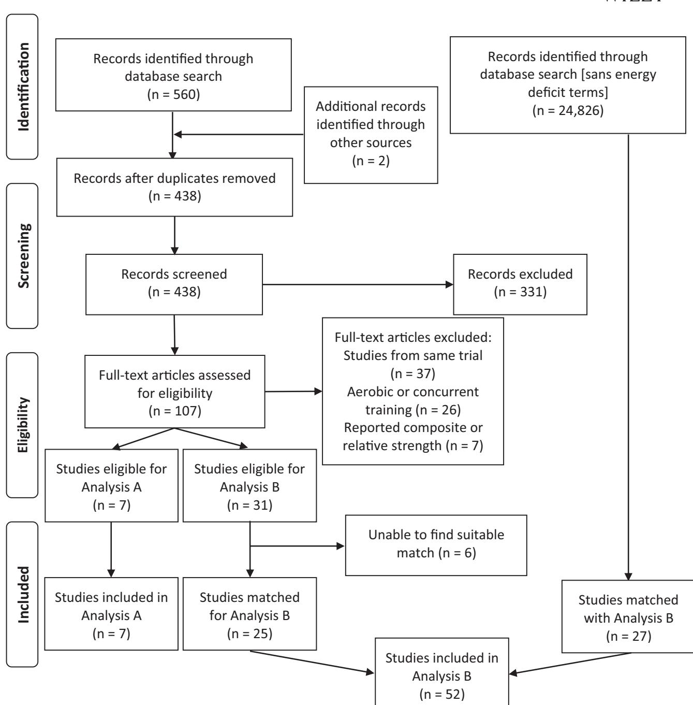
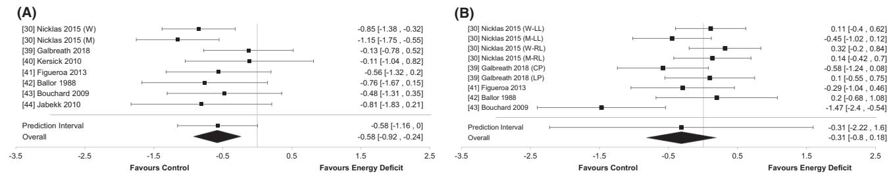
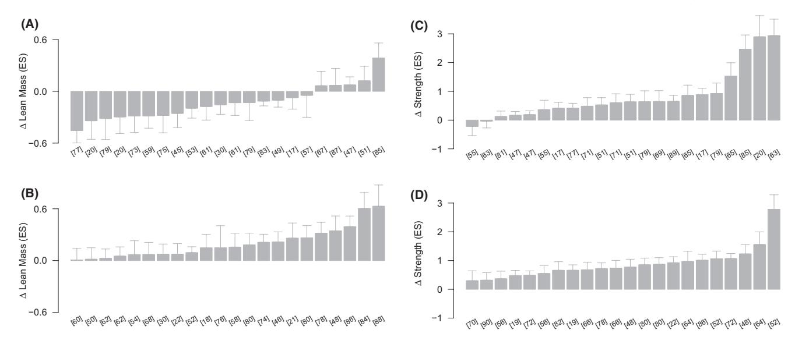
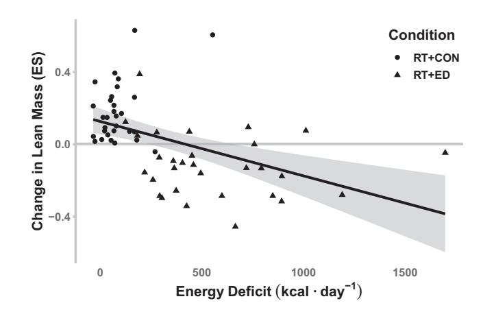

## **1** | **INTRODUCTION**

Periods of energy deficiency occurthroughoutthe lifespan, from younger athleteswithin the relative energy deficiency in sport1 or the female athlete triad2 frameworks to older adults engaging in weight loss. Within these populations are a growing recognition that energy deficiency suppresses reproductive and metabolic hormones3 leading to adverse health outcomes such as impaired bone health.4,5 Despite a growing recognition of these important implications, limited knowledge of the training responses in an energy deficient state exists, particularly with respect to

# **Energy deficiency impairs resistance training gains in lean mass but not strength: A meta-analysis and meta-regression**

**Chaise Murph[y](https://orcid.org/0000-0003-0830-2866)** | **Karsten Koehle[r](https://orcid.org/0000-0002-9618-2069)**

This is an open access article under the terms of the Creative Commons [Attribution-NonCommercial-NoDerivs](http://creativecommons.org/licenses/by-nc-nd/4.0/) License, which permits use and distribution in any medium, provided the original work is properly cited, the use is non-commercial and no modifications or adaptations are made. © 2021 The Authors. *Scandinavian Journal of Medicine & Science In Sports* published by John Wiley & Sons Ltd.

Department of Sport and Health Sciences, Technical University of Munich, Munich, Germany

### **Correspondence**

Karsten Koehler, Department of Sport and Health Science, Technical University of Munich, Uptown München-Campus D, Georg-Brauchle-Ring 60/62, D-80992 München, Germany. Email: [karsten.koehler@tum.de](mailto:karsten.koehler@tum.de)

Short-term energy deficits impair anabolic hormones and muscle protein synthesis. However, the effects of prolonged energy deficits on resistance training (RT) outcomes remain unexplored. Thus, we conducted a systematic review of PubMed and SportDiscus for randomized controlled trials performing RT in an energy deficit (RT+ED) for ≥3 weeks. We first divided the literature into studies with a parallel control group without an energy deficit (RT+CON; Analysis A) and studies without RT+CON (Analysis B). Analysis A consisted of a metaanalysis comparing gains in lean mass (LM) and strength between RT+ED and RT+CON. Studies in Analysis B were matched with separate RT+CON studies for participant and intervention characteristics, and we qualitatively compared the gains in LM and strength between RT+ED and RT+CON. Finally, Analyses A and B were pooled into a meta-regression examining the relationship between the magnitude of the energy deficit and LM. Analysis A showed LM gains were impaired in RT+ED vs RT+CON (effect size (ES) = −0.57, *p* = 0.02), but strength gains were comparable between conditions (ES = −0.31, *p* = 0.28). Analysis B supports the impairment of LM in RT+ED (ES: −0.11, *p* = 0.03) vs RT+CON (ES: 0.20, *p* < 0.001) but not strength (RT+ED ES: 0.84; RT+CON ES: 0.81). Finally, our meta-regression demonstrated that an energy deficit of ~500 kcal · day−1 prevented gains in LM. Individuals performing RT to build LM should avoid prolonged energy deficiency, and individuals performing RT to preserve LM during weight loss should avoid energy deficits >500 kcal day−1.

### **KEYWORDS**

body composition, caloric restriction, low energy availability, strength training, weightlifting

resistance training (RT). RT is recommended for adults of all ages to build lean mass (LM), promote skeletal health, and improve quality of life.6 However, adequate nutrient status is a limiting factor for the production of anabolic hormones such as insulin-like growth factor-1 (IGF-1),7 suggesting that performing RT in an energy deficit may compromise the hormonal response to RT. Indeed, we have previously demonstrated both IGF-1 and growth hormone exhibit impaired responses to resistance exercise after as little as three days in an energy deficit.8 Growth hormone regulates a number of metabolic processes, with which IGF-1 assists, including protein metabolism.9 Furthermore, muscle protein synthesis is also suppressed by an energy deficient status,10 an impairment often accompanied by the loss of LM.11 For a more comprehensive review of the effects of low energy availability, the reader is referred to a recent review.3

In a field of research containing a large number of small studies, synthesis of results using methods like meta-analyses is important to objectively evaluate the effectiveness of these interventions and provide strong evidence of directions for future research. However, to our knowledge, the impact of energy deficiency on RT outcomes has never been assessed systematically in the literature. Thus, the overall objective of this meta-analysis was to test whether, and to what degree, the presence of energy deficiency attained via a reduction in dietary energy intake, attenuates training responses induced by RT. The primary aim was to quantify the discrepancy in LM accretion between interventions prescribing RT in an energy deficit (RT+ED) and interventions prescribing RT without an energy deficit (RT+CON). Our second aim was to quantify whether energy deficiency impairs strength gains in response to RT. Finally, we analyzed the impact of several moderator variables such as participant age, sex, weight status, and study duration on these outcomes. We hypothesized that LM gains, but not strength gains, would be significantly attenuated in interventions conducted in an energy deficit compared to those without. We formed this hypothesis on the basis that increases in LM are typically preceded by improvements in strength due to the earlier involvement of neuronal mechanisms compared to morphological changes.12

## 2 | METHODS

### 2.1 | Study design

Before beginning the systematic search process, an apparent gap in the literature was identified a priori. Based on our familiarity with the subject matter, we anticipated the number of studies employing both RT+CON and RT+ED

conditions within the same intervention to be insufficient for a meta-analysis with adequate power.13 To address this limitation, we supplemented our classical meta-analysis of studies containing both RT+CON and RT+ED conditions (Analysis A) with a qualitative comparison of separate systematic quantitative analyses of RT+CON and RT+ED studies matched for pre-defined subject and intervention characteristics (Analysis B). Finally, all studies were pooled into a meta-regression to determine the energy deficiency threshold at which LM gains are prevented.

### 2.2 | Inclusion criteria

For Analysis A, randomized controlled trials with at least one condition performing RT+ED and one condition performing RT+CON were included in the meta-analysis. For Analysis B, interventions needed to include only one condition performing RT+ED or RT+CON to be included. For each analysis, interventions had to contain at least three weeks of RT performed at least two times per week to align with meta-analyses on similar outcomes14,15 and could not include concurrent aerobic training due to potential interference with both hypertrophy and strength outcomes.16 All included studies were required to be original research and written in English.

### 2.3 | Search strategy

We first conducted a systematic literature search to identify potential RT+ED interventions for either Analysis A or Analysis B due to the substantially smaller body of RT+ED literature compared to RT+CON literature. This systematic literature search was conducted in PubMed and SportDiscus current to June 2021 (Supplementary Appendix 1). The original searches yielded 560 total results and two additional records were identified during the matching process described below. After screening titles, abstracts, and removing duplicates, 107 results were retained. A final count of 38 results was eligible to be included in the analysis following full-text screening (Figure 1).

After the 38 eligible RT+ED studies were identified, these were further divided into studies which contained a RT+CON group ( $n = 7$ ), which were included in Analysis A, and studies which did not contain a RT+CON group ( $n = 31$ ), which were eligible for Analysis B. Potential matches for the studies eligible for Analysis B were subsequently identified from a pool of literature obtained by replicating the previous search with the energy deficit terminology removed. This search yielded 24,826 results. Intervention- and population-specific terminology such as

"postmenopausal" or "10-week" were used to identify subsets of this literature pool containing potential matches. Due to the number of sub-searches conducted, these could not be represented in Figure 1. Not all studies were able to be matched using this method. Of the original 31 results, only 25 were able to be paired and were included in Analysis B. These 25 results were paired with 27 RT+CON studies. On two occasions, one RT+ED study was paired with two RT+CON studies. In one case, a RT+ED study reporting both outcomes17 was paired to one RT+CON study reporting LM18 and to another RT+CON study reporting strength.19 The other case20 matched to two RT+CON studies for male21 and female22 participants separately.

In studies containing multiple RT+CON or RT+ED groups, we only included groups we could confidently match—for example, in supplement studies, placebo groups were included in the analysis over intervention groups. When macronutrient composition of the groups within a study differed, groups were matched between studies using available information to achieve a similar macronutrient distribution.

**FIGURE 1** PRISMA flowchart of the systematic literature search

Relevant variables to be extracted included pre-defined characteristics of the participants (age, sex, BMI), RT interventions (duration, frequency, sets, repetitions), and outcomes related to body composition and strength. When data were not available in text or tables, data were extracted from figures when possible using Web Plot Digitizer (V.4.2, Texas, USA: Ankit Rohatgi, 2019). Corresponding authors were solicited for information which could not be gleaned from the aforementioned sources.

Body composition outcomes extracted included LM, fat-free mass, and fat mass and had to be assessed via dual-energy X-ray absorptiometry (DXA), a preferred method for whole-body composition analysis.23 An exception was made for one study in Analysis A using hydrostatic weighing, which has a comparable degree of accuracy with DXA on a study-wide scale.24 However, hydrostatic weighing was not allowed for

All analyses were performed on effect sizes calculated as the mean change divided by the standard deviation within ( $SD_{\text{within}}$ ) corrected for small sample sizes.27 All data analysis for both Analysis A and Analysis B was conducted in R (R Core Team, Version 3.6) using the robumeta package (V.2.0, Fisher and Tipton, 2017).28 Effect sizes are presented as means  $\pm$ SD with 95% confidence intervals for all outcomes.

### 2.5.1 | Meta-analysis (Analysis A)

In Analysis A, the difference between pre- to post-intervention changes for RT+ED and RT+CON was used as the numerator and the denominator was calculated using the following equation where the SD for each condition refers to the SD of the change29:

$$SD_{\text{within}} = \sqrt{\frac{((n_{\text{RT+ED}} - 1) \times SD_{\text{RT+ED}}^2) + ((n_{\text{RT+CON}} - 1) \times SD_{\text{RT+CON}}^2)}{n_{\text{RT+ED}} + n_{\text{RT+CON}} - 2}}.$$

studies in Analysis B due to the high degree of variability in how the method is executed between laboratories, which could introduce unnecessary variability into the analysis. Though both LM and fat-free mass were included as primary outcomes due to data availability, the term LM will be used exclusively in this analysis to represent changes in these compartments. Per definition of the DXA methodology, the only difference between fat-free mass and LM is the inclusion of bone mass, which does not change on the same order of magnitude as LM,25 making it a negligible factor. Thus, changes in fat-free mass and LM were considered equivalent for the present analysis. Strength was measured through either a repetition maximum strength test (e.g., one- or three-repetition maximum) or maximum voluntary contraction, but not lower intensity tests of muscular endurance due to their lower predictive reliability.26 Strength could not be expressed relative to body weight due to the difference in weight change between groups. From the 7 studies in Analysis A, we calculated 16 body composition effect sizes from the 16 groups in 7 studies reporting body composition and 18 strength effect sizes from the 12 groups in 5 studies reporting strength. From the 52 studies in Analysis B, we calculated 44 body composition effect sizes from the 44 groups in 37 studies reporting body composition and 44 strength effect sizes from the 30 groups in 28 studies reporting strength.

In Analysis A, when SD of the change values was unavailable, they were estimated from pre- and post-intervention SD by using the following equation where  $r$  is the correlation between pre- and post-intervention measurements obtained from one representative study in the analysis for which we obtained access to complete participant data30:

$$SD_{\text{change}} = \sqrt{SD_{\text{pre}}^2 + SD_{\text{post}}^2 - (2 \times r \times SD_{\text{pre}} \times SD_{\text{post}})}.$$

In Analysis A, effect size variance was calculated from the following formula where  $n_{\text{RT+CON}}$  and  $n_{\text{RT+ED}}$  are the sample sizes for the RT+CON and RT+ED conditions, respectively, and  $ES_{\text{corr}}$  is the effect size corrected for small sample size bias29:

$$V_i = \frac{(n_{\text{RT+CON}} + n_{\text{RT+ED}})}{(n_{\text{RT+CON}} \times n_{\text{RT+ED}})} + \frac{(ES_{\text{corr}}^2)}{2 \times (n_{\text{RT+CON}} + n_{\text{RT+ED}})}.$$

### 2.5.2 | Comparative quantitative analysis (Analysis B)

In Analysis B, either the mean change or the difference between post- and pre-intervention means was used as the numerator, depending on data availability. When pre- and post-intervention SDs were available, the denominator was calculated from the following equation29:

$$SD_{\text{within}} = \sqrt{\frac{SD_{\text{pre}}^2 + SD_{\text{post}}^2}{2}}.$$

When pre- and post-intervention SD were unavailable,  $SD_{\text{within}}$  was calculated using the following equation where  $r$  is the correlation between pre- and post-intervention measurements. Because most of the studies did not report correlations between pre- and post-intervention measurements, an average value was calculated from the available data sets which provided this information and applied to each remaining study in the analysis29:

$$SD_{\text{within}} = \frac{SD_{\text{change}}}{\sqrt{2 \times (1-r)}}.$$

In Analysis B, variance in the effect sizes was assessed using the following formula for a pre-post design meta-analysis where  $n$  is the group size,  $ES_{\text{corr}}$  is the effect size corrected for small sample bias and  $r$  is the correlation between pre- and post-measurements29:

$$V_i = \left( \frac{1}{n} + \frac{ES_{\text{corr}}^2}{2n} \right) \times 2(1-r).$$

## 2.6 | Heterogeneity and risk of bias

Heterogeneity was reported as the I-squared value and the prediction interval derived from Tau. Risk of bias was assessed in both Analysis A and Analysis B using visual inspection of Funnel plots and accompanying Egger's Tests using the metafor package (V.2.4, Viechtbauer, 2020) for LM outcomes.31 These analyses were not performed using strength outcomes due to the scarcity of RT papers that do not improve strength leading to false-positive risk of bias tests.

## 2.7 | Analysis of study characteristics

For factors on which we matched studies in Analysis B, including RT intervention characteristics and participant age, sex, and BMI, a two-tailed  $t$  test was performed to check for differences between the RT+ED and RT+CON study pools.

## 2.8 | Estimation of energy deficit and meta-regression

In order to assess whether outcomes were influenced not just by the presence or absence of an ED, but also

by its severity, we calculated an average estimated energy deficit for each condition. Because dietary prescriptions differed between studies (e.g., consume a specific amount of kcal, reduce energy intake by a specific amount of kcal), compliance to prescriptions is generally low32 and studies lacked sufficient information to calculate dietary intake plus all components of energy expenditure, we objectively quantified the energy deficit via changes in energy stores. To this end, the energy deficit was estimated from changes in fat mass, which was estimated to have an energy value of ~9400 kcal per kg.33 Changes in LM were not included in the calculation to avoid autocorrelation issues, considering that LM changes are a primary outcome, as well as the difficulty of quantifying the energy cost of building LM.34 Further, the impact of LM changes was deemed minor based on both the lack of change in the average energy deficit (<1 kcal day-1) and the high correlation between the energy deficit calculated from fat mass changes and the energy deficit calculated from both fat mass and LM ( $r > 0.95$ ) as well as the similarity between the regression outcomes with and without including changes in LM with an energy value of ~1800 kcal kg-1.35

We first regressed our outcome variables on the estimated energy deficit. Then, to understand the contributions of other variables to the relationship between the energy deficit and our outcome variables, we assessed a group of a priori selected covariates including age,36 weight status,37 sex,38 and duration of the intervention12 because each may influence the response to RT.

## 3 | RESULTS

### 3.1 | Analysis A study characteristics

Studies included in Analysis A were published between 1988 and 2018. Analysis A contained 7 studies (6 in women exclusively, 1 in both men and women) with a total of 282 participants ( $60 \pm 11$  years) across 16 groups.30,39-44 Only one intervention did not specify that their participants were either sedentary or physically inactive prior to the intervention.42

The RT interventions included in Analysis A lasted between 8 and 20 weeks ( $13.3 \pm 4.4$  weeks) and involved 2–3 sessions per week ( $2.9 \pm 0.3$  sessions) with 4–13 exercises per session ( $8.3 \pm 2.4$  exercises), 2–4 sets per exercise ( $2.7 \pm 0.4$  sets), and 8–20 repetitions per set ( $11.3 \pm 4.1$  repetitions). All included studies performed whole-body RT routines. Detailed participant and intervention characteristics for each study included in Analysis A are presented in Table S1.

**FIGURE 2** Forest plots of Analysis A for the effect on lean mass (A) and strength (B). A positive effect favors resistance training in an energy deficit while a negative effect favors resistance training without an energy deficit. Each box represents the effect size for that group and the lines around the box represent the 95% confidence interval. Abbreviations: CP, chest press; LL, left leg extension; LP, leg press; M, men; RL, right leg extension; W, women

### 3.2 | Analysis A: Effect of energy deficit assignment on lean mass and strength

Meta-analysis of the effect of group assignment on the relationship between RT and LM revealed a moderate effect favoring RT+CON studies over RT+ED studies (Figure 2A, effect size (ES) = -0.58,  $p = 0.02$ ). However, there was not a significant effect of group assignment on strength (Figure 2B, ES = -0.31,  $p = 0.28$ ). Given that only 7 and 5 studies were included in the two analyses, respectively, no moderator analyses were conducted.

### 3.3 | Analysis B study characteristics

Studies included in Analysis B were published between 1992 and 2018. Analysis B contained 52 studies (10 in men, 24 in women, 18 in both men and women) with a total sample size of 1213 participants ( $51 \pm 16$  years) across 57 groups.17-22,45-90 Only one study did not specify whether their participants were either sedentary or physically inactive prior to the intervention,81 and only one pair of studies explicitly identified their participants as resistance-trained.55,56

The RT interventions included in Analysis B lasted between 3 and 28 weeks ( $15.8 \pm 6.0$  weeks) and involved 2–4 sessions per week ( $2.9 \pm 0.5$  sessions) with 4–14 exercises per session ( $8.2 \pm 2.6$  exercises), 1–4 sets per exercise ( $2.7 \pm 0.6$  sets), and 1–16 repetitions per set ( $10.1 \pm 1.9$  repetitions). All included studies performed whole-body RT routines. Detailed participant and intervention characteristics for each study included in Analysis B are presented in Table S2.

In studies from Analysis B, we were successful in matching RT+ED and RT+CON groups for participant age and sex, study duration, and all RT characteristics (all  $p > 0.75$ ). We were not, however, able to match groups for participant BMI ( $p < 0.001$ ) due to irrevocable differences in the two bodies of literature.

### 3.4 | Analysis B: Qualitative comparison of changes in lean mass and strength

Figure 3 illustrates the individual group effects of RT+ED and RT+CON on LM (3A and 3B, respectively) and strength (3C and 3D, respectively). The overall effect of RT+ED on LM was negative (ES = -0.11,  $p = 0.03$ ) while the overall effect of RT+CON on LM was positive (ES = 0.20,  $p < 0.001$ ). However, both RT+ED (ES = 0.84,  $p < 0.001$ ) and RT+CON (ES = 0.81,  $p < 0.001$ ) had large, positive effects on strength.

### 3.5 | Meta-regression: Estimation of energy deficit and its effect on lean mass

The pooled RT+ED groups from Analysis A and Analysis B had an average estimated energy deficit of  $567 \pm 350$  kcal day-1 while the pooled RT+CON groups were in an approximate energy balance ( $92 \pm 116$  kcal day-1).

Due to the apparent lack of relationship between energy deficiency and strength in Analyses A and B, we performed the meta-regression analysis only on LM. We first ran a model with no covariates regressing the change in LM on the estimated energy deficit. The intercept, representing a state of energy balance, maintained its very small, significant effect (ES = 0.16,  $p < 0.001$ ). The coefficient for the estimated energy deficit (ES =  $-3.1 \times 10^{-4}$ ,  $p = 0.02$ ) illustrates that an energy deficit of 1000 kcal day-1 reduces the anticipated ES by 0.31. In other words, an energy deficit of ~500 kcal day-1 (ES = -0.16) would result in no LM change (ES = 0; Figure 4).

We then conducted a meta-regression using the estimated energy deficit, age, sex, study duration, and BMI as predictors (Table 1). Of the variables tested, energy deficit and BMI were significant moderators, age did not achieve statistical significance as a moderator and neither sex nor study duration significantly influenced the observed

LM outcome. It is important to note the inclusion of covariates did not substantially alter the coefficient for the estimated energy deficit seen in the first meta-regression (ES = −3.5 × 10−4).

## **3.6** | **Heterogeneity and risk of bias**

A substantial portion of the heterogeneity in Analysis A originated from sampling variability, in addition to between study factors (*I* 2 = 0 and 63). By contrast, a vast majority of the heterogeneity in Analysis B originated from between study factors, rather than sampling variability (*I* 2 = 80–95). Visual inspection of the Funnel Plot for LM outcomes in both Analysis A and Analysis B revealed some horizontal spread attributable to heterogeneity, but no apparent asymmetry (Figure S1). In support of this observation, the Egger's Tests (Analysis A: *z* = 0.80, *p* = 0.42; Analysis B: *z* = −0.21, *p* = 0.83) revealed no asymmetries that would suggest a publication bias.

## **4** | **DISCUSSION**

Overall, our results suggest that the presence of an energy deficit impairs the accretion of LM but not strength gains in response to RT. Furthermore, we observed that an energy deficit of 500 kcal day−1 (ES = −0.16) completely ablated the accretion of LM in response to RT observed in a state of energy balance (intercept ES =0.16). This result aligns with previous literature showing the commonly prescribed energy deficit of 500 kcal day−1 impairs LM retention.11

The relationship between RT and LM was influenced by the severity of the energy deficit, weight status, and age, but not sex or duration of the intervention. As a result of the regression analysis, we represented the negative association between LM gains and the strength of energy deficit as a linear relationship. However, we acknowledge the relationship between LM and energy deficit may eventually plateau, resulting in a breakpoint at which a maximal rate of LM loss occurs in the presence of RT, which may or may not be greater than the maximal rate of LM loss without the presence of RT. Despite this, the level of energy deficit required to achieve these theoretical values

**FIGURE 3** Waterfall plots of Analysis B for the effect of resistance training in an energy deficit on lean mass (A) and strength (C) and for resistance training without an energy deficit on lean mass (B) and strength (D). Numbers below the bars correspond to citation numbers where each effect was calculated. The lines around each bar represent the 95% confidence interval for the effect size

**FIGURE 4** Relationship between estimated energy deficit and change in lean mass. The shaded area on either side of the regression line represents the 95% confidence interval for the regression

TABLE 1 Meta-regression of energy deficit on lean mass effect size with all moderators

| Variable    | Intercept | Energy Deficit (kcal/day) | Age (years) | Sex (0 = F, 1 = M) | BMI (kg/m 2 ) | Study Duration (weeks) |
|-------------|-----------|---------------------------|-------------|--------------------|--------------------------|------------------------|
| Coefficient | 1.1088    | -0.0003                   | -0.0050     | 0.0668             | -0.0243                  | 0.0002                 |
| p value     | 0.003     | 0.03                      | 0.07        | 0.37               | 0.03                     | 0.97                   |

was not well-represented within the included literature, if at all, due to the lack of studies with an energy deficit >1000 kcal day-1. Thus, we felt both that these theoretical extremes were not of practical relevance to the research question in this population and that these data were ill-suited to explore these theoretical concepts.

Our results indicate individuals with a higher BMI gained less LM as a result of RT; however, existing literature shows lean individuals tend to lose more LM during energy-restricted weight loss.37 Thus, RT appears to alter the relationship between body composition and composition of weight loss. It is also possible that differences in weight status between the RT+ED (BMI = 32.7 ± 3.0) and RT+CON (BMI = 27.5 ± 3.6) study populations may have accentuated this observed relationship.

Despite not achieving statistical significance, the negative relationship we observed between age and LM gained from RT parallels another recent meta-analysis showing a reduced impact of protein supplementation on LM with increasing age,15 which supports the well-documented paradigm of age-related anabolic resistance.36 Our results suggest a 500 kcal day-1 deficit and aging 30 years produce a similar effect on the predicted change in lean mass in response to RT (ES = -0.15). Given that energy deficiency and age influence the anabolic response to resistance exercise through the same molecular pathways36,91 and we observed effects of each factor, the effects of energy deficiency and age appear to be additive, at least until a point of minimal response to RT.

We did not observe a significant moderation effect of sex on the relationship between RT and LM. This could be attributed to the fact that the majority of the studies included females only and that several studies conducted in both sexes failed to report the sex distribution such that they could not be used in the analysis. However, the positive coefficient of 0.07 suggests that males do add more LM than females, which is an expected observation.38 Duration of the RT intervention was also not a significant moderator of the relationship between RT and LM. While we anticipated a positive relationship between LM gains and study duration indicating larger gains in LM from longer interventions,12 the lack of such a relationship demonstrates significant differences in lean mass accrual within interventions 3–26 weeks in length were not detected in this analysis. This may suggest energy deficiency

continues to suppress LM accretion in response to resistance exercise for as long as it is maintained; however, this hypothesis is weakened by the fact that an effect of study duration did not appear in the RT+CON studies alone (ES = -0.005,  $p = 0.39$ ).

Strength gains were unaffected by the presence or absence of an energy deficit as well as its estimated severity. That subjects gained strength despite impaired gains, or even losses, of LM suggests these strength gains may be independent of hypertrophy and instead due to neural adaptations12 or microarchitectural changes92 typically preceding detectable gains in LM at the onset of a RT program. Of note, one of the two negative effects on strength in the present analysis occurred in the singular study where resistance-trained individuals trained in an energy deficit. It is unclear whether this association would be normal in experienced lifters, as not enough data exist on experienced lifters training in an energy deficit, so future research is needed to answer this question.

The covariates assessed by our meta-regression of the relationship between the severity of energy deficit and LM gained through RT did not include protein intake. While existing literature shows protein intake influences the LM gain from RT,15 such an analysis was outside the scope of the present study for several reasons. First, while many of the included studies reported an assigned protein intake, few studies reported actual intake data. In addition, there was significant variability in how protein intake data were collected and reported which led to concerns with comparability between studies. Unlike with the severity of the energy deficit, where we were able to use changes in body composition as an objective parameter, there is no objective proxy indicator of protein intake. Thus, we felt the data were not of a high enough quality or volume to be of practical use in this analysis. Future research should emphasize accurate, objective, and homogenous reporting of dietary intake information to allow secondary analyses to be conducted accurately and efficiently.

The present meta-analysis provides statistical evidence for the observed impact of energy deficiency on the outcomes of RT, but it does not provide any mechanistic evidence. However, existing literature shows energy deficits directly impair insulin-like growth factor-1 production7 and reduces serum concentrations in a dose-dependent

manner.93 Whether this impaired IGF-1 production persists in the face of potent anabolic stimulation from resistance exercise has only just been investigated. We recently published a study which showed an impaired IGF-1 response following a bout of resistance exercise during three days of an energy deficit.8 This observation combined with observed impairments in muscle protein synthesis accompanying loss of LM during energy deficiency11 present potential mechanisms which may explain the impaired LM accretion in response to resistance exercise during caloric restriction.

While we have made substantial efforts toward ensuring an accurate and impartial meta-analysis, we recognize the present analysis has limitations. First of all, our primary analysis of studies containing both RT+CON and RT+ED groups (Analysis A) had a limited literature pool to draw from. Although we undertook a comprehensive approach to matching studies in Analysis B in order to overcome this limitation, it is impossible to create two groups as comparable as those found in randomized controlled trials when matching groups from different studies. However, we included only studies which were as comparable as possible in Analysis B by matching them on several variables including age, sex, and duration of the intervention. This resulted in only being able to match 25 of the 31 potential RT+ED studies for Analysis B. While it was originally our intention to match for weight status as well, this proved to be impossible due to irrevocable differences in the study populations between available RT+CON and RT+ED literature. Furthermore, though all studies included in the LM analysis used DXA scans, we recognize there may be differences between different machines and protocols for measurement. Despite these limitations, it is encouraging that the results of Analysis A parallel those from Analysis B.

Low energy availability is a more widely recognized perspective than energy deficiency, but we were unable to quantify energy availability within this analysis. Future research in this field should endeavor to report sufficient dietary and exercise information for the calculation of energy availability. However, our objective calculation of energy deficiency from changes in whole-body fat mass circumvented common issues such as absence of or differences in quantification of energy intake, energy expenditure, and energy requirements. By definition, an energy deficit may be induced via a reduced energy intake, increased exercise energy expenditure, or a combination of both. However, for the purposes of this meta-analysis, we focused on reductions in energy intake due to the low exercise energy expenditure of RT and to obtain a clearer picture of the impact of performing RT in an energy deficit without the potential additional interference effects of aerobic training on RT outcomes.16

## 5 | CONCLUSION

In conclusion, the results of the present analysis indicate an energy deficient state impairs LM gains as a result of RT. Furthermore, the impairment of LM gains scaled with the severity of the energy deficit. However, conducting RT in an energy deficient state did not impair strength gains. With this framework of relationships established, research can now focus on alternative RT protocols or dietary strategies to overcome the gap between RT performed in the presence and absence of an energy deficit.

## 6 | PERSPECTIVES

While LM is lost as a function of losing weight without intervention, RT during an energy deficit is recommended to preserve LM to aid in the prevention of weight regain and improve performance. We found that performing RT in an energy deficit impaired gains in LM, but not strength, compared to those performing RT without an energy deficit. Furthermore, the common energy deficit of 500 kcal day-1 was sufficient to prevent gains in LM from RT in this population. Individuals looking to gain LM from RT should avoid prolonged energy deficits while individuals trying to lose weight should practice RT and maintain an energy deficit  $\leq$ 500 kcal day-1 to maintain LM.

## ACKNOWLEDGEMENTS

The authors would like to thank Michael Hebert from the University of Nebraska - Lincoln and J. Marc Goordich from Texas A&M University for lending their statistical expertise and offering practical guidance whenever it was asked. Open access funding enabled and organized by Projekt DEAL.

## AUTHOR CONTRIBUTIONS

CM developed and conducted the systematic search and acquired the data. CM performed the data analysis with guidance from JMG and MH. All authors contributed to the conceptualization and design of the study, assisted with the interpretation, wrote and revised the manuscript, and approved the final version of the manuscript.

## DATA AVAILABILITY STATEMENT

The data that supports the findings of this study are available from the corresponding author upon reasonable request.

## ORCID

REFERENCES

1. 1. Mountjoy M, Sundgot-Borgen JK, Burke LM, et al. IOC consensus statement on relative energy deficiency in sport (RED-S): 2018 update. *Br J Sports Med*. 2018;52(11):687-697. <https://doi.org/10.1136/bjsports-2018-099193>
2. 2. De Souza MJ, Nattiv A, Joy E, et al. 2014 Female athlete triad coalition consensus statement on treatment and return to play of the female athlete triad: 1st international conference held in San Francisco, California, May 2012 and 2nd international conference held in Indianapolis, Indiana, May 2013. *Br J Sports Med*. 2014;48(4):289. <https://doi.org/10.1136/bjsports-2013-093218>
3. 3. Areta JL, Taylor HL, Koehler K. Low energy availability: history, definition and evidence of its endocrine, metabolic and physiological effects in prospective studies in females and males. *Eur J Appl Physiol*. 2021;121(1):1-21. <https://doi.org/10.1007/s0042-1-020-04516-0>
4. 4. De Souza MJ, Williams NI. Beyond hypoestrogenism in amenorrheic athletes: energy deficiency as a contributing factor for bone loss. *Curr Sports Med Rep*. 2005;4(1):38-44.
5. 5. Villareal DT, Fontana L, Weiss EP, et al. Bone mineral density response to caloric restriction-induced weight loss or exercise-induced weight loss: a randomized controlled trial. *Arch Intern Med*. 2006;166(22):2502-2510. <https://doi.org/10.1001/archinte.166.22.2502>
6. 6. Garber CE, Blissmer B, Deschenes MR, et al. American College of Sports Medicine position stand. Quantity and quality of exercise for developing and maintaining cardiorespiratory, musculoskeletal, and neuromotor fitness in apparently healthy adults: guidance for prescribing exercise. *Med Sci Sports Exerc*. 2011;43(7):1334-1359. <https://doi.org/10.1249/MSS.0b013e318213fefb>
7. 7. Clemmons DR. Metabolic actions of insulin-like growth factor-I in normal physiology and diabetes. *Endocrinol Metab Clin North Am*. 2012;41(2):425-443. <https://doi.org/10.1016/j.ecl.2012.04.017>
8. 8. Murphy C, Koehler K. Caloric restriction induces anabolic resistance to resistance exercise. *Eur J Appl Physiol*. 2020;120(5):1155-1164. <https://doi.org/10.1007/s00421-020-04354-0>
9. 9. Moller N, Jorgensen JO. Effects of growth hormone on glucose, lipid, and protein metabolism in human subjects. *Endocr Rev*. 2009;30(2):152-177. <https://doi.org/10.1210/er.2008-0027>
10. 10. Areta JL, Burke LM, Camera DM, et al. Reduced resting skeletal muscle protein synthesis is rescued by resistance exercise and protein ingestion following short-term energy deficit. *Am J Physiol Endocrinol Metab*. 2014;306(8):E989-E997. <https://doi.org/10.1152/ajpendo.00590.2013>
11. 11. Oikawa SY, McGlory C, D'Souza LK, et al. A randomized controlled trial of the impact of protein supplementation on leg lean mass and integrated muscle protein synthesis during inactivity and energy restriction in older persons. *Am J Clin Nutr*. 2018;108(5):1060-1068. <https://doi.org/10.1093/ajcn/nqy193>
12. 12. Folland JP, Williams AG. The adaptations to strength training : morphological and neurological contributions to increased strength. *Sports Med*. 2007;37(2):145-168. <https://doi.org/10.2165/00007256-200737020-00004>
13. 13. Jackson D, Turner R. Power analysis for random-effects meta-analysis. *Res Synth Methods*. 2017;8(3):290-302. <https://doi.org/10.1002/jrsm.1240>
14. 14. Grgic J, Schoenfeld BJ, Skrepnik M, Davies TB, Mikulic P. Effects of rest interval duration in resistance training on measures of muscular strength: A systematic review. *Sports Med*. 2018;48(1):137-151. <https://doi.org/10.1007/s40279-017-0788-x>
15. 15. Morton RW, Murphy KT, McKellar SR, et al. A systematic review, meta-analysis and meta-regression of the effect of protein supplementation on resistance training-induced gains in muscle mass and strength in healthy adults. *Br J Sports Med*. 2018;52(6):376-384. <https://doi.org/10.1136/bjsports-2017-097608>
16. 16. Wilson JM, Marin PJ, Rhea MR, Wilson SM, Loenneke JP, Anderson JC. Concurrent training: a meta-analysis examining interference of aerobic and resistance exercises. *J Strength Cond Res*. 2012;26(8):2293-2307. <https://doi.org/10.1519/JSC.0b013e31823a3e2d>
17. 17. Normandin E, Senechal M, Prud'homme D, Rabasa-Lhoret R, Brochu M. Effects of Caloric Restriction with or without Resistance Training in Dynapenic-Overweight and Obese Menopausal Women: A MONET Study. *J Frailty Aging*. 2015;4(3):155-162. <https://doi.org/10.14283/jfa.2015.54>
18. 18. Holm L, Olesen JL, Matsumoto K, et al. Protein-containing nutrient supplementation following strength training enhances the effect on muscle mass, strength, and bone formation in postmenopausal women. *J Appl Physiol*. 2008;105(1):274-281. <https://doi.org/10.1152/japplphysiol.00935.2007>
19. 19. Vanni AC, Meyer F, da Veiga AD, Zanardo VP. Comparison of the effects of two resistance training regimens on muscular and bone responses in premenopausal women. *Osteoporos Int*. 2010;21(9):1537-1544. <https://doi.org/10.1007/s00198-009-1139-z>
20. 20. Marsh AP, Shea MK, Vance Locke RM, et al. Resistance training and pioglitazone lead to improvements in muscle power during voluntary weight loss in older adults. *J Gerontol A Biol Sci Med Sci*. 2013;68(7):828-836. <https://doi.org/10.1093/gerona/gls258>
21. 21. Treuth MS, Ryan AS, Pratley RE, et al. Effects of strength training on total and regional body composition in older men. *J Appl Physiol*. 1994;77(2):614-620. <https://doi.org/10.1152/jappl.1994.77.2.614>
22. 22. Tibana RA, da Cunha ND, Frade de Souza NM, et al. Irisin levels are not associated to resistance training-induced alterations in body mass composition in older untrained women with and without obesity. *J Nutr Health Aging*. 2017;21(3):241-246. <https://doi.org/10.1007/s12603-016-0748-4>
23. 23. Shepherd JA, Ng BK, Sommer MJ, Heymsfield SB. Body composition by DXA. *Bone*. 2017;104:101-105. <https://doi.org/10.1016/j.bone.2017.06.010>
24. 24. Mahon AK, Flynn MG, Iglay HB, et al. Measurement of body composition changes with weight loss in postmenopausal women: comparison of methods. *J Nutr Health Aging*. 2007;11(3):203-213.
25. 25. Weiss EP, Jordan RC, Frese EM, Albert SG, Villareal DT. Effects of weight loss on lean mass, strength, bone, and aerobic capacity. *Med Sci Sports Exerc*. 2017;49(1):206-217. <https://doi.org/10.1249/MSS.0000000000001074>
26. 26. Lawton TW, Cronin JB, McGuigan MR. Strength testing and training of rowers: A review. *Sports Med*. 2011;41(5):413-432. <https://doi.org/10.2165/11588540-000000000-00000>
27. 27. Hedges LV, Olkin I. *Statistical methods for meta-analysis*. Academic Press Inc.; 1985.

28. Fisher Z, Tipton E, Zhipeng H. robumeta: Robust Variance Meta-Regression. R package version 2.0. 2017.

29. *Handbook of research synthesis and meta-analysis*. The Russell Sage Foundation; 2009.

30. Nicklas BJ, Chmelo E, Delbono O, Carr JJ, Lyles MF, Marsh AP. Effects of resistance training with and without caloric restriction on physical function and mobility in overweight and obese older adults: a randomized controlled trial. *Am J Clin Nutr*. 2015;101(5):991-999. <https://doi.org/10.3945/ajcn.114.105270>

31. Viechtbauer W. Conducting meta-analyses in R with the meta-for package. *J Stat Softw*. 2010;36(3):1-48.

32. Wright G, Dawson B, Jalleh G, Law S. Impact of compliance on weight loss and health profile in a very low energy diet program. *Aust Fam Physician*. 2010;39(1-2):49-52.

33. Hall KD. What is the required energy deficit per unit weight loss? *Int J Obes (Lond)*. 2008;32(3):573-576. <https://doi.org/10.1038/sj.ijo.0803720>

34. Slater GJ, Dieter BP, Marsh DJ, Helms ER, Shaw G, Iraki J. Is an energy surplus required to maximize skeletal muscle hypertrophy associated with resistance training. *Front Nutr*. 2019;6:131. <https://doi.org/10.3389/fnut.2019.00131>

35. Wishnofsky M. Caloric equivalents of gained or lost weight. *Am J Clin Nutr*. 1958;6(5):542-546. <https://doi.org/10.1093/ajcn/6.5.542>

36. Hodson N, West DWD, Philp A, Burd NA, Moore DR. Molecular regulation of human skeletal muscle protein synthesis in response to exercise and nutrients: a compass for overcoming age-related anabolic resistance. *Am J Physiol Cell Physiol*. 2019;317(6):C1061-C1078. <https://doi.org/10.1152/ajpcell.00209.2019>

37. Forbes GB. Body fat content influences the body composition response to nutrition and exercise. *Ann N Y Acad Sci*. 2000;904:359-365.

38. Ivey FM, Roth SM, Ferrell RE, et al. Effects of age, gender, and myostatin genotype on the hypertrophic response to heavy resistance strength training. *J Gerontol A Biol Sci Med Sci*. 2000;55(11):M641-M648. <https://doi.org/10.1093/gerona/55.11.m641>

39. Galbreath M, Campbell B, LaBounty P, et al. Effects of adherence to a higher protein diet on weight loss, markers of health, and functional capacity in older women participating in a resistance-based exercise program. *Nutrients*. 2018;10(8):1070. <https://doi.org/10.3390/nutrients.2018.10.01070>

40. Kerksick CM, Wismann-Bunn J, Fogt D, et al. Changes in weight loss, body composition and cardiovascular disease risk after altering macronutrient distributions during a regular exercise program in obese women. *Nutr J*. 2010;9:59. <https://doi.org/10.1186/1475-2891-9-59>

41. Figueroa A, Vicil F, Sanchez-Gonzalez MA, et al. Effects of diet and/or low-intensity resistance exercise training on arterial stiffness, adiposity, and lean mass in obese postmenopausal women. *Am J Hypertens*. 2013;26(3):416-423. <https://doi.org/10.1093/ajh/hps050>

42. Ballor DL, Katch VL, Becque MD, Marks CR. Resistance weight training during caloric restriction enhances lean body weight maintenance. *Am J Clin Nutr*. 1988;47(1):19-25. <https://doi.org/10.1093/ajcn/47.1.19>

43. Bouchard DR, Soucy L, Senechal M, Dionne IJ, Brochu M. Impact of resistance training with or without caloric restriction on physical capacity in obese older women. *Menopause*. 2009;16(1):66-72. <https://doi.org/10.1097/gme.0b013e3181d7acf7>

44. Jabekk PT, Moe IA, Meen HD, Tomten SE, Hostmark AT. Resistance training in overweight women on a ketogenic diet conserved lean body mass while reducing body fat. *Nutr Metab*. 2010;7:17. <https://doi.org/10.1186/1743-7075-7-17>

45. Villareal DT, Aguirre L, Gurney AB, et al. Aerobic or resistance exercise, or both, in dieting obese older adults. *N Engl J Med*. 2017;376(20):1943-1955. <https://doi.org/10.1056/NEJMoa1616338>

46. Leenders M, Verdijk LB, van der Hoeven L, van Kranenburg J, Nilwik R, van Loon LJ. Elderly men and women benefit equally from prolonged resistance-type exercise training. *J Gerontol A Biol Sci Med Sci*. 2013;68(7):769-779. <https://doi.org/10.1093/gerona/gls241>

47. Hunter GR, Fisher G, Neumeier WH, Carter SJ, Plaisance EP. Exercise training and energy expenditure following weight loss. *Med Sci Sports Exerc*. 2015;47(9):1950-1957. <https://doi.org/10.1249/MSS.0000000000000622>

48. Schroeder ET, Hawkins SA, Jaque SV. Musculoskeletal adaptations to 16 weeks of eccentric progressive resistance training in young women. *J Strength Cond Res*. 2004;18(2):227-235. <https://doi.org/10.1519/R-13443.1>

49. Beavers KM, Ambrosius WT, Rejeski WJ, et al. Effect of exercise type during intentional weight loss on body composition in older adults with obesity. *Obesity*. 2017;25(11):1823-1829. <https://doi.org/10.1002/oby.21977>

50. Vincent KR, Braith RW, Feldman RA, et al. Resistance exercise and physical performance in adults aged 60 to 83. *J Am Geriatr Soc*. 2002;50(6):1100-1107. <https://doi.org/10.1046/j.1532-5415.2002.50267.x>

51. Dunstan DW, Daly RM, Owen N, et al. High-intensity resistance training improves glycemic control in older patients with type 2 diabetes. *Diabetes Care*. 2002;25(10):1729-1736. <https://doi.org/10.2337/diacare.25.10.1729>

52. Tarnopolsky M, Zimmer A, Paikin J, et al. Creatine monohydrate and conjugated linoleic acid improve strength and body composition following resistance exercise in older adults. *PLoS One*. 2007;2(10):e991. <https://doi.org/10.1371/journal.pone.0000991>

53. Verreijen AM, Verlaan S, Engberink MF, Swinkels S, de Vogel-van den Bosch J, Weijs PJM. A high whey protein-, leucine-, and vitamin D-enriched supplement preserves muscle mass during intentional weight loss in obese older adults: a double-blind randomized controlled trial. *Am J Clin Nutr*. 2015;101(2):279-286. <https://doi.org/10.3945/ajcn.114.090290>

54. Rogers ME, Bohlken RM, Beets MW, Hammer SB, Ziegenfuss TN, Sarabon N. Effects of creatine, ginseng, and astragalus supplementation on strength, body composition, mood, and blood lipids during strength-training in older adults. *J Sports Sci Med*. 2006;5(1):60-69.

55. Dudgeon WD, Kelley EP, Scheett TP. In a single-blind, matched group design: branched-chain amino acid supplementation and resistance training maintains lean body mass during a caloric restricted diet. *J Int Soc Sports Nutr*. 2016;13:1. <https://doi.org/10.1186/s12970-015-0112-9>

56. Wilson JM, Lowery RP, Roberts MD, et al. The effects of ketogenic dieting on body composition, strength, power, and hormonal profiles in resistance training males. *J Strength Cond*

Res. 2017;34(12):3463-3474. <https://doi.org/10.1519/JSC.000000000000001935>

1. 57. Jo E, Worts PR, Elam ML, et al. Resistance training during a 12-week protein supplemented VLCD treatment enhances weight-loss outcomes in obese patients. *Clin Nutr.* 2019;38(1):372-382. <https://doi.org/10.1016/j.clnu.2017.12.015>
2. 58. Rosenbaum M, Heaner M, Goldsmith RL, et al. Resistance training reduces skeletal muscle work efficiency in weight-reduced and non-weight-reduced subjects. *Obesity (Silver Spring)*. 2018;26(10):1576-1583. <https://doi.org/10.1002/oby.22274>
3. 59. Hudson JL, Kim JE, Paddon-Jones D, Campbell WW. Within-day protein distribution does not influence body composition responses during weight loss in resistance-training adults who are overweight. *Am J Clin Nutr.* 2017;106(5):1190-1196. <https://doi.org/10.3945/ajcn.117.158246>
4. 60. Arciero PJ, Baur D, Connelly S, Ormsbee MJ. Timed-daily ingestion of whey protein and exercise training reduces visceral adipose tissue mass and improves insulin resistance: the PRISE study. *J Appl Physiol.* 2014;117(1):1-10. <https://doi.org/10.1152/japplphysiol.00152.2014>
5. 61. Wycherley TP, Noakes M, Clifton PM, Cleanthous X, Keogh JB, Brinkworth GD. A high-protein diet with resistance exercise training improves weight loss and body composition in overweight and obese patients with type 2 diabetes. *Diabetes Care.* 2010;33(5):969-976. <https://doi.org/10.2337/dc09-1974>
6. 62. Karelis AD, Messier V, Suppere C, Briand P, Rabasa-Lhoret R. Effect of cysteine-rich whey protein (immunocal(R)) supplementation in combination with resistance training on muscle strength and lean body mass in non-frail elderly subjects: a randomized, double-blind controlled study. *J Nutr Health Aging.* 2015;19(5):531-536. <https://doi.org/10.1007/s12603-015-0442-y>
7. 63. Demling RH, DeSanti L. Effect of a hypocaloric diet, increased protein intake and resistance training on lean mass gains and fat mass loss in overweight police officers. *Ann Nutr Metab.* 2000;44(1):21-29. <https://doi.org/10.1159/000012817>
8. 64. Sakashita M, Nakamura U, Horie N, Yokoyama Y, Kim M, Fujita S. Oral supplementation using gamma-aminobutyric acid and whey protein improves whole body fat-free mass in men after resistance training. *J Clin Med Res.* 2019;11(6):428-434. <https://doi.org/10.14740/jocmr3817>
9. 65. Cardoso GA, Salgado JM, Cesar Mde C, Donado-Pestana CM. The effects of green tea consumption and resistance training on body composition and resting metabolic rate in overweight or obese women. *J Med Food.* 2013;16(2):120-127. <https://doi.org/10.1089/jmf.2012.0062>
10. 66. Tibana RA, Navalta J, Bottaro M, et al. Effects of eight weeks of resistance training on the risk factors of metabolic syndrome in overweight /obese women - "A Pilot Study". *Diabetol Metab Syndr.* 2013;5(1):11. <https://doi.org/10.1186/1758-5996-5-11>
11. 67. Amamou T, Normandin E, Pouliot J, Dionne IJ, Brochu M, Riesco E. Effect of a high-protein energy-restricted diet combined with resistance training on metabolic profile in older individuals with metabolic impairments. *J Nutr Health Aging.* 2017;21(1):67-74. <https://doi.org/10.1007/s12603-016-0760-8>
12. 68. Bacchi E, Negri C, Zanolin ME, et al. Metabolic effects of aerobic training and resistance training in type 2 diabetic subjects: a randomized controlled trial (the RAED2 study). *Diabetes Care.* 2012;35(4):676-682. <https://doi.org/10.2337/dc11-1655>
13. 69. Donnelly JE, Sharp T, Houmard J, et al. Muscle hypertrophy with large-scale weight loss and resistance training. *Am J Clin Nutr.* 1993;58(4):561-565. <https://doi.org/10.1093/ajcn/58.4.561>
14. 70. Ring-Dimitriou S, Steinbacher P, von Duvillard SP, Kaessmann H, Muller E, Sanger AM. Exercise modality and physical fitness in perimenopausal women. *Eur J Appl Physiol.* 2009;105(5):739-747. <https://doi.org/10.1007/s00421-008-0956-7>
15. 71. Campbell WW, Haub MD, Wolfe RR, et al. Resistance training preserves fat-free mass without impacting changes in protein metabolism after weight loss in older women. *Obesity.* 2009;17(7):1332-1339. <https://doi.org/10.1038/oby.2009.2>
16. 72. de Oliveira SA, Dutra MT, de Moraes W, et al. Resistance training-induced gains in muscle strength, body composition, and functional capacity are attenuated in elderly women with sarcopenic obesity. *Clin Interv Aging.* 2018;13:411-417. <https://doi.org/10.2147/CIA.S156174>
17. 73. Andersen RE, Wadden TA, Herzog RJ. Changes in bone mineral content in obese dieting women. *Metabolism.* 1997;46(8):857-861. [https://doi.org/10.1016/s0026-0495\(97\)90070-6](https://doi.org/10.1016/s0026-0495(97)90070-6)
18. 74. Boyden TW, Pamenter RW, Going SB, et al. Resistance exercise training is associated with decreases in serum low-density lipoprotein cholesterol levels in premenopausal women. *Arch Intern Med.* 1993;153(1):97-100.
19. 75. Gornall J, Villani RG. Short-term changes in body composition and metabolism with severe dieting and resistance exercise. *Int J Sport Nutr.* 1996;6(3):285-294. <https://doi.org/10.1123/ijsn.6.3.285>
20. 76. Fernandez-del-Valle M, Gonzales JU, Kloiber S, Mitra S, Klingensmith J, Larumbe-Zabala E. Effects of resistance training on MRI-derived epicardial fat volume and arterial stiffness in women with obesity: a randomized pilot study. *Eur J Appl Physiol.* 2018;118(6):1231-1240. <https://doi.org/10.1007/s0042-1-018-3852-9>
21. 77. Nakata Y, Ohkawara K, Lee DJ, Okura T, Tanaka K. Effects of additional resistance training during diet-induced weight loss on bone mineral density in overweight premenopausal women. *J Bone Miner Metab.* 2008;26(2):172-177. <https://doi.org/10.1007/s00774-007-0805-5>
22. 78. Singh JA, Schmitz KH, Petit MA. Effect of resistance exercise on bone mineral density in premenopausal women. *Joint Bone Spine.* 2009;76(3):273-280. <https://doi.org/10.1016/j.jbspin.2008.07.016>
23. 79. Wood RJ, Gregory SM, Sawyer J, Milch CM, Matthews TD, Headley SA. Preservation of fat-free mass after two distinct weight loss diets with and without progressive resistance exercise. *Metab Syndr Relat Disord.* 2012;10(3):167-174. <https://doi.org/10.1089/met.2011.0104>
24. 80. Holwerda AM, Overkamp M, Paulussen KJM, et al. Protein supplementation after exercise and before sleep does not further augment muscle mass and strength gains during resistance exercise training in active older men. *J Nutr.* 2018;148(11):1723-1732. <https://doi.org/10.1093/jn/nxy169>
25. 81. Pronk NP, Donnelly JE, Pronk SJ. Strength changes induced by extreme dieting and exercise in severely obese females. *J Am Coll Nutr.* 1992;11(2):152-158.
26. 82. Yoshizawa M, Maeda S, Miyaki A, et al. Effect of 12 weeks of moderate-intensity resistance training on arterial stiffness: a randomised controlled trial in women aged 32–59 years. *Br*

*J Sports Med.* 2009;43(8):615-618. <https://doi.org/10.1136/bjsm.2008.052126>

1. 83. Kreider RB, Rasmussen C, Kerksick CM, et al. A carbohydrate-restricted diet during resistance training promotes more favorable changes in body composition and markers of health in obese women with and without insulin resistance. *Phys Sportsmed.* 2011;39(2):27-40. <https://doi.org/10.3810/psm.2011.05.1893>
2. 84. Ferreira FC, de Medeiros AI, Nicioli C, et al. Circuit resistance training in sedentary women: body composition and serum cytokine levels. *Appl Physiol Nutr Metab.* 2010;35(2):163-171. <https://doi.org/10.1139/H09-136>
3. 85. Thomas DT, Wideman L, Lovelady CA. Effects of a dairy supplement and resistance training on lean mass and insulin-like growth factor in women. *Int J Sport Nutr Exerc Metab.* 2011;21(3):181-188. <https://doi.org/10.1123/ijsnem.21.3.181>
4. 86. Schmitz KH, Jensen MD, Kugler KC, Jeffery RW, Leon AS. Strength training for obesity prevention in midlife women. *Int J Obes Relat Metab Disord.* 2003;27(3):326-333. <https://doi.org/10.1038/sj.ijo.0802198>
5. 87. Galedari M, Azarbayjani MA, Peeri M. Effects of type of exercise along with caloric restriction on plasma apelin 36 and HOMA-IR in overweight men. *Sci Sports.* 2017;32(4):e137-e145. <https://doi.org/10.1016/j.scispo.2016.12.002>
6. 88. Bird SP, Tarpenning KM, Marino FE. Independent and combined effects of liquid carbohydrate/essential amino acid ingestion on hormonal and muscular adaptations following resistance training in untrained men. *Eur J Appl Physiol.* 2006;97(2):225-238. <https://doi.org/10.1007/s00421-005-0127-z>
7. 89. Reljic D, Herrmann HJ, Neurath MF, Zopf Y. Iron beats electricity: Resistance training but not whole-body electromyostimulation improves cardiometabolic health in obese metabolic syndrome patients during caloric restriction-a randomized-controlled study. *Nutrients.* 2021;13(5):1640. <https://doi.org/10.3390/nu13051640>
8. 90. Polito MD, Papst R, Goessler K. Twelve weeks of resistance training performed with different number of sets: Effects on maximal strength and resting blood pressure of individuals with hypertension. *Clin Exp Hypertens.* 2021;43(2):164-168. <https://doi.org/10.1080/10641963.2020.1833024>
9. 91. Sharples AP, Hughes DC, Deane CS, Saini A, Selman C, Stewart CE. Longevity and skeletal muscle mass: the role of IGF signalling, the sirtuins, dietary restriction and protein intake. *Aging Cell.* 2015;14(4):511-523. <https://doi.org/10.1111/acel.12342>
10. 92. Seynnes OR, de Boer M, Narici MV. Early skeletal muscle hypertrophy and architectural changes in response to high-intensity resistance training. *J Appl Physiol.* 2007;102(1):368-373. <https://doi.org/10.1152/japplphysiol.00789.2006>
11. 93. Loucks AB, Thuma JR. Luteinizing hormone pulsatility is disrupted at a threshold of energy availability in regularly menstruating women. *J Clin Endocrinol Metab.* 2003;88(1):297-311. <https://doi.org/10.1210/jc.2002-020369>

## SUPPORTING INFORMATION

Additional supporting information may be found in the online version of the article at the publisher's website.

**How to cite this article:** Murphy C, Koehler K. Energy deficiency impairs resistance training gains in lean mass but not strength: A meta-analysis and meta-regression. *Scand J Med Sci Sports.* 2022;32:125–137. <https://doi.org/10.1111/sms.14075>