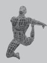
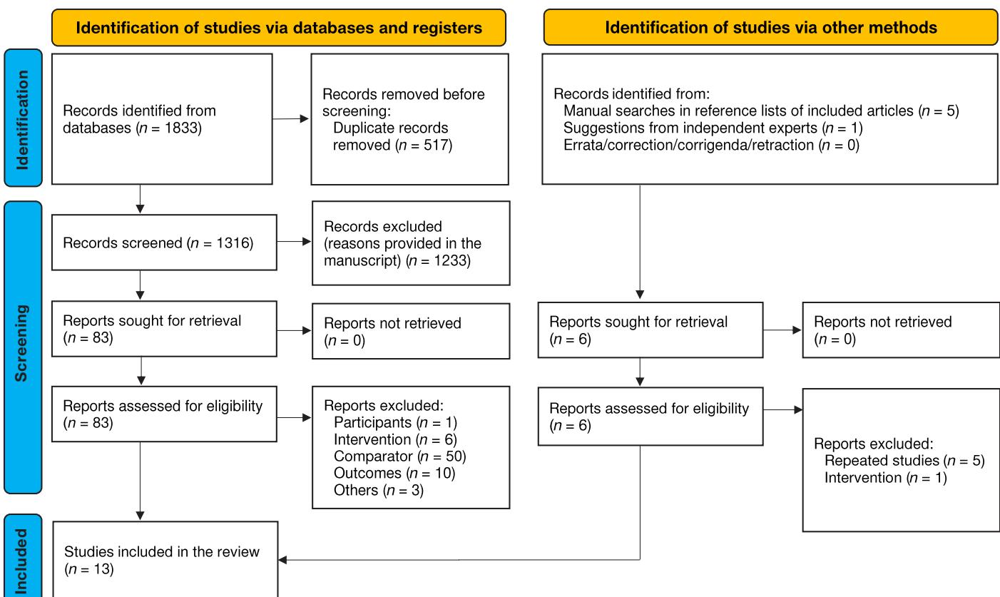
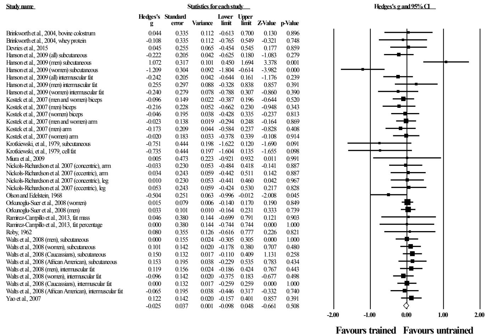

**1** *Citation*: Ramirez-Campillo R, Andrade DC, Clemente FM, Afonso J, Pérez-Castilla A, Gentil P. A proposed model to test the hypothesis of exercise-induced localized fat reduction (spot reduction), including a systematic review with meta-analysis. Hum Mov. 2022;23(3):1–14; doi: https://doi.org/10.5114/hm.2022.110373.

# **A PROPOSED MODEL TO TEST THE HYPOTHESIS OF EXERCISE-INDUCED LOCALIZED FAT REDUCTION (SPOT REDUCTION), INCLUDING A SYSTEMATIC REVIEW WITH META-ANALYSIS**

#### **RODRIGO RAMIREZ-CAMPILLO1,2 [,](https://orcid.org/0000-0003-2035-3279) DAVID C. ANDRADE3 , FILIPE [MA](https://orcid.org/0000-0003-2459-4977)NUEL CLEMENTE4,5 [,](https://orcid.org/0000-0001-9813-2842) JOSÉ AFONSO6 , ALEJANDRO PÉREZ-CASTILLA7 , PAULO GENTIL8**

1 Department of Physical Activity Sciences, Universidad de Los Lagos, Santiago, Chile

2 Exercise and Rehabilitation Sciences Laboratory, School of Physical Therapy, Faculty of Rehabilitation Sciences, Universidad Andres Bello, Santiago, Chile

3 Centre of Physiology and High Altitude Medicine, Biomedical Department, Faculty of Health Sciences,

University of Antofagasta, Antofagasta, Chile

4 Escola Superior Desporto e Lazer, Instituto Politécnico de Viana do Castelo, Viana do Castelo, Portugal

5 Instituto de Telecomunicações, Delegação da Covilhã, Covilhã, Portugal

6 Centre of Research, Education, Innovation, and Intervention in Sport, Faculty of Sport, University of Porto, Porto, Portugal

7 Department of Physical Education and Sports, Faculty of Sport Sciences, University of Granada, Granada, Spain

8 Faculty of Physical Education and Dance, Federal University of Goiás, Goiânia, Brazil

#### Abstract

Purpose. The process in which specific exercises reduce localized adipose tissue depots (targeted fat loss) and modify fat distribution is commonly termed spot reduction. According to this long-held popular belief, exercising a limb would lead to greater reduction in the adjacent adipose tissue in comparison with the contralateral limb. Aside from popular wisdom, scientific evidence from the 20th and 21st century seems to offer inconclusive results. The study aim was to summarize peerreviewed literature assessing the effects of unilateral limb training, compared with the contralateral limb, on the localized adipose tissue depots in healthy participants, and to meta-analyse its results.

Methods. We followed the guidelines of the Preferred Reporting Items for Systematic Reviews and Meta-Analyses. We searched PubMed, Web of Science, and Scopus electronic databases using several relevant keyword combinations. Independent experts were contacted to help identify additional relevant articles. Following the PICOS approach, we included controlled studies that incorporated a localized exercise intervention (i.e., single-leg training) to cohorts of healthy participants (i.e., no restriction for fitness, age, or sex) compared with a control condition (i.e., contralateral limb), where the main outcome was the pre-to-post-intervention change of localized fat. The methodological quality of the studies was assessed with the Physiotherapy Evidence Database scale. Pre- and post-intervention means ± standard deviations of the fat-related outcome in the trained and control groups (limbs) were converted to Hedges' g effect size (*ES*; with 95% confidence intervals [CI]) by using a random-effects model. The impact of heterogeneity was assessed with the *I* 2 statistic. Extended Egger's test served to explore the risk of reporting bias. The statistical significance threshold was set at *p* < 0.05.

Results. From 1833 search records initially identified, 13 were included in the meta-analysis, involving 1158 male and female participants (age, 14–71 years). The 13 studies achieved a high methodological quality, and presented results with low heterogeneity (*I* 2 = 24.3%) and no bias (Egger's test *p* = 0.133). The meta-analysis involved 37 comparisons, with 17 of these favouring (i.e., greater reduction of localized fat) the trained limb, and 20 favouring the untrained limb, but the *ES* ranged between –1.21 and 1.07. The effects were consistent, with a pooled *ES* = –0.03, 95% CI: –0.10 to 0.05, *p* = 0.508, meaning that spot reduction was not observed.

Conclusions. Localized muscle training had no effect on localized adipose tissue depots, i.e., there was no spot reduction, regardless of the characteristics of the population and of the exercise program. The popular belief concerning spot reduction is probably derived from wishful thinking and convenient marketing strategies, such as influencers seeking increased popularity and procedure sellers interested in increasing advertising.

Key words: exercise, human physical conditioning, resistance training, high-intensity interval training, body composition, subcutaneous fat

review paper

doi: https://doi.org/10.5114/hm.2022.110373

*Correspondence address:* Rodrigo Ramirez-Campillo, Exercise and Rehabilitation Sciences Laboratory, School of Physical Therapy, Faculty of Rehabilitation Sciences, Universidad Andres Bello, Campus Casona, Fernández Concha 700, Las Condes, Santiago, postal code 7591538, Chile, e-mail: rodrigo.ramirez@unab.cl, https://orcid.org/0000-0003-2035-3279

© Wroclaw University of Health and Sport Sciences

#### Introduction

*A man may box and fence, and even walk, without losing his terrible abdominal accumulation; but if he centres his efforts at muscular exertion on the abdomen itself the fat cannot stand the attack and will gradually disappear.*

(E. Checkley, 1895) [1]

Since (at least) the 19th century, the notion that specific exercises can reduce localized adipose tissue depots (i.e., targeted fat loss) and modify fat distribution has remained a very popular belief, with the process itself commonly termed spot reduction [2]. From the middle to nearly the end of the 20th century, several studies were performed on the subject, suggesting that spot reduction might be feasible [3–6]. However, during the same period, several studies disproved the notion of spot reduction [2, 7–13]. Toward the end of the 20th century, there seemed to be a consensus among the scientific community that spot reduction was a myth. Nonetheless, during the 21st century, new studies [14–24] have relaunched the debate.

Why is the notion of spot reduction so appealing across centuries [1, 25, 26]? Why have researchers not reached a definitive answer to the problem? This might be explained by 3 main factors. The first one may be the difficulty inherent in addressing the hypothesis of spot reduction. There are complex interactions among (i) different exercise programming characteristics (e.g., exercise modality, periodization, load management, adherence to the program); (ii) diverse regional responses of adipose tissue depots to exercise (i.e., lipolysis, re-esterification, mobilization of free fatty acids); and (iii) inter-individual differences in the modulators of the fat metabolism in response to exercise (e.g., sex, obesity) [19, 27–32]. The second factor of controversy may arise from the different concepts of spot reduction [16, 33]. Various models of study were used to test the hypothesis of spot reduction, such as cross-sectional studies [7, 14, 34, 35], as well as long-term intervention studies involving exercise compared with nutrition [22, 23], trunk-localized exercise [8, 20], limb-localized exercise [5, 9, 18, 21], and whole-body exercise [15, 16]. The third factor is the difficulty to conduct rigorous experimentation to test such a hypothesis (e.g., control the participants' diet and their compliance to the program, use valid measurement techniques [18]). The difficulty encountered by scientists is in contrast with the ease with which personal beliefs (or publicity) can be communicated [1, 25, 26]. Marketing and science often collide [33], and marketing the notion of exercisebased spot reduction to persons seeking a desperate solution to their problems [36] may be very appealing.

If the notion of spot reduction is correct, then performing a regimen of unilateral exercise should lead to higher reduction in adipose content in that region than in the contralateral limb. To the best of our knowledge, the debate regarding exercise-based spot reduction seems to be active, even after (at least) 3 centuries [1]. To contribute to settling down the debate, a systematic review with meta-analysis was conducted to qualitatively assess and quantitatively summarize the evidence in the field, but also circumvent the problem of most exercise-related studies: a reduced sample size [37]. Our aim was to summarize peer-reviewed literature assessing the effects of unilateral limb training, compared with the contralateral limb, on the localized adipose tissue depots in healthy participants across the life span, and to meta-analyse its results.

### Material and methods

We followed the guidelines of the Preferred Reporting Items for Systematic Reviews and Meta-Analyses (PRISMA) [38, 39]. The methods were established before initiating the research, and protocol registration preceded the search.

#### Search strategy

We searched through PubMed, Web of Science, and Scopus electronic databases from the inception of indexing to June 2021, with no restriction on language. Potentially relevant keywords were collected through authors' consensus on the basis of previous studies conducted in relation to spot reduction; organized vocabulary (i.e., Medical Subject Headings [MeSH]) was also incorporated. As a result, the following keywords were introduced in the electronic databases in different combinations by using Boolean search syntax with the operators 'AND,' 'OR': activity, arm, body, clinical, composition, conditioning, controlled, distribution, dominant, elbow, exercise, extension, fat, flexion, forearm, high, human, intensity, interval, knee, leg, local, localized, loss, mass, modalities, model, motor, movement, muscle, musculoskeletal, non-dominant, phenomena, physical, physiological, reduction, regional, resistance, running, single, sport, spot, strength, subcutaneous, targeted, therapy, thigh, training, treatment, trial, unilateral. Electronic searches were conducted in accordance with the specific characteristics of each electronic database search engine. For example, in the PubMed database, the following search syntax was used: controlled clinical trial [Publication Type] AND training [Title/Abstract] OR single-leg [Title/Abstract] AND body composition [MeSH Terms] AND fat [Title/ Abstract].

After the initial search in June 2021, we created accounts in the respective databases. Through these accounts, the lead investigator received weekly automatically generated e-mails for updates regarding the search terms used (if available). All studies that were published before August 2021 were considered for inclusion. We excluded studies on the basis of the review of the title or abstract, or (when needed) after reading the full text. Conference proceedings were considered if the full-text was available. The reference list of included studies was searched for potentially relevant studies. Two authors (RRC, DCA) conducted the process independently, with potential discrepancies resolved by consensus.

Thereafter, the list of included articles and the inclusion criteria were sent to 2 independent world experts in the field of body composition (https://www.expertscape.com/ex/body+composition) to help identify additional relevant articles. Additionally, the experts (i) hold a Ph.D. in sports sciences or a related field (e.g., health sciences); (ii) have peer-reviewed publications on body composition in journals with impact factor according to the Journal Citation Reports®. The experts were not provided with our search strategy to avoid biasing their own searches. Upon completion of all these steps, the databases were again consulted in search for errata or retractions of any included study.

### Eligibility criteria

To elaborate the PICOS eligibility criteria, we first elaborated a definition of the investigated problem. Namely, spot reduction (in humans) is defined as a greater reduction of the non-intramuscular fat-related depot(s) (e.g., subcutaneous fat) adjacent to a voluntarily exercised muscle compared with the same depot from the contralateral non-exercised muscle, after an intervention period.

Accordingly, and following the PICOS criteria, we incorporated studies that:

(i) Included cohorts of healthy (e.g., with medical or ethics review board clearance to participate in a training programme) participants (humans), with no restriction for fitness/sport background, age, or sex. Excluded participants were those with a physical trauma (e.g., limb amputation [40]) or certain diseases (e.g., stroke leading to paretic limb [41], genetic conditions or syndromes potentially affecting adipose tissue or its response to training [24, 42, 43]).

(ii) Involved a localized exercise intervention (without restriction for the mode of exercise, e.g., resistance training, endurance training) where one limb was trained and the contralateral limb was the control. Interventions lasting a minimum of 2 weeks were considered [44, 45]. Studies that incorporated a non-localized exercise intervention (e.g., running, bilateral leg press) were excluded. Cross-sectional studies were also excluded. Studies were not excluded if they lacked dietary control and/or involved nutritional supplementation, as this is not a critical factor for experimental models using the contralateral limb as a control condition [46].

(iii) Compared localized exercise with a control condition (i.e., contralateral limb), with the only difference between the conditions being the exercise intervention.

(iv) Employed a pre-to-post-intervention assessment of at least 1 fat-related parameter (e.g., fat mass, fat volume) by using dual-energy X-ray absorptiometry, magnetic resonance imaging, computerized tomography, skinfold callipers, ultrasound, or the microscopic method (i.e., subcutaneous fat biopsy). Secondary outcomes were considered, including potential adverse effects derived from the intervention (e.g., injury).

(v) Utilized a randomized or non-randomized controlled design, as long as at least 1 comparator group existed.

#### Data extraction

Two authors of the review (RRC, DCA) performed the data extraction independently, using a predefined form created in Microsoft Excel (Microsoft Corporation, Redmond, WA, USA). If there were any discrepancies between the authors in the extracted data, the accuracy of the information was re-checked in the studies. We extracted the following data: participants' sex, age (years), body mass (kg), height (cm), and previous experience with training. If applicable, information about the type and level (e.g., professional, amateur) of sports practice was also retrieved. Regarding training characteristics, the extracted data included training frequency (days/week) and training duration (weeks), intensity level and marker of intensity (e.g., % of one-repetition maximum [1RM]), total volume (e.g., repetitions, minutes), types of exercises performed, combination of exercise with diet, and progressive overload techniques (if any).

The means and standard deviations (*SD*s) of dependent variables were extracted at pre- and post-intervention time points from the included studies. In cases where the required data were not clearly or completely reported, the authors of the study were contacted for clarification. If no response was obtained from the authors (after 2 attempts) or if the authors could not provide the requested data, the study outcome was excluded from the analysis. However, even when no numerical data were provided by the authors upon contact, in cases where data were displayed in a figure [9], the meta-analysis used validated (*r* = 0.99, *p* < 0.001) [47] software (WebPlotDigitizer; https://apps.automeris. io/wpd/) [48] to derive the relevant numerical data.

#### Methodological quality assessment

The Physiotherapy Evidence Database (PEDro) scale was used to assess the methodological quality of the included studies [49]. There are 11 items on the PEDro checklist, but item 1 is not included in the total score. Therefore, the methodological quality of the included studies was rated from 0 (lowest quality) to 10 (highest quality). The scale evaluates different aspects of the study design, such as participant eligibility criteria, randomization, blinding, attrition, and reporting of data. The validity and reliability of the PEDro scale was established previously [49–51]. Additionally, its agreement with other scales (e.g., Cochrane risk of bias tool) has been reported [52]. Also, the PEDro scale is probably one of the most frequently used scales in the literature, which helps to make comparisons between metaanalyses. In accordance with the cut-off scores, the methodological quality was rated as 'poor' (< 4), 'fair' (4–5), 'good' (6–8), or 'excellent' (9–10) in some subfields, however, it is not possible to satisfy all scale items in some areas of physiotherapy practice [53]. Moreover, in the context of this study, the definition of spot reduction, and the proposed experimental model to test the hypothesis of spot reduction, is not possible to blind the participants regarding whether they trained or not one of their limbs, which makes item 5 from the PEDro scale an unfair criterium to assess the methodological quality of studies involved in our review. Therefore, as outlined in previous systematic reviews in some sub-fields of physiotherapy [54, 55], the methodological quality of the studies was interpreted by using the following convention, based on the summary score: studies that scored 3 points were considered as being of 'poor quality,' studies scoring 4 or 5 points were considered as being of 'moderate quality,' and studies that scored 6–10 points were considered as being of 'high quality'. Two authors (RRC, DCA) performed the methodological quality assessment independently. Disagreements in the assessments between the reviewers were resolved through discussion and consensus.

### Statistical analysis

Pre- and post-intervention mean ± *SD* of a given fat-related outcome in the trained and control groups was converted to Hedges' *g* effect size (*ES*). A metaanalysis for a given fat-related outcome was conducted if at least 3 studies provided sufficient data for the calculation of *ES* [56–58]. The data were standardized by using post-score *SD*. For studies that reported standard errors, *SD*s were calculated by multiplying the standard error with the square root of the sample size [59]. In all analyses, we used the random-effects model to account for differences between studies that might affect the treatment effect [60, 61]. The *ES* values are presented with their respective 95% confidence intervals (CIs). The calculated *ES* values were interpreted with the following scale: < 0.2, trivial; 0.2–0.6, small; > 0.6–1.2, moderate; > 1.2–2.0, large; > 2.0–4.0, very large; > 4.0, extremely large [62]. The impact of heterogeneity was assessed with the *I* 2 statistic, with values of < 25%, 25–75%, and > 75% considered to represent low, moderate, and high levels of heterogeneity, respectively. Extended Egger's test (2-tailed) served to explore the risk of reporting bias [63]. To adjust for publication bias, a sensitivity analysis was conducted with the trim and fill method [64], with L0 as the default estimator for the number of missing studies [65]. All analyses were carried out by using the Comprehensive Meta-Analysis program (version 2; Biostat, Englewood, NJ, USA). The statistical significance threshold was set at *p* < 0.05.

## Ethical approval

The conducted research is not related to either human or animal use. The protocol for this systematic review with meta-analysis was registered at the International Platform of Registered Systematic Review and Meta-Analysis Protocols (INPLASY) on June 28, 2021 (registration number: INPLASY202160103).

## Results

#### Study selection

A total of 1833 search records were initially identified. After excluding the duplicates and studies on

the basis of the title or abstract, 83 studies remained, and their full texts were read. From these, 13 were included in the meta-analysis [5, 9, 10, 18, 21, 46, 66–72]. Figure 1 provides a diagram of the study selection process. The included studies involved 1158 participants (acting as both experimental and control groups). The characteristics of the participants from the included studies, the programming parameters of the training interventions, and the fat-related outcomes (for both the control and experimental limbs) are presented in Table 1.

Briefly, training interventions were applied during 2 up to 20 weeks, with a training frequency of 3 sessions per week, up to 7 sessions per week (i.e., daily training). The training intensity (i.e., single-leg) varied from 10% to 90% of 1RM for those interventions that applied resistance training exercises, and equalled ca. 40% of peak oxygen consumption (VO2max) in the intervention that used endurance (i.e., cycling) training. Of note, the interventions with resistance training exercises commonly utilized elbow flexors/extensorsrelated exercises (e.g., dumbbell biceps concentration curls, overhead triceps extension) or knee extensorsrelated exercises (e.g., seated leg press, seated leg extension); none of the included studies applied knee flexors-related exercises. No major adverse effects were reported among the included studies; only mild-moderate delayed-onset muscle soreness was observed. However, most of the studies in this meta-analysis failed to report specific information regarding adverse health effects. This reflects a larger problem in sports sciences and produces unbalanced accounts, as authors present the main effects, but not the potential adverse health effects.

### Methodological quality

In accordance with the PEDro checklist, the 13 studies achieved 6–8 points and were classified as being of 'high' methodological quality (Table 2).

### Meta-analysis results

The meta-analysis included 13 controlled studies, involving 37 comparisons, with 17 of these favouring (i.e., greater reduction of localized fat) the trained limb, and 20 favouring the untrained limb, but the *ES* ranged between –1.21 and 1.07. The effects were consistent, with a pooled *ES* = –0.03, 95% CI: –0.10 to 0.05, *p* = 0.508, *I* 2 = 24.3%, Egger's test *p* = 0.133 (Figure 2), meaning that spot reduction was not observed.

Figure 1. PRISMA 2020 flow diagram

## **HUMAN MOVEMENT**

Table 1. Included studies characteristics

| Study Participants |   | Training Outcomes      |
|--------------------|---|------------------------|
| (                  | n | = 17; age, 21.4 years; |
| (                  | n | = 17; age, 23.8 years; |
| (                  | n | = 25; age, 71 years;   |
| and men (          |   | n = 22; age,           |

| Nickols 70 women, white (95%) 20 weeks, 3 sessions per week. Concentric (or eccentric) Richardson (age, 20.2 years; BMI, 22.1 km ∙ m–2) et al., 2007 leg and arm. During week 1, one set of 6 repetitions was [69] performed for knee extension and elbow flexion. In weeks pants completed 5 sets of 6 repetitions. In weeks 6–20, the volume was maintained. Torque output was not controlled                                                                                                                                           | Arm fat mass (kg; DEXA) Leg fat mass (kg; DEXA)                                             |
|--------------------------------------------------------------------------------------------------------------------------------------------------------------------------------------------------------------------------------------------------------------------------------------------------------------------------------------------------------------------------------------------------------------------------------------------------------------------------------------------------------------------------------------------|---------------------------------------------------------------------------------------------|
| Of note, one group of women ( n = 37) performed concentric                                                                                                                                                                                                                                                                                                                                                                                                                                                                                 |                                                                                             |
| training, and the other group ( n = 33) eccentric training                                                                                                                                                                                                                                                                                                                                                                                                                                                                                 |                                                                                             |
| Olson and 32 boys, with no experience Edelstein, in weight training 1968 [5] (age, 14–16 years) week; however, data from all the participants were mixed). Right arm curl with dumbbell and triceps extension with dumbbell, for 3 sets of 7RM each exercise (with as many repetitions as possible in the second and third sets). When a sufficient gain in strength allowed 7 repetitions to be per athletics during the study                                                                                                           | Triceps sub  cutaneous fat (mm; skinfold callipers)                                        |
| See: Kostek et al., 2007 [18] Orkunoglu 320 women (age, 22.9 years; Suer et al., body mass, 64.7 kg; height, 164.2 cm; BMI, 23.7 kg ∙ m–2) 2008 [70] and 197 men (age, 23.9 years; body mass, 78.8 kg; height, 178.5 cm; BMI, 24.7 kg ∙ m–2); all European descents (white) Ramirez 11 physical education 12 weeks, 3 sessions per week (80 minutes per session). Campillo students (7 men and et al., 2013 4 women; Latin American) [21] (age, 23.0 years; BMI, 25.0 kg ∙ m–2) completed 960–1200 consecutive repetitions for their set | Arm subcu taneous fat volume (mm3 ; MRI) Leg fat mass (kg; DEXA) Leg fat percentage (DEXA) |
| Roby, 1962 15 male college students 10 weeks, 3 sessions per week. Dominant arm triceps [10] (age, 21.1 years) Overload was applied when participants were able to perform 15 repetitions in all 3 sets                                                                                                                                                                                                                                                                                                                                    | Triceps sub  cutaneous fat (mm; skinfold callipers)                                        |
| Men ( n : 78–82) and women                                                                                                                                                                                                                                                                                                                                                                                                                                                                                                                 |                                                                                             |
| ( n : 95–98), relatively healthy,                                                                                                                                                                                                                                                                                                                                                                                                                                                                                                          |                                                                                             |
| reported Caucasians ( n = 114)                                                                                                                                                                                                                                                                                                                                                                                                                                                                                                             |                                                                                             |
| or African Americans ( n = 52)                                                                                                                                                                                                                                                                                                                                                                                                                                                                                                             |                                                                                             |
| See: Hanson et al., 2009 [46] Walts et al., 2008 [71] physically inactive (age, 63.0 years); self                                                                                                                                                                                                                                                                                                                                                                                                                                         | Knee extensor subcutaneous fat (cm2 ; CT) Knee extensor intermuscular fat (cm2 ; CT)        |
| Men ( n = 46; age, 64.4 years;                                                                                                                                                                                                                                                                                                                                                                                                                                                                                                             |                                                                                             |
| women ( n = 52; age, 62.7 years;                                                                                                                                                                                                                                                                                                                                                                                                                                                                                                           |                                                                                             |
| See: Hanson et al., 2009 [46] Yao et al., 2007 [72] height, 174 cm; body mass, height, 163 cm; body mass,                                                                                                                                                                                                                                                                                                                                                                                                                                  | Knee extensor intermuscular fat (cm2 ; CT)                                                  |

1RM – one-repetition maximum, BMI – body mass index, bpm – beats per minute, CT – computed tomography, DEXA – dual-energy X-ray absorptiometry, MRI – magnetic resonance imaging, ROM – range of motion, VO2 – volume of oxygen consumption

Table 2. Methodological quality of the included studies based on the PEDro rating scale

| Study name                          | Q1 | Q2 | Q3 a | Q4 | Q5 | Q6 | Q7 | Q8 | Q9 | Q10 | Q11 | Total* | Study quality |
|-------------------------------------|----|----|-----------------|----|----|----|----|----|----|-----|-----|--------|---------------|
| Brinkworth et al., 2004 [66]        | 1  | 0  | 1               | 1  | 0  | 1  | 1  | 1  | 1  | 1   | 1   | 8/10   | High          |
| Devries et al., 2015 [67]           | 1  | 1  | 1               | 1  | 0  | 0  | 0  | 1  | 1  | 1   | 1   | 7/10   | High          |
| Hanson et al., 2009 [46]            | 1  | 0  | 1               | 1  | 0  | 0  | 0  | 1  | 1  | 1   | 1   | 6/10   | High          |
| Kostek et al., 2007 [18]            | 1  | 0  | 1               | 1  | 0  | 1  | 1  | 1  | 1  | 1   | 1   | 8/10   | High          |
| Krotkiewski, et al., 1979 [9]       | 1  | 0  | 1               | 1  | 0  | 0  | 0  | 1  | 1  | 1   | 1   | 6/10   | High          |
| Miura et al., 2009 [68]             | 1  | 1  | 1               | 1  | 0  | 0  | 0  | 1  | 1  | 1   | 1   | 7/10   | High          |
| Nickols-Richardson et al. 2007 [69] | 1  | 0  | 1               | 1  | 0  | 0  | 0  | 1  | 1  | 1   | 1   | 6/10   | High          |
| Olson and Edelstein, 1968 [5]       | 1  | 0  | 1               | 1  | 0  | 0  | 0  | 1  | 1  | 1   | 1   | 6/10   | High          |
| Orkunoglu-Suer et al., 2008 [70]    | 1  | 0  | 1               | 1  | 0  | 0  | 0  | 1  | 1  | 1   | 1   | 6/10   | High          |
| Ramirez-Campillo et al., 2013 [21]  | 1  | 0  | 1               | 1  | 0  | 0  | 0  | 1  | 1  | 1   | 1   | 6/10   | High          |
| Roby, 1962 [10]                     | 1  | 0  | 1               | 1  | 0  | 0  | 0  | 1  | 1  | 1   | 1   | 6/10   | High          |
| Walts et al., 2008 [71]             | 1  | 0  | 1               | 1  | 0  | 1  | 1  | 1  | 1  | 1   | 1   | 8/10   | High          |
| Yao et al., 2007 [72]               | 1  | 0  | 1               | 1  | 0  | 0  | 0  | 1  | 1  | 1   | 1   | 6/10   | High          |

A detailed explanation for each PEDro scale item can be accessed at <https://www.pedro.org.au/english/downloads/pedro-scale>. Q3 was considered to be attained even if concealed allocation was not reported, since the decision about whether or not to include a person in a trial could not be influenced by knowledge of whether the subject was to receive treatment or not. a in the context of this study, \* for a possible maximal punctuation of 10

Figure 2. Forest plot for changes in localized fat (spot reduction) in trained compared with untrained limbs.

Negative values denote that the trained limb reduced more fat than the untrained limb. Values shown are effect sizes (Hedges' g) with 95% confidence intervals (CI). The size of the plotted squares reflects the statistical weight of each study. The white diamond reflects the overall result

#### Discussion

In the context of the definition of our proposed model to test the hypothesis of spot reduction, our aim was to summarize peer-reviewed literature assessing the effects of unilateral limb training, compared with the contralateral limb, on the localized adipose tissue depots in healthy participants across the life span, and to meta-analyse its results. From the 13 studies included in our meta-analysis, all achieved 6 or more points in the PEDro scale. This may increase the perceived quality of research included in our analyses and the confidence in evidence. Further, results were obtained with low impact of heterogeneity (*I* 2 = 24.3%) and no significant risk of reporting bias (Egger's test *p* = 0.133). In addition, a total of 1158 participants were included in the 13 studies, a strength when compared with the relatively reduced number of participants involved in sports sciences literature [37]. Although exercise is a potent contributor to fat reduction [73], our metaanalysis indicated no significant (trivial) effect of localized muscle training on localized adipose tissue depots, i.e., no spot reduction was observed. Therefore, long-term exercise-based localized adipose tissue reduction would not be an expected result of an adequately planned exercise intervention. The result of our meta-analysis is based on interventions with a mean duration of 11 weeks (range, 2–20 weeks) involving different training approaches (e.g., cycling, resistance training) in participants of different sex, age, and physical fitness level (e.g., sedentary, physically active). Despite the heterogeneity in samples, protocols, and study designs, the lack of effect was consistent, denoting a robust phenomenon that is largely independent of the characteristics of the population or of the exercise program. It is indeed intriguing from a physiological and anatomical perspective how exercise-based interventions may induce a localized effect on skeletal muscle tissue [74], bone tissue [75], or even skin tissue [76], but not on adipose tissue.

Such an intriguing phenomenon has generated controversy since (at least) the 19th century [1, 25, 26], with several studies performed on the subject from the middle of the 20th century up to recently [2–24]. It is possible that the controversy regarding spot reduction relates to its definition. For example, if spot reduction considers the intramuscular fat stores, a localized reduction may occur, contrary to the subcutaneous fat depot [24]. Considering our definition of voluntary exercise-based localized fat reduction (i.e., spot reduction; see methods section, eligibility criteria sub-section), a valid model to test the hypothesis of spot reduction would be one in which, essentially, the muscles in one part of the body are trained, whereas the muscles in the contralateral side are not. Indeed, the use of an appropriate research model is fundamental for researchers to avoid flawed experiments that may lead them to inappropriate (or even intended) results. For such definition and proposed model we considered [19, 27–30, 32, 71] (i) fat depots from different body regions are not equally comparable within a given individual (i.e., comparing arms and legs); (ii) for the same body fat depot, significant inter-individual differences might occur (e.g., abdominal fat may respond differently to exercise in males compared with females) [28, 77, 78]; (iii) contrary to neuromuscular-related outcomes, there is no evidence for a cross-education between subcutaneous fat depots through exercise; (iv) the effects of exercise training on one limb compared with the contralateral non-exercised limb allow a tight control for dietary (even if this is not manipulated) and other possible intervening factors (e.g., methodology, seasonal variation, genetics, biology, variations in attention and motivation between experimental and control groups) [46, 71]; (v) studies seeking to validly test the hypothesis of spot reduction should consider the size of the adipose tissue depots adjacent to the trained and respective non-trained muscles before and after an intervention period (with a relatively high volume of work to impact fat tissue), not just after an acute exercise bout [14]; (vi) valid studies should use valid measurement techniques, avoiding techniques that may provide biased results owing to changes in muscle mass [18] or other factors not related to biological changes in fat content [79]. For example, reductions of 3–14% (mean, 7.5%) were noted in the trained arm compared with the non-trained arm when subcutaneous fat was measured in the biceps with a skinfold calliper [18]. In contrast, when MRI was used to measure arm subcutaneous fat volume, the reduction was nearly 3-fold lower (range, 0–7%; mean, 2.8%) [18]. Additionally, valid studies should report the reliability of measurement (e.g., coefficient of variation, total error of measurement), as not all studies in this field have reported this essential element [4–6, 15].

In contrast to our proposed definition and model to test the hypothesis of exercise-induced localized fat reduction, 2 cross-sectional studies [14, 17] found acute localized lipolysis. However, the studies did not demonstrate spot reduction (i.e., localized reduction of adipose tissue). Moreover, in the 2 aforementioned cross-sectional studies [14, 17], although they reported that exercising one leg promoted an increase in lipolysis in the subcutaneous fat adjacent to the muscles being exercised (e.g., anterior thigh), the effect was highly local, meaning that any significant long-term effect (i.e., fat reduction) would be unlikely. Further, compared with the aforementioned cross-sectional studies [14, 17], some authors observed contradicting findings, with intense exercise (e.g., resistance training) reducing subcutaneous adipose tissue blood flow and lipolysis [31]. Aside the controversial findings, the fact that an acute increase in lipolysis does not translate into chronic reduction in fat depots is analogous to the fact that exercise at a given intensity may allow maximal acute rate of fat oxidation [80], without long-term effect on body composition [81]. Indeed, even if acute localized lipolysis occurs during exercise, several additional physiological processes are needed before free fatty acids enter the blood stream for later oxidation in tissues [28, 29, 82]. Moreover, the authors from one of the aforementioned cross-sectional studies [14] indicated that 'More calories are expended during aerobic, whole body exercise than by exercise with local muscle groups, and, accordingly, a person seeking to loose fat must be advised to perform whole body exercise' (p. E398). Indeed, high-intensity exercise has been found to promote large reduction in body fat in different body parts, with many different activities [83]. From a practical point of view, if the main aim of a training programme were to improve body composition, including reductions of adipose tissue, the most logically defendable approach would be to include a training programme allowing a considerable energy expenditure density. To this aim, compared with localized exercise, non-localized exercise involving large muscles groups would be preferable. Of course, localized exercise may still offer important practical relevance, improving the endurance of trunk muscles (e.g., abdominal muscle training), inducing a cross-education effect on injured limbs, or improving localized-peripheral adaptations with a minimization of central responses (e.g., blood pressure), among others. But the current literature does not support its use for regional fat reduction.

### Limitations

According to our definition, a valid model to test the hypothesis of spot reduction would be one in which the muscles in one limb are trained, whereas the muscles in the contralateral limb are not. To our knowledge, this model is less prone to bias compared with the rest of the models (e.g., cross-sectional, exercise compared with nutrition, trunk-localized exercise, whole-body exercise) currently proposed in the scientific literature to test the hypothesis of spot reduction through exercise training. Considering our proposed definition and model, we conducted a systematic review with meta-analysis that included studies with participants across a wide range of ages, with no restriction for sex or training status, and that included different protocols (e.g., training, assessment techniques). Owing to the high heterogeneity between the included studies, a high heterogeneity in results might been expected. However, the meta-analysis clearly denotes that lack of spot reduction is ubiquitous, i.e., the effect is very strong and seems to be sample- and protocol-independent. Although our results appear highly consistent, we discuss some potential limitations.

Firstly, exercising one limb might induce a partial activation of the contralateral limb [84], and contralateral strength gains have been reported [85–87]. How much activation of the control limb might have occurred and to what extent this affected study outcomes is unclear. Additionally, studies usually controlled for the correct technical execution of training exercise by proper spotters and researchers. Therefore, it is assumed that participants recruited for exercise interventions had an adequate exercise technique and supervision that made them able to activate the target muscle while maintaining the contralateral muscle relatively inactive. Secondly, the lack of nutritional control was not considered as an exclusion criterion in our meta-analysis. Nonetheless, the effects of exercise training on one limb compared with the contralateral non-exercised limb allow a tight control for dietary (even if this is not manipulated) and other possible intervening factors (e.g., seasonal variation, genetics, biology) [46, 71]. Thirdly, we only considered voluntary training protocols in this meta-analysis. Therefore, non-voluntary muscle activation strategies and their potential to affect the trained limb [88, 89] were not investigated. Fourthly, the studies included in our meta-analysis consisted of training programmes lasting 2–20 weeks; longer-term interventions were not addressed. However, on the basis of the current findings and those derived from some cross-sectional studies involving athletes with several years of training using one limb more than the contralateral one (e.g., tennis) [7, 35, 90], longer-term interventions would probably help to confirm the presented findings.

- Conclusions Localized muscle training had no effect on localized adipose tissue depots, i.e., there was no spot reduction, regardless of the characteristics of the population and of the exercise program. Disclosure statement No author has any financial interest or received any financial benefit from this research. Conflict of interest The authors state no conflict of interest. Data availability The datasets generated and/or analysed during the current study are available from the corresponding author on reasonable request. References
- 1. Checkley E. A natural material method of physical education training making muscle and reducing flesh without dieting or apparatus. New York: William C. Bryant and Co.; 1895.
- 2. Roby FB. The effect of exercise on regional subcutaneous fat accumulations. Doctoral thesis. Champaign: University of Illinois; 1960.
- 3. Mohr DR. Changes in waistline and abdominal girth and subcutaneous fat following isometric exercises. Res Q. 1965;36(2):168–173; doi: 10.1080/10671188. 1965.10614676.
- 4. Noland M, Kearney JT. Anthropometric and densitometric responses of women to specific and general exercise. Res Q. 1978;49(3):322–328; doi: 10.1080/10671 315.1978.10615541.
- 5. Olson AL, Edelstein E. Spot reduction of subcutaneous adipose tissue. Res Q. 1968;39(3):647–652; doi: 10.1080/ 10671188.1968.10616592.
- 6. Bailey HR. Localized tissue reduction. Med J Aust. 1976;1(21):780–781; doi: 10.5694/j.1326-5377.1976. tb141054.x.
- 7. Gwinup G, Chelvam R, Steinberg T. Thickness of subcutaneous fat and activity of underlying muscles. Ann Intern Med. 1971;74(3):408–411; doi: 10.7326/0003- 4819-74-3-408.
- 8. Katch FI, Clarkson PM, Kroll W, McBride T, Wilcox A. Effects of sit up exercise training on adipose cell size and adiposity. Res Q Exerc Sport. 1984;55(3):242–247; doi: 10.1080/02701367.1984.10609359.
- 9. Krotkiewski M, Aniansson A, Grimby G, Björntorp P, Sjöström L. The effect of unilateral isokinetic strength training on local adipose and muscle tissue morphology, thickness, and enzymes. Eur J Appl Physiol Occup Physiol. 1979;42(4):271–281; doi: 10.1007/BF00423297.
- 10. Roby FB. Effect of exercise on regional subcutaneous fat accumulations. Res Q. 1962;33(2):273–278; doi: 10.1080/10671188.1962.10613202.
- 11. Ingemann-Hansen T, Halkjaer-Kristensen J. Lean and fat component of the human thigh. The effects of immobilization in plaster and subsequent physical training. Scand J Rehabil Med. 1977;9(2):67–72.
- 12. Schwartz KV. "Spot" reduction of fat. Ann Intern Med. 1971;75(2):316; doi: 10.7326/0003-4819-75-2-316\_1.
- 13. Krotkiewski M. Can body fat patterning be changed? Acta Med Scand Suppl. 1988;723:213–223; doi: 10.1111/ j.0954-6820.1987.tb05946.x.
- 14. Stallknecht B, Dela F, Helge JW. Are blood flow and lipolysis in subcutaneous adipose tissue influenced by contractions in adjacent muscles in humans? Am J Physiol Endocrinol Metab. 2007;292(2):E394–E399; doi: 10.1152/ajpendo.00215.2006.
- 15. Scotto di Palumbo A, Guerra E, Orlandi C, Bazzucchi I, Sacchetti M. Effect of combined resistance and endurance exercise training on regional fat loss. J Sports Med Phys Fitness. 2017;57(6):794–801; doi: 10.23736/S00 22-4707.16.06358-1.
- 16. Paoli A, Casolo A, Saoncella M, Bertaggia C, Fantin M, Bianco A, et al. Effect of an endurance and strength mixed circuit training on regional fat thickness: the quest for the "spot reduction". Int J Environ Res Public Health. 2021;18(7):3845; doi: 10.3390/ijerph18073845.
- 17. Heinonen I, Bucci M, Kemppainen J, Knuuti J, Nuutila P, Boushel R, et al. Regulation of subcutaneous adipose tissue blood flow during exercise in humans. J Appl Physiol. 2012;112(6):1059–1063; doi: 10.1152/ japplphysiol.00732.2011.
- 18. Kostek MA, Pescatello LS, Seip RL, Angelopoulos TJ, Clarkson PM, Gordon PM, et al. Subcutaneous fat alterations resulting from an upper-body resistance training program. Med Sci Sports Exerc. 2007;39(7):1177– 1185; doi: 10.1249/mss.0b0138058a5cb.
- 19. Nindl BC, Harman EA, Marx JO, Gotshalk LA, Frykman PN, Lammi E, et al. Regional body composition changes in women after 6 months of periodized physical training. J Appl Physiol. 2000;88(6):2251–2259; doi: 10.1152/jappl.2000.88.6.2251.
- 20. Vispute SS, Smith JD, LeCheminant JD, Hurley KS. The effect of abdominal exercise on abdominal fat. J Strength Cond Res. 2011;25(9):2559–2564; doi: 10.1519/ JSC.0b013e3181fb4a46.
- 21. Ramírez-Campillo R, Andrade DC, Campos-Jara C, Henríquez-Olguín C, Alvarez-Lepín C, Izquierdo M. Regional fat changes induced by localized muscle endurance resistance training. J Strength Cond Res. 2013; 27(8):2219–2224; doi: 10.1519/JSC.0b013e31827e8681.
- 22. Kordi R, Dehghani S, Noormohammadpour P, Rostami M, Mansournia MA. Effect of abdominal resistance exercise on abdominal subcutaneous fat of obese women: a randomized controlled trial using ultrasound imaging assessments. J Manipulative Physiol Ther. 2015; 38(3):203–209; doi: 10.1016/j.jmpt.2014.12.004.

- 23. Redman LM, Heilbronn LK, Martin CK, Alfonso A, Smith SR, Ravussin E, et al. Effect of calorie restriction with or without exercise on body composition and fat distribution. J Clin Endocrinol Metab. 2007;92(3): 865–872; doi: 10.1210/jc.2006-2184.
- 24. Gorgey AS, Shepherd C. Skeletal muscle hypertrophy and decreased intramuscular fat after unilateral resistance training in spinal cord injury: case report. J Spinal Cord Med. 2010;33(1):90–95; doi: 10.1080/10790268. 2010.11689681.
- 25. Dedrick A, Merten JW, Adams T, Wheeler M, Kassie T, King JL. A content analysis of Pinterest belly fat loss exercises: unrealistic expectations and misinformation. Am J Health Educ. 2020;51(5):328–337; doi: 10.1080/ 19325037.2020.1795754.
- 26. Kieffer SH. Myths and truths from exercise physiology. J Phys Educ Recreat Dance. 2008;79(8):23–25; doi: 10.1080/07303084.2008.10598227.
- 27. Idoate F, Ibañez J, Gorostiaga EM, García-Unciti M, Martínez-Labari C, Izquierdo M. Weight-loss diet alone or combined with resistance training induces different regional visceral fat changes in obese women. Int J Obes. 2011;35(5):700–713; doi: 10.1038/ijo.2010.190.
- 28. Horowitz JF. Fatty acid mobilization from adipose tissue during exercise. Trends Endocrinol Metab. 2003;14(8): 386–392; doi: 10.1016/s1043-2760(03)00143-7.
- 29. Jensen MD. Lipolysis: contribution from regional fat. Annu Rev Nutr. 1997;17:127–139; doi: 10.1146/annurev. nutr.17.1.127.
- 30. Nindl BC, Friedl KE, Marchitelli LJ, Shippee RL, Thomas CD, Patton JF. Regional fat placement in physically fit males and changes with weight loss. Med Sci Sports Exerc. 1996;28(7):786–793; doi: 10.1097/0000 5768-199607000-00003.
- 31. Heinonen IHA, Boushel R, Kalliokoski KK. The circulatory and metabolic responses to hypoxia in humans – with special reference to adipose tissue physiology and obesity. Front Endocrinol. 2016;7:116; doi: 10.3389/ fendo.2016.00116.
- 32. Thompson D, Karpe F, Lafontan M, Frayn K. Physical activity and exercise in the regulation of human adipose tissue physiology. Physiol Rev. 2012;92(1):157–191; doi: 10.1152/physrev.00012.2011.
- 33. Pinto H. Local fat treatments: classification proposal. Adipocyte. 2016;5(1):22–26; doi: 10.1080/21623945. 2015.1066534.
- 34. Poliszczuk T, Mańkowska M, Poliszczuk D, Wiśniewski A. Symmetry and asymmetry of reaction time and body tissue composition of upper limbs in young female basketball players. Pediatr Endocrinol Diabetes Metab. 2013;19(4):132–136.
- 35. Maughan RJ, Abel RW, Watson JS, Weir J. Forearm composition and muscle function in trained and untrained limbs. Clinic Physiol. 1986;6(4):389–396; doi: 10.1111/j.1475-097x.1986.tb00244.x.
- 36. Greenway FL, Pekarovics S. Anthropometry of local fat reduction. In: Preedy VR (ed.), Handbook of anthropometry: physical measures of human form in health and disease. New York: Springer; 2012; 1989–2005.
  - 37. Abt G, Boreham C, Davison G, Jackson R, Nevill A, Wallace E, et al. Power, precision, and sample size estimation in sport and exercise science research. J Sports Sci. 2020;38(17):1933–1935; doi: 10.1080/02640414. 2020.1776002.
  - 38. Liberati A, Altman DG, Tetzlaff J, Mulrow C, Gøtzsche PC, Ioannidis JPA, et al. The PRISMA statement for reporting systematic reviews and meta-analyses of studies that evaluate healthcare interventions: explanation and elaboration. BMJ. 2009;339:b2700; doi: 10.1136/ bmj.b2700.
  - 39. Page MJ, McKenzie JE, Bossuyt PM, Boutron I, Hoffmann TC, Mulrow CD, et al. The PRISMA 2020 statement: an updated guideline for reporting systematic reviews. BMJ. 2021;372:n71; doi: 10.1136/bmj.n71.
  - 40. Sherk VD, Bemben MG, Bemben DA. Interlimb muscle and fat comparisons in persons with lower-limb amputation. Arch Phys Med Rehabil. 2010;91(7):1077–1081; doi: 10.1016/j.apmr.2010.04.008.
  - 41. Jørgensen L, Jacobsen BK. Changes in muscle mass, fat mass, and bone mineral content in the legs after stroke: a 1 year prospective study. Bone. 2001;28(6):655–659; doi: 10.1016/s8756-3282(01)00434-3.
  - 42. Precone V, Barati S, Paolacci S, Salgarello M, Visconti G, Gentileschi S, et al. Genetic syndromes with localized subcutaneous fat tissue accumulation. Acta Biomed. 2019;90(10-S):90–92; doi: 10.23750/abm.v90i10-S.8767.
  - 43. Herbst KL. Subcutaneous adipose tissue diseases: Dercum disease, lipedema, familial multiple lipomatosis, and Madelung disease. In: Feingold KR, Anawalt B, Boyce A, Chrousos G, de Herder WW, Dhatariya K, et al. (eds.), Endotext. South Dartmouth: MDText.com, Inc. 2000–2019.
  - 44. Tassone EC, Baker BA. Body weight and body composition changes during military training and deployment involving the use of combat rations: a systematic literature review. Brit J Nutr. 2017;117(6):897–910; doi: 10.1017/S0007114517000630.
  - 45. Sánchez-Muñoz C, Zabala M, Muros JJ. Nutritional intake and anthropometric changes of professional road cyclists during a 4-day competition. Scand J Med Sci Sports. 2016;26(7):802–808; doi: 10.1111/sms.12513.
  - 46. Hanson ED, Srivatsan SR, Agrawal S, Menon KS, Delmonico MJ, Wang MQ, et al. Effects of strength training on physical function: influence of power, strength, and body composition. J Strength Cond Res. 2009;23(9): 2627–2637; doi: 10.1519/JSC.0b013e3181b2297b.
  - 47. Drevon D, Fursa SR, Malcolm AL. Intercoder reliability and validity of WebPlotDigitizer in extracting graphed data. Behav Modif. 2017;41(2):323–339; doi: 10.1177/ 0145445516673998.
  - 48. Rohatgi A. WebPlotDigitizer, version 4.4. Available from: https://automerisio/WebPlotDigitizer 2020.
  - 49. Maher CG, Sherrington C, Herbert RD, Moseley AM, Elkins M. Reliability of the PEDro scale for rating quality

- of randomized controlled trials. Phys Ther. 2003;83(8): 713–721; doi: 10.1093/ptj/83.8.713.
- 50. De Morton NA. The PEDro scale is a valid measure of the methodological quality of clinical trials: a demographic study. Aust J Physiother. 2009;55(2):129–133; doi: 10.1016/s0004-9514(09)70043-1.
- 51. Yamato TP, Maher C, Koes B, Moseley A. The PEDro scale had acceptably high convergent validity, construct validity, and interrater reliability in evaluating methodological quality of pharmaceutical trials. J Clin Epidemiol. 2017;86:176–181; doi: 10.1016/j.jclinepi.2017. 03.002.
- 52. Moseley AM, Rahman P, Wells GA, Zadro JR, Sherrington C, Toupin-April K, et al. Agreement between the Cochrane risk of bias tool and Physiotherapy Evidence Database (PEDro) scale: a meta-epidemiological study of randomized controlled trials of physical therapy interventions. PLoS One. 2019;14(9):e0222770; doi: 10.1371/journal.pone.0222770.
- 53. Cashin AG, McAuley JH. Clinimetrics: Physiotherapy Evidence Database (PEDro) scale. J Physiother. 2020; 66(1):59; doi: 10.1016/j.jphys.2019.08.005.
- 54. Ramirez-Campillo R, Gentil P, Negra Y, Grgic J, Girard O. Effects of plyometric jump training on repeated sprint ability in athletes: a systematic review and metaanalysis. Sports Med. 2021;51(10):2165–2179; doi: 10.1007/s40279-021-01479-w.
- 55. Stojanović E, Ristić V, McMaster DT, Milanović Z. Effect of plyometric training on vertical jump performance in female athletes: a systematic review and meta-analysis. Sports Med. 2017;47(5):975–986; doi: 10.1007/ s40279-016-0634-6.
- 56. Skrede T, Steene-Johannessen J, Anderssen SA, Resaland GK, Ekelund U. The prospective association between objectively measured sedentary time, moderateto-vigorous physical activity and cardiometabolic risk factors in youth: a systematic review and meta-analysis. Obes Rev. 2019;20(1):55–74; doi: 10.1111/obr.12758.
- 57. García-Hermoso A, Ramírez-Campillo R, Izquierdo M. Is muscular fitness associated with future health benefits in children and adolescents? A systematic review and meta-analysis of longitudinal studies. Sports Med. 2019;49(7):1079–1094; doi: 10.1007/s40279-019-010 98-6.
- 58. Moran J, Ramirez-Campillo R, Granacher U. Effects of jumping exercise on muscular power in older adults: a meta-analysis. Sports Med. 2018;48(12):2843–2857; doi: 10.1007/s40279-018-1002-5.
- 59. Higgins J, Deeks J. Selecting studies and collecting data. In: Higgins JPT, Green S (eds.), Cochrane handbook for systematic reviews of interventions, version 5.1.0 (updated March 2011). The Cochrane Collaboration; 2011; 168–182.
- 60. Deeks JJ, Higgins JP, Altman DG. Analysing data and undertaking meta-analyses. In: Higgins JP, Green S (eds.), Cochrane handbook for systematic reviews of interventions. The Cochrane Collaboration; 2008; 243–
  - 296.
- 61. Kontopantelis E, Springate DA, Reeves D. A re-analysis of the Cochrane Library data: the dangers of unobserved heterogeneity in meta-analyses. PLoS One. 2013;8(7): e69930; doi: 10.1371/journal.pone.0069930.
- 62. Hopkins WG, Marshall SW, Batterham AM, Hanin J. Progressive statistics for studies in sports medicine and exercise science. Med Sci Sports Exerc. 2009;41(1):3– 13; doi: 10.1249/MSS.0b013e31818cb278.
- 63. Egger M, Davey Smith G, Schneider M, Minder C. Bias in meta-analysis detected by a simple, graphical test. BMJ. 1997;315(7109):629–634; doi: 10.1136/bmj.315. 7109.629.
- 64. Duval S, Tweedie R. Trim and fill: a simple funnel-plotbased method of testing and adjusting for publication bias in meta-analysis. Biometrics. 2000;56(2):455–463; doi: 10.1111/j.0006-341x.2000.00455.x.
- 65. Shi L, Lin L. The trim-and-fill method for publication bias: practical guidelines and recommendations based on a large database of meta-analyses. Medicine. 2019; 98(23):e15987; doi: 10.1097/md.0000000000015987.
- 66. Brinkworth GD, Buckley JD, Slavotinek JP, Kurmis AP. Effect of bovine colostrum supplementation on the composition of resistance trained and untrained limbs in healthy young men. Eur J Appl Physiol. 2004;91(1):53– 60; doi: 10.1007/s00421-003-0944-x.
- 67. Devries MC, Breen L, Von Allmen M, MacDonald MJ, Moore DR, Offord EA, et al. Low-load resistance training during step-reduction attenuates declines in muscle mass and strength and enhances anabolic sensitivity in older men. Physiol Rep. 2015;3(8):e12493; doi: 10.14814/ phy2.12493.
- 68. Miura A, Yamamoto N, Yamaoka Endo M, Ueoka H, Yamada M, Kuno S-Y, et al. Effect of aerobic leg exercise training on subcutaneous adipose tissue of thigh in young Japanese women. J Physiol Anthropol. 2009; 28(5):247–250; doi: 10.2114/jpa2.28.247.
- 69. Nickols-Richardson SM, Miller LE, Wootten DF, Ramp WK, Herbert WG. Concentric and eccentric isokinetic resistance training similarly increases muscular strength, fat-free soft tissue mass, and specific bone mineral measurements in young women. Osteoporos Int. 2007;18(6):789–796; doi: 10.1007/s00198-006- 0305-9.
- 70. Orkunoglu-Suer FE, Gordish-Dressman H, Clarkson PM, Thompson PD, Angelopoulos TJ, Gordon PM, et al. INSIG2 gene polymorphism is associated with increased subcutaneous fat in women and poor response to resistance training in men. BMC Med Genet. 2008;9:117; doi: 10.1186/1471-2350-9-117.
- 71. Walts CT, Hanson ED, Delmonico MJ, Yao L, Wang MQ, Hurley BF. Do sex or race differences influence strength training effects on muscle or fat? Med Sci Sports Exerc. 2008;40(4):669–676; doi: 10.1249/MSS.0b013e3181 61aa82.
- 72. Yao L, Delmonico MJ, Roth SM, Hand BD, Johns J, Conway J, et al. Adrenergic receptor genotype influence on midthigh intermuscular fat response to strength

- training in middle-aged and older adults. J Gerontol A Biol Sci Med Sci. 2007;62(6):658–663; doi: 10.1093/ gerona/62.6.658.
- 73. Donnelly JE, Blair SN, Jakicic JM, Manore MM, Rankin JW, Smith BK. American College of Sports Medicine position stand. Appropriate physical activity intervention strategies for weight loss and prevention of weight regain for adults. Med Sci Sports Exerc. 2009;41(2): 459–471; doi: 10.1249/MSS.0b013e3181949333.
- 74. American College of Sports Medicine. American College of Sports Medicine position stand. Progression models in resistance training for healthy adults. Med Sci Sports Exerc. 2009;41(3):687–708; doi: 10.1249/ MSS.0b013e3181915670.
- 75. Kohrt WM, Bloomfield SA, Little KD, Nelson ME, Yingling VR. American College of Sports Medicine position stand. Physical activity and bone health. Med Sci Sports Exerc. 2004;36(11):1985–1996; doi: 10.1249/01. mss.0000142662.21767.58.
- 76. Armstrong LE, Casa DJ, Millard-Stafford M, Moran DS, Pyne SW, Roberts WO. American College of Sports Medicine position stand. Exertional heat illness during training and competition. Med Sci Sports Exerc. 2007; 39(3):556–572; doi: 10.1249/MSS.0b013e31802fa199.
- 77. Sanal E, Ardic F, Kirac S. Effects of aerobic or combined aerobic resistance exercise on body composition in overweight and obese adults: gender differences. A randomized intervention study. Eur J Phys Rehabil Med. 2013;49(1):1–11.
- 78. Leibel RL, Edens NK, Fried SK. Physiologic basis for the control of body fat distribution in humans. Annu Rev Nutr. 1989;9:417–443; doi: 10.1146/annurev.nu.09. 070189.002221.
- 79. Zachariah T, Rawal SB, Pramanik SN, Singh MV, Kishnani S, Bharadwaj H, et al. Variations in skinfold thickness during de-acclimatisation and re-acclimatisation to high altitude. Relation to body fat content. Eur J Appl Physiol Occup Physiol. 1987;56(5):570–576; doi: 10.1007/BF00635372.
- 80. Achten J, Gleeson M, Jeukendrup AE. Determination of the exercise intensity that elicits maximal fat oxidation. Med Sci Sports Exerc. 2002;34(1):92–97; doi: 10.1097/00005768-200201000-00015.
- 81. Venables MC, Jeukendrup AE. Endurance training and obesity: effect on substrate metabolism and insulin sensitivity. Med Sci Sports Exerc. 2008;40(3):495–502; doi: 10.1249/MSS.0b013e31815f256f.
- 82. Maughan RJ, Shirreffs SM (eds.). Biochemistry of exercise IX. Champaign: Human Kinetics; 1996.
- 83. Maillard F, Pereira B, Boisseau N. Effect of high-intensity interval training on total, abdominal and visceral fat mass: a meta-analysis. Sports Med. 2018;48(2):269– 288; doi: 10.1007/s40279-017-0807-y.
- 84. Howe L, Goodwin J, Blagrove R. The integration of unilateral strength training for the lower extremity within an athletic performance programme. Prof Strength Cond J. 2014;33:19–24.
- 85. Carroll TJ, Herbert RD, Munn J, Lee M, Gandevia SC. Contralateral effects of unilateral strength training: evidence and possible mechanisms. J Appl Physiol. 2006; 101(5):1514–1522; doi: 10.1152/japplphysiol.00531. 2006.
- 86. Cirer-Sastre R, Beltrán-Garrido JV, Corbi F. Contralateral effects after unilateral strength training: a metaanalysis comparing training loads. J Sports Sci Med. 2017;16(2):180–186.
- 87. Green LA, Gabriel DA. The effect of unilateral training on contralateral limb strength in young, older, and patient populations: a meta-analysis of cross education. Phys Ther Rev. 2018;23(4–5):238–249; doi: 10.1080/ 10833196.2018.1499272.
- 88. Shiba N, Matsuse H, Takano Y, Yoshimitsu K, Omoto M, Hashida R, et al. Electrically stimulated antagonist muscle contraction increased muscle mass and bone mineral density of one astronaut – initial verification on the international space station. PLoS One. 2015;10(8): e0134736; doi: 10.1371/journal.pone.0134736.
- 89. Keller BA, Katch FI. Transcutaneous electrical muscle stimulation does not alter regional arm adiposity and muscularity. Am J Hum Biol. 1998;10(3):317–326; doi: 10.1002/(SICI)1520-6300(1998)10:3<317::AID-AJHB7>3.0.CO;2-F.
- 90. Sanchis-Moysi J, Serrano-Sánchez JA, González-Henríquez JJ, Calbet JAL, Dorado C. Greater reduction in abdominal than in upper arms subcutaneous fat in 10 to 12-year-old tennis players: a volumetric MRI study. Front Pediatr. 2019;7:345; doi: 10.3389/fped.2019. 00345.