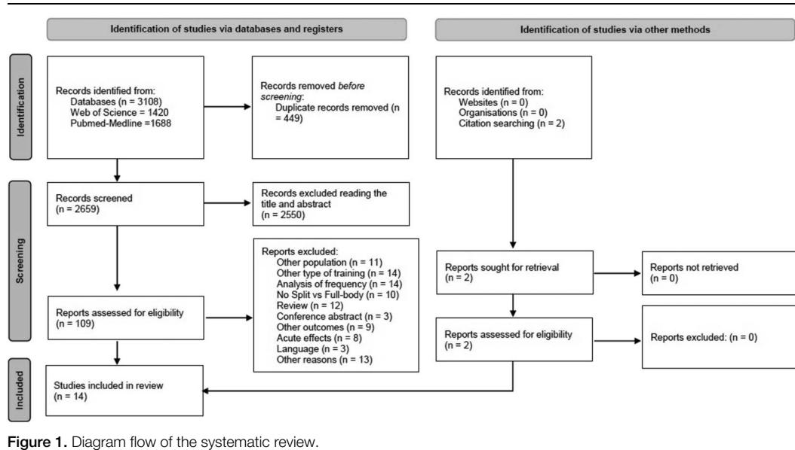
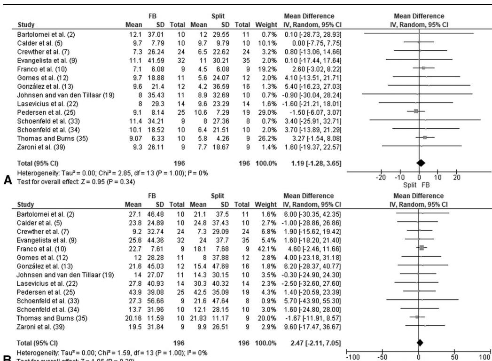

# Efficacy of Split Versus Full-Body Resistance Training on Strength and Muscle Growth: A Systematic Review With Meta-Analysis

Domingo J. Ramos-Campo,1 Pedro J. Benito-Peinado,1 Luis Andreu-Caravaca,2,3 Miguel A. Rojo-Tirado,1 and Jacobo A. Rubio-Arias ´ 4

1

LFE Research Group, Department of Health and Human Performance, Faculty of Physical Activity and Sport Science (INEF), Universidad Polit ´ecnica de Madrid, Madrid, Spain; 2 Sports Physiology Department, Faculty of Health Sciences, UCAM Universidad Cat ´olica San Antonio de Murcia, Murcia, Spain; 3 Facultad de Deporte. UCAM Universidad Cat ´olica de Murcia, Murcia, Spain; and 4 Health Research Center, Department of Education, Faculty of Educational Sciences, University of Almerıa, Almer ´ ıa, Spain ´

#### Abstract

Ramos-Campo, DJ, Benito-Peinado, PJ, Caravaca, LA, Rojo-Tirado, MA, and Rubio-Arias, JA. Efficacy of split versus full-body ´ resistance training on strength and muscle growth: a systematic review with meta-analysis. J Strength Cond Res 38(7): 1330–1340, 2024—No previous study has systematically compared the effect of 2 resistance training routines commonly used to increase muscle mass and strength (i.e., split [Sp] and full-body [FB] routines). Our objective was to conduct a systematic review and meta-analysis following PRISMA guidelines to compare the effects on strength gains and muscle growth in healthy adults. 14 studies (392 subjects) that compared Sp and FB routines in terms of strength adaptations and muscle growth were included. Regarding the effects of the Sp or FB routine on both bench press and lower limbs strength, the magnitude of the change produced by both routines was similar (bench press: mean difference [MD] 5 1.19; [21.28, 3.65]; p 5 0.34; k 5 14; lower limb: MD 5 2.47; [22.11, 7.05]; p 5 0.29; k 5 14). Concerning the effect of the Sp vs. FB routine on muscle growth, similar effects were observed after both routines in the cross-sectional area of the elbow extensors (MD 5 0.30; [22.65, 3.24]; p 5 0.84; k 5 4), elbow flexors (MD 5 0.17; [22.54, 2.88]; p 5 0.91; k 5 5), vastus lateralis (MD 520.08; [21.82, 1.66]; p 5 0.93; k 5 5), or lean body mass (MD 520.07; [21.59, 1.44]; p 5 0.92; k 5 6). In conclusion, the present systematic review and meta-analysis provides solid evidence that the use of Sp or FB routines within a resistance training program does not significantly impact either strength gains or muscle hypertrophy when volume is equated. Consequently, individuals are free to confidently select a resistance training routine based on their personal preferences.

Key Words: cross-sectional area, frequency, hypertrophy, muscle mass, one repetition maximum

# Introduction

Resistance training is commonly recognized as the most effective method of improving muscle strength and size, also known as muscle hypertrophy, in human individuals (28). To optimize muscle adaptation, it is crucial to properly manipulate several variables associated with resistance training programs.

A specific variable of great importance in resistance training is training frequency. Frequency is often described as the number of training sessions performed each week. However, a more common definition of frequency relates to the number of times a specific muscle group is trained in a week (9). Thus, there is strong evidence that resistance training frequency does not significantly affect muscle hypertrophy when volume is equated (29). However, previous findings suggest that higher-frequency resistance training programs, through more frequent stimulation of muscle protein synthesis pathways, may lead to a greater cumulative

effect over time, resulting in enhanced hypertrophic responses compared with lower-frequency training programs (8). By contrast, evidence showed a significant effect of resistance training frequency on muscle strength gains, with higher training frequencies resulting in greater muscle strength gains (14). However, the effects of higher training frequencies appear to be primarily due to greater training volume because when training volume is equated, the effect of resistance training frequency on muscle strength gains is similar (14). Therefore, research suggests a gradual dose-response relationship whereby increases in resistance training volume produce greater gains in muscle hypertrophy (32). Consequently, it is widely accepted that volume plays a key role in both strength and hypertrophic adaptations and, for this reason, for a given training volume, individuals can choose a weekly frequency per muscle group based on their personal preferences (29).

Contrary to scientific evidence, there are common practices among bodybuilders and strength athletes. In this sense, a survey conducted with 127 competitive male bodybuilders revealed that more than two-thirds of respondents trained each muscle group only once a week (15). In addition, none of the respondents trained a muscle group more than twice a week, and all reported using a split routine. This differs from weightlifters and powerlifters, who typically train muscles more frequently through full-

Address correspondence to Dr. Domingo J. Ramos-Campo, [domingojesusramos@](mailto:domingojesusramos@gmail.com) [gmail.com.](mailto:domingojesusramos@gmail.com)

Supplemental digital content is available for this article. Direct URL citations appear in the printed text and are provided in the HTML and PDF versions of this article on the journal's Web site [\(http://journals.lww.com/nsca-jscr\)](http://journals.lww.com/nsca-jscr).

Journal of Strength and Conditioning Research 38(7)/1330–1340

ª 2024 National Strength and Conditioning Association

body routines (11). Full-body routines include exercises that stimulate the body's major muscle groups in the same training session, whereas split routines include multiple exercises performed for a specific muscle group in one training session (21). Split routines are typical of bodybuilding-style training and serve to increase muscle metabolic stress by increasing volume loading within a muscle group (20), which in turn can enhance the hypertrophic response to the exercise bout (28). In this way, it is suggested that the split routine is believed to improve the ability to perform a greater volume of training per muscle group while maintaining intensity, generating greater muscle strain in a specific training session (9). In addition, this type of routine facilitates recovery because alternating between muscle groups allows a certain muscle to have more recovery time between training sessions (9). Therefore, implementing a split routine may be an effective strategy to improve hypertrophic gains by facilitating the use of higher volumes over time. However, controversial results are obtained in studies comparing the effect of split vs. full-body routines on muscle growth and strength gains. For example, similar gains in muscle mass and strength performance have been reported after split and full-body routines between untrained (10,13,25) and trained (12,22) people. By contrast, other studies reported that full-body routines may be more effective at improving cross-sectional area than split routines (34,39) . Conversely, Bartolomei et al. (2) found opposite results, reporting that the full-body training paradigm may be more appropriate for improving maximal strength, whereas a split routine training may be more optimal for stimulating muscle growth in experienced resistance-trained men. Thus, to obtain an answer to determine the effect of split or full-body routines to optimize muscle growth and improve strength, it is necessary to analyze the quantitative and meta-analytical effect of the current literature.

Remarkably, no previous study has systematically analyzed and compared the effect of these 2 resistance training routines commonly used as an intervention to increase muscle mass and strength. Therefore, we aimed to conduct a systematic review and meta-analysis to compare the effects of split and full-body routines on strength gains and muscle growth in healthy adults.

# Methods

# Experimental Approach to the Problem

The present systematic review with meta-analysis was developed following the guidelines described in the Preferred Reporting Items for Systematic Reviews and Meta-Analyses (PRISMA) statement (24). In addition, it was preregistered in the International Prospective Registry of Systematic Reviews (PROS-PERO) with identifier number 444324.

# Data Sources and Search Strategy

Two independent researchers (D.J.R.C. and J.A.R.A.) conducted a comprehensive literature search using the Web of Science (WOS) and PubMed-Medline electronic databases. The search covered articles from the inception of the databases up to June 23, 2023, without date restrictions. Article retrieval used a combination of terms, including split training or split routine or split weight training or frequency resistance training or frequency workout and full-body or total body training or frequency resistance training or full-body training or frequency workout or full-body routine. The Boolean operator "AND" was used to combine these descriptors with hypertrophy, body composition, muscle size, muscle thickness, cross-sectional area, growth, muscle fiber, muscle fiber, lean body mass, muscle mass, lean tissue, fat free mass, strength, and one repetition maximum.

#### Selection Criteria

This systematic review only considered controlled interventions that investigated the comparative effects of split vs full-body routines within a strength training program. Split-routine resistance training consists of dividing all the exercises in a program into 2 or more groups and doing each group of exercise on separate days of the week (10). To be included, studies had to meet the following criteria: be published in English, involved subjects aged \$18 and ,40 years, compared split vs. full-body routines, and assess strength (one repetition maximum) or muscle mass (lean body mass, fat-free mass, or cross-sectional area) as outcomes. Studies were excluded if they did not provide data on the specified variables, were editorials, letters to the editor, or meeting abstracts, focused on the acute effects of split versus full-body routines or included subjects who (a) were obese or had certain pathologies; (b) included drugs during training or had a history of drug use or addiction; and (c) had other capacities, such as adapted sport.

### Data Extraction

Two authors (D.J.R.C. and J.A.R.A.) independently reviewed the retrieved articles to identify potentially relevant ones. Any disagreement regarding inclusion/exclusion was resolved through consensus discussions. For the studies that met inclusion criteria, the primary outcome analyzed was strength performance, specifically bench press or lower-limb one repetition maximum (1RM). In addition, secondary outcomes such as cross-sectional area of elbow extensors, cross-sectional area of elbow flexors, cross-sectional area of vastus lateralis, and lean body mass were analyzed in the articles that fulfilled the inclusion criteria and assessed the primary outcome.

In addition, the following study characteristics were extracted: authors' names, year, country, study design, number of subjects in each group, subjects' sex, type of subjects, as well as their age, height, body mass, fat mass (%), bench press 1RM (kg), lower limb 1RM (kg), and training experience. Moreover, information regarding the strength training program characteristics was extracted, including volume (weeks), training frequency (days per week), intensity (%1RM), number of exercises, total number of sessions in the program, muscle groups trained per week, sets, repetitions, rest (s), total volume (kg), and the primary and secondary outcomes described above.

# Data Synthesis and Statistical Analysis

Meta-Analysis. Meta-analysis and statistical analysis were performed using the Review Manager software (RevMan 5.4; Cochrane Collaboration, Oxford, United Kingdom). The mean difference (MD) and 95% confidence interval (CI) were calculated as the effect size measure to compare the outcomes between the split and full-body routine. The pooled effect size was estimated using the inverse variance random-effects method (estimation method: DerSimonian-Laird). In addition, statistical heterogeneity was evaluated using the Cochrane's chi-square (x2 ), the I 2 statistic, and the between-study variance using the tausquare (t2 ). Values of I2 between 30 and 60% were considered as moderate levels of heterogeneity, whereas a value of t2 . 1 suggests the presence of substantial statistical heterogeneity. A p value of ,0.1 for x2 was defined as an indicator of the presence of heterogeneity. In addition, a sensitivity analysis was performed using the leave-1-out method (37) with OpenMetaAnalyst.

Risk of Bias Assessment (Study Quality). Three researchers (D.J.R.C., J.A.R.A. and M.A.R.T.) assessed the quality of study methodologies using the Cochrane's risk-of-bias tool RoB2 (18), and each domain of each study was classified as low risk of bias, some concerns, or high risk of bias. Any disagreements were resolved by discussion. Publication bias was considered with the funnel plot, and Egger's test was used to assess publication bias. Egger's test and funnel plot were used to assess publication bias in variables that included 5 or more studies. A p value of #0.05 was considered statistically significant. Publication bias analysis was calculated using SPSS software.

# Results

#### Search Results and General Characteristics of Subjects and Protocols

A total of 3,108 articles (WOS: n 5 1,420; Medline: n 5 1,688) were identified in the initial search. The title and abstract of 2,999 articles were reviewed after removing duplicate articles. Subsequently, 109 full-text articles were reviewed. Finally, 14 studies were selected for inclusion in the statistical analysis (Figure 1).

The characteristics of the studies included in the systematic review with meta-analysis are described in Table 1. A total of 28 groups (14 studies) were included in the statistical analyses (194 subjects in the split routine groups and 198 subjects in the fullbody routine groups). Of the 14 studies included in the systematic review, 2 studies included women, 11 included, men and 1 enrolled both men and women. The average age of the subjects included in the studies was 25.3 years (range: 20.7–35.1 years), and an average body mass of 78.1 kg (range: 60.2–92.9 kg). The one repetition maximum of the subjects was 76.1 kg (range: 28.7–104.8 kg) in bench press and 107.1 kg (range: 71.2–159.7 kg) in lower-limb exercises. The main outcome (strength performance assessed by a one-repetition maximum test) of the metaanalysis included 28 groups (14 articles, 194 subjects in the split routine groups and 198 subjects in the full-body routine groups) (Table 2).

# Publication Bias and Heterogeneity

Risk of Bias. The risk of bias assessment is shown in Figure 2. According to the RoB2 assessment tool, 10 of the 14 (71.4%) included randomized controlled trials (RCTs) had a low overall and domain-specific risk of bias, whereas the other 4 (28.6%) had some concerns in domain 1 (randomization process) and mainly in domain 2 (deviations from the intended interventions).

No publication bias was shown in the analysis of bench press 1RM, lower-limb 1RM, vastus lateralis cross-sectional area, elbow flexors cross-sectional area, and lean body mass, through the funnel plot (see Table 1, Supplemental Digital Content, [http://](http://links.lww.com/JSCR/A477) [links.lww.com/JSCR/A477](http://links.lww.com/JSCR/A477)). Furthermore, Egger's regression test indicated no significant bias, further supporting the absence of performance bias. In addition, in the leave-one-out meta-analysis test, no study was found that significantly altered the direction or statistical value of the effect on the variables of 1RM bench press, 1RM lower-limb, and elbow flexors cross-sectional area (see Table 2, Supplemental Digital Content, [http://links.lww.com/](http://links.lww.com/JSCR/A477) [JSCR/A477](http://links.lww.com/JSCR/A477)). However, in the vastus lateralis cross-sectional area, the study by Schoenfeld et al. (34) modified the direction of the effect without significant changes (p 5 0.972), and in the lean body mass, the study by Franco et al. (10) also modified the direction of the effect without significant changes (p 5 0.972).

# Meta-Analysis

Effects of Split or Full-Body Routine on Strength (1RM). Regarding the effects of split or full-body routine on both bench press and lower-limb strength (Figures 3A and B), the magnitude of the change produced by both routines was similar (bench press: MD 5 1.19; [95% CI 521.28, 3.65]; p 5 0.34; k 5 14; lower limb: MD 5 2.47; [95% CI 522.11, 7.05]; p 5 0.29; k 5 14). Heterogeneity of effects was low among strength performance studies (I 2 5 0%).

Effects of Split or Full-Body Routine on Cross-Sectional Area and Lean Body Mass. Concerning the effect of split vs. full-body routine on muscle growth, similar effects were observed after both routine on cross-sectional area of elbow extensors (Figure 4A; MD 5 0.30; [95% CI 522.65, 3.24]; p 5 0.84; k 5 4), elbow flexors (Figure 4B; MD 5 0.17; [95% CI 522.54, 2.88]; p 5 0.91; k 5 5), and vastus lateralis (Figure 4C; MD 520.08; [95% CI 521.82, 1.66]; p 5 0.93; k 5 5).

Similarly, no differences were observed on lean body mass (Figure 4D; SMD 5 0.002; [95% CI 520.28, 0.31]; p 5 0.91; k 5 6) between split and full-body routine. Heterogeneity of effects was low among studies for muscle growth (I 2 5 0%).

# Discussion

This review aimed to conduct a systematic review with a metaanalysis of the existing literature, comparing the impact of split versus full-body resistance training routines on strength gains and muscle hypertrophy. The main findings suggest that the choice between split and full-body routines, which represent the 2 most prevalent forms of resistance training distribution in programs, has minimal effect on strength gains and muscle growth when considering equal training volumes in programs ranged 4–12 weeks.

According to the primary findings of this review, both split and full-body training routines yield similar strength adaptations

Table 1 Main characteristics of the subjects of the included studies.\*

| Study, year of publication | Country      | Design | Design | Type of subjects | Men   | Age (y) | Body Mass (kg)             | Height (m) | Fat mass (%) | RM bench press (kg) | RM bench limb (kg) |             |              |              |
|----------------------------|--------------|--------|--------|------------------|-------|---------|----------------------------|------------|--------------|---------------------|--------------------|-------------|--------------|--------------|
| Bartolomei et al. (2)      | Italy        | RCT    |        | Split            | Split | 10      | Trained (6.6 ± 3.5 y)      | Men        | 29.9 ± 4.2   | 79.2 ± 9.5          | 12.3 ± 3.5         | 99.0 ± 22.2 | 114.0 ± 25.4 |              |
|                            |              |        |        | Full body        |       | 10      | to training experience     |            | 24.1 ± 4.4   | 78.7 ± 11.3         | 10.4 ± 1.8         | 92.8 ± 25.1 | 114.3 ± 31.7 |              |
| Lasevicus et al. (2)       | Brazil       | RCT    |        | Split            | Split | 14      | Trained (3.2 ± 1.1 y)      | Men        | 21.0 ± 4.0   | 78.7 ± 9.8          | 178.5 ± 6.0        |             | 80.9 ± 15.6  | 159.7 ± 27.7 |
|                            |              |        |        | Full body        |       | 14      | to training experience     |            |              |                     |                    | 78.1 ± 19.8 | 156.5 ± 26.4 |              |
| Prieto et al. (13)         | Saudi Arabia | RCT    |        | Split            | Split | 16      | Untrained                  | Men        | 21.12 ± 1.6  | 82.6 ± 27.6         | 178 ± 6.7          | 18.6 ± 8    | 59.5 ± 26.9  | 109 ± 35.4   |
|                            |              |        |        | Full body        |       |         |                            |            | 21.17 ± 1.7  | 80.1 ± 24.1         | 176.6 ± 4.6        | 18.6 ± 7.6  | 51.6 ± 16.1  | 108.6 ± 26.8 |
| Evangelista et al. (9)     | Brazil       | RCT    |        | Split            | Split | 35      | Untrained                  | Men        | 26.2 ± 4.6   | 69.9 ± 9            | 169 ± 7            |             | 56.4 ± 20.9  | 85.5 ± 26.9  |
|                            |              |        |        | Full body        |       | 32      |                            |            | 27.5 ± 3.6   | 72.5 ± 13.9         | 170 ± 8            |             | 63.8 ± 28.9  | 89.8 ± 30.7  |
| Pedersen et al. (25)       | Norway       | RCT    |        | Split            | Split | 19      | Resistance untrained       | Women      | 25.8 ± 3.3   | 70.9 ± 9.6          | 167.8 ± 4.6        |             | 35.3 ± 5.5   | 149.3 ± 26.4 |
|                            |              |        |        | Full body        |       | 25      |                            |            | 22.9 ± 3.1   | 66.5 ± 8.5          | 168.8 ± 4.4        |             |              |              |
| Calder et al. (5)          | USA          | RCT    |        | Split            | Split | 10      | Resistance untrained       | Women      | 20.7 ± 1.3   | 63.3 ± 8.8          | 166.9 ± 5.1        |             | 29.9 ± 5.5   | 108.5 ± 23.6 |
|                            |              |        |        | Full body        |       | 10      |                            |            | 21.2 ± 0.9   | 60.2 ± 6.3          | 166.4 ± 5.4        |             | 28.7 ± 4.6   | 112.8 ± 14.7 |
| Zaroni et al. (39)         | Brazil       | RCT    |        | Split            | Split | 9       | Well trained (6.6 ± 2.4 y) | Men        | 26.4 ± 4.7   | 84.4 ± 8.1          | 177.8 ± 6.6        |             | 93.2 ± 15.4  | 111.9 ± 18.8 |
|                            |              |        |        | Full body        |       | 9       |                            |            | 25.6 ± 3.7   | 83.4 ± 11.7         | 179.1 ± 6.7        |             | 104.2 ± 17.6 | 105.6 ± 20.7 |
| Schoenfeld et al. (34)     | USA          | RCT    |        | Split            | Split | 10      | Trained (4.5 ± 3.1 y)      | Men        | 23.5 ± 2.9   | 78.0 ± 10.7         | 176 ± 5            |             | 93.3 ± 17.2  | 115.5 ±      |

\*RCT 5 randomized controlled trial; RM 5 repetition maximum.

# Table 2

Characteristics of the training intervention of studies included in the meta-analysis.\*

| Frequency (days 3 week/ weekly Muscle training days Intensity Total group Rest Total (% RM or Exercises session trained Sets Repetitions in Volume per muscle between Study Group (wk) group) other) (number) (number) per week (number) (number) sets (s) | volume training (kg) Observations |
|------------------------------------------------------------------------------------------------------------------------------------------------------------------------------------------------------------------------------------------------------------|-----------------------------------|
| et al. (2)                                                                                                                                                                                                                                                 |                                   |
| Split 10 4/1 RIR 1 5–8 each                                                                                                                                                                                                                                |                                   |
| 40 1 5 6 120 147,762                                                                                                                                                                                                                                       | 6                                 |
| Bartolomei                                                                                                                                                                                                                                                 | Both groups performed             |
| session                                                                                                                                                                                                                                                    | a training program                |
|                                                                                                                                                                                                                                                            | using the same                    |
|                                                                                                                                                                                                                                                            | exercises and the same            |
|                                                                                                                                                                                                                                                            | total number of                   |
|                                                                                                                                                                                                                                                            | repetitions per set.              |
|                                                                                                                                                                                                                                                            | During each training              |
|                                                                                                                                                                                                                                                            | session, subjects in the          |
|                                                                                                                                                                                                                                                            | FB group performed                |
|                                                                                                                                                                                                                                                            | exercises recruiting              |
|                                                                                                                                                                                                                                                            | muscle groups of both             |
|                                                                                                                                                                                                                                                            | the upper and lower               |
|                                                                                                                                                                                                                                                            | body, whereas subjects            |
|                                                                                                                                                                                                                                                            | in the SR group                   |
|                                                                                                                                                                                                                                                            | performed a training              |
|                                                                                                                                                                                                                                                            | program involving                 |
|                                                                                                                                                                                                                                                            | a limited number of               |
|                                                                                                                                                                                                                                                            | muscle groups per                 |
|                                                                                                                                                                                                                                                            | Session. Specifically,            |
|                                                                                                                                                                                                                                                            | the SR training group             |
|                                                                                                                                                                                                                                                            | trained the chest and             |
|                                                                                                                                                                                                                                                            | triceps on Monday, the            |
|                                                                                                                                                                                                                                                            | legs on Tuesday, the              |
|                                                                                                                                                                                                                                                            | back and biceps on                |
|                                                                                                                                                                                                                                                            | Thursday, and the                 |
|                                                                                                                                                                                                                                                            | shoulders on Friday               |
| 10 4/3-4 RIR 1 6–7 each                                                                                                                                                                                                                                    |                                   |
| 40 4 5 6 120 143,480 Full body session                                                                                                                                                                                                                     | 6 training                        |
| et al. (22)                                                                                                                                                                                                                                                |                                   |
| Split 10 4/2 Failure 3–4 40 2 6 8–12 90 Bench                                                                                                                                                                                                              | press:                            |
| 63,428.9                                                                                                                                                                                                                                                   | 6                                 |
| 27,848.0;                                                                                                                                                                                                                                                  | Lat                               |
| 61,491.4                                                                                                                                                                                                                                                   | 6                                 |
| 17,635.5;                                                                                                                                                                                                                                                  | Biceps                            |
| curl 31,083.6                                                                                                                                                                                                                                              | 6                                 |
| 7,812.0;                                                                                                                                                                                                                                                   | Triceps                           |
| 62,426.8                                                                                                                                                                                                                                                   | 6                                 |
| 29,094.2;                                                                                                                                                                                                                                                  | Smith                             |
| Squat                                                                                                                                                                                                                                                      | 158,611.2                         |
| 6 33,466.6;                                                                                                                                                                                                                                                | Leg                               |
| press                                                                                                                                                                                                                                                      | 45˚                               |
| 237,917.1                                                                                                                                                                                                                                                  | 6                                 |
| 50,199.9;                                                                                                                                                                                                                                                  | Leg                               |
| 79305.5                                                                                                                                                                                                                                                    | 6                                 |
| Lasevicius                                                                                                                                                                                                                                                 | Split: muscle groups              |
|                                                                                                                                                                                                                                                            | were trained twice per            |
|                                                                                                                                                                                                                                                            | week (4 sessions per              |
| pulldown                                                                                                                                                                                                                                                   | week). Full-body:                 |
|                                                                                                                                                                                                                                                            | muscle groups were                |
|                                                                                                                                                                                                                                                            | trained 3 times per               |
| Extension                                                                                                                                                                                                                                                  | week. Cadence 2:2 pushdown        |
| 10 3/3 Failure 7 30 3 4 8–12 90 Bench Full                                                                                                                                                                                                                 | press:                            |
| 62,154.6 body                                                                                                                                                                                                                                              | 6                                 |
| 27,848.0; pull-down                                                                                                                                                                                                                                        | Lat                               |
| 63,444.5                                                                                                                                                                                                                                                   | 6                                 |
| 21,597.2;                                                                                                                                                                                                                                                  | Biceps                            |
| curl 34,527.7                                                                                                                                                                                                                                              | 6                                 |
| 7,749.4;                                                                                                                                                                                                                                                   | Triceps push-down                 |
| 59,001.4                                                                                                                                                                                                                                                   | 6                                 |
| 25,613.2;                                                                                                                                                                                                                                                  | Smith                             |
| squat                                                                                                                                                                                                                                                      | 185,532.7                         |
| 6 92,670.7;                                                                                                                                                                                                                                                | leg                               |
| press                                                                                                                                                                                                                                                      | 45˚                               |
| 44,459.2                                                                                                                                                                                                                                                   | 6                                 |
| 61,992.5; extension                                                                                                                                                                                                                                        | leg                               |
| 79305.5                                                                                                                                                                                                                                                    | 6                                 |
| Prieto et al.                                                                                                                                                                                                                                              |                                   |
| Split 8 2/1 62–78%                                                                                                                                                                                                                                         |                                   |
| 10 16 1 3 6–12 60–120                                                                                                                                                                                                                                      | On Monday, the SPLIT              |
| (13) 1RM                                                                                                                                                                                                                                                   | group only performed              |
|                                                                                                                                                                                                                                                            | exercises to stimulate            |
|                                                                                                                                                                                                                                                            | the muscles of the                |
| 8 2/2 62–78%                                                                                                                                                                                                                                               |                                   |
| 10 16 2 3 6–12 60–120 Full body 1RM                                                                                                                                                                                                                        |                                   |

# Table 2

Characteristics of the training intervention of studies included in the meta-analysis.\* (Continued)

| (days 3 week/ weekly Muscle days Total group Rest Total volume (% RM or trained Sets in per muscle Study Group (kg) (wk) group) other) per week sets (s) the did in the Split 8 4/2 RPE 9.5–10 6 32 2 8 8–12 60 The weekly sets | upper exercises whereas all exercises both same Split | body, and on they did to upper body, the FB group full-body workouts the sessions over period. The strength carried out by groups were the each week routine: “A” |
|---------------------------------------------------------------------------------------------------------------------------------------------------------------------------------------------------------------------------------|-------------------------------------------------------|-------------------------------------------------------------------------------------------------------------------------------------------------------------------|
| et al. (9)                                                                                                                                                                                                                      |                                                       |                                                                                                                                                                   |
| volume was                                                                                                                                                                                                                      |                                                       |                                                                                                                                                                   |
| equated between                                                                                                                                                                                                                 |                                                       |                                                                                                                                                                   |
| the groups                                                                                                                                                                                                                      |                                                       |                                                                                                                                                                   |
| (Mondays                                                                                                                                                                                                                        |                                                       | and                                                                                                                                                               |
| Thursdays)                                                                                                                                                                                                                      |                                                       | and a “B”                                                                                                                                                         |
| (Tuesdays                                                                                                                                                                                                                       |                                                       | and Fridays):                                                                                                                                                     |
| A                                                                                                                                                                                                                               | session:                                              | bench press,                                                                                                                                                      |
| inclined                                                                                                                                                                                                                        |                                                       | bench press,                                                                                                                                                      |
| cable                                                                                                                                                                                                                           |                                                       | triceps                                                                                                                                                           |
| pushdown,                                                                                                                                                                                                                       |                                                       | triceps                                                                                                                                                           |
| kickback,                                                                                                                                                                                                                       |                                                       | shoulder                                                                                                                                                          |
| press,                                                                                                                                                                                                                          |                                                       | and front                                                                                                                                                         |
| dumbbell                                                                                                                                                                                                                        |                                                       | raise. B                                                                                                                                                          |
| Session                                                                                                                                                                                                                         |                                                       | consisted of                                                                                                                                                      |
| seated                                                                                                                                                                                                                          |                                                       | row, lat pull                                                                                                                                                    |
| down,                                                                                                                                                                                                                           |                                                       | biceps curl,                                                                                                                                                      |
| hammer                                                                                                                                                                                                                          |                                                       | curl, squat and                                                                                                                                                   |
| leg                                                                                                                                                                                                                             | curl.                                                 | Full body:                                                                                                                                                        |
| routine                                                                                                                                                                                                                         |                                                       | trained each                                                                                                                                                      |
| muscle                                                                                                                                                                                                                          |                                                       | group 4 times                                                                                                                                                     |
| per                                                                                                                                                                                                                             | week                                                  | (Mondays,                                                                                                                                                         |
| Tuesdays,                                                                                                                                                                                                                       |                                                       | Thursdays,                                                                                                                                                        |
| and                                                                                                                                                                                                                             | Fridays)                                              | with the                                                                                                                                                          |
| following                                                                                                                                                                                                                       |                                                       | exercises:                                                                                                                                                        |
| bench                                                                                                                                                                                                                           |                                                       | press, cable                                                                                                                                                      |
| triceps                                                                                                                                                                                                                         |                                                       | push-down,                                                                                                                                                        |
| shoulder                                                                                                                                                                                                                        |                                                       | press, seated                                                                                                                                                     |
| row,                                                                                                                                                                                                                            | biceps                                                | curl, squat                                                                                                                                                       |
| and                                                                                                                                                                                                                             | leg                                                   | curl                                                                                                                                                              |
| 8 4/4 RPE 9.5–10 7 32 4 4 8–12 60 Full body                                                                                                                                                                                     |                                                       |                                                                                                                                                                   |
| et al. (25)                                                                                                                                                                                                                     |                                                       |                                                                                                                                                                   |
| Split 12 4/2 Failure 8–12                                                                                                                                                                                                       |                                                       |                                                                                                                                                                   |
| 4 in lower                                                                                                                                                                                                                      |                                                       |                                                                                                                                                                   |
| body and 6 in                                                                                                                                                                                                                   |                                                       |                                                                                                                                                                   |
| upper body                                                                                                                                                                                                                      |                                                       |                                                                                                                                                                   |
| 48 2 3 8–12 60 Ranged from                                                                                                                                                                                                      |                                                       |                                                                                                                                                                   |
| 23,543 (21,345,                                                                                                                                                                                                                 |                                                       |                                                                                                                                                                   |
| 25,741) kg to                                                                                                                                                                                                                   |                                                       |                                                                                                                                                                   |
| 32,215 (30,017,                                                                                                                                                                                                                 |                                                       |                                                                                                                                                                   |
| 34,412) kg                                                                                                                                                                                                                      |                                                       |                                                                                                                                                                   |
| Full-body Pedersen                                                                                                                                                                                                              |                                                       | trained all the                                                                                                                                                   |
| major RM                                                                                                                                                                                                                        |                                                       | muscle groups in                                                                                                                                                  |
| one                                                                                                                                                                                                                             | session                                               | twice per                                                                                                                                                         |
| week;                                                                                                                                                                                                                           |                                                       | split performed 4                                                                                                                                                 |
| weekly                                                                                                                                                                                                                          |                                                       | sessions (2                                                                                                                                                       |
| upper weekly                                                                                                                                                                                                                    |                                                       | body and 2 lower                                                                                                                                                  |
| body).                                                                                                                                                                                                                          |                                                       | Both groups                                                                                                                                                       |
| performed                                                                                                                                                                                                                       |                                                       | the same                                                                                                                                                          |
| exercises                                                                                                                                                                                                                       |                                                       | and weekly                                                                                                                                                        |
| number                                                                                                                                                                                                                          |                                                       | of sets and                                                                                                                                                       |
| 12 2/2 Failure 8–12                                                                                                                                                                                                             |                                                       |                                                                                                                                                                   |
| 10 24 2 3 8–12 60 Ranged from Full                                                                                                                                                                                              |                                                       |                                                                                                                                                                   |
| 22,771 (20,855, body RM                                                                                                                                                                                                         |                                                       |                                                                                                                                                                   |
| 24,687) kg to                                                                                                                                                                                                                   |                                                       |                                                                                                                                                                   |
| 31,348 (29,433,                                                                                                                                                                                                                 |                                                       |                                                                                                                                                                   |
| 33,265) weekly                                                                                                                                                                                                                  |                                                       |                                                                                                                                                                   |
| et al. (5)                                                                                                                                                                                                                      |                                                       |                                                                                                                                                                   |
| Split Two 10-wk                                                                                                                                                                                                                 |                                                       |                                                                                                                                                                   |
| separated by                                                                                                                                                                                                                    |                                                       |                                                                                                                                                                   |
| 2 wk of                                                                                                                                                                                                                         |                                                       |                                                                                                                                                                   |
| 4/2 Failure Calder                                                                                                                                                                                                              |                                                       |                                                                                                                                                                   |
| 4 in upper                                                                                                                                                                                                                      |                                                       |                                                                                                                                                                   |
| body and 3 in                                                                                                                                                                                                                   |                                                       |                                                                                                                                                                   |
| lower body                                                                                                                                                                                                                      |                                                       |                                                                                                                                                                   |
| 80 2 5 Upper body:                                                                                                                                                                                                              |                                                       |                                                                                                                                                                   |
| 6–10 RM; lower                                                                                                                                                                                                                  |                                                       |                                                                                                                                                                   |
| body: 10–12                                                                                                                                                                                                                     |                                                       |                                                                                                                                                                   |
| 2/2 Failure Christmas                                                                                                                                                                                                           |                                                       |                                                                                                                                                                   |
| 7 40 2 5 120 RM Full body                                                                                                                                                                                                       |                                                       |                                                                                                                                                                   |
| et al. (39)                                                                                                                                                                                                                     |                                                       |                                                                                                                                                                   |
| Split 8 5/1 Failure 5 each                                                                                                                                                                                                      |                                                       |                                                                                                                                                                   |
| 40 1 3 8–12 RM 120 More total load                                                                                                                                                                                              |                                                       |                                                                                                                                                                   |
| lifted in full body                                                                                                                                                                                                             |                                                       |                                                                                                                                                                   |
| 25 Zaroni                                                                                                                                                                                                                       | exercises                                             | of the                                                                                                                                                            |
| major session                                                                                                                                                                                                                   |                                                       | muscle groups.                                                                                                                                                    |
| 15                                                                                                                                                                                                                              | sets                                                  | per session (3                                                                                                                                                    |
| sets                                                                                                                                                                                                                            | per                                                   | exercise)                                                                                                                                                         |
| 8 5/5 Failure 5 each                                                                                                                                                                                                            |                                                       |                                                                                                                                                                   |
| 40 5 3 120 Full body session                                                                                                                                                                                                    |                                                       |                                                                                                                                                                   |
| et al. (10)                                                                                                                                                                                                                     |                                                       |                                                                                                                                                                   |
| Split 8 2-5/1 Failure                                                                                                                                                                                                           |                                                       |                                                                                                                                                                   |
| 7 34 1 4–10 per week 8–12 RM 90–120 No differences: Franco                                                                                                                                                                      |                                                       |                                                                                                                                                                   |
| FB: 27,318.1 6                                                                                                                                                                                                                  |                                                       |                                                                                                                                                                   |
| 10,937.0 SP:                                                                                                                                                                                                                    |                                                       |                                                                                                                                                                   |
| 26,295.3 6                                                                                                                                                                                                                      |                                                       |                                                                                                                                                                   |
| 10,820.0 kg in                                                                                                                                                                                                                  |                                                       |                                                                                                                                                                   |
| 8th week                                                                                                                                                                                                                        |                                                       |                                                                                                                                                                   |
| 8 2-5/2-5 Failure                                                                                                                                                                                                               |                                                       |                                                                                                                                                                   |
| 7 34 5 4–10 per week 90–120 Full body                                                                                                                                                                                           |                                                       |                                                                                                                                                                   |
| et al. (12)                                                                                                                                                                                                                     |                                                       |                                                                                                                                                                   |
| Split 8 5/1 Failure                                                                                                                                                                                                             |                                                       |                                                                                                                                                                   |
| 2–3 40 1 10 8–12 RM 90 353,243.5 6 Gomes                                                                                                                                                                                        | Split:                                                |                                                                                                                                                                   |
| adductors                                                                                                                                                                                                                       |                                                       | and elbow                                                                                                                                                         |
| 8 5/5 Failure                                                                                                                                                                                                                   |                                                       |                                                                                                                                                                   |
| 11 40 5 10 90 410,652.9 6 Full body                                                                                                                                                                                             |                                                       |                                                                                                                                                                   |

# Table 2

Characteristics of the training intervention of studies included in the meta-analysis.\* (Continued)

| Frequency (days 3 week/ weekly Muscle training days Intensity Total group Rest Total volume (% RM or Exercises session trained Sets Repetitions in training Volume per muscle between Study Group (kg) (wk) group) other) (number) (number) per week (number) (number) sets (s) flexors, flexors flexors spine (length for Schoenfeld Split 8 3/1 Failure 6–9 24 1 2–3 per 8–12 RM 90 SPLIT, | extensors extensors extensors Thursday—knee and and abductors, flexors extensors. performed time all body where | and hip and flexors, and elbow plantar lumbar and Full-body: the RT ; 32 min) segments multiple |
|----------------------------------------------------------------------------------------------------------------------------------------------------------------------------------------------------------------------------------------------------------------------------------------------------------------------------------------------------------------------------------------------|-----------------------------------------------------------------------------------------------------------------|-------------------------------------------------------------------------------------------------|
| et al. (34)                                                                                                                                                                                                                                                                                                                                                                                  |                                                                                                                 |                                                                                                 |
| exercise (18                                                                                                                                                                                                                                                                                                                                                                                 |                                                                                                                 |                                                                                                 |
| per session)                                                                                                                                                                                                                                                                                                                                                                                 |                                                                                                                 |                                                                                                 |
| exercises                                                                                                                                                                                                                                                                                                                                                                                    | were                                                                                                            |                                                                                                 |
| performed                                                                                                                                                                                                                                                                                                                                                                                    |                                                                                                                 | for a specific                                                                                  |
| muscle                                                                                                                                                                                                                                                                                                                                                                                       | group                                                                                                           | in                                                                                              |
| a session                                                                                                                                                                                                                                                                                                                                                                                    | with                                                                                                            | 2–3                                                                                             |
| muscle                                                                                                                                                                                                                                                                                                                                                                                       | groups                                                                                                          | trained                                                                                         |
| per                                                                                                                                                                                                                                                                                                                                                                                          | session                                                                                                         | or a full                                                                                      |
| body,                                                                                                                                                                                                                                                                                                                                                                                        | where                                                                                                           | 1 exercise                                                                                      |
| was                                                                                                                                                                                                                                                                                                                                                                                          | performed                                                                                                       | per                                                                                             |
| muscle                                                                                                                                                                                                                                                                                                                                                                                       | group                                                                                                           | in                                                                                              |
| a session                                                                                                                                                                                                                                                                                                                                                                                    | with                                                                                                            | all                                                                                             |
| muscle                                                                                                                                                                                                                                                                                                                                                                                       | groups                                                                                                          | trained                                                                                         |
| in each                                                                                                                                                                                                                                                                                                                                                                                      | session                                                                                                         |                                                                                                 |
| 8 3/3 Failure 7 24 3 90 Full body                                                                                                                                                                                                                                                                                                                                                            |                                                                                                                 |                                                                                                 |
| et al. (7)                                                                                                                                                                                                                                                                                                                                                                                   |                                                                                                                 |                                                                                                 |
| Split 4 3/1 Failure 4–5 12 1 3–6 8 RM 60–90 2 groups Crewther                                                                                                                                                                                                                                                                                                                                | to                                                                                                              | complete                                                                                        |
| either                                                                                                                                                                                                                                                                                                                                                                                       | a 4-wk                                                                                                          | FB or a 4-                                                                                      |
| wk SB                                                                                                                                                                                                                                                                                                                                                                                        | training                                                                                                        | protocol.                                                                                       |
| The                                                                                                                                                                                                                                                                                                                                                                                          | groups                                                                                                          | then                                                                                            |
| crossed                                                                                                                                                                                                                                                                                                                                                                                      | over                                                                                                            | to                                                                                              |
| complete                                                                                                                                                                                                                                                                                                                                                                                     | the                                                                                                             | other                                                                                           |
| training                                                                                                                                                                                                                                                                                                                                                                                     | protocol                                                                                                        | after                                                                                           |
| an 8-wk                                                                                                                                                                                                                                                                                                                                                                                      | washout                                                                                                         |                                                                                                 |
| period.                                                                                                                                                                                                                                                                                                                                                                                      | The                                                                                                             | prescribed                                                                                      |
| exercises                                                                                                                                                                                                                                                                                                                                                                                    | included;                                                                                                       |                                                                                                 |
| back                                                                                                                                                                                                                                                                                                                                                                                         | squats,                                                                                                         | leg curls,                                                                                      |
| leg press,                                                                                                                                                                                                                                                                                                                                                                                   | bench                                                                                                           | press,                                                                                          |
| bent-over                                                                                                                                                                                                                                                                                                                                                                                    | row,                                                                                                            | pull                                                                                           |
| downs,                                                                                                                                                                                                                                                                                                                                                                                       | shoulder                                                                                                        | press,                                                                                          |
| bicep                                                                                                                                                                                                                                                                                                                                                                                        | curls                                                                                                           | and calf                                                                                        |
| raises.                                                                                                                                                                                                                                                                                                                                                                                      | To equate                                                                                                       | for                                                                                             |
| training                                                                                                                                                                                                                                                                                                                                                                                     | volume,                                                                                                         | the                                                                                             |
| total                                                                                                                                                                                                                                                                                                                                                                                        | number                                                                                                          | of                                                                                              |
| repetitions                                                                                                                                                                                                                                                                                                                                                                                  |                                                                                                                 | prescribed                                                                                      |
| each                                                                                                                                                                                                                                                                                                                                                                                         | week                                                                                                            | were                                                                                            |
| identical                                                                                                                                                                                                                                                                                                                                                                                    | (i.e.,                                                                                                          | FB                                                                                              |
| training                                                                                                                                                                                                                                                                                                                                                                                     | 5                                                                                                               | 21                                                                                              |
| exercises,                                                                                                                                                                                                                                                                                                                                                                                   |                                                                                                                 | 2–3 sets 3                                                                                      |
| 8 repetitions;                                                                                                                                                                                                                                                                                                                                                                               |                                                                                                                 | SB                                                                                              |
| training                                                                                                                                                                                                                                                                                                                                                                                     | 5                                                                                                               | 13                                                                                              |
| exercises,                                                                                                                                                                                                                                                                                                                                                                                   |                                                                                                                 | 3–6 sets 3                                                                                      |
| 8 repetitions)                                                                                                                                                                                                                                                                                                                                                                               |                                                                                                                 |                                                                                                 |
| 4 3/3 Failure 7 12 3 60–90 Full body                                                                                                                                                                                                                                                                                                                                                         |                                                                                                                 |                                                                                                 |
| and Burns                                                                                                                                                                                                                                                                                                                                                                                    |                                                                                                                 |                                                                                                 |
| Split 8 3/1 Failure                                                                                                                                                                                                                                                                                                                                                                          |                                                                                                                 |                                                                                                 |
| 5–6 24 1 9 per muscle                                                                                                                                                                                                                                                                                                                                                                        |                                                                                                                 |                                                                                                 |
| per week                                                                                                                                                                                                                                                                                                                                                                                     |                                                                                                                 |                                                                                                 |
| 8–12 RM Split: Thomas                                                                                                                                                                                                                                                                                                                                                                        | Day 1)                                                                                                          | pectoralis,                                                                                     |
| deltoids,                                                                                                                                                                                                                                                                                                                                                                                    | and                                                                                                             | triceps,                                                                                        |
| day                                                                                                                                                                                                                                                                                                                                                                                          | 2) upper                                                                                                        | back and                                                                                        |
| biceps,                                                                                                                                                                                                                                                                                                                                                                                      | day                                                                                                             | 3)                                                                                              |
| hamstrings,                                                                                                                                                                                                                                                                                                                                                                                  |                                                                                                                 | calves, and                                                                                     |
| 8 3/3 Failure                                                                                                                                                                                                                                                                                                                                                                                |                                                                                                                 |                                                                                                 |
| 8 24 3 (35) Full body                                                                                                                                                                                                                                                                                                                                                                        | quadriceps, abdominals                                                                                          |                                                                                                 |
| and van den                                                                                                                                                                                                                                                                                                                                                                                  |                                                                                                                 |                                                                                                 |
| Tillaar (19)                                                                                                                                                                                                                                                                                                                                                                                 |                                                                                                                 |                                                                                                 |
| Split 8 4/2 65–90% 4–6 32 2 3–6 per                                                                                                                                                                                                                                                                                                                                                          |                                                                                                                 |                                                                                                 |
| (14–21 per                                                                                                                                                                                                                                                                                                                                                                                   |                                                                                                                 |                                                                                                 |
| session): 70                                                                                                                                                                                                                                                                                                                                                                                 |                                                                                                                 |                                                                                                 |
| per week                                                                                                                                                                                                                                                                                                                                                                                     |                                                                                                                 |                                                                                                 |
| 2–10 Volume matched                                                                                                                                                                                                                                                                                                                                                                          |                                                                                                                 |                                                                                                 |
| between the                                                                                                                                                                                                                                                                                                                                                                                  |                                                                                                                 |                                                                                                 |
| SPLIT: Johnsen                                                                                                                                                                                                                                                                                                                                                                               | 2 sessions                                                                                                      |                                                                                                 |
| training exercise                                                                                                                                                                                                                                                                                                                                                                            | barbell                                                                                                         | back                                                                                            |
| squat conditions                                                                                                                                                                                                                                                                                                                                                                             | and exercises                                                                                                   | for                                                                                             |
| the lower                                                                                                                                                                                                                                                                                                                                                                                    | body                                                                                                            | and 2                                                                                           |
| sessions                                                                                                                                                                                                                                                                                                                                                                                     | training                                                                                                        | bench                                                                                           |
| press                                                                                                                                                                                                                                                                                                                                                                                        | and exercises                                                                                                   | for                                                                                             |
| the upper                                                                                                                                                                                                                                                                                                                                                                                    | body;                                                                                                           | FULL                                                                                           |
| 8 4/4 65–90% 6 32 4 2–3 per Full body exercise                                                                                                                                                                                                                                                                                                                                               |                                                                                                                 |                                                                                                 |

when the training volume is equal. This suggests a dose-response relationship between resistance training volume and muscular strength adaptations, as previously noted (26). Consequently, it can be inferred that resistance training volume plays a more important role in driving strength adaptations than the choice of resistance training routine (split or full body). However, even when training volume is kept equal, it is sensible to consider that excessive training volume during a single resistance training session might not be optimal. This excess volume could cause fatigue buildup, which could ultimately hinder performance (27). For this reason, experienced individuals usually include higher resistance training frequencies in their routines, enabling them to distribute training volume throughout the week while maintaining peak performance during each resistance training session (14). This approach may lead to greater muscle strength gains due to greater weekly volume (14).

Meta-analytic analysis of hypertrophy variables revealed that both training modalities (split vs. full-body) similarly increase muscle size. This implies that based on the current scientific evidence, the distribution of training volume throughout the week does not play a significant role in improving muscle mass. Remarkably, the muscle growth observed in the studies included in this review aligns with previous research findings (3).

Numerous RCTs and meta-analyses consistently demonstrate that training volume is a key factor in stimulating muscle growth (6,32). Therefore, when the total training volume is held constant, there are no differences between the different distribution approaches. Although this meta-analysis matched groups based on weekly total training volume, other training variables that likely influence muscle growth were not equal between the groups (31). For example, studies such as Calder et al. (5) and Pedersen et al. (25) reported higher weekly training frequencies in the split routine group (4 sessions·wk21 ) compared with the full-body group (2 sessions·wk21 ). However, a previous meta-analysis suggests that there is no difference in muscle hypertrophy between training frequencies of 2–3 days per week (31).

It should be noted that all articles included in this metaanalysis, which looked at muscle hypertrophy, observed improvements in muscle hypertrophy in both groups. This could be attributed to the correct manipulation of training variables to enhance hypertrophy, including intensities near failure (2) and even to failure (5,7,10,12,22,25,33,35,39) and training frequencies (14) ranging from 2 (5,10,25) to 5 days (10,12,39), although significant increases in muscle mass have also been reported at low intensities (30).

Although all studies included in this meta-analysis used valid and reliable methods for quantifying muscle mass, different authors employed methods with varying levels of precision. Ultrasound was the most widely used method, employed by up to 5 studies (2,9,22,34,35,39) followed by dual-energy X-ray absorptiometry (DXA), which was used by 3 studies (5,10,12), anthropometry, used in 2 studies (7,13), and bioelectrical impedance, used only by Pedersen et al. (25).

Although the most common variable in the scientific literature is fat-free mass, in the studies included in this publication, the concept of lean body mass is more frequently used. This concept, which is related to lean mass, can vary significantly in its definition because it may exclude bone content or an estimation of live bone (17). In general, it involves subtracting bone from fat-free mass. This heterogeneity among studies could be a limitation, but because the studies use the same internal criterion, and the hypertrophy results they provide are consistent with those presented in the scientific literature, we believe that this limitation, although noteworthy, does not prevent us from drawing conclusions.

Anthropometry and bioelectrical impedance have been widely used by coaches and researchers due to their accessibility, low

Table 2

| of the training of studies included in the (Continued) Frequency (days 3 week/ weekly Muscle training days Intensity Total group Rest Total volume (% RM or Exercises session trained Sets Repetitions in training Volume per muscle between Study Group (kg) (wk) group) other) (number) (number) per week (number) (number) sets (s) BODY (16–18 per body session): 70 barbell per week bench Schoenfeld Split 8 3/1 Failure 3 per session 24 1 3 10RM 90 Total volume load 3 (number of rep 3 | trained sessions back press exercises | Observations 4 full with squat and each time per session |
|--------------------------------------------------------------------------------------------------------------------------------------------------------------------------------------------------------------------------------------------------------------------------------------------------------------------------------------------------------------------------------------------------------------------------------------------------------------------------------------------------|---------------------------------------|-----------------------------------------------------------|
| et al. (33)                                                                                                                                                                                                                                                                                                                                                                                                                                                                                      |                                       |                                                           |
| load) was                                                                                                                                                                                                                                                                                                                                                                                                                                                                                        |                                       |                                                           |
| drawn                                                                                                                                                                                                                                                                                                                                                                                                                                                                                            | from                                  | a pool of 9                                               |
| total                                                                                                                                                                                                                                                                                                                                                                                                                                                                                            | exercises:                            | 3                                                         |
| exercises                                                                                                                                                                                                                                                                                                                                                                                                                                                                                        | targeting                             | the                                                       |
| anterior                                                                                                                                                                                                                                                                                                                                                                                                                                                                                         | torso                                 | (incline                                                  |
| barbell                                                                                                                                                                                                                                                                                                                                                                                                                                                                                          | press,                                | flat                                                      |
| barbell                                                                                                                                                                                                                                                                                                                                                                                                                                                                                          | press,                                | and                                                       |
| Hammer                                                                                                                                                                                                                                                                                                                                                                                                                                                                                           | strength                              | chest                                                     |
| press),                                                                                                                                                                                                                                                                                                                                                                                                                                                                                          | 3 exercises                           |                                                           |
| targeting                                                                                                                                                                                                                                                                                                                                                                                                                                                                                        | the                                   | posterior                                                 |
| torso                                                                                                                                                                                                                                                                                                                                                                                                                                                                                            | (wide-grip                            | lat pull                                                 |
| down,                                                                                                                                                                                                                                                                                                                                                                                                                                                                                            | close-grip                            | lat                                                       |
| pull-down,                                                                                                                                                                                                                                                                                                                                                                                                                                                                                       |                                       | and seated                                                |
| cable                                                                                                                                                                                                                                                                                                                                                                                                                                                                                            | row),                                 | and 3                                                     |
| exercises                                                                                                                                                                                                                                                                                                                                                                                                                                                                                        | targeting                             | the                                                       |
| thigh                                                                                                                                                                                                                                                                                                                                                                                                                                                                                            | (barbell                              | back                                                      |
| squat,                                                                                                                                                                                                                                                                                                                                                                                                                                                                                           | machine                               | leg                                                       |
| press,                                                                                                                                                                                                                                                                                                                                                                                                                                                                                           | and                                   | machine leg                                               |
| 8 3/3 Failure 3 per session 24 3 7 3RM 180 Full body equalized                                                                                                                                                                                                                                                                                                                                                                                                                                   | extension)                            |                                                           |

\*RIR 5 repetitions in reserve; RM 5 repetition maximum. † The symbol implies significant differences between groups. cost, and simplicity for assessing body composition, including muscle mass (23). However, despite being validated methods, their precision in measuring segmental muscle mass specifically may be limited (38). Anthropometry is based on skinfold measurements, circumferences, and bone diameters, which can underestimate or overestimate muscle mass depending primarily on subcutaneous fat distribution and interindividual variability (1). However, muscle mass results obtained through bioelectrical impedance may be influenced by numerous variables (subject hydration or body temperature, for example), making it difficult to assess muscle mass accurately (4). By contrast, both ultrasonography and DXA (36) provide a more direct assessment of the

| Study                                                                                  | FB   |       |       | Split |       |       | Mean Difference |                       |  | Mean Difference IV, Random, 95% CI | Mean Difference IV, Random, 95% CI |
|----------------------------------------------------------------------------------------|------|-------|-------|-------|-------|-------|-----------------|-----------------------|--|---------------------------------------|---------------------------------------|
|                                                                                        | Mean | SD    | Total | Mean  | SD    | Total | Weight          |                       |  |                                       |                                       |
| Bartolomei et al. (2)                                                                  | 12.1 | 37.01 | 10    | 12    | 29.55 | 11    | 0.7%            | 0.10 [-28.73, 28.93]  |  |                                       |                                       |
| Calder et al. (5)                                                                      | 9.7  | 7.79  | 10    | 9.7   | 9.79  | 10    | 10.1%           | 0.00 [-7.75, 7.75]    |  |                                       |                                       |
| Crewther et al. (7)                                                                    | 7.3  | 26.24 | 24    | 6.5   | 22.62 | 24    | 3.2%            | 0.80 [-13.06, 14.66]  |  |                                       |                                       |
| Evangelista et al. (9)                                                                 | 11.1 | 41.59 | 32    | 11    | 30.21 | 35    | 2.0%            | 0.10 [-17.44, 17.64]  |  |                                       |                                       |
| Franco et al. (10)                                                                     | 7.1  | 6.08  | 9     | 4.5   | 6.08  | 9     | 19.2%           | 2.60 [-3.02, 8.22]    |  |                                       |                                       |
| Gomes et al. (12)                                                                      | 9.7  | 18.88 | 11    | 5.6   | 24.07 | 12    | 2.0%            | 4.10 [-13.51, 21.71]  |  |                                       |                                       |
| González et al. (13)                                                                   | 9.6  | 21.4  | 12    | 4.2   | 36.59 | 16    | 1.3%            | 5.40 [-16.23, 27.03]  |  |                                       |                                       |
| Johnsen and van den Tillaar (19)                                                       | 8    | 35.43 | 11    | 8.9   | 32.69 | 10    | 0.7%            | -0.90 [-30.04, 28.24] |  |                                       |                                       |
| Lasevicius et al. (22)                                                                 | 8    | 29.3  | 14    | 9.6   | 23.29 | 14    | 1.6%            | -1.60 [-21.21, 18.01] |  |                                       |                                       |
| Pedersen et al. (25)                                                                   | 9.1  | 8.14  | 25    | 10.6  | 7.29  | 19    | 29.0%           | -1.50 [-6.07, 3.07]   |  |                                       |                                       |
| Schoenfeld et al. (33)                                                                 | 11.4 | 34.21 | 9     | 8     | 27.36 | 8     | 0.7%            | 3.40 [-25.91, 32.71]  |  |                                       |                                       |
| Schoenfeld et al. (34)                                                                 | 10.1 | 18.52 | 10    | 6.4   | 21.51 | 10    | 2.0%            | 3.70 [-13.89, 21.29]  |  |                                       |                                       |
| Thomas and Burns (35)                                                                  | 9.07 | 6.33  | 10    | 5.8   | 4.26  | 9     | 26.2%           | 3.27 [-1.54, 8.08]    |  |                                       |                                       |
| Zaroni et al. (39)                                                                     | 9.3  | 28.11 | 9     | 7.7   | 18.67 | 9     | 1.4%            | 1.60 [-19.37, 22.57]  |  |                                       |                                       |
| Total (95% CI)                                                                         | 196  |       |       | 196   |       |       | 1.00%           |                       |  | 1.19 [-1.28, 3.65]                    |                                       |
| Heterogeneity: $Tau^2 = 0.00$ ; $Chi^2 = 2.85$ , $df = 13$ ( $P = 1.00$ ); $I^2 = 0\%$ |      |       |       |       |       |       |                 |                       |  |                                       |                                       |
| Test for overall effect: $Z = 0.95$ ( $P = 0.34$ )                                     |      |       |       |       |       |       |                 |                       |  |                                       |                                       |
| Study                                                                                  | FB   |       |       | Split |       |       | Mean Difference |                       |  | Mean Difference IV, Random, 95% CI | Mean Difference IV, Random, 95% CI |
|                                                                                        | Mean | SD    | Total | Mean  | SD    | Total | Weight          |                       |  |                                       |                                       |
| Bartolomei et al. (2)                                                                  | 27.1 | 46.48 | 10    | 21.1  | 37.5  | 11    | 1.6%            | 6.00 [-30.35, 42.35]  |  |                                       |                                       |
| Calder et al. (5)                                                                      | 23.8 | 24.89 | 10    | 24.8  | 37.43 | 10    | 2.7%            | -1.00 [-28.86, 26.86] |  |                                       |                                       |
| Crewther et al. (7)                                                                    | 9.2  | 32.74 |       |       |       |       |                 |                       |  |                                       |                                       |

Figure 2. Risk of bias in the included RCTs. RCT 5 randomized controlled trial.

Figure 3. A) Effects of split vs. full-body routine on bench press 1RM; (B) effects of split vs full-body routine on lower-limb 1RM. 1RM 5 one repetition maximum; FB 5 full-body routine.

| Study                  | D1 | D2 | D3 | D4 | D5 | Overall |                                               |
|------------------------|----|----|----|----|----|---------|-----------------------------------------------|
| Bartolomei et al. (2)  | +  | +  | +  | +  | +  | +       | Low risk                                      |
| Calder et al. (5)      | !  | !  | +  | +  | +  | !       | Some concerns                                 |
| Crewther et al. (7)    | +  | !  | +  | +  | +  | !       | High risk                                     |
| Evangelista et al. (9) | +  | +  | +  | +  | +  | +       |                                               |
| Franco et al. (10)     | +  | +  | +  | +  | +  | +       | D1 Randomisation process                      |
| Gomes et al. (12)      | +  | !  | +  | +  | +  | !       | D2 Deviations from the intended interventions |
| González et al. (13)   | +  | +  | +  | +  | +  | +       | D3 Missing outcome data                       |
| Johsen et al. (19)     | +  | +  | +  | +  | +  | +       | D4 Measurement of the outcome                 |
| Lasevicius et al. (22) | +  | +  | +  | +  | +  | +       | D5 Selection of the reported result           |
| Perdersen et al. (25)  | +  | +  | +  | +  | +  | +       |                                               |
| Schoenfeld et al. (33) | +  | +  | +  | +  | +  | +       |                                               |
| Schoenfeld et al. (34) | +  | +  | +  | +  | +  | +       |                                               |
| Thomas et al. (35)     | +  | !  | +  | +  | +  | !       |                                               |
| Zaroni et al. (39)     | +  | +  | +  | +  | +  | +       |                                               |

anatomical cross-sectional area of the muscle, offering more detailed information about potential muscle mass changes following strength training programs.

Certainly, it is crucial to recognize the variability in splitroutine training program organization among the studies included in the current meta-analysis. The distinctiveness in the application of full-body or split routines inherently alters the training frequency for each muscle group. For instance, the study by Gomes et al. (12) incorporated exercises targeting multiple muscle groups within each session, blurring the lines between training frequency and overall program organization. Conversely, studies such as Thomas and Burns, (35), Bartolomei et al. (2), and Johnsen and van den Tillaar, (19) adopted a more segregated approach, delineating specific muscle groups in their training sessions, whereas Lasevicius et al. (22) introduced minimal differences in the number of muscle groups engaged in each split-routine session. Recognizing these intricacies in program design is paramount, as they undoubtedly contribute to the observed disparities in strength and muscle growth outcomes. Hence, it is imperative to consider these program characteristics when interpreting the results of the meta-analysis, acknowledging their potential impact on the research question at hand.

Therefore, from a practical standpoint, individuals can choose between the split and full-body resistance training routines based on personal preference. It is important to consider that higher resistance training frequencies allow for a higher weekly training volume. This fact is especially interesting for experienced individuals looking to promote strength and hypertrophic adaptations. However, studies involving highly resistance-trained individuals are limited. Future research should investigate the effects of both types of resistance training routines (full-body and split) in this population. In addition, a limitation of the present review is the small number of studies (only 3) comparing the effects of split and full-body routines specifically in women. It is worth noting that previous studies have highlighted the significance of training volume and frequency in influencing muscular strength in female subjects (16). Therefore, future research should focus on examining the effects of manipulating resistance training routines exclusively in female populations. Furthermore, research should aim to directly compare male and female adaptations to the same training interventions, rather than grouping male and female subjects together for analysis.

In conclusion, the present systematic review and meta-analysis provides strong evidence that the utilization of split or full-body routines within a resistance training program does not significantly impact strength gains and muscle hypertrophy when volume is equated. Consequently, individuals are free to confidently select a resistance training routine based on their personal preferences.

Figure 4. A) Effects of split vs. full-body routine on elbow extensors cross-sectional area; (B) effects of split vs full-body routine on elbow flexors cross-sectional area; (C) effects of split vs full-body routine on vastus lateralis cross-sectional area; (D) effects of split vs full-body routine on lean body mass. FB 5 full-body routine; SMD 5 standardized mean difference; MD 5 mean differences.

| Study                                                                                 | FB                                                 |       |       | Split |      |       | Mean Difference |       |                | Std. Mean Difference | IV, Random, 95% CI | Mean Difference |
|---------------------------------------------------------------------------------------|----------------------------------------------------|-------|-------|-------|------|-------|-----------------|-------|----------------|----------------------|--------------------|-----------------|
|                                                                                       | Mean                                               | SD    | Total | Mean  | SD   | Total | Mean            | SD    | Total          |                      |                    |                 |
| Evangelista et al. (9)                                                                | 3.5                                                | 11.75 | 32    | 4.2   | 9.69 | 35    | 32.2%           | -0.70 | [-5.88, 4.48]  |                      |                    |                 |
| Lasevicius et al. (22)                                                                | 2.6                                                | 9.85  | 14    | 4.7   | 8.71 | 14    | 18.2%           | -2.10 | [-8.99, 4.79]  |                      |                    |                 |
| Schoenfeld et al. (34)                                                                | 3.46                                               | 5.76  | 10    | 2.13  | 6.74 | 10    | 28.7%           | 1.33  | [-4.17, 6.83]  |                      |                    |                 |
| Zaroni et al. (39)                                                                    | 5                                                  | 5.94  | 9     | 2.5   | 7.85 | 9     | 20.9%           | 2.50  | [-3.93, 8.93]  |                      |                    |                 |
| Total (95% CI)                                                                        |                                                    |       | 65    |       |      | 68    | 100.0%          | 0.30  | [-2.65, 3.24]  |                      |                    |                 |
| Heterogeneity: $Tau^2 = 0.00$ ; $Chi^2 = 1.19$ , $df = 3$ ( $P = 0.75$ ); $I^2 = 0\%$ |                                                    |       |       |       |      |       |                 |       |                |                      |                    |                 |
| <b>A</b>                                                                              | Test for overall effect: $Z = 0.20$ ( $P = 0.84$ ) |       |       |       |      |       |                 |       |                |                      |                    |                 |
| Study                                                                                 | FB                                                 |       |       | Split |      |       | Mean Difference |       |                | Std. Mean Difference | IV, Random, 95% CI | Mean Difference |
|                                                                                       | Mean                                               | SD    | Total | Mean  | SD   | Total | Mean            | SD    | Total          |                      |                    |                 |
| Evangelista et al. (9)                                                                | 3.5                                                | 9.84  | 32    | 2.9   | 8.21 | 35    | 38.6%           | 0.60  | [-3.76, 4.96]  |                      |                    |                 |
| Lasevicius et al. (22)                                                                | 0.6                                                | 8     | 14    | 2.5   | 7.08 | 14    | 23.4%           | -1.90 | [-7.50, 3.70]  |                      |                    |                 |
| Schoenfeld et al. (33)                                                                | 4.3                                                | 7.65  | 9     | 4.2   | 6.02 | 8     | 17.3%           | 0.10  | [-6.41, 6.61]  |                      |                    |                 |
| Schoenfeld et al. (34)                                                                | 3.09                                               | 12.44 | 10    | 2.12  | 8.53 | 10    | 8.4%            | 0.97  | [-8.38, 10.32] |                      |                    |                 |
| Zaroni et al. (39)                                                                    | 3.8                                                | 7.91  | 9     | 1.5   | 8.83 | 9     | 12.2%           | 2.30  | [-5.45, 10.05] |                      |                    |                 |
| Total (95% CI)                                                                        |                                                    |       | 74    |       |      | 76    | 100.0%          | 0.17  | [-2.54, 2.88]  |                      |                    |                 |
| Heterogeneity: $Tau^2 = 0.00$ ; $Chi^2 = 0.88$ , $df = 4$ ( $P = 0.93$ ); $I^2 = 0\%$ |                                                    |       |       |       |      |       |                 |       |                |                      |                    |                 |
| <b>B</b>                                                                              | Test for overall effect: $Z = 0.12$ ( $P = 0.90$ ) |       |       |       |      |       |                 |       |                |                      |                    |                 |
| Study                                                                                 | FB                                                 |       |       | Split |      |       | Mean Difference |       |                | Std. Mean Difference | IV, Random, 95% CI | Mean Difference |
|                                                                                       | Mean                                               | SD    | Total | Mean  | SD   | Total | Mean            | SD    | Total          |                      |                    |                 |
| Bartolomei et al. (2)                                                                 | 0.6                                                | 5.23  | 10    | 1.7   | 4.81 | 11    | 16.3%           | -1.10 | [-5.41, 3.21]  |                      |                    |                 |
| Evangelista et                                                                        |                                                    |       |       |       |      |       |                 |       |                |                      |                    |                 |

- References
- 1. Al-Gindan YY, Hankey CR, Leslie W, Govan L, Lean MEJ. Predicting muscle mass from anthropometry using magnetic resonance imaging as reference: A systematic review. Nutr Rev 72: 113–126, 2014.
- 2. Bartolomei S, Nigro F, Malagoli Lanzoni I, et al. A comparison between total body and split routine resistance training programs in trained men. J Strength Cond Res 35: 1520–1526, 2021.
- 3. Benito PJ, Cupeiro R, Ramos-Campo DJ, Alcaraz PE, Rubio-Arias J. A systematic review with meta-analysis of the effect of resistance training on whole-body muscle growth in healthy adult males. Int J Environ Res Public Health 17: 1285, 2020.
- 4. Brodie D, Moscrip V, Hutcheon R. Body composition measurement: A review of hydrodensitometry, anthropometry, and impedance methods. Nutrition 14: 296–310, 1998.
- 5. Calder AW, Chilibeck PD, Webber CE, Sale DG. Comparison of whole and split weight training routines in young women. Can J Appl Physiol 19: 185–199, 1994.
- 6. Carvalho L, Junior RM, Barreira J, et al. Muscle hypertrophy and strength gains after resistance training with different volume-matched loads: A systematic review and meta-analysis. Appl Physiol Nutr Metabol 47: 357–368, 2022.
- 7. Crewther BT, Heke T, Keogh J. The effects of two equal-volume training protocols upon strength, body composition and salivary hormones in male rugby union players. Biol Sport 33: 111–116, 2016.
- 8. Dankel SJ, Mattocks KT, Jessee MB, et al. Frequency: The overlooked resistance training variable for inducing muscle hypertrophy? Sports Med 47: 799–805, 2017.
- 9. Evangelista AL, Braz TV, La Scala Teixeira CV, et al. Split or full-body workout routine: Which is best to increase muscle strength and hypertrophy? Einstein (Sao Paulo). 2021;19:1–8.
- 10. Franco CMC, Carneiro MAS, de Sousa JFR, Gomes GK, Orsatti FL. Influence of high- and low-frequency resistance training on lean body mass and muscle strength gains in untrained men. J Strength Cond Res 35: 2089–2094, 2021.
- 11. Fry AC, Schilling BK, Staron RS, et al. Muscle fiber characteristics and performance correlates of male Olympic-style weightlifters. J Strength Cond Res 17: 746–754, 2003.
- 12. Gomes GK, Franco CM, Nunes PRP, Orsatti FL. High-frequency resistance training is not more effective than low-frequency resistance training in increasing muscle mass and strength in well-trained men. J Strength Cond Res 33(Suppl 1): S130–S139, 2019.
- 13. Gonzalez PP, Zabala EL, Brahim MB. Split versus full-body strength ´ training workouts in untrained people. A randomised study. Arch Med Deporte 37:78–83, 2020.
- 14. Grgic J, Schoenfeld BJ, Davies TB, et al. Effect of resistance training frequency on gains in muscular strength: A systematic review and metaanalysis. Sports Med 48: 1207–1220, 2018.
- 15. Hackett DA, Johnson NA, Chow CM. Training practices and ergogenic aids used by male bodybuilders. J Strength Cond Res 27: 1609–1617, 2013.
- 16. Hagstrom AD, Marshall PW, Halaki M, Hackett DA. The effect of resistance training in women on dynamic strength and muscular hypertrophy: A systematic review with meta-analysis. Sports Med 50: 1075–1093, 2020.
- 17. Heymsfield SB, Smith R, Aulet M, et al. Appendicular skeletal muscle mass: Measurement by dual-photon absorptiometry. Am J Clin Nutr 52: 214–218, 1990.
- 18. Higgins JPT, Altman DG, Gøtzsche PC, et al; Cochrane Bias Methods Group, Cochrane Statistical Methods Group. The Cochrane Collaboration's tool for assessing risk of bias in randomised trials. BMJ (Online) 343: d5928, 2011.
- 19. Johnsen E, van den Tillaar R. Effects of training frequency on muscular strength for trained men under volume matched conditions. PeerJ 9: e10781, 2021.
- 20. Kerksick CM, Wilborn CD, Campbell BI, et al. Early-phase adaptations to a split-body, linear periodization resistance training program in collegeaged and middle-aged men. J Strength Cond Res 23: 962–971, 2009.
- 21. Kraemer WJ, Ratamess NA. Fundamentals of resistance training: Progression and exercise prescription. Med Sci Sports Exerc 36: 674–688, 2004.
- 22. Lasevicius T, Schoenfeld BJ, Grgic J, et al. Similar muscular adaptations in resistance training performed two versus three days per week.J Hum Kinet 68: 135–143, 2019.
- 23. Matthie JR. Bioimpedance measurements of human body composition: Critical analysis and outlook. Expert Rev Med Devices 5: 239–261, 2008.
- 24. Page MJ, McKenzie JE, Bossuyt PM, et al. The PRISMA 2020 statement: An updated guideline for reporting systematic reviews. Int J Surg. 88: 105906, 2021.
- 25. Pedersen H, Fimland MS, Schoenfeld BJ, et al. A randomized trial on the efficacy of split-body versus full-body resistance training in non-resistance trained women. BMC Sports Sci Med Rehabil. 14: 1–9, 2022.
- 26. Ralston GW, Kilgore L, Wyatt FB, Baker JS. The effect of weekly set volume on strength gain: A meta-analysis. Sports Med 47: 2585–2601, 2017.
- 27. Ribeiro AS, Schoenfeld BJ, Silva DRP, et al. Effect of two- versus threeway split resistance training routines on body composition and muscular strength in bodybuilders: A pilot study. Int J Sport Nutr Exerc Metab 25: 559–565, 2015.
- 28. Schoenfeld BJ. The mechanisms of muscle hypertrophy and their application to resistance training. J Strength Cond Res 24: 2857–2872, 2010.
- 29. Schoenfeld BJ, Grgic J, Krieger J. How many times per week should a muscle be trained to maximize muscle hypertrophy? A systematic review and meta-analysis of studies examining the effects of resistance training frequency. J Sports Sci 37: 1286–1295, 2019.
- 30. Schoenfeld BJ, Grgic J, Ogborn D, Krieger JW. Strength and hypertrophy adaptations between low- vs. high-load resistance training: A systematic review and meta-analysis. J Strength Cond Res 31: 3508–3523, 2017.
- 31. Schoenfeld BJ, Ogborn D, Krieger JW. Effects of resistance training frequency on measures of muscle hypertrophy: A systematic review and meta-analysis. Sports Med 46: 1689–1697, 2016.
- 32. Schoenfeld BJ, Ogborn D, Krieger JW. Dose-response relationship between weekly resistance training volume and increases in muscle mass: A systematic review and meta-analysis. J Sports Sci 35: 1985–1987, 2017.
- 33. Schoenfeld BJ, Ratamess NA, Peterson MD, et al. Effects of different volume-equated resistance training loading strategies on muscular adaptations in well-trained men. J Strength Cond Res 28: 2909–2918, 2014.
- 34. Schoenfeld BJ, Ratamess NA, Peterson MD, Contreras B, Tiryaki-Sonmez
  - G. Influence of resistance training frequency on muscular adaptations in well-trained men. J Strength Cond Res 29: 1821–1829, 2015.
- 35. Thomas MH, Burns SP. Increasing lean mass and strength: A comparison of high frequency strength training to lower frequency strength training. Int J Exerc Sci 9: 159–167, 2016.
- 36. Trutschnigg B, Kilgour RD, Reinglas J, et al. Precision and reliability of strength (Jamar vs. Biodex handgrip) and body composition (dual-energy X-ray absorptiometry vs. bioimpedance analysis) measurements in advanced cancer patients. Appl Physiol Nutr Metabol 33: 1232–1239, 2008.
- 37. Wallace BC, Dahabreh IJ, Trikalinos TA, et al. Closing the gap between methodologists and end-users: R as a computational back-end. J Stat Software. 2012;49:1–15.
- 38. Ward LC. Segmental bioelectrical impedance analysis: An update. Curr Opin Clin Nutr Metab Care 15: 424–429, 2012.
- 39. Zaroni RS, Brigatto FA, Schoenfeld BJ, et al. High resistance-training frequency enhances muscle thickness in resistance-trained men. J Strength Cond Res 33(Suppl 1): S140–S151, 2019.