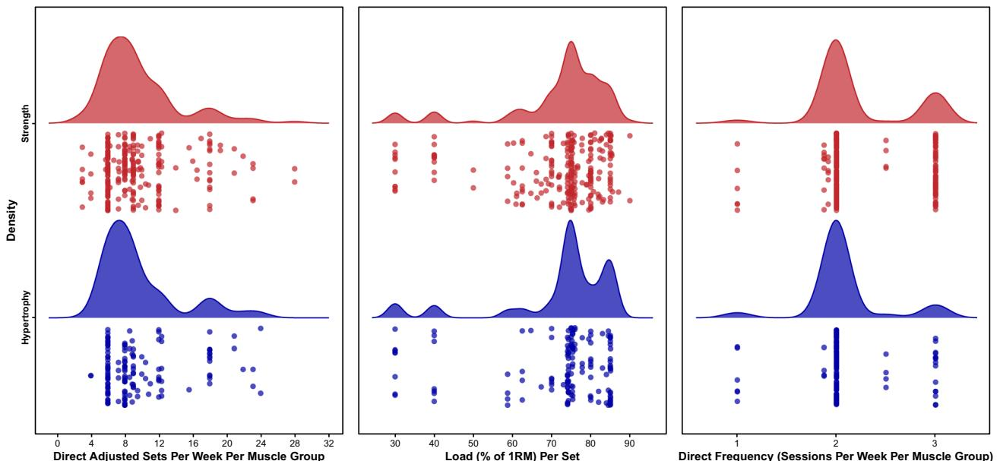
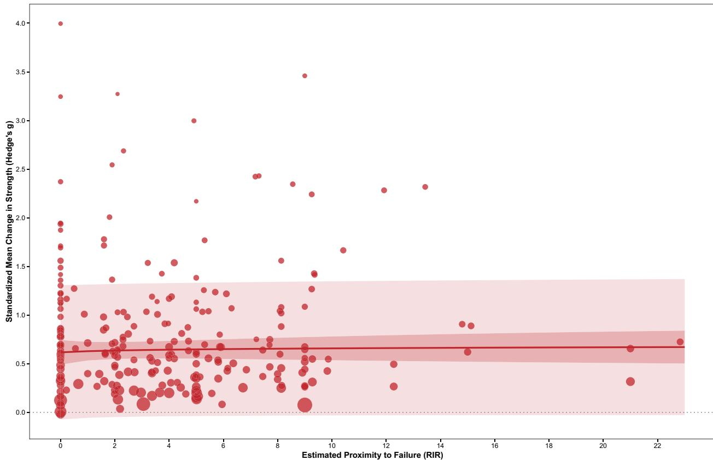
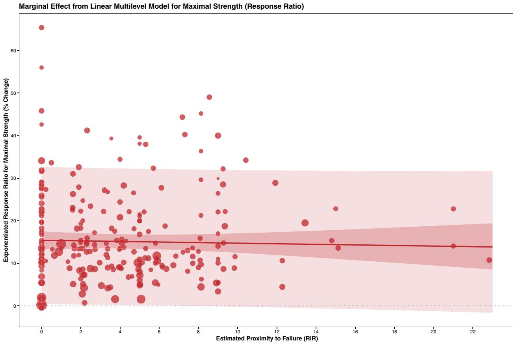
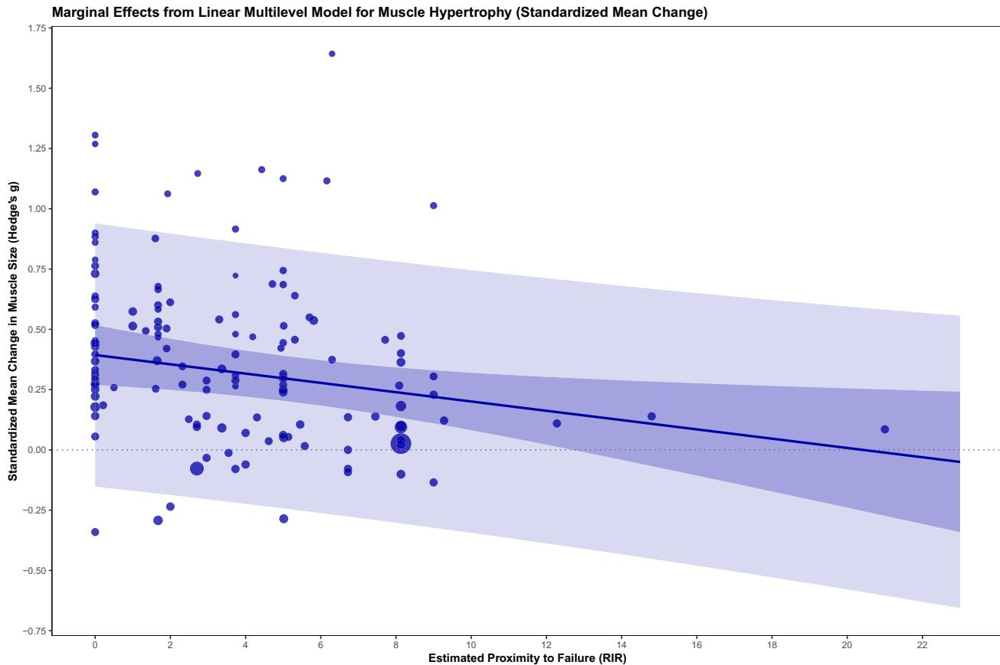
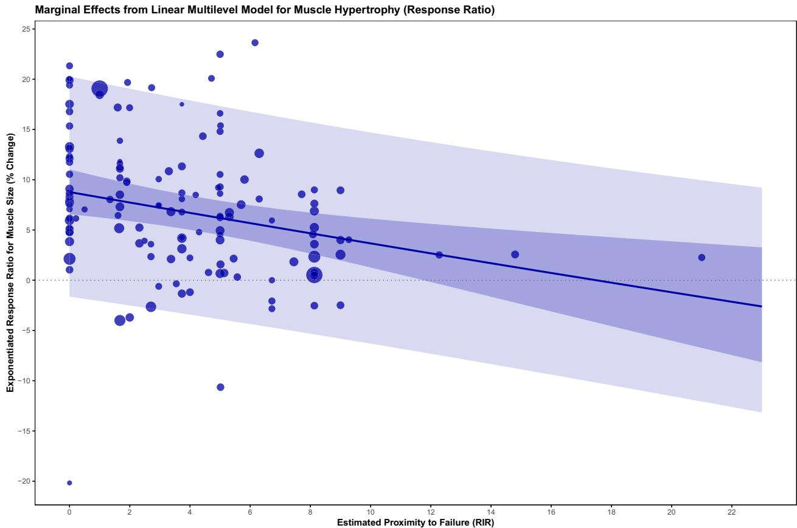
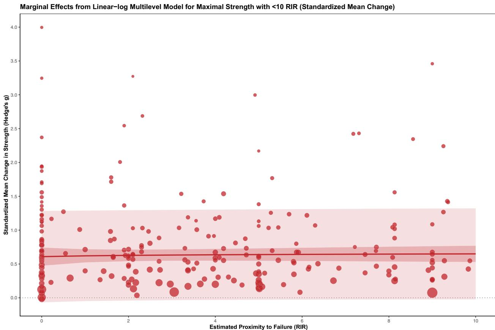
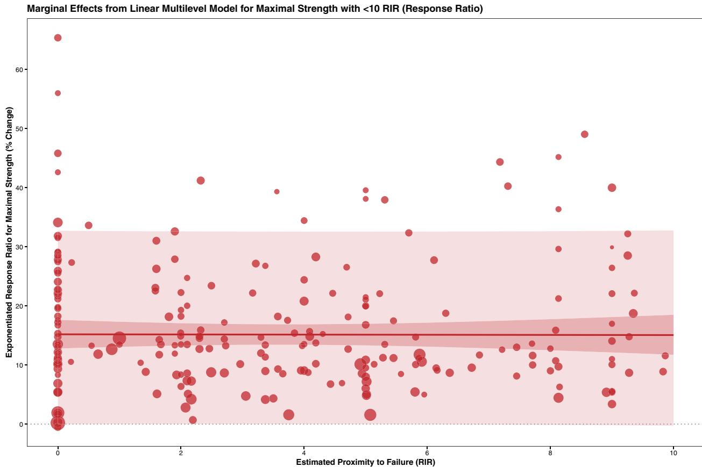
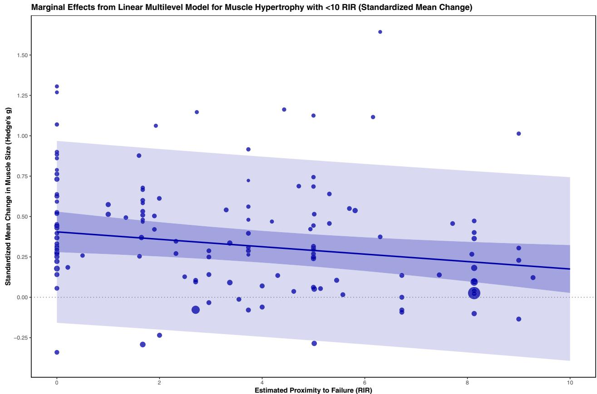
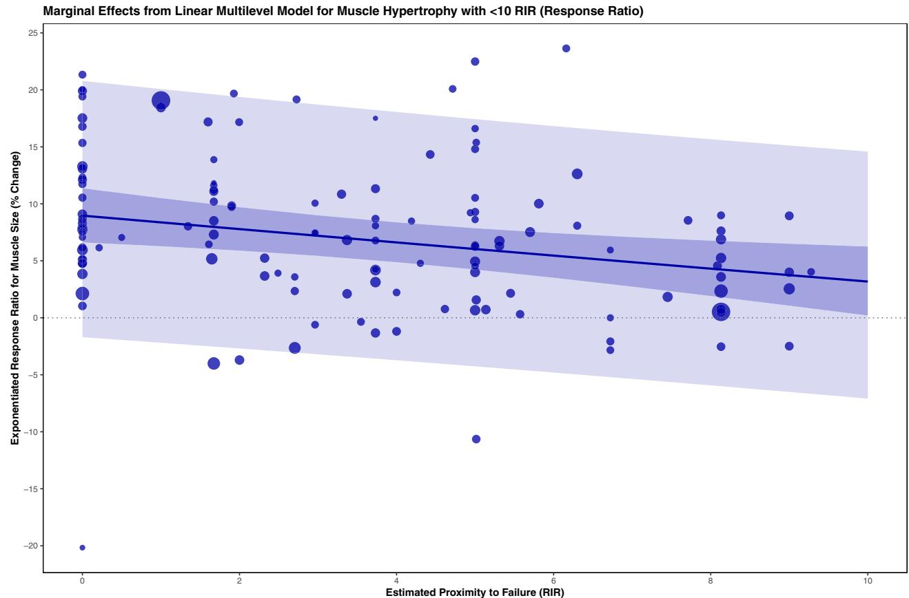

# Exploring the Dose–Response Relationship Between Estimated Resistance Training Proximity to Failure, Strength Gain, and Muscle Hypertrophy: A Series of Meta-Regressions

Accepted: 18 June 2024 / Published online: 6 July 2024  
© The Author(s), under exclusive licence to Springer Nature Switzerland AG 2024

## Abstract

**Background** The proximity to failure in which sets are terminated has gained attention in the scientific literature as a potentially key resistance training variable. Multiple meta-analyses have directly (i.e., failure versus not to failure) or indirectly (e.g., velocity loss, alternative set structures) evaluated the effect of proximity to failure on strength and muscle hypertrophy outcomes categorically; however, the dose–response effects of proximity to failure have not been analyzed collectively in a continuous manner.

**Objective** To meta-analyze the aforementioned areas of relevant research, proximity to failure was quantified as the number of repetitions in reserve (RIR). Importantly, the RIR associated with each effect in the analysis was estimated on the basis of the available descriptions of the training interventions in each study. Data were extracted and a series of exploratory multi-level meta-regressions were performed for outcomes related to both strength and muscle hypertrophy. A range of sensitivity analyses were also performed. All models were adjusted for the effects of load, method of volume equating, duration of intervention, and training status.

**Results** The best fit models for both strength and muscle hypertrophy outcomes demonstrated modest quality of overall fit. In all of the best-fit models for strength, the confidence intervals of the marginal slopes for estimated RIR contained a null point estimate, indicating a negligible relationship with strength gains. However, in all of the best-fit models for muscle hypertrophy, the marginal slopes for estimated RIR were negative and their confidence intervals did not contain a null point estimate, indicating that changes in muscle size increased as sets were terminated closer to failure.

**Conclusions** The dose–response relationship between proximity to failure and strength gain appears to differ from the relationship with muscle hypertrophy, with only the latter being meaningfully influenced by RIR. Strength gains were similar across a wide range of RIR, while muscle hypertrophy improves as sets are terminated closer to failure. Considering the RIR estimation procedures used, however, the exact relationship between RIR and muscle hypertrophy and strength remains unclear. Researchers and practitioners should be aware that optimal proximity to failure may differ between strength and muscle hypertrophy outcomes, but caution is warranted when interpreting the present analysis due to its exploratory nature. Future studies deliberately designed to explore the continuous nature of the dose–response effects of proximity to failure in large samples should be considered.

## Key Points

To date, no meta-analysis has examined both linear and non-linear dose–response relationships between proximity to failure [i.e., repetitions in reserve (RIR)] and training-induced changes in muscular strength and hypertrophy.

To analyze RIR as a continuous variable, a systematic estimation process was used to assign an RIR value to each group within each study. Critically, the accuracy of this process is unknown.

The dose–response relationship between proximity to failure and strength gain appears to differ from the relationship with muscle hypertrophy, with only the latter being meaningfully influenced by RIR. Load [percentage of one-repetition maximum (% of 1RM)] seems to be a more influential training variable for maximal strength, whereas muscle hypertrophy seems to improve upon terminating sets closer to failure.

## 1 Introduction

It is well established that the configuration of resistance training variables, such as set volume [1, 2], load [percentage of one-repetition maximum (% of 1RM)] [3, 4], and frequency [6], can impact resistance training outcomes. The impact of another variable, proximity to failure, operationally defined as the number of repetitions in reserve (RIR) prior to momentary failure (i.e., the inability to complete the concentric phase of a repetition despite maximal effort to do so) following set termination has gained recent attention in the scientific literature [7, 8]. Despite the recent attention on this topic, the specific proximity to failure that maximizes various resistance training outcomes (i.e., muscular hypertrophy and strength gain) remains unclear. Indeed, recent meta-analyses from Grgic et al. [9] and Vieira et al. [10] reported no significant difference for muscle hypertrophy [SMD 0.15 ( $p=0.237$ ); SMD 0.59 ( $p=0.239$ )], and strength gain [SMD 0.01 ( $p=0.860$ ); SMD 0.16 ( $p=0.566$ )] when comparing volume-equated resistance training interventions in which sets were performed to or not to failure. Moreover, meta-analyses from Jukic et al. [11] and Davies et al. [12] show equivocal outcomes for muscle hypertrophy [SMD – 0.03 ( $p=0.708$ ); SMD – 0.05 ( $p=0.73$ )] and strength gain [SMD – 0.06 ( $p=0.291$ ); SMD – 0.05 ( $p=0.56$ )] when comparing the effects of traditional and

alternative set structures, which alter proximity to failure via the manipulation of intra-set rest intervals [13].

Although the data from these meta-analyses [9–12] provide valuable insight into the influence of proximity to failure on resistance training outcomes, they investigate proximity to failure in a categorical (e.g., to failure versus not to failure; traditional versus alternative set structures) fashion despite its continuous nature. This is primarily due to the uncertainty of the proximity to failure achieved across relevant studies; for example, it is difficult to know the RIR upon set termination in non-failure groups due to a lack of reporting, individual differences, and set-to-set fatigue. Additionally, there is ambiguity in the criteria for set termination [14] in failure groups, further limiting the applicability of these categorical comparisons. Fisher et al. [15] recently suggested that investigating proximity to failure in a categorical fashion fails to inform the overall dose–response relationship between proximity to failure and resistance training outcomes. In other words, previous meta-analyses [9–12] have not attempted to ascertain the relationship between the number of RIR per set with muscle hypertrophy and strength gain, which limits the ability to make practical recommendations regarding proximity to failure. Specifically, if proximity to failure in resistance training is only examined in a categorical fashion, it cannot answer the question: “how far from failure should someone train to optimize muscle hypertrophy and strength gain?” To our knowledge, no meta-analysis to date has examined proximity to failure as a continuous variable on muscle hypertrophy and strength gain.

A commonly used method that aims to rectify the limitations of categorically examining proximity to failure is intra-set velocity loss (VL). Intra-set VL controls for proximity to failure by prescribing set termination once the concentric velocity of a repetition has declined by a predetermined percentage from a set’s fastest (usually first) repetition (e.g., 70% of 1RM to 20% VL). In this way, higher VL thresholds terminate sets closer to failure (i.e., low RIR), while lower VL thresholds terminate sets farther from failure (i.e., high RIR). Recent meta-analyses [16–20] have indeed included meta-regressions examining the dose–response relationship between intra-set VL and various resistance training outcomes. However, while different VL thresholds lead to a different number of RIR, this method of set termination does not control for the number of repetitions performed in a set or the relative volume (repetitions  $\times$  sets  $\times$  % of 1RM) [21, 22], which limits conclusions that can be made since training volume is related to muscle hypertrophy and strength gain [23–26]. For example, Pareja-Blanco et al. [27] compared the effects of training the Smith machine squat with either a 20% or 40% VL threshold for 8 weeks with the total number of sets and load equated. These intra-set VL thresholds resulted in the 20% and 40% groups training at an average

mean propulsive velocity of  $0.69$  and  $0.58 \text{ m s}^{-1}$ , respectively, suggesting the groups trained at different proximities to failure. However, the 40% VL group performed an average of 40% more repetitions throughout the study (40% VL:  $310.5 \pm 42$  versus 20% VL:  $185.9 \pm 22.2$  repetitions); thus, the relative volume load was not equated. Studies exist [28, 29] that have compared different VL thresholds and controlled for relative volume load, but have only been included in one meta-analysis to date [16].

Therefore, this exploratory meta-analysis aimed to investigate the effect of resistance training proximity to failure on muscle hypertrophy and maximal strength gain by combining all of the aforementioned areas of research. To best investigate the effect of proximity to failure continuously and explore potential dose–response relationships, RIR was estimated for the training intervention associated with each effect. While considerable effort was put into the estimations for each effect, the accuracy of these estimations cannot be verified. Thus, readers should be cautious with their interpretations of the following analysis. More studies that better define, control, and report RIR are needed to improve the quality of the estimations required for a dose–response meta-analysis. Until more of these high-quality studies exist, this analysis aims to bridge the gap between previous work and that which is theoretically ideal.

## 2 Methods

This exploratory meta-analysis was performed without a systematic search and was not preregistered. First, all studies from the existing relevant meta-analyses [9–12, 16–20] were collected ( $n = 40$ ). Then, any additional studies we were aware of, or were discovered during data extraction (e.g., authors were aware of, reference checking, and manual searching via Google Scholar), that met the inclusion criteria were also collected ( $n = 15$ ). To be included in this meta-analysis, studies had to: (1) be published in English and either published in a peer-reviewed journal, on a pre-print repository, or as a MSc or PhD thesis; (2) ensure participants had no known medical conditions or injuries; (3) include either set and/or repetition volume-equated conditions; (4) include load-equated conditions (i.e.,  $\pm 5\%$  of 1RM); (5) compare at least two different proximities to failure; and (6) include measurement(s) of maximal strength (i.e., isometric, isotonic, or isokinetic) and/or direct measurements of muscle hypertrophy [i.e., ultrasound, magnetic resonance imaging (MRI), etc.]. Studies that were initially gathered but did not meet these inclusion criteria were excluded. This process was performed by Z.R.

Data describing the population studied, specifications of the training intervention, and the outcomes of interest (e.g., muscle hypertrophy and strength) were extracted from

studies found to be eligible. In the case that any necessary data were not reported, Z.R. emailed the authors of the manuscripts requesting the raw or mean values. If the authors did not reply within 3 months, we resorted to calculating the desired data on the basis of the figures and tables (data were digitized using WebPlotDigitizer; v4.3, Ankit Rohatgi; <https://apps.automeris.io/wpd/>).

### 2.1 RIR Estimation

To operationally define proximity to failure as a continuous variable, the primary predictor in this meta-analysis was the estimated RIR to which training was performed by each group. Because self-reported RIR was not reported in almost all studies, specific procedures were followed to estimate RIR for every group included in the analysis. A detailed breakdown of the estimation of each study included in the analysis and all estimation equations utilized can be found in supplementary file 1 (<https://osf.io/dwbx3>). All initial estimations were performed by Z.R., and these estimations were subsequently verified by J.P., M.Z., M.R., and I.J. All conflicting predictions were due to manual error and were resolved upon re-estimation. The estimation process categorized studies into one of the following five subgroups: (1) groups training to failure, (2) groups reporting velocity, (3) groups reporting RIR, (4) groups reporting load and repetitions performed, and (5) groups training with alternative set structures.

### 2.2 Groups Training to Failure

The first category of studies consisted of those that included a group training to failure [24–26, 30–54]. Groups that trained to failure were estimated, by definition, to have trained to 0 RIR. However, due to the ambiguity of the terminology utilized to describe “failure” [7], studies that provided a clear definition (e.g., momentary failure, concentric failure, etc.) and did not indicate participants terminated sets upon their own volition (i.e., volitional failure) were separately coded with an RIR of “–1” for the linear-spline meta-regression model to potentially tease out differences associated with failure definition. All other groups with RIR estimates of 0, including volitional failure, were coded as “0.”

In studies that included a group training to failure, if a group did not train to failure but performed sets at an equivalent load, subtraction of the repetitions performed per set was used to estimate RIR. For example, if the group training to failure (i.e., 0 RIR) performed ten repetitions with 75% of 1RM and the group not training to failure performed five repetitions with 75% of 1RM, the number of RIR was estimated to be five. This was also applied for groups training with a repetition maximum (e.g., 10RM). For example, if a

group performed sets of eight repetitions with a 10RM load, then the estimated RIR was two.

### 2.3 Groups Reporting Velocity

The second category of studies reported velocity data that allowed for RIR estimations [27–29, 55–67]. Utilizing the most representative citations available [68–71], equations were utilized or created to predict the maximum possible number of repetitions at a given load on the basis of the repetitions performed and the intra-set VL. These equations were matched by exercise, loading range, training status, sex, and concentric intended velocity as closely as possible. After the maximum possible number of repetitions was estimated, subtraction could be performed from the repetitions per set provided.

For example, Pareja-Blanco and colleagues [27] reported a mean velocity loss of  $41.9 \pm 1.9\%$  in the VL40 group. Using the reported average number of repetitions per set ( $6.5 \pm 0.9$ ) and load used (75% of 1RM), the maximum possible number of repetitions was predicted using the regression equations for the Smith machine squat published by Rodriguez-Rosell et al. [68]. Specifically, at 70% of 1RM, the predicted maximum possible number of repetitions was 8.31. When subtracting the average number of repetitions performed per set reported by Pareja-Blanco et al. [27], the estimated RIR was 1.81. However, because the average load reported was 75% of 1RM, we averaged the estimated RIR created from the equations for 70% and 80% of 1RM from Rodriguez-Rosell [68], resulting in the final estimated RIR for the VL40 group of 1.67. The prediction equations that were used for each velocity loss study can be found in supplementary file 1 (<https://osf.io/dwbx3>).

### 2.4 Groups Reporting RIR

The third category of studies directly reported RIR, and these values were utilized verbatim for the RIR estimations [40, 72–74]. For example, if a group reported the average RIR throughout the study as 2.3, the estimated RIR was also 2.3. If a study reported RIR but also fell into one of the two prior categories (i.e., training to failure or provided velocity data), the other method was used to predict RIR due to its objectivity ( $n = 1$ ).

### 2.5 Groups Reporting Load and Repetitions Performed

The next category of studies reported the load and repetitions performed from which RIR estimations were derived [32, 33, 75–81]. Once again, prediction equations were utilized from the most representative citations available [68–70, 82–84] to establish the maximum possible number

of repetitions at a given load, to which subtraction of the repetitions performed per set could estimate RIR. These equations were matched by exercise, loading range, training status, sex, and concentric intended velocity as closely as possible. For example, Carneiro et al. [79] had untrained women perform sets of four repetitions at 90% of 1RM on the bilateral knee extension. Using the prediction equation created from the data of Hoeger et al. [85], it was estimated that approximately 4.65 repetitions are possible at 90% of 1RM. Thus, subtracting four repetitions per set from that estimation led to an estimated RIR of 0.65.

Alternatively, some studies reported load as a percentage of a repetition maximum (RM) other than a 1RM. In this case, the load relative to a 1RM (i.e., % of 1RM), was first predicted. Next, utilizing the predicted percentage of 1RM, the same steps could be followed as previously outlined. For example, Drinkwater and colleagues [75] had trained men perform sets of bench press with percentages of 6RM loads. Therefore, using the prediction equation from Chapman et al. [70], the percentage of 1RM associated with 100% of 6RM was predicted, which equated to 89% of 1RM. Then, the percentages of this value used in Drinkwater et al. [75] were applied to calculate the load per set [e.g., 70% of 89% (6RM) = 62.3% of 1RM]. The same steps outlined in the previous paragraph were then followed to predict the maximum possible repetitions at the given load. Finally, the number of repetitions performed per set was subtracted from the predicted maximum possible number of repetitions to estimate RIR.

### 2.6 Groups Training with Alternative Set Structures

For groups training with alternative set structures [30, 32–36, 38, 41, 43, 44, 52, 66, 67, 75–81, 86], a determination needed to be made as to what constitutes a “set” from which proximity to failure could be evaluated. We decided to treat each group of repetitions performed with any intra-set or inter-set rest between them as an individual set. For rest–pause groups, each of these sets was performed to failure, making the RIR estimation simple (i.e., 0 RIR) [78]. For cluster and rest redistribution groups, this RIR estimation method was chosen because of these set structures’ ability to maintain repetition performance, and thus RIR, compared with traditional set structures.

For example, Iglesias-Soler et al. [87] compared the total number of repetitions performed with a 4RM load on the Smith machine squat between traditional and cluster set structures in a crossover design. The traditional set condition performed three sets to failure, whereas the cluster set condition performed as many repetitions as possible with an individualized inter-repetition rest period (i.e., single-repetition sets). The authors observed that participants were able to increase the total number of repetitions performed by

approximately fivefold with a cluster set structure (cluster:  $45.5 \pm 32$  repetitions; traditional:  $9.33 \pm 1.87$  repetitions), indicating RIR was likely maintained for many of the early repetitions. Due to this evidence, along with variability in the initial proximity to failure of each set, intra- and inter-set rest intervals, the load used, sex of the participants, and exercise selection, we determined this estimating RIR for cluster and rest redistribution groups in this manner to be the best course of action.

To illustrate, Farinas et al. [43] investigated the effects of set structure within a unilateral knee extension training program. Participants in the traditional group performed four sets of eight repetitions with a 10RM load and 3-min inter-set rest periods. Using an equivalent load (i.e., 10RM), the alternative set structure group instead performed 1 repetition every 17.4 s until 32 total repetitions were completed. The estimated RIR for each group was calculated by subtracting the number of repetitions performed in each single-repetition set from the maximum possible number of repetitions. Thus, the RIR estimation for the traditional group would be two and the alternative set structure group would be nine.

Out of all the RIR estimation procedures, the alternative set structure research was the most challenging due to a very scarce body of evidence investigating the influence of these set structures on repetitions to failure performance (and thereby RIR). To ensure this body of research did not dramatically influence the results, we have performed an interaction moderator analysis. In this analysis, the dose–response relationship of RIR was estimated in groups that did and did not use alternative set structures, allowing us to examine the existence of systematic differences in these approaches.

## 2.7 Special Cases

Throughout the estimation process, special case rules were applied to a few groups. Specifically, in these cases, even though a group fell into one of the aforementioned categories, the estimation approach led to subjectively implausible RIR values. These alternative approaches are outlined in Supplementary File 1 (<https://osf.io/dwbx3>).

## 2.8 Additional Details

For each group in the analysis, the estimated RIR was used to represent the average proximity to failure at which sets were terminated. Specifically, averages were developed for both the “muscle” and the “exercise.” For the “muscle” RIR, if a study included multiple exercises, those that primarily trained the muscle site measured or were prime movers in the exercise or joint action tested counted toward the estimation. For example, if a lower body training program included the barbell back squat, knee extension machine, and knee

flexion machine, only the RIR estimations of the barbell back squat and knee extension machine would be averaged for quadriceps-specific outcomes (i.e., strength or muscle hypertrophy). Alternatively, for the “exercise” RIR, only sets performed on the same exercise that was tested were counted toward the estimation; thus, this is only relevant for dynamic strength outcomes. For example, in the same lower body training program that included the barbell back squat, knee extension machine, and knee flexion machine, only the RIR estimations of the barbell back squat would be used for the exercise RIR. When applicable, the RIR estimations of multiple sets performed by a single group were averaged for the final estimation. Finally, if a RIR estimate was negative, it was recorded as “0.”

While the limitations of our methods are outlined further in the discussion, they are important to briefly mention prior to interpreting the results. A variety of potential influences of RIR were not directly accounted for in our estimations (e.g., set-to-set fatigue, strength gain, etc.); thus, may introduce bias in our estimates. We opted to confine our estimation approach to the “average” demands imposed on participants across studies, focusing on quantifying the number of possible repetitions relative to those performed. This basis for our estimations, supported by the most substantial data, allowed us the highest confidence in the accuracy of our findings rather than introducing even more assumptions to account for the other potential confounders (e.g., sex, exercise selection, repetition range, initial proximity to failure, etc.).

By maintaining this consistent approach to estimation, we acknowledged the possibility of encountering biased RIR values (either overly conservative or liberal). However, we aimed to preserve the integrity of the “true” RIR values’ monotonicity, crucial for accurately estimating the directionality of the dose–response relationship.

## 3 Statistical Analysis

This exploratory meta-analysis was performed using the *metafor* package [88] in R language and environment for statistical computing (v 4.0.2; R Core Team, <https://www.r-project.org/>). The extracted dataset, analysis scripts, models summaries, and supplementary materials are available on the Open Science Framework (<https://osf.io/7knsj/>). Given the goal of this analysis, we have opted to avoid dichotomizing our findings and therefore did not employ traditional null hypothesis significance testing [89]. Rather, we took an estimation-based approach in which effect estimates and their precision were interpreted cautiously and probabilistically [90]. As the included studies had multiple groups and reported effects within these groups for multiple outcomes, we opted to calculate effect sizes in a nested structure.

Therefore, multilevel mixed-effects models [91] with cluster-robust variance estimation [92] were performed with study, group, and observation included as explicitly nested random intercepts in the model (i.e., observations were nested within groups which were nested within studies). Moreover, a range of models were fit and compared including with (1) random intercepts only, (2) the addition of a single random slope for estimated RIR on the study level, and (3) the addition of random slopes for estimated RIR on the study and group level to account for potential heterogeneity in the relationship of estimated RIR on these levels. Effects were weighted by inverse sampling variance to account for the observation-level, within-study, and between-study variance. Models were constructed with effect sizes, and variances thereof, calculated as both standardized mean change and response ratio using the *escalc* function [93, 94]. Specifically, standardized mean changes were calculated as the difference between post-test and pre-test means, divided by the pre-test standard deviation with an adjustment (i.e., C) for a small sample bias. In addition, response ratios were calculated as the sum of the natural logarithm of the ratio of post-test and pre-test means and an adjustment for small sample bias (i.e., C), which were later exponentiated (i.e.,  $e^x$ ) and thereby converted to percentage change scores to aid practical interpretation. Formulas for each effect size and their variances can be seen below:

$$SMC = C \left( \frac{M_{post} - M_{pre}}{SD_{pre}} \right); C = 1 - \frac{3}{4(n-1)-1}$$

$$var(SMC) = \frac{2(1-r)}{n} + \frac{(SMC)^2}{2 \cdot n}$$

$$RR = C + \ln \left( \frac{M_{post}}{M_{pre}} \right); C = \frac{1}{2} \left( \frac{(SD_{post})^2}{n \cdot (M_{post})^2} - \frac{(SD_{pre})^2}{n \cdot (M_{pre})^2} \right);$$

$$var(RR) = \frac{(SD_{post})^2}{n \cdot M_{post}} + \frac{(SD_{pre})^2}{n \cdot M_{pre}} + \frac{2r \cdot SD_{post} \cdot SD_{pre}}{M_{post} \cdot M_{pre} \cdot n}$$

$$RR_{exp} = (e^{RR} - 1) \cdot 100$$

No studies reported the pre-intervention to post-intervention correlations required to determine the variance. Therefore, the available data were used to retroactively calculate pre-to-post correlations if possible [95]. Then, we meta-analyzed these approximated correlation coefficients (i.e., Fisher's  $r$ -to- $z$  transformed correlation coefficient) and imputed this estimate for the studies where we were unable to obtain the required data. Since all meta-analytic models included moderators, statistical heterogeneity was evaluated

using  $I^2$ , which represents the remaining variance that is not already accounted for by the moderators [96]. This heterogeneity was then partitioned across the three levels of the nested random effects (i.e., study, group, and observation). Additionally, marginal and conditional  $R^2$  were calculated to quantify the proportion of variance explained by only the fixed effects and the sum of the fixed and random effects, respectively [97]. Both  $I^2$  and  $R^2$  were calculated using the *orchaRd* package for multilevel models [98]. To account for potential non-linear dose–response relationships between proximity to failure and resistance training outcomes, the following functional forms for all model structures described above were fit and subsequently compared using the *bayes-testR* package [99], utilizing Bayesian information criterion (BIC)-approximated Bayes factors to determine under which model the observed data are the most probable for each outcome (i.e., strength and muscle hypertrophy):

1. (1) Linear.
2. (2) Linear spline (knot at 0 RIR).
3. (3) Linear-log.
4. (4) Quadratic.
5. (5) Cubic.
6. (6) Restricted cubic spline (4 knots at 5%, 35%, 65%, and 95% quantiles).

All models included the following fixed effects: (1) estimated RIR, (2) load per set, (3) method of volume equating (set, repetition, or both), (4) duration (i.e., weeks) of the training intervention (continuous), and (5) training status of the participants (binary categorical). Estimated marginal means (and their slopes) with 95% compatibility intervals (confidence and prediction) were extracted for the main effect of RIR (adjusted proportionally for all other predictors) using the *emmeans* package [100]. For RIR, estimates were extracted at 0 to 23 RIR to represent the range of values observed in the dataset.

Following the determination of the best fit models for each outcome (i.e., strength or muscle hypertrophy) and effect size (i.e., SMC or RR), interaction moderator analyses were performed to evaluate the influence of a variety of factors related to study design and participant characteristics (Supplementary File 2: <https://osf.io/3tcwx>). Specifically, separate models were fit for each moderator that maintained the same structure as the best fit models from the main analysis, but also included main effects and an interaction term between estimated RIR and the moderator of interest (e.g., method of volume equating, set structure, intended concentric velocity, etc.). These analyses can be viewed at <https://osf.io/7knsj/>. Finally, after inspecting the data, it appeared that some studies with very high RIR estimations may have been disproportionately influencing the models. Thus, a sensitivity analysis was performed where all models were refit

only with effect sizes from groups that were estimated to train with less than or equal to 10 RIR.

## 4 Results

### 4.1 Study Characteristics

A breakdown of all 55 studies included in this analysis can be found in Supplementary File 0 (<https://osf.io/wpx92>). On average, training interventions lasted  $8.28 \pm 2.35$  weeks and participants were  $27.83 \pm 12.84$  years old. A visual summary of the training interventions from the included studies can be seen in Fig. 1. Additionally, tables summarizing study characteristics can be seen in Supplementary File 2 (<https://osf.io/3tcwx>). The most frequently occurring (i.e., mode) values of the primary training variables for effects included in the strength models were volume: six sets per week; load: 75% of 1RM; and frequency: two sessions per week. The average values for these metrics were  $9.58 \pm 4.48$  sets per week,  $72.06 \pm 13.27\%$  of 1RM, and  $2.23 \pm 0.48$  sessions per week, respectively. For the effects in the muscle hypertrophy models, the most frequently occurring values were six sets per week, 85% of 1RM, and two sessions per week. The average values for these metrics were  $9.69 \pm 4.61$  sets per week,  $72.27 \pm 14.53\%$  of 1RM, and  $2.08 \pm 0.39$  sessions per week. Finally, the average RIR for hypertrophy models was

 $3.59 \pm 3.40$  with a range of 0–21. For the strength models, the average RIR was  $4.03 \pm 3.96$  with a range of 0–22.83.

### 4.2 Primary Analysis

The following sections will present the results of all meta-regression models. Specifically, for each model, we will evaluate the overall quality of model fit (i.e.,  $R^2$  and  $I^2$ ) and the marginal slope for the main effect of estimated RIR (i.e., the slope at the mean of RIR after adjusting for load, method of volume equating, intervention duration, and training status). Full model summary tables, comparisons thereof, and all extracted estimates are located at <https://osf.io/7knsj/>.

#### 4.2.1 Strength Outcomes

The multilevel meta-regression models for strength included 243 total effects from 55 studies. Model comparisons revealed that the linear-log model was the best fit with effects as a standardized mean change (Fig. 2). The fixed effects of the model explained less than a quarter of the total variance ( $R^2_{marginal} = 12.29\%$ ;  $R^2_{conditional} = 78.66\%$ ), with the primary source of remaining variance occurring at the study level ( $I^2_{study} = 52.37\%$ ;  $I^2_{group} = 13.44\%$ ;  $I^2_{observation} = 21.17\%$ ). The marginal slope of estimated RIR was positive but contained a null point estimate within the confidence interval [ $\beta = 0.003$  (95% CI = 0.012, 0.018; 95% PI = 0.675, 0.682)]. The slope indicates

Visual Summaries of Training Interventions Included in Meta-regression Models

**Fig. 1** Visual summary of training interventions included in the analysis. Data are presented as raincloud plots with each data point representing an effect. Direct adjusted sets per week per muscle

group = number of direct sets performed per week per muscle group, while alternative set structure groups were adjusted to the same number of sets as the traditional set structure group in the same study

Marginal Effects from Linear-log Multilevel Model for Maximal Strength (Standardized Mean Change)

**Fig. 2** Best fit (linear-log) multilevel meta-regression for maximal strength outcomes analyzed as a standardized mean change. Data are presented as estimated marginal means (solid line) with 95% compatibility intervals (dark band=confidence, light band=prediction) after adjusting for load, method of volume equating, intervention duration, and training status of the participants. Colored circles represent the

effect size of each observation included in the analysis, with the size of each circle representing its weight determined by inverse variance weighting. The main effect for estimated RIR is presented at the mean of continuous fixed effects (i.e., load and intervention duration) and proportionally marginalized across categorical fixed effects (i.e., method of volume equating and training status)

that strength gains improve negligibly as sets are terminated farther from failure.

Model comparisons revealed that the linear model was the best fit with effects as a response ratio (Fig. 3). The fixed effects of the model explained less than a third of the total variance ( $R^2_{marginal} = 29.04\%; R^2_{conditional} = 59.41\%$ ) with the primary source of remaining variance occurring at the observation level ( $I^2_{study} = 35.09\%; I^2_{group} = 4.83\%; I^2_{observation} = 53.35\%$ ). The marginal slope of estimated RIR was negative but contained a null point estimate within the confidence interval [ $\beta = -0.059$  (95% CI  $-0.304, 0.186$ ; 95% PI  $-12.944, 14.732$ )]. The slope indicates that strength gains decrease negligibly as sets are terminated farther from failure.

## 4.2.2 Muscle Hypertrophy Outcomes

The multilevel meta-regression models for muscle hypertrophy included 140 total effects from 26 studies. Model

comparisons revealed that the linear model was the best fit with effects as a standardized mean change (Fig. 4). The fixed effects of the model explained less than a quarter of the total variance ( $R^2_{marginal} = 19.2\%; R^2_{conditional} = 72.09\%$ ) with the primary source of remaining variance occurring at the study level ( $I^2_{study} = 55.57\%; I^2_{group} = 2.29\%; I^2_{observation} = 30.53\%$ ). The marginal slope of estimated RIR was negative and did not contain a null point estimate within the confidence interval [ $\beta = -0.019$  (95% CI  $-0.035, -0.004$ ; 95% PI  $-0.551, 0.513$ )]. The slope indicates that muscle hypertrophy improves as sets are terminated closer to failure.

Model comparisons revealed that the linear model was the best fit with effects as a response ratio (Fig. 5). The fixed effects of the model explained less than a third of the total variance ( $R^2_{marginal} = 26.38\%; R^2_{conditional} = 63.24\%$ ) with the primary source of remaining variance occurring at the observation level ( $I^2_{study} = 38.65\%; I^2_{group} = 5.84\%; I^2_{observation} = 44.35\%$ ). The marginal slope of estimated RIR was negative

**Fig. 3** Best fit (linear) multilevel meta-regression for maximal strength outcomes analyzed as an exponentiated response ratio. Data are presented as estimated marginal means (solid line) with 95% compatibility intervals (dark band=confidence, light band=prediction) after adjusting for load, method of volume equating, intervention duration, and training status of the participants. Colored circles represent the effect size of each observation included in the analysis, with the size of each circle representing its weight determined by inverse variance weighting. The main effect for estimated RIR is presented at the mean of continuous fixed effects (i.e., load and intervention duration) and proportionally marginalized across categorical fixed effects (i.e., method of volume equating and training status)

and did not contain a null point estimate within the confidence interval  $[\beta = -0.48 \text{ (95\% CI } -0.78, -0.179; 95\% \text{ PI } -9.811, 9.817)]$ . The slope indicates that muscle hypertrophy improves as sets are terminated closer to failure.

### 4.3 Sensitivity Analyses

#### 4.3.1 Strength Outcomes

Upon refitting the multilevel meta-regression models for strength only with the effects with an RIR estimate of  $< 10$ , they included 232 total effects from 54 studies. Model comparisons revealed that the linear-log model was the best fit with effects as a standardized mean change (Fig. 6). The fixed effects of the model explained less than a quarter of the total variance ( $R^2_{\text{marginal}} = 12.68\%; R^2_{\text{conditional}} = 75.81\%$ ) with the primary source of remaining variance occurring at the study level ( $I^2_{\text{study}} = 51.63\%; I^2_{\text{group}} = 11.03\%; I^2_{\text{observation}} = 24.01\%$ ). The marginal slope of estimated RIR was positive but contained a null point estimate within the confidence interval  $[\beta = -0.011 \text{ (95\% CI } -0.411, 0.39; 95\% \text{ PI } -13.085, 15.029)]$ . The slope indicates that strength gains increase negligibly as sets are terminated farther from failure.

Model comparisons revealed that the linear model was the best fit with effects as a response ratio (Fig. 7). The fixed effects of the model explained less than a third of the total variance ( $R^2_{\text{marginal}} = 29.15\%; R^2_{\text{conditional}} = 57.69\%$ ) with the primary source of remaining variance occurring at the observation level ( $I^2_{\text{study}} = 34.55\%; I^2_{\text{group}} = 3.13\%; I^2_{\text{observation}} = 55.87\%$ ). The marginal slope of estimated RIR was positive but contained a null point estimate within the confidence interval  $[\beta = -0.011 \text{ (95\% CI } -0.411, 0.39; 95\% \text{ PI } -13.085, 15.029)]$ . The slope indicates that strength gains increase negligibly as sets are terminated farther from failure.

Finally, upon refitting all models with the RIR and load per set of the specific exercise evaluated as a dynamic

**Fig. 4** Best fit (linear) multi-level meta-regression for muscle hypertrophy outcomes analyzed as a standardized mean change. Data are presented as estimated marginal means (solid line) with 95% compatibility intervals (dark band=confidence, light band=prediction) after adjusting for load, method of volume equating, intervention duration, and training status of the participants. Colored circles represent the

effect size of each observation included in the analysis, with the size of each circle representing its weight determined by inverse variance weighting. The main effect for estimated RIR is presented at the mean of continuous fixed effects (i.e., load and intervention duration) and proportionally marginalized across categorical fixed effects (i.e., method of volume equating and training status)

strength outcome, a linear-log model was the best fit, regardless of effect size. All estimates were similar to the primary and secondary models.

### 4.3.2 Muscle Hypertrophy Outcomes

Upon refitting the multilevel meta-regression models for muscle hypertrophy only with the effects with an RIR estimate of < 10, they included 137 total effects from 26 studies. Model comparisons revealed that the linear model was the best fit with effects as a standardized mean change (Fig. 8). The fixed effects of the model explained less than a quarter of the total variance ( $R^2_{marginal} = 18.65\%$ ;  $R^2_{conditional} = 73.3\%$ ) with the primary source of remaining variance occurring at the study level ( $I^2_{study} = 57.55\%$ ;  $I^2_{group} = 2.31\%$ ;  $I^2_{observation} = 29.25\%$ ). The marginal slope of estimated RIR was negative and did not contain a null point estimate within the confidence interval ( $\beta = -0.023$  [95% CI  $-0.042, -0.004$ ; 95% PI  $-0.572, 0.526$ ]).

The slope indicates that muscle hypertrophy improves as sets are terminated closer to failure.

Model comparisons revealed that the linear model was the best fit with effects as a standardized mean change (Fig. 9). The fixed effects of the model explained less than a third of the total variance ( $R^2_{marginal} = 25.52\%$ ;  $R^2_{conditional} = 64\%$ ) with the primary source of remaining variance occurring at the observation level ( $I^2_{study} = 39.71\%$ ;  $I^2_{group} = 6.48\%$ ;  $I^2_{observation} = 43.22\%$ ). The marginal slope of estimated RIR was negative and did not contain a null point estimate within the confidence interval [ $\beta = -0.544$  (95% CI  $-0.929, -0.158$ ; 95% PI  $-10.074, 9.996$ )]. The slope indicates that muscle hypertrophy improves as sets are terminated closer to failure.

### 4.4 Interacting Moderators

The following sections will present the results of the interaction moderator analyses. We evaluated the interaction

**Fig. 5** Best fit (linear) multilevel meta-regression for muscle hypertrophy outcomes analyzed as an exponentiated response ratio. Data are presented as estimated marginal means (solid line) with 95% compatibility intervals (dark band=confidence, light band=prediction) after adjusting for load, method of volume equating, intervention duration, and training status of the participants. Colored circles represent the effect size of each observation included in the analysis, with the size of each circle representing its weight determined by inverse variance weighting. The main effect for estimated RIR is presented at the mean of continuous fixed effects (i.e., load and intervention duration) and proportionally marginalized across categorical fixed effects (i.e., method of volume equating and training status)

contrasts of the two-way interactions between estimated RIR and the moderators of interest. Specifically, we will identify moderators that alter the qualitative inference of the relationship between estimated RIR and the outcome variable (i.e., directionality, magnitude, and uncertainty). These analyses should be cautiously interpreted, as the number of observations that contribute to the effects could be substantially reduced when compared with the main models, thereby reducing the precision of the estimates. Data visualization from all interaction moderator analyses are located at <https://osf.io/7knsj/>.

#### 4.4.1 Strength Outcomes

For strength outcomes, interacting moderators were identified that altered the qualitative inference. When effects were analyzed as a standardized mean change in the primary analysis, upper body outcomes ( $n=104$ ) demonstrated a more positive slope than lower body outcomes ( $n=139$ ).

sent the effect size of each observation included in the analysis, with the size of each circle representing its weight determined by inverse variance weighting. The main effect for estimated RIR is presented at the mean of continuous fixed effects (i.e., load and intervention duration) and proportionally marginalized across categorical fixed effects (i.e., method of volume equating and training status)

Additionally, training programs that used multi-joint exercises ( $n=150$ ) demonstrated a more positive slope than programs that included both multi- and single-joint exercises ( $n=27$ ). In the sensitivity analysis of the effects with an RIR estimate of  $<10$ , training programs that used multi-joint exercises ( $n=150$ ) demonstrated a more positive slope than programs that included both multi- and single-joint exercises ( $n=27$ ).

When effects were analyzed as a response ratio in the primary analysis, training programs that used multi-joint exercises ( $n=150$ ) demonstrated a more positive slope than programs that included both multi- and single-joint exercises ( $n=27$ ). In the sensitivity analysis of the effects with an RIR estimate of  $<10$ , training programs that used multi-joint exercises ( $n=150$ ) demonstrated a more positive slope than programs that included both multi- and single-joint exercises ( $n=27$ ). Within-participant designs ( $n=32$ ) also demonstrated a more positive slope than between-participant designs ( $n=211$ ).

**Fig. 6** Best fit (linear-log) multilevel meta-regression for maximal strength outcomes analyzed as a standardized mean change after effects with > 10 estimated RIR were removed. Data are presented as estimated marginal means (solid line) with 95% compatibility intervals (dark band=confidence, light band=prediction) after adjusting for load, method of volume equating, intervention duration, and training status of the participants. Colored circles represent the effect

size of each observation included in the analysis, with the size of each circle representing its weight determined by inverse variance weighting. The main effect for estimated RIR is presented at the mean of continuous fixed effects (i.e., load and intervention duration) and proportionally marginalized across categorical fixed effects (i.e., method of volume equating and training status)

#### 4.4.2 Muscle Hypertrophy Outcomes

For hypertrophy outcomes, interacting moderators were identified that altered the qualitative inference. When effects were analyzed as a standardized mean change in the primary analysis, training programs that did not employ progressive overload ( $n=5$ ) exhibited a positive slope, while those that included progressive overload ( $n=135$ ) exhibited a negative slope. In the sensitivity analysis of the effects with an RIR estimate of < 10, within-participant designs ( $n=18$ ) demonstrated a positive slope, while between-participant designs ( $n=122$ ) exhibited a negative slope.

When effects were analyzed as a response ratio in the primary analysis, training programs that did not employ progressive overload ( $n=5$ ) exhibited a positive slope, while those that included progressive overload ( $n=135$ ) exhibited a negative slope. In the sensitivity analysis of the effects with an RIR estimate of < 10, training programs that used heavier

loads demonstrated a more positive slope than programs that used lighter loads. Within-participant designs ( $n=18$ ) also demonstrated a more positive slope than between-participant designs ( $n=122$ ). Finally, training programs that did not employ progressive overload ( $n=5$ ) exhibited a positive slope, while those that included progressive overload ( $n=135$ ) exhibited a negative slope.

## 5 Discussion

The present meta-analysis explored the dose–response relationship between proximity to failure (quantified as estimated RIR), strength gains, and muscle hypertrophy. Our results showed that strength gains are minimally influenced by proximity to failure, while muscle hypertrophy tends to increase as sets are terminated closer to failure. These relationships can inform future research

**Fig. 7** Best fit (linear) multilevel meta-regression for maximal strength outcomes analyzed as an exponentiated response ratio after-effects with > 10 estimated RIR were removed. Data are presented as estimated marginal means (solid line) with 95% compatibility intervals (dark band=confidence, light band=prediction) after adjusting for load, method of volume equating, intervention duration, and training status of the participants. Colored circles represent the effect

size of each observation included in the analysis, with the size of each circle representing its weight determined by inverse variance weighting. The main effect for estimated RIR is presented at the mean of continuous fixed effects (i.e., load and intervention duration) and proportionally marginalized across categorical fixed effects (i.e., method of volume equating and training status)

and potentially improve the conceptual understanding of practitioners in regard to how proximity to failure influences muscular hypertrophy and strength outcomes, respectively.

## 5.1 Strength

In all of the best-fit models within the present analysis, the confidence intervals of the marginal slope for estimated RIR contained a null point estimate, suggesting a negligible relationship between proximity to failure and strength gains. There are multiple potential explanations for these findings. In the following sections, we will discuss the principle of specificity in regard to force production and opposing advantages of training far from and close to failure for strength gain to explain the observed relationship.

### 5.1.1 Force Production and the Principle of Specificity

The main estimates from the statistical models were extracted after adjusting for load, the method in which volume was equated, intervention duration, and training status. Other meta-analytic data suggest that load in particular exhibits a positive dose–response relationship with strength gains [3, 4]. These data, in concert with the present findings, suggest that load, in isolation, is a better predictor of strength outcomes than proximity to failure. Importantly, as load increases at a fixed number of repetitions, the furthest obtainable proximity to failure decreases. For example, when training with a 10RM load (~75% of 1RM) a set could be terminated after a single repetition resulting in 9 RIR. However, a set terminated after a single repetition with a 2RM load (~95% of 1RM) will be much closer to failure due to the heavier load used (i.e., 1 RIR). To get to a 1 RIR in the first example with a 10RM load, fatigue must be

**Fig. 8** Best fit (linear) multilevel meta-regression for muscle hypertrophy outcomes analyzed as a standardized mean change after effects with > 10 estimated RIR were removed. Data are presented as estimated marginal means (solid line) with 95% compatibility intervals (dark band=confidence, light band=prediction) after adjusting for load, method of volume equating, intervention duration, and training status of the participants. Colored circles represent the effect size of

each observation included in the analysis, with the size of each circle representing its weight determined by inverse variance weighting. The main effect for estimated RIR is presented at the mean of continuous fixed effects (i.e., load and intervention duration) and proportionally marginalized across categorical fixed effects (i.e., method of volume equating and training status)

accumulated throughout the set via performing additional repetitions (i.e., nine repetitions). This example illustrates the difference between a load-mediated and intra-set-fatigue-mediated change in proximity to failure. The present analysis would suggest that intra-set-fatigue-mediated changes in proximity to failure have a negligible influence on strength gains, while there is more research in support of load-mediated changes.

The contrast between load-mediated and intra-set-fatigue mediated changes in proximity to failure and their impact on strength outcomes could be potentially explained by the principle of specificity [101] in regard to force production. To align with the principle of specificity, one would expect that training with similar forces to the strength assessment of interest would result in favorable outcomes such as training with loads > 85% of 1RM to maximize performance on a 1RM test. Importantly, however, force production declines as sets are taken closer to failure [102] but

increases proportionally with load (i.e., % of 1RM) [103], thereby supporting the contrast between load-mediated and intra-set-fatigue-mediated changes in proximity to failure and their impact on strength gains. Moreover, a recent meta-analysis by Zhang et al. [20] concluded that lower velocity loss thresholds resulted in higher strength gains per repetition than higher velocity loss thresholds. These results indicate that repetitions performed early in the set, which have the highest force production, lead to the greatest relative strength gain.

### 5.1.2 Advantages of Training Far from Failure for Strength

There are a number opposing advantages of training far from and close to failure for strength gains that may effectively counterbalance one another, leading to a negligible overall relationship. The first potential advantage of conditions training farther from failure is fatigue management. Multiple

**Fig. 9** Best fit (linear) multilevel meta-regression for muscle hypertrophy outcomes analyzed as an exponentiated response ratio after effects with > 10 estimated RIR were removed. Data are presented as estimated marginal means (solid line) with 95% compatibility intervals (dark band=confidence, light band=prediction) after adjusting for load, method of volume equating, intervention duration, and training status of the participants. Colored circles represent the effect

size of each observation included in the analysis, with the size of each circle representing its weight determined by inverse variance weighting. The main effect for estimated RIR is presented at the mean of continuous fixed effects (i.e., load and intervention duration) and proportionally marginalized across categorical fixed effects (i.e., method of volume equating and training status)

acute studies have demonstrated that training closer to failure results in greater indices of neuromuscular and perceptual fatigue compared with training farther from failure [24, 104, 105]. Since resistance training interventions often do not employ a formal tapering period in which training stress is reduced temporarily to allow for an improvement in acute performance [106], training farther from failure may allow participants to perform strength assessments in the absence of training-related fatigue compared with conditions training closer to failure. This isn't to say that intentional tapering periods result in superior performance in all cases, but in the absence of a tapering period, training farther from failure may fulfill a similar role.

Additionally, there may be proximity-to-failure-specific adaptations to rate of force development (RFD), which may contribute to the attenuation of maximal strength gains. While maximal strength (i.e., absolute force production measured in a specific context) is by definition a

time-independent characteristic, the rate at which force is produced could influence an individual's ability to generate sufficient absolute force (i) prior to the onset of fatigue and (ii) reaching the position in the range-of-motion with the greatest force requirements. Pareja-Blanco et al. [56] reported that training the Smith machine squat to a 40% velocity loss threshold resulted in a reduction in the RFD measured from 0–50 ms, while lower velocity loss thresholds (i.e., 0%, 10%, and 20%) improved RFD, suggesting training closer to failure may harm RFD. However, differential adaptations seem to occur in the early (<200 ms) and the late (>200 ms) phases of RFD, with the latter being suggested as more predictive of maximal strength [107].

In an additional investigation, Pareja-Blanco et al. [57] reported that only groups training the Smith machine bench press to higher velocity loss thresholds (i.e., 25% and 50%) saw improvements in RFD measured from 0–400 ms, suggesting training closer to failure may harm early but not late

phase RFD. However, as previously mentioned, these studies cannot delineate if the proximity to failure or relative volume load (i.e., % of  $1\text{RM} \times \text{repetitions} \times \text{sets}$ ) mediates effects on RFD, as both are manipulated via velocity loss thresholds. In studies that equate relative volume load and measure RFD, conditions training farther from failure usually result in superior changes in RFD, regardless of the phase examined [26, 28, 34, 35, 38]. Finally, a recent cross-sectional examination of strength-trained individuals demonstrate significant differences in earlier but not later phases of RFD compared with untrained controls, potentially indicating that all phases of RFD may contribute to maximal strength [108]; however, this area lacks sufficient evidence to confidently describe the relationship between proximity to failure and phase-specific alterations to RFD.

### 5.1.3 Advantages of Training Close to Failure for Strength

In contrast to the potential advantages of training farther from failure, training closer to failure may offer exposure to motor patterns and psychological experiences more specific to a maximal strength assessment. It is well established that motor patterns change with increases in load, which require that single repetition sets are terminated closer to failure, in exercises with many degrees of freedom (e.g., barbell back squat) [109]. As maximal strength assessments occur at the threshold of failure, conditions training closer to failure may be more regularly exposed to similar motor demands, thereby aligning with the principle of specificity. Similarly, there seem to be psycho-physiological inputs to maximal strength (e.g., visualization) in which greater exposure to the subjective experience of performing resistance training near or to failure could be beneficial [110]. Practically, training closer to failure also allows for greater accuracy in subjectively reported RIR [111]. Given that loads are often selected via the perception of RIR (i.e., RIR-based RPE) [112], inaccuracy in this perception of RIR could also lead individuals to train with lower loads unnecessarily and potentially harm strength outcomes.

The second advantage of training closer to failure is greater increases in muscle size, as supported by the present meta-analysis. Although the contribution of changes in muscle size to changes in strength has been a topic of debate in the scientific literature [113, 114], it is plausible that some relationship exists, though the degree of which is uncertain. Given this assumption, training closer to failure would benefit from greater muscle-size-mediated strength gain than conditions training farther from failure.

Taken collectively, these opposing advantages of training far from and close to failure may explain the negligible dose–response relationship between estimated proximity to failure and strength gain in the present meta-analysis.

## 5.2 Hypertrophy

In contrast to results from the analysis of strength outcomes, the confidence interval of the marginal slope for estimated RIR did not contain a null point estimate in all best-fit models for muscle hypertrophy. In other words, the findings suggest a meaningful relationship between proximity to failure and changes in muscle size, whereby muscle hypertrophy tends to increase as sets are performed closer to failure. In the following sections, we will discuss the mechanistic support for this relationship, potential explanations of the directionality of the observed effects, and other important considerations of the present findings.

### 5.2.1 Mechanistic Support of the Observed Relationship

The linear relationship observed in the present meta-analysis seems to support the proposed mechanistic models of resistance-training-induced muscle hypertrophy [115]. Specifically, Henneman’s size principle suggests that motor units, and the muscle fibers they innervate, are recruited sequentially on the basis of their size as force requirements rise [116]. As higher threshold motor units tend to innervate more type II fibers, which may have a greater potential for hypertrophy [117], the goal becomes to create the necessary and sufficient conditions to recruit these motor units, allowing the muscle fibers they innervate to experience mechanical tension [118]. Critically, training to failure seems to allow for a stimulus to be delivered to these muscle fibers independent of load [119], while heavier loads may allow for greater motor unit recruitment farther from failure [120]. This rationale seems to be somewhat supported by our data, as greater changes in muscle size were observed close to failure but this pattern was less pronounced as load increased (although only considered a “meaningful” interaction in the response ratio sensitivity analysis). Thus, the proximity to failure necessary to maximize muscle hypertrophy may be load-dependent, in that heavier loads may not require as low of RIR.

### 5.2.2 Explaining the Directionality of the Observed Effects

It is unclear why our findings suggest a linear increase in changes in muscle size while terminating sets closer to failure. While training to or close to failure is associated with increased acute fatigue [104, 105] and performance decrements [121, 122], there is a paucity of studies that examine fatigue longitudinally. It could be that the repeated bout effect strongly diminishes the fatigue associated with training to or close to failure as one habituates to the stimulus [123]. Alternatively, ambiguity in failure definitions could be playing a role. Halperin et al. [111] demonstrated that participants often under-predict the number of repetitions

they are able to perform, thus, potentially training farther from failure than intended. If underprediction does occur, studies that state participants trained to “failure” without a clear definition of criteria for set termination would result in RIR estimations that were too low (i.e., estimated to be too close to failure) in the present meta-analysis. However, the failure definition interacting moderator analysis suggests that studies that provided a failure definition resulted in greater changes in muscle size than those that did not. Because both models suggest that gains in muscle size increase the closer to failure a set is terminated, ambiguity in failure definition does not seem to influence the shape of the dose–response relationship. However, the magnitude of the expected effects may differ between studies providing explicit failure definitions and those that do not. Ultimately, it is difficult to explain the directionality of the observed relationship, and future research should aim to explore its origins.

### 5.2.3 Other Findings

Another interesting finding of the present meta-analysis was that the marginal slopes for RIR were not meaningfully influenced by the method in which volume was equated (i.e., set or repetition volume-equated). In all of the recent velocity loss meta-analyses [16–18], the authors report positive linear dose–response relationships between the velocity loss threshold in which sets are terminated and changes in muscle size. However, as previously mentioned, velocity loss thresholds influence both proximity to failure and relative volume load, which makes it difficult to utilize the positive linear dose–response relationships to inform RIR prescriptions for muscle hypertrophy. With the present meta-analysis in mind, it seems that the method in which volume was equated (i.e., set or repetition volume-equated) does not meaningfully alter the dose–response relationship between estimated proximity to failure and changes in muscle size. Thus, a particular type of volume-equated study design (i.e., either set or repetition volume-equated) does not seem to be necessary to inform the relationship between proximity to failure and muscle hypertrophy.

Finally, it is important to mention that the present analysis predominantly focuses on the proximity to failure that optimizes the average muscle hypertrophy of the prime movers of a given exercise (e.g., a training intervention that features a leg press means that the quadriceps are the prime mover). There are considerably fewer studies that examine the effect of proximity to failure on synergistic muscle groups (e.g., triceps brachii in the bench press), thus the present findings should not be generalized blindly. Moreover, very few studies measure hypertrophy of multiple regions within a given muscle (e.g., proximal, middle, distal), which could exhibit differential relationships to the proximity to failure at which training is performed. To provide more context for

these relationships, future research should aim to measure synergistic muscles and regional hypertrophy of all the sites of interest.

### 5.3 Limitations and Considerations

Several limitations exist with this meta-analysis. While considerable thought and collaboration were put into constructing the highest quality process of estimating RIR, the accuracy of these estimations is unknown. Previous research suggests that the number of repetitions performed at a given load is highly individual [124–127]. Thus, estimating RIR on the basis of homogeneous RM values may be representative of the group-level RIR, but likely only applies to some participants within a study. Additionally, multiple other factors that influence proximity to failure were not directly addressed. First, as participants perform multiple sets, set-to-set performance declines due to fatigue. Specifically, if the load is not adjusted from set to set and sets are performed to the same repetition target (e.g., ten repetitions), there may be fewer RIR on later sets. Therefore, the estimated RIR values, on average, could be overestimated (i.e., the estimations are too far from failure), although the exact extent to which this may occur is influenced by various factors (e.g., sex, exercise selection, load, rest period, and initially prescribed proximity to failure); thus, this could not be adequately accounted for. Importantly, attempting to quantify how the factors affect set-to-set performance with a scarcity of data, especially considering that these factors may interact with each other, would introduce even more variability into the dataset; potentially leading to even less confidence in our analysis.

Another factor that may influence RIR is strength gain. Specifically, if the load is not adequately adjusted as participants gain strength (i.e., progressive overload), and sets are performed to the same repetition target (e.g., ten repetitions), there may be greater RIR in later sessions of the training program. Therefore, the estimated RIR values, on average, could be underestimated (i.e., the estimations are too close to failure), although, again, the extent to which this may occur is influenced by various factors (e.g., exercise selection, load, weight increments available, and frequency of load progression); thus, this could not be adequately accounted for. Another limitation comes from the decision to average RIR values across all sets performed to describe each group. Therefore, this analysis does not take into account the variability in RIR throughout a training program. For example, at an average estimated RIR of two, the group could have performed all sets at two RIR or an even proportion of one and three RIR sets.

From a practical perspective, the observed relationships between estimated RIR and strength or muscle hypertrophy outcomes may not hold on the individual level. For example, in the context of training volume, Damas et al. [128]

demonstrated that some participants saw more favorable outcomes in a limb training with < 10 sets per week compared with a limb training with > 10 sets per week. Crucially, these findings contradict a well-cited meta-analysis by Schoenfeld et al. [1], which suggests that > 10 sets per week are optimal for muscle hypertrophy outcomes, on average. This example demonstrates that training recommendations derived from meta-analytic estimates may be inappropriate for some individuals; however, in the absence of robust individual-level evidence (e.g.,  $N$  of 1 trials) average effects may be the best estimate [129, 130]. Moreover, applying these relationships outside the context of the volumes, loads, frequencies, and study designs included in this analysis should be done with caution (see Fig. 1 and Supplementary File 2: <https://osf.io/3tcwx>). For example, only volume-equated studies (i.e., either set or repetition equated) were included in the present analysis. While training closer to failure resulted in superior muscle hypertrophy outcomes, these results may change if participants could modify the number of sets performed to align with their recovery capacity. As training to failure results in greater acute fatigue [104, 105], training with a greater number of RIR could allow for more weekly sets and could impact longitudinal strength and muscle hypertrophy outcomes. Finally, many studies did not provide the necessary data for the analysis, so much of it had to be estimated (e.g., pre- to post-test correlation coefficients).

Our goal with this analysis was to provide reasonably precise population average RIR estimates that, in the absence of better evidence, can describe the relationship between proximity to failure and resistance training outcomes. However, it is critical to mention that the quality of model fit is modest, suggesting that proximity to failure is only one piece in explaining training outcomes. Further, the uncertainty intervals of all estimates are wide, indicating many dose–response shapes are compatible with the current analysis (particularly upon the addition of future high-quality data). All of the estimates in the current analysis (and differences between them) should be contextualized relative to a smallest effect size of interest (SESOI) of the reader. This threshold is ultimately a subjective quantity but may be informed by “practically significant” differences or other logistical constraints such as measurement error. Thus, a difference in one context may be deemed “meaningfully relevant” while “practically insignificant” in another. While the limitations are notable, this analysis may be useful to explore the directionality of these relationships and identify potential RIR thresholds of interest for future research.

## 6 Conclusions

The dose–response relationships between estimated proximity to failure and strength gain appear to be different from those with muscle hypertrophy. Strength gains seem to be

negligibly impacted by the proximity to failure in which sets are performed at a given load, while muscle hypertrophy improves as sets are terminated closer to failure. However, the quality of overall model fits was modest, and the width of the uncertainty intervals of all estimates suggest many dose–response shapes are compatible with the current analysis, particularly upon the addition of future data. Considering these results and the RIR estimation procedures used, the exact relationship between RIR and muscle hypertrophy and strength remains unclear. Researchers and practitioners should therefore be cautious interpreting the findings of the present analysis.

**Supplementary Information** The online version contains supplementary material available at <https://doi.org/10.1007/s40279-024-02069-2>.

## Declarations

**Funding** No funds, grants, or other support was received for this study.

**Conflict of Interest** Zac Robinson, Joshua Pelland, Jacob Remmert, and Michael Zourdos are all coaches and writers in the fitness industry. Martin Refalo, Ivan Jukic, and James Steele declare that they have no conflicts of interest relevant to the content of this review.

**Data and Supplementary Material Accessibility** All materials, data, and code are available on the Open Science Framework project page (<https://osf.io/7knsj/>).

**Author Contributions** Z.R. extracted the data, performed the initial RIR estimations, performed the statistical analysis, and drafted the manuscript. J.P., J.R., and M.Z. provided the first peer-review of the RIR estimations and edited the manuscript. M.R. and I.J. provided the second peer-review of the RIR estimations and edited the manuscript. J.S. assisted with the statistical analysis and edited the manuscript.

## References

1. 1. Schoenfeld BJ, Ogborn D, Krieger JW. Dose-response relationship between weekly resistance training volume and increases in muscle mass: a systematic review and meta-analysis. *J Sports Sci* [Internet]. 2016;35:1073–82. <https://doi.org/10.1080/02640414.2016.1210197>.
2. 2. Ralston GW, Kilgore L, Wyatt FB, Baker JS. The effect of weekly set volume on strength gain: a meta-analysis. *Sports Med* [Internet]. 2017;47:2585–601. <https://doi.org/10.1007/s40279-017-0762-7>.
3. 3. Refalo MC, Hamilton DL, Paval DR, Gallagher IJ, Feros SA, Fyfe JJ. Influence of resistance training load on measures of skeletal muscle hypertrophy and improvements in maximal strength and neuromuscular task performance: a systematic review and meta-analysis. *J Sports Sci* [Internet]. 2021;39:1723–45. <https://doi.org/10.1080/02640414.2021.1898094>.
4. 4. Lopez P, Radaelli R, Taaffe DR, Newton RU, Galvão DA, Trajano GS, et al. Resistance training load effects on muscle hypertrophy and strength gain: systematic review and network meta-analysis. *Med Sci Sports Exerc* [Internet]. 2020;53:1206–16. <https://doi.org/10.1249/mss.0000000000002585>.
5. 5. Schoenfeld BJ, Grgic J, Krieger J. How many times per week should a muscle be trained to maximize muscle hypertrophy?

A systematic review and meta-analysis of studies examining the effects of resistance training frequency. *J Sports Sci* [Internet]. 2018;37:1286–95. <https://doi.org/10.1080/02640414.2018.1555906>.

1. 6. Cuthbert M, Haff GG, Arent SM, Ripley N, McMahon JJ, Evans M, et al. Effects of variations in resistance training frequency on strength development in well-trained populations and implications for in-season athlete training: a systematic review and meta-analysis. *Sports Med* [Internet]. 2021;51:1967–82. <https://doi.org/10.1007/s40279-021-01460-7>.
2. 7. Pelland JC, Robinson ZP, Remmert JF, Cerminaro RM, Benitez B, John TA, et al. Methods for controlling and reporting resistance training proximity to failure: current issues and future directions. *Sports Med* [Internet]. 2022;52:1461–72. <https://doi.org/10.1007/s40279-022-01667-2>.
3. 8. Refalo MC, Helms ER, Hamilton DL, Fyfe JJ. Towards an improved understanding of proximity-to-failure in resistance training and its influence on skeletal muscle hypertrophy, neuromuscular fatigue, muscle damage, and perceived discomfort: a scoping review. *J Sports Sci* [Internet]. 2022;40:1369–91. <https://doi.org/10.1080/02640414.2022.2080165>.
4. 9. Grgic J, Schoenfeld BJ, Orazem J, Sabol F. Effects of resistance training performed to repetition failure or non-failure on muscular strength and hypertrophy: a systematic review and meta-analysis. *J Sport Health Sci* [Internet]. 2022;11:202–11. <https://doi.org/10.1016/j.jshs.2021.01.007>.
5. 10. Vieira AF, Umpierre D, Teodoro JL, Lisboa SC, Baroni BM, Izquierdo M, et al. Effects of resistance training performed to failure or not to failure on muscle strength, hypertrophy, and power output: a systematic review with meta-analysis. *J Sport Sci* [Internet]. 2021;35:1165–75. <https://doi.org/10.1519/jsc.0000000000003936>.
6. 11. Jukic I, Hooren BV, Ramos AG, Helms ER, McGuigan MR, Tufano JJ. The effects of set structure manipulation on chronic adaptations to resistance training: a systematic review and meta-analysis. *Sports Med* [Internet]. 2021;51:1061–86. <https://doi.org/10.1007/s40279-020-01423-4>.
7. 12. Davies TB, Tran DL, Hogan CM, Haff GG, Latella C. Chronic effects of altering resistance training set configurations using cluster sets: a systematic review and meta-analysis. *Sports Med* [Internet]. 2021;51:707–36. <https://doi.org/10.1007/s40279-020-01408-3>.
8. 13. Jukic I, Helms ER, McGuigan MR, Garcia-Ramos A. Using cluster and rest redistribution set structures as alternatives to resistance training prescription method based on velocity loss thresholds. *PeerJ* [Internet]. 2022;10: e13195. <https://doi.org/10.7717/peerj.13195>.
9. 14. Steele J, Fisher J, Giessing J, Gentil P. Clarity in reporting terminology and definitions of set endpoints in resistance training. *Muscle Nerve* [Internet]. 2017;56:368–74. <https://doi.org/10.1002/mus.25557>.
10. 15. Fisher JP, Steele J, Smith D. Intensity of effort and momentary failure in resistance training: are we asking a binary question for a continuous variable? *J Sport Health Sci* [Internet]. 2022;11:644–7. <https://doi.org/10.1016/j.jshs.2022.03.002>.
11. 16. Jukic I, Castilla AP, Ramos AG, Hooren BV, McGuigan MR, Helms ER. The acute and chronic effects of implementing velocity loss thresholds during resistance training: a systematic review, meta-analysis, and critical evaluation of the literature. *Sports Med* [Internet]. 2022;53:177–214. <https://doi.org/10.1007/s40279-022-01754-4>.
12. 17. Hernàndez-Belmonte A, Pallarès JG. Effects of velocity loss threshold during resistance training on strength and athletic adaptations: a systematic review with meta-analysis. *Appl Sci* [Internet]. 2022;12:4425. <https://doi.org/10.3390/app12.094425>.
13. 18. Gantois P, Nakamura FY, Alcazar J, Sousa Fortes L de, Pareja-Blanco F, Souza Fonseca F de. The effects of different intra-set velocity loss thresholds on lower-limb adaptations to resistance training in young adults: a systematic review and meta-analysis. *2021*. <https://doi.org/10.31236/osf.io/v3tr9>.
14. 19. Refalo MC, Helms ER, Trexler Eric T, Hamilton DL, Fyfe JJ. Influence of resistance training proximity-to-failure on skeletal muscle hypertrophy: a systematic review with meta-analysis. *Sports Med* [Internet]. 2022. <https://doi.org/10.1007/s40279-022-01784-y>.
15. 20. Zhang X, Feng S, Li H. The effect of velocity loss on strength development and related training efficiency: a doseresponse metaanalysis. *Healthcare* [Internet]. 2023;11:337. <https://doi.org/10.3390/healthcare11030337>.
16. 21. Jukic I, Prnjak K, King A, McGuigan MR, Helms ER. Velocity loss is a flawed method for monitoring and prescribing resistance training volume with a free-weight back squat exercise. *Eur J Appl Physiol* [Internet]. 2023. <https://doi.org/10.1007/s00421-023-05155-x>.
17. 22. Jukic I, Prnjak K, McGuigan MR, Helms ER. One velocity loss threshold does not fit all: Consideration of sex, training status, history, and personality traits when monitoring and controlling fatigue during resistance training. *Sports Med Open* [Internet]. 2023. <https://doi.org/10.1186/s40798-023-00626-z>.
18. 23. Klemp A, Dolan C, Quiles JM, Blanco R, Zoeller RF, Graves BS, et al. Volume-equated high- and low-repetition daily undulating programming strategies produce similar hypertrophy and strength adaptations. *Appl Physiol Nutr Metab* [Internet]. 2016;41:699–705. <https://doi.org/10.1139/apnm-2015-0707>.
19. 24. Lasevicius T, Schoenfeld BJ, Silva-Batista C, de Souza Barros T, Aihara AY, Brendon H, et al. Muscle failure promotes greater muscle hypertrophy in low-load but not in high-load resistance training. *J Sport Sci* [Internet]. 2019;36:346–51. <https://doi.org/10.1519/jsc.00000000000003454>.
20. 25. Martorelli S, Cadore EL, Izquierdo M, Celes R, Martorelli A, Cleto VA, et al. Strength training with repetitions to failure does not provide additional strength and muscle hypertrophy gains in young women. *Eur J Transl Myol* [Internet]. 2017. <https://doi.org/10.4081/ejtm.2017.6339>.
21. 26. da Silva LXN, Teodoro JL, Menger E, Lopez P, Grazioli R, Farinha J, et al. Repetitions to failure versus not to failure during concurrent training in healthy elderly men: a randomized clinical trial. *Exp Gerontol* [Internet]. 2018;108:18–27. <https://doi.org/10.1016/j.exger.2018.03.017>.
22. 27. Pareja-Blanco F, Rodriguez-Rosell D, Sànchez-Medina L, Sanchis-Moysi J, Dorado C, Mora-Custodio R, et al. Effects of velocity loss during resistance training on athletic performance, strength gains and muscle adaptations. *Scand J Med Sci Sports* [Internet]. 2016;27:724–35. <https://doi.org/10.1111/sms.12678>.
23. 28. Andersen V, Paulsen G, Stien N, Baarholm M, Seynnes O, Saeterbakken AH. Resistance training with different velocity loss thresholds induce similar changes in strength and hypertrophy. *J Sport Sci* [Internet]. 2021. <https://doi.org/10.1519/jsc.00000000000004067>.
24. 29. Myrholt RB, Solberg P, Pettersen H, Seynnes O, Paulsen G. Effects of low- versus high-velocity-loss thresholds with similar training volume on maximal strength and hypertrophy in highly trained individuals. *Int J Sports Physiol Perform* [Internet]. 2023;18:368–77. <https://doi.org/10.1123/ijspp.2022-0161>.
25. 30. Goto K, Ishii N, Kizuka T, Takamatsu K. The impact of metabolic stress on hormonal responses and muscular adaptations. *Med Sci Sports Exerc* [Internet]. 2005;37:955–63. [https://journals.lw.com/acsm-msse/Fulltext/2005/06000/The\\_Impact\\_of\\_Metabolic\\_Stress\\_on\\_Hormonal\\_9.aspx](https://journals.lw.com/acsm-msse/Fulltext/2005/06000/The_Impact_of_Metabolic_Stress_on_Hormonal_9.aspx). Accessed July 2022
26. 31. Santanielo N, Nòbrega S, Scarpelli M, Alvarez I, Otoboni G, Pintanel L, et al. Effect of resistance training to muscle failure

vs non-failure on strength, hypertrophy and muscle architecture in trained individuals. *Biol Sport [Internet]*. 2020;37:333–41. <https://doi.org/10.5114/biolsport.2020.96317>.

32. Rooney KJ, Herbert RD, Balnave RJ. Fatigue contributes to the strength training stimulus. *Med Sci Sports Exerc*. 1994;26:1160–4.

33. Folland JP, Irish CS, Roberts JC, Tarr JE, Jones DA. Fatigue is not a necessary stimulus for strength gains during resistance training. *Br J Sports Med [Internet]*. 2002;36:370–3. <https://doi.org/10.1136/bjsm.36.5.370>.

34. Zaras N, Stasinaki A-N, Spiliopoulou P, Mpampoulis T, Hadjicharalambous M, Terzis G. Effect of inter-repetition rest vs. traditional strength training on lower body strength, rate of force development, and muscle architecture. *Appl Sci [Internet]*. 2020;11:45. <https://doi.org/10.3390/app11010045>.

35. Iglesias-Soler E, Mayo X, Rio-Rodriguez D, Carballeira E, Fariñas J, Fernândez-Del-Olmo M. Inter-repetition rest training and traditional set configuration produce similar strength gains without cortical adaptations. *J Sports Sci [Internet]*. 2015;34:1473–84. <https://doi.org/10.1080/02640414.2015.11192.99>.

36. Fariñas J, Mayo X, Giraldez-García MA, Carballeira E, Fernândez-Del-Olmo M, Rial-Vázquez J, et al. Set configuration in strength training programs modulates the cross education phenomenon. *J Sport Sci [Internet]*. 2021;35:2414–20. <https://doi.org/10.1519/jsc.0000000000003189>.

37. Nòbrega SR, Ugrinowitsch C, Pintanel L, Barcelos C, Libardi CA. Effect of resistance training to muscle failure vs. volitional interruption at high- and low-intensities on muscle mass and strength. *J Sport Sci [Internet]*. 2018;32:162–9. <https://doi.org/10.1519/jsc.0000000000001787>.

38. Zaras N, Stasinaki A-N, Mpampoulis T, Spiliopoulou P, Hadjicharalambous M, Terzis G. Effect of inter-repetition rest vstraditional resistance training on the upper body strength rate of force development and triceps brachii muscle architecture. *J Human Kinet [Internet]*. 2022;81:189–98. <https://doi.org/10.2478/hukin-2022-0016>.

39. Terada K, Kikuchi N, Burt D, Voisin S, Nakazato K. Low-load resistance training to volitional failure induces muscle hypertrophy similar to volume-matched, velocity fatigue. *J Sport Sci [Internet]*. 2020;36:1576–81. <https://doi.org/10.1519/jsc.0000000000003690>.

40. Lacerda LT, Marra-Lopes RO, Diniz RCR, Lima FV, Rodrigues SA, Martins-Costa HC, et al. Is performing repetitions to failure less important than volume for muscle hypertrophy and strength? *J Sport Sci [Internet]*. 2019;34:1237–48. <https://doi.org/10.1519/jsc.0000000000003438>.

41. Rial-Vázquez J, Mayo X, Tufano JJ, Fariñas J, Rùa-Alonso M, Iglesias-Soler E. Cluster vstraditional training programmes: changes in the forcevelocity relationship. *Sports Biomech [Internet]*. 2020;21:85–103. <https://doi.org/10.1080/14763141.2020.1718197>.

42. Bergamasco JGA, da Silva DG, Bittencourt DF, de Oliveira RM, Jùnior JCB, Caruso FR, et al. Low-load resistance training performed to muscle failure or near muscle failure does not promote additional gains on muscle strength, hypertrophy, and functional performance of older adults. *J Sport Sci [Internet]*. 2020;36:1209–15. <https://doi.org/10.1519/jsc.00000000000003632>.

43. J Fariñas, Giraldez-García Ma, E Carballeira, Rial-Vázque, Mayo X, Fernândez-Del-Olmo M, et al. Cross education in a knee extension exercise depends on set configuration of resistance training. *2019 https://doi.org/10.13140/RG.2.2.19941.96485*

44. Karsten B, Fu Y, Larumbe-Zabala E, Seijo M, Naclerio F. Impact of two high-volume set configuration workouts on resistance training outcomes in recreationally trained men. *J Sport Sci [Internet]*. 2021;35:S136–43. <https://doi.org/10.1519/jsc.00000000000003163>.

45. Izquierdo-Gabarren M, Expòsito RGDT, García-Pallarès J, Sànchez-Medina L, Villarreal ESSD, Izquierdo M. Concurrent endurance and strength training not to failure optimizes performance gains. *Med Sci Sports Exerc [Internet]*. 2010;42:1191–9. <https://doi.org/10.1249/mss.0b013e3181c67eec>.

46. Padulo J, Mignogna P, Mignardi S, Tonni F, DOttavio S. Effect of different pushing speeds on bench press. *Int J Sports Med [Internet]*. 2012;33:376–80. <https://doi.org/10.1055/s-0031-1299702>.

47. Kilgallon MJ, Johnston MJ, Kilduff LP, Watsford ML. A comparison of training with a velocity loss threshold or to repetition failure on upper-body strength development in professional Australian footballers. *Int J Sports Physiol Perform [Internet]*. 2021;16:1758–63. <https://doi.org/10.1123/ijspp.2020-0882>.

48. Held S, Hecksteden A, Meyer T, Donath L. Improved strength and recovery after velocity-based training: a randomized controlled trial. *Int J Sports Physiol Perform [Internet]*. 2021;16:1185–93. <https://doi.org/10.1123/ijspp.2020-0451>.

49. Fisher JP, Blossom D, Steele J. A comparison of volume-equated knee extensions to failure, or not to failure, upon rating of perceived exertion and strength adaptations. *Appl Physiol Nutr Metab [Internet]*. 2016;41:168–74. <https://doi.org/10.1139/apnm-2015-0421>.

50. Sampson JA, Groeller H. Is repetition failure critical for the development of muscle hypertrophy and strength? *Scand J Med Sci Sports [Internet]*. 2015;26:375–83. <https://doi.org/10.1111/sms.12445>.

51. Izquierdo M, Ibañez J, González-Badillo JJ, Häkkinen K, Ratamess NA, Kraemer WJ, et al. Differential effects of strength training leading to failure versus not to failure on hormonal responses, strength, and muscle power gains. *J Appl Physiol [Internet]*. 2006;100:1647–56. <https://doi.org/10.1152/japplphysiol.01400.2005>.

52. Cuevas-Aburto J, Jukic I, González-Hernández JM, Janicijevic D, Barboza-González P, Chirosa-Rios LJ, et al. Effect of resistance-training programs differing in set configuration on maximal strength and explosive-action performance. *Int J Sports Physiol Perform [Internet]*. 2021;16:243–9. <https://doi.org/10.1123/ijspp.2019-1005>.

53. Lim C, Kim HJ, Morton RW, Harris R, Phillips SM, Jeong TS, et al. Resistance exercise-induced changes in muscle phenotype are load dependent. *Med Sci Sports Exerc [Internet]*. 2019;51:2578–85. <https://doi.org/10.1249/mss.00000000000002088>.

54. Edward Z, Pelka RC. Comparison of velocity-based & traditional resistance exercise training.

55. Sànchez-Moreno M, Cornejo-Daza PJ, González-Badillo JJ, Pareja-Blanco F. Effects of velocity loss during body mass prone-grip pull-up training on strength and endurance performance. *J Sport Sci [Internet]*. 2020;34:911–7. <https://doi.org/10.1519/jsc.00000000000003500>.

56. Pareja-Blanco F, Alcazar J, Sánchez-Valdepeñas J, Cornejo-Daza PJ, Piqueras-Sanchiz F, Mora-Vela R, et al. Velocity loss as a critical variable determining the adaptations to strength training. *Med Sci Sports Exerc [Internet]*. 2020;52:1752–62. <https://doi.org/10.1249/MSS.00000000000002295>.

57. Pareja-Blanco F, Alcazar J, Cornejo-Daza PJ, Sànchez-Valdepeñas J, Rodriguez-Lopez C, Mora JH, et al. Effects of velocity loss in the bench press exercise on strength gains, neuromuscular adaptations, and muscle hypertrophy. *Scand J Med Sci Sports [Internet]*. 2020;30:2154–66. <https://doi.org/10.1111/sms.13775>.

58. Rodriguez-Rosell D, Yàñez-García JM, Mora-Custodio R, Sànchez-Medina L, Ribas-Serna J, González-Badillo JJ. Effect of velocity loss during squat training on neuromuscular

performance. Scand J Med Sci Sports [Internet]. 2021;31:1621–35. <https://doi.org/10.1111/sms.13967>.

1. 59. Rodiles-Guerrero L, Pareja-Blanco F, Leòn-Prados JA. Effect of velocity loss on strength performance in bench press using a weight stack machine. Int J Sports Med [Internet]. 2020;41:921–8. <https://doi.org/10.1055/a-1179-5849>.
2. 60. Sànchez-Moreno M, Rodriguez-Rosell D, Diaz-Cueli D, Pareja-Blanco F, González-Badillo JJ. Effects of velocity loss threshold within resistance training during concurrent training on endurance and strength performance. Int J Sports Physiol Perform [Internet]. 2021;16:849–57. <https://doi.org/10.1123/ijspp.2020-0349>.
3. 61. Pareja-Blanco F, Sànchez-Medina L, Suàrez-Arrones L, González-Badillo JJ. Effects of velocity loss during resistance training on performance in professional soccer players. Int J Sports Physiol Perform [Internet]. 2017;12:512–9. <https://doi.org/10.1123/ijspp.2016-0170>.
4. 62. Rodriguez-Rosell D, Yàñez-Garcia JM, Mora-Custodio R, Pareja-Blanco F, Ravelo-Garcia AG, Ribas-Serna J, et al. Velocity-based resistance training: impact of velocity loss in the set on neuromuscular performance and hormonal response. Appl Physiol Nutr Metab [Internet]. 2020;45:817–28. <https://doi.org/10.1139/apnm-2019-0829>.
5. 63. Rissanen J, Walker S, Pareja-Blanco F, Häkkinen K. Velocity-based resistance training: Do women need greater velocity loss to maximize adaptations? Eur J Appl Physiol [Internet]. 2022;122:1269–80. <https://doi.org/10.1007/s00421-022-04925-3>.
6. 64. Galiano C, Pareja-Blanco F, de Mora JH, de Villarreal ES. Low-velocity loss induces similar strength gains to moderate-velocity loss during resistance training. J Sport Sci [Internet]. 2020;36:340–5. <https://doi.org/10.1519/jsc.0000000000003487>.
7. 65. Rodiles-Guerrero L, Cornejo-Daza PJ, Sànchez-Valdepeñas J, Alcazar J, Rodriguez-Lòpez C, Sànchez-Moreno M, et al. Specific adaptations to 0%, 15%, 25%, and 50% velocity-loss thresholds during bench press training. Int J Sports Physiol Perform [Internet]. 2022;17:1231–41. <https://doi.org/10.1123/ijspp.2021-0481>.
8. 66. Davies TB, Halaki M, Orr R, Mitchell L, Helms ER, Clarke J, et al. Effect of set-structure on upper-body muscular hypertrophy and performance in recreationally-trained male and female. J Sport Sci [Internet]. 2021;36:2176–85. <https://doi.org/10.1519/jsc.0000000000003971>.
9. 67. Nicholson G, Ispoglou T, Bissas A. The impact of repetition mechanics on the adaptations resulting from strength-, hypertrophy- and cluster-type resistance training. Eur J Appl Physiol [Internet]. 2016;116:1875–88. <https://doi.org/10.1007/s00421-016-3439-2>.
10. 68. Rodriguez-Rosell D, Yàñez-Garcia JM, Sànchez-Medina L, Mora-Custodio R, González-Badillo JJ. Relationship between velocity loss and repetitions in reserve in the bench press and back squat exercises. J Sport Sci [Internet]. 2020;34:2537–47. <https://doi.org/10.1519/jsc.0000000000002881>.
11. 69. Chapman M, Larumbe-Zabala E, Goss-Sampson M, Colpus M, Triplett NT, Naclerio F. Perceptual, mechanical, and electromyographic responses to different relative loads in the parallel squat. J Sport Sci [Internet]. 2019;33:8–16. <https://doi.org/10.1519/jsc.000000000001867>.
12. 70. Chapman M, Larumbe-Zabala E, Goss-Sampson M, Triplett NT, Naclerio F. Using perceptual and neuromuscular responses to estimate mechanical changes during continuous sets in the bench press. J Sport Sci [Internet]. 2019;33:2722–32. <https://doi.org/10.1519/jsc.0000000000002516>.
13. 71. Sànchez-Moreno M, Rodriguez-Rosell D, Pareja-Blanco F, Mora-Custodio R, González-Badillo JJ. Movement velocity as indicator of relative intensity and level of effort attained during the set in pull-up exercise. Int J Sports Physiol Perform [Internet]. 2017;12:1378–84. <https://doi.org/10.1123/ijspp.2016-0791>.
14. 72. Vieira JG. Resistance training with repetition to failure or not on muscle strength and perceptual responses. J Prof Exerc Physiol. 2019;
15. 73. Zac P, Robinson MCJ, Macarilla CT, Zourdos MC. The effect of resistance training proximity to failure on muscular adaptations and longitudinal fatigue in trained men. Master's Thesis. 2023.
16. 74. Ruple BA, Plotkin DL, Smith MA, Godwin JS, Sexton CL, McIntosh MC, et al. The effects of resistance training to near failure on strength, hypertrophy, and motor unit adaptations in previously trained adults. Physiol Rep [Internet]. 2023. <https://doi.org/10.14814/phy2.15679>.
17. 75. Drinkwater EJ, Lawton TW, Lindsell RP, Pyne DB, Hunt PH, McKenna MJ. Training leading to repetition failure enhances bench press strength gains in elite junior athletes. The J Sport Sci [Internet]. 2005;19:382. <https://doi.org/10.1519/r-15224.1>.
18. 76. Oliver JM, Jagim AR, Sanchez AC, Mardock MA, Kelly KA, Meredith HJ, et al. Greater gains in strength and power with intraset rest intervals in hypertrophic training. J Sport Sci [Internet]. 2013;27:3116–31. <https://doi.org/10.1519/jsc.0b013e3182 891672>.
19. 77. Hansen KT, Cronin JB, Pickering SL, Newton MJ. Does cluster loading enhance lower body power development in preseason preparation of elite rugby union players? J Sport Sci [Internet]. 2011;25:2118–26. <https://doi.org/10.1519/jsc.0b013e3182 20b6a3>.
20. 78. Prestes J, Tibana RA, de Araujo Sousa E, Nascimento C, da D, Oliveira Rocha de P, Camarço NF, et al. Strength and muscular adaptations after 6 weeks of rest-pause vs. traditional multiple-sets resistance training in trained subjects. J Sport Sci [Internet]. 2019;33:S113–21. <https://doi.org/10.1519/jsc.00000000000001923>.
21. 79. Carneiro MAS, Oliveira Junior GN, de, Sousa JFR de, Santagnello SB, Souza MVC, Orsatti FL. Effects of cluster training sets on muscle power and forcevelocity relationship in postmenopausal women. Sport Sci Health [Internet]. 2019;16:257–65. <https://doi.org/10.1007/s11332-019-00599-1>.
22. 80. Samson A, Somashekharan PP. Effect of cluster training versus traditional training on muscular strength among recreationally active males-a comparative study. Indian J Physiother Occup Therapy Int J Internet. 2018;12:122. <https://doi.org/10.5958/0973-5674.2018.00022.9>.
23. 81. Zarezadehmehrizi A, Aminai M, Amiri-Khorasani M. Effects of traditional and cluster resistance training on explosive power in soccer players. Indian J Health Phys Activ. 2013;4:51–56.
24. 82. Beck M, Varner W, LeVault L, Boring J, Fahs CA. Decline in unintentional lifting velocity is both load and exercise specific. J Sport Sci [Internet]. 2020;34:2709–14. <https://doi.org/10.1519/jsc.0000000000003786>.
25. 83. Richens B, Cleather D. The relationship between the number of repetitions performed at given intensities is different in endurance and strength trained athletes. Biol Sport [Internet]. 2014;31:157–61. <https://doi.org/10.5604/20831862.1099047>.
26. 84. Hernàndez-Belmonte A, Courel-Ibàñez J, Conesa-Ros E, Martinez-Cava A, Pallarès JG. Level of effort: A reliable and practical alternative to the velocity-based approach for monitoring resistance training. J Sport Sci [Internet]. 2021;36:2992–9. <https://doi.org/10.1519/jsc.0000000000004060>.
27. 85. Hoeger DR, Werner B, Hopkins WK. Relationship between repetitions and selected percentages of one repetition maximum a comparison between untrained and trained males and females. J Strength Condit Res. 1990;1:11–13.
28. 86. Harris DM, Oranchuk DJ, Latella C. Neuromuscular adaptations to different set configurations during a periodized power training

block in elite junior judokas. *Int J Sports Sci Coach* [Internet]. 2023. <https://doi.org/10.1177/17479541221151195>.

87. Iglesias-Soler E, Carballeira E, Sànchez-Otero T, Mayo X, Fernàndez-del-Olmo M. Performance of maximum number of repetitions with cluster-set configuration. *Int J Sports Physiol Perform* [Internet]. 2014;9:637–42. <https://doi.org/10.1123/ijspp.2013-0246>.

88. Viechtbauer W. Conducting meta-analyses in R with the metafor package. *J Stat Softw* [Internet]. 2010;36:1–48. <https://doi.org/10.18637/jss.v036.i03>.

89. Amrhein V, Greenland S, McShane B. Scientists rise up against statistical significance. *Nature* [Internet]. 2019;567:305–7. <https://doi.org/10.1038/d41586-019-00857-9>.

90. Gardner MJ, Altman DG. Confidence intervals rather than p values: estimation rather than hypothesis testing. *BMJ* [Internet]. 1986;292:746–50. <https://doi.org/10.1136/bmj.292.6522.746>.

91. den Noortgate WV, Lòpez-Lòpez JA, Marin-Martinez F, Sànchez-Meca J. Three-level meta-analysis of dependent effect sizes. *Behav Res Methods* [Internet]. 2012;45:576–94. <https://doi.org/10.3758/s13428-012-0261-6>.

92. Hedges LV, Tipton E, Johnson MC. Robust variance estimation in meta-regression with dependent effect size estimates. *Res Synth Methods* [Internet]. 2010;1:39–65. <https://doi.org/10.1002/jrsm.5>.

93. Morris SB. Estimating effect sizes from pretest-posttest-control group designs. *Org Res Methods* [Internet]. 2007;11:364–86. <https://doi.org/10.1177/1094428106291059>.

94. Lajeunesse MJ. On the meta-analysis of response ratios for studies with correlated and multi-group designs. *Ecology* [Internet]. 2011;92:2049–55. <https://doi.org/10.1890/11-0423.1>.

95. Higgins JPT, Thomas J, Chandler J, Cumpston M, Li T, Page MJ, et al., editors. Cochrane Handbook for Systematic Reviews of Interventions [Internet]. Wiley; 2019. <https://doi.org/10.1002/9781119536604>.

96. Nakagawa S, Santos ESA. Methodological issues and advances in biological meta-analysis. *Evol Ecol* [Internet]. 2012;26:1253–74. <https://doi.org/10.1007/s10682-012-9555-5>.

97. Nakagawa S, Schielzeth H. A general and simple method for obtaining R2 from generalized linear mixed-effects models. *OHara RB*, editor. Methods Ecol Evol [Internet]. 2012;4:133–42. <https://doi.org/10.1111/j.2041-210x.2012.00261.x>.

98. Nakagawa S, Lagisz M, O’Dea RE, Rutkowska J, Yang Y, Noble DW, et al. The orchard plot: cultivating a forest plot for use in ecology, evolution, and beyond. *Res Synth Methods*. 2021;12:4–12.

99. Makowski D, Ben-Shachar MS, Lüdecke D. bayestestR: describing effects and their uncertainty, existence and significance within the Bayesian framework. *J Open Source Softw* [Internet]. 2019;4:1541. <https://doi.org/10.21105/joss.01541>.

100. Lenth RV. Emmeans: estimated marginal means, aka least-squares means [Internet]. 2022. <https://CRAN.R-project.org/package=emmeans>. Accessed July 2022

101. Zatsiorsky VM, Kraemer WJ. Science and practice of strength training. 2nd ed. Champaign: Human Kinetics; 2006.

102. Piqueras-Sanchiz F, Cornejo-Daza PJ, Sànchez-Valdepeñas J, Bachero-Mena B, Sànchez-Moreno M, Martin-Rodriguez S, et al. Acute mechanical, neuromuscular, and metabolic responses to different set configurations in resistance training. *J Sport Sci* [Internet]. 2021;36:2983–91. <https://doi.org/10.1519/jsc.0000000000004068>.

103. McBride JM, Haines TL, Kirby TJ. Effect of loading on peak power of the bar, body, and system during power cleans, squats, and jump squats. *J Sports Sci* [Internet]. 2011;29:1215–21. <https://doi.org/10.1080/02640414.2011.587444>.

104. Pareja-Blanco F, Rodriguez-Rosell D, Aagaard P, Sànchez-Medina L, Ribas-Serna J, Mora-Custodio R, et al. Time course of recovery from resistance exercise with different set configurations. *J Sport Sci* [Internet]. 2020;34:2867–76. <https://doi.org/10.1519/jsc.0000000000002756>.

105. Moràn-Navarro R, Pèrez CE, Mora-Rodriguez R, de la Cruz-Sànchez E, González-Badillo JJ, Sànchez-Medina L, et al. Time course of recovery following resistance training leading or not to failure. *Eur J Appl Physiol* [Internet]. 2017;117:2387–99. <https://doi.org/10.1007/s00421-017-3725-7>.

106. Travis SK, Mujika I, Gentles JA, Stone MH, Bazyler CD. Tapering and peaking maximal strength for powerlifting performance: a review. *Sports* [Internet]. 2020;8:125. <https://doi.org/10.3390/sports8090125>.

107. Andersen LL, Andersen JL, Zebis MK, Aagaard P. Early and late rate of force development: differential adaptive responses to resistance training? *Scand J Med Sci Sports* [Internet]. 2010;20:e162–9. <https://doi.org/10.1111/j.1600-0838.2009.00933.x>.

108. Vecchio AD, Negro F, Falla D, Bazzucchi I, Farina D, Felici F. Higher muscle fiber conduction velocity and early rate of torque development in chronically strength-trained individuals. *J Appl Physiol* [Internet]. 2018;125:1218–26. <https://doi.org/10.1152/japplphysiol.00025.2018>.

109. Maddox EU, Sievert ZA, Bennett HJ. Modified vector coding analysis of trunk and lower extremity kinematics during maximum and sub-maximum back squats. *J Biomech* [Internet]. 2020;106: 109830. <https://doi.org/10.1016/j.biomech.2020.109830>.

110. Paravlic AH, Slimani M, Tod D, Marusic U, Milanovic Z, Pisot R. Effects and doseresponse relationships of motor imagery practice on strength development in healthy adult populations: a systematic review and meta-analysis. *Sports Med* [Internet]. 2018;48:1165–87. <https://doi.org/10.1007/s40279-018-0874-8>.

111. Halperin I, Malleron T, Har-Nir I, Androulakis-Korakakis P, Wolf M, Fisher J, et al. Accuracy in predicting repetitions to task failure in resistance exercise: a scoping review and exploratory meta-analysis. *Sports Med* [Internet]. 2021;52:377–90. <https://doi.org/10.1007/s40279-021-01559-x>.

112. Helms ER, Cronin J, Storey A, Zourdos MC. Application of the repetitions in reserve-based rating of perceived exertion scale for resistance training. *Strength Condit J* [Internet]. 2016;38:42–9. <https://doi.org/10.1519/ssc.0000000000000218>.

113. Loenneke JP, Buckner SL, Dankel SJ, Abe T. Exercise-induced changes in muscle size do not contribute to exercise-induced changes in muscle strength. *Sports Med* [Internet]. 2019;49:987–91. <https://doi.org/10.1007/s40279-019-01106-9>.

114. Taber CB, Vigotsky A, Nuckols G, Haun CT. Exercise-induced myofibrillar hypertrophy is a contributory cause of gains in muscle strength. *Sports Med* [Internet]. 2019;49:993–7. <https://doi.org/10.1007/s40279-019-01107-8>.

115. Alix-Fages C, Vecchio AD, Baz-Valle E, Santos-Concejero J, Balsalobre-Fernández C. The role of the neural stimulus in regulating skeletal muscle hypertrophy. *Eur J Appl Physiol* [Internet]. 2022;122:1111–28. <https://doi.org/10.1007/s00421-022-04906-6>.

116. Henneman E, Somjen G, Carpenter DO. Excitability and inhibitibility of motoneurons of different sizes. *J Neurophysiol* [Internet]. 1965;28:599–620. <https://doi.org/10.1152/jn.1965.28.3.599>.

117. Tesch PA. Skeletal muscle adaptations consequent to long-term heavy resistance exercise. *Med Sci Sports Exerc* [Internet]. 1988;20:S132–4. <https://doi.org/10.1249/00005768-19881-0001-00008>.

118. Wackerhage H, Schoenfeld BJ, Hamilton DL, Lehti M, Hulmi JJ. Stimuli and sensors that initiate skeletal muscle hypertrophy following resistance exercise. *J Appl Physiol* [Internet]. 2019;126:30–43. <https://doi.org/10.1152/japplphysiol.00685>. 2018.

1. 119. Morton RW, Sonne MW, Zuniga AF, Mohammad IYZ, Jones A, McGlory C, et al. Muscle fibre activation is unaffected by load and repetition duration when resistance exercise is performed to task failure. *J Physiol* [Internet]. 2019;597:4601–13. <https://doi.org/10.1113/jp278056>.
2. 120. Murphy J, Hodson-Tole E, Vigotsky AD, Potvin JR, Fisher JP, Steele J. Motor unit recruitment patterns of the quadriceps differ between continuous high- and low-torque isometric knee extension to momentary failure. *2021. <https://doi.org/10.1101/2021.04.08.438966>*.
3. 121. Mangine GT, Serafini PR, Stratton MT, Olmos AA, VanDusseldorp TA, Feito Y. Effect of the repetitions-in-reserve resistance training strategy on bench press performance, perceived effort, and recovery in trained men. *J Sport Sci* [Internet]. 2021;36:1–9. <https://doi.org/10.1519/jsc.0000000000004158>.
4. 122. Refalo MC, Helms ER, Hamilton DL, Fyfe JJ. Influence of resistance training proximity-to-failure, determined by repetitions-in-reserve, on neuromuscular fatigue in resistance-trained males and females. *Sports Med Open* [Internet]. 2023. <https://doi.org/10.1186/s40798-023-00554-y>.
5. 123. Hyldahl RD, Chen TC, Nosaka K. Mechanisms and mediators of the skeletal muscle repeated bout effect. *Exerc Sport Sci Rev* [Internet]. 2017;45:24–33. <https://doi.org/10.1249/jes.0000000000000095>.
6. 124. Cooke DM, Haischer MH, Carzoli JP, Bazyler CD, Johnson TK, Varieur R, et al. Body mass and femur length are inversely related to repetitions performed in the back squat in well-trained lifters. *J Sport Sci* [Internet]. 2019;33:890–5. <https://doi.org/10.1519/jsc.0000000000003021>.
7. 125. Zourdos MC, Goldsmith JA, Helms ER, Trepeck C, Halle JL, Mendez KM, et al. Proximity to failure and total repetitions performed in a set influences accuracy of intraset repetitions in reserve-based rating of perceived exertion. *J Sport Sci* [Internet]. 2021;35:S158–65. <https://doi.org/10.1519/jsc.0000000000002995>.
8. 126. Mitter B, Zhang L, Bauer P, Baca A, Tschan H. Modelling the relationship between load and repetitions to failure in resistance training: a Bayesian analysis. *Eur J Sport Sci* [Internet]. 2022. <https://doi.org/10.1080/17461391.2022.2089915>.
9. 127. Nuzzo JL, Pinto MD, Nosaka K, Steele J. Maximal number of repetitions at percentages of the one repetition maximum: a meta-regression and moderator analysis of sex, age, training status, and exercise. *Sports Med* [Internet]. 2023. <https://doi.org/10.1007/s40279-023-01937-7>.
10. 128. Damas F, Barcelos C, Nòbrega SR, Ugrinowitsch C, Lixandrão ME, Santos LM, et al. Individual muscle hypertrophy and strength responses to high vs. low resistance training frequencies. *J Strength Condit Res* [Internet]. 2019;33:897–901. <https://doi.org/10.1519/jsc.0000000000002864>.
11. 129. Steele J, Fisher J, Smith D, Schoenfeld B, Yang Y, Nakagawa S. Meta-analysis of variation in sport and exercise science. *2022. <https://doi.org/10.51224/srxiv.214>*.
12. 130. Hecksteden A, Kraushaar J, Scharhag-Rosenberger F, Theisen D, Senn S, Meyer T. Individual response to exercise training - a statistical perspective. *J Appl Physiol* [Internet]. 2015;118:1450–9. <https://doi.org/10.1152/japplphysiol.00714.2014>.

Springer Nature or its licensor (e.g. a society or other partner) holds exclusive rights to this article under a publishing agreement with the author(s) or other rightsholder(s); author self-archiving of the accepted manuscript version of this article is solely governed by the terms of such publishing agreement and applicable law.

## Authors and Affiliations

