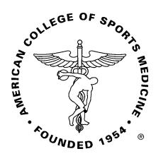

# Exercise and Fluid Replacement

#### SUMMARY

This Position Stand provides guidance on fluid replacement to sustain appropriate hydration of individuals performing physical activity. The goal of prehydrating is to start the activity euhydrated and with normal plasma electrolyte levels. Prehydrating with beverages, in addition to normal meals and fluid intake, should be initiated when needed at least several hours before the activity to enable fluid absorption and allow urine output to return to normal levels. The goal of drinking during exercise is to prevent excessive (92% body weight loss from water deficit) dehydration and excessive changes in electrolyte balance to avert compromised performance. Because there is considerable variability in sweating rates and sweat electrolyte content between individuals, customized fluid replacement programs are recommended. Individual sweat rates can be estimated by measuring body weight before and after exercise. During exercise, consuming beverages containing electrolytes and carbohydrates can provide benefits over water alone under certain circumstances. After exercise, the goal is to replace any fluid electrolyte deficit. The speed with which rehydration is needed and the magnitude of fluid electrolyte deficits will determine if an aggressive replacement program is merited.

# INTRODUCTION

People perform physical activity throughout a range of environmental conditions (temperature, humidity, sun, wind exposure). Depending upon the metabolic rate, environmental conditions and clothing worn, exercise can induce significant elevations in body (core and skin) temperatures. Body temperature elevations elicit heat loss responses of increased skin blood flow and increased sweat secretion (120,121). Sweat evaporation provides the primary avenue of heat loss during vigorous exercise in warm hot weather; therefore sweat losses can be substantial. Besides containing water, sweat contains electrolytes that are lost. If not appropriately replaced, water and electrolytes imbalances (dehydration and hyponatremia) can develop and adversely impact on the individuals exercise performance and perhaps health (27,72).

This Position Stand summarizes current knowledge regarding exercise with respect to fluid electrolyte needs and the impact of their imbalances on exercise performance and health. This position statement replaces the prior Position Stand on exercise and fluid replacement published in 1996 (39). The new Position Stand includes a Strength of Recommendation Taxonomy (SORT) to document the strength of evidence for each conclusion and recommendation (50). Table 1 provides a description of strength of evidence category employed, based on thequality, quantity and consistency of the evidence for each statement. Occasionally review papers have been cited, to reduce the number of references, which provide extensive documentation regarding supporting studies. Recommendations are provided for practical hydration assessment techniques and rehydration strategies for before, during and after exercise. It is recognized that considerable variability exists between individuals, different physical activities and environmental conditions regarding water electrolyte losses so that each person will need to customize these recommendations. Importantly, it is emphasized that during exercise individuals should avoid drinking more fluid than the amount needed to replace theirsweat losses.

Throughout this Position Stand, the term ''euhydration'' refers to ''normal'' body water content, while the terms ''hypohydration'' and ''hyperhydration'' refer to body water content deficits and excesses beyond the normal fluctuation in body water content, respectively. The term ''dehydration'' refers to the loss of body water. The hypohydration that occurs during exercise is usually characterized as hyperosmotic hypovolemia (because sweat is hypotonic to plasma), although iso osmotic hypovolemia can occur when taking some medications (e.g., diuretics) or exposure to cold and hypoxia. For simplicity, the term dehydration will be used to describe both the process of body water loss and hypohydration in this position statement, unless stated otherwise.

# FLUID AND ELECTROLYTE REQUIREMENTS Physical Activity and Individual Variability

Participation in physical activity exposes individuals to a variety of factors that influence sweat losses; these include the duration and intensity of exercise, the environmental

0195-9131/07/3902-0377/0

MEDICINE & SCIENCE IN SPORTS & EXERCISE

This pronouncement was written for the American College of Sports Medicine by Michael N. Sawka, FACSM (chair); Louise M. Burke, FACSM, E. Randy Eichner, FACSM, Ronald J. Maughan, FACSM, Scott J. Montain, FACSM, Nina S. Stachenfeld, FACSM.

POSITION STAND

conditions and the type of clothing/equipment worn. Sometimes, these factors are standardized for a specific activity or event within a sport (e.g., the temperature of an air conditioned indoor stadium or the uniform worn by a sporting team). In other cases, these factors occur in a predictable manner (e.g., running speeds in a 10,000 m race are higher than in a marathon, Nordic skiing, and other outdoor winter sports are undertaken in colder environments than summer sports). Nevertheless, in most activities, there is considerable variability in exposure to the factors that contribute to sweat rates between participants.

Individual characteristics, such as body weight (11), genetic predisposition, heat acclimatization state (120), and metabolic efficiency (economy at undertaking a specific exercise task) will influence sweat rates for a given activity. As a result, there is a large range in sweat rates and total sweat losses of individuals between and within activities, and in some cases even in the same event on a given day. For example, elite marathon runners may have higher sweating rates but similar total sweat losses (run for shorter duration) as recreational runners who finish the race at the rear of the field. In a soccer match, sweat rates will vary between players according to their position and playing style as well as the total time spent on the field (130). Likewise, American football players (large body mass and wearing protective clothing) will have markedly greater daily sweat losses (~8.8 LIdj1 ) than cross country runners (~3.5 LIdj1 ) training in the same hot environmental for the same duration (62).

Table 2 summarizes sweat rates observed among serious competitors across a range of sports, both in training and in competition (14–16,18,21,22,41,62,89,130,133). These data show that individuals often achieve sweating rates from 0.5 to 2.0 LIhj1 . The differences in sweat rates between individuals, different sports and climatic season demonstrate the difficulties in providing a single one size fits all recommendation. Sweating rate differences between persons for a given event and environment are likely reduced when body size (body mass or surface area corrections) is considered, but marked individual differences still persist.

# Environment

Muscular contractions produce metabolic heat that is transferred from the active muscles to blood and then the body core. Subsequent body core temperature elevations elicit physiologic adjustments that facilitate heat transfer from within the body core to the skin where it can be dissipated to the environment. Heat exchange between the skin and the environment is governed by biophysical properties dictated by the surrounding temperature, humidity

TABLE 1. Strength of recommendation taxonomy.

| TABLE 1. Strength | of recommendation | taxonomy.          |              |              |                |
|-------------------|-------------------|--------------------|--------------|--------------|----------------|
| Strength of       |                   |                    |              |              |                |
| Recommendation    |                   |                    | Definition   |              |                |
| A                 | Recommendation    | based              | on           | consistent   | and good       |
|                   | quality           | experimental       |              | evidence     | (morbidity,    |
|                   | mortality,        | exercise           | and          | cognitive    | performance,   |
|                   | physiologic       | responses).        |              |              |                |
| B                 | Recommendation    | based              | on           | inconsistent | or             |
|                   | limited           | quality            | experimental |              | evidence.      |
| C                 | Recommendation    | based              | on           | consensus,   | usual          |
|                   | practice,         | opinion,           | disease      | oriented     | evidence,*     |
|                   | case              | series or studies  | of           | diagnosis,   | treatment,     |
|                   | prevention,       | or                 | screening,   | or           | extrapolations |
|                   | from              | quasi experimental |              | research.    |                |

\* Patient oriented evidence measures outcomes that matter to patients: morbidity, mortality, symptom improvement, cost reduction, and quality of life. Disease oriented evidence measures intermediate, physiologic, or surrogate end points that may or may not reflect improvements in patient outcomes (e.g., blood pressure, blood chemistry, physiologic function, pathologic findings).

TABLE 2. Observations of sweat rates, voluntary fluid intake and levels of dehydration in various sports. Values are mean, plus (range) or [95% reference range].

|               |                  |              |             |            | Sweat | rate (L I h j 1 |           |              |               |               |
|---------------|------------------|--------------|-------------|------------|-------|-----------------|-----------|--------------|---------------|---------------|
|               |                  |              |             |            |       |                 | Voluntary | fluid intake |               |               |
|               |                  |              |             |            |       |                 |           | (L I h j 1   |               |               |
|               |                  |              |             |            |       |                 |           |              | Dehydration   | (% BM)        |
|               |                  |              |             |            |       |                 |           |              | (= change     | in BM)        |
| Sport         |                  |              | Condition   |            | Mean  | Range           | Mean      | Range        | Mean          | Range         |
| Waterpolo     | [41]             | Training     | (males)     |            | 0.29  | [0.23–0.35]     | 0.14      | [0.09–0.20]  | 0.26          | [0.19–0.34]   |
|               |                  | Competition  | (males)     |            | 0.79  | [0.69–0.88]     | 0.38      | [0.30–0.47]  | 0.35          | [0.23–0.46]   |
| Netball       | [16]             | Summer       | training    | (females)  | 0.72  | [0.45–0.99]     | 0.44      | [0.25–0.63]  | 0.7           | [+0.3–1.7]    |
|               |                  | Summer       | competition | (females)  | 0.98  | [0.45–1.49]     | 0.52      | [0.33–0.71]  | 0.9           | [0.1–1.9]     |
| Swimming      | [41]             | Training     | (males      | & females) | 0.37  |                 | 0.38      |              | 0             | (+1.0–1.4 kg) |
| Rowing        | [22]             | Summer       | training    | (males)    | 1.98  | (0.99–2.92)     | 0.96      | (0.41–1.49)  | 1.7           | (0.5–3.2)     |
|               |                  | Summer       | training    | (females)  | 1.39  | (0.74–2.34)     | 0.78      | (0.29–1.39)  | 1.2           | (0–1.8)       |
| Basketball    | [16]             | Summer       | training    | (males)    | 1.37  | [0.9–1.84]      | 0.80      | [0.35–1.25]  | 1.0           | [0–2.0]       |
|               |                  | Summer       | competition | (males)    | 1.6   | [1.23–1.97]     | 1.08      | [0.46–1.70]  | 0.9           | [0.2–1.6]     |
| Soccer        | [130]            | Summer       | training    | (males)    | 1.46  | [0.99–1.93]     | 0.65      | (0.16–1.15)  | 1.59          | [0.4–2.8]     |
| Soccer        | [89]             | Winter       | training    | (males)    | 1.13  | (0.71–1.77)     | 0.28      | (0.03–0.63)  | 1.62          | [0.87–2.55]   |
| American      | football [62]    | Summer       | training    | (males)    | 2.14  | [1.1–3.18]      | 1.42      | [0.57–2.54]  | 1.7 kg (1.5%) | [0.1–3.5 kg]  |
| Tennis        | [15]             | Summer       | competition | (males)    | 1.6   | [0.62–2.58]     | ~1.1      |              | 1.3           | [+0.3–2.9]    |
|               |                  | Summer       | competition | (females)  |       | [0.56–1.34]     | ~0.9      |              | 0.7           | [+0.9–2.3]    |
| Tennis        | [14]             | Summer       | competition |            |       |                 |           |              |               |               |
|               |                  | (cramp–prone |             | males)     |       |                 |           |              |               |               |
|               |                  |              |             |            | 2.60  | [1.79–3.41]     | 1.6       | [0.80–2.40]  |               |               |
| Squash        | [18]             | Competition  | (males)     |            | 2.37  | [1.49–3.25]     | 0.98      |              | 1.28 kg       | [0.1–2.4 kg]  |
| Half          | marathon running | [21] Winter  | competition | (males)    | 1.49  | [0.75–2.23]     | 0.15      | [0.03–0.27]  | 2.42          | [1.30–3.6]    |
| Cross–country | running          | [62] Summer  | training    | (males)    | 1.77  | [0.99–2.55]     | 0.57      | [0–1.3]      | ~1.8          |               |
| Ironman       | triathlon [133]  | Temperate    | competition |            |       |                 |           |              |               |               |
|               |                  | (males       | & females]  |            |       |                 |           |              |               |               |
|               |                  | Swim         | leg         |            |       |                 |           |              | 1 kg          | (+0.5–2.0 kg) |
|               |                  | Bike         | leg         |            | 0.81  | (0.47–1.08)     | 0.89      | (0.60–1.31)  | +0.5 kg       | (+3.0–1.0 kg) |
|               |                  | Run          | leg         |            | 1.02  | (0.4–1.8)       | 0.63      | (0.24–1.13)  | 2 kg          | (+1.5–3.5 kg) |
|               |                  | Total        | race        |            |       |                 | 0.71      | (0.42–0.97)  | 3.5%          | (+2.5–6.1 %)  |

+ = gain in BM; ^not corrected for change in BM that occurs in very prolonged events due to factors other than fluid loss (e.g. metabolic fuel losses).

and air motion, sky and ground radiation, and clothing (61). In temperate and cooler environments, the high capacity for dry heat loss (radiation and convection) reduces evaporative cooling requirements, so sweat losses are relatively small. As the environmental heat stress increases, there is a greater dependence on sweating for evaporative cooling. The wearing of heavy or impermeable clothing, such as a football uniform, greatly increases the heat stress (90) and evaporative cooling requirements while exercising in temperate to hot environments. Likewise, wearing heavy or impermeable clothing while exercising in cold weather can elicit unexpectedly high sweat rates (59).

The following calculations give the minimal sweating rate needed to provide evaporative cooling for persons performing high (e.g., metabolic rate ~1000 W) intensity exercise in hot weather. If the exercise task is 20% efficient, then 80% of metabolic energy is converted to heat in the body. Therefore, high intensity exercise will require ~800 W (0.8 kJIs j1 or 48 kJIminj1 or 11.46 kcalIminj1 ) of metabolic energy to be dissipated to avoid heat storage. Since the latent heat of evaporation is 2.43 kJIgj1 (0.58 kcalIgj1 ), the individual will need to evaporate ~20 gIminj1 (48 kJIminj1 2.43 kJIgj1 or 11.46 kcalIminj1 0.58 kcalIgj1 ) or ~1.2 LIhj1 . If the environment is cooler and allows greater dry heat loss the required sweating rates would be lower. If secreted sweat drips from the body and is not evaporated, higher sweating will be needed to achieve the evaporative cooling requirements (32,120). Conversely, increased air motion (wind, movement velocity) will facilitate evaporation and minimize wasted (dripping) sweat (32).

Heat acclimatization enhances an individual to achieve higher and more sustained sweating rates, if needed (120,121). Similarly, aerobic exercise training has a modest effect on enhancing sweating rate responses (120,121). Other factors, such as wet skin (e.g., from high humidity) and dehydration can act to suppress the sweating rate response (120).

Sweat electrolyte losses depend on the total sweat losses and sweat electrolyte concentrations. Sweat sodium concentration averages ~35 mEqILj1 (range 10–70 mEqILj1 ) and varies depending upon genetic predisposition, diet, sweating rate, and heat acclimatization state (3,17,40,60,130,144). Sweat concentrations of potassium averages 5 mEqILj1 (range 3–15 mEqILj1 ) , calcium averages 1 mEqILj1 (range 0.3–2 mEqILj1 ), magnesium average 0.8 mEqILj1 (range 0.2–1.5 mEqILj1 ), and chloride averages 30 mEqILj1 (range 5–60 mEqILj1 ) (17). Neither sex, maturation, or aging appear to have marked effects on sweat electrolyte concentrations (92,99); although dehydration can increase the sweat concentrations of sodium and chloride (98). Sweat glands reabsorb sodium and chloride, but the ability to reabsorb these electrolytes does not increase proportionally with the sweating rate. As a result, the concentration of sweat sodium and chloride increases as a function of sweating rate (3,40). Heat acclimatization improves the ability to reabsorb sodium and chloride, thus heat acclimatized individuals usually have lower sweat sodium concentrations (e.g., 950% reduction) for any given sweating rate (3).

Evidence statement. Exercise can elicit high sweat rates and substantial water and electrolyte losses during sustained exercise, particularly in warm-hot weather. Evidence Category A. There is considerable variability for water and electrolyte losses between individuals and between different activities. Evidence Category A. If sweat water and electrolyte losses are not replaced, then the person will dehydrate. Evidence Category A.

# HYDRATION ASSESSMENT

Daily water balance depends on the net difference between water gain and water loss (72). Water gain occurs from consumption (liquids and food) and production (metabolic water), while water losses occur from respiratory, gastrointestinal, renal, and sweat losses. The volume of metabolic water produced during cellular metabolism (~0.13 gIkcalj1 ) is approximately equal to respiratory water losses (~0.12 gIkcalj1 ) (38,93), so this results in water turnover with no net change in total body water. Gastrointestinal tract losses are small (~100–200 mLIdj1 ) unless the individual has diarrhea. Sweating provides the primary avenue of water loss during exercise-heat stress. The kidneys regulate water balance by adjusting urine output, with minimum and maximum urine outputs of approximately 20 and 1000 mLIhj1 , respectively (72). During exercise and heat stress, both glomerular filtration and renal blood flow are markedly reduced, resulting in decreased urine output (150). Therefore, when fluids are over consumed during exercise (hyperhydration), there may be a reduced ability to produce urine to excrete the excess volume. With intermittent activities these effects may not be as strong on reducing urine production.

Over a protracted period (e.g., 8–24 h), if adequate fluid and electrolytes are consumed, the water losses will usually be fully replaced to reestablish the ''normal'' total body water (TBW) (72). TBW is regulated within T 0.2 to 0.5% of daily body mass (1,31). TBW averages ~60% of body mass, with a range from approximately 45 to 75% (72). These differences are primarily due to body composition; fat-free mass is ~70 to 80% water, while adipose tissue is ~10% water (72). These water content relationships are independent of age, sex and race (72). Therefore, an average 70-kg person has approximately 42 L of total body water, with a range of 31–51 L (72). Trained athletes have relatively high TBW values by virtue of having a high muscle mass and low body fat and a small aerobic training effect. Additionally, individuals who glycogen load may experience a small increase in TBW, but this is not always observed (151). Furthermore, the surplus water associated with typical muscle glycogen increases is minor (~200 mL) when considering the small absolute muscle mass involved and assuming 3 mL water per gram glycogen (itself inconclusive) (126). The precise fate of water liberated as glycogen is utilized is unknown, but the fact that any water bound to glycogen is part of the starting TBW pool suggests it is of little potential consequence to fluid intake recommendations.

When assessing an individual`s hydration status, there is no one TBW that represents euhydration, and determinations need to be made of body water fluctuations beyond a range that have functional consequences (72). Ideally, the hydration biomarker should be sensitive and accurate enough to detect body water fluctuations of ~3% of TBW (or water content change sufficient to detect fluctuations of ~2% body weight for the average person). In addition, the biomarker should also be practical (time, cost, and technical expertise) to be used by individuals and coaches.

Table 3 provides an assessment of a variety of hydration biomarkers (72,94). Dilution methods of TBW with plasma osmolality measurements provide the most valid and precise measures of body hydration status (72,114), but are not practical for use by most persons. Other complex biomarkers such as plasma volume, fluid regulatory hormones, and bioelectrical impedance measures are easily confounded and/or not valid (72). Individuals can determine their hydration status by using several simple biomarkers (urine and body weight) that by themselves have marked limitations; but when these indicators are used together in the proper context, they can provide valuable insight.

The use of first morning body weight measurement after voiding, in combination with a measure of urine concentration should allow sufficient sensitivity (low false negative) to detect deviations in fluid balance. Urine biomarkers of hydration status can allow discrimination of whether an individual is euhydrated or dehydrated (6,111,127). Urine specific gravity (USG) and osmolality (UOsmol) are quantifiable, whereas urine color and urine volume are often subjective and might be confounded. USG of e 1.020 is indicative of being euhydrated (6,12,111). UOsmol is more variable, but values e 700 mOsmolIkgj1 are indicative of being euhydrated (6,111,127).

Urine values can provide misleading information regarding hydration status if obtained during rehydration periods. For example, if dehydrated persons consume large volumes of hypotonic fluids, they will have copious urine production long before euhydration is reestablished (131). Urine samples collected during this period will be light in color and have USG and UOsmol values that reflect euhydration when in fact the person remains dehydrated. This emphasizes the need to use either first morning urine samples, or samples after several hours of stable hydration status, to allow valid discrimination between euhydration and dehydration.

Body weight (BW) measurements provide another simple and effective tool to assess fluid balance (31,34). For well-hydrated persons, who are in energy balance, a first morning (after urinating) nude BW will be stable and fluctuate by G1% (1,31,64,65). At least three consecutive morning nude BW measurements should be made to establish a baseline value, which approximates euhydration, in active men consuming food and fluid ad libitum (31). Women may need more BW measurements to establish a baseline value, because their menstrual cycle influences body water status. For example, luteal phases can increase body water and BW by 92 kg (20). Lastly, first morning BW is influenced by changes in eating and bowel habits.

Acute changes in BW during exercise can be used to calculate sweating rates and perturbations in hydration status that occur in different environments (1,34). This approach assumes that 1 mL of sweat loss represents a 1-g loss in body weight (i.e., specific gravity of sweat is 1.0 gImLj1 ). The before-exercise BW measures are used with the postexercise BW corrected for urine losses and drink volume. When possible, nude weights should be used to avoid corrections for sweat trapped in the clothing (34). Other nonsweat factors contributing to BW loss during exercise include respiratory water and carbon exchange (93). Ignoring those two factors will over estimate sweat rate modestly (~5–15%) but generally do not require correction for exercise durations G3 h (34). If proper controls are made, BW changes can provide a sensitive estimate of acute TBW changes to access hydration changes during exercise.

Evidence statement. Individuals can monitor their hydration status by employing simple urine and body weight measurements. Evidence Category B. An individual with a first morning USG e 1.020 or UOsmol e 700 mOsmolIkgj1 can be considered as euhydrated. Evidence Category B. Several days of first morning body weights can be used to establish base-line body weights that represent euhydration. Evidence Category B. Body weight changes can reflect sweat losses during exercise and can be used to calculate individual fluid replacement needs for specific exercise and environmental conditions. Evidence Category A.

# HYDRATION EFFECTS

#### Physiology and Performance

Individuals can become dehydrated while performing physical activity (Table 2), and prior to emphasis on rehydration during exercise, larger fluid deficits may have been more common (23,101,149). Individuals often start an exercise task with normal total body water and dehydrate over an extended duration; however, in some sports the person might initiate the exercise task dehydrated such as when the interval between exercise sessions is inadequate for full rehydration or when initial body weight is an issue. For example, in weight-class sports (e.g., boxing, power lifting, wrestling) individuals may purposely dehydrate to compete in lower weight classes (36). In addition, some individuals undertaking twice a day training, or prolonged daily sessions of exercise in hot conditions, may also carry a fluid deficit from their previous workout into the

TABLE 3. Biomarkers of hydration status.

| Measure                | Practicality |                     |                    |
|------------------------|--------------|---------------------|--------------------|
|                        |              | Validity (Acute vs. |                    |
|                        |              | Chronic changes)    |                    |
| TBW                    | Low          | Acute and Chronic   | G 2%               |
| Plasma Osmolality      | Medium       | Acute and Chronic   | G 290 mOsmol       |
| Urine Specific Gravity | High         | Chronic             | G 1.020 g I mL j 1 |
| Urine Osmolality       | High         | Chronic             | G 700 mOsmol       |
| Body Weight            | High         | Acute and Chronic*  | G 1%               |

EUH = euhydration; \* = potentially confounded by changes in body composition during very prolonged assessment periods.

next (62). Finally, individuals medicated with diuretics may be dehydrated prior to initiating exercise. Water deficit without proportionate sodium chloride loss is the most commonly seen form of dehydration during exercise in the heat (118). If large sodium chloride deficits occur during exercise then the extracellular fluid volume will contract and cause ''salt depletion dehydration.'' Regardless of the dehydration method, for any water deficit, there is similarity in altered physiologic function and performance consequences (118).

Dehydration increases physiologic strain as measured by core temperature, heart rate and perceived exertion responses during exercise-heat stress (118). The greater the body water deficit, the greater the increase in physiologic strain for a given exercise task (2,96,97,122). Dehydration 92% BW degrades aerobic exercise and cognitive/mental performance in temperate-warm-hot environments (27,33,72). Greater levels of dehydration will further degrade aerobic exercise performance (72). The critical water deficit (92% BW for most individuals) and the magnitude of performance decrement are likely related to the environmental temperature, exercise task, and the individual`s unique biological characteristics (e.g., tolerance to dehydration). Therefore, some individuals will be more or less tolerant to dehydration. Dehydration (3% BW) has marginal influence on degrading aerobic exercise performance when cold stress is present (29). Dehydration (3–5% BW) probably does not degrade either muscular strength (54,68,72) or anaerobic performance (30,72,74).

Physiologic factors that contribute to dehydration-mediated aerobic exercise performance decrements include increased body core temperature, increased cardiovascular strain, increased glycogen utilization, altered metabolic function, and perhaps altered central nervous system function (106,118,121). Though each factor is unique, evidence suggests that they interact to contribute in concert, rather than in isolation, to degrade aerobic exercise performance (32,118,121). The relative contribution of each factor may differ depending on the specific activity, environmental conditions, heat acclimatization status and athlete prowess, but elevated hyperthermia probably acts to accentuate the performance decrement. Cognitive/mental performance, which is important where concentration, skilled tasks and tactical issues are involved, is also degraded by dehydration and hyperthermia (69,116). The evidence is stronger for a negative effect of hyperthermia than that of mild dehydration on degrading cognitive/mental performance (35), but the two are closely linked when performing exercise in warm-hot weather.

Hyperhydration can be achieved by overdrinking combined with an agent that ''binds'' water within the body (58,66). These binding agents include glycerol and hypertonic drinks that can induce hyperhydration for varied durations. Simple overdrinking will usually stimulate urine production (72) and body water will rapidly return to euhydration within several hours (58,107,128); however, as previously discussed this compensatory mechanism (urine production) is less effective during exercise and there is a risk of dilutional hyponatremia (150). Likewise, over consumption of fluids with most hyperhydration binding agents will still elevate urine output well above normal levels. Hyperhydration does not provide any thermoregulatory advantages (80), but can delay the onset of dehydration (79), which may be responsible for any small performance benefits that are occasionally reported (67,77).

Evidence statement. Dehydration increases physiologic strain and perceived effort to perform the same exercise task, and this is accentuated in warm-hot weather. Evidence Category A. Dehydration (92% BW) can degrade aerobic exercise performance, especially in warm-hot weather. Evidence Category A. The greater the dehydration level the greater the physiologic strain and aerobic exercise performance decrement. Evidence Category B. Dehydration (92% BW) might degrade mental/cognitive performance. Evidence Category B. Dehydration (3% BW) has marginal influence on degrading aerobic exercise performance when cold stress is present. Evidence Category B. Dehydration (3–5% BW) does not degrade either anaerobic performance or muscular strength. Evidence Categories A and B. The critical water deficit and the magnitude of exercise performance degradation are related to the heat stress, exercise task, and the individual`s unique biological characteristics. Evidence Category C. Hyperhydration agents can be achieved by several methods, but provides equivocal benefits and has several disadvantages. Evidence Category B.

#### Health

Health problems in individuals can result from dehydration or overdrinking (consuming volumes greater than sweat losses). In general, dehydration is more common, but overdrinking-with symptomatic hyponatremia-is more dangerous. Dehydration can impair exercise performance and contribute to serious heat illness, and exacerbate symptomatic exertional rhabdomyolysis; while exercise-associated hyponatremia can produce grave illness or death.

Heat illnesses. Dehydration increases the risk for heat exhaustion (2,91,123) and is a risk factor for heat stroke (25,53,63,113). Heat stroke is also associated with other factors as lack of heat acclimatization, medications, genetic predisposition, and illness (25,51). Dehydration was present in ~17% of all heat stroke hospitalizations in the U.S. Army over a 22-yr period (25). In a series of 82 cases of heat stroke in Israeli soldiers, dehydration was present in ~16% of the cases (53). Consistent with this association, team physicians providing medical support for American football players during summer practice have observed that dehydration-sometimes aggravated by vomiting-is associated with the development of heat stroke (51,115). In addition, dehydration has been associated with reduced autonomic cardiac stability (26), altered intracranial volume (47) and reduced cerebral blood flow velocity responses to orthostatic challenge (24).

Skeletal muscle cramps are believed associated with dehydration, electrolyte deficits and muscle fatigue, and they are common in non-heat-acclimatized American football players (early summer practice sessions), tennis matches, long cycling races, late in tropical triathlons, soccer and beach volleyball. Muscle cramps can also occur in winter activities-in cross-country ski-racers and icehockey goalies. Persons susceptible to muscle cramps are believed to be often profuse sweaters with large sweat sodium losses (14,141). Triathlon athletes experiencing muscle cramps, however, have been reported to not have clinically significant different serum electrolyte concentrations than counterparts without cramps (142).

Rhabdomyolysis. Rhabdomyolysis (syndrome causing release of skeletal muscle contents) is most often observed with novel, strenuous, overexertion and clinical evidence suggests that dehydration can increase the consequences of rhabdomyolysis. For example, it appears that dehydration increases the likelihood or severity of acute renal failure associated with rhabdomyolysis (19,124). Among U.S. soldiers who were hospitalized for serious heat illness, and thus likely experienced large fluid and electrolyte fluxes, 25% had rhabdomyolysis and 13% had acute renal failure (25).

A cluster of exertional rhabdomyolysis cases provides evidence that dehydration, combined with heat stress and novel training, can induce serious health problems. In 1988, at a Massachusetts State Police training academy, 50 cadets performed numerous calisthenics and running drills in hot weather during the first days of training, with limited water intake (63). One cadet who collapsed from exertional heat stroke while running, was hospitalized and required dialysis for acute renal failure caused by rhabdomyolysis. He later died from the complications of heat stroke, rhabdomyolysis, renal failure, and hepatic failure. Thirteen other cadets were hospitalized for severe dehydration, rhabdomyolysis, and acute renal insufficiency, and six were hemodialyzed for acute renal failure (63). In fact, all 50 cadets had some rhabdomyolysis (as defined by serum creatine kinase 910 times normal).

Exercise-associated hyponatremia. Exerciseassociated hyponatremia was first reported at the comrades marathon (45). Later, exercise-associated hyponatremia was reported in endurance runners (104), and since that time a number of participants from a variety of occupational and recreational activities have been hospitalized for this condition, with several having died (8,82,100,108). Symptomatic hyponatremia can occur when plasma sodium rapidly drops to ~130 mmolILj1 and below. The lower the plasma sodium falls, the faster it falls, and the longer it remains low, the greater the risk of dilutional encephalopathy and pulmonary edema. Some individuals have survived plasma sodium levels as low as 109 mmolILj1 and others have died with initial (in hospital) levels over 120 mmolILj1 . With plasma sodium G125 mmolILj1 and falling, symptoms become increasingly severe and include headache, vomiting, swollen hands and feet, restlessness, undue fatigue, confusion and disorientation (due to progressive encephalopathy), and wheezy breathing (due to pulmonary edema). When plasma sodium falls well below 120 mmolILj1 , the chances increase for severe

cerebral edema with seizure, coma, brainstem herniation, respiratory arrest, and death (100).

Contributing factors to exercise-associated hyponatremia include overdrinking of hypotonic fluids and excessive loss of total body sodium (95). In marathoners, symptomatic hyponatremia is more likely to occur in smaller and less lean individuals who run slowly, sweat less, and drink heavily-water and other hypotonic fluids-before, during, and after the race (4,46,71). In tropical triathlons (e.g., Kona, HI), some participants may have been both dehydrated and hyponatremic based upon clinical observations (109). Individuals with genes for cystic fibrosis may be prone to salt depletion and exercise-associated hyponatremia (132). In general, symptomatic hyponatremia in events that last G4 h is from overdrinking before, during and sometimes even after the event (95). In longer ultraendurance events, sodium losses can induce hyponatremia to levels associated with the onset of symptoms regardless if the individual is over- or underdrinking, so replacing some of the sodium losses is warranted.

Exercise-associated hyponatremia occurs occasionally in American football and tennis players who drink too much water to treat or try to prevent heat cramps, or when a cramping player is given hypotonic fluid intravenously (48,70). Consistent with this, hyponatremia hospitalizations have been associated with soldiers who were misdiagnosed as suffering from dehydration (similar symptoms such as light headedness, fatigue) and subsequently directed to drink large volumes of water (108).

Evidence statement. Dehydration is a risk factor for both heat exhaustion and exertional heat stroke. Evidence Categories A and B. Dehydration can increase the likelihood or severity of acute renal failure consequent to exertional rhabdomyolysis. Evidence Category B. Dehydration and sodium deficits are associated with skeletal muscle cramps. Evidence Category C. Symptomatic exercise-associated hyponatremia can occur in endurance events. Evidence Category A. Fluid consumption that exceeds sweating rate is the primary factor leading to exercise-associated hyponatremia. Evidence Category A. Large sweat sodium losses and small body mass (and total body water) can contribute to the exercise-associated hyponatremia. Evidence Category B.

# MODIFYING FACTORS

#### Sex

Women typically have lower sweating rates and electrolyte losses than men (7,119,125). The lower sweating rates are primarily because they have smaller body size and lower metabolic rates when performing a given exercise task. In addition, women seem to have less wasted sweat when their skin is wet (125).

Sex differences in renal water and electrolyte retention are subtle and probably not of consequence. The diuretic response to a water load can be greater in women than men, suggesting that women turn water over more quickly than men (37). Women show reduced arginine vasopressin (AVP) responses to osmotic stimuli, which should result in elevated renal water and electrolyte losses (140). Paradoxically, within women, both endogenous estrogens and exogenously administered estrogens appear to increase AVP release and both estrogens and progesterone enhance renal water and electrolyte retention (136,137,139).

Women appear to be at greater risk than men to develop symptomatic hyponatremia when competing in marathon and ultra marathon races (4,71). While the explanation for this increased risk may be due to a number of biological and psychosocial factors, the cause for greater risk for hyponatremia has not been established with certainty. Previous information regarding fluid intake available to women have often been based on sweat loss data obtained from men, and as such, are too high for women and may have led to accentuated sodium dilution due to their smaller total body water (103,134). This position statement provides some sweat rate data obtained directly from women (Table 2).

Although the kidney is important in the pathogenesis of hyponatremia, the target organs for morbidity and mortality are the brain and lungs. Studies to directly address the possible mechanisms for sex differences in how the brain handles water/electrolyte imbalances cannot be performed in humans. During AVP-induced hyponatremia, animal studies have shown significantly greater sodium transport in the male rat versus the female rat brain, suggesting impairment of the Na+ -K+ -ATPase pump activity in the female brain (56,57). Therefore, this might aggravate hyponatremia induced cerebral edema. Likewise, sex hormones have been suggested to impair Na+ -K+ -ATPase pump activity in the female brain and account for women having increased morbidity and mortality from postoperative hyponatremia (55).

Evidence statement. Women generally have lower sweating rates than men. Evidence Category A. Sex differences in renal water and electrolyte retention are subtle and probably not of consequence. Evidence Category B. Women are at greater risk than men to develop exercise-associated symptomatic hyponatremia. Evidence Category C.

#### Age

Older (ages 965 yr) persons are generally adequately hydrated (72). However, there is an age-related blunting of thirst response to water deprivation (81,86,117), making older persons more susceptible to becoming dehydrated (81). Older adults have an age-related increase in resting plasma osmolality and are slower to restore body fluid homeostasis in response to water deprivation (110) and exercise (86) than younger adults. If given sufficient time and access to water and sodium, older adults will adequately restore body fluids, indicating appropriate, albeit sluggish, control of body fluids (84,86). Older persons are also slower to excrete water following fluid loads (83,86,135,138,143). This slower water and sodium excretion increases sodium retention and can lead to increases in blood pressure (84). Most, but not all, of the age related slower responses to water or saline loads or dehydration can be attributed to the lower glomerular filtration rate (83), due to a progressive fall in the number of functioning nephrons (49).

While thirst sensitivity to a given extracellular fluid loss is reduced in older adults, osmoreceptor signaling remains intact (86,135,138). The osmotic and volume stimuli that results from dehydrating, impart important drives for thirst and drinking in older adults (9). Thus, older adults should be encouraged to rehydrate during or after exercise, but they should also consider the risks of excess water (i.e., hyponatremia) or sodium ingestion (i.e., hypertension) because they may be slower to excrete both the water and electrolytes.

Prepubescent children have lower sweating rates than adults, and with values rarely exceeding 400 mLIhj1 (10,92). These lower sweating rates are probably the result of smaller body mass and thus lower metabolic rate. Sweat electrolyte content is similar or slightly lower in children than adults (10).

Evidence statement. Older adults have age-related decreased thirst sensitivity when dehydrated making them slower to voluntary reestablish euhydration. Evidence Category A. Older adults have age-related slower renal responses to water and sodium loads and may be at greater risk for hyponatremia Evidence Categories A and C. Children have lower sweating rates than adults. Evidence Category B.

#### Diet

Meal consumption is critical to ensure full hydration on a day-to-day basis (1,2,72,131). Eating food promotes fluid intake and retention (72). Sweat electrolyte (e.g., sodium and potassium) losses need to be replaced to reestablish total body water and this can be accomplished during meals with most persons (85,105,128). Diet macronutrient composition has a minor influence on urine losses during rest and probably has even a smaller influence during exercise (72). Therefore, diet macronutrient composition does not measurably alter daily fluid needs for individuals (72).

Caffeine is contained in many beverages and foods and recent evidence suggests if consumed in relatively small doses (G180 mgIdj1 ) it will likely not increase daily urine output or cause dehydration (5,72). The influence of caffeine consumption on urine output during exercise or in dehydrated individuals is not well documented, but urine production is already decreased by dehydration, exercise and heat stress (72,150). Therefore, it is doubtful that caffeine consumption during exercise would elevate urine output and induce dehydration during exercise. Since alcohol can act as a diuretic (particularly at high doses) and increase urine output, it should be consumed in moderation, particularly during the postexercise period when rehydration is a goal (129).

Evidence statement. Meal consumption promotes euhydration. Evidence Category A. Sweat electrolyte (sodium and potassium) losses should be fully replaced to reestablish euhydration. Evidence Category A. Caffeine consumption will not markedly alter daily urine output or hydration status. Evidence Category B. Alcohol consumption can increase urine output and delay full rehydration. Evidence Category B.

# FLUID REPLACEMENT

#### Before Exercise

The goal of prehydrating is to start the physical activity euhydrated and with normal plasma electrolyte levels. If sufficient beverages are consumed with meals and a protracted recovery period (8–12 h) has elapsed since the last exercise session, then the person should already be close to being euhydrated (72). However, if the person has suffered substantial fluid deficits and has not had adequate time or fluids/electrolytes volumes to reestablish euhydration, then an aggressive prehydration program may be merited. The prehydration program will help ensure that any previously incurred fluid-electrolyte deficit is corrected prior to initiating the exercise task.

When hydrating prior to exercise the individual should slowly drink beverages (for example, ~5–7 mLIkgj1 per body weight) at least 4 h before the exercise task. If the individual does not produce urine, or the urine is dark or highly concentrated, s/he should slowly drink more beverage (for example, another ~3–5 mLIkgj1 ) about 2 h before the event. By hydrating several hours prior to exercise there is sufficient time for urine output to return towards normal before starting the event. Consuming beverages with sodium (20–50 mEqILj1 ) and/or small amounts of salted snacks or sodium-containing foods at meals will help to stimulate thirst and retain the consumed fluids (88,112,128).

Attempting to hyperhydrate with fluids that expand of the extra- and intracellular spaces (e.g., water and glycerol solutions) will greatly increase the risk of having to void during competition (58,107) and provides no clear physiologic or performance advantage over euhydration (77,79,80). In addition, hyperhydration can substantially dilute and lower plasma sodium (58,107) before starting exercise and therefore increase the risk of dilutional hyponatremia, if fluids are aggressively replaced during exercise (95).

Enhancing palatability of the ingested fluid is one way to help promote fluid consumption, before, during, or after exercise. Fluid palatability is influenced by several factors including temperature, sodium content and flavoring. The preferred water temperature is often between 15 and 21-C, but this and flavor preference varies greatly between individuals and cultures (52).

Recommendations. Prehydrating with beverages, if needed, should be initiated at least several hours before the exercise task to enable fluid absorption and allow urine output to return toward normal levels. Consuming beverages with sodium and/or salted snacks or small meals with beverages can help stimulate thirst and retain needed fluids.

#### During Exercise

The goal of drinking during exercise is to prevent excessive dehydration (92% BW loss from water deficit) and excessive changes in electrolyte balance to avert compromised exercise performance. The amount and rate of fluid replacement depends upon the individual sweating rate, exercise duration, and opportunities to drink. Individuals should periodically drink (as opportunities allow) during exercise, if it is expected they will become excessively dehydrated. Care should be taken in determining fluid replacement rates, particularly in prolonged exercise lasting greater than 3 h. The longer the exercise duration the greater the cumulative effects of slight mismatches between fluid needs and replacement, which can excessive dehydration or dilutional hyponatremia (95).

It is difficult to recommend a specific fluid and electrolyte replacement schedule because of different exercise tasks (metabolic requirements, duration, clothing, equipment), weather conditions, and other factors (e.g., genetic predisposition, heat acclimatization and training status) influencing a person`s sweating rate and sweat electrolyte concentrations. Table 4 provides approximate sweating rates for individuals of different sizes, running at different speeds in cool/temperate and warm weather conditions (95). These predicted sweating rates range from ~0.4 to ~1.8 LIhj1 and individual sweating rates for any of these conditions probably have a normal distribution with unknown variance. Therefore, it is recommended that individuals should monitor body weight changes during training/competition sessions to estimate their sweat lost during a particular exercise task with respect to the weather conditions. This allows customized fluid replacement programs to be developed for each person`s particular needs; however, this may not always be practical. Fluid and electrolyte replacement strategies will be vastly different for a large football player in early season summer practice when contrasted with a petite marathoner running at a 6-h pace.

A possible starting point suggested for marathon runners (who are euhydrated at the start) is they drink ad libitum from 0.4 to 0.8 LIhj1 , with the higher rates for faster, heavier individuals competing in warm environments and the lower rates for the slower, lighter persons competing in cooler environments (102). Table 5 provides the predicted body weight changes (from under- or overconsumption of fluids) during a 42-km marathon for persons of different sizes running at different speeds in cool/temperate weather. The analysis employed the sweating rates provided in

TABLE 4. Predicted sweating rates (LIhj1 ) for running 8.5 to 15 kmIhj1 in cool/ temperate (Tdb = 18-C) and warm weather (Tdb = 28-C).

| temperate Body Weight | (Tdb = 18 C) (kg) Climate | and warm weather 8.5 km I h j (~5.3 mph) | (Tdb = 28 1 10 km I h j (~6.3 mph) | C). 1 12.5 km I h (~7.9 mph) | j 1 15 km I h j 1 (~9.5 mph) |
|-----------------------|---------------------------|------------------------------------------|------------------------------------|------------------------------|------------------------------|
| 50                    | Cool/temperate            | 0.43                                     | 0.53                               | 0.69                         | 0.86                         |
|                       | Warm                      | 0.52                                     | 0.62                               | 0.79                         | 0.96                         |
| 70                    | Cool/temperate            | 0.65                                     | 0.79                               | 1.02                         | 1.25                         |
|                       | Warm                      | 0.75                                     | 0.89                               | 1.12                         | 1.36                         |
| 90                    | Cool/temperate            | 0.86                                     | 1.04                               | 1.34                         | 1.64                         |
|                       | Warm                      | 0.97                                     | 1.15                               | 1.46                         | 1.76                         |

Table 4 and three fluid replacement rates (0.4, 0.6, 0.8 LIhj1 ) (95). For smaller runners, drinking at 0.8 LIhj1 resulted in over-consumption (weight gain, light shaded areas), and for larger runners, drinking at 0.4 LIhj1 resulted in excessive dehydration (3% body weight loss, dark shaded areas). Clearly, this table demonstrates that it is inappropriate to use a single fluid replacement rate for all runners; however, the use of activity specific caveats can broaden the applicability of general guidance. For example, a mathematical analysis to estimate plasma sodium levels for the conditions in Table 5, predicted that if the above caveats for runner size, speed and environmental conditions are followed, the 0.4–0.8 LIhj1 guidelines are probably satisfactory for individuals participating in marathon length events (95). However, longer durations or different types of physical activity, more extreme weather and unique populations may have considerably different fluid replacement needs. For example, some American football players (often with very large body weights) wearing full equipment in hot weather are reported to have sweating losses of 98LIdj1 , these individuals will require much larger fluid volumes to maintain euhydration on a day to day basis compared to the runners Table 6.

The composition of the consumed fluids can be important. The Institute of Medicine provided general guidance for composition of ''sports beverages'' for persons performing prolonged physical activity in hot weather (73). They recommend that these types of fluid replacement beverages might contain ~20–30 meqILj1 sodium (chloride as the anion), ~2–5 meqILj1 potassium and ~5–10% carbohydrate (73). The need for these different components (carbohydrate and electrolytes) will depend on the specific exercise task (e.g., intensity and duration) and weather conditions. The sodium and potassium are to help replace sweat electrolyte losses, while sodium also helps to stimulate thirst, and carbohydrate provides energy. These components also can be consumed by nonfluid sources such as gels, energy bars, and other foods.

TABLE 5. Predicted percent body weight loss due to dehydration at end of 42-km marathon held in cool/temperate weather (dry bulb temperature = 18-C) for individuals of varying body weight drinking 400–800 mLIhj1 while running at 8.5–15 kmIhj1

| of varying Body Weight | body weight Fluid Intake (mL I h j 1 (kg) ) | drinking 8.5 (~5.3 | 400–800 km I h j mph) | mL I h 1 10 (~6.3 | while km I h j 1 mph) | running 12.5 (~7.9 | at km I h j mph) | 8.5–15 1 15 (~9.5 | km I h km I h j 1 mph) |
|------------------------|---------------------------------------------|--------------------|-----------------------|-------------------|-----------------------|--------------------|------------------|-------------------|------------------------|
| 50                     | 400                                         | j                  | 0.4                   | j                 | 1.1                   | j                  | 2.0              | j                 | 2.6                    |
|                        | 600                                         |                    | 1.6                   |                   | 0.6                   | j                  | 0.6              | j                 | 1.5                    |
|                        | 800                                         |                    | 3.6                   |                   | 2.2                   |                    | 0.7              | j                 | 0.3                    |
| 70                     | 400                                         | j                  | 1.8                   | j                 | 2.3                   | j                  | 3.0              | j                 | 3.4                    |
|                        | 600                                         | j                  | 0.4                   | j                 | 1.1                   | j                  | 2.0              | j                 | 2.6                    |
|                        | 800                                         |                    | 1.1                   |                   | 0.1                   | j                  | 1.0              | j                 | 1.8                    |
| 90                     | 400                                         | j                  | 2.6                   | j                 | 3.0                   | j                  | 3.5              | j                 | 3.9                    |
|                        | 600                                         | j                  | 1.5                   | j                 | 2.1                   | j                  | 2.8              | j                 | 3.2                    |
|                        | 800                                         | j                  | 0.4                   | j                 | 1.1                   | j                  | 2.0              | j                 | 2.6                    |

Italic values illustrate overdrinking relative to sweating rate and increased risk of hyponatremia. Bold values illustrate sufficient dehydration (3% was selected as next full percentage above 92% criteria provided in text) to compromise performance.

TABLE 6. American College of Sports Medicine exercise and fluid replacement Position Stand evidence statements.

| TABLE 6. American College of Sports | Medicine       |                     | exercise     | and                 | fluid         | replacement   |             | Position         | Stand               | evidence     |              | statements.  |                     |                               |                   |
|-------------------------------------|----------------|---------------------|--------------|---------------------|---------------|---------------|-------------|------------------|---------------------|--------------|--------------|--------------|---------------------|-------------------------------|-------------------|
| Section Heading                     |                |                     |              |                     |               |               |             | Evidence         |                     | Statement    |              |              |                     |                               | Evidence Category |
| Fluid & Electrolyte                 |                |                     |              |                     |               |               |             |                  |                     |              |              |              |                     |                               |                   |
|                                     | Exercise       | can elicit          | high         | sweat               | rates         | and           | substantial | water            | and                 | electrolyte  | losses       | during       | sustained           | exercise, particularly        |                   |
|                                     | in             | warm-hot            | weather.     |                     |               |               |             |                  |                     |              |              |              |                     |                               |                   |
| There                               | is             | considerable        |              | variability         | for           | water         | and         | electrolyte      | losses              |              | between      | individuals  | and                 | between different activities. | A                 |
| If                                  | sweat          | water               | and          | electrolyte         | losses        | are           | not         | replaced         | then the            | person       | will         | dehydrate.   |                     |                               | A                 |
| Hydration Assessment                | Individuals    | can                 | monitor      | their               | hydration     |               | status by   | employing        |                     | simple       | urine        | and body     | weight              | measurements.                 | B                 |
| A                                   | person         | with a              | first        | morning             | USG           | e 1.020       | or          | UOsmol           | e 700               | mOsmol       | I kg j       | 1 can        | be considered       | as euhydrated.                | B                 |
|                                     | Several        | days of             | first        | morning             | body          | weight        | values      | can              | be used             | to           | establish    | base-line    | body                | weights that                  |                   |
|                                     | represent      |                     | euhydration. |                     |               |               |             |                  |                     |              |              |              |                     |                               |                   |
| Body                                | weight         |                     | changes      | can                 | reflect       | sweat         | losses      | during           | exercise            | and          | can be       | used to      | calculate           | individual fluid              |                   |
|                                     | replacement    |                     | needs        | for                 | specific      | exercise      | and         | environmental    |                     |              | conditions.  |              |                     |                               |                   |
| Hydration Effects                   | Dehydration    |                     | increases    | physiologic         |               | strain        | and         | perceived        | effort              | to           | perform the  | same         | exercise            | task, and is accentuated      |                   |
|                                     | in             | warm-hot            | weather.     |                     |               |               |             |                  |                     |              |              |              |                     |                               |                   |
|                                     | Dehydration    | ( 9                 | 2% BW)       | can                 | degrade       | aerobic       |             | exercise         | performance,        |              | especially   | in           | warm-hot            | weather.                      | A                 |
| The                                 | greater        | the                 | dehydration  |                     | level         | the greater   | the         | physiologic      |                     | strain       | and          | aerobic      | exercise            | performance decrement.        | B                 |
|                                     | Dehydration    | ( 9                 | 2% BW)       | might               |               | degrade       | mental /    | cognitive        |                     | performance. |              |              |                     |                               | B                 |
|                                     | Dehydration    | (3%                 | BW)          | has                 | marginal      | influence     | on          | degrading        |                     | aerobic      | exercise     |              | performance         | when cold                     |                   |
|                                     | stress         | is                  | present.     |                     |               |               |             |                  |                     |              |              |              |                     |                               |                   |
|                                     | Dehydration    |                     | (3–5% BW)    | does                | not           | degrade       | either      | anaerobic        |                     | performance  | or           | muscular     | strength.           |                               | A & B             |
| The                                 | critical       | water               | deficit      | and                 | magnitude     | of            | exercise    |                  | performance         |              | degradation  | are          | related to          | the heat stress, exercise     |                   |
|                                     | task,          | and the             | individual   | ` s                 | unique        | biological    |             | characteristics. |                     |              |              |              |                     |                               |                   |
|                                     | Hyperhydration |                     | can be       | achieved            | by            | several       | but         | has              | equivocal           | benefits     | and          | several      | disadvantages.      |                               | B                 |
|                                     | Dehydration    | is                  | a risk       | factor              | for both      | heat          | exhaustion  | and              |                     | exertional   | heat         | stroke.      |                     |                               | A & B             |
|                                     | Dehydration    | can                 | increase     | the                 |               | likelihood or | severity    | of               | acute               | renal        | failure      | consequent   | to                  | exertional rhabdomyolysis.    | B                 |
|                                     | Dehydration    | and                 | sodium       | deficits            |               | are           | associated  | with             | skeletal            | muscle       | cramps.      |              |                     |                               | C                 |
|                                     | Symptomatic    |                     |              | exercise-associated |               | hyponatremia  |             | can occur        | in                  | endurance    |              | events.      |                     |                               | A                 |
| Fluid                               |                | consumption         | that         | exceeds             |               | sweating      | rate is     | the              | primary             | factor       | leading      | to           | exercise-associated | hyponatremia.                 | A                 |
| Large                               | sweat          |                     | sodium       | losses              | and           | small body    | weight      | (and             | total               | body         | water)       | can          | contribute to       | the                           |                   |
|                                     |                | exercise-associated |              |                     | hyponatremia. |               |             |                  |                     |              |              |              |                     |                               |                   |
| Modifying Factors                   | Women          | generally           | have         | lower               | sweating      |               | rates than  | men.             |                     |              |              |              |                     |                               | A                 |
| Sex                                 |                | differences         | in renal     | water               | and           | electrolyte   |             | retention        | are                 | subtle       | and          | probably not | of                  | consequence.                  | C                 |
|                                     | Women          | are at              | greater      | risk                | than men      | to            | develop     |                  | exercise-associated |              |              | symptomatic  | hyponatremia.       |                               | C                 |
| Older                               | adults         | have                | age          | related             |               | decreased     | thirst      | sensitivity      | when                |              | dehydrated   | making       | them                | slower to voluntarily         |                   |
|                                     | reestablish    |                     | euhydration. |                     |               |               |             |                  |                     |              |              |              |                     |                               |                   |
| Older                               | adults         | have                | age          | related             | slower        | renal         | responses   | to               | water               | and          | may be       | at greater   | risk                |                               |                   |
|                                     | for            | hyponatremia.       |              |                     |               |               |             |                  |                     |              |              |              |                     |                               |                   |
|                                     | Children       | have                | lower        | sweating            | rates         | than          | adults.     |                  |                     |              |              |              |                     |                               | B                 |
| Meal                                |                | consumption         |              | promotes            |               | euhydration.  |             |                  |                     |              |              |              |                     |                               | A                 |
| Sweat                               |                | electrolyte         | (sodium      | and                 |               | potassium)    | losses      | should           | be                  | fully        | replaced     | to           | reestablish         | euhydration.                  | A                 |
|                                     | Caffeine       | consumption         |              | will not            |               | markedly      | alter daily | urine            | output              | or           | hydration    | status.      |                     |                               | B                 |
|                                     | Alcohol        | consumption         |              | can                 | increase      | urine         | output      | and delay        | full                |              | rehydration. |              |                     |                               | B                 |

Carbohydrate consumption can be beneficial to sustain exercise intensity during high-intensity exercise events of ~1 h or longer, as well as less intense exercise events sustained for longer periods (13,43,44,76,146). Carbohydrate-based sports beverages are sometimes used to meet carbohydrate needs, while attempting to replace sweat water and electrolyte losses. Carbohydrate consumption at a rate of ~30–60 gIhj1 has been demonstrated to maintain blood glucose levels and sustain exercise performance (43,44). For example, to achieve a carbohydrate intake sufficient to sustain performance, an individual could ingest one-half to one liter of a conventional sports drink each hour (assuming 6–8% carbohydrate, which would provide 30–80 gIhj1 of carbohydrate) along with sufficient water to avoid excessive dehydration. The greatest rates of carbohydrate delivery are achieved with a mixture of sugars (e.g., glucose, sucrose, fructose, maltodextrine). If both fluid replacement and carbohydrate delivery are going to be met with a single beverage, the carbohydrate concentration should not exceed 8%, or even be slightly less, as highly concentrated carbohydrate beverages reduce gastric emptying (75,145). Finally, caffeine consumption might help to sustain exercise performance (42) and likely will not alter hydration status during exercise (44,72,147).

Recommendations. Individuals should develop customized fluid replacement programs that prevent excessive (G2% body weight reductions from baseline body weight) dehydration. The routine measurement of pre- and postexercise body weights is useful for determining sweat rates and customized fluid replacement programs. Consumption of beverages containing electrolytes and carbohydrates can help sustain fluidelectrolyte balance and exercise performance.

#### After Exercise

After exercise, the goal is to fully replace any fluid and electrolyte deficit. The aggressiveness to be taken depends on the speed that rehydration must be accomplished and the magnitude of the fluid-electrolyte deficit. If recovery time and opportunities permit, consumption of normal meals and snacks with a sufficient volume of plain water will restore euhydration, provided the food contains sufficient sodium to replace sweat losses (72). If dehydration is substantial with a relatively short recovery periods (G12 h) then aggressive rehydration programs may be merited (87,88,128).

Failure to sufficiently replace sodium losses will prevent the return to euhydrated state and stimulate excessive urine production (87,105,127). Consuming sodium during the recovery period will help retain ingested fluids and help stimulate thirst. Sodium losses are more difficult to assess than water losses, and it is well known that individuals lose sweat electrolytes at vastly different rates. Drinks containing sodium such as sports beverages may be helpful, but many foods can supply the needed electrolytes. A little extra salt may usefully be added to meals and recovery fluids when sweat sodium losses are high.

Individuals looking to achieve rapid and complete recovery from dehydration should drink ~1.5 L of fluid for each kilogram of body weight lost (128). The additional volume is needed to compensate for the increased urine production accompanying the rapid consumption of large volumes of fluid (127). Therefore, when possible, fluids should be consumed over time (and with sufficient electrolytes) rather than being ingested in large boluses to maximize fluid retention (78,148).

Intravenous fluid replacement after exercise may be warranted in individuals with severe dehydration (97% body weight loss), with nausea, vomiting, or diarrhea, or who for some reason cannot ingest oral fluids. For most situations, intravenous fluid replacement does not provide an advantage over drinking in replacing fluid and electrolyte deficits (28).

Recommendations. If time permits, consumption of normal meals and beverages will restore euhydration. Individuals needing rapid and complete recovery from excessive dehydration can drink ~1.5 L of fluid for each kilogram of body weight lost. Consuming beverages and snacks with sodium will help expedite rapid and complete recovery by stimulating thirst and fluid retention. Intravenous fluid replacement is generally not adventagous, unless medically merited.

# CONCLUSION

Physical exercise can elicit high sweat rates and substantial water and electrolyte losses, particularly in warm-hot weather. If sweat water and electrolyte losses are not replaced then the individual will dehydrate during physical activity. Excessive dehydration can degrade exercise performance and increase risk of exertional heat illness. Overdrinking can lead to symptomatic exerciseassociated hyponatremia. Women and older adults may be at greater risk for fluid-electrolyte imbalances during and after vigorous exercise.

The goal of prehydrating is to start of physical activity euhydrated and with normal body electrolyte status. Prehydrating with beverages should be initiated at least several hours before exercise to enable fluid absorption and allow urine output to return to normal levels. The goal of drinking during exercise is to prevent excessive (92% body weight loss from water deficit) dehydration and excessive changes in electrolyte balance from compromising performance and health. Because there is considerable variability in sweating rates and composition between individuals, individualized fluid replacement programs are recommended. Measurement of pre- and postexercise body weight to determine sweat rates is a simple and valid approach to estimate sweat losses. During exercise, consuming beverages containing electrolytes and carbohydrates can provide benefits over water along under certain circumstances. After exercise, the goal is to replace fluid and electrolyte deficits. The speed with which rehydration is needed and the magnitude of fluid/electrolyte deficits will determine if an aggressive replacement program is merited.

This Position Stand replaces the 1996 Position Stand ''Exercise and Fluid Replacement,'' Med. Sci. Sports Exerc. 28(1):i–vii, 1996. This pronouncement was reviewed for the American College of Sports Medicine by the Pronouncements Committee and by Michael F. Bergeron, Ph.D., FACSM; Mark Hargreaves, Ph.D., FACSM; Emily M. Haymes Ph.D., FACSM; Gary W. Mack, Ph.D., FACSM; and William O. Roberts, M.D., FACSM.

Financial and Affiliation Disclosure: Michael F. Bergeron received research funding support from the Gatorade Sports Science Institute for research projects for which he was/is the principal investigator. E. Randy Eichner is a member of the Gatorade Sports Science Institute's Science Advisory Board and Speakers Bureau. Mark Hargreaves is a member of the Science Advisory Board of the Gatorade Science Institute, for which he receives an honorarium. Ronald J. Maughan is a member of the Gatorade Sports Science Institute Sports Medicine Review Board. Additionally, he has received research funding from and/or acted an adviser to the following companies: The Coca-Cola Company, Wander, Callitheke, Grand Metropolitan, Diageo, Armour Pharmaceuticals, Nestec, Powerbar, Kraft Foods, GlaxoSmithKline. Nina S. Stachenfeld has a small grant from the Gatorade Sports Science Institute.

#### REFERENCES

- 1. ADOLPH, E. Physiological Regulations. 1943.
- 2. ADOLPH, E. F., and ASSOCIATES. Physiology of Man in the Desert. 1947.
- 3. ALLAN, J. R., and C. G. WILSON. Influence of acclimatization on sweat sodium concentration. J. Appl. Physiol. 30:708–712, 1971.
- 4. ALMOND, C. S., A. Y. SHIN, E. B. FORTESCUE, et al. Hyponatremia among runners in the Boston Marathon. N. Engl. J. Med. 352: 1550–1556, 2005.
- 5. ARMSTRONG, L. E., A. C. PUMERANTZ, M. W. ROTI, et al. Fluid, electrolyte, and renal indices of hydration during 11 days of controlled caffeine consumption. Int. J. Sport Nutr. Exerc. Metab. 15:252–265, 2005.
- 6. ARMSTRONG, S., C. M. MARESH, J. W. CASTELLANI, M. F. BERGERON, and R. W. KENEFICK. Urinary indices of hydration status. International Journal of Sports Nutrition 4:265–279, 1994.
- 7. AVELLINI, B. A., E. KAMON, and J. T. KRAJEWSKI. Physiological responses of physically fit men and women to acclimation to humid heat. J. Appl. Physiol. 49:254–261, 1980.
- 8. AYUS, J. C., J. VARON, and A. I. ARIEFF. Hyponatremia, cerebral edema, and noncardiogenic pulmonary edema in marathon runners. Ann. Intern. Med. 132:711–714, 2000.
- 9. BAKER, L. B., T. A. MUNCE, and W. L. KENNEY. Sex differences in voluntary fluid intake by older adults during exercise. Med. Sci. Sports Exerc. 37:789–796, 2005.
- 10. BAR-OR, O. Temperature regulation during exercise in children and adolescents. In: Perspectives in Exercise Science and Sports Medicine, Volume 2: Youth, Exercise and Sport, C. V. Gisolf and D. R. Lamb. Indianapolis: Benchmark Press, pp. 335–367, 1989.
- 11. Barr, S. I., D. L. Costill. Water: can the endurance athlete get too much of a good thing. J. Am. Diet. Assoc. 89:1629–1632, 1635, 1989.
- 12. BARTOK, C., D. A. SCHOELLER, J. C. SULLIVAN, R. R. CLARK, and G. L. LANDRY. Hydration testing in collegiate wrestlers undergoing hypertonic dehydration. Med. Sci. Sports Exerc. 36:510–517, 2004.
- 13. BELOW, P. R., R. MORA-RODRIGUEZ, J. GONZALEZ-ALONSO, and
  - E. F. COYLE. Fluid and carbohydrate ingestion independently improve performance during 1 h of intense exercise. Med. Sci. Sports Exerc. 27:200–210, 1995.
- 14. BERGERON, M. F. Heat cramps: fluid and electrolyte challenges during tennis in the heat. J. Sci. Med. Sport 6:19–27, 2003.
- 15. BERGERON, M. F., C. M. MARESH, L. E. ARMSTRONG, et al. Fluidelectrolyte balance associated with tennis match play in a hot environment. Int. J. Sport Nutr. 5:180–193, 1995.
- 16. BROAD, E. M., L. M. BURKE, G. R. COX, P. HEELEY, and
  - M. RILEY. Body weight changes and voluntary fluid intakes during training and competition sessions in team sports. Int. J. Sport Nutr. 6:307–320, 1996.
- 17. BROUNS, F. Heat-sweat-dehydration-rehydration: a praxis oriented approach. J. Sports Sci. 9 Spec No:143–152, 1991.
- 18. BROWN, D., and E. M. WINTER. Fluid loss during international standard match-play in squash. In: Science and Racquet Sports,
  - A. Lees, I. Maynard, M. Hughes, and T. Reilly. London: E & FN Spon, pp. 56–59, 1998.
- 19. BROWN, T. P. Exertional rhabdomyolysis. Early recognition is key. The Physician and Sports Medicine 32:15–20, 2004.
- 20. BUNT, J. C., T. G. LOHMAN, and R. A. BOILEAU. Impact of total body water fluctuations on estimation of body fat from body density. Med. Sci. Sports Exerc. 21:96–100, 1989.
- 21. BURKE, L. M., C. WOOD, D. B. PYNE, R. D. TELEFORD, and P. U. SAUNDERS. Effect of carbohydrate intake on half-marathon performance of well-trained runners. Journal of Sports Nutrition and Exercise Metabolism 15:573–589, 2005.
- 22. BURKE, L. M. Swimming and rowing. In: Applied Sports Nutrition, Illinois: Human Kinetics, p, 2006.
- 23. BUSKIRK, E., and W. BEETHAM. Dehydration and body temperature as a result of marathon running. Medicina Sportiva 14: 493–506, 1960.
- 24. Carter R. III, S. N. Cheuvront, C. R. Vernieuw, and M. N. Sawka. Hypohydration and prior heat-stress exacerbates decreases in cerebral blood flow velocity during standing. Journal of Applied Physiology, (In Press) 2006.
- 25. CARTER, R. I., S. N. CHEUVRONT, J. O. WILLIAMS, et al. Hospitalizations and death from heat illness in US Army soldiers, 1980–2002. Med. Sci. Sports Exerc. 37:1338–1344, 2005.
- 26. CARTER, R. I., S. N. CHEUVRONT, D. W. WRAY, M. A. KOLKA,
  - L. A. STEPHENSON, and M. N. SAWKA. Hypohydration and exercise-heat stress alters heart rate variability and parasympathetic control. Journal of Thermal Biology 30:495–502, 2005.
- 27. CASA, D. J., P. M. CLARKSON, and W. O. ROBERTS. American College of Sports Medicine roundtable on hydration and physical activity: consensus statements. Curr. Sports Med. Rep. 4:115–127, 2005.
- 28. CASA, D. J., C. M. MARESH, L. E. ARMSTRONG, et al. Intravenous versus oral rehydration during a brief period: responses to subsequent exercise in the heat. Med. Sci. Sports Exerc. 32:124–133, 2000.
- 29. CHEUVRONT, S. N., R. CARTER III, J. W. CASTELLANI, and M. N. SAWKA. Hypohydration impairs endurance exercise performance in temperate but not cold air. J. Appl. Physiol. 99:1972–1976, 2005.
- 30. CHEUVRONT, S. N., R. CARTER III, E. M. HAYMES, and M. N. SAWKA. No effect of moderate hypohydration or hyperthermia on anaerobic exercise performance. Med. Sci. Sports Exerc. 38:1093–1097, 2006.
- 31. CHEUVRONT, S. N., R. CARTER III, S. J. MONTAIN, and M. N. SAWKA. Daily body mass variability and stability in active men undergoing exercise-heat stress. Int. J. Sport Nutr. Exerc. Metab. 14:532–540, 2004.
- 32. CHEUVRONT, S. N., R. CARTER III, S. J. MONTAIN, and M. N. SAWKA. Influence of hydration and air flow on thermoregulatory control in the heat. Journal of Thermal Biology 29:532–540, 2004.
- 33. CHEUVRONT, S. N., R. CARTER III, and M. N. SAWKA. Fluid balance and endurance exercise performance. Curr. Sports Med. Rep. 2:202–208, 2003.
- 34. CHEUVRONT, S. N., E. M. HAYMES, and M. N. SAWKA. Comparison of sweat loss estimates for women during prolonged high-intensity running. Med. Sci. Sports Exerc. 34:1344–1350, 2002.

- 35. CIAN, C., N. KOULMANN, P. S. BARRAUD, C. RAPHEL, C. JIMENEZ, and B. MELIN. Influence of variations in body hydration on cognitive function: effect of hyperhydration, heat stress, and exercise-induced dehydration. Journal of Psychophysiology 14:29–36, 2000.
- 36. CLARK, R. R., C. BARTOK, J. C. SULLIVAN, and D. A. SCHOELLER. Minimum weight prediction methods cross-validated by the four-component model. Med. Sci. Sports Exerc. 36:639–647, 2004.
- 37. CLAYBAUGH, J. R., A. K. SATO, L. K. CROSSWHITE, and L. H. HASSELL. Effects of time of day, gender, and menstrual cycle phase on the human response to a water load. Am. J. Physiol. Regul. Integr. Comp. Physiol. 279:R966–R973, 2000.
- 38. CONSOLAZIO, F. C., R. E. JOHNSON, and L. J. PECORA. The computation of metabolic balances. In: Physiological Measurements of Metabolic Function in Man, New York: McGraw-Hill, pp. 313–339, 1963.
- 39. CONVERTINO, V. A., L. E. ARMSTRONG, E. F. COYLE, et al. American College of Sports Medicine position stand. Exercise and fluid replacement. Med. Sci. Sports Exerc. 28:i–vii, 1996.
- 40. COSTILL, D. L., R. COTE, E. MILLER, T. MILLER, and S. WYNDER. Water and electrolyte replacement during repeated days of work in the heat. Aviat. Space Environ. Med. 46:795–800, 1975.
- 41. COX, G. R., E. M. BROAD, M. D. RILEY, and L. M. BURKE. Body mass changes and voluntary fluid intakes of elite level water polo players and swimmers. J. Sci. Med. Sport 5:183–193, 2002.
- 42. COX, G. R., B. DESBROW, P. G. MONTGOMERY, et al. Effect of different protocols of caffeine intake on metabolism and endurance performance. J. Appl. Physiol. 93:990–999, 2002.
- 43. COYLE, E. F. Fluid and fuel intake during exercise. J. Sports Sci. 22:39–55, 2004.
- 44. COYLE, E. F., and S. J. MONTAIN. Carbohydrate and fluid ingestion during exercise: are there trade-offs? Med. Sci. Sports Exerc. 24:671–678, 1992.
- 45. DANCASTER, C. P., and S. J. WHEREAT. Fluid and electrolyte balance during the comrades marathon. S. Afr. Med. J. 45:147–150, 1971.
- 46. DAVIS, D. P., J. S. VIDEEN, A. MARINO, et al. Exercise-associated hyponatremia in marathon runners: a two-year experience.
  - J. Emerg. Med. 21:47–57, 2001.
- 47. DICKSON, J. M., H. M. WEAVERS, N. MITCHELL, et al. The effects of dehydration on brain volume-preliminary results. Int. J. Sports Med. 26:481–485, 2005.
- 48. DIMEFF, R. J. Seizure disorder in a professional American football player. Curr. Sports Med. Rep. 5:173–176, 2006.
- 49. DONTAS, A. S., S. G. MARKETOS, and P. PAPANAYIOTOU. Mechanisms of renal tubular defects in old age. Postgraduate Medical Journal 48:295–303, 1972.
- 50. EBELL, M. H., J. SIWEK, B. D. WEISS, et al. Strength of recommendation taxonomy (SORT): a patient-centered approach to grading evidence in the medical literature. Am. Fam. Physician 69:548–556, 2004.
- 51. EICHNER, E. R. Heat stroke in sports: causes, prevention and treatment. Sports Science Exchange 15:1–4, 2004.
- 52. ENGELL, D., and E. HIRSCH. Environmental and sensory modulation of fluid intake in humans. In: Thirst: Physiological and Psychological Aspects, D. J. Ramsey and D. A. Booth. Berlin: Springer-Verlag, pp. 382–402, 1999.
- 53. EPSTEIN, Y., D. S. MORAN, Y. SHAPIRO, E. SOHAR, and J. SHEMER. Exertional heat stroke: a case series. Med. Sci. Sports Exerc. 31:224–228, 1999.
- 54. EVETOVICH, T. K., J. C. BOYD, S. M. DRAKE, et al. Effect of moderate dehydration on torque, electromyography, and mechanomyography. Muscle Nerve 26:225–231, 2002.
- 55. FRASER, C. L., and A. I. ARIEFF. Epidemiology, pathophysiology, and management of hyponatremic encephalopathy. Am. J. Med. 102:67–77, 1997.
- 56. FRASER, C. L., J. KUCHARCZYK, A. I. ARIEFF, C. ROLLIN, P. SARNACKI, and D. NORMAN. Sex differences result in increased morbidity from hyponatremia in female rats. Am. J. Physiol. 256:R880–R885, 1989.
  - 57. FRASER, C. L., and P. SARNACKI. Na+-K+-ATPase pump function in rat brain synaptosomes is different in males and females. Am.
    - J. Physiol. 257:E284–E289, 1989.
  - 58. FREUND, B. J., S. J. MONTAIN, A. J. YOUNG, et al. Glycerol hyperhydration: hormonal, renal, and vascular fluid responses.
    - J. Appl. Physiol. 79:2069–2077, 1995.
  - 59. FREUND, B. J., and A. J. YOUNG. Environmental influences on body fluid balance during exercise: cold stress. In: Body Fluid Balance Exercise and Sport, E. R. Buskirk and S. M. Puhl. Boca Raton: CRC Press, pp. 159–196, 1996.
  - 60. FUKUMOTO, T., T. TANAKA, H. FUJIOKA, S. YOSHIHARA, T. OCHI, and A. KUROIWA. Differences in composition of sweat induced by thermal exposure and by running exercise. Clin. Cardiol. 11:707–709, 1988.
  - 61. GAGGE, A. P., and R. R. GONZALEZ. Mechanisms of heat exchange: Biophysics and Physiology. In: Handbook of Physiology, Section 4, Environmental Physiology, M. J. Fregly and
    - C. M. Blatteis. New York: Oxford University Press, pp. 45–84, 1996.
  - 62. GODEK, S. F., A. R. BARTOLOZZI, and J. J. GODEK. Sweat rate and fluid turnover in American football players compared with runners in a hot and humid environment. Br. J. Sports Med. 39:205–211, 2005.
  - 63. GOODMAN, A., S. KLITZMAN, S. LAU, et al. Exertional rhabdomyolysis and acute renal impairment-New York City and Massachusetts, 1988. MMWR Morb. Mortal. Wkly. Rep. 39:751–756, 1990.
  - 64. GRANDJEAN, A. C., K. J. REIMERS, K. E. BANNICK, and M. C. HAVEN. The effect of caffeinated, non-caffeinated, caloric and non-caloric beverages on hydration. J. Am. Coll. Nutr. 19:591–600, 2000.
  - 65. GRANDJEAN, A. C., K. J. REIMERS, M. C. HAVEN, and G. L. CURTIS. The effect on hydration of two diets, one with and one without plain water. J. Am. Coll. Nutr. 22:165–173, 2003.
  - 66. GREENLEAF, J. E., R. LOOFT-WILSON, J. L. WISHERD, et al. Hypervolemia in men from fluid ingestion at rest and during exercise. Aviat. Space Environ. Med. 69:374–386, 1998.
  - 67. GREENLEAF, J. E., R. LOOFT-WILSON, J. L. WISHERD, M. A. MCKENZIE, C. D. JENSEN, and J. H. WHITTAM. Pre-exercise hypervolemia and cycle ergometer endurance in men. Biol. Sport 14:103–114, 1997.
  - 68. GREIWE, J. S., K. S. STAFFEY, D. R. MELROSE, M. D. NARVE, and
    - R. G. KNOWLTON. Effects of dehydration on isometric muscular strength and endurance. Med. Sci. Sports Exerc. 30:284–288, 1998.
  - 69. HANCOCK, P. A., and I. VASMATZIDIS. Effects of heat stress on cognitive performance: the current state of knowledge. Int. J. Hyperthermia 19:355–372, 2003.
  - 70. HERFEL, R., C. K. STONE, S. I. KOURY, and J. J. BLAKE. Iatrogenic acute hyponatraemia in a college athlete. Br. J. Sports Med. 32:257–258, 1998.
  - 71. HEW, T. D., J. N. CHORLEY, J. C. CIANCA, and J. G. DIVINE. The incidence, risk factors, and clinical manifestations of hyponatremia in marathon runners. Clin. J. Sport Med. 13:41–47, 2003.
  - 72. INSTITUTE OF MEDICINE. Water. In: Dietary Reference Intakes for Water, Sodium, Cholride, Potassium and Sulfate, Washington, D.C: National Academy Press, pp. 73–185, 2005.
  - 73. INSTITUTE OF MEDICINE. Fluid Replacement and Heat Stress. 1994.
  - 74. JACOBS, I. The effects of thermal dehydration on performance of the Wingate anaerobic test. Int. J. Sports Med. 1:21–24, 1980.
  - 75. JENTJENS, R. L., C. SHAW, T. BIRTLES, R. H. WARING, L. K. HARDING, and A. E. JEUKENDRUP. Oxidation of combined ingestion of glucose and sucrose during exercise. Metabolism 54:610–618, 2005.
  - 76. JEUKENDRUP, A. E. Carbohydrate intake during exercise and performance. Nutrition 20:669–677, 2004.
  - 77. KAVOURAS, S. A., L. E. ARMSTRONG, C. M. MARESH, et al.

SPECIAL

COMMUNICATIONS

- Rehydration with glycerol: endocrine, cardiovascular and thermoregulatory responses during exercise in heat. J. Appl. Physiol., 2005.
- 78. KOVACS, E. M., R. M. SCHMAHL, J. M. SENDEN, and F. BROUNS. Effect of high and low rates of fluid intake on post-exercise rehydration. Int. J. Sport Nutr. Exerc. Metab. 12:14–23, 2002.
- 79. LATZKA, W. A., M. N. SAWKA, S. J. MONTAIN, et al. Hyperhydration: tolerance and cardiovascular effects during uncompensable exercise-heat stress. J. Appl. Physiol. 84:1858–1864, 1998.
- 80. LATZKA, W. A., M. N. SAWKA, S. J. MONTAIN, et al. Hyperhydration: thermoregulatory effects during compensable exercise-heat stress. J. Appl. Physiol. 83:860–866, 1997.
- 81. LEAF, A. Dehydration in elderly. N. Engl. J. Med. 311:791–792, 1984.
- 82. LEVINE, B. D., and P. D. THOMPSON. Marathon maladies. N. Engl.
  - J. Med. 352:1516–1518, 2005.
- 83. LINDEMAN, R. D. Renal physiology and pathophysiology of aging. Contrib. Nephrol. 105:1–12, 1993.
- 84. LUFT, F. C., M. H. WEINBERGER, N. S. FINEBERG, J. Z. MILLER, and C. E. GRIM. Effects of age on renal sodium homeostasis and its relevance to sodium sensitivity. Am. J. Med. 82:9–15, 1987.
- 85. MACK, G. W. The Body Fluid and Hemopoietic Systems. In: ACSM's Advanced Exercise Physiology, C. M. Tipton, M. N. Sawka, C. A. Tate, and R. L. Terjung. Baltimore, MD: Lippincott, Williams & Wilkins, pp. 501–520, 2005.
- 86. MACK, G. W., C. A. WESEMAN, G. W. LANGHANS, H. SCHERZER,
  - C. M. GILLEN, and E. R. NADEL. Body fluid balance in dehydrated healthy older men: thirst and renal osmoregulation.
  - J. Appl. Physiol. 76:1615–1623, 1994.
- 87. MAUGHAN, R. J., and J. B. LEIPER. Effects of sodium content of ingested fluids on post-exercise rehydration in man. European Journal of Applied Physiology 71:311–319, 1995.
- 88. MAUGHAN, R. J., J. B. LEIPER, and S. M. SHIRREFFS. Restoration of fluid balance after exercise-induced dehydration: effects of food and fluid intake. European Journal of Applied Physiology 73:317–325, 1996.
- 89. MAUGHAN, R. J., S. M. SHIRREFFS, S. J. MERSON, and C. A. HORSWILL. Fluid and electrolyte balance in elite male football (soccer) players training in a cool environment. J. Sports Sci. 23:73–79, 2005.
- 90. MCCULLOUGH, E. A., and W. L. KENNEY. Thermal insulation and evaporative resistance of football uniforms. Med. Sci. Sports Exerc. 35:832–837, 2003.
- 91. MCLELLAN, T. M., S. S. CHEUNG, W. A. LATZKA, et al. Effects of dehydration, hypohydration, and hyperhydration on tolerance during uncompensable heat stress. Can. J. Appl. Physiol. 24: 349–361, 1999.
- 92. MEYER, F., O. BAR-OR, D. MACDOUGALL, and G. J. HEIGENHAUSER. Sweat electrolyte loss during exercise in the heat: effects of gender and maturation. Med. Sci. Sports Exerc. 24:776–781, 1992.
- 93. MITCHELL, J. W., E. R. NADEL, and J. A. J. STOLWIJK. Respiratory weight losses during exercise. Journal of Applied Physiology 32:474–476, 1972.
- 94. MONTAIN, S. J., S. N. CHEUVRONT, R. CARTER III, and M. N. SAWKA. Human water and electrolyte balance with physical activity. In: Present Knowledge in Nutrition, B. Bowman and
  - R. Russell. Washington, D.C: International Life Sciences Institute, 2006. (In Press).
- 95. MONTAIN, S. J., S. N. CHEUVRONT, and M. N. SAWKA. Exerciseassociated hyponatremia: quantitative analysis for understand the aetiology. Br. J. Sports Med. 40:98–106, 2006.
- 96. MONTAIN, S. J., and E. F. COYLE. Influence of graded dehydration on hyperthermia and cardiovascular drift during exercise. J. Appl. Physiol. 73:1340–1350, 1992.
- 97. MONTAIN, S. J., W. A. LATZKA, and M. N. SAWKA. Control of thermoregulatory sweating is altered by hydration level and exercise intensity. J. Appl. Physiol. 79:1434–1439, 1995.
- 98. MORGAN, R. M., M. J. PATTERSON, and M. A. NIMMO. Acute effects of dehydration on sweat composition in men during prolonged exercise in the heat. Acta Physiol. Scand. 182:37–43, 2004.
- 99. MORIMOTO, T., Z. SLABOCHOVA, R. K. NAMAN, and F. SARGENT. Sex differences in physiological reactions to thermal stress.
  - J. Appl. Physiol. 22:526–532, 1967.
- 100. MURRAY, B., and E. R. EICHNER. Hyponatremia of exercise. Curr. Sports Med. Rep. 3:117–118, 2004.
- 101. MUSTAFA, K. Y., and N. E. MAHMOUD. Evaporative water loss in African soccer players. J. Sports Med. Phys. Fitness 19:181–183, 1979.
- 102. NOAKES, T. Fluid replacement during marathon running. Clin. J. Sport Med. 13:309–318, 2003.
- 103. NOAKES, T. D. Fluid replacement during exercise. Exerc. Sport Sci. Rev. 21:297–330, 1993.
- 104. NOAKES, T. D., N. GOODWIN, B. L. RAYNER, T. BRANKEN, and
  - R. K. TAYLOR. Water intoxication: a possible complication during endurance exercise. Med. Sci. Sports Exerc. 17:370–375, 1985.
- 105. NOSE, H., G. W. MACK, X. R. SHI, and E. R. NADEL. Involvement of sodium retention hormones during rehydration in humans.
  - J. Appl. Physiol. 65:332–336, 1988.
- 106. NYBO, L., and B. NIELSEN. Hyperthermia and central fatigue during prolonged exercise in humans. J. Appl. Physiol. 91: 1055–1060, 2001.
- 107. O'BRIEN, C., B. J. FREUND, A. J. YOUNG, and M. N. SAWKA. Glycerol hyperhydration: physiological responses during coldair exposure. J. Appl. Physiol. 99:515–521, 2005.
- 108. O'BRIEN, K. K., S. J. MONTAIN, W. P. CORR, M. N. SAWKA, J. J. KNAPIK, and S. C. CRAIG. Hyponatremia associated with overhydration in U.S. Army trainees. Mil. Med. 166:405–410, 2001.
- 109. O'TOOLE, M. L., P. S. DOUGLAS, R. H. LAIRD, and D. B. HILLER. Fluid and electrolyte status in athletes receiving medical care at an ultradistance triathlon. Clin. J. Sport Med. 5:116–122, 1995.
- 110. PHILLIPS, P. A., B. J. ROLLS, J. G. LEDINGHAM, and J. J. MORTON. Body fluid changes, thirst and drinking in man during free access to water. Physiol. Behav. 33:357–363, 1984.
- 111. POPOWSKI, L. A., R. A. OPPLIGER, L. G. PATRICK, R. F. JOHNSON,
  - J. A. KIM, and C. V. GISOLF. Blood and urinary measures of hydration status during progressive acute dehydration. Med. Sci. Sports Exerc. 33:747–753, 2001.
- 112. RAY, M. L., M. W. BRYAN, T. M. RUDEN, S. M. BAIER, R. L. SHARP, and D. S. KING. Effect of sodium in a rehydration beverage when consumed as a fluid or meal. J. Appl. Physiol. 85:1329–1336, 1998.
- 113. REMICK, D., J. CHANCELLOR, J. PEDERSON, E. J. ZAMBRASKI, M. N. SAWKA, and C. B. WENGER. Hyperthermia and dehydrationrelated deaths assoicated with intentional rapid weight loss in three collegiate wrestlers- North Carolina, Wisconsin, and Michigan, November–December 1997. MMWR Morb. Mortal. Wkly. Rep. 47:105–108, 1998.
- 114. RITZ, P. Methods of assessing body water and composition. In: Hydration throughout Life, M. J. Arnaud. Montrouge: John Libby Eurotext, pp. 63–74, 1998.
- 115. ROBERTS, W. O. Death in the heat: can football heat stroke be prevented? Curr. Sports Med. Rep. 3:1–3, 2004.
- 116. RODAHL, K. Occupational health conditions in extreme environments. Ann. Occup. Hyg. 47:241–252, 2003.
- 117. ROLLS, B. J., and P. A. PHILLIPS. Aging and disturbances of thirst and fluid balance. Nutr. Rev. 48:137–144, 1990.
- 118. SAWKA, M. N., and E. F. COYLE. Influence of body water and blood volume on thermoregulation and exercise performance in the heat. Exerc. Sport Sci. Rev. 27:167–218, 1999.
- 119. SAWKA, M. N., M. M. TONER, R. P. FRANCESCONI, and K. B. PANDOLF. Hypohydration and exercise: effects of heat acclimation, gender, and environment. J. Appl. Physiol. 55:1147–1153, 1983.
- 120. SAWKA, M. N., C. B. WENGER, and K. B. PANDOLF. Thermoregulatory responses to acute exercise- heat stress and heat

- acclimation. In: Handbook of Physiology, Section 4: Environmental Physiology, C. M. Blatteis and M. J. Fregly. New York: Oxford University Press for the American Physiological Society, pp. 157–186, 1996.
- 121. SAWKA, M. N., and A. J. YOUNG. Physiological Systems and Their Responses to Conditions of Heat and Cold. In: ACSM's Advanced Exercise Physiology, C. M. Tipton, M. N. Sawka,
  - C. A. Tate, and R. L. Terjung. Baltimore, MD: Lippincott, Williams & Wilkins, pp. 535–563, 2005.
- 122. SAWKA, M. N., A. J. YOUNG, R. P. FRANCESCONI, S. R. MUZA, and
  - K. B. PANDOLF. Thermoregulatory and blood responses during exercise at graded hypohydration levels. J. Appl. Physiol. 59: 1394–1401, 1985.
- 123. SAWKA, M. N., A. J. YOUNG, W. A. LATZKA, P. D. NEUFER, M. D. QUIGLEY, and K. B. PANDOLF. Human tolerance to heat strain during exercise: influence of hydration. J. Appl. Physiol. 73: 368–375, 1992.
- 124. SAYERS, S. P., and P. M. CLARKSON. Exercise-induced rhabdomyolysis. Curr. Sports Med. Rep. 1:59–60, 2002.
- 125. SHAPIRO, Y., K. B. PANDOLF, B. A. AVELLINI, N. A. PIMENTAL, and
  - R. F. GOLDMAN. Physiological responses of men and women to humid and dry heat. J. Appl. Physiol. 49:1–8, 1980.
- 126. SHERMAN, W. M., M. J. PLYLEY, R. L. SHARP, et al. Muscle glycogen storage and its relationship with water. Int. J. Sports Med. 3:22–24, 1982.
- 127. SHIRREFFS, S. M., and R. J. MAUGHAN. Urine osmolality and conductivity as indices of hydration status in athletes in the heat. Med. Sci. Sports Exerc. 30:1598–1602, 1998.
- 128. SHIRREFFS, S. M., and R. J. MAUGHAN. Volume repletion after exercise-induced volume depletion in humans: replacement of water and sodium losses. Am. J. Physiol. 274:F868–F875, 1998.
- 129. SHIRREFFS, S. M., and R. J. MAUGHAN. Restoration of fluid balance after exercise-induced dehydration: effects of alcohol consumption. J. Appl. Physiol. 83:1152–1158, 1997.
- 130. SHIRREFFS, S. M., L. F. RAGON-VARGAS, M. CHAMORRO, R. J. MAUGHAN, L. SERRATOSA, and J. J. ZACHWIEJA. The sweating response of elite professional soccer players to training in the heat. Int. J. Sports Med. 26:90–95, 2005.
- 131. SHIRREFFS, S. M., A. J. TAYLOR, J. B. LEIPER, and R. J. MAUGHAN. Post-exercise rehydration in man: effects of volume consumed and drink sodium content. Med. Sci. Sports Exerc. 28:1260–1271, 1996.
- 132. SMITH, H. R., G. S. DHATT, W. M. MELIA, and J. G. DICKINSON. Cystic fibrosis presenting as hyponatraemic heat exhaustion. BMJ 310:579–580, 1995.
- 133. SPEEDY, D. B., T. D. NOAKES, N. E. KIMBER, et al. Fluid balance during and after an ironman triathlon. Clin. J. Sport Med. 11: 44–50, 2001.
- 134. SPEEDY, D. B., T. D. NOAKES, and C. SCHNEIDER. Exerciseassociated hyponatremia: a review. Emerg Med. (Fremantle.) 13:17–27, 2001.
- 135. STACHENFELD, N. S., L. DIPIETRO, E. R. NADEL, and G. W. MACK. Mechanism of attenuated thirst in aging: role of central volume receptors. Am. J. Physiol. 272:R148–R157, 1997.
- 136. STACHENFELD, N. S., D. L. KEEFE, and S. F. PALTER. Estrogen and progesterone effects on transcapillary fluid dynamics. Am. J. Physiol. Regul. Integr. Comp. Physiol. 281:R1319–R1329, 2001.
  - 137. STACHENFELD, N. S., D. L. KEEFE, and H. S. TAYLOR. Responses to a saline load in gonadotropin-releasing hormone antagonistpretreated premenopausal women receiving progesterone or estradiol-progesterone therapy. J. Clin. Endocrinol. Metab. 90: 386–394, 2005.
  - 138. STACHENFELD, N. S., G. W. MACK, A. TAKAMATA, L. DIPIETRO, and E. R. NADEL. Thirst and fluid regulatory responses to hypertonicity in older adults. Am. J. Physiol. 271:R757–R765, 1996.
  - 139. STACHENFELD, N. S., C. SILVA, D. L. KEEFE, C. A. KOKOSZKA, and
    - E. R. NADEL. Effects of oral contraceptives on body fluid regulation. J. Appl. Physiol. 87:1016–1025, 1999.
  - 140. STACHENFELD, N. S., A. E. SPLENSER, W. L. CALZONE, M. P. TAYLOR, and D. L. KEEFE. Sex differences in osmotic regulation of AVP and renal sodium handling. J. Appl. Physiol. 91:1893–1901, 2001.
  - 141. STOFAN, J., D. NIKSICH, C. A. HORSWILL, et al. Sweat and sodium losses in cramp-prone professional football players. Med. Sci. Sports Exerc. 33(Suppl 1):S256–2001.
  - 142. SULZER, N. U., M. P. SCHWELLNUS, and T. D. NOAKES. Serum electrolytes in Ironman triathletes with exercise-associated muscle cramping. Med. Sci. Sports Exerc. 37:1081–1085, 2005.
  - 143. TAJIMA, F., S. SAGAWA, J. IWAMOTO, K. MIKI, J. R. CLAYBAUGH, and
    - K. SHIRAKI. Renal and endocrine responses in the elderly during head-out water immersion. Am. J. Physiol. 254:R977–R983, 1988.
  - 144. VERDE, T., R. J. SHEPHARD, P. COREY, and R. MOORE. Sweat composition in exercise and in heat. J. Appl. Physiol. 53:1540–1545, 1982.
  - 145. WALLIS, G. A., D. S. ROWLANDS, C. SHAW, R. L. JENTJENS, and
    - A. E. JEUKENDRUP. Oxidation of combined ingestion of maltodextrins and fructose during exercise. Med. Sci. Sports Exerc. 37:426–432, 2005.
  - 146. WELSH, R. S., J. M. DAVIS, J. R. BURKE, and H. G. WILLIAMS. Carbohydrates and physical/mental performance during intermittent exercise to fatigue. Med. Sci. Sports Exerc. 34:723–731, 2002.
  - 147. WEMPLE, R. D., D. R. LAMB, and K. H. MCKEEVER. Caffeine vs caffeine-free sports drinks: effects on urine production at rest and during prolonged exercise. Int. J. Sports Med. 18:40–46, 1997.
  - 148. WONG, S. H., C. WILLIAMS, M. SIMPSON, and T. OGAKI. Influence of fluid intake pattern on short-term recovery from prolonged, submaximal running and subsequent exercise capacity. J. Sports Sci. 16:143–152, 1998.
  - 149. WYNDHAM, C. H., and N. B. STRYDOM. The danger of an inadequate water intake during marathon running. S. Afr. Med.
    - J. 43:893–896, 1969.
  - 150. ZAMBRASKI, E. J. The renal system. In: ACSM's Advanced Exercise Physiology, C. M. Tipton, M. N. Sawka, C. A. Tate, and R. L. Terjung. Baltimore, MD: Lippincott, Williams & Wilkins, pp. 521–532, 2005.
  - 151. ZDERIC, T. W., C. J. DAVIDSON, S. SCHENK, L. O. BYERLEY, and
    - E. F. COYLE. High-fat diet elevates resting intramuscular triglyceride concentration and whole body lipolysis during exercise. Am. J. Physiol. Endocrinol. Metab. 286:E217–E225, 2004.