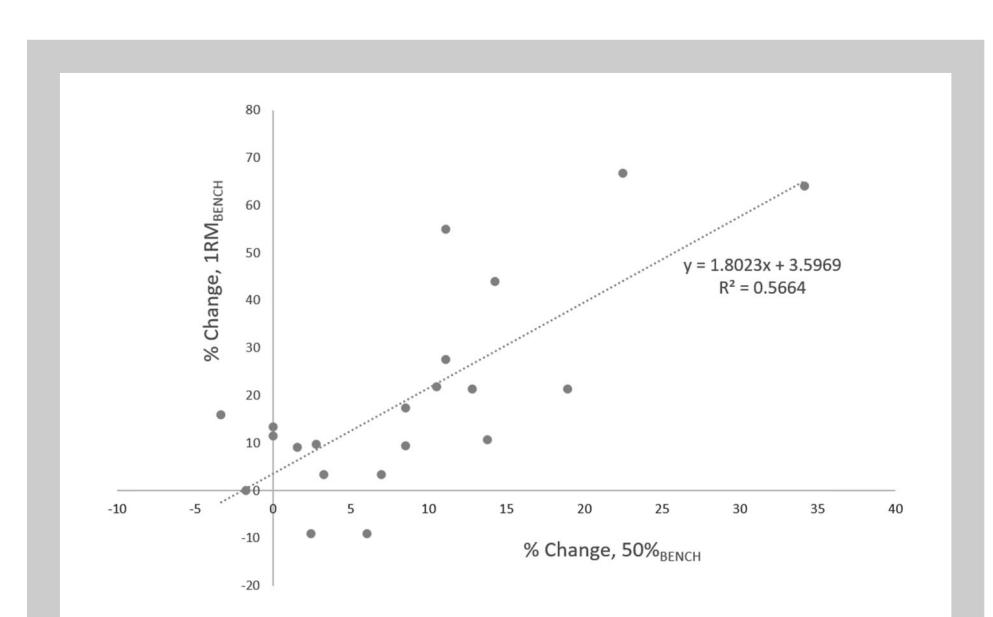

# LONGER INTERSET REST PERIODS ENHANCE MUSCLE STRENGTH AND HYPERTROPHY IN RESISTANCE-TRAINED MEN

BRAD J. SCHOENFELD, 1 ZACHARY K. POPE, 2 FRANKLIN M. BENIK, 2 GARRETT M. HESTER, 2 JOHN SELLERS, 2 JOSH L. NOONER, 2 JESSICA A. SCHNAITER, 2 KATHERINE E. BOND-WILLIAMS, 2 ADRIAN S. CARTER, 2 CORBIN L. ROSS, 2 BRANDON L. JUST, 2 MENNO HENSELMANS, 3 AND JAMES W. KRIEGER4

1 Department of Health Sciences, CUNY Lehman College, Bronx, New York; 2 Health and Human Performance, Oklahoma State University, Stillwater, Oklahoma; 3 Bayesian Bodybuilding, Gorinchem, the Netherlands; and 4 Weightology, LLC, Redmond, Washington

# ABSTRACT

Schoenfeld, BJ, Pope, ZK, Benik, FM, Hester, GM, Sellers, J, Nooner, JL, Schnaiter, JA, Bond-Williams, KE, Carter, AS, Ross, CL, Just, BL, Henselmans, M, and Krieger, JW. Longer interset rest periods enhance muscle strength and hypertrophy in resistance-trained men. J Strength Cond Res 30(7): 1805–1812, 2016—The purpose of this study was to investigate the effects of short rest intervals normally associated with hypertrophy-type training versus long rest intervals traditionally used in strengthtype training on muscular adaptations in a cohort of young, experienced lifters. Twenty-one young resistance-trained men were randomly assigned to either a group that performed a resistance training (RT) program with 1-minute rest intervals (SHORT) or a group that employed 3-minute rest intervals (LONG). All other RT variables were held constant. The study period lasted 8 weeks with subjects performing 3 total body workouts a week comprised 3 sets of 8–12 repetition maximum (RM) of 7 different exercises per session. Testing was performed prestudy and poststudy for muscle strength (1RM bench press and back squat), muscle endurance (50% 1RM bench press to failure), and muscle thickness of the elbow flexors, triceps brachii, and quadriceps femoris by ultrasound imaging. Maximal strength was significantly greater for both 1RM squat and bench press for LONG compared to SHORT. Muscle thickness was significantly greater for LONG compared to SHORT in the anterior thigh, and a trend for greater increases was noted in the triceps brachii (p = 0.06) as well. Both groups saw significant increases in local upper body muscle endurance with no significant differences noted between groups. This study provides evidence that longer rest periods promote greater increases in muscle strength and hypertrophy in young resistance-trained men.

KEY WORDS rest period, rest interval, muscle hypertrophy, muscular adaptations, rest between sets

# INTRODUCTION

Skeletal muscle is a highly plastic tissue that readily adapts to imposed demands. When subjected to progressive resistance exercise, robust increases in both muscular strength and size are generally noted after a period of several weeks (8,13). Muscle hypertrophy is governed by a phenomenon called mechanotransduction, whereby sarcolemmal-bound mechanosensors convert mechanical forces into chemical signals that regulate the activation of anabolic and catabolic pathways (31). When sufficient mechanical overload is induced, anabolic processes prevail over catabolic processes to promote a net increase in muscle protein synthesis and corresponding enlargement of fibers (11). Although a direct relationship has been noted between muscle cross-sectional area (CSA) and the ability to exert maximal force, neural factors also play a primary role in strength acquisition (10).

Muscular adaptations are believed to be maximized by the manipulation of resistance training (RT) variables. The preponderance of this research has focused on determining optimal strategies for manipulating volume and load, which are considered primary drivers of strength and hypertrophy (13). However, other variables may also play a role in the phenotypic response to resistance exercise. One such variable is the time taken between sets, commonly known as the rest interval.

To date, several studies have investigated the effects of varying rest interval length on muscular adaptations. Employing a randomized crossover design, Ahtiainen et al. (3) found no differences in muscle CSA nor maximal strength between 2 vs. 5 minutes rest periods in a sample of

Journal of Strength and Conditioning Research 2015 National Strength and Conditioning Association

Address correspondence to Brad J. Schoenfeld, brad@workout911.com. 30(7)/1805–1812

well-trained young men. Conversely, Buresh et al. (6) showed superior increases in hypertrophy of the arms and a trend for greater muscle growth in the legs when young, untrained subjects rested for 2.5 minutes versus 1 minute. Interestingly, strength increases were similar between conditions. This study was limited, however, by the use of anthropometric measures for muscle CSA, whereas Ahtiainen et al. (3) employed the gold-standard magnetic resonance imaging. To further confound matters, Villanueva et al. (23) recently found that elderly men achieved significantly greater gains in lean body mass and maximal strength when training with short (1 minute) compared with long (4 minutes) rest intervals.

Given the conflicting findings of the present literature and the disparities in methodologies, there is a need for more research to provide greater clarity on the topic. The purpose of this study was to investigate the effects of short rest intervals normally associated with hypertrophy-type training versus long rest intervals traditionally used in strength-type training on muscular adaptations in a cohort of young, experienced lifters. To address important gaps in the literature, we used current rest interval recommendations for hypertrophy and strength of 1 vs. 3 minutes, respectively (9,28), and employed validated measures to directly assess site-specific changes in muscle thickness (MT) (18,26). Consistent with generally accepted guidelines on the topic (28), we hypothesized that short rest intervals would produce greater increases in muscle growth and local muscle endurance, whereas long rest intervals would result in superior strength increases.

# METHODS

## Experimental Approach to the Problem

Subjects were pair matched based on initial strength levels and then randomly assigned to either a group that performed a RT program with 1-minute rest intervals or a group that employed 3-minute rest intervals. All other RT variables were held constant. The study period lasted 8 weeks with subjects performing 3 total body workouts a week comprised 3 sets of 8–12 repetition maximum (RM) of 7 different exercises per session. Testing was carried out prestudy and poststudy for muscle strength (1RM bench press and back squat), muscle endurance (50% 1RM bench press to failure), and MT of the elbow flexors, triceps brachii, and quadriceps femoris. This design allowed direct investigation of the hypothesis that muscular hypertrophy is maximized when consecutive sets are performed before when full recovery has taken place using rest intervals of 60 seconds or less (28).

### Subjects

Twenty-three male volunteers were recruited from a university population for this study. All participants met the following criteria: (a) between 18 and 35 years, (b) free from neuromuscular and musculoskeletal disorders, (c) free from anabolic steroids or any other illegal agents known to increase muscle size for the previous year, and (d) experienced lifters (defined as consistently lifting weights for a minimum of 6 months and a back squat/body weight ratio \$1.0). All subjects agreed to abstain from the use of legal ergogenic supplements throughout the duration of the study.

Participants were pair matched according to baseline 1RM back squat strength and then randomly assigned to 1 of 2 experimental groups: a short-rest group (SHORT) where 1 minute was afforded between sets (n = 12) or a long-rest group (LONG) where 3 minutes was afforded between sets (n = 11). The study procedures were approved by a university Institutional Review Board for Human Subjects Research. All participants were instructed on the testing and training procedures before signing an informed consent.

# Resistance Training Procedures

The RT protocol consisted of seven exercises per session, and exercise order was kept consistent between groups. These exercises targeted the thigh musculature (barbell back squat, plate-loaded leg press, and plateloaded leg extension), anterior torso muscles (flat barbell press and seated barbell military press), and the posterior torso muscles (wide-grip plate-loaded lateral pulldown and plate-loaded seated cable row). The exercises were chosen based on their common inclusion in bodybuilding-type and strength-type RT programs (5,7). Subjects were also instructed to refrain from performing any additional resistance-type training for the duration of the study.

Training for both routines consisted of three weekly sessions performed on nonconsecutive days for 8 weeks. Sets were carried out to the point of momentary concentric muscular failure—the inability to perform another concentric repetition while maintaining proper form. Cadence of repetitions was performed in a controlled fashion, with a concentric action of approximately 1 second and an eccentric action of approximately 2 seconds. Subjects performed 8–12 RM per set, and the load was adjusted for each exercise as needed on successive sets to ensure that subjects achieved failure in the target repetition range. This type of training program is commonly employed by fitness enthusiasts to enhance muscular adaptations and thus represents a credible means to study the proposed topic. A similar protocol recently was shown to produce robust muscle hypertrophy and strength in the population studied (22).

All routines were directly supervised by the research team to ensure adherence to the training protocol. Attempts were made to progressively increase the loads lifted each week within the confines of maintaining the target repetition range. Before training, the subjects underwent 10RM testing to determine individual initial loads for each exercise. Repetition maximum testing was consistent with recognized guidelines as established by the National Strength and Conditioning Association (5).

#### Measurements

Muscle Thickness. Ultrasound imaging was used to obtain measurements of MT. A trained technician performed all testing using a B-mode ultrasound imaging unit (LOGIQ S8, GE, USA). After a generous application of a water-soluble transmission gel to the measurement site, a linear array probe (Model ML6-15; 12 MHz) was placed perpendicular to the tissue interface without depressing the skin. Equipment settings were optimized for image quality and held constant between testing sessions. When the quality of the image was deemed to be satisfactory, the technician saved the image to hard drive and obtains MT dimensions by measuring the distance from the subcutaneous adipose tissue-muscle interface to the muscle-bone interface as per the protocol by Abe et al. (2). Measurements were taken on the right side of the body at four sites: elbow flexors (combination of biceps brachii and brachialis), triceps brachii, anterior quadriceps, and vastus lateralis. For the anterior and posterior upper arm, measurements were taken 60% distal between the lateral epicondyle of the humerus and the acromion process of the scapula; for the anterior quadriceps, measurements were taken at 50% of the distance between the anterior superior iliac spine and the superior border of the patella; for the vastus lateralis, measurements were taken at 50% of the distance between the lateral condyle of the femur and greater trochanter. For each measurement, the examined limb was secured to minimize unwanted movement.

In an effort to help ensure that swelling in the muscles from training did not obscure results, images were obtained 48–72 hours before commencement of the study and after the final training session. This is consistent with research showing that acute increases in MT return to baseline within 48 hours after a RT session (19). To further ensure accuracy of measurements, at least 2 images were obtained for each site. If measurements were within 10% of one another, the figures were averaged to obtain a final value. If measurements were more than 10% of one another, a third image was obtained, and the closest two measurements were then averaged. Preliminary data from our laboratory have shown that the test-retest intraclass correlation coefficients (ICCs) for thickness measurement of the biceps brachii, triceps brachii, anterior quadriceps, and lateral quadriceps are 0.952, 0.992, 0.894, and 0.921, respectively.

Muscle Strength. Upper body strength and lower body strength were assessed by 1RM testing in the bench press (1RMBENCH) followed by the parallel back squat (1RMSQUAT) exercises. Subjects reported to the laboratory having refrained from any exercise other than activities of daily living for at least 48 hours before baseline testing and at least 48 hours before testing at the conclusion of the study. Repetition maximum testing was consistent with recognized guidelines as established by the National Strength and Conditioning Association (5). In brief, subjects performed a general warm-up before testing that consisted of light cardiovascular exercise lasting approximately 5–10 minutes. A specific warm-up set of the given exercise of 5 repetitions was performed at ;50% 1RM followed by 1 to two sets of 2– 3 repetitions at a load corresponding to ;60–80% 1RM. Subjects then performed sets of 1 repetition with increasing weight for 1RM determination. Three to 5 minutes rest was provided between each successive attempt. All 1RM determinations were made within 5 attempts. Subjects were required to reach parallel in the 1RMSQUAT for the attempt to be considered successful as determined by the research team. Successful 1RMBENCH was achieved if the subject displays a five-point body contact position (head, upper back, and buttocks firmly on the bench with both feet flat on the floor) and executed a full lock-out. A minimum of 5-minute rest separated the 1RMSQUAT and 1RMBENCH. Strength testing took place using free weights. The test-retest (ICC3,1) from our laboratory for the 1RMBENCH and 1RMSQUAT are 0.996 and 0.986, respectively.

Muscle Endurance. Upper body muscular endurance was assessed by performing bench press using 50% of 1RM (50%BENCH) for as many repetitions as possible to muscular failure with proper form. Testing for this outcome was performed a minimum of 5 minutes after completion of 1RMSQUAT. Successful performance was achieved if the subject displayed a five-point body contact position (head, upper back, and buttocks firmly on the bench with both feet flat on the floor) and executed a full lock-out. Both initial and final testing used the baseline 1RMBENCH to determine muscular endurance. Muscular endurance testing was performed after assessment of muscular strength to minimize effects of metabolic stress interfering with performance of the latter.

Volume Load. Volume load data, calculated as load 3 reps 3 sets, were obtained from the 3 barbell exercises (flat barbell press, seated barbell military press, and barbell back squat) for the last training session of each week.

#### Dietary Adherence

To avoid potential confounding from diet, subjects were advised to maintain their customary nutritional regimen and to avoid taking any supplements other than that provided in the course of the study. To maximize anabolism, subjects were provided with a supplement on training days containing 24 g protein and 1 g carbohydrate (Iso100 Hydrolyzed Whey Protein Isolate; Dymatize Nutrition, Dallas, TX, USA). The supplement was consumed within 1 hour after exercise, as this time frame has been purported to help potentiate increases in muscle protein synthesis after a bout of RT (4).

#### Statistical Analyses

Data were modeled using a 2 x 2 repeated measures analysis of variance. Treatment was the between-subject factor and time was the repeated within-subjects factor. Post hoc analyses were performed using t-tests. Total aggregate 8 week load volume was compared between groups using an independent t-test. Pearson product moment correlations were used to examine the relationship between volume load and changes in strength, endurance, and MT. Effect sizes were calculated as the mean pre-post change divided by the pooled pretest SD (20), and 95% CIs were reported for all primary outcomes. All analyses were performed using R version 3.1.3 (The R Foundation for Statistical Computing, Vienna, Austria). Effects were considered significant at p # 0.05, and trends were declared at 0.05 , p # 0.10. Data are reported as x 6 SD unless otherwise specified.

# RESULTS

A total of 21 subjects completed the study: 10 subjects in LONG and 11 subjects in SHORT. Two subjects dropped out before completion because of noncompliance (,80% of sessions attended). Overall attendance for those who completed the study was 86%. No significant differences were noted between groups in any baseline measure. Data for volume load are presented in Table 1. Results of outcomes for muscular adaptations are presented in Table 2.

#### Volume Load

Total aggregate load volume over the 8 weeks was greater on an absolute basis for LONG compared to SHORT (51,385 6 9420 vs 44,755 6 12,166 kg, respectively): these results were not significantly different between the groups (p = 0.18), but the observed power for this analysis was only 0.26. There were no significant correlations between total load volume or changes in load volume and changes in the various measurements, but the observed power for these analyses was only 0.05–0.07.

### Muscle Thickness

There was no significant time by treatment interaction for changes in elbow flexor thickness (p = 0.16; CI for difference in change between groups = 20.06, 0.31). There was a significant main effect of time (P = 0.001). LONG significantly increased elbow flexor MT from baseline to poststudy by 5.4% (p , 0.01). The increase for SHORT of 2.8% showed a trend (p = 0.08) for statistical significance.

A group-time interaction trend was noted for greater increases in triceps brachii thickness for LONG compared to SHORT (p = 0.06; CI = 20.01, 0.56). There was a significant main effect of time (P = 0.009). LONG significantly increased triceps brachii MT from baseline to poststudy by 7.0% (p , 0.01). The increase for SHORT of 0.5% was not statistically significant (p = 0.83).

There was a significant time by treatment interaction for changes in anterior quadriceps femoris thickness, with significantly greater increases in favor of LONG compared to SHORT (p = 0.04; CI = 0.00, 0.69). There was a significant

| <b>TABLE 1. Volume-load data (kilograms, mean <math>\pm</math> SD).</b> |                   |                   |                   |                   |                   |                   |                   |                   |
|-------------------------------------------------------------------------|-------------------|-------------------|-------------------|-------------------|-------------------|-------------------|-------------------|-------------------|
| Group                                                                   | Week 1            | Week 2            | Week 3            | Week 4            | Week 5            | Week 6            | Week 7            | Week 8            |
| LONG                                                                    | 5,736 $\pm$ 1,201 | 6,082 $\pm$ 1,326 | 6,265 $\pm$ 1,165 | 6,372 $\pm$ 1,220 | 6,595 $\pm$ 1,178 | 6,680 $\pm$ 1,194 | 6,911 $\pm$ 1,198 | 6,674 $\pm$ 1,309 |
| SHORT                                                                   | 5,235 $\pm$ 1,554 | 5,599 $\pm$ 1,570 | 5,454 $\pm$ 1,448 | 5,527 $\pm$ 1,482 | 5,555 $\pm$ 1,560 | 5,683 $\pm$ 1,698 | 5,677 $\pm$ 1,570 | 6,025 $\pm$ 1,813 |

main effect of time (P , 0.0001), with both LONG and SHORT increased MT from baseline to poststudy of 13.3% (p , 0.001) and 6.9% (p , 0.01), respectively.

There was no significant group by time interaction for changes in vastus lateralis thickness (p = 0.77; CI = 20.27, 0.36). There was a significant main effect of time (P = 0.002), with both LONG and SHORT increasing MT from baseline to poststudy of 11.5% (p , 0.01) and 10.0% (p , 0.01), respectively.

### Maximal Strength

There was a significant time by treatment interaction for 1RMSQUAT, with significantly greater increases in favor of LONG compared to SHORT (p , 0.01; CI = 6.1, 32.9). There was a significant main effect of time (P , 0.0001),

with both LONG and SHORT showing a significant increase in 1RMSQUAT from baseline to poststudy of 15.2% (p , 0.001) and 7.6% (p , 0.001), respectively.

There was a significant time by treatment interaction for 1RMBENCH, with significantly greater between-group increases in favor of LONG compared to SHORT (p = 0.02; CI = 2.2, 32.5). There was a significant main effect of time (P = 0.0001). LONG showed a significant increase in 1RMBENCH from baseline to poststudy of 12.7% (p , 0.001). The increase for SHORT of 4.1% (p , 0.09) showed a trend for statistical significance.

### Muscle Endurance

The 50%BENCH task was performed with a load that corresponded to 50.4% and 50.1% of the pretesting 1RM strength

for SHORT and LONG, respectively. There was no significant time by group for changes in 50%BENCH (p = 0.27; CI = 22.7, 8.0). There was a significant main effect of time (P = 0.001); both the LONG and SHORT showed a significant increase in 50%BENCH from baseline to poststudy by 23.2% (p , 0.01) and 13.0% (p = 0.03), respectively. For the group as a whole, a strong positive relationship (r = 0.75) was seen between % change in 1RMBENCH and % change in 50%BENCH repetitions (Figure 1).

# DISCUSSION

Our study produced several important findings. Consistent with our hypothesis, there was

TABLE 2. Prestudy vs. poststudy outcome measures.\*

|          | Measure   |           |                |       | LONG-pre |      |       |   | LONG-post |     | ES   |       | SHORT-pre |      |       | SHORT-post |      | ES     |
|----------|-----------|-----------|----------------|-------|----------|------|-------|---|-----------|-----|------|-------|-----------|------|-------|------------|------|--------|
| Elbow    | flexor    | thickness | (cm)           | 4.28  | 6        | 0.60 | 4.51  | 6 | 0.50      | †   | 0.39 | 4.00  | 6         | 0.57 | 4.11  | 6          | 0.53 | 0.18   |
| Triceps  | brachii   | thickness | (cm)           | 4.14  | 6        | 0.76 | 4.43  | 6 | 0.84      | †   | 0.37 | 4.10  | 6         | 0.84 | 4.12  | 6          | 0.60 | 0.03   |
| Anterior | quad      | thickness | (cm)           | 5.35  | 6        | 0.65 | 6.06  | 6 | 0.58      | † z | 1.23 | 5.25  | 6         | 0.53 | 5.61  | 6          | 0.56 | † 0.63 |
| Vastus   | lateralis |           | thickness (cm) | 3.58  | 6        | 0.58 | 3.99  | 6 | 0.65      | †   | 0.81 | 3.59  | 6         | 0.43 | 3.95  | 6          | 0.46 | † 0.72 |
| 1RM      | bench     | press     | (kg)           | 93.4  | 6        | 18.1 | 105.2 | 6 | 18.9      | † z | 0.49 | 94.2  | 6         | 29.5 | 98.1  | 6          | 29.0 | 0.16   |
| 1RM      | back      | squat     | (kg)           | 118.2 | 6        | 31.0 | 136.1 | 6 | 32.5      | † z | 0.58 | 119.4 | 6         | 32.7 | 128.5 | 6          | 31.5 | † 0.29 |
| 50%      | bench     | press     | (reps)         | 27.6  | 6        | 4.1  | 34.0  | 6 | 5.6       | †   | 1.74 | 28.4  | 6         | 3.4  | 32.1  | 6          | 4.1  | † 1.01 |

\*ES = effect size; 1RM = 1 repetition maximum.

†Indicates a significant effect from baseline values.

zIndicates significantly greater prestudy to poststudy change compared with SHORT.

a clear benefit to longer rest intervals from a strength standpoint. Both 1RMSQUAT and 1RMBENCH were significantly greater for LONG compared to SHORT, and effect sizes were at least double that in favor of the longer rest condition for these measures. Contrary to our hypothesis, there was a strong suggestion that longer rest periods had a greater impact on hypertrophic outcomes. Muscle thickness was significantly greater for LONG compared to SHORT in the anterior thigh, and the effect size differences imply that these differences were meaningful. Regarding the triceps brachii, there was a trend for greater increases with LONG compared to SHORT (p = 0.06), and the 95% CI (20.01, 0.56) suggests a high probability for an effect. Moreover, effect sizes markedly favored LONG compared to SHORT (0.37 versus 0.03, respectively). Although increases in biceps brachii thickness were not different between groups, the effect sizes again favored LONG compared to SHORT (0.39 versus 0.18, respectively). It should also be noted that significant increases in MT for the triceps brachii and biceps brachii were only seen in LONG. Interestingly, increases in thickness of the lateral thigh were similar between conditions. Finally, although both groups saw significant increases in local upper body muscle endurance, rest interval duration did not seem to influence this outcome.

Our finding that LONG produced greater strength increases compared with SHORT is in line with general RT guidelines, which recommend rest periods of 3 minutes or more between sets to maximize absolute strength (9,28). Longer rest periods can allow for the completion of a higher number of repetitions (29) and the maintenance of a higher training intensity and volume (30), and thus may allow for greater muscle activation per set. However, two previous studies showed that varying the rest intervals between sets had no impact on strength outcomes (3,6), whereas another study showed a benefit to shorter rest intervals (23). Of these studies however, two used volume-equated and/or repetition-equated methodological approaches (3,23), which may nullify the aforementioned benefits of longer rest intervals on training capacity. In addition, the remaining study assessed muscular strength using 5RM testing on a Smith Machine rather than a 1RM with free weights (6), which is often considered the "gold standard" for assessing strength in nonlaboratory settings (14).

Regarding increases in muscle mass, our findings were consistent with those of Buresh et al. (6), who reported significantly greater increases in arm CSA and a trend for greater increases in leg CSA with rest durations of 2.5 minutes versus 1 minute. The veracity of the results of Buresh et al. (6) can be questioned because CSA was estimated from anthropometric measurements. In this study, we provide direct site-specific measures showing that longer rest intervals produce significantly greater increases in thickness of the anterior thigh and strong indication of greater growth in the upper arm. These findings are at odds with those of Ahtiainen et al. (3) who found no differences in CSA of the

quadriceps femoris with rest intervals of 2 versus 5 minutes and of Villanueva et al. (23) who found greater increases in lean body mass with rest intervals of 1 versus 4 minutes. These studies, in conjunction with this study, reveal an important consideration in interpreting the results from studies examining rest intervals; that is, rest intervals should be considered as an absolute (e.g., 1 minute vs 5 minutes), rather than an arbitrary, relative value (e.g., short vs long). For example, both Ahtiainen et al. (3) and this study sought to directly compare adaptations after training with short vs long rest intervals. However, we used a 1-minute vs 3 minute protocol, whereas Ahtiainen et al. (3) used 2 minute vs 5-minute protocol. Accordingly, it can be inferred that a rest interval of 1 minute is likely too short in duration to promote maximal hypertrophic gains, whereas a 2-minute rest period provides sufficient recuperation in this regard.

The divergent findings from Ahtiainen et al. (3) and Villanueva et al. (23) for strength development and muscular hypertrophy may be due to differences in research design. Both of these studies equated volume between groups, which is in contrast to this study and Buresh et al. (6). In the study of Ahtiainen et al. (3), this resulted in the shorter rest interval group performing on average 1 more set per exercise. Given the dose-response curve of training volume on strength development and muscle hypertrophy (20), the extra sets may have counteracted the negative effect of the shorter rest period on training adaptations, causing equal adaptations in both groups. Moreover, as previously noted, Ahtiainen et al. (3) afforded 2-minute rest between sets, which may have allowed for sufficient recovery and thus negated any detrimental effects associated with shorter rest periods.

Villanueva et al. (23) equated not only total training volume but also repetitions per set and the number of sets. This inherently resulted in the shorter rest interval group training closer to muscular repetition failure per set, which has been found to increase strength development and muscle hypertrophy (17). Training closer to repetition failure may facilitate training adaptations by increasing motor unit recruitment and intramuscular metabolic stress in the form of phosphate metabolites, lactate and H+ accumulation, hypoxia, and lowered pH. In addition, the population examined by Villanueva et al. had a mean age of 68 (64.1) years. Increasing age is accompanied by well-known functional declines attributed to changes in both the morphology of skeletal muscle tissue and neurological networks that control them (21). Regardless of the differences in methodological approaches used between our study and those of Villanueva et al., the presumption that these differing populations are equally responsive to a training variable such as rest interval duration requires further support.

Henselmans and Schoenfeld (12) hypothesized that the effect of the interset rest interval is primarily mediated by its effect on total training volume and not different between strength development and muscular hypertrophy. This study could not significantly correlate the change in training load to the magnitude of training adaptations; however, our data were statistically underpowered for these analyses. We therefore cannot rule out the possibility that the greater training load achieved by the longer rest period group was responsible for the greater training adaptations. In the study of Buresh et al. (5), the significantly greater upper body muscle hypertrophy co-occurred with significantly greater training loads in the upper body, whereas the lower body muscle hypertrophy difference did not reach statistical significance and co-occurred with a nonsignificantly different training load in the lower body. Moreover, there is compelling evidence for a dose-response effect of RT volume on training adaptations (15,16,20,27). The higher workloads might have a particular impact on the development of type I fibers which, because of their endurance-oriented nature, would benefit from longer times under load. As such, the hypothesis from Henselmans and Schoenfeld (12) requires further research, ideally in the form of a study with a volumeequated group and a nonvolume-equated group.

To the authors' knowledge, no previous study has evaluated the effects of varying rest interval duration on muscular endurance. Somewhat surprisingly, we found no significant differences between resting 1 versus 3 minutes on 50%BENCH. We did, however, observe a strong positive correlation (r = 0.75) between % change in 1RMBENCH and % change in 50%BENCH for the group as a whole. Reducing the amount of rest between sets decreases the ability for clearance of metabolic substrates (1). Theoretically, consistently training in this manner over time should result in adaptations for enhanced buffering capacity that would translate into a greater ability to perform repetitions with submaximal loads. Alternatively, increases in maximal muscular strength may be associated with a reduced cost when performing tasks with the same absolute submaximal load. Although each group increased 1RMBENCH, only LONG reached statistical significance, thereby suggesting that longer rest periods may have greater impact on improving muscular endurance. This hypothesis runs counter to generally accepted RT guidelines (28) and thus warrants further investigation as correlation is not necessarily indicative of causality. It should be noted that results are specific to upper body muscular endurance and cannot necessarily be generalized to those of the lower extremities. Further research is needed to clarify whether differences in this outcome exist between body segments.

The study had several limitations. First, the duration of the training protocol was relatively short. Although the 8-week study period produced significant increases in muscle strength and hypertrophy in most of the outcomes assessed, it remains possible that between-group differences would have diverged over a longer time frame. Second, although subjects were advised to maintain their usual and customary diets, we cannot rule out the possibility that differences in either energy or macronutrient consumption influenced results. Third, volume load could not be adequately determined for the

machine-based exercises, as renovation of the university gym forced the use of alternative machines. Although the movement patterns of these machines were identical, they differed in mode of action (cable pulley versus pivot) and thus had different load schemes (load corresponded to a number rather than a true load) that precluded accurate volume load assessment. Thus, it is possible that the volume load data obtained from the 3 barbell exercises did not adequately reflect the actual total volume load performed by each group. Finally, MT measurements were taken only at the midportion of each muscle. Although it is common to use these measures as a proxy of whole-muscle growth, there is evidence that hypertrophy often manifests in a regional-specific manner, with greater protein accretion occurring at the proximal and/ or distal aspects of a given muscle (24,25). Thus, it remains possible that subjects may have experienced differential changes in proximal or distal muscle growth in one condition versus the other that would not have been observed with the testing methods employed.

# PRACTICAL APPLICATIONS

The present study provides evidence that longer rest periods promote greater increases in muscle strength and hypertrophy. Our findings are consistent with current recommendations for maximal strength gains but run counter to general hypertrophy training guidelines (9,28). When the results are taken together with those of Ahtiainen et al. (3) and Buresh et al. (6), it would seem that a minimum rest interval of ;2 minutes should be recommended for maximizing gains in muscle size. Beneficial effects of longer rest intervals may be mediated by a higher volume loads, but our study was underpowered to make this determination.

Although our results suggest that longer rest periods be employed for enhancing muscular adaptations, we cannot infer that these findings will necessarily hold true when other training variables are manipulated. It is also noteworthy that there was considerable variability within groups and even between muscle groups in the same participants. This may imply that, when manipulating training variables, susceptibility for adaptations may be specific to the individual and/ or muscle group. Moreover, integrating phases of short rest in combination with longer rest periods may evoke responses that could translate into greater muscular gains over time. This possibility warrants further study. Finally, time constraints must also be considered with respect to rest interval duration. Sessions for the LONG lasted more than twice long as those for the SHORT. The cost-benefit tradeoff must therefore be taken into account if training time is an important factor.

# ACKNOWLEDGMENTS

The authors thank Dymatize Nutrition for supplying the whey protein used in this study. The authors also thank Ryan Thiele MA, ATC, LAT for lending his time to best ensure the safety of participants throughout study.

- REFERENCES
- 1. Abdessemed, D, Duche, P, Hautier, C, Poumarat, G, and Bedu, M. Effect of recovery duration on muscular power and blood lactate during the bench press exercise. Int J Sports Med 20: 368–373, 1999.
- 2. Abe, T, DeHoyos, DV, Pollock, ML, and Garzarella, L. Time course for strength and muscle thickness changes following upper and lower body resistance training in men and women. Eur J Appl Physiol 81: 174–180, 2000.
- 3. Ahtiainen, JP, Pakarinen, A, Alen, M, Kraemer, WJ, and Hakkinen, K. Short vs. long rest period between the sets in hypertrophic resistance training: Influence on muscle strength, size, and hormonal adaptations in trained men. J Strength Cond Res 19: 572–582, 2005.
- 4. Aragon, AA and Schoenfeld, BJ. Nutrient timing revisited: Is there a post-exercise anabolic window? J Int Soc Sports Nutr 10: 5, 2013.
- 5. Baechle, TR and Earle, RW. Essentials of strength training and conditioning. In: Anonymous. Champaign, IL: Human Kinetics, 2008.
- 6. Buresh, R, Berg, K, and French, J. The effect of resistive exercise rest interval on hormonal response, strength, and hypertrophy with training. J Strength Cond Res 23: 62–71, 2009.
- 7. Coburn, JW and Malek, MH. NSCA's essentials of personal training. In: Anonymous. Champaign, IL: Human Kinetics, 2011.
- 8. DeFreitas, JM, Beck, TW, Stock, MS, Dillon, MA, and Kasishke, PR 2nd. An examination of the time course of training-induced skeletal muscle hypertrophy. Eur J Appl Physiol 111: 2785–2790, 2011.
- 9. de Salles, BF, Simao, R, Miranda, F, Novaes Jda, S, Lemos, A, and Willardson, JM. Rest interval between sets in strength training. Sports Med 39: 765–777, 2009.
- 10. Duchateau, J, Semmler, JG, and Enoka, RM. Training adaptations in the behavior of human motor units. J Appl Physiol 101: 1766–1775, 2006.
- 11. Glass, DJ. Skeletal muscle hypertrophy and atrophy signaling pathways. Int J Biochem Cell Biol 37: 1974–1984, 2005.
- 12. Henselmans, M and Schoenfeld, BJ. The effect of inter-set rest intervals on resistance exercise-induced muscle hypertrophy. Sports Med 44: 1635–1643, 2014.
- 13. Kraemer, WJ and Ratamess, NA. Fundamentals of resistance training: Progression and exercise prescription. Med Sci Sports Exerc 36: 674–688, 2004.
- 14. Kraemer, WJ, Ratamess, NA, Fry, AC, and French, DN. Strength testing: Development and evaluation of methodology. In: Physiological Assessment of Human Fitness. P.J. Maud and C. Foster, eds. Champaign, IL: Human Kinetics, 2006. pp: 119–150.
- 15. Krieger, JW. Single versus multiple sets of resistance exercise: A meta-regression. J Strength Cond Res 23: 1890–1901, 2009.
- 16. Krieger, JW. Single vs. multiple sets of resistance exercise for muscle hypertrophy: A meta-analysis. J Strength Cond Res 24: 1150–1159, 2010.
- 17. Lawton, T, Cronin, J, Drinkwater, E, Lindsell, R, and Pyne, D. The effect of continuous repetition training and intra-set rest training on bench press strength and power. J Sports Med Phys Fitness 44: 361– 367, 2004.
  - 18. Miyatani, M, Kanehisa, H, Ito, M, Kawakami, Y, and Fukunaga, T. The accuracy of volume estimates using ultrasound muscle thickness measurements in different muscle groups. Eur J Appl Physiol 91: 264–272, 2004.
  - 19. Ogasawara, R, Thiebaud, RS, Loenneke, JP, Loftin, M, and Abe, T. Time course for arm and chest muscle thickness changes following bench press training. Interv Med Appl Sci 4: 217–220, 2012.
  - 20. Radaelli, R, Fleck, SJ, Leite, T, Leite, RD, Pinto, RS, Fernandes, L, and Simao, R. Dose response of 1, 3 and 5 sets of resistance exercise on strength, local muscular endurance and hypertrophy. J Strength Cond Res 29: 1349–1358, 2015.
  - 21. Roos, MR, Rice, CL, and Vandervoort, AA. Age-related changes in motor unit function. Muscle Nerve 20: 679–690, 1997.
  - 22. Schoenfeld, BJ, Ratamess, NA, Peterson, MD, Contreras, B, and Tiryaki-Sonmez, G. Influence of resistance training frequency on muscular adaptations in well-trained men. J Strength Cond Res 29: 1821–1829, 2015.
  - 23. Villanueva, MG, Lane, CJ, and Schroeder, ET. Short rest interval lengths between sets optimally enhance body composition and performance with 8 weeks of strength resistance training in older men. Eur J Appl Physiol 115: 295–308, 2015.
  - 24. Wakahara, T, Fukutani, A, Kawakami, Y, and Yanai, T. Nonuniform muscle hypertrophy: Its relation to muscle activation in training session. Med Sci Sports Exerc 45: 2158–2165, 2013.
  - 25. Wakahara, T, Miyamoto, N, Sugisaki, N, Murata, K, Kanehisa, H, Kawakami, Y, Fukunaga, T, and Yanai, T. Association between regional differences in muscle activation in one session of resistance exercise and in muscle hypertrophy after resistance training. Eur J Appl Physiol 112: 1569–1576, 2012.
  - 26. Walton, JM, Roberts, N, and Whitehouse, GH. Measurement of the quadriceps femoris muscle using magnetic resonance and ultrasound imaging. Br J Sports Med 31: 59–64, 1997.
  - 27. Wernbom, M, Augustsson, J, and Thomee, R. The influence of frequency, intensity, volume and mode of strength training on whole muscle cross-sectional area in humans. Sports Med 37: 225–264, 2007.
  - 28. Willardson, JM. A brief review: Factors affecting the length of the rest interval between resistance exercise sets. J Strength Cond Res 20: 978–984, 2006.
  - 29. Willardson, JM and Burkett, LN. The effect of rest interval length on bench press performance with heavy vs. light loads. J Strength Cond Res 20: 396–399, 2006.
  - 30. Willardson, JM and Burkett, LN. The effect of different rest intervals between sets on volume components and strength gains. J Strength Cond Res 22: 146–152, 2008.
  - 31. Zou, K, Meador, BM, Johnson, B, Huntsman, HD, Mahmassani, Z, Valero, MC, Huey, KA, and Boppart, MD. The alpha(7)beta(1) integrin increases muscle hypertrophy following multiple bouts of eccentric exercise. J Appl Physiol 111: 1134–1141, 2011.