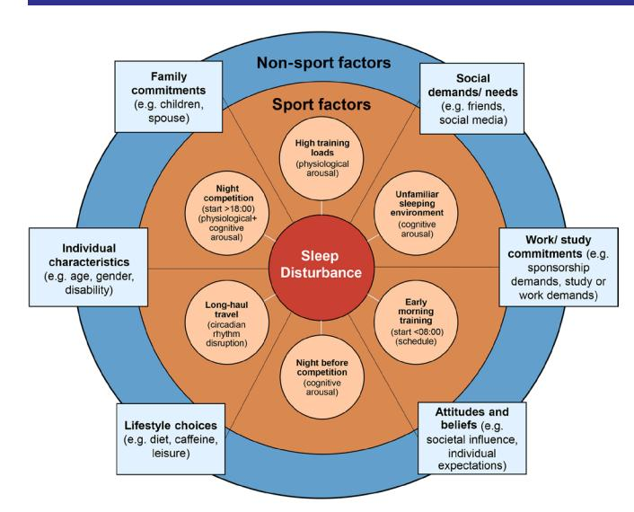
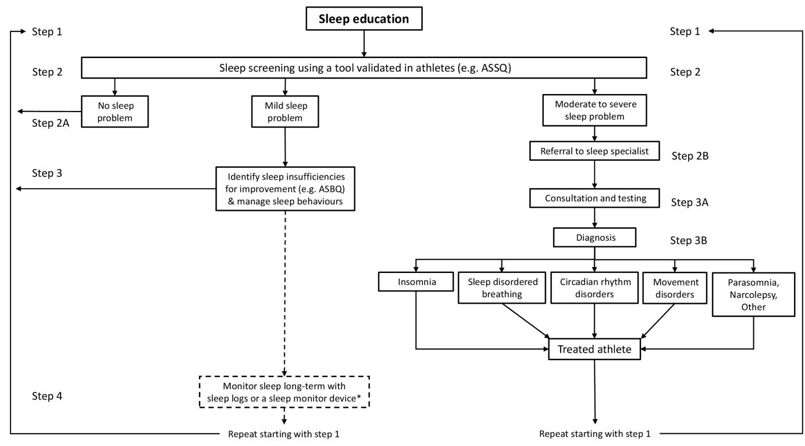

# Sleep and the athlete: narrative review and 2021 expert consensus recommendations

Neil P Walsh,1 Shona L Halson,2 Charli Sargent,3 Gregory D Roach,3 Mathieu Nédélec,4 Luke Gupta,5 Jonathan Leeder,6 Hugh H Fullagar,7 Aaron J Coutts,7 Ben J Edwards,1 Samuel A Pullinger,1,8 Colin M Robertson,9 Jatin G Burniston,1 Michele Lastella,3 Yann Le Meur,4 Christophe Hausswirth,10 Amy M Bender,11 Michael A Grandner,12 Charles H Samuels13

**To cite:** Walsh NP, Halson SL, Sargent C, et al. Br J Sports Med 2021;**55**:356–368.

For numbered affiliations see end of article.

#### **Correspondence to**

Professor Neil P Walsh, School of Sport and Exercise Science, Liverpool John Moores University, Liverpool, UK; n.walsh@ljmu.ac.uk

Accepted 30 September 2020 Published Online First 3 November 2020

© Author(s) (or their employer(s)) 2021. No commercial re-use. See rights and permissions. Published by BMJ.

## **ABSTRACT**

Elite athletes are particularly susceptible to sleep inadequacies, characterised by habitual short sleep (<7 hours/night) and poor sleep quality (eg, sleep fragmentation). Athletic performance is reduced by a night or more without sleep, but the influence on performance of partial sleep restriction over 1–3 nights, a more real-world scenario, remains unclear. Studies investigating sleep in athletes often suffer from inadequate experimental control, a lack of females and questions concerning the validity of the chosen sleep assessment tools. Research only scratches the surface on how sleep influences athlete health. Studies in the wider population show that habitually sleeping <7 hours/ night increases susceptibility to respiratory infection. Fortunately, much is known about the salient risk factors for sleep inadequacy in athletes, enabling targeted interventions. For example, athlete sleep is influenced by sport-specific factors (relating to training, travel and competition) and non-sport factors (eg, female gender, stress and anxiety). This expert consensus culminates with a sleep toolbox for practitioners (eg, covering sleep education and screening) to mitigate these risk factors and optimise athlete sleep. A one-size-fits-all approach to athlete sleep recommendations (eg, 7–9 hours/ night) is unlikely ideal for health and performance. We recommend an individualised approach that should consider the athlete's perceived sleep needs. Research is needed into the benefits of napping and sleep extension (eg, banking sleep).

# **PREAMBLE**

An ever-growing volume of peer-reviewed publications speaks to the recent and rapid growth in scope and understanding of sleep for optimal athlete health and performance. More than 80% of all peer-reviewed publications on this topic have been published in the last 10 years (>1 000 papers using the search terms 'sleep' and 'athlete', Web of Science). Herein, a panel of international experts review the current knowledge on sleep and the athlete, briefly covering the background, exploring continued controversies, highlighting fruitful avenues for future research and providing practical recommendations.

The introduction section covers the need for sleep, including sleep architecture and the restorative benefits of sleep for the brain and body. Pitfalls and challenges measuring athlete sleep are reviewed, and practical recommendations provided. The following section, entitled sleep and the athlete, covers the influence of sleep inadequacy and sleep extension on athletic performance. We review the evidence that elite athletes are particularly susceptible to sleep inadequacy, for example, during intensified training and in those reporting symptoms of over-reaching and overtraining. The final section, entitled strategies to improve sleep, provides practical recommendations to alleviate the symptoms of jet lag, nutritional strategies to enhance sleep and a toolbox for practitioners to manage and optimise athlete sleep.

# **INTRODUCTION**

## **The need for sleep**

Normal human sleep comprises two main types non-rapid eye movement sleep (non-REM) and REM sleep[.1](#page-9-0) Non-REM sleep is divided into three stages, representing a continuum from 'light' sleep in stages 1 and 2, through to 'deep' sleep in stage 3[.2](#page-9-1) The duration and composition of normal sleep changes across the life cycle. At the ages most relevant to aspiring and established athletes, a sleep of 8–10hours for an adolescent (aged 15 years) contains approximately 57% light sleep, 22% deep sleep and 21% REM sleep; and a sleep of 7–9hours for a young adult (aged 30 years) contains approximately 61% light sleep, 16% deep sleep and 23% REM sleep[.3](#page-9-2)

Sleep is essential for the brain and the body. Protocols with one or two nights of total sleep deprivation or 1 or 2weeks of partial sleep restriction have been used to demonstrate the importance of sleep for both mental and physical health. In particular, sleep loss impairs cognition[,4](#page-9-3) learning and memory consolidation[5](#page-9-4) and mental well-bein[g6](#page-9-5) ; it disrupts growth and repair of cells[,7](#page-9-6) metabolism of glucose[8](#page-9-7) and lowers the protective immune response to vaccination[9 10](#page-10-0) and resistance to respiratory infection (see [online supplemental file 1](https://dx.doi.org/10.1136/bjsports-2020-102025) for more extensive review on the need for sleep)[.11](#page-10-1)

## **Measuring sleep**

With the increasing popularity of measuring sleep within both medical and consumer fields, unsurprisingly, the number of sleep measurement tools is rapidly increasing ([table](#page-3-0) 1). Some of the more common measurements regarding sleep include: sleep architecture (sleep staging), sleep duration, measured or estimated sleep efficiency (quality), sleep-onset latency (SOL: time taken to fall asleep) and wake after sleep onset (WASO). Sleep can be measured both objectively (polysomnography, activity monitoring, smartphone applications and nearable devices placed on or near the bed) and subjectively (sleep diaries and questionnaires) and has been reviewed elsewhere (see [online supplemental file 1](https://dx.doi.org/10.1136/bjsports-2020-102025) for more extensive review on measuring sleep)[.12](#page-10-2)

## Polysomnography

Polysomnography is considered the gold standard of sleep monitoring and typically includes an assessment of eye movement, brain activity, heart rate, muscle activity, oxygen saturation, breathing rate and body movement[.13](#page-10-3) Polysomnography allows for the determination of REM and non-REM. As polysomnography can be an expensive, obtrusive and complex technique, it is typically used for the assessment of sleep disorders or in research studies.

## Activity monitoring

Activity monitors are wearable devices that record movement,[14](#page-10-4) with most using a 3-axis accelerometer to determine sleep/wake based on a specific algorithm.[15](#page-10-5) Currently, there are generally two classifications of devices—those that are considered 'researchgrade' (validated against polysomnography)[16](#page-10-6) and those that are considered 'commercially available'. Both research-grade and commercially available activity monitors typically overestimate sleep duration relative to polysomnography (and underestimate relative to recall and sleep diary), underestimate awakenings and WASO relative to polysomnography (and overestimate relative to recall and sleep diary), and generally underestimate sleep latency relative to both polysomnography and sleep diary.[17](#page-10-7)

# Nearables and smartphone applications

One subset of nearable devices is placed on the mattress and measures movement and other physiological signals of the individual lying on the bed (typically using ballistocardiography)[.18 19](#page-10-8) Currently, validation of available devices is sparse, little is known about the algorithms used, and these devices are not considered accurate for measuring sleep.[20](#page-10-9) In general, smartphone apps are poor at determining sleep stages and sleep parameters[15](#page-10-5) and researchers have little room to influence or access raw data.[21 22](#page-10-10)

## Sleep diaries and questionnaires

Sleep diaries can be a simple and cost-effective means of assessing sleep and typically include: bed and wake time, lights-out time, daytime napping, ratings of sleepiness and alertness, caffeine and alcohol intake, exercise and light emitting device us[e23](#page-10-11) for a duration of at least 1week. Questionnaires are often used for screening purposes or an initial assessment of sleep due to their ease of administration and low cost. Common questionnaires in insomnia research include: the Pittsburgh Sleep Quality Index (PSQI) to assess sleep quality,[24](#page-10-12) the Sleep Hygiene Index to assess sleep hygiene[25](#page-10-13) and the Epworth Sleepiness Scal[e26](#page-10-14) to assess daytime sleepiness. However, these questionnaires have not been validated for athletes ([table](#page-3-0) 1). Athlete-specific questionnaires include the Athlete Sleep Screening Questionnaire[27 28](#page-10-15) and the Athlete Sleep Behaviour Questionnaire[.29](#page-10-16) Similar to sleep diaries, while questionnaires may be time and cost effective, response biases may exist.

In summary, there are increasing options for scientists and athletes to monitor sleep, with some devices (primarily consumer sleep technology) having some limitations in their assessment of sleep and wakefulness. Consideration should be given to whether or not the devices are validated, and an assessment is required as to the usefulness and appropriateness of using unvalidated technology. Some devices may provide some basic level of sleep awareness and education; however, individuals should be cognisant of the limitations of available means of monitoring sleep [\(table](#page-3-0) 1).

# **SLEEP AND THE ATHLETE**

# **Sleep and athletic performance**

Sleep disturbance is a common occurrence prior to competition that may impact athletic performance.[30](#page-10-17) Discerning the effects of sleep disturbance on athletic performance is difficult across studies, given the wide variety in study designs, populations, conditions, measuring tools and reported outcomes. To best ascertain the quality of evidence for studies investigating the relationship between sleep and athletic performance, it is recommended to separate experimental outcomes between partial (ie, partial restriction or acute improvement in sleep for 1–3 nights) and complete (ie, sleep deprivation/loss) changes in sleep quality or quantity.

#### The effect of sleep restriction and acute sleep improvement on athletic performance

The effect of sleep restriction and acute sleep improvement on performance is equivocal for strength[31](#page-10-18) and exercise performance.[32](#page-10-19) Such mixed results may be a result of differences in sleep protocols,[33](#page-10-20) as well as the time of testing. For example, if performance is assessed towards the end of the day (eg, 17:00–19:00hours) the circadian drive for alertness/performance may limit the effect of sleep restriction on performance.[34](#page-10-21) In addition, the time of sleep restriction (eg, prolonged wake vs early rising) can vary between studies,[33 35](#page-10-20) with collective evidence suggesting that sports-specific skill execution, submaximal strength and anaerobic power can decline, however, there are many instances in which performance is maintained (eg, maximal aerobic or strength efforts).[33](#page-10-20) Few studies have assessed the effect of acute sleep enhancement on athletic performance,[36](#page-10-22) with preliminary evidence showing positive benefits for strategies such as sleep hygiene. For example, strategies that focus on improving the sleep environment (removal of light, technology and noise, 17°C–22°C temperature) have shown improvements in sleep duration, although most studies report limited benefits to sports performance[.36](#page-10-22) Comparatively, studies have shown sleep extension improves sport-specific skill execution[,37](#page-10-23) as well as sprint performance,[38](#page-10-24) however, these studies often lack objective measures of sleep or a control group. From a practical perspective, naps offer a suitable strategy to supplement lost sleep, with 20–30min naps improving sprint[39](#page-10-25) and peak jump velocity performance.[40](#page-10-26)

#### Sleep deprivation, chronic sleep improvement and athletic performance

There is sufficient evidence to suggest a detrimental effect of sleep deprivation (a night or more without any sleep) and a beneficial effect of chronic sleep improvement (repeated exposure of strategies that improve sleep over weeks or months) on sportspecific and physical performance.[33 36 41](#page-10-20) Thus, avoiding situations that present large risks to sleep, and promoting long-term behaviours that improve sleep quantity and quality is encouraged [\(box](#page-2-0) 1). While study findings emphasise the importance of positive long-term sleep behaviour for sporting performance,[42 43](#page-10-27) there are concerns with the available evidence. For instance, it is uncommon for sleep studies to include a control group; as such, studies showing improvements in physical performance with sleep extension should be considered with caution. Large discrepancies in sleep protocol duration and timing make it difficult to determine the performance effect of sleep interventions. Of further note, it is debatable whether the findings of the detrimental effects of sleep deprivation on performance are applicable to elite athletic populations, given it would be rare for athletes to endure a night or more without any sleep. Other issues include an underrepresentation of female athletes, differences in quantification of performance and experimental environments, the inability to blind subjects and imprecision and/or lack of adequate description of the sleep intervention protocol.

Adequately controlled investigations are required to fully explore the influence of sleep extension on athletic performance and health. A recent study of a small group of trained cyclists and triathletes, showed better endurance performance after three consecutive nights of sleep extension (~8.4hours sleep each night) compared with habitual sleep (~6.8hours sleep each night); prompting the authors to recommend endurance athletes sleep >8hours each night to optimise performance.[44](#page-10-28) The degree to which the ergogenic effect of sleep extension varies as a function of habitual sleep is important to determine (ie, repaying a recent sleep debt or a real effect of banking sleep?).[45](#page-10-29) Other unresolved questions include: whether sleep extension (eg, targeting >8hours each night) should be recommended for all athletes, across all sports and event types (viz. 'one-size-fits-all'); whether sleep extension increases sleep inertia (eg, grogginess on waking), with detrimental effects on postwaking performance[46](#page-10-30); whether there is a ceiling effect (eg, for total sleep time, slow-wave sleep or REM sleep) beyond which no further performance or health benefit is gained; or whether too much sleep can have negative effects on performance or health. Reductions in sleep efficiency and sleep quality with sleep extensio[n44](#page-10-28) might conceivably have detrimental effects on athlete immunity[.47 48](#page-10-31)

From a practical perspective, there appears minimal harm in attempting to improve sleep or minimise situations which compromise sleep over long periods to improve performance outcomes. Our five recommendations [\(Box](#page-2-0) 1) also offer additional benefits on overall health and mental well-being[,49](#page-10-32) as discussed elsewhere in this review.

# **Sleep inadequacy and the athlete**

The prevalence of sleep inadequacy has been reported to be high among elite athletic populations who often experience disruptive training and competition schedules that limit the opportunity for sleep. This is characterised by habitual sleep durations <7hours,[50](#page-10-33) sleep dissatisfaction[,51](#page-10-34) unrefreshing sleep[,52](#page-10-35) long SOL[,52 53](#page-10-35) day-time sleepiness[54](#page-10-36) and day-time fatigue[.55](#page-10-37) Studies reporting global sleep quality show that 50%–78% of elite athletes experience sleep disturbance and 22%–26% suffer highly disturbed sleep[.30 43 54](#page-10-17)

Definitive evidence that sleep inadequacy is more prevalent in elite athletes than the wider population is in short supply. Only a small handful of studies have included non-athletic controls to allow this comparison,[56–58](#page-10-38) and these controls were not always representative of sleep characteristics in the wider population.[56](#page-10-38) In addition, studies have tended to rely on subjective rather than objective measures of sleep [\(table](#page-3-0) 1).[56 57](#page-10-38) Using sleep questionnaires, one such study reported a higher prevalence of poor sleep quality and a greater proportion of morning types among elite Canadian athletes compared with non-athletic controls; although, the controls were selected from previous studies and screened to include only good sleepers (PSQI <5)[.56](#page-10-38) Another study using sleep questionnaires reported no differences in chronotype distributions between elite Australian athletes and non-athletic controls.[57](#page-10-39) Notwithstanding, objective sleep assessment using actigraphy showed shorter sleep duration and poorer sleep quality (eg, sleep efficiency and sleep latency) in 47 British Olympic athletes compared with age and gender matched nonathletic controls.[58](#page-10-40) The empirical evidence also indicates that clinical sleep problems are prevalent in high level athletes. For example, a recent systematic review profiling sleep characteristics in elite athletes highlighted the prevalence of insomnia symptoms (eg, longer sleep latency, greater sleep fragmentation, non-restorative sleep and excessive day-time fatigue)[.30](#page-10-17) Anecdotal evidence indicates that other sleep problems, such as sleep apnoea, are generally less common but do exist. The prevalence of obstructive sleep apnoea appears to be higher in strength and power athletes (eg, rugby players) than the non-athletic population. This is likely a consequence of large body mass and neck circumference, anatomical features consistent with sleep apnoea.[54 59](#page-10-36)

# Does participation in elite sport degrade sleep?

It remains to be shown whether a causal relationship exists between participation in elite sport and sleep inadequacy. Athlete sleep is influenced by various sport-specific factors and also by societal factors (eg, pervasive use of smart phones and social media in an 'always connected' society) ([figure](#page-4-0) 1).[30 60](#page-10-17) Sportspecific risk factors for sleep inadequacy in athletes have broadly been identified as those pertaining to training, travel and competition ([figure](#page-4-0) 1)[.30 61](#page-10-17) More specifically, the risk factors include: high training loads[62–64](#page-10-41); short-haul and long-haul travel[65 66;](#page-10-42) the night before competition[67 68](#page-10-43); evening competition (start times

#### **Box 1 Sleep and athletic performance: five key recommendations**

- 1. Avoid situations that present ongoing risks to sleep; promote positive habitual sleep behaviour.
- 2. When incorporating strategies to enhance sleep or performance in the field setting, take account of other factors that may impact results (eg, ongoing illness).
- 3. Researchers are encouraged to take on the responsibility for improving the quality of evidence on sleep and athletic performance (eg, reporting of randomisation procedures, protocol adherence and handling of missing outcome data). We recommend a research methods consensus meeting be held.
- 4. We recommend researchers report baseline athlete sleep behaviour (eg, sleep inadequacies) to better characterise the effect of targeted sleep interventions on athletic performance. Practitioners are encouraged to target specific individuals in need of help and/or address specific situations for those at risk (ie, situations known to compromise sleep, for example, travel).
- 5. Future research needs to focus on: (1) sleep interventions that assess strength outcomes in athletic populations; (2) longer (eg, more repetitive) periods of sleep restriction and sport-specific measures of performance and (3) randomised controlled trials on sleep and (1) performance at differing times of the day (eg, early morning heats in Olympic swimming) and (2) differing tasks—meaning differing sports and different elements that contribute to sporting success.

after 18:00)[69 70](#page-10-44) and early morning training (start times before 8:00).[55](#page-10-37)

# Sport-specific risk factors for sleep inadequacy in athletes

The extent to which multiple factors challenge athlete sleep is unlikely to be uniform across all sports. Given both the specificity of athlete selection processes for different sports, and the different environmental and cultural constraints within different sports (eg, early morning training is engrained in swimming culture), it is reasonable to expect that athlete risk profiles and the challenges to athlete sleep vary between different sports.[61](#page-10-45) Although the available evidence is limited, one study reported that long-term sleep problems were particularly prominent in contact and combat sport athletes and in those participating in aesthetic sports.[53](#page-10-46) The underlying cause(s) of sleep problems in these athletes remains speculative but may include a history of concussion in contact and combat athletes[71 72](#page-10-47) and an influence of generalised anxiety disorder, negative perfectionism and low energy availability in aesthetic sport competitors.[53 73](#page-10-46) Energy restriction resulted in a hypometabolic state, affecting nocturnal body temperature and sleep patterns in overweight women.[74](#page-10-48) Studies are required to assess the influence of low energy availability on sleep patterns among athletes, particularly those participating in aesthetic and weight category sports. Research assessing actigraphy-derived sleep patterns in elite athletes has shown that individual sport athletes obtain less sleep than team

**Table 1** Evaluation of tools for sleep assessment in athletes

| Tool                                  | Strengths Weaknesses Practicality of use       |
|---------------------------------------|------------------------------------------------|
| Polysomnography                       | Gold standard for sleep assessment.            |
| Research-grade actigraphy devices     | Current standard for sleep assessment in       |
| Commercial wearable devices           | Non-intrusive and less expensive than          |
| Nearables                             | Non-intrusive, placed on or near the bed,      |
| Sleep diaries                         | Non-intrusive and cost effective. Affords      |
| Sleep questionnaires                  | Cost and time effective, can provide           |
| Athlete-specific sleep questionnaires | Cost and time effective, can identify athletes |
|                                       | See figure 2 for specifics. Additional         |

ASBQ, Athlete Sleep Behaviour Questionnaire; ASSQ, Athlete Sleep Screening Questionnaire; ESS, Epworth Sleepiness Scale; ISS, Insomnia Severity Index; KSS, Karolinska Sleepiness Scale; LSEQ, Leeds Sleep Evaluation Questionnaire; MEQ, Morningness and Eveningness Questionnaire; PSQI, Pittsburgh Sleep Quality Index; SHI, Sleep Hygiene Index; SSS, Stanford Sleepiness Scale; VAS, Visual Analogue Scale.

sport athletes.[75](#page-10-49) Earlier training start times were proposed to account for shorter sleep duration in individual sport athletes, and retiring to bed earlier the night before early morning training does not appear to offset the reduction in sleep duration.[35](#page-10-50) Circumstantial evidence supports the notion that elite athletes tend to prevail in their chosen sport in part due to the matching of their chronotype with the sport-specific training schedules.[57](#page-10-39) An association between sport-type and chronotype distribution has been demonstrated in elite athletes, whereby a high proportion of morning types (72%) were involved in sports with early morning training schedules.[57](#page-10-39) Sport-type differences also become evident during high risk periods for sleep disruption, such as competition. For example, in a study of sleep habits in elite German athletes, precompetition sleep difficulties (eg, not being able to fall asleep) were more evident in individual compared with team sports.[67](#page-10-43)

## General risk factors for sleep inadequacy in athletes

Candidate risk factors for sleep inadequacy in elite athletes also include many of those factors commonly considered to influence sleep in non-athletic individuals. These include female gender[,76–78](#page-10-51) spinal cord injury,[79](#page-11-0) increasing age[80](#page-11-1) and poor mental health (eg, traits of neuroticism, maladaptive perfectionism and hyperarousal, and the pervasive influence of psychological stress and anxiety (rumination or worry)).[81](#page-11-2) Gender was identified as a risk factor for lifetime sleep problems in elite French athletes, with a greater incidence of sleep problems in female athletes[.53](#page-10-46) As is the case in non-athletic individuals, spinal cord injured athletes typically report poorer sleep quality than able-bodied athletes.[30 79](#page-10-17) Age has been shown to relate to the prevalence of poor sleep quality, with athletes>25 years of age reporting higher PSQI scores than those <20 years of age[54;](#page-10-36) early parenthood could be a contributing factor[.82](#page-11-3) Athlete age was also identified as a risk factor for sleep disruption prior to a major competition, however normal sleep quality (eg, PSQI scores) was not.[68](#page-10-52) The latter finding indicates that athletes who typically report good sleep quality are not necessarily resilient against situational sleep disruption in the face of challenges, such as an important competition. Hyperarousal trait predicted actigraphy-derived reduction in sleep efficiency following a night game in elite netball player[s83;](#page-11-4) in the same way as non-athletes with hyperarousal trait are known to suffer reduced sleep quality in the face of psychosocial stressors[.84](#page-11-5) These recent findings in elite netball player[s83](#page-11-4) indicate that the basal level of arousal may provide a risk factor for sleep disruption during competition. It is, therefore, possible to build 'at-risk' profiles and target subsequent sleep management at the individual athlete level.

In summary, current evidence indicates that elite athletes are particularly susceptible to sleep complaints.[85](#page-11-6) Nevertheless, the research evidence indicates that sleep inadequacy in elite sport can be predictable, enabling targeted sleep education and sleep management interventions.

## **Intensified training, over-reaching and overtraining**

Elite athletes follow rigorous, carefully planned training regimens designed to optimise peak performance during the most important competitions of the season. Periods of intensified training are inherent to athletes' training programmes and are intended to impose training stress to stimulate the physiological adaptations necessary to improve performance. However, when the balance between training stress and adequate recovery is disrupted, an abnormal training response may occur, and functional over-reaching and overtraining can develop.[86](#page-11-7) Overtraining is defined as a long-term decrement in performance capacity with or without related physiological and psychological signs and symptoms of maladaptation in which restoration of performance capacity may take several weeks or months.[86](#page-11-7)

# Over-reaching, overtraining and sleep disturbances

Sleep disturbances are frequently reported as one of the many symptoms of over-reaching/overtraining.[86 87](#page-11-7) This finding has been demonstrated through athlete self-reports of difficulties initiating sleep, restlessness and heavy legs during sleep[88–91](#page-11-8); but also via altered nocturnal wrist actigraphy in athletes with clear signs of over-reaching (ie, high perceived fatigue and decreased performance) during intensified training.[63 92 93](#page-10-53) Nevertheless, the reported magnitude of these sleep alterations with over-reaching/overtraining is quite modest in terms of both the reduction in sleep efficiency (<5%) and sleep duration (<30 min), particularly when compared with that observed in sleep disorder patients[94](#page-11-9) or even in athletes in response to jet lag[95](#page-11-10) or hypoxia.[96](#page-11-11) Of note, a case study reported larger sleep deficiency (<6 hours per night compared with 8–10 hours per night following full recovery) in a talented female sprint cyclist who developed signs of overtraining (ie, persistent fatigue and underperforming over months). This case indicates that more severe sleep impairments could be associated with overtraining syndrome, but more research is needed to confirm this hypothesis.[89](#page-11-12)

#### Is sleep disturbance a symptom of over-reaching/overtraining or an aetiological mechanism?

It remains unclear whether sleep disturbance is an aetiological mechanism of over-reaching or merely a symptom. While the psychophysiological mechanism(s) underlying sleep disturbance during periods of over-reaching/overtraining remain unclear, several potential factors may contribute to the reported sleep disturbances and performance decline. During overload training periods, several aspects of innate and adaptive immunity are depressed (eg, marked reductions in neutrophil function, lymphocyte proliferation and circulating T cells).[97 98](#page-11-13) Over-reached athletes with objective signs of moderate sleep disturbance demonstrate a

**Figure 1** Contributory factors for sleep disturbance in athletes; including sport-specific factors (orange shading) and non-sport factors (blue shading).

higher incidence of upper respiratory tract infections than non-over-reached athletes.[63](#page-10-53) Depressed immune response, often leading to infection, has been shown to impair sleep.[99](#page-11-14) However, given that lack of sleep itself also has a direct impact on immune function,[100](#page-11-15) further studies are needed to determine whether an altered immune function that may occur with over-reaching/overtraining leads to sleep disturbance. An additional confounder in determining this link is that over-reaching/overtraining can change mood and increase stress and anxiety, all of which can adversely impact sleep.[101–104](#page-11-16) These reciprocal relationships make it difficult to determine the direction of the relationships between sleep, immune function, stress, anxiety and mood, and how these may lead to or contribute to the development of over-reaching/overtraining.

Recently, Schaal *et al* reported that the daily use of wholebody cryostimulation during intensified training improved the quality of the swimmers' recovery by preserving sleep quantity (measured by actigraphy) and preventing the development of over-reaching[.93](#page-11-17) Since cold exposure after intense exercise can induce a prompt postexercise parasympathetic reactivation[,93 105](#page-11-17) which may promote relaxation and the onset of sleepiness,[106](#page-11-18) the development of over-reaching and its related sleep disturbances may potentially be mediated by alterations of the autonomic nervous system balance. Further investigations are required to test this hypothesis.

The impact of training and competition schedules on sleep Lastly, the increase in training load at the origin of over-reaching/ overtraining development is often accompanied by changes in training and competition scheduling, which may influence the amount of time an athlete can spend in bed. The impact of training and competition schedules on athletes' sleep is well established (see section 'sleep inadequacy and the athlete').[55 75 107 108](#page-10-37) Early morning training and competition reduce athletes' sleep duration and increase pretraining fatigue levels.[55 75](#page-10-37) Similarly, intense training sessions and matches performed in the evening (18:00–21:00hours) are commonly associated with later sleep onset time, shorter time in bed and less total sleep obtained

**Figure 2** A flow diagram for practitioners to help optimise and manage sleep for athletes. **Step 1 –** Sleep education should occur multiple times throughout the season and can be in the form of presentations, informal sessions, and information sheets. **Step 2 –** Use questionnaire-based sleep screening initially during pre- and post-season evaluations and on an as needed basis during the season. The Athlete Sleep Screening Questionnaire (ASSQ) is a validated clinical tool to flag athletes who need further help from a sleep specialist. Step 2A – The questionnaire you use should identify athletes with sleep problems using validated cut-points. For example, the ASSQ categorises athletes into no, mild, moderate, and severe clinical sleep problem. Athletes with no sleep problem can go back to Step 1 (Sleep Education) to determine what areas to focus on. **Step 2B –** If the athlete has a moderate to severe sleep problem, referral to a sleep professional is recommended right away due to the potential duration of treatment and potential wait times. **Step 3 –** Identify sleep improvement and optimisation strategies based on the athlete's sleep insufficiencies and/or poor sleep habits. The Athlete Sleep Behaviour Questionnaire (ASBQ) identifies maladaptive sleep behaviours and has been validated in an athlete sample. For athletes who have moderate to severe sleep problems, caution is warranted as identifying sleep insufficiencies can make the problem worse (eg, recommending more sleep when the athlete has insomnia). Proper judgement is required. **Step 3A –** Ideally the moderate to severe clinical sleep problem athlete should have a sleep consultation with a sleep medicine physician specialising in working with athletes. **Step 3B –** Once a diagnosis has been established, different treatments are available and can help the athlete optimise sleep. **Step 4 –** Tracking sleep with sleep logs or a sleep monitor in those with a mild sleep problem (broken arrows) may not be necessary but can be used for feedback to the athlete to help modify behaviour change. The practitioner must be able to properly interpret the data and understand the limitations of the sleep logs or the sleep monitor which should be validated against polysomnography. \*See [table 1](#page-3-0) for monitoring tools.

([figure](#page-4-0) 1).[69 109](#page-10-44) As such, when designing training programmes, practitioners need to consider the upcoming competitive schedules and should also be aware of the implications of training timing on sleep duration and fatigue levels.[55](#page-10-37) Poorly designed training programmes may restrict the opportunity athletes have for sleep, which may limit recovery between training sessions and increase the risk of over-reaching/overtraining. Potential solutions (eg, naps) are provided in the sleep toolbox section at the end of this consensus.

#### **STRATEGIES TO IMPROVE SLEEP Circadian rhythms, jet lag and sleep**

Humans possess a body clock situated in the suprachiasmatic nuclei in the hypothalamus. In the absence of external time cues (such as light/dark cycle), this master clock tends to run for about 24.3hours.[110](#page-11-19) The clock becomes synchronised and in-tune with the environment and solar day (~24hours 'circadian rhythm') by the coupling of cyclic changes in the external environment ('zeitgebers'—time cues) with rhythmic signals from melatonin (originating from the pineal gland, an 'internal zeitgeber')[.111 112](#page-11-20) The body clock is connected to networks of peripheral clocks, and has roles in increasing alertness, mental and physical activity in the daytime, and preparing the body in the evening for sleep. This 'circadian rhythm' enables consolidated sleep to take place at night and prepares the body towards the end of sleep for wakening to face the new day. The body clock does this via the rhythmic changes it produces in the autonomic nervous system, bloodborne hormones, core body temperature and the sleepwake cycle[.110](#page-11-19)

Chronotype is a genetically determined predisposition that modifies each individual's preference to be most active in the morning ('morningness'), the middle of the day (neither type) or in the evening ('eveningness').[57 113](#page-10-39) In relation to chronotype distribution, as defined by the 'morningness–eveningness' preference continuum[,114](#page-11-21) a skew towards 'morningness' has been reported in elite athletes[.56 57 115](#page-10-38)

The ease of falling asleep, the ability to maintain sleep and the likelihood of waking up are associated with the rhythm of core body temperature. Getting to sleep and maintaining sleep are easiest when core body temperature is either falling or low (at and after the onset of melatonin secretion, ~21:00hours), and most difficult when it is rising or high (and melatonin secretion has stopped).[116](#page-11-22) Further, when core body temperature is rising, spontaneous waking is most likely to occur. The timing of the body clock is stable and transient changes to a regular routine for instance, waking in the middle of the night to feed a baby, or turn off a car alarm, or taking a nap in the daytime—result in no change in the phase of the body clock.[117](#page-11-23) In contrast, the normal synchrony between the body clock and the environment is transiently lost after rapid transmeridian travel, the associated negative feelings and symptoms of which are referred to as 'jet lag'.[118](#page-11-24)

# Daily variations in components of sports performance before travel

Variations in human physiology that manifest over a 24-hour solar day (circadian) have been extensively reported.[119](#page-11-25) Before considering the consequences of jet lag for sporting performance, it is essential to note that there are specific times of day when rhythms associate with peak sporting performance. Tasks that require fine motor coordination (such as standing on a wobble board) or are related to learning game tactics may be achieved more easily in the morning (08:00–09:00hours). This is probably because basal arousal levels are lower than the diurnal peak and closer to the optimum level for performance.[117 119](#page-11-23) Tasks requiring complex hand-eye-coordination skill, such as the accuracy of tennis or badminton serves, peak around 13:00– 15:00hours. They have two components to the rhythm, a circadian influence parallel to core body temperature, but also a time-awake effect where performance decreases with time awake and mental fatigue (synchronous with the sleep-wake cycle). Limited evidence indicates that self-paced endurance performance (total work done in 1hour) is comparable in the morning (08:30hours) and early evening (17:30hours) in temperate conditions.[120](#page-11-26) Lastly, circadian rhythms in gross muscular tasks such as back and leg strength (daily variation of 3%–10%)[,121–123](#page-11-27) repeated sprint performance and time-trial performance (daily variation of 3%–6%),[124 125](#page-11-28) exhibit maximum and minimum values in parallel to those of core body temperature (17:00– 20:00 and ~05:00hours, respectively).[122](#page-11-29) The most reported explanation as to why gross muscular performance is better in the evening than the morning centres around the causal relationship between core body temperature and muscle temperature and performance, from the observation of both profiles being in phase. Research in this area has shown this relationship is not simple and temperature does not fully explain the daily rhythm in strength.[126–130](#page-11-30)

## Jet lag after time zone transition

After a westward flight, for example, where local time is 8hours behind 'body time', the individual feels tired at ~16:00hours (new local time) and wakes up at a now inappropriate time in the local time zone (24:00hours), when the local inhabitants are going to bed. After an eastward flight, destination time is ahead of an unadjusted 'body time'. In this case the individual does not feel tired when it is time to go to bed (local midnight) because the body clock will indicate only 16:00hours, but they feel tired (24:00hours, body time) when the local inhabitants are waking for the next day (08:00hours, local time). In these circumstances where there is a mismatch between the endogenous and exogenous rhythms, the symptoms of 'jet lag' arise. As adjustment of the body clock to the new time zone occurs, nocturnal sleep improves and symptoms of daytime fatigue, poorer motivation and poorer mental performance subside.[116](#page-11-22)

## Jet lag and sporting performance

Empirical evidence that jet lag affects athletic performance directly is sparse. Three main lines of evidence underpin the rationale for the adjustment strategies recommended for sports persons crossing multiple time zones (see [online supplemental](https://dx.doi.org/10.1136/bjsports-2020-102025) [table 1](https://dx.doi.org/10.1136/bjsports-2020-102025) for bright light avoidance and exposure).[116–118 131 132](#page-11-22) First, the evidence that the body clock influences sporting performance, hence an endogenous component[34](#page-10-21); second, the observed negative effects while adjusting the body clock to the new time zone; including, nocturnal sleep loss, daytime fatigue, poorer motivation and poorer mental performance, which in turn can affect training and physical performance; and third, the findings of meta-analyses of win-loss records of basketball, hockey and American football teams travelling across time zones before matches[.133 134](#page-11-31) Although limited to the level of association, these meta-analyses predictably show advantages, hence a better chance of winning, if the team plays at a time coinciding with daytime in the time zone left (closest to peak core body temperature). For example, after eastward flights, local afternoon or evening matches are preferable to morning; whereas, after westward flights, morning or early afternoon matches are preferable to late afternoons or evenings: we know that teams travelling westward for evening matches have a disadvantage.[133 134](#page-11-31) When the advice presented in [online supplemental table 1](https://dx.doi.org/10.1136/bjsports-2020-102025) is delivered through a formal educational programme to athletes it works well in regard to preparation prior to, during and after arrival at the destination to help alleviate the symptoms of jet lag.[118 132 135](#page-11-24)

Travel fatigue and jet lag: guidelines and research recommendations Travel fatigue associated with high frequency travel and jet lag associated with time zone displacement are downsides of elite competition. The symptoms of travel fatigue and jet lag may present themselves in a similar manner, but different aspects of travel cause them. Travel fatigue associated with the disruption and demands of travel, such as getting to the plane and poor prior sleep, can become an enduring problem for elite competitors in sports such as basketball (National Basketball Association) and hockey (National Hockey League), who endure high frequency domestic flights for matches each season.[136](#page-11-32) Jet lag is associated with the resynchronisation of the body clock to the new environment and resolves at a rate of about 1 day per time zone crossed.[118 132](#page-11-24) Much effort has gone into assessing the responsible factors for jet lag[135 137](#page-11-33) and the time course of recovery while staying in the new time zone. The severity of symptoms and adjustment of an individual depend on the direction of the flight and interindividual variation.[135](#page-11-33) There have been several investigations on chronobiotics, agents that can cause phase adjustment of the body clock (eg, light (250–10 000 lux), exercise or melatonin), employed with various levels of success.[138](#page-11-34) Either preflight,[139](#page-11-35) after arrival using melatonin,[140 141](#page-11-36) bright light,[142 143](#page-12-0) or exercise[144](#page-12-1); or, a combination of prearrival and postarrival melatonin.[140 141 145](#page-11-36) Readers are directed elsewhere for a review of interventions to minimise jet lag after westward and eastward flights.[145 146](#page-12-2) There is a pressing need for real-world and robust studies to support the proposed strategies for adjusting the body clock after time zone transitions, for example, randomised controlled trials are required to assess the efficacy of melatonin and the advice on the use of bright light ([online supplemental table 1](https://dx.doi.org/10.1136/bjsports-2020-102025)).

## **Nutritional strategies to enhance sleep**

The role that nutrition may play in enhancing the quality and/or quantity of sleep has become of interest to many people working not only in sport, but in other areas of health and disease. The notion that a nutritional intervention may improve athlete sleep and potentially enhance muscle recovery and repair, hormonal status, overnight protein synthesis or muscle glycogen stores has stoked commercial interest in nutritional supplements for sleep. The rationale behind the potential influence of nutrition on sleep relates to a number of neurotransmitters being associated with the sleep-wake cycle (eg, serotonin), that have potential to be influenced by nutrition[.147](#page-12-3) However, unfortunately the research in this area is in its infancy and definitive conclusions are currently difficult to formulate. The limited research in the area provides some evidence that dietary intake prior to sleep, specifically carbohydrate intake and the timing of ingestion, has the potential to influence sleep[.148 149](#page-12-4) Afaghi *et al*[148](#page-12-4) compared low and high Glycaemic Index (GI) carbohydrate-rich meals eaten 4hours before bedtime with a high GI meal eaten 1hour prior to bedtime, finding that the earlier consumed high GI meal reduced SOL (the time taken to fall asleep). Further information on the influence of dietary macronutrients on sleep is found in recent reviews[.42 150](#page-10-27)

chocolate and tea, with coffee being the primary source of dietary caffeine, although preworkout and energy drinks are becoming increasingly popular sources.[151](#page-12-5) Caffeine antagonises adenosine receptors in the brain: these receptors are associated with arousal regulation and stimulation of these receptors promotes wakefulness. Normal dietary caffeine consumption is sufficient to antagonise up to 50% of the inhibitory A1 and facilitatory A2A receptors[.152](#page-12-6) A recent systematic review of 58 publications highlighted the negative effects of caffeine on sleep.[151](#page-12-5) Results of this analysis indicate that caffeine typically increases SOL and decreases sleep duration, sleep efficiency and perceived sleep quality. When examining the influence of caffeine on sleep architecture, slow wave sleep and slow wave activity were reduced, while stage one sleep, wakefulness and arousal were increased. The magnitude of these effects of caffeine was modulated to some extent by age, gender, body mass and genetic predisposition; nevertheless, the typical consumption of 1–2 double espressos up to 16hours before sleep induced consistent negative effects on sleep.[151](#page-12-5)

The above-mentioned review[151](#page-12-5) presented results mainly from studies involving healthy, non-athletic males; relatively little is known about the effects of caffeine on sleep in athletes. Caffeine is frequently used by athletes to enhance performance and as a fatigue countermeasure prior to training (doses of 3–6mg/kg body mass appear to be effective).[153](#page-12-7) One study has investigated the effects of caffeine consumption on sleep in elite rugby union players and found that caffeine consumption before an evening game was common and resulted in an increase in postgame salivary caffeine levels.[154](#page-12-8) Similar to the data from the previously mentioned systematic review,[151](#page-12-5) salivary caffeine concentrations were associated with increased SOL, a decrease in sleep efficiency and tended to be related to a decrease in sleep duration. This may partially explain some of the difficulties with sleep post game that many elite team sport athletes report.[155](#page-12-9) Further research is required to be able to provide guidance around optimising timing and doses of caffeine in relation to effects on sleep architecture. It is likely this will be required on an in individual basis, with present evidence suggesting a judicious approach to the use of caffeine in athletes.

In summary, there are very few high-quality, randomised controlled trials on nutrition and athlete sleep. Limitations include the type, timing and dosages of macronutrients and other nutritional interventions given (eg, herbal products), as well as the variable means by which sleep quantity and quality are measured in studies [\(table](#page-3-0) 1).[42](#page-10-27) Athletes should be wary of unsubstantiated claims regarding sleep-boosting supplements and aware of the risks of a doping violation for supplements not tested by an established quality assurance programme.[153](#page-12-7)

# **A 'sleep toolbox' for practitioners: evidence-based practice**

Sleep management in athletes can be challenging for practitioners for many different reasons; not least, the lack of knowledge relating to sleep-wake cycles and the prevalence of common sleep myths.[156 157](#page-12-10) These issues are amplified when sleep disturbance and consequent daytime dysfunction are more common among athletes compared with healthy non-athletes.[56](#page-10-38) Practitioners need to be equipped with tools to overcome these challenges to optimise sleep in athletes for better athlete health, well-being and success [\(box](#page-8-0) 2). [Figure](#page-5-0) 2 describes a pathway for practitioners to follow in order to manage and optimise sleep for athletes.

barriers being lack of sleep knowledge[.157](#page-12-11) It is important for practitioners to seek out and access accurate sleep information specific to athletes in the form of seminars, manuscripts and other evidence-based modes when preparing athlete sleep education. Promoting sleep information specific to the athlete's sport such as sleep need, adjusting to training times and emphasis on the impact of sleep on performance is key to create buy-in and behavioural change. Encouragingly, sleep education presentations ranging in duration from 30 to 60min have been shown to increase sleep duration by an average of 20–90min.[158–160](#page-12-12) However, the improvements in sleep were not maintained at follow-up 1month later. [159](#page-12-13) More frequent sleep education sessions throughout the season, along with frequent check-ins with the athlete about their sleep, may be required to maintain the benefit ([box](#page-8-1) 3).

# Tool #2: sleep screen athletes and refer for help when needed

Sleep screening has become an integral part of managing athlete health, allowing practitioners to identify sleep problems and refer athletes to a sleep specialist for clinical diagnosis, when necessary [\(figure](#page-5-0) 2 and [table](#page-3-0) 1). This is an important step because any sleep-focused strategies will likely be ineffective in the presence of untreated sleep disorders.

# Tool #3: encourage nap opportunities

A nap is considered daytime sleep and purported benefits include improvements in alertness, concentration, motor performance and mood.[161](#page-12-14) For those athletes who may have rigid early morning training times and cannot get enough night-time sleep, a nap during the day can supplement limited night-time sleep.[162](#page-12-15)

Naps have even been shown to enhance mood, alertness and cognitive performance for those who typically get the amount of sleep they need on a nightly basis,[161](#page-12-14) so taking a nap may still be beneficial if the athlete is getting a sufficient amount of night-time sleep. When athletes have a shorter window to nap, durations of <30min are recommended so they do not have sleep inertia (ie, grogginess) from getting into the deeper stages of sleep. Athletes should consider the benefits of taking a 15–20min 'coffee-nap' in the mid-afternoon. Caffeine consumed in doses of 150–200mg just prior to a mid-afternoon nap (hence 'coffee-nap') has been shown to be an effective countermeasure to mid-afternoon sleepiness (the 'postlunch dip').[163 164](#page-12-16) On wakening, exposure to bright light and face washing are also recommended additions to the nap routine.[164](#page-12-17) Athletes can set an alarm about 10min longer than the duration of the nap in order to factor in the amount of time to fall asleep. Relaxation and breathing techniques can help the athlete to fall asleep. Athletes should avoid naps altogether if they have problems falling asleep at night.

#### **Box 3 Athlete sleep education—five tips to educate athletes on the importance of sleep**

- 1. **Night-time sleep quantity**—a range of 7–9 hours is appropriate for healthy adults and 8–10 hours for teenagers[166](#page-12-18); however, experts speculate that athletes need more to recover from the physical and psychological demands of the sport.[167](#page-12-19) The amount of sleep athletes get may need to increase depending on the training load of the sport and the age of the athlete.
- 2. **Daytime sleep quantity (naps**)—when schedule changes are not possible, napping can supplement insufficient night-time sleep. But a nap can also be beneficial for those just wanting a boost in alertness. See tool #3 for more information.
- 3. **Good sleep hygiene**—sleep hygiene includes the habits necessary to have good sleep quality and daytime alertness. Research has shown that having good sleep hygiene can improve sleep quality.[168](#page-12-20) Common sleep hygiene habits include avoiding stimulants (eg, caffeine), alcohol, and heavy meals too close to bedtime, adequate exposure to natural light in the morning, not lying in bed awake for long periods of time, having a relaxing bedtime routine and having a sleep environment conducive to sleep which is cool, dark and quiet.
- 4. **Sleep and train in-line with chronotype**—adolescents are more likely to be evening chronotypes ('night owls') due to later melatonin release. The research shows athletes are more likely to be morning chronotypes ('larks') but those who are night owls struggle more with their sleep[.56](#page-10-38) When possible, avoiding training times early in the morning and late at night allows ample opportunity for sleep and recovery.
- 5. **Caution when using sleep monitors**—see [table 1](#page-3-0) for strengths and weaknesses of sleep monitors. Caution must be taken to understand the impact of the feedback from the device to the individual athlete. Some athletes may become preoccupied with their sleep monitor data, which may increase anxiety around sleep and result in worse sleep[.169](#page-12-21) Another important consideration is privacy, as sleep monitoring device apps may contain personal and sensitive information; it is important to consider who has access to this information.[170](#page-12-22) Practitioners must weigh both the pros and cons of using sleep monitoring technology for the athletes they are working with.

## **Box 2 Summary of the sleep toolbox for practitioners**

- 1. Provide sleep education for athletes—Sleep education sessions for athletes have been shown to improve sleep. Sleep education could cover topics related to sleep quantity, quality, timing, and sleep monitors. Education should focus on how sleep relates to performance in their sport to create buy-in for further sleep interventions (see tool #1).
- 2. Screen athletes for sleep problems—All the best sleep advice could undermine an athlete's sleep if they have an underlying sleep problem (eg, bank sleep for an athlete with insomnia). Start with a questionnaire-based tool validated in athletes as athletes can be quickly identified and seek help from a sleep specialist in a timely manner (see tool #2, [figure 2](#page-5-0)).
- 3. Encourage naps—With late or early training times, travel and balancing life outside of sport, athletes may not have enough sleep opportunity at night so supplementing with a nap is key. Even short naps of <30min can enhance mood, alertness and cognitive performance in those who get sufficient nighttime sleep. Time naps from 13:00 to 16:00 hours when there is a dip in alertness (the 'postlunch dip') and consider a 'coffee-nap' (see tool #3).
- 4. Bank sleep—Sleep extension has potential to improve athlete performance and mood and reduce stress levels. This tool may be a good way to ease anxiety leading into an important competition. By getting more sleep prior to an important competition, athletes can have confidence knowing that a poor night's sleep the night before competition should not affect their performance. The period of banking sleep does not have to be months, even just 1week has been shown to improve performance (see tool #4).

## Tool #4: banking sleep and sleep extension

Getting more sleep ('banking sleep') before a period of anticipated sleep loss may benefit performance.[45 165](#page-10-29) The sleep extension approach involves scheduling a longer sleep opportunity than normal, usually a window of 9–10hours where there is a protected time for sleep. One study in collegiate basketball players showed that sleep extension, comprising a 10-hour time in bed each night over a time frame of 5–7weeks, improved reaction time, sprint times, mood and free-throw shooting accuracy. [38](#page-10-24) Research is required to determine whether the purported benefits of sleep extension can be realised with shorter additional nightly sleep and/or over a shorter time frame, particularly in athletes identified with sleep insufficiency.

# **CONCLUSION**

The available evidence indicates that elite athletes are particularly susceptible to sleep inadequacies that are characterised by habitual short sleep duration (<7 hours each night) and poor sleep quality (eg, fragmented sleep). These observations have sparked a recent explosion of research targeted towards understanding the relationship of sleep to recovery, training and performance in elite athletes. Unfortunately, the quality of much of the available research evidence is poor, largely due to inconsistent, unreliable and invalid research methods. A key recommendation from this narrative review and expert consensus is for researchers to collaborate and employ better, more consistent research methods to improve the quality of the evidence and responsibly inform practitioners. Based on the best available evidence, a sleep toolbox is provided [\(figure](#page-5-0) 2 and [Box](#page-8-0) 2), offering standardised interventions and screening tools to address the problem of sleep health in elite athletes.

# **What is already known?**

► Sleep disruption affects recovery, training and performance in elite athletes and elite athletes do not get enough sleep. The primary risk factors for chronic sleep disturbance include high training loads, travel and stress associated with competition. Other risk factors include individual versus team sports, female vs male athletes and the type of sport. ► While there is a growing interest in understanding the relationship of sleep to recovery, training and performance, to date, the quality of the evidence is poor largely due to inconsistent, unreliable and invalid research methods. Researchers should collaborate and employ more consistent research methods to improve the quality of the evidence.

## **What are the new findings?**

► Our five recommendations (box 3) and the sleep toolbox (box 2) are based on best evidence to provide clinicians and practitioners with standardised interventions and tools to address the problem of sleep health in elite athletes. The toolbox also provides researchers with valid, reliable and standardised methods for future research. ► Future research should focus on the role and impact of sleep extension and napping on sleep health and performance in elite athletes. In addition, with more accurate, valid and reliable research methods, future research should explore the relationship of sleep to immune function and the effect of nutritional manipulation on sleep.

#### **Author affiliations**

Research Institute for Sport and Exercise Science, Liverpool John Moores University, Liverpool, UK

School of Behavioural and Health Sciences, Australian Catholic University, Brisbane, Queensland, Australia

3 Appleton Institute for Behavioural Science, Central Queensland University, Adelaide, Queensland, Australia

4 Laboratory Sport, Expertise and Performance (EA 7370), French National Institute of Sport (INSEP), Paris, France

5 English Institute of Sport, Bisham Abbey National High Performance Centre, Marlow, UK

6 English Institute of Sport, London, UK

7 School of Sport, Exercise and Rehabilitation, University of Technology Sydney, Sydney, New South Wales, Australia

8 Sports Science Department, Aspire Academy, Doha, Qatar

9 School for Sport and Exercise Sciences, University of Bolton, Bolton, UK

10Laboratory LAMHESS (EA6312), University of Nice Sophia-Antipolis, Nice, France 11Faculty of Kinesiology, University of Calgary, Calgary, Alberta, Canada

12Sleep and Health Research Program, University of Arizona, Tucson, Arizona, USA

13Cummings School of Medicine, University of Calgary, Calgary, Alberta, Canada

**Twitter** Neil P Walsh [@ProfNeilWalsh,](https://twitter.com/ProfNeilWalsh) Shona L Halson [@shonahalson](https://twitter.com/shonahalson), Gregory D Roach [@CBTmin](https://twitter.com/CBTmin), Luke Gupta [@lukegup86](https://twitter.com/lukegup86), Hugh H Fullagar [@HughFullagar](https://twitter.com/HughFullagar), Aaron J Coutts [@aaronjcoutts,](https://twitter.com/aaronjcoutts) Yann Le Meur [@YLMSportScience](https://twitter.com/YLMSportScience) and Amy M Bender [@sleep4sport](https://twitter.com/sleep4sport)

**Contributors** All authors have made substantial contributions to the drafting and revision of this consensus statementand have seen and given final approval for the submission.

**Funding** The authors have not declared a specific grant for this research from any funding agency in the public, commercial or not-for-profit sectors.

**Competing interests** AMB and CH have received grant funding from Own the Podium and Mitacs. MAG has received grant funding from Kemin Foods, Nexalin Technology and Jazz Pharmaceuticals; he has performed consulting activities for Fitbit, Natrol, Casper Sleep, Curaegis Technologies, Smartypants, Thrive Global, Pharmavite and Merck.

**Patient consent for publication** Not required.

**Provenance and peer review** Not commissioned; externally peer reviewed.

**Data availability statement** There are no data in this work.

**Supplemental material** This content has been supplied by the author(s). It has not been vetted by BMJ Publishing Group Limited (BMJ) and may not have been peer-reviewed. Any opinions or recommendations discussed are solely those of the author(s) and are not endorsed by BMJ. BMJ disclaims all liability and responsibility arising from any reliance placed on the content. Where the content includes any translated material, BMJ does not warrant the accuracy and reliability of the translations (including but not limited to local regulations, clinical guidelines, terminology, drug names and drug dosages), and is not responsible for any error and/or omissions arising from translation and adaptation or otherwise.

#### **ORCID iDs**

Neil P Walsh <http://orcid.org/0000-0002-3681-6015>

Samuel A Pullinger <http://orcid.org/0000-0001-7680-3991>

## **REFERENCES**

1 Carskadon MA, Dement WC. Monitoring and staging human sleep. In: Kryger MH, Roth T, Dement WC, eds. Principles and practice of sleep medicine. St. Louis, MO: Elsevier Saunders, 2011: 16–26. 2 Berry RB, Brooks R, Gamaldo CE, et al. The AASM manual for the scoring of sleep and associated events: rules, terminology and technical specifications. Darien, IL: American Academy of Sleep Medicine, 2017. 3 Ohayon MM, Carskadon MA, Guilleminault C, et al. Meta-Analysis of quantitative sleep parameters from childhood to old age in healthy individuals: developing normative sleep values across the human lifespan. [Sleep](http://dx.doi.org/10.1093/sleep/27.7.1255) 2004;27:1255–73. 4 Belenky G, Wesensten NJ, Thorne DR, et al. Patterns of performance degradation and restoration during sleep restriction and subsequent recovery: a sleep dose-response study. [J Sleep Res](http://dx.doi.org/10.1046/j.1365-2869.2003.00337.x) 2003;12:1–12. 5 Walker MP, Stickgold R. It's practice, with sleep, that makes perfect: implications of Sleep-Dependent learning and plasticity for skill performance. [Clin Sports Med](http://dx.doi.org/10.1016/j.csm.2004.11.002) 2005;24:301–17. ix. 6 Haack M, Mullington JM. Sustained sleep restriction reduces emotional and physical well-being. [Pain](http://dx.doi.org/10.1016/j.pain.2005.09.011) 2005;119:56–64. 7 Czeisler CA, Klerman EB. Circadian and sleep-dependent regulation of hormone release in humans. Recent Prog Horm Res 1999;54:97–130. discussion 30-2. 8 Spiegel K, Leproult R, Van Cauter E. Impact of sleep debt on metabolic and endocrine function. [Lancet](http://dx.doi.org/10.1016/S0140-6736(99)01376-8) 1999;354:1435–9.

9 Lange T, Perras B, Fehm HL, et al. Sleep enhances the human antibody response to hepatitis A vaccination. [Psychosom Med](http://dx.doi.org/10.1097/01.PSY.0000091382.61178.F1) 2003;65:831–5. 10 Spiegel K, Sheridan JF, Van Cauter E. Effect of sleep deprivation on response to Immunizaton. [JAMA](http://dx.doi.org/10.1001/jama.288.12.1469) 2002;288:1471–2. 11 Cohen S, Doyle WJ, Alper CM, et al. Sleep habits and susceptibility to the common cold. [Arch Intern Med](http://dx.doi.org/10.1001/archinternmed.2008.505) 2009;169:62–7. 12 Halson SL. Sleep monitoring in athletes: motivation, methods, miscalculations and why it matters. [Sports Med](http://dx.doi.org/10.1007/s40279-019-01119-4) 2019;49:1487–97. 13 Roomkham S, Lovell D, Cheung J, et al. Promises and challenges in the use of consumer-grade devices for sleep monitoring. [IEEE Rev Biomed Eng](http://dx.doi.org/10.1109/RBME.2018.2811735) 2018;11:53–67. 14 Quante M, Kaplan ER, Rueschman M, et al. Practical considerations in using accelerometers to assess physical activity, sedentary behavior, and sleep. [Sleep](http://dx.doi.org/10.1016/j.sleh.2015.09.002)  [Health](http://dx.doi.org/10.1016/j.sleh.2015.09.002) 2015;1:275–84. 15 Kolla BP, Mansukhani S, Mansukhani MP. Consumer sleep tracking devices: a review of mechanisms, validity and utility. [Expert Rev Med Devices](http://dx.doi.org/10.1586/17434440.2016.1171708) 2016;13:497–506. 16 Depner CM, Cheng PC, Devine JK, et al. Wearable technologies for developing sleep and circadian biomarkers: a summary of workshop discussions. [Sleep](http://dx.doi.org/10.1093/sleep/zsz254) 2020;43:zsz254. 17 Ancoli-Israel S, Martin JL, Blackwell T, et al. The SBSM guide to actigraphy monitoring: clinical and research applications. [Behav Sleep Med](http://dx.doi.org/10.1080/15402002.2015.1046356) 2015;13:S4–38. 18 Russo K, Goparaju B, Bianchi MT. Consumer sleep monitors: is there a baby in the bathwater? [Nat Sci Sleep](http://dx.doi.org/10.2147/NSS.S94182) 2015;7:147–57. 19 Kortelainen JM, Mendez MO, Bianchi AM, et al. Sleep staging based on signals acquired through bed sensor. [IEEE Trans Inf Technol Biomed](http://dx.doi.org/10.1109/TITB.2010.2044797) 2010;14:776–85. 20 Tuominen J, Peltola K, Saaresranta T, et al. Sleep parameter assessment accuracy of a consumer home sleep monitoring ballistocardiograph beddit sleep tracker: a validation study. [J Clin Sleep Med](http://dx.doi.org/10.5664/jcsm.7682) 2019;15:483–7. 21 Choi YK, Demiris G, Lin S-Y, et al. Smartphone applications to support sleep selfmanagement: review and evaluation. [J Clin Sleep Med](http://dx.doi.org/10.5664/jcsm.7396) 2018;14:1783–90. 22 Lorenz CP, Williams AJ. Sleep apps: what role do they play in clinical medicine? [Curr](http://dx.doi.org/10.1097/MCP.0000000000000425)  [Opin Pulm Med](http://dx.doi.org/10.1097/MCP.0000000000000425) 2017;23:512–6. 23 Anderson KN. Insomnia and cognitive behavioural therapy—how to assess your patient and why it should be a standard part of care. [J Thorac Dis](http://dx.doi.org/10.21037/jtd.2018.01.35) 2018;10:S94–102. 24 Buysse DJ, Reynolds CF, Monk TH, et al. The Pittsburgh sleep quality index: a new instrument for psychiatric practice and research. [Psychiatry Res](http://dx.doi.org/10.1016/0165-1781(89)90047-4) 1989;28:193–213. 25 Mastin DF, Bryson J, Corwyn R. Assessment of sleep hygiene using the sleep hygiene index. [J Behav Med](http://dx.doi.org/10.1007/s10865-006-9047-6) 2006;29:223–7. 26 Johns MW. A new method for measuring daytime sleepiness: the Epworth Sleepiness scale. [Sleep](http://dx.doi.org/10.1093/sleep/14.6.540) 1991;14:540–5. 27 Bender AM, Lawson D, Werthner P, et al. The clinical validation of the athlete sleep screening questionnaire: an instrument to identify athletes that need further sleep assessment. [Sports Med Open](http://dx.doi.org/10.1186/s40798-018-0140-5) 2018;4:23. 28 Samuels C, James L, Lawson D, et al. The athlete sleep screening questionnaire: a new tool for assessing and managing sleep in elite athletes. [Br J Sports Med](http://dx.doi.org/10.1136/bjsports-2014-094332) 2016;50:418–22. 29 Driller MW, Mah CD, Halson SL. Development of the athlete sleep behavior questionnaire: a tool for identifying maladaptive sleep practices in elite athletes. [Sleep Sci](http://dx.doi.org/10.5935/1984-0063.20180009) 2018;11:37–44. 30 Gupta L, Morgan K, Gilchrist S. Does elite sport degrade sleep quality? A systematic review. [Sports Med](http://dx.doi.org/10.1007/s40279-016-0650-6) 2017;47:1317–33. 31 Knowles OE, Drinkwater EJ, Urwin CS, et al. Inadequate sleep and muscle strength: implications for resistance training. [J Sci Med Sport](http://dx.doi.org/10.1016/j.jsams.2018.01.012) 2018;21:959–68. 32 Kirschen GW, Jones JJ, Hale L. The impact of sleep duration on performance among competitive athletes: a systematic literature review. [Clin J Sport Med](http://dx.doi.org/10.1097/JSM.0000000000000622) 2020;30:503–12. 33 Fullagar HHK, Skorski S, Duffield R, et al. Sleep and athletic performance: the effects of sleep loss on exercise performance, and physiological and cognitive responses to exercise. [Sports Med](http://dx.doi.org/10.1007/s40279-014-0260-0) 2015;45:161–86. 34 Reilly T, Waterhouse J. Sports performance: is there evidence that the body clock plays a role? [Eur J Appl Physiol](http://dx.doi.org/10.1007/s00421-009-1066-x) 2009;106:321–32. 35 Sargent C, Halson S, Roach GD. Sleep or swim? Early-morning training severely restricts the amount of sleep obtained by elite swimmers. [Eur J Sport Sci](http://dx.doi.org/10.1080/17461391.2012.696711) 2014;14:S310–5. 36 Bonnar D, Bartel K, Kakoschke N, et al. Sleep interventions designed to improve athletic performance and recovery: a systematic review of current approaches. [Sports](http://dx.doi.org/10.1007/s40279-017-0832-x)  [Med](http://dx.doi.org/10.1007/s40279-017-0832-x) 2018;48:683–703. 37 Schwartz J, Simon RD. Sleep extension improves serving accuracy: a study with College varsity tennis players. [Physiol Behav](http://dx.doi.org/10.1016/j.physbeh.2015.08.035) 2015;151:541–4. 38 Mah CD, Mah KE, Kezirian EJ, et al. The effects of sleep extension on the athletic performance of collegiate basketball players. [Sleep](http://dx.doi.org/10.5665/SLEEP.1132) 2011;34:943–50. 39 Waterhouse J, Atkinson G, Edwards B, et al. The role of a short post-lunch nap in improving cognitive, motor, and sprint performance in participants with partial sleep deprivation. [J Sports Sci](http://dx.doi.org/10.1080/02640410701244983) 2007;25:1557–66. 40 O'Donnell S, Beaven CM, Driller M. The influence of Match-Day napping in elite female Netball athletes. [Int J Sports Physiol Perform](http://dx.doi.org/10.1123/ijspp.2017-0793) 2018;13:1143–8. 41 Vitale KC, Owens R, Hopkins SR, et al. Sleep hygiene for optimizing recovery in athletes: review and recommendations. [Int J Sports Med](http://dx.doi.org/10.1055/a-0905-3103) 2019;40:535–43. 42 Halson SL. Sleep in elite athletes and nutritional interventions to enhance sleep. [Sports Med](http://dx.doi.org/10.1007/s40279-014-0147-0) 2014;44:13–23. 43 Samuels C. Sleep, recovery, and performance: the new frontier in high-performance athletics. [Neurol Clin](http://dx.doi.org/10.1016/j.ncl.2007.11.012) 2008;26:169–80. ix-x. 44 Roberts SSH, Teo W-P, Aisbett B, et al. Extended sleep maintains endurance performance better than normal or restricted sleep. [Med Sci Sports Exerc](http://dx.doi.org/10.1249/MSS.0000000000002071) 2019;51:2516–23. 45 Rupp TL, Wesensten NJ, Bliese PD, et al. Banking sleep: realization of benefits during subsequent sleep restriction and recovery. [Sleep](http://dx.doi.org/10.1093/sleep/32.3.311) 2009;32:311–21. 46 Thompson A, Jones H, Gregson W, et al. Effects of dawn simulation on markers of sleep inertia and post-waking performance in humans. [Eur J Appl Physiol](http://dx.doi.org/10.1007/s00421-014-2831-z) 2014;114:1049–56. 47 Walsh NP. Recommendations to maintain immune health in athletes. [Eur J Sport Sci](http://dx.doi.org/10.1080/17461391.2018.1449895) 2018;18:820–31. 48 Besedovsky L, Lange T, Haack M. The sleep-immune crosstalk in health and disease. [Physiol Rev](http://dx.doi.org/10.1152/physrev.00010.2018) 2019;99:1325–80. 49 Irish LA, Kline CE, Gunn HE, et al. The role of sleep hygiene in promoting public health: a review of empirical evidence. [Sleep Med Rev](http://dx.doi.org/10.1016/j.smrv.2014.10.001) 2015;22:23–36. 50 Roberts SSH, Teo W-P, Warmington SA. Effects of training and competition on the sleep of elite athletes: a systematic review and meta-analysis. [Br J Sports Med](http://dx.doi.org/10.1136/bjsports-2018-099322) 2019;53:513–22. 51 Rodrigues DF, Silva A, Rosa JPP, et al. Sleep quality and psychobiological aspects of Brazilian Paralympic athletes in the London 2012 pre-Paralympics period. [Motriz: rev.](http://dx.doi.org/10.1590/S1980-65742015000200007)  [educ. fis.](http://dx.doi.org/10.1590/S1980-65742015000200007) 2015;21:168–76. 52 Tuomilehto H, Vuorinen V-P, Penttilä E, et al. Sleep of professional athletes: underexploited potential to improve health and performance. [J Sports Sci](http://dx.doi.org/10.1080/02640414.2016.1184300) 2017;35:704–10. 53 Schaal K, Tafflet M, Nassif H, et al. Psychological balance in high level athletes: gender-based differences and Sport-Specific patterns. [PLoS One](http://dx.doi.org/10.1371/journal.pone.0019007) 2011;6:e19007. 54 Swinbourne R, Gill N, Vaile J, et al. Prevalence of poor sleep quality, sleepiness and obstructive sleep apnoea risk factors in athletes. [Eur J Sport Sci](http://dx.doi.org/10.1080/17461391.2015.1120781) 2016;16:850–8. 55 Sargent C, Lastella M, Halson SL, et al. The impact of training schedules on the sleep and fatigue of elite athletes. [Chronobiol Int](http://dx.doi.org/10.3109/07420528.2014.957306) 2014;31:1160–8. 56 Bender A, Van Dongen H, Samuels C. Sleep quality and chronotype differences between elite athletes and non-athlete controls. [Clocks Sleep](http://dx.doi.org/10.3390/clockssleep1010002) 2019;1:3–12. 57 Lastella M, Roach GD, Halson SL, et al. The Chronotype of elite athletes. [J Hum Kinet](http://dx.doi.org/10.1515/hukin-2016-0049) 2016;54:219–25. 58 Leeder J, Glaister M, Pizzoferro K, et al. Sleep duration and quality in elite athletes measured using wristwatch actigraphy. [J Sports Sci](http://dx.doi.org/10.1080/02640414.2012.660188) 2012;30:541–5. 59 Emsellem HA, Murtagh KE. Sleep apnea and sports performance. [Clin Sports Med](http://dx.doi.org/10.1016/j.csm.2005.01.002) 2005;24:329–41. x. 60 Halson SL. Stealing sleep: is sport or Society to blame? [Br J Sports Med](http://dx.doi.org/10.1136/bjsports-2015-094961) 2016;50:381. 61 Nedelec M, Aloulou A, Duforez F, et al. The variability of sleep among elite athletes. [Sports Med Open](http://dx.doi.org/10.1186/s40798-018-0151-2) 2018;4:34. 62 Dumortier J, Mariman A, Boone J, et al. Sleep, training load and performance in elite female gymnasts. [Eur J Sport Sci](http://dx.doi.org/10.1080/17461391.2017.1389992) 2018;18:151–61. 63 Hausswirth C, Louis J, Aubry A, et al. Evidence of disturbed sleep and increased illness in overreached endurance athletes. [Med Sci Sports Exerc](http://dx.doi.org/10.1249/MSS.0000000000000177) 2014;46:1036–45. 64 Kölling S, Steinacker JM, Endler S, et al. The longer the better: Sleep–wake patterns during preparation of the world Rowing junior Championships. [Chronobiol Int](http://dx.doi.org/10.3109/07420528.2015.1118384) 2016;33:73–84. 65 Fowler P, Duffield R, Howle K, et al. Effects of northbound long-haul international air travel on sleep quantity and subjective jet lag and wellness in professional Australian soccer players. [Int J Sports Physiol Perform](http://dx.doi.org/10.1123/ijspp.2014-0490) 2015;10:648–54. 66 Fowler PM, Knez W, Crowcroft S, et al. Greater effect of East versus West travel on jet lag, sleep, and team sport performance. [Med Sci Sports Exerc](http://dx.doi.org/10.1249/MSS.0000000000001374) 2017;49:2548–61. 67 Erlacher D, Ehrlenspiel F, Adegbesan OA, et al. Sleep habits in German athletes before important competitions or games. [J Sports Sci](http://dx.doi.org/10.1080/02640414.2011.565782) 2011;29:859–66. 68 Juliff LE, Halson SL, Peiffer JJ. Understanding sleep disturbance in athletes prior to important competitions. [J Sci Med Sport](http://dx.doi.org/10.1016/j.jsams.2014.02.007) 2015;18:13–18. 69 Fullagar HHK, Skorski S, Duffield R, et al. Impaired sleep and recovery after night matches in elite football players. [J Sports Sci](http://dx.doi.org/10.1080/02640414.2015.1135249) 2016;34:1333–9. 70 Nédélec M, Dawson B, Dupont G. Influence of night soccer matches on sleep in elite players. [J Strength Cond Res](http://dx.doi.org/10.1519/JSC.0000000000002906) 2019;33:174–9. 71 Gosselin N, Lassonde M, Petit D, et al. Sleep following sport-related concussions. [Sleep Med](http://dx.doi.org/10.1016/j.sleep.2007.11.023) 2009;10:35–46. 72 Kostyun RO, Milewski MD, Hafeez I. Sleep disturbance and neurocognitive function during the recovery from a sport-related concussion in adolescents. [Am J Sports Med](http://dx.doi.org/10.1177/0363546514560727) 2015;43:633–40. 73 Masi G, Millepiedi S, Mucci M, et al. Generalized anxiety disorder in referred children and adolescents. [J Am Acad Child Adolesc Psychiatry](http://dx.doi.org/10.1097/01.chi.0000121065.29744.d3) 2004;43:752–60. 74 Karklin A, Driver HS, Buffenstein R. Restricted energy intake affects nocturnal body temperature and sleep patterns. [Am J Clin Nutr](http://dx.doi.org/10.1093/ajcn/59.2.346) 1994;59:346–9. 75 Lastella M, Roach GD, Halson SL, et al. Sleep/Wake behaviours of elite athletes from individual and team sports. [Eur J Sport Sci](http://dx.doi.org/10.1080/17461391.2014.932016) 2015;15:94–100. 76 Ohayon MM, Sagales T. Prevalence of insomnia and sleep characteristics in the general population of Spain. [Sleep Med](http://dx.doi.org/10.1016/j.sleep.2010.02.018) 2010;11:1010–8.

77 Wong WS, Fielding R. Prevalence of insomnia among Chinese adults in Hong Kong: a population-based study. [J Sleep Res](http://dx.doi.org/10.1111/j.1365-2869.2010.00822.x) 2011;20:117–26. 78 Lund HG, Reider BD, Whiting AB, et al. Sleep patterns and predictors of disturbed sleep in a large population of college students. [J Adolesc Health](http://dx.doi.org/10.1016/j.jadohealth.2009.06.016) 2010;46:124–32. 79 Giannoccaro MP, Moghadam KK, Pizza F, et al. Sleep disorders in patients with spinal cord injury. [Sleep Med Rev](http://dx.doi.org/10.1016/j.smrv.2012.12.005) 2013;17:399–409. 80 Riemann D, Baglioni C, Bassetti C, et al. European guideline for the diagnosis and treatment of insomnia. [J Sleep Res](http://dx.doi.org/10.1111/jsr.12594) 2017;26:675–700. 81 Kalmbach DA, Anderson JR, Drake CL. The impact of stress on sleep: pathogenic sleep reactivity as a vulnerability to insomnia and circadian disorders. [J Sleep Res](http://dx.doi.org/10.1111/jsr.12710) 2018;27:e12710. 82 Finan PH, Quartana PJ, Smith MT. The effects of sleep continuity disruption on positive mood and sleep architecture in healthy adults. [Sleep](http://dx.doi.org/10.5665/sleep.5154) 2015;38:1735–42. 83 Juliff LE, Peiffer JJ, Halson SL. Night games and sleep: physiological, neuroendocrine, and psychometric mechanisms. [Int J Sports Physiol Perform](http://dx.doi.org/10.1123/ijspp.2016-0809) 2018;13:867–73. 84 Riemann D, Spiegelhalder K, Feige B, et al. The hyperarousal model of insomnia: a review of the concept and its evidence. [Sleep Med Rev](http://dx.doi.org/10.1016/j.smrv.2009.04.002) 2010;14:19–31. 85 Gouttebarge V, Castaldelli-Maia JM, Gorczynski P, et al. Occurrence of mental health symptoms and disorders in current and former elite athletes: a systematic review and meta-analysis. [Br J Sports Med](http://dx.doi.org/10.1136/bjsports-2019-100671) 2019;53:700–6. 86 Meeusen R, Duclos M, Foster C, et al. Prevention, diagnosis, and treatment of the overtraining syndrome: joint consensus statement of the European College of sport science and the American College of sports medicine. [Med Sci Sports Exerc](http://dx.doi.org/10.1249/MSS.0b013e318279a10a) 2013;45:186–205. 87 Kellmann M. Preventing overtraining in athletes in high-intensity sports and stress/ recovery monitoring. [Scand J Med Sci Sports](http://dx.doi.org/10.1111/j.1600-0838.2010.01192.x) 2010;20:95–102. 88 Fry RW, Grove JR, Morton AR, et al. Psychological and immunological correlates of acute overtraining. [Br J Sports Med](http://dx.doi.org/10.1136/bjsm.28.4.241) 1994;28:241–6. 89 Halson S, Martin DT, Gardner AS, et al. Persistent fatigue in a female sprint cyclist after a talent-transfer initiative. [Int J Sports Physiol Perform](http://dx.doi.org/10.1123/ijspp.1.1.65) 2006;1:65–9. 90 Jurimae Jet al. Relations among heavy training stress, mood state, and performance for male junior rowers. [Percept Mot Skills](http://dx.doi.org/10.2466/PMS.95.6.520-526) 2002;95:520–6. 91 Jürimäe J, Mäestu J, Purge P, et al. Changes in stress and recovery after heavy training in rowers. [J Sci Med Sport](http://dx.doi.org/10.1016/S1440-2440(04)80028-8) 2004;7:335–9. 92 Killer SC, Svendsen IS, Jeukendrup AE, et al. Evidence of disturbed sleep and mood state in well-trained athletes during short-term intensified training with and without a high carbohydrate nutritional intervention. [J Sports Sci](http://dx.doi.org/10.1080/02640414.2015.1085589) 2017;35:1402–10. 93 Schaal K, LE Meur Y, Louis J, et al. Whole-Body cryostimulation limits overreaching in elite synchronized swimmers. [Med Sci Sports Exerc](http://dx.doi.org/10.1249/MSS.0000000000000546) 2015;47:1416–25. 94 Sadeh A. The role and validity of actigraphy in sleep medicine: an update. [Sleep Med](http://dx.doi.org/10.1016/j.smrv.2010.10.001)  [Rev](http://dx.doi.org/10.1016/j.smrv.2010.10.001) 2011;15:259–67. 95 Leeder JDC, Gardner AS, Foley S, et al. The effect of jet lag on parameters of sleep in elite divers quantified by actigraphy. [Med Sci Sports Exerc](http://dx.doi.org/10.1249/01.MSS.0000354738.28757.87) 2009;41:57–8. 96 Pedlar C, Whyte G, Emegbo S, et al. Acute sleep responses in a normobaric hypoxic tent. [Med Sci Sports Exerc](http://www.ncbi.nlm.nih.gov/pubmed/15947736) 2005;37:1075–9. 97 Cadegiani FA, Kater CE. Hormonal aspects of overtraining syndrome: a systematic review. [BMC Sports Sci Med Rehabil](http://dx.doi.org/10.1186/s13102-017-0079-8) 2017;9:14. 98 Halson SL, Lancaster GI, Jeukendrup AE, et al. Immunological responses to overreaching in cyclists. [Med Sci Sports Exerc](http://dx.doi.org/10.1249/01.MSS.0000064964.80040.E9) 2003;35:854–61. 99 Imeri L, Opp MR, How OMR. How (and why) the immune system makes us sleep. [Nat Rev Neurosci](http://dx.doi.org/10.1038/nrn2576) 2009;10:199–210. 100 Besedovsky L, Lange T, Born J. Sleep and immune function. [Pflugers Arch - Eur J](http://dx.doi.org/10.1007/s00424-011-1044-0)  [Physiol](http://dx.doi.org/10.1007/s00424-011-1044-0) 2012;463:121–37. 101 Thomsen DK, Yung Mehlsen M, Christensen S, et al. Rumination—relationship with negative mood and sleep quality. [Pers Individ Dif](http://dx.doi.org/10.1016/S0191-8869(02)00120-4) 2003;34:1293–301. 102 Akerstedt T, Kecklund G, Alfredsson L, et al. Predicting long-term sickness absence from sleep and fatigue. [J Sleep Res](http://dx.doi.org/10.1111/j.1365-2869.2007.00609.x) 2007;16:341–5. 103 Petersen H, Kecklund G, D'Onofrio P, et al. Stress vulnerability and the effects of moderate daily stress on sleep polysomnography and subjective sleepiness. [J Sleep](http://dx.doi.org/10.1111/j.1365-2869.2012.01034.x)  [Res](http://dx.doi.org/10.1111/j.1365-2869.2012.01034.x) 2013;22:50–7. 104 Meerlo P, Sgoifo A, Suchecki D. Restricted and disrupted sleep: effects on autonomic function, neuroendocrine stress systems and stress responsivity. [Sleep Med Rev](http://dx.doi.org/10.1016/j.smrv.2007.07.007) 2008;12:197–210. 105 Al Haddad H, Laursen PB, Ahmaidi S, et al. Influence of cold water face immersion on post-exercise parasympathetic reactivation. [Eur J Appl Physiol](http://dx.doi.org/10.1007/s00421-009-1253-9) 2010;108:599–606. 106 Al Haddad H, Mendez-Villanueva A, Bourdon PC, et al. Effect of acute hypoxia on post-exercise parasympathetic reactivation in healthy men. [Front Physiol](http://dx.doi.org/10.3389/fphys.2012.00289) 2012;3:289. 107 Roach GD, Schmidt WF, Aughey RJ, et al. The sleep of elite athletes at sea level and high altitude: a comparison of sea-level natives and high-altitude natives (ISA3600). [Br J Sports Med](http://dx.doi.org/10.1136/bjsports-2013-092843) 2013;47:i114–20. 108 Lastella M, Roach GD, Halson SL, et al. Sleep/Wake behaviour of endurance cyclists before and during competition. [J Sports Sci](http://dx.doi.org/10.1080/02640414.2014.942690) 2015;33:293–9. 109 Sargent C, Roach GD. Sleep duration is reduced in elite athletes following night-time competition. [Chronobiol Int](http://dx.doi.org/10.3109/07420528.2016.1167715) 2016;33:667–70. 110 Chadwick D, Ackrill K. Circadian clocks and their adjustment. Ciba Foundation symposium. Chichester, UK: John Wiley and Sons, 1995: 183. 134–53. 111 Reppert SM, Weaver DR. Coordination of circadian timing in mammals. [Nature](http://dx.doi.org/10.1038/nature00965) 2002;418:935–41. 112 Hastings MH, Maywood ES, Brancaccio M. Generation of circadian rhythms in the suprachiasmatic nucleus. [Nat Rev Neurosci](http://dx.doi.org/10.1038/s41583-018-0026-z) 2018;19:453–69. 113 Barclay NL, Watson NF, Buchwald D, et al. Moderation of genetic and environmental influences on diurnal preference by age in adult twins. [Chronobiol Int](http://dx.doi.org/10.3109/07420528.2013.842924) 2014;31:222–31. 114 Horne JA, Ostberg O. A self-assessment questionnaire to determine morningnesseveningness in human circadian rhythms. [Int J Chronobiol](http://www.ncbi.nlm.nih.gov/pubmed/1027738) 1976;4:97–110. 115 Silva A, Queiroz SS, Winckler C, et al. Sleep quality evaluation, chronotype, sleepiness and anxiety of Paralympic Brazilian athletes: Beijing 2008 Paralympic Games. [Br J](http://dx.doi.org/10.1136/bjsm.2010.077016)  [Sports Med](http://dx.doi.org/10.1136/bjsm.2010.077016) 2012;46:150–4. 116 Edwards BJ, Waterhouse J. Athletic performance: effects of sleep loss. In: Kushida C, ed. The encyclopedia of sleep. Waltham, MA: Academic Press, 2013: 320–6. 117 Reilly T, Atkinson G, Waterhouse J. Biological rhythms and exercise. Oxford, UK: Oxford University Press, 1997: 6–7. 118 Waterhouse J, Reilly T, Atkinson G, et al. Jet lag: trends and coping strategies. [Lancet](http://dx.doi.org/10.1016/S0140-6736(07)60529-7) 2007;369:1117–29. 119 Drust B, Waterhouse J, Atkinson G, et al. Circadian rhythms in sports Performance an update. [Chronobiol Int](http://dx.doi.org/10.1081/CBI-200041039) 2005;22:21–44. 120 Reilly T, Garrett R. Effects of time of day on self-paced performances of prolonged exercise. [J Sports Med Phys Fitness](http://www.ncbi.nlm.nih.gov/pubmed/7500634) 1995;35:99–102. 121 Coldwells A, Atkinson G, Reilly T. Sources of variation in back and leg dynamometry. [Ergonomics](http://dx.doi.org/10.1080/00140139408963625) 1994;37:79–86. 122 Giacomoni M, Edwards B, Bambaeichi E. Gender differences in the circadian variations in muscle strength assessed with and without superimposed electrical twitches. [Ergonomics](http://dx.doi.org/10.1080/00140130500101452) 2005;48:1473–87. 123 Reilly T, Down A. Circadian variation in the standing broad jump. [Percept Mot Skills](http://dx.doi.org/10.2466/pms.1986.62.3.830) 1986;62:830. 124 Reilly T, Down A. Investigation of circadian rhythms in anaerobic power and capacity of the legs. [J Sports Med Phys Fitness](http://www.ncbi.nlm.nih.gov/pubmed/1293415) 1992;32:343–7. 125 Kline CE, Durstine JL, Davis JM, et al. Circadian variation in swim performance. [J](http://dx.doi.org/10.1152/japplphysiol.00910.2006)  [Appl Physiol](http://dx.doi.org/10.1152/japplphysiol.00910.2006) 2007;102:641–9. 126 Edwards BJ, Pullinger SA, Kerry JW, et al. Does raising morning rectal temperature to evening levels offset the diurnal variation in muscle force production? [Chronobiol Int](http://dx.doi.org/10.3109/07420528.2012.741174) 2013;30:486–501. 127 Robinson WR, Pullinger SA, Kerry JW, et al. Does lowering evening rectal temperature to morning levels offset the diurnal variation in muscle force production? [Chronobiol Int](http://dx.doi.org/10.3109/07420528.2013.793197) 2013;30:998–1010. 128 Racinais S, Blonc S, Jonville S, et al. Time of day influences the environmental effects on muscle force and contractility. [Med Sci Sports Exerc](http://dx.doi.org/10.1249/01.MSS.0000149885.82163.9F) 2005;37:256–61. 129 Pullinger SA, Oksa J, Clark LF, et al. Diurnal variation in repeated sprint performance cannot be offset when rectal and muscle temperatures are at optimal levels (38.5°C). [Chronobiol Int](http://dx.doi.org/10.1080/07420528.2018.1454938) 2018;35:1054–65. 130 Pullinger SA, Oksa J, Brocklehurst EL, et al. Controlling rectal and muscle temperatures: can we offset diurnal variation in repeated sprint performance? [Chronobiol Int](http://dx.doi.org/10.1080/07420528.2018.1444626) 2018;35:959–68. 131 Forbes-Robertson S, Dudley E, Vadgama P, et al. Circadian disruption and remedial interventions: effects and interventions for jet lag for athletic peak performance. [Sports Med](http://dx.doi.org/10.2165/11596850-000000000-00000) 2012;42:185–208. 132 Edwards BJ, Robinson CM, Waterhouse JM. Practical considerations for team travel, the lifestyle of elite athletes travel fatigue and coping with jet lag. In: Worsfold P, Twist C, eds. The science of rugby. London, UK: Routledge, 2014: 156–74. 133 Jehue R, Street D, Huizenga R. Effect of time zone and game time changes on team performance: National football League. [Med Sci Sports Exerc](http://dx.doi.org/10.1249/00005768-199301000-00017) 1993;25:127–31. 134 Roy J, Forest G. Greater circadian disadvantage during evening games for the National Basketball association (NBA), National hockey League (NHL) and national football League (NFL) teams travelling westward. [J Sleep Res](http://dx.doi.org/10.1111/jsr.12565) 2018;27:86–9. 135 Waterhouse J, Edwards B, Nevill A, et al. Identifying some determinants of "jet lag" and its symptoms: a study of athletes and other travellers. [Br J Sports Med](http://dx.doi.org/10.1136/bjsm.36.1.54) 2002;36:54–60. 136 Samuels CH. Jet lag and travel fatigue: a comprehensive management plan for sport medicine physicians and high-performance support teams. [Clin J Sport Med](http://dx.doi.org/10.1097/JSM.0b013e31824d2eeb) 2012;22:268–73. 137 Spitzer RL, Terman M, Williams JB, et al. Jet lag: clinical features, validation of a new syndrome-specific scale, and lack of response to melatonin in a randomized, doubleblind trial. [Am J Psychiatry](http://dx.doi.org/10.1176/ajp.156.9.1392) 1999;156:1392–6. 138 Atkinson G, Batterham AM, Dowdall N, et al. From animal cage to aircraft cabin: an overview of evidence translation in jet lag research. [Eur J Appl Physiol](http://dx.doi.org/10.1007/s00421-014-3026-3) 2014;114:2459–68. 139 Burgess HJ, Crowley SJ, Gazda CJ, et al. Preflight adjustment to eastward Travel:3 days of advancing sleep with and without morning bright light. [J Biol Rhythms](http://dx.doi.org/10.1177/0748730403253585) 2003;18:318–28. 140 Herxheimer A, Petrie KJ. Melatonin for the prevention and treatment of jet lag. [Cochrane Database Syst Rev](http://dx.doi.org/10.1002/14651858.CD001520) 2002:CD001520. 141 Edwards BJ, Atkinson G, Waterhouse J, et al. Use of melatonin in recovery from jet-lag following an eastward flight across 10 time-zones. [Ergonomics](http://dx.doi.org/10.1080/001401300750003934) 2000;43:1501–13.

142 Thompson A, Batterham AM, Jones H, et al. The practicality and effectiveness of supplementary bright light for reducing jet-lag in elite female athletes. [Int J Sports](http://dx.doi.org/10.1055/s-0032-1331160)  [Med](http://dx.doi.org/10.1055/s-0032-1331160) 2013;34:582–9. 143 Boulos Z, Macchi MM, Stürchler MP, et al. Light visor treatment for jet lag after westward travel across six time zones. [Aviat Space Environ Med](http://www.ncbi.nlm.nih.gov/pubmed/12398256) 2002;73:953–63. 144 Shiota M, Sudou M, Ohshima M. Using outdoor exercise to decrease jet lag in airline crewmembers. [Aviat Space Environ Med](http://www.ncbi.nlm.nih.gov/pubmed/8968481) 1996;67:1155–60. 145 Roach GD, Sargent C. Interventions to minimize jet lag after westward and eastward flight. [Front Physiol](http://dx.doi.org/10.3389/fphys.2019.00927) 2019;10:927. 146 Janse van Rensburg DCC, Jansen van Rensburg A, Fowler P, et al. How to manage travel fatigue and jet lag in athletes? A systematic review of interventions. [Br J](http://dx.doi.org/10.1136/bjsports-2019-101635)  [Sports Med](http://dx.doi.org/10.1136/bjsports-2019-101635) 2020;54:960–8. 147 Halson SL, Burke LM, Pearce J. Nutrition for travel: from jet lag to catering. [Int J Sport](http://dx.doi.org/10.1123/ijsnem.2018-0278)  [Nutr Exerc Metab](http://dx.doi.org/10.1123/ijsnem.2018-0278) 2019;29:228–35. 148 Afaghi A, O'Connor H, Chow CM. High-glycemic-index carbohydrate meals shorten sleep onset. [Am J Clin Nutr](http://dx.doi.org/10.1093/ajcn/85.2.426) 2007;85:426–30. 149 Afaghi A, O'Connor H, Chow CM. Acute effects of the very low carbohydrate diet on sleep indices. [Nutr Neurosci](http://dx.doi.org/10.1179/147683008X301540) 2008;11:146–54. 150 St-Onge M-P, Mikic A, Pietrolungo CE. Effects of diet on sleep quality. [Adv Nutr](http://dx.doi.org/10.3945/an.116.012336) 2016;7:938–49. 151 Clark I, Landolt HP. Coffee, caffeine, and sleep: a systematic review of epidemiological studies and randomized controlled trials. [Sleep Med Rev](http://dx.doi.org/10.1016/j.smrv.2016.01.006) 2017;31:70–8. 152 Landolt HP. Circadian rhythms. caffeine, the circadian clock, and sleep. [Science](http://dx.doi.org/10.1126/science.aad2958) 2015;349:1289. 153 Maughan RJ, Burke LM, Dvorak J, et al. IOC consensus statement: dietary supplements and the high-performance athlete. [Br J Sports Med](http://dx.doi.org/10.1136/bjsports-2018-099027) 2018;52:439–55. 154 Dunican IC, Higgins CC, Jones MJ, et al. Caffeine use in a super rugby game and its relationship to post-game sleep. [Eur J Sport Sci](http://dx.doi.org/10.1080/17461391.2018.1433238) 2018;18:513–23. 155 Fullagar HHK, Duffield R, Skorski S, et al. Sleep and recovery in team sport: current sleep-related issues facing professional team-sport athletes. [Int J Sports Physiol](http://dx.doi.org/10.1123/ijspp.2014-0565)  [Perform](http://dx.doi.org/10.1123/ijspp.2014-0565) 2015;10:950–7. 156 Robbins R, Grandner MA, Buxton OM, et al. Sleep myths: an expert-led study to identify false beliefs about sleep that impinge upon population sleep health practices. [Sleep Health](http://dx.doi.org/10.1016/j.sleh.2019.02.002) 2019;5:409–17. 157 Miles KH, Clark B, Fowler PM, et al. Sleep practices implemented by team sport coaches and sports science support staff: a potential avenue to improve athlete sleep? [J Sci Med Sport](http://dx.doi.org/10.1016/j.jsams.2019.01.008) 2019;22:748–52. 158 O'Donnell S, Driller MW. Sleep-hygiene education improves sleep indices in elite female athletes. [Int J Exerc Sci](http://www.ncbi.nlm.nih.gov/pubmed/28674597) 2017;10:522–30. 159 Caia J, Scott TJ, Halson SL, et al. The influence of sleep hygiene education on sleep in professional rugby League athletes. [Sleep Health](http://dx.doi.org/10.1016/j.sleh.2018.05.002) 2018;4:364–8. 160 Fullagar H, Skorski S, Duffield R, et al. The effect of an acute sleep hygiene strategy following a late-night soccer match on recovery of players. [Chronobiol Int](http://dx.doi.org/10.3109/07420528.2016.1149190) 2016;33:490–505. 161 Milner CE, Cote KA. Benefits of napping in healthy adults: impact of nap length, time of day, age, and experience with napping. [J Sleep Res](http://dx.doi.org/10.1111/j.1365-2869.2008.00718.x) 2009;18:272–81. 162 Blanchfield AW, Lewis-Jones TM, Wignall JR, et al. The influence of an afternoon nap on the endurance performance of trained runners. [Eur J Sport Sci](http://dx.doi.org/10.1080/17461391.2018.1477180) 2018;18:1177–84. 163 Horne JA, Reyner LA. Counteracting driver sleepiness: effects of napping, caffeine, and placebo. [Psychophysiology](http://dx.doi.org/10.1111/j.1469-8986.1996.tb00428.x) 1996;33:306–9. 164 Hayashi M, Masuda A, Hori T. The alerting effects of caffeine, bright light and face washing after a short daytime nap. [Clin Neurophysiol](http://dx.doi.org/10.1016/S1388-2457(03)00255-4) 2003;114:2268–78. 165 Arnal PJ, Lapole T, Erblang M, et al. Sleep extension before sleep loss: effects on performance and neuromuscular function. [Med Sci Sports Exerc](http://dx.doi.org/10.1249/MSS.0000000000000925) 2016;48:1595–603. 166 , Watson NF, Badr MS, et al, Consensus Conference Panel. Recommended amount of sleep for a healthy adult: a joint consensus statement of the American Academy of sleep medicine and sleep research Society. [J Clin Sleep Med](http://dx.doi.org/10.5664/jcsm.4758) 2015;11:591–2. 167 Bird SP. Sleep, recovery, and athletic performance: a brief review and recommendations. Strength Cond J 2013;35:43–7. 168 Brown FC, Buboltz WC, Soper B. Relationship of sleep hygiene awareness, sleep hygiene practices, and sleep quality in university students. [Behav Med](http://dx.doi.org/10.1080/08964280209596396) 2002;28:33–8. 169 Baron KG, Abbott S, Jao N, et al. Orthosomnia: are some patients taking the quantified self too far? [J Clin Sleep Med](http://dx.doi.org/10.5664/jcsm.6472) 2017;13:351–4. 170 Kroshus E, Wagner J, Wyrick D, et al. Wake up call for collegiate athlete sleep: narrative review and consensus recommendations from the NCAA Interassociation Task force on sleep and wellness. [Br J Sports Med](http://dx.doi.org/10.1136/bjsports-2019-100590) 2019;53:731–6.