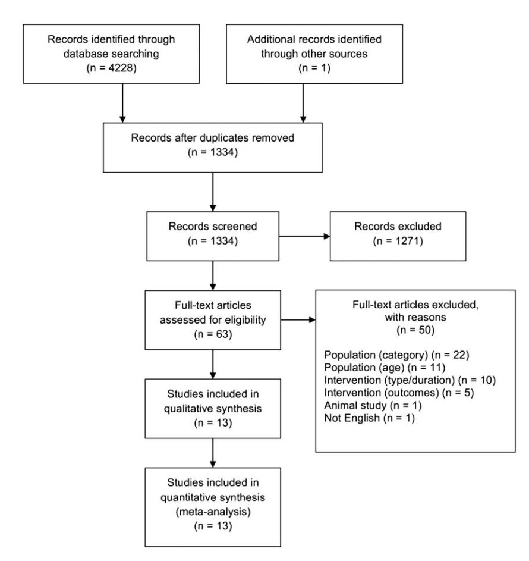
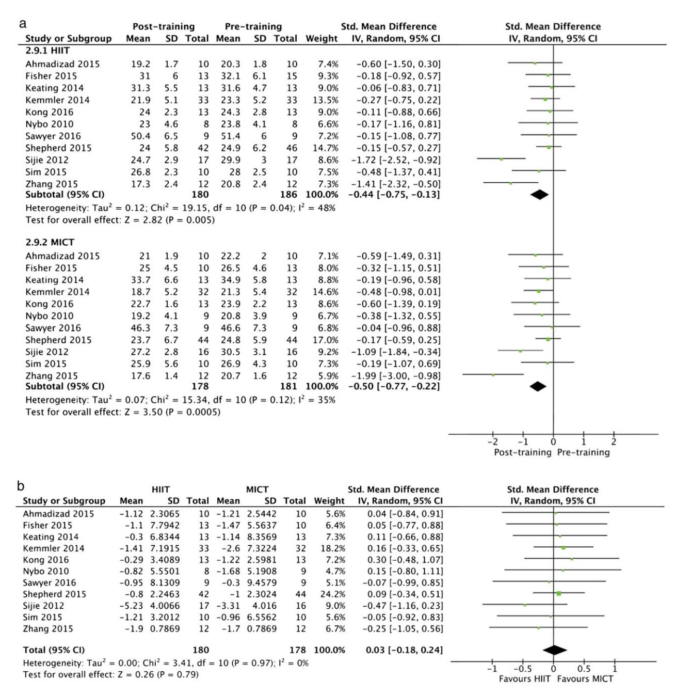
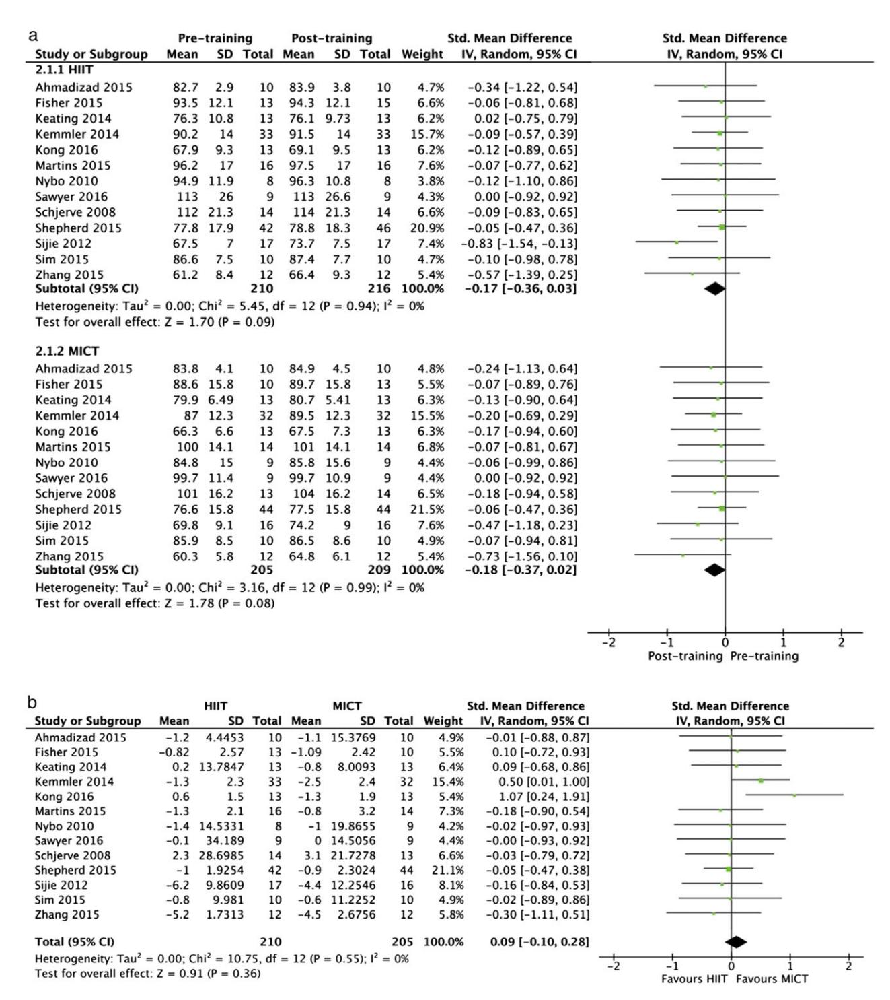

# Etiology and Pathophysiology

# The effects of high-intensity interval training vs. moderate-intensity continuous training on body composition in overweight and obese adults: a systematic review and meta-analysis

M. Wewege, R. van den Berg, R. E. Ward and A. Keech

Department of Exercise Physiology, School of Medical Sciences, University of New South Wales, Sydney, Australia

Received 29 January 2017; revised 12 February 2017; accepted 12 February 2017

Address for correspondence: M. Wewege, Department of Exercise Physiology, School of Medical Sciences, University of New South Wales, Sydney, NSW 2052, Australia. E-mail: m.wewege@unsw.edu.au

#### Summary

Objective: The objective of this study is to compare the effects of high-intensity interval training (HIIT) and moderate-intensity continuous training (MICT) for improvements in body composition in overweight and obese adults.

Methods: Trials comparing HIIT and MICT in overweight or obese participants aged 18–45 years were included. Direct measures (e.g. whole-body fat mass) and indirect measures (e.g. waist circumference) were examined.

Results: From 1,334 articles initially screened, 13 were included. Studies averaged 10 weeks × 3 sessions per week training. Both HIIT and MICT elicited significant (p < 0.05) reductions in whole-body fat mass and waist circumference. There were no significant differences between HIIT and MICT for any body composition measure, but HIIT required ~40% less training time commitment. Running training displayed large effects on whole-body fat mass for both HIIT and MICT (standardized mean difference 0.82 and 0.85, respectively), but cycling training did not induce fat loss.

Conclusions: Short-term moderate-intensity to high-intensity exercise training can induce modest body composition improvements in overweight and obese individuals without accompanying body-weight changes. HIIT and MICT show similar effectiveness across all body composition measures suggesting that HIIT may be a time-efficient component of weight management programs.

Keywords: Exercise, high-intensity interval training, obesity.

# Introduction

Obesity, or more specifically the accumulation of excess body fat, is a significant and rapidly increasing global health issue. More than 39% of adults were considered overweight (body mass index [BMI] > 25 kg m2 ) and 13% considered obese (BMI > 30 kg m2 ) in 2014, and the prevalence of overweight and obesity has doubled globally (1,2) since 1980 (1,2). Being overweight or obese is a major risk factor for cardiovascular and metabolic disorders, in particular, atherosclerosis, type II diabetes and metabolic syndrome (3), and increases risk of all-cause mortality (4). In particular, central adiposity, which specifically relates to adipose

tissue deposited around the trunk and includes the visceral fat around the central organs, induces a range of negative adaptations in cardiovascular structure and function, which magnifies risk of chronic illness and mortality (5–7).

The benefits of physical activity for weight control, reducing central adiposity and managing obesity are well documented (8–12). A key recent finding from a meta-analysis of 117 studies reveals physical activity to be mildly effective for reducing total body weight (although less effective than hypocaloric diet) but has a larger effect in reducing visceral adiposity (10). However, the optimal 'dose–response' characteristics of exercise on body composition are still to be determined, specifically in relation to regional-specific

changes in central adiposity and visceral fat levels. Traditional endurance training methods for weight control tended to focus on longer-duration sessions involving moderateintensity exercise performed continuously without rest, often termed moderate-intensity continuous training (MICT). In recent times, high-intensity interval training (HIIT), referring to alternating short bursts of high-intensity exercise and recovery periods, has become a popular alternative primarily because of its time efficiency, because lack of time is a commonly cited barrier to exercise participation (13).

There is robust and growing evidence that HIIT may elicit superior benefits than MICT across a range of health markers in both healthy and chronic illness populations. Recent meta-analyses have reported that HIIT induces greater improvements in cardiorespiratory fitness than MICT in healthy, young to middle-aged adults (14,15) and in patients with coronary artery disease and cardio-metabolic disorders (16–18). Separate meta-analyses specifically focusing on sprint interval training, a lower-volume variant of HIIT, which involves repeated intervals of very high-intensity with a maximum duration of 30 s, also report a moderate-to-large effect on cardiorespiratory fitness in comparison with noexercise healthy control participants (19,20). HIIT also appears to be superior to MICT for improving markers of vascular function in patients with cardiovascular or metabolic disorders (see review (21)), and HIIT is effective for improving fasting glucose levels and reducing blood pressure in overweight or obese populations (see review (22)).

Despite clear evidence for the positive adaptations following HIIT compared with MICT with regard to aerobic fitness and vascular function, it is still unclear which form of training is most effective for weight control, overall fat loss or central adiposity. Recent studies have analysed the comparative effectiveness of HIIT and MICT on body fat loss in overweight populations with varying findings (23–35), but a systematic review is yet to be conducted. The aim of this systematic review and meta-analysis was to compare the effectiveness of HIIT and MICT on body weight and body composition outcomes in healthy but overweight or obese adults. Secondary aims were to examine outcomes specific to central adiposity and factors in exercise programming which influence effectiveness on body composition measures.

# Methods

### Literature search strategy

The review was conducted in accordance with the Preferred Reporting Items for Systematic Reviews and Meta-analyses statement guidelines (36). A systematic search of electronic databases was conducted up to 1 September 2016, including MEDLINE, Scopus, Embase, SportDiscus, Web of Science, CINAHL and Physiotherapy Evidence Database (PEDro). The search strategy comprised key phrases 'high intensity interval' or 'high intensity intermittent' or 'sprint interval' to identify relevant trials. The search strategy was limited to human subjects and randomized controlled trials where the option was available. The reference lists of the included studies were also examined for any new references not found during the initial electronic search. Two reviewers independently appraised papers (R. V. and M. W.); a third reviewer (A. K.) was consulted to resolve disputes. Study quality was assessed using a modified PEDro score (37) (Table S1).

#### Inclusion and exclusion criteria

#### Type of study

The search included studies involving randomized controlled trial or matched controlled trial designs, written in English. Uncontrolled, cross-sectional and animal studies were excluded from analysis.

#### Type of participants

The review covered studies that included apparently healthy overweight or obese individuals with mean age between 18 and 45 years. Overweight was defined as a BMI greater than 25; obese was defined as BMI greater than 30. Participants were not diagnosed with any other medical comorbidities such as coronary artery disease or diabetes.

#### Type of interventions

Training programs were a minimum duration of 4 weeks. Participants were allocated to a HIIT group or a matched comparator group that undertook MICT. HIIT programs involved interval durations of up to 4 min, with the intensity classified as being greater than 85% of heart rate maximum (HRmax) or a surrogate physiological index, namely, 80% maximal aerobic capacity, or a rating of perceived exertion of 17 (38). MICT programs included continuous aerobic exercise of intensity 60–75% of HRmax (or 50–65% maximal aerobic capacity; 12–15 rating of perceived exertion). Studies were excluded if training was combined with other forms of exercise training (e.g. resistance training), but studies that involved a supplementary nutritional intervention for both trial groups were included.

#### Outcome measures

The primary outcomes were commonly assessed direct measures of body composition, including whole-body fat levels, whole-body lean mass or regional-specific fat measures such as trunk fat (mass or area) and visceral fat mass (area or volume). In instances where whole-body fat percentage was reported, these values were recalculated as whole-body fat mass (BFkg) using the pre-training and post-training body mass values. Secondary outcomes were commonly assessed indirect or surrogate measures of body composition, which include body mass, BMI and waist circumference. Whole-body or regional fat mass measures were drawn from studies that applied hydrostatic weighing, ultrasound, dual-energy X-ray absorptiometry (DXA), bioelectrical impedance analysis (BIA), computed tomography (CT) or magnetic resonance imaging (MRI) (39,40). Measures of body fat drawn from skinfold measures or air displacement plethysmography (Bod Pod) were not included because of validity and/or reliability concerns (41–43).

#### Data synthesis

Two reviewers (M. W. and R. V.) extracted data in duplicate and cross-checked results. Outcomes for body composition were extracted and archived in a database for analysis, including baseline and post-intervention mean ± standard deviation values, and mean difference (MD) and 95% confidence intervals were reported. If not reported, the MD between pre-intervention and post-intervention was calculated by subtracting baseline from post-intervention values. Standardized mean difference (SMD) was calculated as a percentage change from baseline and was applied when different methods were used to establish the same outcome measure. If not reported, 95% confidence intervals and standard deviations for overall treatment effects were calculated using Review Manager (REVMAN) 5.3 (Nordic Cochrane, Denmark). Authors of included studies were contacted for missing values where required.

### Statistical analysis

Between-group meta-analyses were completed for continuous data by using the change in the mean and standard deviation of outcome measures as outlined previously. A random effects inverse variance analysis was used with the effects measure of SMD for BFkg, lean mass, trunk fat, body mass and BMI measures, and MD for waist circumference. Heterogeneity was quantified using the Cochrane Q test and Higgins I 2 . Egger plots were provided to assess the risk of publication bias. Independent sample t-tests were conducted to assess differences between HIIT and MICT interventions in training hours per week during the interventions. Within-group meta-analyses were completed for continuous data using the baseline and post-intervention values for each intervention. Random effects inverse variance analysis was also used with the same effects measures as above. A sub-analysis was also conducted for BFkg and body mass with studies pooled according to exercise modality (treadmill running vs. cycle ergometer). Level of significance was set at p < 0.05 and 95% confidence intervals. Magnitude of effect was categorized as large (SMD > 0.8), medium (SMD 0.5–0.8), small (SMD 0.2–0.5) or trivial (SMD < 0.2) (44,45). Statistical analysis was conducted using SPSS 22.0 (IBM Corp., Armonk, NY, USA), and figures were produced using REVMAN 5.3.

# Results

#### Studies included in the review

The search strategy identified 4,228 articles from electronic databases, and one additional record was identified through other means. Following removal of duplicates, 1,334 articles were initially screened via title and abstract, and 63 were identified as potentially relevant. Full-text examination further excluded 50 studies, leaving 13 studies for inclusion in this analysis (Fig. 1).

Thirteen studies examined body composition outcomes in 424 overweight and obese adults (50% male); 216 completed a HIIT intervention (50% male; mean age = 32.3 years; mean BMI = 29.8), and 208 completed a MICT intervention (50% male; mean age = 31.5 years; mean BMI = 29.5). Participant demographics are outlined in Table 1, and intervention characteristics are outlined in Table 2. Interventions were conducted for 10.4 ± 3.1 weeks (range 5–16 weeks), and the mode of exercise was matched for HIIT and MICT interventions in all studies. Cycle ergometer was the most common modality (seven studies (24,25,27,30,32,34,35)), followed by treadmill running (six studies (23,26,28,29,31,33)).

The HIIT intervention participants trained 3.3 ± 0.7 d per week, for a total of 95 ± 46 min per week. MICT participants trained 3.7 ± 0.9 d per week, for a total of 158 ± 46 min per week. Duration of training per week was significantly lower for the HIIT intervention compared with MICT (p = 0.003). Of the 13 studies, seven applied protocols matched for workload or energy expenditure.

All data for whole-body fat levels (N = 11 studies) were drawn from studies applying either DXA (seven studies (24,25,28,31,32,34,35)) or BIA (four studies (23,26,30,33)). Six studies reported whole-body lean mass (four studies using DXA (27,28,34,35) and two studies using BIA (26,30)), four studies reported trunk fat values (three studies using DXA (25,27,35) and one using BIA (30)) and one CT study provided visceral fat as a measure (33).

# Within-group effects

Within-group analyses are summarized in Table 3. Forest plots for BFkg and body mass are shown in Figs 2a and 3a, respectively. Baseline and follow-up values were unavailable from one study (27) for trunk fat, and one study (26) for lean mass, which were not included in the within-group analyses. The magnitude of change that these studies reported was used in the betweengroup analyses.

Pooled analyses of the individual interventions determined that both HIIT and MICT protocols resulted in statistically significant reductions in BFkg (SMD: 0.44 and 0.5 for HIIT and MICT, respectively; MD: 1.7 and 2.1 kg for HIIT and MICT, respectively) and waist circumference (MD: 3 cm for HIIT and MICT each). There was no significant effect of HIIT or MICT on body mass (SMD: 0.17 and 0.18 for HIIT and MICT, respectively; MD: 2 and 1.9 kg for HIIT and MICT, respectively), lean mass or trunk fat measures. Sub-analysis of the effect of exercise mode (running or cycling) showed a large effect following a HIIT and MICT running protocol for BFkg (SMD: 0.82 and 0.85 for HIIT and MICT, respectively; MD: 2.6 kg for HIIT and MICT each) and small effect on body mass (SMD: 0.31 and 0.3 for HIIT and MICT, respectively) (Table 3). No significant effects were identified for HIIT or MICT cycle ergometer protocols on these measures.

# Between-group effects

Comparisons of HIIT and MICT interventions revealed no significant differences in their effects on any measure of body composition (Table 3). Forest plots for BFkg and body mass are shown in Figs 2b and 3b, respectively. Sub-analysis conducted for exercise mode (cycle ergometer or treadmill running) similarly did not detect any between-group effects. No heterogeneity was detected in any of these analyses.

# Quality assessment

A PEDro (37) assessment determined that the quality of studies in this analysis was moderate (mean score = 4.6 ± 1.3; range 2 to 7; Table S1). Common limitations were related to the allocation of subjects and high dropout rates. All studies except one (28) (92%) randomly allocated subjects to intervention groups, but only one (24) study (8%) used a concealed method of allocation. No study blinded subjects or therapists, but the authors acknowledge the difficulty of applying this in training studies. However, only three studies (25,26,33) blinded a study assessor, which presents a limitation due to potential bias. The overall dropout rate (from N = 10 studies reporting data) was 18.5% (HIIT: 16%, MICT: 20%, p = 0.074; running studies: 23%, cycling studies: 15%, p = 0.12). Eight studies (62%) lost more than 15% of participants to follow-up (Table S1);

Figure 1 Preferred Reporting Items for Systematic Reviews and Meta-analyses flow diagram for study selection.

only Fisher (24) and Sawyer (35) applied an intention-totreat analysis to overcome this issue. From four running studies that provided data (N = 129), 17 participants (13%) reported an adverse event (eight HIIT participants and nine MICT participants). Only one cycling study provided adverse events data, with only one participant adverse event report provided. No studies reported acute injuries from either training protocol, with all adverse events reported as chronic flare-ups or intolerance.

#### Heterogeneity and publication bias

Moderate heterogeneity was detected in two analyses: the pooled within-group analysis of HIIT interventions for changes to BFkg (I 2 = 48%) and also the BFkg sub-analysis for HIIT running protocols (I 2 = 69%). This heterogeneity is due to the strong results of two studies that both applied running protocols (31,33). Egger plots for all analyses determined no indication of publication bias.

# Discussion

To our knowledge, this is the first review to directly compare HIIT and MICT exercise protocols for changes in body composition focusing on overweight and obese individuals. Our results revealed, firstly, short-term aerobic exercise training of at least moderate-intensity can induce significant improvements in BFkg and waist circumference, even in the absence of changes in body weight. Secondly, both HIIT and MICT appear to be similarly effective on these measures, despite HIIT training requiring ~40% less time commitment. Thirdly, training programs that involve running appear especially effective for inducing changes in these body composition measures, while cycling programs are not effective. Each of these findings has major implications for optimizing weight management interventions.

The primary finding is ~10 weeks of high-intensity or moderate-intensity exercise training can reduce BFkg by ~2 kg and waist circumference by ~3 cm in the absence of body mass changes. These values indicate a modest improvement in body composition from short-term exercise training, with body fat mass decreasing by ~6% from initial levels. It should be noted, however, that the magnitude of these changes is within the error for repeated measurement of whole-body fat levels drawn from DXA and BIA if test conditions have not been well-controlled across sessions (46–49), and for waist circumference (50) drawn from overweight or obese populations, so caution must be applied when interpreting this finding.

Exercise has consistently been reported to be relatively ineffective for managing overweight or obesity when not combined with a dietary intervention, based primarily on studies that only analysed body mass or BMI (8,51). While the evidence we present is not definitive, it does add to other

Table1Participantdemographicsforincludedstudiesandoutcomeinstrumentsapplied

| Study     | Year | HIIT        |            |             | MICT         |                           |             | Outcome measure instrument(s) |             |              |                           |
|-----------|------|-------------|------------|-------------|--------------|---------------------------|-------------|-------------------------------|-------------|--------------|---------------------------|
|           |      | Sample size | Gender     | Age (years) | Weight (kg)  | BMI (kg m -2 ) | Sample size | Gender                        | Age (years) | Weight (kg)  | BMI (kg m -2 ) |
| Ahmadizad | 2015 | 10          | 10 M       | 25.0 ± 1.0  | 83.9 ± 3.8   | 27.6 ± 1.9                | 10          | 10 M                          | 25.0 ± 1.0  | 84.9 ± 4.5   | 27.6 ± 1.9                |
| Fisher    | 2015 | 15          | 15 M       | 20.0 ± 1.5  | 94.3 ± 12.1  | 30.0 ± 3.1                | 13          | 13 M                          | 20.0 ± 1.5  | 89.7 ± 15.8  | 29.0 ± 3.4                |
| Keatingi  | 2014 | 13          | 3 M; 10 F  | 41.8 ± 2.7  | 76.1         | 28.2 ± 0.5                | 13          | 2 M; 10 F                     | 44.1 ± 1.9  | 80.7 ± 1.5   | 28.5 ± 0.6                |
| Kemmleri  | 2014 | 33          | 33 M       | 43.9 ± 5.0  | 91.5 ± 14.0  | NA                        | 32          | 32 M                          | 42.9 ± 5.1  | 89.5 ± 12.3  | NA                        |
| Kongi     | 2016 | 13          | 13 F       | 21.5 ± 4.0  | 69.1 ± 9.5   | 25.8 ± 2.6                | 13          | 13 F                          | 20.5 ± 1.9  | 67.5 ± 7.3   | 25.5 ± 2.1                |
| Martinsi  | 2015 | 13          | 4 M; 9 F   | 33.9 ± 7.8  | 97.5 ± 17.0  | 33.2 ± 3.5                | 13          | 5 M; 8 F                      | 33.0 ± 9.9  | 101.1 ± 14.1 | 33.3 ± 2.4                |
| Nyboi     | 2010 | 8           | 8 M        | 37.0 ± 3.0  | 96.3 ± 3.8   | NA                        | 9           | 9 M                           | 31.0 ± 2.0  | 85.8 ± 5.5   | NA                        |
| Sawyeri   | 2016 | 9           | 5 M; 4 F   | 35.6 ± 8.9  | 112.7 ± 26.6 | 37.4 ± 6.2                | 9           | 4 M; 5 F                      | 34.8 ± 7.7  | 99.7 ± 10.9  | 34.5 ± 3.2                |
| Schjervei | 2008 | 14          | 3 M; 11 F  | 46.9 ± 2.2  | 114.0 ± 5.7  | 36.6 ± 1.2                | 13          | 3 M; 10 F                     | 44.4 ± 2.1  | 104.1 ± 4.5  | 36.7 ± 1.4                |
| Shepherdi | 2015 | 46          | 15 M; 31 F | 42.0 ± 11.0 | 78.8 ± 18.3  | 27.7 ± 5.0                | 44          | 15 M; 29 F                    | 43.0 ± 11.0 | 77.5 ± 15.8  | 27.7 ± 4.6                |
| Sijjeli   | 2012 | 17          | 17 F       | 19.8 ± 1.0  | 73.7 ± 7.5   | 27.72 ± 1.88              | 16          | 16 F                          | 19.3 ± 0.7  | 74.2 ± 9.0   | 28.32 ± 1.96              |
| Simi      | 2015 | 10          | 10 M       | 31.0 ± 8.0  | 87.4 ± 7.7   | 27.4 ± 1.6                | 10          | 10 M                          | 31.0 ± 8.0  | 86.5 ± 8.6   | 27.2 ± 1.5                |
| Zhangi    | 2015 | 12          | 12 F       | 21.0 ± 1.0  | 66.4 ± 9.3   | 25.8 ± 2.7                | 12          | 12 F                          | 20.6 ± 1.2  | 64.8 ± 6.1   | 26.0 ± 1.6                |

BIA,intensitytraining;NA,

bioelectricalimpedanceanalysis;BMI,bodymassindex;CT,computedtomography;DXA,dual-energyX-rayabsorptiometry;F,female;HIIT,high-intensityintervaltraining;M,male;MICT,moderatecontinuousnotavailable.

Table2ProgramcharacteristicsforHIITandMICTinterventions

| Study     | Duration (weeks) | Exercise modality | HIIT                                                             | Frequency (days/week) | Exercise time per week (min) | Attendance rate, dropouts and adverse events           | Exercise intensity (% max) | Frequency (days/week)      | Exercise time per week (min) | Attendance rate, dropouts (%) and adverse events |                                                         |
|-----------|------------------|-------------------|------------------------------------------------------------------|-----------------------|------------------------------|--------------------------------------------------------|----------------------------|----------------------------|------------------------------|--------------------------------------------------|---------------------------------------------------------|
| Ahmadizad | 6                | Running           | 90% VO 2 max                                          | 3                     | 85.5                         | NR                                                     | NR                         | 50–60% VO 2 max | 3                            | 150                                              | NR                                                      |
| Fisher    | 6                | Cycle             | 85% max AP                                                       | 3                     | 60                           | Attendance NR; Dropouts = 2 (13%); Adverse NR          | NR; VO 2 max    | 55–65%                     | 5                            | 262.5                                            | Attendance NR; Dropouts = 3 (23%); Adverse NR           |
| Keating   | 12               | Cycle             | 30–45 s 120% VO 2 max: 120–180 s 30 W                 | 3                     | 66                           | Attendance = 96%; Dropouts = 2 (15%); Adverse = 0      | NR; VO 2 max    | 50–65%                     | 3                            | 126                                              | Attendance = 92%; Dropouts = 2 (15%); Adverse = 1 (8%)  |
| Kemmler   | 16               | Running           | 92–110% IAT-HR 90 s–12 min: 1- to 3-min rest                     | 4                     | 212                          | Attendance = 83%; Dropouts = 7 (18%); Adverse = 3 (9%) | NR; IAT-HR                 | 70–82.5%                   | 4                            | 228                                              | Attendance = 82%; Dropouts = 9 (21%); Adverse = 4 (13%) |
| Kong      | 5                | Cycle             | 8-s sprint: 12-s rest for 20 min                                 | 4                     | 80                           | Attendance = 100%; Dropouts = 2 (13%); Adverse NR      | NR; VO 2 max    | 60%                        | 4                            | 160                                              | Attendance NR; Dropouts = 3 (19%); Adverse NR           |
| Martins   | 12               | Cycle             | 85–90% HRmax                                                     | 3                     | 60                           | Attendance = 100%; Dropouts = 3 (19%); Adverse NR      | NR; HRmax                  | 70%                        | 3                            | 96                                               | Attendance = 100%; Dropouts = 1 (7%); Adverse NR        |
| Nybo      | 12               | Running           | 5 x 2 min >95% HRmax                                             | 2                     | 40                           | Attendance = 67%; Dropouts NR; Adverse = 5 (63%)       | NR; HRmax                  | 80%                        | 2.5                          | 150                                              | Attendance = 83%; Dropouts NR; Adverse = 2 (22%)        |
| Sawyer    | 8                | Cycle             | 10 x 1 min 90–95% HRmax                                          | 3                     | 87                           | Attendance = 100%; Dropouts = 4 (18%); Adverse NR      | NR; HRmax                  | 70–75%                     | 3                            | 120                                              | Attendance = 100%; Dropouts = 2 (18%); Adverse NR       |
| Schierve  | 12               | Running           | 4 x 4 min 85–95% HRmax: 3-min rest 50–60% HRmax                  | 3                     | 75                           | NR                                                     | NR                         | 50–60% HRmax               | 3                            | 141                                              | NR                                                      |
| Shepherd  | 10               | Cycle             | 15–60 s >90% HRmax                                               | 3                     | 65.1                         | Attendance = 83%; Dropouts = 4 (9%); Adverse NR        | NR; HRmax                  | 70%                        | 5                            | 180                                              | Attendance = 61%; Dropouts = 8 (9%); Adverse NR         |
| Sijle     | 12               | Running           | 5 x 3 min 85% VO 2 max: 3 min 50% VO 2 max | 5                     | 135                          | Attendance NR; Dropouts = 3 (18%); Adverse = 0         | NR; VO 2 max    | 50%                        | 5                            |                                                  |                                                         |

AP,aerobicpower;APMHR,age-predicatedmaximumheartrate;HIIT,high-intensityintervaltraining;HRmax,heartratemaximum;IAT-HR,individualaerobicthresholdheartrate;MICT,moderate-intensitycontinuoustraining;NR,notreported;VO2max,maximalaerobiccapacity;W,watts.

recently published evidence (analysing studies that applied CT and MRI) that exercise could have utility for fat loss, particularly visceral fat, even if weight loss is not observed. A recent meta-analysis of 117 studies (N = 4,815 participants) (10) reported that, while caloric restriction is more effective than exercise for weight loss, exercise is more effective for decreasing visceral fat stores, and using correlation analysis noted that in the absence of weight loss exercise training still induces ~6% drop in visceral fat. Similarly, a separate meta-analysis of 29 aerobic training studies (ranging from 4 to 52 weeks and involving moderate-intensity to high-intensity exercise training) reported aerobic exercise was effective (effect size 0.33) for lowering visceral fat compared with control groups (52). As such, our findings support the growing view that weight management programming for overweight or obese individuals cannot focus primarily on measures of body weight or BMI and needs to expand to include direct measures of body fat levels (or, at the least, the indirect measure of waist circumference) to give a broader indication in the change to the individual's overall risk profile (53).

There was insufficient evidence from studies providing direct measurement of trunk fat or visceral fat from CT/MRI to support the data from the indirect measure of central adiposity (waist circumference). All four studies reporting trunk fat were drawn from DXA or BIA, and no exerciseinduced effect was seen. To date, only one study has compared the effect of HIIT and MICT on visceral fat using a 'gold-standard' instrument for measurement non-invasively (CT or MRI) (39). This study (33) using CT scanning found a significant decrease (19.5%) in abdominal visceral fat area following 12 weeks of HIIT treadmill running, but no significant decrease in the MICT group (11.1%). Visceral fat

deposits may have more impact on health than simply excess total fat accumulation (5,7,53), and visceral fat accumulation is independently associated with health issues such as hypertension and insulin resistance (54,55). Furthermore, aerobic exercise appears to be a key factor in reducing visceral adiposity compared with diet, with significant reductions occurring without changes to overall body mass (10,52). It is plausible that regional and whole-body fat reduction may occur differently between HIIT and MICT exercise regimes, primarily because of mechanistic factors related to mitochondrial adaptations (56). A greater effect from HIIT on visceral fat adiposity has been reported in women with type II diabetes (57). Future studies should endeavour to include visceral adipose measures using CT and MRI.

The second key finding from this meta-analysis was that HIIT and MICT induced similar magnitude of changes in BFkg and waist circumference. Considering HIIT involved ~40% less time commitment than MICT in the studies we analysed, and also demonstrated a comparable dropout rate, HIIT may be a time-efficient and sustainable strategy to induce modest improvements to body composition. Lack of time is reported to be a strong barrier for many people to undertake physical activity (13,58), so an intensive exercise program with less time commitment may provide a suitable option for individuals trying to improve their body composition. In addition, there is some preliminary evidence that participants report HIIT to be at least as enjoyable as MICT, if not more so (58,59), and preliminary data from application of HIIT in higher-risk populations such as patients with coronary artery disease do not show an increased risk of adverse events occurring (59). In combination with the lower time commitment to training, these points suggest that HIIT may have utility as a sustainable,

Table 3 Summary of meta-analyses

| Outcome   |               | (sub-group) | Studies ( n ) | n   |      | HIIT SMD | p value | Within-group n | effects | MICT SMD | p value | SMD     | 95%     | CI   | Between-group p value | effects 2 I | Heterogeneity p value |
|-----------|---------------|-------------|---------------|-----|------|----------|---------|----------------|---------|----------|---------|---------|---------|------|-----------------------|-------------|-----------------------|
| BFkg      |               |             | 11            | 180 |     | 0.44     | 0.005   | & 178          |        | 0.5      | 0.0005  | 0.03    |  0.18, | 0.24 | 0.79                  | 0%          | 0.97                  |
| (mode     | =             | run)        | 5             | 80  |     | 0.82     | 0.01 &  | 79             |        | 0.85     | 0.001   |  0.04  |  0.36, | 0.27 | 0.78                  | 0%          | 0.64                  |
| (mode     | =             | cycle)      | 6             | 100 |     | 0.17     | 0.23    | 99             |        | 0.23     | 0.10    | 0.09    |  0.19, | 0.30 | 0.55                  | 0%          | 0.99                  |
| Trunk     | fat no.       |             | 4             | 69  |     | 0.19     | 0.31    | 71             |        | 0.14     | 0.43    |  0.10  |  0.49, | 0.28 | 0.60                  | 13%         | 0.33                  |
| Lean mass |               | no.         | 6             | 118 | 0.07 |          | 0.63    | 120            | 0.06    |          | 0.7     | 0.16    |  0.23, | 0.55 | 0.42                  | 49%         | 0.08                  |
| Mass      |               |             | 13            | 210 |     | 0.17     | 0.09    | 205            |        | 0.18     | 0.08    | 0.09    |  0.10, | 0.28 | 0.36                  | 0%          | 0.55                  |
| (mode     | =             | run)        | 6             | 94  |     | 0.31     | 0.04    | 92             |        | 0.3      | 0.04    | 0.10    |  0.19, | 0.39 | 0.50                  | 0%          | 0.51                  |
| (mode     | =             | cycle)      | 7             | 116 |     | 0.06     | 0.66    | 113            |        | 0.08     | 0.54    | 0.09    |  0.19, | 0.37 | 0.52                  | 7%          | 0.38                  |
| Waist     | circumference |             | 5             | 83  |     | 3.07     | * 0.03  | 80             |        | 3.04     | * 0.006 |  0.05* |  1.09, | 1.00 | 0.93                  | 0%          | 0.78                  |
| BMI       |               |             | 9             | 143 |     | 0.22     | 0.06    | 140            |        | 0.32     | 0.02    | 0.09    |  0.15, | 0.32 | 0.46                  | 0%          | 0.57                  |

Bold indicates significant change (p < 0.05); \* indicates mean difference instead of standardized mean difference; # indicates data missing from one study, not included in within-group analysis; & indicates significant heterogeneity.

For between-group effects, a positive SMD value indicates greater magnitude of change for the MICT groups compared with HIIT, except for lean mass where the positive SMD indicates greater magnitude of change that was recorded for HIIT.

BFkg, body fat mass (kg); CI, confidence intervals; HIIT, high-intensity interval training; MICT, moderate-intensity continuous training; NA, not available; SMD, standardized mean difference.

long-term intervention for many overweight or obese individuals. More long-term and 'real-world' studies are required in this area (60), and it is important to note that HIIT and MICT can play complementary roles in exercise prescription for managing obesity and even in combination with resistance training (52).

It is interesting to note the third finding that changes in body composition is influenced by the choice of exercise modality. Our results showed that treadmill running in either HIIT or MICT resulted in significant decreases in BFkg and even body mass. The magnitude of the effect on BFkg was observed to be large (SMD 0.82 for HIIT; 0.85 for MICT), equating to 2.6 kg of fat loss in each group, or ~10% drop in the BFkg from baseline levels. In contrast, cycle training did not significantly affect any measure of body composition. The underlying physiological basis for these differences is unclear and presents a novel area for research. There are a number of physiological

Figure 2 (a) Forest plot for within-group effects of HIIT and MICT interventions on body fat (kg) and (b) forest plot for between-group effects of HIIT and MICT interventions on body fat (kg). CI, confidence interval; HIIT, high-intensity interval training; MICT, moderate-intensity continuous training; SD, standard deviation. [Colour figure can be viewed at [wileyonlinelibrary.com](http://wileyonlinelibrary.com)]

differences between running and cycling that could plausibly at least partially explain the finding. These include more muscle mass recruitment during running for any given sub-maximal workload relative to maximal capacity (e.g. %HRmax), leading presumably to greater energy expenditure (61) although this is not yet clear (62). However, the suitability of applying running training for obese individuals needs clarification. The running and cycling studies showed comparable dropout rates (23% and 15%, respectively), and while running studies constituted a

Figure 3 (a) Forest plot for within-group effects of HIIT and MICT interventions on body mass and (b) forest plot for between-group effects of HIIT and MICT interventions on body mass. CI, confidence interval; HIIT, high-intensity interval training; MICT, moderate-intensity continuous training; SD, standard deviation. [Colour figure can be viewed at [wileyonlinelibrary.com\]](http://wileyonlinelibrary.com)

considerable rate of reported adverse events (13% across four studies that reported this measure), the lack of reported adverse events data from cycling studies (N = 1) does not allow for any meaningful comparison of relative safety profile at this stage. Therefore, a determination about the overall safety and sustainability of running protocols applied in overweight or obese individuals is limited. Future training studies should endeavour to adequately report adverse events, especially those that relate directly to the intervention.

# Strengths and limitations

The quality of included studies and the small pooled sample size (total of 424 adults) present limitations for this analysis, with studies ranging from 17 to 90 participants. As determined in the PEDro assessment, the included studies generally were limited by the lack of assessor blinding and high dropout rates that were not accounted for with intention-to-treat analyses. Inadequate reporting of session attendance, program adherence and adverse events can also be added to the key areas for improvement in overall study quality for the future.

The generalizability of the findings are limited by the relatively modest magnitude of change in whole-body fat levels (~2 kg) and waist circumference (~3 cm) drawn from relatively short-term training studies (~10 weeks), which are within the error of measurement for the instruments applied (47,48,50). In addition, the evidence of change in central adiposity is largely limited to an indirect measure (waist circumference) because of insufficient number of studies applying gold-standard instruments (CT and MRI) for assessing regional-specific changes in trunk fat or visceral fat. Therefore, while we report statistically significant reductions in body fat and waist circumference from shortterm HIIT and MICT, these findings can only provide limited guidance towards clinical relevance at this stage. More long-term studies assessing direct measures of body fat using well-validated instruments are required to clearly deduce the effect of exercise on whole-body and regionalspecific body fat changes.

#### Conclusions and practical implications

Short-term HIIT and MICT exercise both elicit modest improvements, and of similar magnitude, in body fat levels and waist circumference in overweight and obese adults. Considering HIIT shows similar efficacy to MICT, but with ~40% less time commitment each week, HIIT can be considered a time-efficient alternative for managing overweight and obese individuals. Future studies need to analyse the effectiveness of HIIT and MICT on visceral adiposity, considering the health implications of central fat deposition.

# Acknowledgement

We would like to thank the authors of included studies who provided us with extra data for this review.

# Conflict of interest statement

The authors declare no conflicts of interest and report no sources of funding for this study.

#### Supporting information

Additional Supporting Information may be found online in the supporting information tab for this article. http://dx.doi. org/10.1111/obr.12532

Table S1. Results for assessment of study quality using a modified Physiotherapy Evidence Database (PEDro) score.

#### References

- 1. Finucane MM, Stevens GA, Cowan MJ et al. National, regional, and global trends in body-mass index since 1980: systematic analysis of health examination surveys and epidemiological studies with 960 country-years and 9.1 million participants. Lancet (London, England) 2011; 377: 557–567.
- 2. Organisation WH. Obesity and overweight: fact sheet 311. 2016.
- 3. Poirier P, Giles TD, Bray GA et al. Obesity and cardiovascular disease: pathophysiology, evaluation, and effect of weight loss. Circulation 2006; 113: 898–918.
- 4. Flegal KM, Kit BK, Orpana H, Graubard BI. Association of allcause mortality with overweight and obesity using standard body mass index categories: a systematic review and meta-analysis. JAMA 2013; 309: 71–82.
- 5. Bastien M, Poirier P, Lemieux I, Despres JP. Overview of epidemiology and contribution of obesity to cardiovascular disease. Prog Cardiovasc Dis 2014; 56: 369–381.
- 6. Ghandehari H, Le V, Kamal-Bahl S, Bassin SL, Wong ND. Abdominal obesity and the spectrum of global cardiometabolic risks in US adults. Int J Obes (Lond) 2009; 33: 239–248.
- 7. Oliveros E, Somers VK, Sochor O, Goel K, Lopez-Jimenez F. The concept of normal weight obesity. Prog Cardiovasc Dis 2014; 56: 426–433.
- 8. Shaw K, Gennat H, O'Rourke P, Del Mar C. Exercise for overweight or obesity. Cochrane Database Syst Rev 2006: CD003817. <https://doi.org/10.1002/14651858.CD003817.pub3>
- 9. Ohkawara K, Tanaka S, Miyachi M, Ishikawa-Takata K, Tabata I. A dose-response relation between aerobic exercise and visceral fat reduction: systematic review of clinical trials. Int J Obes (Lond) 2007; 31: 1786–1797.
- 10. Verheggen RJ, Maessen MF, Green DJ, Hermus AR, Hopman MT, Thijssen DH. A systematic review and meta-analysis on the effects of exercise training versus hypocaloric diet: distinct effects on body weight and visceral adipose tissue. Obes Rev 2016; 17: 664–690.
- 11. Chin SH, Kahathuduwa CN, Binks M. Physical activity and obesity: what we know and what we need to know. Obes Rev 2016; 17: 1226–1244.
- 12. Shook RP. Obesity and energy balance: what is the role of physical activity? Expert Rev Endocrinol Metab 2016; 11: 511–520.

- 13. Trost SG, Owen N, Bauman AE, Sallis JF, Brown W. Correlates of adults' participation in physical activity: review and update. Med Sci Sports Exerc 2002; 34: 1996–2001.
- 14. Bacon AP, Carter RE, Ogle EA, Joyner MJ. VO2max trainability and high intensity interval training in humans: a meta-analysis. PLoS One 2013; 8: e73182.
- 15. Milanovic Z, Sporis G, Weston M. Effectiveness of highintensity interval training (hit) and continuous endurance training for VO2max improvements: a systematic review and meta-analysis of controlled trials. Sports Med 2015; 45: 1469–1481.
- 16. Elliott AD, Rajopadhyaya K, Bentley DJ, Beltrame JF, Aromataris EC. Interval training versus continuous exercise in patients with coronary artery disease: a meta-analysis. Heart Lung Circ 2015; 24: 149–157.
- 17. Liou K, Ho S, Fildes J, Ooi SY. High intensity interval versus moderate intensity continuous training in patients with coronary artery disease: a meta-analysis of physiological and clinical parameters. Heart Lung Circ 2016; 25: 166–174.
- 18. Weston KS, Wisløff U, Coombes JS. High-intensity interval training in patients with lifestyle-induced cardiometabolic disease: a systematic review and meta-analysis. Br J Sports Med 2013; 48: 1227–1234.
- 19. Gist NH, Fedewa MV, Dishman RK, Cureton KJ. Sprint interval training effects on aerobic capacity: a systematic review and meta-analysis. Sports Med 2014; 44: 269–279.
- 20. Sloth M, Sloth D, Overgaard K, Dalgas U. Effects of sprint interval training on VO2max and aerobic exercise performance: a systematic review and meta-analysis. Scand J Med Sci Sports 2013; 23: e341–e352.
- 21. Ramos JS, Dalleck LC, Tjonna AE, Beetham KS, Coombes JS. The impact of high-intensity interval training versus moderateintensity continuous training on vascular function: a systematic review and meta-analysis. Sports Med 2015; 45: 679–692.
- 22. Batacan RB, Duncan MJ, Dalbo VJ, Tucker PS, Fenning AS. Effects of high-intensity interval training on cardiometabolic health: a systematic review and meta-analysis of intervention studies. Br J Sports Med 2016.<https://doi.org/10.1136/bjsports-2015-095841>
- 23. Ahmadizad S, Avansar AS, Ebrahim K, Avandi M, Ghasemikaram M. The effects of short-term high-intensity interval training vs. moderate-intensity continuous training on plasma levels of nesfatin-1 and inflammatory markers. Horm Mol Biol Clin Invest 2015; 21: 165–173.
- 24. Fisher G, Brown AW, Brown MMB et al. High intensity interval- vs moderate intensity-training for improving cardiometabolic health in overweight or obese males: a randomized controlled trial. PLoS One 2015; 10: e0138853. [https://doi.org/](https://doi.org/10.1371/journal.pone.0138853) [10.1371/journal.pone.0138853](https://doi.org/10.1371/journal.pone.0138853).
- 25. Keating SE, Machan EA, O'Connor HTet al. Continuous exercise but not high intensity interval training improves fat distribution in overweight adults. J Obes 2014; 2014. [https://doi.org/10.1155/](https://doi.org/10.1155/2014/834865) [2014/834865](https://doi.org/10.1155/2014/834865).
- 26. Kemmler W, Scharf M, Lell M, Petrasek C, Von Stengel S. High versus moderate intensity running exercise to impact cardiometabolic risk factors: the randomized controlled rush-study. Biomed Res Int 2014; 2014.<https://doi.org/10.1155/2014/843095>
- 27. Martins C, Kazakova I, Ludviksen M et al. High-intensity interval training and isocaloric moderate-intensity continuous training result in similar improvements in body composition and fitness in obese individuals. Int J Sport Nutr Exerc Metab 2015; 26: 197–204.
- 28. Nybo L, Sundstrup E, Jakobsen MD et al. High-intensity training versus traditional exercise interventions for promoting health. Med Sci Sports Exerc 2010; 42: 1951–1958.
- 29. Schjerve IE, Tyldum GA, Tjonna AE et al. Both aerobic endurance and strength training programmes improve cardiovascular health in obese adults. Clin Sci 2008; 115: 283–293.
- 30. Shepherd SO, Wilson OJ, Taylor AS et al. Low-volume highintensity interval training in a gym setting improves cardiometabolic and psychological health. PLoS One 2015; 10: e0139056.
- 31. Sijie T, Hainai Y, Fengying Y, Jianxiong W. High intensity interval exercise training in overweight young women. J Sports Med Phys Fitness 2012; 52: 255–262.
- 32. Sim AY, Wallman KE, Fairchild TJ, Guelfi KJ. Effects of highintensity intermittent exercise training on appetite regulation. Med Sci Sports Exerc 2015; 47: 2441–2449.
- 33. Zhang H, Tong TK, Qiu W, Wang J, Nie J, He Y. Effect of high-intensity interval training protocol on abdominal fat reduction in overweight Chinese women: a randomized controlled trial. Kinesiology 2015; 47: 57–66.
- 34. Kong ZW, Fan XT, Sun SY, Song LL, Shi QD, Nie J. Comparison of high-intensity interval training and moderate-to-vigorous continuous training for cardiometabolic health and exercise enjoyment in obese young women: a randomized controlled trial. PLoS One 2016; 11: e0158589.
- 35. Sawyer BJ, Tucker WJ, Bhammar DM, Ryder JR, Sweazea KL, Gaesser GA. Effects of high-intensity interval training and moderate-intensity continuous training on endothelial function and cardiometabolic risk markers in obese adults. J Appl Physiol 2016; 121: 279–288.
- 36. Moher D, Liberati A, Tetzlaff J, Altman DG. Preferred reporting items for systematic reviews and meta-analyses: the PRISMA statement. Ann Intern Med 2009; 151: 264–269.
- 37. Maher CG, Sherrington C, Herbert RD, Moseley AM, Elkins
- M. Reliability of the PEDro scale for rating quality of randomized controlled trials. Phys Ther 2003; 83: 713–721.
- 38. Borg GA. Psychophysical bases of perceived exertion. Med Sci Sports Exerc 1982; 14: 377–381.
- 39. Shuster A, Patlas M, Pinthus JH, Mourtzakis M. The clinical importance of visceral adiposity: a critical review of methods for visceral adipose tissue analysis. Br J Radiol 2012; 85:1–10.
- 40. Lee SY, Gallagher D. Assessment methods in human body composition. Curr Opin Clin Nutr Metab Care 2008; 11: 566–572.
- 41. Wells JCK, Fewtrell MS. Measuring body composition. Arch Dis Child 2006; 91: 612–617.
- 42. Tseh W, Caputo JL, Keefer DJ. Validity and reliability of the BOD POD(R) S/T tracking system. Int J Sports Med 2010; 31: 704–708.
- 43. Le Carvennec M, Fagour C, Adenis-Lamarre E, Perlemoine C, Gin H, Rigalleau V. Body composition of obese subjects by air displacement plethysmography: the influence of hydration. Obesity (Silver Spring, Md) 2007; 15: 78–84.
- 44. Borenstein M, Hedges LV, Higgins JP, Rothstein HR. A basic introduction to fixed-effect and random-effects models for metaanalysis. Res Synth Meth 2010; 1: 97–111.
- 45. Cohen J. A power primer. Psychol Bull 1992; 112: 155–159.
- 46. Nana A, Slater GJ, Stewart AD, Burke LM. Methodology review: using dual-energy X-ray absorptiometry (DXA) for the assessment of body composition in athletes and active people. Int J Sport Nutr Exerc Metab 2015; 25: 198–215.
- 47. LaForgia J, Dollman J, Dale MJ, Withers RT, Hill AM. Validation of DXA body composition estimates in obese men and women. Obesity (Silver Spring, Md). 2009; 17: 821–826.
- 48. Shafer KJ, Siders WA, Johnson LK, Lukaski HC. Validity of segmental multiple-frequency bioelectrical impedance analysis to estimate body composition of adults across a range of body mass indexes. Nutrition 2009; 25: 25–32.
- 49. Pietrobelli A, Wang Z, Formica C, Heymsfield SB. Dual-energy X-ray absorptiometry: fat estimation errors due to variation in soft tissue hydration. Am J Physiol Endocrinol Metab 1998; 274: E808–EE16.

- 50. Verweij LM, Terwee CB, Proper KI, Hulshof CTJ, van Mechelen W. Measurement error of waist circumference: gaps in knowledge. Public Health Nutr 2013; 16: 281–288.
- 51. Chin SH, Kahathuduwa CN, Binks M. Physical activity and obesity: what we know and what we need to know. Obes Rev 2016; 17: 1226–1244.
- 52. Ismail I, Keating SE, Baker MK, Johnson NA. A systematic review and meta-analysis of the effect of aerobic vs resistance exercise training on visceral fat. Obes Rev 2012; 13: 68–91.
- 53. Ross R, Bradshaw AJ. The future of obesity reduction: beyond weight loss. Nat Rev Endocrinol 2009; 5: 319–325.
- 54. Rheaume C, Arsenault BJ, Belanger S et al. Low cardiorespiratory fitness levels and elevated blood pressure: what is the contribution of visceral adiposity? Hypertension (Dallas, Tex : 1979) 2009; 54: 91–97.
- 55. Fujioka S, Matsuzawa Y, Tokunaga K, Tarui S. Contribution of intra-abdominal fat accumulation to the impairment of glucose and lipid metabolism in human obesity. Metabolism 1987; 36: 54–59.
- 56. MacInnis MJ, Gibala MJ. Physiological adaptations to interval training and the role of exercise intensity. J Physiol 2016 [https://doi.](https://doi.org/10.1113/JP273196) [org/10.1113/JP273196.](https://doi.org/10.1113/JP273196)
- 57. Maillard F, Rousset S, Pereira B et al. High-intensity interval training reduces abdominal fat mass in postmenopausal women with type 2 diabetes. Diabetes Metab 2016; 42: 433–441.
- 58. Welch N, McNaughton SA, Hunter W, Hume C, Crawford D. Is the perception of time pressure a barrier to healthy eating and physical activity among women? Public Health Nutr 2009; 12: 888–895.
- 59. Rognmo O, Moholdt T, Bakken H et al. Cardiovascular risk of high- versus moderate-intensity aerobic exercise in coronary heart disease patients. Circulation 2012; 126: 1436–1440.
- 60. Gray SR, Ferguson C, Birch K, Forrest LJ, Gill JM. High-intensity interval training: key data needed to bridge the gap from laboratory to public health policy. Br J Sports Med 2016; 50: 1231–1232.
- 61. Millet GP, Vleck VE, Bentley DJ. Physiological differences between cycling and running. Sports Med 2009; 39: 179–206.
- 62. Scott CB, Littlefield ND, Chason JD, Bunker MP, Asselin EM. Differences in oxygen uptake but equivalent energy expenditure between a brief bout of cycling and running. Nutr Metab 2006; 3: 1–1.