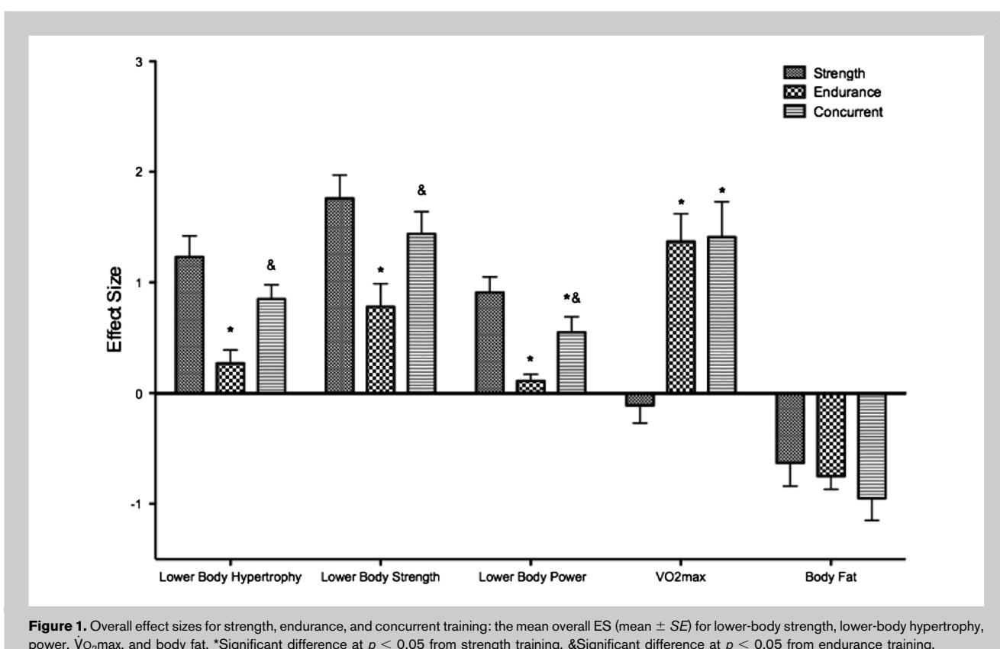
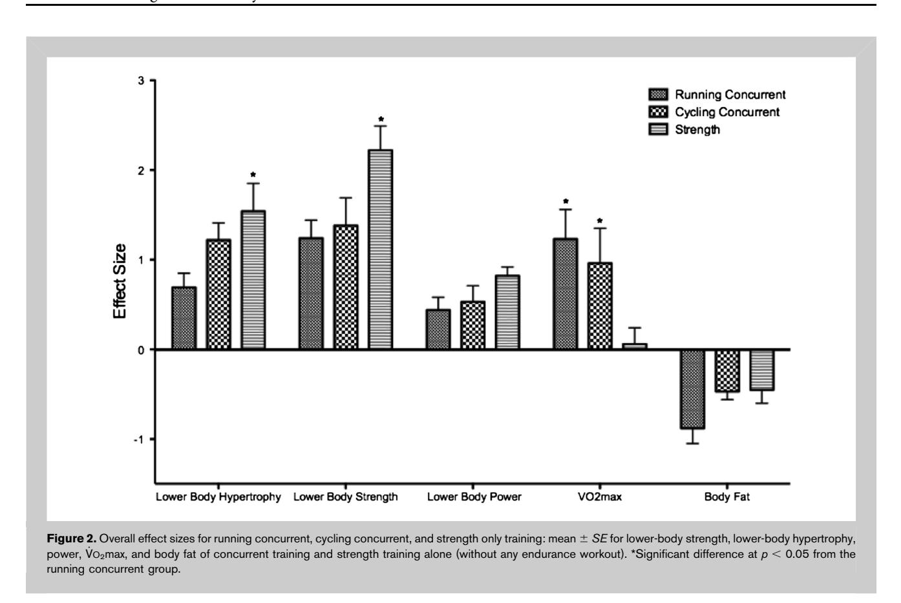
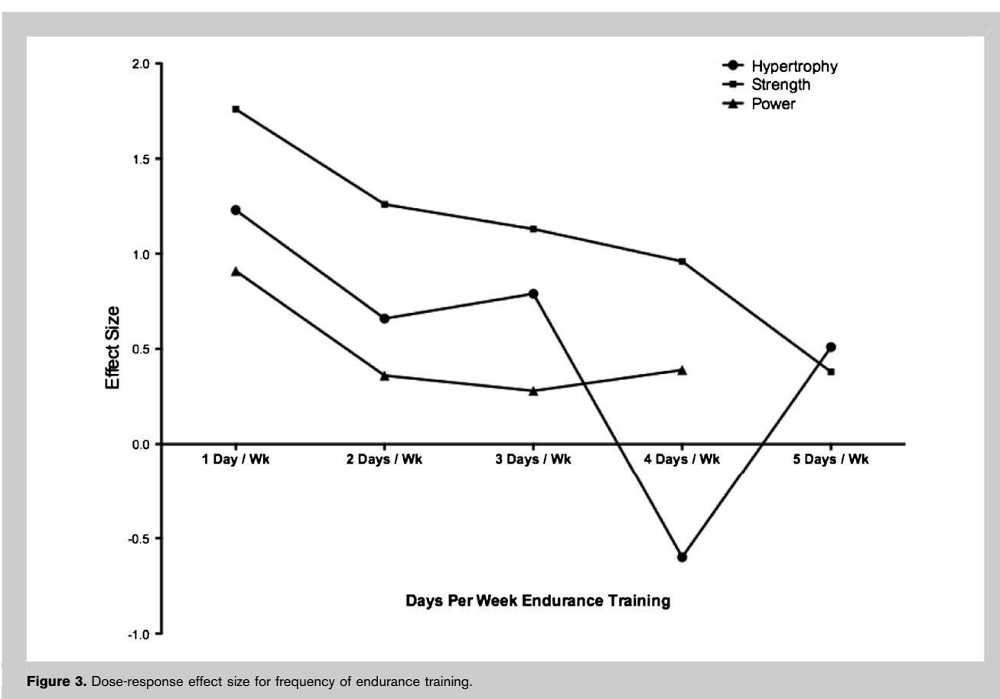
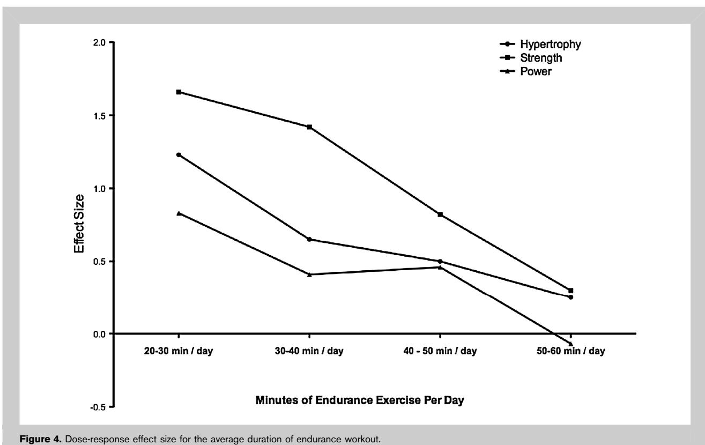
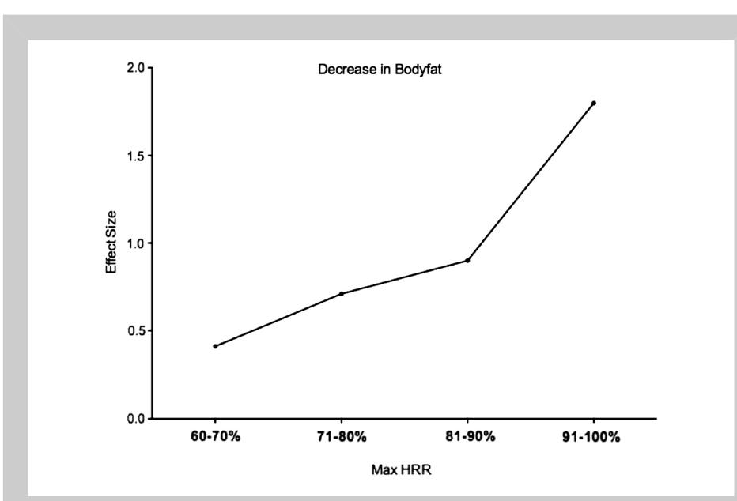

# CONCURRENT TRAINING: AMETA-ANALYSIS EXAMINING INTERFERENCE OF AEROBIC AND RESISTANCE EXERCISES

JACOB M. WILSON, 1 PEDRO J. MARIN, 2,3 MATTHEW R. RHEA, 4 STEPHANIE M.C. WILSON, 1 JEREMY P. LOENNEKE, 5 AND JODY C. ANDERSON1

1 Department of Health Sciences and Human Performance, The University of Tampa, Tampa, Florida; 2 Laboratory of Physiology, European University Miguel de Cervantes, Valladolid, Spain; 3 Research Center on Physical Disability, Valladolid, Spain; 4 Human Movement Program, A. T. Still University, Mesa, Arizona; 5 Department of Health and Exercise Science, The University of Oklahoma, Norman, Oklahoma

# ABSTRACT

Wilson, JM, Marin, PJ, Rhea, MR, Wilson, SMC, Loenneke, JP, and Anderson, JC. Concurrent training: A meta-analysis examining interference of aerobic and resistance exercise. J Strength Cond Res 26(8): 2293–2307, 2012—The primary objective of this investigation was to identify which components of endurance training (e.g., modality, duration, frequency) are detrimental to resistance training outcomes. A meta-analysis of 21 studies was performed with a total of 422 effect sizes (ESs). Criteria for the study included were (a) compare strength training alone to strength plus endurance training (concurrent) or to compare combinations of concurrent training; (b) the outcome measures include at least one measure of strength, power, or hypertrophy; and (c) the data necessary to calculate ESs must be included or available. The mean ES for hypertrophy for strength training was 1.23; for endurance training, it was 0.27; and for concurrent training, it was 0.85, with strength and concurrent training being significantly greater than endurance training only. The mean ES for strength development for strength training was 1.76; for endurance training, it was 0.78; and for concurrent training, it was 1.44. Strength and concurrent training was significantly greater than endurance training. The mean ES for power development for strength training only was 0.91; for endurance training, it was 0.11; and for concurrent training, it was 0.55. Significant differences were found between all the 3 groups. For moderator variables, resistance training concurrently with running, but not cycling, resulted in significant decrements in both hypertrophy and strength. Correlational analysis identified significant negative relationships between frequency (20.26 to

20.35) and duration (20.29 to 20.75) of endurance training for hypertrophy, strength, and power. Significant relationships (p , 0.05) between ES for decreased body fat and % maximal heart rate (r = 20.60) were also found. Our results indicate that interference effects of endurance training are a factor of the modality, frequency, and duration of the endurance training selected.

KEY WORDS strength training, endurance training, power, hypertrophy, V\_ O2max

## INTRODUCTION

Several sports require the need for endurance, power, muscular size, and strength. For example, in a single hockey game, an athlete may be required to sprint past his or her opponent for a lose puck (explosive power), deliver a hard body check (strength and muscularity), and kill 2 power plays in overtime (endurance). The inclusion of resistance training (to gain strength, hypertrophy, and power) combined with aerobic exercise (to enhance endurance) in a single program is known as concurrent training. Generally, concurrent training studies have 3 groups: one with exclusive resistance training, one with endurance training only, and the last performing both resistance training and endurance training in the same program. Concurrent training, relative to resistance training alone, has been shown to result in decrements in strength (13,21,25,29), hypertrophy (25,29,39), and power (21,24,26,29,31). However, additional studies have found little to no decrements in strength training gains with the addition of endurance training (4,38,39,48,49). Moreover, recent data have demonstrated large interindividual variation in responses to changes in maximal voluntary contraction after concurrent training (212 to 87%). These data indicate that some individuals experience strength decrements after concurrent training, whereas others experience substantial gains (27).

26(8)/2293–2307

Address correspondence to Dr. Jacob M. Wilson, jmwilson@ut.edu.

Journal of Strength and Conditioning Research -2012 National Strength and Conditioning Association

Several explanations have been offered to explain the concurrent training or interference effects seen. One of the more popular theories is the chronic interference hypothesis, which postulates that the addition of endurance training results in overreaching and overtraining and stimulates competing adaptations over a long-term training program (33). Overreaching is currently thought to be caused by high-volume, high-intensity, or high-frequency training bouts (22), particularly when bouts of exercise result in large amounts of skeletal muscle damage (22). It is likely that elements of endurance training, which exacerbate overreaching, would in theory result in greater interference effects.

As far as competing adaptations are concerned, traditional resistance exercise trains skeletal muscle in short duration activities in which force is maximal or at least near maximal levels. In contrast, endurance training requires individuals to exert relatively low force outputs and maintain those outputs over long durations. Logically, the adaptations for resistance and endurance exercise are vastly different and in many cases conflict one another (23,33). From a molecular standpoint, endurance exercise preferentially increases net protein synthesis in the mitochondrial subfraction, whereas highintensity resistance training preferentially increases net protein synthesis in the myofibrillar subfraction (9,23,50). Moreover, with training experience, these changes become increasingly more specific over time (50). When combined, however, research indicates that the upregulation of translation initiation via the PI3K-AKT-mTOR signaling pathway is impaired when resistance training is performed after glycogen depleting endurance exercise (12,23). Moreover, although resistance training increases myofibrillar protein synthesis for up to 72 hours after an intense training bout (12), moderate intensity endurance exercise immediately acts to inhibit important elongation factors (eef2) responsible for increasing protein synthesis and maintains this inhibition for the duration of the activity (45).

To date, very little research has been conducted to disseminate which components of endurance (e.g., modality, intensity, duration) training are most detrimental to resistance training outcomes and still further which outcomes (e.g., strength, hypertrophy, power) are affected to the greatest extent. A robust and quantitative approach to the problem can be provided in the form of a meta-analysis of the data. This technique minimizes subjectivity by standardizing treatment effects of relevant studies into effect sizes (ESs), pooling the data, and then analyzing it to draw conclusions (41). The primary objective of this investigation was to quantitatively identify which components of endurance exercise result in detrimental effects on resistance training outcomes.

power, V\_ O2max, and body fat. \*Significant difference at p , 0.05 from strength training. &Significant difference at p , 0.05 from endurance training.

| <b>Table 1.</b> Effect size for muscle hypertrophy.*† |                         |                   |    |                    |                    |                  |            |                   |    |
|-------------------------------------------------------|-------------------------|-------------------|----|--------------------|--------------------|------------------|------------|-------------------|----|
|                                                       | Strength                |                   |    | Endurance          |                    |                  | Concurrent |                   |    |
|                                                       | Overall                 | Mean (95% CI)     | N  | Mean (95% CI)      | N                  | Mean (95% CI)    | N          | Mean (95% CI)     |    |
| Moderators                                            | Gender                  | 1.23 (0.92, 1.53) | 23 | 0.27 (-0.53, 0.60) | 20                 | 0.85 (0.57, 1.2) | 29         |                   |    |
|                                                       | Male                    | 1.12 (0.49, 1.75) | 14 | $p > 0.05$         | 0.12 (-0.11, 0.36) | 11               | $p < 0.05$ | 0.81 (0.42, 1.20) | 15 |
|                                                       | Female                  | ID                |    | ID                 |                    |                  | ID         |                   |    |
|                                                       | Both                    | 1.42 (0.67, 2.17) | 9  |                    | 0.72 (0.44, 0.99)  | 9                |            | 1.08 (0.52, 1.63) | 14 |
| Age (y)                                               | <25                     | 1.14 (0.48, 1.80) | 13 | $p > 0.05$         | 0.28 (0.04, 0.52)  | 13               |            | 0.87 (0.41, 1.31) | 18 |
|                                                       | 25–50                   | 1.70 (0.99, 2.41) | 7  |                    | ID                 |                  |            | 1.11 (0.63, 1.59) | 8  |
|                                                       | >50                     | ID                |    | ID                 |                    |                  | ID         |                   |    |
|                                                       | Untrained               | 1.19 (0.59, 1.78) | 18 |                    | 0.31 (0.08, 0.53)  | 15               |            | 0.94 (0.56, 1.38) | 24 |
| Split                                                 | Trained                 | ID                |    | ID                 |                    |                  | ID         |                   |    |
|                                                       | Athletes                | ID                |    | ID                 |                    |                  | ID         |                   |    |
|                                                       | Only strength training  | 1.22 (0.73, 1.17) | 23 |                    | 0.32 (0.14, 0.50)  | 20               |            | 0.80 (0.38, 1.22) | 20 |
|                                                       | Only endurance training |                   |    |                    |                    |                  |            | 1.06 (0.59, 1.53  | 8  |
| Strength + endurance (I)                              |                         |                   |    |                    |                    |                  |            |                   |    |
| Strength + endurance (II)                             |                         |                   |    |                    |                    |                  |            |                   |    |
| Strength + endurance (III)                            |                         |                   |    |                    |                    |                  |            |                   |    |

\*CIconfidenceinterval;ESeffectsize;IDinsufficientdata,5ESs);strength+endurance3:strength/endurancesameday;strength+endurance(II)4strength/endeveryotherday;strength+endurance(III)strengthendurancesamedayhalftime,andhalfstrengthalone.†Strength+endurancesameday:strengthtraining/endurancetrainingperformedonthesameday.

# METHODS

# Experimental Approach to the Problem

To evaluate what components of endurance exercise result in detrimental effects on resistance training, a meta-analytic review was conducted. Relevant studies were combined and analyzed statistically to provide an overview of the body of research on this topic. Conclusions were based on the literature with suggestions for applications and future research for strength and conditioning professionals.

### Literature Search

Searches were performed for published studies with a number of criteria. First, the primary focus of the study was to compare the effects of strength training alone with concurrent training on strength, power, and hypertrophy. However, if a study's primary objective was to compare 2 different concurrent training methods to each other, then it was also included in our analysis. Finally, to be considered for our analysis, the subject populations of the studies had to have similar baseline characteristics in strength and aerobic capacity (e.g., both untrained or trained) so that valid outcome measures could be made. Moreover, the outcome measures had to include at least one measure or a combination of measures of strength, power, or hypertrophy. Strength variables included maximal exertion against an external resistance (both dynamic and static). Hypertrophy was accepted as whole muscle volume or thickness as indicated by magnetic resonance imaging or ultrasound, respectively, or changes in muscle fiber cross-sectional area (types 1 and 2). Finally, power was fractionated into immediate (e.g., vertical jump and peak power on a Wingate) and mean power output as recorded in a Wingate 30-second test. Electronic databases searched included the Science Citation Index, National Library of Medicine, Sport Discus, Google Scholar, and MEDLINE, which were searched in February 2011 back to the earliest available time (1980) when Hickson et al. published a foundational study on concurrent training (25). Exclusion of studies with irrelevant content and doublets was carried out in 3 steps. First, the titles of the articles were read. Second, the abstracts were read. Third, the entire article was read. The reference lists of relevant articles were, in turn, scanned for additional articles (published or unpublished) that met the inclusion criteria. Attempts were made to contact the authors for requesting any unpublished work. Conference abstracts and proceedings were excluded. Relevant studies were selected and searched for data necessary to compute ES and descriptive information regarding the training protocol.

#### Coding of Studies

Each study was read and coded by the primary investigator for descriptive information including gender, age,

and training experience. For both endurance and resistance training, we coded for frequency, mean training intensity, volume (duration of endurance and sets of strength training), and type of training split used. For resistance training, frequency was coded by the number of days per week that the participants trained their lower or upper bodies. Endurance training was coded as days per week aerobic exercise was performed. Intensity for resistance and endurance training was coded, respectively, as the average percent of 1 repetition maximum (1RM) used and average percent of heart rate reserve or V\_ O2max used. Volume for resistance and endurance training, respectively, was coded as the number of sets performed for the upper and lower body and the average duration of the endurance training session. Training split was coded as strength only, endurance only, strength and endurance training performed on the same day, and strength and endurance training performed every other day. Training status was defined as untrained, trained, and athlete. The participants must have been training for at least 1 year with weightlifting before the study to be considered as trained. To be considered for the athlete category, the participants must have been competitive athletes at the collegiate or professional level.

### Calculation and Analysis of Effect Size

Pre-ES and post-ES were calculated with the following formula: ([Posttest mean 2 pretest mean]/pretest SD). The ESs were then adjusted for sample size bias (41,42). This adjustment consists of applying a correction factor to adjust for a positive bias in smaller sample sizes. Descriptive statistics were calculated, and univariate analysis of variance by groups was used to identify differences between training status, gender, and age with the level of significance set at p , 0.05. All the calculations were made with SPSS statistical software package v.19.0 (SPSS Inc., Chicago, IL, USA). The scale proposed by Rhea (41,42) was used for interpretation of the ES magnitude. Coder drift was assessed by randomly selecting 10 studies for recoding. Per case agreement was determined by dividing the variables coded the same by the total number of variables (41,42). A mean agreement of 0.90 was required for acceptance.

# RESULTS

The overall ES and moderating variables are presented in Tables–1–5. The 72 ESs for lower-body muscle hypertrophy, 24 ESs for upper-body muscle hypertrophy, 75 ESs for lowerbody strength development, 24 ESs for upper-body strength development, 46 ESs for lower-body power development,

46 ESs for V\_ O2max, and 43 ESs for body fat were obtained from a total of 21 primary studies (3,4,7,10,11,13,18,20, 24–26,29,30,32,38–40,46–49).

### Muscle Hypertrophy

The mean overall ES for muscle hypertrophy for strength training was 1.23 (95% confidence interval [CI]: 0.92, 1.53; n: 23); for endurance training, it was 0.27 (95% CI: 20.53, 0.60; n: 20); and for concurrent training, it was 0.85 (95% CI: 0.57, 1.2; n: 29) (Figure 1 and Table 1). Significant differences were found between strength and endurance (p , 0.05) and between endurance and concurrent (p , 0.05).

Moderating Variables. An analysis of the differences in hypertrophy gains achieved for endurance training in male and combined gender groups from all studies included was performed to determine whether gender influenced strength gains. The combined group gained more hypertrophy than did the male group 0.72 (95% CI: 0.44, 0.99; n: 9) vs. 0.12 (95% CI: 20.11, 0.36; n: 11) (p , 0.05), respectively (Table 1). A significant difference was found between concurrent training with running endurance modality and strength training alone (without any endurance workout) 0.68 (95% CI: 0.31, 1.06; n: 16) vs. 1.54 (95% CI: 1.10, 1.97; n: 12) (p , 0.05), respectively (Figure 2). However, no significant differences were found between training groups for upper body; the mean overall ES for muscle hypertrophy strength training was 0.16 (95% CI: 20.03, 0.36; n: 8); for endurance training, it was 0.02 (95% CI: 21.71, 0.22; n: 8); and for concurrent training, it was 0.14 (95% CI: 20.06, 0.33; n: 8) (p . 0.05). Training split performing endurance and strength training on the same day resulted in an ES for hypertrophy of 0.8, whereas performing them on separate days resulted in an ES of 1.06. However, these were not significantly different. Correlational analysis identified significant relationships (p , 0.05) between ES for lower-body hypertrophy and frequency of endurance training (r = 20.26) (Figure 3) and the average duration of endurance workout (r = 20.75) (Figure 4). Insufficient data were obtained for an analysis of other variables (minimum 5 ESs).

### Strength Development

The mean overall ES for strength development for strength training was 1.76 (95% CI: 1.34, 2.18; n: 24), for endurance training was 0.78 (95% CI: 0.36, 1.19; n: 25), and for concurrent training 1.44 (95% CI: 1.03, 1.84; n: 26) (Figure 1 and Table 2). Significant differences were found between strength and endurance (p , 0.05), and between endurance and concurrent (p , 0.05), for lower body (Figure 1 and Table 2). However, no significant differences were found between training groups for upper body; the mean overall ES for strength development for strength training was 3.17 (95% CI: 0.88, 5.45; n: 8); for endurance training, it was

| 0.05 p Concurrent 18 26 N 8 1.84) 2.04) 2.88) CI) (95% (1.03, (0.72, (0.76, Mean 1.44 1.38 1.82 ID 0.05 p 25 18 N Endurance 7 1.19) CI) 1.33) 1.88) (95%               | 0.05 0.05 p p 22 16 17 8 8 2.28) 1.96) 3.19) 2.06) 2.27) (0.99, (0.64, (1.07, (0.51, (0.45, 1.30 1.28 1.63 2.13 1.36 ID ID ID ID 0.05 p 20 15 25 7 1.26) 1.35) 2.14) 1.31)                                                                                                                                     |
|------------------------------------------------------------------------------------------------------------------------------------------------------------------------|----------------------------------------------------------------------------------------------------------------------------------------------------------------------------------------------------------------------------------------------------------------------------------------------------------------|
| development.* †                                                                                                                                                        |                                                                                                                                                                                                                                                                                                                |
| 25                                                                                                                                                                     | ,                                                                                                                                                                                                                                                                                                              |
| (0.36, (0.18, (0.14, Mean ID p N Strength 2.18) 2.10) 3.00) CI) (1.34, (0.96, (1.30, Mean ID strength Female Overall Male Both for size Effect Moderators Gender TABLE | 2 0.19, (0.29, (0.39, (0.35, ( ID ID ID p p 2.26) 3.46) 2.15) 2.97) 2.18) (1.10, (1.79, (1.11, (1.27, (1.23, ID ID (III) (II) (I) training endurance endurance endurance training endurance strength + + + Untrained Strength Strength Strength Athletes Trained 25–50 Only Only status Training (y) Split Age |

\*CI

confidence

interval;

ES

effectsize;ID

insufficient

data,5ESs);

strength+

endurance

(I)

3:strength/endurance

sameday;

strength+

endurance

(II)4

strength/end

every

otherday;

strength+

endurance

(III)5strength

endurance

onsamedayhalftime,andhalf

strength

alone.

†Strength

+

endurance

sameday:

strength

training/endurance

training

performed

onthesameday.

Strength+

endurance

everyotherday:

strength

training

and

endurance

training

were

performed

every

otherday.

| <b>TABLE 3.</b> Effect size for muscle power development.*† |                            |                   |                    |                    |                   |                    |    |
|-------------------------------------------------------------|----------------------------|-------------------|--------------------|--------------------|-------------------|--------------------|----|
|                                                             | Strength                   |                   | Endurance          |                    | Concurrent        |                    |    |
|                                                             | Mean (95% CI)              | N                 | Mean (95% CI)      | N                  | Mean (95% CI)     | N                  |    |
|                                                             | 0.91 (0.65, 0.13)          | 15                | 0.11 (-0.15, 0.38) | 14                 | 0.55 (0.31, 0.79) | 17                 |    |
| Moderators                                                  | Male                       | 0.87 (0.41, 1.33) | 12                 | 0.22 (0.10, 0.33)  | 11                | 0.43 (-0.81, 0.94) | 18 |
|                                                             | Female                     | ID                |                    | ID                 |                   | ID                 |    |
|                                                             | Both                       | ID                |                    | ID                 |                   | ID                 |    |
| Age (y)                                                     | <25                        | 0.88 (0.39, 1.36) | 17                 |                    |                   | 0.44 (-0.04, 0.93) | 15 |
|                                                             | 25-50                      | ID                |                    | 0.56 (0.23, 0.88)  | 13                | ID                 |    |
|                                                             | >50                        | ID                |                    | ID                 |                   | ID                 |    |
| Training status                                             | Untrained                  | ID                |                    | ID                 |                   | ID                 |    |
|                                                             | Trained                    | 0.85 (0.29, 1.41) | 7                  | 0.05 (-0.09, 0.18) | 7                 | 0.56 (-0.19, 1.10) | 5  |
|                                                             | Athletes                   | ID                |                    | ID                 |                   | ID                 |    |
| Split                                                       | Only strength training     | 0.96 (0.56, 1.36) | 15                 |                    |                   |                    |    |
|                                                             | Only endurance training    |                   |                    | 0.21 (0.11, 0.31)  | 14                |                    |    |
|                                                             | Strength + endurance (I)   |                   |                    |                    |                   | 0.36 (-0.27, 0.98) | 9  |
| Strength + endurance (II)                                   | Strength + endurance (II)  |                   |                    |                    |                   | 0.47 (-0.22, 1.16) | 7  |
|                                                             | Strength + endurance (III) |                   |                    |                    |                   | ID                 |    |

\*CI

confidence

interval;ES

effectsize;ID.

insufficient

data,5ESs);

strength+

endurance

3:strength/endurance

sameday;

strength+

endurance

(II)4

strength/end

every

otherday;

strength+

endurance

(III)5strength

endurance

thesamedayhalftime,andhalf

strength

alone.

†Strength

+

endurance

sameday:

strength

training/endurance

training

performed

onthesameday.

Strength+

endurance

everyotherday:

strength

training

and

endurance

training

were

performed

every

otherday.

| <b>TABLE 4.</b> Effect size for $\dot{V}_{o2}\max$ *† |                                      |                     |                                    |                   |                                    |                    |    |
|-------------------------------------------------------|--------------------------------------|---------------------|------------------------------------|-------------------|------------------------------------|--------------------|----|
|                                                       | Strength                             |                     | Endurance                          |                   | Concurrent                         |                    |    |
|                                                       | Mean (95% CI) -0.11 (-0.62, 0.41) | N 15             | Mean (95% CI) 1.37 (0.85, 1.88) | N 15           | Mean (95% CI) 1.41 (0.91, 1.91) | N 16            |    |
| Moderators                                            | Male                                 | -0.29 (-0.85, 0.26) | 10                                 | 1.45 (0.57, 2.33) | 10                                 | 1.94 (0.93, 2.95)  | 10 |
|                                                       | Female                               | ID                  |                                    | ID                |                                    | ID                 |    |
|                                                       | Both                                 | ID                  |                                    | ID                |                                    | 0.97 (-0.36, 2.31) | 6  |
|                                                       | <25                                  | -0.03 (-0.49, 0.48) | 12                                 | 1.39 (0.69, 2.08) | 13                                 | 1.61 (0.73, 2.48)  | 14 |
| Age (y)                                               | 25-50                                | ID                  |                                    | ID                |                                    | ID                 |    |
|                                                       | >50                                  | ID                  |                                    | ID                |                                    | ID                 |    |
|                                                       | Untrained                            | 0.00 (-0.62, 0.63)  | 8                                  | 1.36 (0.35, 2.36) | 8                                  | 1.56 (0.49, 2.63)  | 9  |
|                                                       | Trained                              | ID                  |                                    | ID                |                                    | ID                 |    |
| Split                                                 | Athletes                             | ID                  |                                    | ID                |                                    | ID                 |    |
|                                                       | Only strength training               | -0.21 (-0.66, 0.24) | 15                                 |                   |                                    | ID                 |    |
|                                                       | Only endurance training              |                     |                                    | 1.30 (0.60, 2.01) | 15                                 | 1.15 (0.16, 2.15)  | 11 |
|                                                       | Strength + endurance (I)             |                     |                                    |                   |                                    | ID                 |    |
| Strength + endurance (II)                             |                                      |                     |                                    |                   | ID                                 |                    |    |
| Strength + endurance (III)                            |                                      |                     |                                    |                   | ID                                 |                    |    |

\*CIconfidenceinterval;ESeffectsize;IDinsufficientdata(,5ESs);strength+endurance3:strength/endurancesameday;strength+endurance(II)4strength/endeveryotherday;strength+endurance(III)5strengthendurancethesamedayhalftime,andhalfstrengthalone.†Strength+endurancesameday:strengthtraining/endurancetrainingperformedonthesameday.Strength+enduranceeveryotherday:strengthtrainingandendurancetrainingperformedeveryotherday.

| <b>TABLE 5.</b> Effect size for body fat.*† |                            |                                       |         |                                       |         |                                       |            |  |
|---------------------------------------------|----------------------------|---------------------------------------|---------|---------------------------------------|---------|---------------------------------------|------------|--|
|                                             | Strength                   |                                       |         | Endurance                             |         |                                       | Concurrent |  |
|                                             | Overall                    | Mean (95% CI) -0.62 (-0.99, -0.25) | N 14 | Mean (95% CI) -0.75 (-1.12, -0.37) | N 14 | Mean (95% CI) -0.95 (-1.30, -0.58) | N 15    |  |
| Moderators                                  | Male                       | -0.76 (-1.08, -0.46)                  | 12      | -0.68 (-0.99, -0.37)                  | 12      | -0.99 (-1.22, -0.77)                  | 13         |  |
|                                             | Female                     | ID                                    |         | ID                                    |         | ID                                    |            |  |
|                                             | Both                       | ID                                    |         | ID                                    |         | ID                                    |            |  |
| Age (y)                                     | <25                        | -0.50 (-0.84, -0.17)                  | 9       | -0.86 (-1.18, -0.55)                  | 10      | -1.18 (-1.42, -0.94)                  | 11         |  |
|                                             | 25-50                      | ID                                    |         | ID                                    |         | ID                                    |            |  |
|                                             | >50                        | ID                                    |         | ID                                    |         | ID                                    |            |  |
| Training status                             | Untrained                  | -0.38 (-0.71, -0.05)                  | 9       | -0.64 (-0.99, -0.28)                  | 9       | -0.65 (-0.91, -0.39)                  | 9          |  |
|                                             | Trained                    | ID                                    |         | ID                                    |         | ID                                    |            |  |
|                                             | Athletes                   | ID                                    |         | ID                                    |         | ID                                    |            |  |
| Split                                       | Only strength training     | -0.74 (-1.02, -0.46)                  | 14      | -0.75 (-1.03, -0.47)                  | 14      | -0.88 (-1.16, -0.61)                  | 9          |  |
|                                             | Only endurance training    |                                       |         |                                       |         | ID                                    |            |  |
|                                             | Strength + endurance (I)   |                                       |         |                                       |         | ID                                    |            |  |
|                                             | Strength + endurance (II)  |                                       |         |                                       |         | ID                                    |            |  |
|                                             | Strength + endurance (III) |                                       |         |                                       |         | ID                                    |            |  |

\*CI = confidence interval; ID = insufficient data (<5 ESs); strength + endurance (I) = 3:strength/endurance same day; strength + endurance (II) = 4 strength/end EOD; strength + endurance (III) = 5 strength endurance on the same day half time, and half strength alone; ES = effect size.

†Strength + endurance same day: strength training/endurance training performed on the same day. Strength + endurance every other day: strength training and endurance training were performed every other day.

0.39 (95% CI: 21.89, 2.68; n: 8); and for concurrent training, it was 1.97 (95% CI: 20.32, 4.25; n: 8) (p . 0.05).

Moderating Variables. No significant difference was found between variables including training split (Table 2).

However, a significant difference was found between ES of concurrent training with running endurance modality and strength training alone (without any endurance workout), 1.23 (95% CI: 0.81, 1.65; n: 9) vs. 2.22 (95% CI: 1.70, 2.74; n: 14) (p , 0.05), respectively (Figure 2). Correlational analysis identified significant relationships (p , 0.05) between ES for lower-body strength and frequency of endurance training (r =20.31) (Figure 3) and the average duration of endurance workout (r =20.34) (Figure 4). Insufficient data were obtained for an analysis of other variables.

### Power Development

There were not enough data to compare the effects of concurrent training on immediate and mean power. Therefore, we pooled these data. The mean overall ES for power development of the lower body (Figure 1 and Table 3) for strength training only was 0.91 (95% CI: 0.65, 1.30; n: 15); for endurance training, it was 0.11 (95% CI: 20.15, 0.38; n: 14);

Figure 5. Dose-response effect size of the decrease in body fat for percent of maximal heart rate reserve for concurrent training.

Figure 6. Competing long-term adaptations: Commonality of adaptations between strength training, long duration endurance exercise, and high-volume sprint training.

and for concurrent training, it was 0.55 (95% CI: 0.31, 0.79; n: 17). Significant differences for lower body (Figure 1 and Table 3) were found between strength, endurance, and concurrent training (p , 0.05). Insufficient data were obtained for an analysis of the upper body.

Moderating Variables. No significant difference was found between moderating variables (Table 3). Correlational analysis identified significant relationships (p , 0.05) between ESs for power development and frequency of endurance training (r =20.35) (Figure 3) and the average duration of the endurance workout (r =20.29) (Figure 4). Insufficient data were obtained for an analysis of other variables.

### Maximal Oxygen Uptake

The mean overall ES for V\_ O2max for strength training was 20.11 (95% CI: 20.62, 0.41; n: 15); for endurance training, it was 1.37 (95% CI: 0.85, 1.88; n: 15); and for concurrent training, it was 1.41 (95% CI: 0.91, 1.91; n: 16) (Figure 1 and Table 4). Significant differences were found between strength and endurance (p , 0.05) and between strength and concurrent (p , 0.05).

Moderating Variables. No significant differences were found for any moderating variables analyzed (Table 4).

#### Body Fat

The mean overall ES for the changes in body fat mass for strength training was 20.62 (95% CI: 20.99, 20.25; n: 14); for endurance training, it was 20.75 (95% CI: 21.12, 20.37; n: 14), and for concurrent training, it was 20.95 (95% CI: 21.30, 20.58; n: 15) (Figure 1 and Table 5). No significant differences were found between strength, endurance, and concurrent training (p . 0.05) (Figure 1 and Table 5).

Moderating Variables. No significant difference was found between variables (Table 5). Correlational analysis identified significant relationships (p , 0.05) between ES for decrease in body fat and percent of maximal heart rate (r = 0.60) (Figure 5). Insufficient data were obtained for an analysis of other variables.

# DISCUSSION

Skeletal muscle demonstrates remarkable plasticity to various loading patterns, and it is becoming increasingly evident that muscle tissue can distinguish between specific signals imposed by variations in the duration, modality, and type of exercise. Endurance athletes demonstrate an increase in mitochondrial density (35), and no change or a small selective hypertrophy of type 1 fibers, with maintenance or a decrease in type 2 fiber size (15). Elite weightlifters and power lifters train at relatively high percentages of their 1RM, express preferential hypertrophy of type 2 fibers (17), and have a decrease in mitochondrial density relative to that of the general population (34).

The unique and relatively distinct adaptations of endurance training, coupled together with an increase in total training volume, and therefore probability to overreach, result in a classic interference effect between endurance and strength training adaptations. If indeed overtraining and overreaching and competing adaptations explain interference effects of endurance training, then it may be that specific components of endurance training are primarily responsible for the interference effects seen. The primary findings of this metaanalysis are that endurance training modality is a determinant influencing interference. Moreover, interference effects are primarily body part specific because decrements were found in lower, but not in upper-body exercise, after what is primarily lower body–dominated endurance exercise activity. We also found that training volume accounted for a small portion of the interference effects seen when concurrent training is performed. Finally, a common benefit of concurrent training is the loss of body fat. This analysis indicated that when concurrently training, body fat declines to the greatest extent with high-intensity endurance exercise.

The primary outcome variables assessed in our analysis were hypertrophy, maximal strength, power, and V\_ O2max. Overall, the ESs for hypertrophy and maximal strength were not significantly different between strength and concurrent training groups. In contrast, power was significantly lower in the concurrent training group (0.55) than in the strength only group (0.91). These findings suggest that the overall power may be more susceptible to decrements than strength or hypertrophy. Although past research on strength outcomes is conflicting, it appears that force at high velocities is affected more than force at low velocities (14). Thus, it could be speculated that decrements in power result from either impairments in velocity or rate of force development (21). Another important finding of our study was that concurrent training relative to endurance only training resulted in no decrements in V\_ O2max, indicating that aerobic capacity is not inhibited when concurrent training relative to endurance training alone. Although our subjects were primarily recreationally and strength trained, Aagaard and Andersen (1) recently provided strong evidence in elite endurance athletes that strength training can lead to enhanced long-term (.30 minutes) and short-term (,15 minutes) endurance capacity. These researchers concluded that strength training may augment endurance performance by increases in the proportion of type 2A muscle fibers and gains in maximal muscle strength and rate of force development, while likely involving enhancements in neuromuscular function.

When separating our analysis into concurrent running vs. cycling, we found that strength training concurrently with running, but not with cycling, resulted in significant decrements in both hypertrophy and strength. There are at least 2 possible reasons why runners are more susceptible to decrements than those who cycle. The first is that cycling is more biomechanically similar to the majority of measures of strength taken in the studies reviewed (compound free weights) (16,19,36). A second possibility concerns skeletal muscle damage. Although we cannot suggest this from our

analysis, it could be speculated that different types of contractions influence the differences seen between running and cycling. Running has a high eccentric component, whereas cycling consists of primarily concentric activity. These differences in contraction types (eccentric vs. concentric) may create greater damage in running than in cycling. For example, long distance running causes large increases in muscle damage, whereas ultradistance cycling (230 km) does not (28). However, future studies need to address contraction types before we can definitively attribute differences to this potential moderating variable. Although not significantly different, it is intriguing to recognize that running, however, resulted in a larger decline in fat mass (20.8 more fat loss) than did cycling. Moreover, we found that no decrements were found in upper-body strength, power, or hypertrophy. These data indicate that the interference effects of endurance training with strength training outcomes are body part specific and not systemic, because primarily lower-body modalities did not interfere with upper-body strength training outcomes. This could be a function of the lower-body endurance modality employed, and it could be speculated that performing upper-body endurance exercise would interfere with upper body strength training outcomes. To date, only a handful of studies have compared concurrent training, which used the upper body to an appreciable amount during the endurance bout. In 2 studies (5,6), Bell found that rowers who added resistance training to their normal schedule increased upper body strength to the same extent as a group of nonrowers who only performed resistance training. Moreover, Abernethy and Quigley (2) found that arm ergometer exercise did not interfere with arm extension strength. However, all 3 of these studies did not meet the criteria of our current analysis because each compared strength and concurrent groups that differed in their baseline aerobic training background (5,6) or measured aerobic capacity (2).

Volume is typically defined as the total amount of work done during a given exercise session. For endurance exercise, this is at least partly dependent on the duration and frequency of training. We found primarily low (r = 20.26 to 20.35) to moderate (r = 20.75) significant negative correlations for frequency and duration of endurance exercise for hypertrophy, strength, and power outcomes. As indicated by the theoretical Venn diagram in Figure 6, commonality between long duration endurance and resistance exercise may be low. However, commonality between short duration highintensity sprinting with resistance exercise may be high. As an explanation, the neuromuscular system is required to exert their lowest forces over long sustained periods of time, which likely results in adaptations with the lowest possible commonality to strength training. These results coincide with past research from Balabinis et al. (4) who found that shorter duration, high-intensity sprinting exercise did not result in decrements in strength or power and significantly increased V\_ O2max in college level basketball players. More

recently, Rhea et al. (43) found that short duration sprinting in National Collegiate Athletic Association baseball players resulted in greater increases in power than did low-intensity long duration exercise. It is also possible that greater total volumes of endurance training lead to a greater susceptibility for overreaching and under recovery. One limitation of our study is that we did not specifically analyze the total frequency of muscle groups trained (endurance + strength).

Perhaps the most intriguing finding of this study was that body fatness decreased with increasing endurance training intensities (Figure 5). In fact, the most dramatic loss in fat mass occurred from moderately high to very high intensities. These results seem paradoxical; research on the acute response of endurance exercise has found that maximal total fat calories are metabolized at moderate intensity endurance exercise (44). However, maximizing intensities, which are ideal for fat metabolism during an exercise, may not be ideal for maximizing fat metabolism in the long term. Research indicates that increases in metabolic rate after exercise increases exponentially with increasing intensity (8). Moreover, although traditional endurance exercise may decrease muscle mass relative to strength training alone, very highintensity exercise does not appear to have this effect (4). Finally, research comparing very high-intensity to lowintensity exercise demonstrates that the former results in greater increases in the activity of muscle 3-hydroxyacycl coenzyme A dehydrogenase, an enzyme critical to the rate of beta oxidation (51).

# PRACTICAL APPLICATIONS

Our research suggests that overall power is the major variable, which is affected by concurrent training. Therefore, athletes whose sport requires maximal power or rate of force development should limit concurrently training for strength and endurance. However, if an athlete's sport is primarily dependent on maximal strength and hypertrophy, then concurrent training may not lead to significant decrements, given the proper modality of endurance training is selected. Specifically, our research suggests that athletes seeking to concurrently train to obtain simultaneous increases in muscle hypertrophy, strength, and endurance should select a modality of endurance exercise that closely mimics their sport to avoid the occurrence of competing adaptations. For example, a hockey player wanting to increase leg strength during dry ice training may want to avoid running and instead select a cycling exercise, which more closely approximates the demands of skating (37). In addition, athletes should avoid long duration endurance exercise (.20–30 minutes) that is performed with a high frequency (.3dwk21 ). Instead, athletes whose sport requires strength and power should select endurance activity that is performed at very high intensities, because this will result in lower decrements in hypertrophy, strength, and power. For individuals who are seeking to gain only small to moderate amounts of muscle and strength, while losing large amounts of body fat, it may

- be advantageous to select running as their modality of exercise because this resulted in the largest ES declines in fat mass, with smaller increases in hypertrophy and strength. However, these individuals should still include higher intensity exercise during their program, because this appears to result in the greatest declines in fat mass when combined chronically with resistance exercise. Finally, our data suggest that coaches can incorporate strength training for individuals attempting to primarily increase endurance performance without a fear of interfering with their aerobic capacity. ACKNOWLEDGMENTS This research received no funding from any organization or grants. REFERENCES
- 1. Aagaard, P and Andersen, JL. Effects of strength training on endurance capacity in top-level endurance athletes. Scand J Med Sci Sports 20(Suppl. 2): 39–47, 2010.
- 2. Abernethy, P and Quigley, B. Concurrent strength and endurance training of the elbow extensors. J Strength Cond Res 7: 234–240, 1993.
- 3. Ahtiainen, JP, Hulmi, JJ, Kraemer, WJ, Lehti, M, Pakarinen, A, Mero, AA, Karavirta, L, Sillanpaa, E, Selanne, H, Alen, M, Komulainen, J, Kovanen, V, Nyman, K, and Ha¨kkinen, K. Strength, endurance or combined training elicit diverse skeletal muscle myosin heavy chain isoform proportion but unaltered androgen receptor concentration in men. Int J Sports Med 30: 879–887, 2009.
- 4. Balabinis, CP, Psarakis, CH, Moukas, M, Vassiliou, MP, and Behrakis, PK. Early phase changes by concurrent endurance and strength training. J Strength Cond Res 17: 393–401, 2003.
- 5. Bell, G, Syrotuik, D, and Socha, T. Effect of strength training and concurrent strength and endurance training on strength, testosterone, and cortisol. J Strength Cond Res 11: 57–64, 1997.
- 6. Bell, GJ, Petersen, SR, Wessel, J, Bagnall, K, and Quinney, HA. Physiological adaptations to concurrent endurance training and low velocity resistance training. Int J Sports Med 12: 384–390, 1991.
- 7. Bell, GJ, Syrotuik, D, Martin, TP, Burnham, R, and Quinney, HA. Effect of concurrent strength and endurance training on skeletal muscle properties and hormone concentrations in humans. Eur J Appl Physiol 81: 418–427, 2000.
- 8. Borsheim, E and Bahr, R. Effect of exercise intensity, duration and mode on post-exercise oxygen consumption. Sports Med 33: 1037–1060, 2003.
- 9. Burd, NA, Tang, JE, Moore, DR, and Phillips, SM. Exercise training and protein metabolism: Influences of contraction, protein intake, and sex-based differences. J Appl Physiol 106: 1692–1701, 2009.
- 10. Chtara, M, Chaouachi, A, Levin, GT, Chaouachi, M, Chamari, K, Amri, M, and Laursen, PB. Effect of concurrent endurance and circuit resistance training sequence on muscular strength and power development. J Strength Cond Res 22: 1037–1045, 2008.
- 11. Craig, B, Lucas, J, and Pohlman, R. Effects of running, weightlifting and a combination of both on growth hormone release. J Appl Sport Sci Res 5: 198–203, 1991.
- 12. Creer, A, Gallagher, P, Slivka, D, Jemiolo, B, Fink, W, and Trappe, S. Influence of muscle glycogen availability on ERK1/2 and Akt signaling after resistance exercise in human skeletal muscle. J Appl Physiol 99: 950–956, 2005.
- 13. Dolezal, BA and Potteiger, JA. Concurrent resistance and endurance training influence basal metabolic rate in nondieting individuals. J Appl Physiol 85: 695–700, 1998.
- 14. Dudley, GA and Djamil, R. Incompatibility of endurance- and strength-training modes of exercise. J Appl Physiol 59: 1446–1451, 1985.
- 15. Edstrom, L and Ekblom, B. Differences in sizes of red and white muscle fibres in vastus lateralis of musculus quadriceps femoris of normal individuals and athletes. Relation to physical performance. Scand J Clin Lab Invest 30: 175–181, 1972.
- 16. Escamilla, RF. Knee biomechanics of the dynamic squat exercise. Med Sci Sports Exerc 33: 127–141, 2001.
- 17. Fry, AC. The role of resistance exercise intensity on muscle fibre adaptations. Sports Med 34: 663–679, 2004.
- 18. Glowacki, SP, Martin, SE, Maurer, A, Baek, W, Green, JS, and Crouse, SF. Effects of resistance, endurance, and concurrent exercise on training outcomes in men. Med Sci Sports Exerc 36: 2119–2127, 2004.
- 19. Gregor, RJ, Broker, JP, and Ryan, MM. The biomechanics of cycling. Exerc Sport Sci Rev 19: 127–169, 1991.
- 20. Ha¨kkinen, A, Hannonen, P, Nyman, K, Lyyski, T, and Ha¨kkinen, K. Effects of concurrent strength and endurance training in women with early or longstanding rheumatoid arthritis: Comparison with healthy subjects. Arthr Rheum 49: 789–797, 2003.
- 21. Ha¨kkinen, K, Alen, M, Kraemer, WJ, Gorostiaga, E, Izquierdo, M, Rusko, H, Mikkola, J, Ha¨kkinen, A, Valkeinen, H, Kaarakainen, E, Romu, S, Erola, V, Ahtiainen, J, and Paavolainen, L. Neuromuscular adaptations during concurrent strength and endurance training versus strength training. Eur J Appl Physiol 89: 42–52, 2003.
- 22. Halson, SL and Jeukendrup, AE. Does overtraining exist? An analysis of overreaching and overtraining research. Sports Med 34: 967–981, 2004.
- 23. Hawley, JA. Molecular responses to strength and endurance training: Are they incompatible? Appl Physiol Nutr Metab 34: 355–361, 2009.
- 24. Hennessy, L and Watson, A. The interference effects of training for strength and endurance simultaneously. J Strength Cond Res 12: 9–12, 1994.
- 25. Hickson, RC. Interference of strength development by simultaneously training for strength and endurance. Eur J Appl Physiol Occup Physiol 45: 255–263, 1980.
- 26. Hunter, G, Demment, R, and Miller, D. Development of strength and maximum oxygen uptake during simultaneous training for strength and endurance. J Sports Med Phys Fitness 27: 269–275, 1987.
- 27. Karavirta, L, Ha¨kkinen, K, Kauhanen, A, Arija-Blazquez, A, Sillanpaa, E, Rinkinen, N, and Ha¨kkinen, A. Individual responses to combined endurance and strength training in older adults. Med Sci Sports Exerc 43: 484–490, 2011.
- 28. Koller, A, Mair, J, Schobersberger, W, Wohlfarter, T, Haid, C, Mayr, M, Villiger, B, Frey, W, and Puschendorf, B. Effects of prolonged strenuous endurance exercise on plasma myosin heavy chain fragments and other muscular proteins. Cycling vs. running. J Sports Med Phys Fitness 38: 10–17, 1998.
- 29. Kraemer, W, Patton, J, Gordon, S, Harman, E, Deschenes, M, Reynolds, K, Newton, R, Triplett, N, and Dziados, J. Compatibility of high-intensity strength and endurance training on hormonal and skeletal muscle adaptations. J Appl Physiol 78: 976–989, 1995.
- 30. Kraemer, WJ, Vescovi, JD, Volek, JS, Nindl, BC, Newton, RU, Patton, JF, Dziados, JE, French, DN, and Ha¨kkinen, K. Effects of concurrent resistance and aerobic training on load-bearing performance and the Army physical fitness test. Mil Med 169: 994–999, 2004.
- 31. Leveritt, M and Abernethy, P. Acute effects of high-intensity endurance exercise on subsequent resistance activity. J Strength Cond Res 13: 47–51, 1999.
- 32. Leveritt, M, Abernethy, PJ, Barry, B, and Logan, PA. Concurrent strength and endurance training: The influence of dependent variable selection. J Strength Cond Res 17: 503–508, 2003.
- 33. Leveritt, M, Abernethy, PJ, Barry, BK, and Logan, PA. Concurrent strength and endurance training. A review. Sports Med 28: 413–427, 1999.

- 34. MacDougall, JD, Sale, DG, Moroz, JR, Elder, GC, Sutton, JR, and Howald, H. Mitochondrial volume density in human skeletal muscle following heavy resistance training. Med Sci Sports Exerc 11: 164–166, 1979.
- 35. MacLean, DA, Graham, TE, and Saltin, B. Branched-chain amino acids augment ammonia metabolism while attenuating protein breakdown during exercise. Am J Physiol 267: E1010–E1022, 1994.
- 36. Mann, RA and Hagy, J. Biomechanics of walking, running, and sprinting. Am J Sports Med 8: 345–350, 1980.
- 37. Martinez, ML, Ibanez Santos, J, Grijalba, A, Santesteban, MD, and Gorostiaga, EM. Physiological comparison of roller skating, treadmill running and ergometer cycling. Int J Sports Med 14: 72–77, 1993.
- 38. McCarthy, JP, Agre, JC, Graf, BK, Pozniak, MA, and Vailas, AC. Compatibility of adaptive responses with combining strength and endurance training. Med Sci Sports Exerc 27: 429–436, 1995.
- 39. McCarthy, JP, Pozniak, MA, and Agre, JC. Neuromuscular adaptations to concurrent strength and endurance training. Med Sci Sports Exerc 34: 511–519, 2002.
- 40. Nelson, AG, Arnall, DA, Loy, SF, Silvester, LJ, and Conlee, RK. Consequences of combining strength and endurance training regimens. Phys Ther 70: 287–294, 1990.
- 41. Rhea, MR. Determining the magnitude of treatment effects in strength training research through the use of the effect size. J Strength Cond Res 18: 918–920, 2004.
- 42. Rhea, MR, Alvar, BA, Burkett, LN, and Ball, SD. A Meta-analysis to determine the dose response for strength development. Med Sci Sports Exerc 35: 456–464, 2003.
- 43. Rhea, MR, Oliverson, JR, Marshall, G, Peterson, MD, Kenn, JG, and Ayllon, FN. Noncompatibility of power and endurance training among college baseball players. J Strength Cond Res 22: 230–234, 2008.
- 44. Romijn, JA, Coyle, EF, Sidossis, LS, Gastaldelli, A, Horowitz, JF, Endert, E, and Wolfe, RR. Regulation of endogenous fat and carbohydrate metabolism in relation to exercise intensity and duration. Am J Physiol 265: E380–E391, 1993.
- 45. Rose, AJ, Broholm, C, Kiillerich, K, Finn, SG, Proud, CG, Rider, MH, Richter, EA, and Kiens, B. Exercise rapidly increases eukaryotic elongation factor 2 phosphorylation in skeletal muscle of men. J Physiol 569: 223–228, 2005.
- 46. Sale, DG, Jacobs, I, MacDougall, JD, and Garner, S. Comparison of two regimens of concurrent strength and endurance training. Med Sci Sports Exerc 22: 348–356, 1990.
- 47. Sale, DG, MacDougall, JD, Jacobs, I, and Garner, S. Interaction between concurrent strength and endurance training. J Appl Physiol 68: 260–270, 1990.
- 48. Sillanpaa, E, Ha¨kkinen, A, Nyman, K, Mattila, M, Cheng, S, Karavirta, L, Laaksonen, DE, Huuhka, N, Kraemer, WJ, and Ha¨kkinen, K. Body composition and fitness during strength and/or endurance training in older men. Med Sci Sports Exerc 40: 950–958, 2008.
- 49. Sillanpaa, E, Laaksonen, DE, Ha¨kkinen, A, Karavirta, L, Jensen, B, Kraemer, WJ, Nyman, K, and Ha¨kkinen, K. Body composition, fitness, and metabolic health during strength and endurance training and their combination in middle-aged and older women. Eur J Appl Physiol 106: 285–296, 2009.
- 50. Tang, JE, Perco, JG, Moore, DR, Wilkinson, SB, and Phillips, SM. Resistance training alters the response of fed state mixed muscle protein synthesis in young men. Am J Physiol Regul Integr Comp Physiol 294: R172–R178, 2008.
- 51. Tremblay, A, Simoneau, JA, and Bouchard, C. Impact of exercise intensity on body fatness and skeletal muscle metabolism. Metabolism 43: 814–818, 1994.